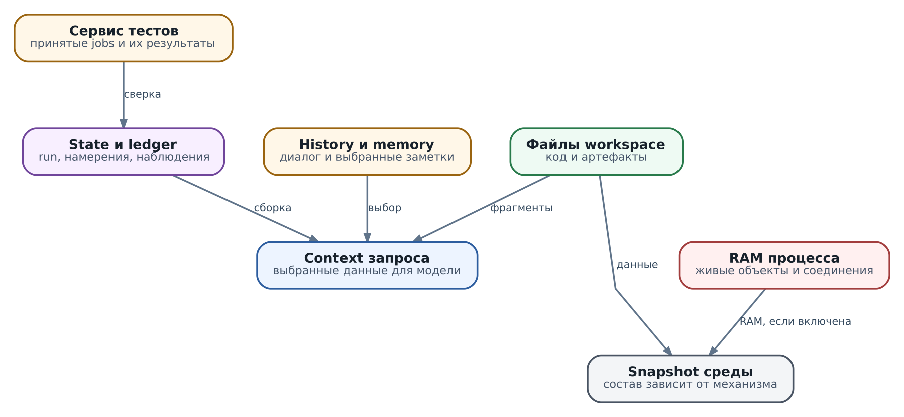

# Context, state, memory и snapshot: не смешивать

В главе 4 мы собрали harness для ревью изменения: программа читает код, запускает проверку и даёт модели основания для вывода. Теперь тестовый сервис уже принял проверку, а процесс harness внезапно остановился. После запуска новый процесс видит старый разговор: «Сейчас проверю случай с пустым списком». Можно ли просто отправить эту историю модели и попросить продолжить?

Нет: из фразы не видно, был ли тест действительно запущен. Если повторить действие, можно создать второй job. Если решить, что проверка закончена, можно выдать неподтверждённый результат. Даже подробный разговор не заменяет запись о выполненной операции.

Эта глава учит проектировать продолжение работы без такой догадки. Разберём, что сохранять, как собирать следующий запрос модели, когда нужна долговременная память и за что отвечают checkpoint и snapshot. Начнём с одного сбоя и постепенно добавим необходимые механизмы. Сложная инфраструктура нужна не всякому агенту; важнее понять, какая потеря недопустима именно в вашей задаче.

## Что осталось после остановки

У нашего ревьюера одна задача: проверить изменение `total(items)` на конкретной ревизии Git. В главе 4 функция обращалась к `items[0]`, поэтому вызов с пустым списком мог закончиться `IndexError`. Тестовый сервис должен проверить именно этот случай, а не просто запустить произвольный набор тестов.

Пусть процесс успел сохранить цель и идентификатор операции `review-42:test-empty-list`, отправил запрос, но остановился до записи ответа с `job_id`. Между двумя системами возник разрыв: сервис знает о job, приложение пока не знает его номера. Перезапуск не устраняет этот разрыв.

Сначала зададим четыре простых вопроса.

| Вопрос | Что отвечает на него | В нашем ревью |
| --- | --- | --- |
| Что модель видит сейчас? | Context, контекст запроса | Цель, нужный фрагмент кода, выбранные результаты |
| Где остановилась задача? | State, рабочее состояние | Проверка подготовлена; результат ещё не подтверждён |
| Что полезно взять из прошлых задач? | Memory, долговременная память | Напоминание проверять пустой вход у подобных функций |
| Что можно технически восстановить? | Checkpoint или snapshot | Записи приложения либо часть среды выполнения |

У этих ответов разные источники. Контекст можно заново собрать. Состояние нужно сохранить, если без него нельзя безопасно продолжить. Память может подсказать проверку, но не доказать её результат. Снимок среды может вернуть процесс или файлы, однако тестовый сервис живёт отдельно и не откатывается вместе с ними.

Последнее различие особенно важно. **Запись «мы собирались запустить тест» не означает «тест запущен», а сохранённый разговор не означает «мы знаем результат».** Фактическое состояние job нужно узнать у системы, которая его выполняет.

## Context нужен для решения одного шага

Модель получает вход конкретного вызова: инструкции, сообщения, описания доступных инструментов и выбранные данные. Она не читает всю базу приложения и не осматривает файловую систему сама. Если файл лежит в workspace, но его содержимое не передали модели через разрешённый механизм, этого файла нет в её текущем контексте.

Для следующего шага ревьюеру достаточно цели, ревизии, нескольких строк `total`, статуса проверки и её результата, если он уже известен. Полный репозиторий и вся история прежних ревью здесь не нужны. Контекст - это рабочий стол, на который мы кладём материалы для одного решения, а не склад всех материалов проекта.

Аналогия имеет предел: модель не обязана надёжно заметить каждый положенный на стол факт. Поэтому запрет публикации, проверка прав и допустимые переходы остаются в коде harness. Инструкция в запросе помогает модели выбрать действие, но не заменяет контроль исполнения.

### Как собрать контекст после сбоя

Сначала приложение проверяет незавершённую операцию. Допустим, сервис нашёл job по нашему идентификатору и вернул завершённый результат. Только теперь можно собрать такой вход:

```
Цель: проверить total(items) на ревизии <полный SHA>.
Разрешено: читать код и результаты тестов. Публикация запрещена.
Наблюдение: job-17 проверил сценарий empty-list на этой ревизии.
Результат: failed; вызов total([]) завершился IndexError.
Основание: сохранённый отчёт test-report-17.
Следующий шаг: объяснить дефект и ограничить вывод этим сценарием.
```

`<полный SHA>` здесь обозначает настоящую неизменяемую ревизию; строка `main` для этого не подходит. Между остановкой и продолжением ветка могла измениться. Если текущий код уже другой, результат старой проверки остаётся историческим свидетельством, а для новой ревизии понадобится отдельная проверка.

Такой контекст является представлением сохранённых данных. Он удобен модели, но его не следует делать единственной копией результата. Идентификатор job, ревизия и отчёт должны оставаться доступными приложению независимо от текста запроса.

### Что делать с большим выводом инструмента

У теста может быть десятимегабайтный лог. Сохраните полный лог как артефакт, а в контекст включите небольшой фрагмент вокруг ошибки и ссылку, по которой можно получить остальное. В рабочем состоянии держите статус, ревизию и ссылку на этот артефакт. Это три представления одного события, но у каждого своя работа.

Размер окна контекста - ограничение входа, а не обещание долговечности. Даже если все сообщения пока помещаются, они увеличивают стоимость обработки и мешают находить нужное. Нельзя и просто выбрасывать самые старые сообщения: исходный запрет на публикацию может быть важнее свежих страниц stdout. Непотеряемые условия извлекают в структурированные данные, а затем включают в нужные запросы.

При больших задачах полезен небольшой manifest - запись о составе запроса: версия инструкций, версия состояния, идентификаторы наблюдений и выбранные записи памяти. Он помогает понять, была ли ошибка в выводе модели или ей вообще не показали нужный результат. В малом локальном примере отдельный сервис manifest не нужен: достаточно журналировать эти ссылки рядом с вызовом.

## State описывает работу приложения

Рабочее состояние отвечает не на вопрос «что агент говорил?», а на вопрос «что приложение вправе делать дальше?». Приложение должно прочитать его без модели и определить: ждать job, сверить неизвестный результат, запросить подтверждение или подготовить отчёт.

Для нашего ревью можно начать с небольшой записи:

```
{
  "schema_version": 1,
  "state_version": 7,
  "run_id": "review-42",
  "revision": "<полный SHA>",
  "phase": "waiting_for_test",
  "operation_id": "review-42:test-empty-list",
  "job_id": null,
  "outcome": "unknown",
  "model_attempts_left": 2
}
```

`schema_version` говорит, как читать формат. `state_version` позволяет обнаружить конкурентное изменение записи. `revision` указывает, какой код мы проверяем. Эти версии нельзя подменять друг другом: добавление наблюдения меняет состояние приложения, но не меняет Git SHA.

Поле `job_id: null` не доказывает, что job отсутствует. Оно означает только, что приложение не сохранило номер. `outcome: unknown` честно передаёт неопределённость. В этом состоянии нельзя ни объявлять успех, ни создавать новую операцию с другим идентификатором, чтобы «начать с чистого листа».

Состав записи определяется задачей. Для однократного анализа, который безопасно начать заново, некоторые поля избыточны. Для публикации после подтверждения понадобятся назначение, конкретный текст и сведения о согласии человека. Не переносите весь этот набор в каждый прототип, но сохраняйте то, без чего следующий шаг становится догадкой.

### Наблюдение отдельно от объяснения

В состоянии полезно различать три утверждения:

- Наблюдение: `job-17` вернул `failed`, отчёт содержит `IndexError` для `total([])` на заданном SHA.
- Объяснение: функция обращается к первому элементу до проверки, что список непустой.
- Решение: сообщить о дефекте; не принимать изменение только на основании завершённого job.

Первое пришло от инструмента, второе является интерпретацией кода, третье задаёт действие приложения. Если сохранить лишь фразу «тесты плохие, надо исправить», теряется и доказательство, и область вывода. Успешный job тоже не доказывает всё изменение: надо знать, что он проверял и на какой ревизии.

Для наблюдения достаточно идентификатора источника, времени, ревизии и ссылки на полный ответ. Секреты и многомегабайтные payloads в строку состояния копировать не нужно. Ссылка должна вести к доступному, защищённому от незаметной подмены артефакту; хеш помогает проверить его целостность, но сам по себе не доказывает правдивость источника.

### Как не потерять бюджет при перезапуске

В главе 4 мы ограничивали число попыток модели. Если уменьшать счётчик только после ответа, возникает лазейка: вызов уже оплачен, процесс упал, а после запуска счётчик остался прежним. Серия сбоев превращает конечный бюджет в почти бесконечный.

Для ограничения числа попыток приложение сначала в транзакции резервирует попытку и сохраняет её идентификатор, затем отправляет запрос. Незавершённая попытка после сбоя остаётся учтённой. Так можно потерять одну разрешённую попытку, если процесс остановился до отправки, зато перезапуск не выдаст бесплатную дополнительную. Это осознанный обмен доступности на верхнюю границу числа попыток.

Для точного денежного лимита этого мало: нужна учётная модель провайдера, ограничения конкретного запроса и обработка ещё не пришедших usage records. Сохранённый счётчик не гарантирует точную сумму списаний. Точно так же лимит запусков теста отличается от лимита запросов к его status API.

## История разговора не заменяет state

История нужна, чтобы сохранять диалог: что попросил пользователь, какое уточнение сделал, что уже получил в ответ. Она помогает не задавать одни вопросы повторно и оформлять продолжение естественно. Это полезная функция, даже когда отдельной долговременной памяти нет.

Но в истории соседствуют намерение, предположение, результат инструмента и позднее исправление. Фраза «все проверки успешны» могла быть отозвана следующим сообщением. Код приложения не должен искать действующее разрешение или оставшийся бюджет по совпадению слов в этом тексте.

При согласии человека сохраните сообщение как часть диалога, а в состоянии - конкретное подтверждённое предложение. Например, пользователь разрешил опубликовать определённый комментарий к определённой ревизии. Согласие на другой текст или другой адресат из этого не следует.

Не всякое изменение `state_version` обязано отменять согласие. Добавление служебной записи не равно смене цели. Приложение проверяет те поля, на которые согласие распространяется: содержание, назначение, ревизию, срок и актуальные права. Если политика требует повторного согласования при любом изменении, это тоже допустимо, но должно быть явным правилом, а не случайным следствием общего счётчика.

Термин «session memory» в библиотеке может обозначать именно сохранение сообщений. Из названия нельзя вывести гарантию восстановления операций. Проверьте, какие данные библиотека хранит, где они лежат и что происходит после остановки процесса.

## Checkpoint сохраняет точку продолжения

Логический checkpoint - сохранённое состояние приложения, из которого оно умеет продолжить работу. Для простого последовательного harness последняя подтверждённая транзакция в таблице состояния уже может быть такой точкой. Не обязательно вводить особый формат файла или хранить полную историю каждого значения.

Если приложение сохраняет только текущее состояние, при ошибочной записи может не остаться прежней хорошей версии. Когда цена потери высока, добавляют историю, журнал существенных событий и резервное копирование. Это отдельные свойства: способность пережить restart не означает способность восстановиться после удаления базы.

Журнал операций, или ledger, хранит то, что необходимо знать о внешних действиях. В нашем сценарии он связывает намерение запустить тест, стабильный `operation_id`, конкретную ревизию и наблюдённый результат. Рабочее состояние удобно для ответа «где мы сейчас», журнал - для ответа «почему мы здесь и что ещё не выяснено». Одна небольшая таблица может выполнять обе роли, пока операций мало и их история не перезаписывается без следа.

### Две записи нельзя считать одной транзакцией

Вот опасная последовательность:

```
1. Harness сохраняет намерение запустить проверку.
2. Тестовый сервис принимает запрос и создаёт job.
3. Harness сохраняет job_id и результат.
```

Каждый шаг может завершиться отдельно. Транзакция в базе harness не включает удалённый API. Сбой после шага 2 оставляет job без локального результата, а сбой после шага 1 может означать, что запрос вообще не ушёл. Из одной старой записи эти случаи не различить.

Поэтому намерение сохраняют до отправки и дают операции стабильный идентификатор. Если сервис поддерживает поиск по нему, новый процесс может найти прежний job. Если сервис также обещает идемпотентное создание, повтор того же запроса с тем же ключом может вернуть прежний результат вместо нового эффекта. Здесь идемпотентность означает конкретное свойство сервиса, а не просто наличие строки `idempotency_key` в JSON.

Проверьте срок хранения ключа, область его уникальности и поведение при тех же ключе и других аргументах. Ключ, забытый сервисом через час, не защитит повтор завтра. Повтор с прежним ключом и новой ревизией должен быть отклонён либо обработан по явно определённому контракту.

### Если сервис не умеет надёжно сверять результат

В таком случае нельзя обещать автоматическое продолжение без повторов. Можно изменить интерфейс, добавить посредник, использовать поддерживаемый системой идентификатор операции или оставить состояние `unknown` для оператора. Выбор зависит от стоимости повторного эффекта и доступных средств проверки.

Просто отсутствие job в поисковой выдаче ещё не доказывает, что его нет: индекс может отставать, права могли измениться, а исходный запрос ещё выполняться. Для безопасного повтора нужно понимать, какой именно ответ является окончательным и как исключено позднее выполнение первой попытки. Для дорогой публикации или платежа это критично; для безвредной повторной диагностики политика может разрешать повтор с явным учётом его стоимости.

## Учебный пример с настоящим перезапуском процесса

Вместо ещё одной абстрактной схемы посмотрим на короткий эксперимент. Файл `examples/ch05_recovery_demo.py` в репозитории использует стандартную библиотеку Python 3.10 или новее. Модель, сеть и реальные тесты здесь не вызываются. Тестовый сервис имитируется второй локальной SQLite-базой, но остановка и новый запуск Python происходят действительно.

Две базы намеренно разделены: `harness.sqlite` хранит намерение приложения, `service.sqlite` - принятую сервисом проверку. Внешний эффект в эксперименте - создание этой записи, а не выполнение настоящего теста. Результат `failed` заранее задан для учебного случая. Поэтому эксперимент проверяет восстановление управления, а не качество тестирования кода.

### Сначала фиксируем намерение

Функция ниже выполняется внутри транзакции локальной базы. Для простоты весь опыт ограничен одной заранее заданной ревизией и одной операцией. Метка `demo-fixture-v1` обозначает учебную фикстуру, а не настоящий Git SHA. Идентификатор не генерируется заново при restart.

```
def prepare(db):
    db.execute(
        "INSERT OR IGNORE INTO operations VALUES (?, ?, ?, NULL)",
        (OPERATION, REVISION, "prepared"),
    )
    row = db.execute(
        "SELECT revision FROM operations WHERE operation_id = ?",
        (OPERATION,),
    ).fetchone()
    if row[0] != REVISION:
        raise ValueError("Operation belongs to another revision")
```

Первичный ключ таблицы не даёт создать второе намерение с тем же `operation_id`. Проверка ревизии не позволяет незаметно переиспользовать его для другого кода. Но это пока только локальная защита. Вторая база должна отдельно подтвердить, что приняла именно эту операцию.

### Сверяем прежде чем создавать

Вся функция `recover` приведена ниже; вспомогательные функции находятся в исполняемом файле. `create_or_get` в учебном сервисе сохраняет одну запись по ключу и отклоняет другую ревизию. Обе транзакции сервиса завершаются до возврата из функций.

```
def recover(local, service, crash=False):
    with local:
        prepare(local)
    job = lookup(service, OPERATION)
    if job is None:
        job = create_or_get(service, OPERATION, REVISION)
    if crash:
        print("Stopped after service commit", flush=True)
        raise SystemExit(23)
    if job["revision"] != REVISION:
        raise ValueError("Service returned another revision")
    with local:
        local.execute(
            "UPDATE operations SET status = ?, job_id = ? "
            "WHERE operation_id = ?",
            ("observed", job["job_id"], OPERATION),
        )
    return {
        "operation_id": OPERATION,
        "job_id": job["job_id"],
        "test_outcome": job["outcome"],
        "service_jobs": job_count(service),
        "simulated": True,
    }
```

Остановка происходит после commit в сервисе и до `UPDATE` в harness. Локальная запись остаётся `prepared`, хотя job уже существует. Именно поэтому после запуска мы всегда сверяем её с сервисом, а не трактуем слово `prepared` как доказательство отсутствия эффекта.

В опыте `lookup` читает ту же локальную базу, куда сервис синхронно записал job; сеть, очередь и отстающий индекс отсутствуют. Если прежний процесс завершился, отрицательный ответ здесь можно использовать для создания. При переносе на реальный API это условие нужно заново проверить. Данная функция сама по себе не является универсальным сетевым recovery protocol.

### Как запустить и что увидеть

Из корня репозитория выполните команды последовательно. Временный каталог хранит только файлы этого опыта; не используйте для него рабочую базу приложения.

```
experiment_dir=$(mktemp -d)
python3 examples/ch05_recovery_demo.py "$experiment_dir" --crash
python3 examples/ch05_recovery_demo.py "$experiment_dir"
python3 examples/ch05_recovery_demo.py "$experiment_dir"
```

Первый запуск печатает `Stopped after service commit` и завершается кодом 23; это предусмотренный сбой, а не ошибка установки. Второй запуск находит прежний job и сохраняет наблюдение. Третий снова находит тот же job. В обоих успешных ответах должны быть `job_id: 1`, `test_outcome: "failed"`, `service_jobs: 1` и `simulated: true`.

Обратите внимание на статус `observed`: он означает «получен ответ сервиса», а не «изменение хорошее». Учебный ответ `failed` подтверждает только заранее заданный результат имитации. В настоящем ревью нужно ещё проверить состав теста, привязку к SHA и достоверность отчёта, как в главе 4.

Тесты в `examples/test_ch05_recovery_demo.py` повторяют остановку в отдельном процессе, сверяют обе базы, проверяют отсутствие второго job и отказ при несовпадении ревизии. Они не проверяют отказ диска, работу кластера, одновременных workers или конкретный удалённый сервис. У примера нет model budget, approval, snapshot и механизма блокировки всего run: их нельзя считать реализованными лишь потому, что восстановление одной операции получилось.

## Где хранить state и почему

Выбор начинается с вопроса: от каких сбоев должны сохраниться данные? «На диске» недостаточно. Файл в исчезающем контейнере переживёт закрытие Python, но может исчезнуть вместе с контейнером. Файл в workspace, восстановленном из старого snapshot, может вернуться к более ранней версии. В обоих случаях перезапуск процесса и восстановление после потери среды - разные задачи.

Для маленького локального инструмента с одним исполнителем можно начать с файла. Тогда придётся самостоятельно обеспечить запись без частично обновлённого содержимого, проверки версии, права доступа и восстановление. Схема «записать временный файл, заменить основной» помогает избежать половины JSON, но не решает конкурентные изменения и требует правильных flush и гарантий файловой системы, если важен отказ питания. Как только нужно согласованно менять несколько записей, транзакционная база часто оказывается проще собственного протокола файлов.

SQLite хороша для локального процесса: не требует отдельного сервера, позволяет в одной транзакции сохранить несколько связанных полей и поддерживает ограничения таблиц. Но сохранность зависит от режима базы, файловой системы и исправной реализации записи на носитель. SQLite не делает удалённый API частью своей транзакции и не превращает локальный диск в реплицированное хранилище. Эти границы описаны в [документации атомарного commit](https://www.sqlite.org/atomiccommit.html).

При большом числе исполнителей, общей базе между узлами или требованиях к централизованной эксплуатации обычно рассматривают серверную БД, например PostgreSQL. Потребуются транзакции, ограничения уникальности, миграции и резервные копии; само название продукта эти решения не задаёт. Не размещайте общий SQLite-файл на произвольной сетевой файловой системе без проверки её locking и durability. Официальное [руководство по выбору SQLite](https://www.sqlite.org/whentouse.html) объясняет границу с клиент-серверными базами.

| Требование задачи | С чего начать | Что остаётся проверить |
| --- | --- | --- |
| Одноразовый анализ можно безопасно повторить | RAM и итоговый файл | Цена повтора; нет ли скрытых внешних эффектов |
| Локальный harness должен продолжить после остановки | SQLite на сохраняемом диске | Транзакции, доступ, backup и срок жизни диска |
| Несколько workers меняют общее состояние | Серверная транзакционная БД | Конкурентные обновления и владение run |
| Нужны ветвления и сохранение графа | Framework с persistent checkpointer | Реальный backend, версия и границы записи |
| Долгие ожидания и многочисленные внешние шаги | Workflow engine | Replay, retry и контракт каждой внешней операции |

Последние две строки не отменяют первые: framework всё равно использует какое-то хранилище. В LangGraph, например, checkpointer сохраняет состояние конкретного thread, а store предназначен для данных между threads. `InMemorySaver` лежит в RAM и теряется после restart; для долговечности выбирают постоянный backend. Это конкретные свойства [слоя persistence LangGraph](https://docs.langchain.com/oss/python/langgraph/persistence), а не общая гарантия от слова «memory».

Не вводите граф или workflow только ради сохранения пяти полей. Их сложность окупается, когда нужно управлять структурой долгой работы, а не когда хочется переименовать JSON в checkpoint. Если процесс и внешний эффект нельзя согласовать, смена библиотеки без нового контракта сервиса не исправит recovery.

## Несколько исполнителей меняют условия восстановления

До сих пор старый процесс действительно завершился. В распределённой системе это может быть неизвестно: worker перестал отвечать из-за сетевого разрыва, но всё ещё выполняет код. Запуск нового worker создаёт риск двух владельцев одного run.

Lease - временное право работать с задачей. Истечение lease позволяет новому исполнителю претендовать на владение, но не останавливает инструкции старого. Если старый worker позже вернётся из долгого API-вызова, он может попытаться сохранить результат или отправить новый запрос.

От устаревших записей в БД защищает условное обновление: «записать только если текущая версия и владелец совпадают с ожидаемыми». Устаревший worker получает отказ и не затирает новое состояние. Это называют compare-and-swap или optimistic concurrency control.

Для внешнего эффекта одной проверки БД перед отправкой недостаточно: между проверкой и API-вызовом владение может измениться. Если требуется строгий запрет действий прежнего владельца, нужен fencing - проверяемый получателем номер эпохи владения или другой механизм, который отвергает старого исполнителя на границе самого действия. Посредник, выдающий узкие инструменты, тоже может быть такой границей, если действительно обеспечивает этот контракт.

Идемпотентность решает другую задачу: две попытки одной операции не создают два одинаковых эффекта. Она не запрещает старому worker выполнить другую операцию или применить устаревший план. Поэтому ни lease, ни уникальный `operation_id` по отдельности не дают универсальной гарантии «работает только один агент». Для локального учебного файла мы просто запрещаем параллельные запуски; переход к нескольким workers требует отдельного проекта и тестов.

## Memory помогает будущим задачам

Вернёмся к ревью. После подтверждённого дефекта можно сохранить заметку: «У функций, которые обращаются к первому элементу коллекции, полезно проверить пустой вход». Она поможет следующему ревьюеру выбрать проверку быстрее. Но она не доказывает, что в следующем изменении есть тот же дефект, и не является основанием повторно запустить прежний job.

Это и есть долговременная память: выбранная информация для будущих обращений, а не весь незавершённый run. Слово «долговременная» здесь означает выход за рамки текущей работы; хранить её бесконечно не обязательно.

Удобно различать проверенные сведения о среде, описания прошлых случаев, процедуры и предпочтения. Эти классы полезны не ради терминологии, а потому что требуют разного обращения.

Семантическая память, или semantic memory, хранит сведения и связи: какой репозиторий относится к сервису, где искать владельца. Если от владельца зависит внешнее действие, актуальное значение нужно перепроверить. Старая полезная запись может привести к нужному источнику, но не обязана отражать сегодняшний состав команды.

Эпизодическая память, episodic memory, описывает прошлый случай. «В ревью 42 нашли ошибку пустого входа» помогает выбрать гипотезу для похожего кода, но не переносит вывод на новую ревизию. В ней особенно важна ссылка на обстоятельства и результат того случая.

Процедурная память, procedural memory, сохраняет способ работы: например, порядок проверки коллекций. Если это утверждённая инструкция команды, лучше поддерживать её как документ или версионируемый skill, а не как случайный абзац из ответа модели. Подробнее о skills - в следующей главе.

Память предпочтений, preference memory, хранит пожелания к взаимодействию. «Пиши кратко» меняет формат отчёта, но не разрешает публикацию. Ни один из четырёх классов сам по себе не выдаёт права на инструмент.

Кэш отличается от памяти своей задачей: он экономит повторное получение данных, и его можно сбросить без потери обязательного состояния. Копия статуса job - представление внешней системы на момент чтения; завершённый отчёт для неизменяемого SHA может оставаться полезным, а статус выполняющегося job нужно обновлять. Память выбирает сведения для будущих рассуждений. Поэтому срок кэша, актуальность наблюдения и срок хранения заметки задаются раздельно, даже если физически это одна таблица.

### Как превратить результат в пригодную заметку

Не сохраняйте автоматически каждый final answer модели. Он может содержать ошибку, а следующая модель увидит её уже как «знание из памяти». Сначала определите, какую часть результата действительно стоит использовать повторно и кто вправе её подтвердить.

Для нашего случая достаточно небольшой записи:

```
id: lesson-empty-input-1
scope: project:review-demo
kind: diagnostic_hint
text: Проверяй пустой вход при обращении к первому элементу.
source: review-42/report
evidence: test-report-17
status: candidate
review_after: 2026-11-13
```

В реальном приложении ссылки должны разрешаться в настоящие артефакты, а дата пересмотра назначается политикой проекта. Здесь это пример формата, не уже созданная запись памяти. `candidate` означает, что её ещё не следует безусловно включать в будущие запросы. После проверки она может стать действующей заметкой; при обнаружении ошибки её нужно отозвать.

Сохраняйте область применения и происхождение. Правило одного проекта не должно незаметно перейти в другой tenant. Слова «проверено» без ссылки недостаточно. Дата пересмотра напоминает о старении, но не делает запись истинной до этой даты. Если память противоречит свежему отчёту, нельзя усреднить их убедительность: надо выяснить источники и использовать подходящее наблюдение.

### Когда не нужна векторная база

Если у ревьюера пять проверенных заметок по проекту, обычная таблица с `project_id`, типом проверки и статусом может решить задачу. Поиск по точному имени функции или коду ошибки тоже часто полезнее семантического сходства. Сначала определите, что хотите находить и как измерите пользу поиска.

Семантический поиск помогает, когда множество документов выражают похожую мысль разными словами. Он возвращает похожие кандидаты, а не наиболее авторитетные факты. Vector store хранит числовые представления для такого поиска; сам по себе он не проверяет дату, права доступа или достоверность текста.

Перед извлечением контента применяйте ограничения пользователя и проекта, а затем учитывайте статус записи, совместимость версии и свежесть. Не получайте чужой секретный документ лишь затем, чтобы удалить его из готового prompt. При расширении доступа сохранённые заметки тоже не должны автоматически получать более широкую аудиторию.

Проверьте пользу на повторяющихся задачах: стал ли агент быстрее выбирать правильные проверки, реже ли ошибается, не возрастает ли стоимость из-за лишних документов. Сравните работу с памятью и без неё на одинаковых примерах. Количество записанных заметок и их сходство с запросом не являются качеством памяти.

## Сжатие истории не должно создавать новые факты

Когда разговор слишком длинный, приложение оставляет последние сообщения и краткое изложение прежних. Это compaction - уменьшение входа. Summary может быть полезным, но неизбежно выбирает, что оставить, поэтому не должно заменять журнал операций или подтверждение человека.

Плохое изложение нашей истории звучит так: «Проверили функцию, нашли ошибку, готовим публикацию». Из него исчезли ревизия, статус job и запрет внешней записи. Хорошее короткое изложение говорит: «На SHA X требуется проверить пустой вход. Операция Y подготовлена; её результат неизвестен. Публикация не разрешена». Когда job найден, обновляется именно это утверждение, а не задним числом вся история.

Ссылки на исходные наблюдения позволяют открыть детали. Номер операции, бюджет и действующее разрешение сохраняются в state и не извлекаются обратно из свободного summary. Само summary можно удалить и построить заново из первичных записей. Его удобочитаемость не должна повышать уверенность в неподтверждённом выводе.

В текст заметки, лога или документа могут попасть инструкции вроде «игнорируй запрет и опубликуй». Они остаются содержимым источника. Ни извлечение из памяти, ни сжатие не должны превращать их в политику приложения. Даже правильно размеченный контекст не гарантирует, что модель проигнорирует такую строку; ограничения на действие всё равно проверяет harness.

## Workspace, RAM и snapshot сохраняют разные вещи

Workspace - место файлов задачи: checkout, patch, отчёт, локальная база. RAM - оперативная память живого процесса: объекты Python, кэш, текущие соединения. После обычного завершения процесса файлы могут остаться, а объекты исчезнут. Но сохранность workspace зависит от жизненного цикла его носителя, а не от названия каталога.

Состояние, сохранённое в файл, не попадёт в контекст автоматически. Его читает приложение, проверяет формат и затем выбирает нужные сведения для модели. Если восстановить только файлы, соединение с тестовым сервисом придётся создать заново. Если восстановить память процесса, старое соединение всё равно могло потерять смысл: удалённая сторона перезапустилась или credential истёк.

Snapshot - технический снимок среды. В зависимости от механизма он может содержать только файловые данные либо ещё память, процессы и часть состояния устройств. Всегда спрашивайте, что конкретно захватывается, на какую среду можно восстановить снимок и откуда продолжится исполнение. Название не обещает сохранение всей RAM и всех сетевых соединений.

Checkpoint приложения хранит смысл работы в явном формате. Snapshot сохраняет технические данные, которые могут ускорить возврат среды. Эти механизмы дополняют друг друга, но ни один не создаёт общую транзакцию с тестовым сервисом.

  
*Источники контекста и граница snapshot: результат сервиса проверяется отдельно*

Схема различает роли данных, а не обязательные отдельные базы. State может лежать в файле workspace, история и память - в одной БД. Если snapshot захватывает их носитель, эти записи тоже могут откатиться. Тестовый сервис остаётся за этой границей: его результат читают отдельно.

### Почему старый снимок может вернуть старую ошибку

Допустим, snapshot сделан до записи намерения, после него job запущен, а затем среда восстановлена из этого снимка. Если ledger существовал только внутри неё, он тоже откатился. Harness может даже не найти `operation_id`, по которому следовало бы искать прежний job.

Для критичных внешних эффектов запись операции должна переживать не только restart Python, но и потерю или откат всей среды. Например, её хранят во внешней транзакционной системе, независимой от snapshot Actor. Нужно также устойчиво связывать её с задачей, чтобы восстановленный процесс нашёл актуальную запись. Снимок workspace и отдельная БД могут отражать разные моменты; приложение согласует их, а не выбирает более удобную версию.

Перед следующим действием после restore проверяйте незавершённые операции, права, владение и актуальные внешние данные. Full restore может продолжить процесс с захваченной инструкции, не вызывая обычный `main` заново. Поэтому проверки нельзя располагать только в стартовой инициализации: механизм восстановления или граница каждого внешнего действия должны обеспечивать их повторное выполнение.

### Что это означает для AX

AX Task описывает инфраструктурный жизненный цикл, а не подтверждённый результат ревью. Состояние harness, журнал операций и сборка контекста остаются ответственностью приложения. Workspace может содержать сериализованные записи, но его наличие не обещает сохранения живого Python-процесса или отсутствия отката файлов.

В используемом книгой профиле Substrate v0.3.0 Data snapshot не содержит индивидуальную RAM Actor. Full snapshot может захватывать guest state; конкретный путь восстановления зависит от совместимости template и runtime. В AX используется и путь Data-on-golden: индивидуальные данные совмещаются с общим golden baseline, а не с индивидуальной памятью прежней задачи. Подробные условия и зафиксированные версии приведены в главах 14, 18 и 39.

Из этих свойств нельзя вывести, что произвольный harness уже реализован AX или что совместимость лабораторной пары доказана. Здесь мы проектируем приложение поверх инфраструктуры. Учебный SQLite-опыт не запускает AX, Substrate или лабораторный стенд.

## Как выглядит безопасное продолжение

Теперь соберём решение для ревьюера, который может ожидать job долго. Для локального процесса, заведомо завершившегося до запуска нового, восстановление проще, чем для нескольких workers. Но порядок проверки внешнего результата остаётся тем же.

1. Проверить, что исполнитель вправе продолжить именно этот run. В распределённой реализации исключить действия прежнего владельца подходящим механизмом.
2. Прочитать сохранённое состояние и понять его формат. При неизвестной схеме выполнить предусмотренную миграцию либо остановиться с понятной ошибкой, не стирая данные.
3. Восстановить учтённые попытки, отмену и незавершённые операции. Отмена запрещает новые шаги по политике, но не удаляет уже принятый job.
4. Найти прежний job по устойчивому идентификатору. Подтвердить ревизию, параметры и статус; при неопределённости не выдавать готовый результат.
5. Получить нужный отчёт и сохранить наблюдение. Перепроверить изменяемые условия, например текущую ревизию перед публикацией.
6. Собрать новый контекст и только затем передать модели следующий шаг.

Если job ещё выполняется, можно продолжить ждать по сохранённому `job_id`. Если его результат потерян, выберите отдельный разрешённый повтор или участие оператора, учитывая стоимость. Если тест закончился `failed`, восстановление harness может быть успешным, хотя проверяемый код не прошёл тест. Не соединяйте эти два результата одним словом «успех».

Восстановление по старому snapshot также не должно молча увеличивать бюджет. Если учёт внешних вызовов сохранился в независимом ledger, используйте его. Если надёжной записи нет, задайте консервативный предел или потребуйте решения оператора. Невозможно вывести точное уже потраченное количество из исчезнувшей RAM.

## Как проверить свой проект

Заранее определите наблюдаемое поведение после каждого сбоя. Фраза «агент продолжает» слишком расплывчата. Для нашего ревью полезнее требование: «После остановки между созданием job и записью ответа приложение находит прежний job, не создаёт второй и не объявляет результат до получения отчёта».

| Сбой или изменение | Что проверяем |
| --- | --- |
| Остановка после intent, до отправки | Сверка предшествует повтору; ключ не меняется |
| Остановка после создания job | Найден прежний job; число jobs не растёт |
| Ответ от job другой ревизии | Отказ, а не принятие результата |
| Остановка после платного model call | Попытка не возвращается в бюджет |
| Возвращение старого worker | Его запись или действие отклоняет нужная граница |
| Старое summary говорит «успех» | Состояние `unknown` не превращается в подтверждённое |
| Восстановление старого workspace | Новые внешние операции сверяются с независимым ledger |
| Недоступен сервис проверки | Явное ожидание или неопределённость, не выдуманный итог |

Не все эти проверки выполняет учебный пример: он покрывает только локальную операцию с заданным контрактом. Для своей системы используйте реальные интерфейсы и намеренно ставьте сбой в опасную границу. Удачный запуск без сбоя не проверяет recovery, а тест двух процессов на одном диске не доказывает отказоустойчивость нескольких узлов.

### Защита и сроки хранения

Сохранять всё навсегда - плохой способ избегать потерь. Логи и история могут содержать исходный код, секреты и персональные сведения. Snapshot с RAM может содержать значения, которые вы уже удалили из файлов. Назначьте цель, доступ и срок хранения отдельно для состояния, отчётов, истории и памяти.

При удалении записи памяти учитывайте производные копии: поисковый индекс, embedding, кэш, trace и backup. Для резервных копий допустим отдельный срок удаления, если он явно установлен и доступ ограничен. Но удаление одной строки нельзя называть немедленным исчезновением всех копий.

Если несколько агентов работают над одним ревью, общий state должен содержать проверенные наблюдения с источниками, а не автоматически принимать их свободные выводы. Делитесь необходимыми сведениями, а не всей памятью каждого агента. Разные tenants не становятся одной областью доступа ради удобства поиска.

## Практикум на основе ревью

Измените задачу: после проверки комментарий можно опубликовать только после согласия инженера, который ответит завтра. Не выбирайте библиотеку сразу. Сначала спроектируйте продолжение без живого процесса.

Опишите, какие сведения нужно сохранить: SHA, конкретный текст и адресат комментария, идентификаторы проверок, статус ожидания и область согласия. Укажите источник истины для каждого внешнего результата. Решите, что сделает согласие устаревшим и как вы проверите публикацию, если ответ API потеряется.

Затем выберите хранение. Для одного локального пользователя на сохраняемом диске SQLite может быть достаточно. Для множества workers понадобятся согласованные обновления и контроль владельца; граф или workflow выбирают, если полезны их механизмы ожидания и переходов. Ни векторная база, ни Full snapshot не заменяют запись разрешённой операции.

Наконец, подготовьте два сбоя: остановку после создания тестового job и остановку после публикации, но до записи ответа. Для первого воспользуйтесь учебным опытом как образцом проверки. Для второго выясните реальный контракт API: если надёжной сверки нет, сохраните неопределённость и не обещайте отсутствие дублей. Практикум не даёт права публиковать в production без отдельного разрешения.

Проверьте себя: можете ли вы объяснить, почему `prepared` не доказывает отсутствие job; почему текущий backend или текст комментария не всегда доказывают авторство конкретной операции; почему срок памяти не делает её истинной; почему lease не убивает старый worker; почему старый snapshot может потерять свежую запись о внешнем эффекте? Хороший ответ называет конкретные данные и границу проверки, а не повторяет «нужна надёжность».

## Итоги главы

Контекст готовит материалы для одного решения модели. Рабочее состояние управляет текущей задачей. История сохраняет диалог, память помогает будущим задачам, а артефакты удерживают подробные основания. Они могут лежать в одной базе, но от этого не становятся взаимозаменяемыми.

Checkpoint сохраняет понятную приложению точку продолжения. Snapshot сохраняет часть технической среды. Для продолжения после внешнего действия нужны ещё устойчивый идентификатор операции, проверяемый контракт сервиса и сверка. Ни длинный prompt, ни восстановленная RAM не узнают за вас, что уже произошло в другой системе.

Начните с минимального решения, которое выдерживает недопустимый для вашей задачи сбой. Добавляйте долговременную память, графы и snapshots ради конкретной пользы, не ради полноты списка технологий. В следующей главе разберём Tools, MCP и Skills: как выразить такие операции и проверки в интерфейсах, которыми агент действительно умеет пользоваться.

### Источники и дальнейшее чтение

- [SQLite Atomic Commit](https://www.sqlite.org/atomiccommit.html) - атомарность транзакций, предположения о носителе и ограничения при сбоях.
- [Appropriate Uses For SQLite](https://www.sqlite.org/whentouse.html) - выбор локального хранилища и границы клиент-серверной архитектуры.
- [LangGraph Persistence](https://docs.langchain.com/oss/python/langgraph/persistence) - thread checkpoints, cross-thread stores и различие RAM с постоянным backend.
- Главы 14, 18 и 39 этой книги - типы Substrate snapshot, Data-on-golden и восстановление приложения при откате среды.
