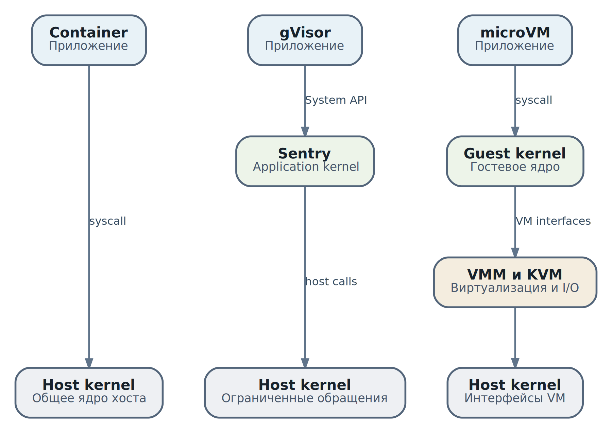

# От Linux process к gVisor и microVM

В главе 7 мы разделили ревью между участниками и проверили, что их ответы относятся к одной ревизии. Все участники читали заранее подготовленные материалы. Теперь ревьюер хочет сам запустить `test_empty_list` для функции `total(items)`. Это выглядит как небольшой шаг: вместо чтения отчёта `job-42` получить новый отчёт. Но для платформы меняется самое важное - она начинает исполнять код, который не контролирует.

Внешний pull request способен изменить не только функцию. В нём могут быть тест, который читает переменные окружения, сборочный плагин, запускающий дополнительную программу, или зависимость с установочным скриптом. Нам не нужно заранее угадать, какой файл опасен. Окружение должно оставаться ограниченным даже в предположении, что выполняемая программа действует против нас.

Здесь и появляется sandbox, или изолированная среда исполнения. Это не просто каталог для временных файлов и не просьба к агенту вести себя осторожно. Это набор механизмов, которые ограничивают доступ выполняемого кода к системе. Разделение ролей отвечает на вопрос «кто должен делать работу». Изоляция отвечает на другой: «что этот исполнитель сможет сделать, если перестанет соблюдать договорённость».

В этой главе разберём, как работают процесс, контейнер, gVisor и microVM; почему они дают разные границы; как выбрать подходящий вариант для проверки чужого кода. Затем превратим выбор в проверяемый план и отделим его от доказательства, что ограничения действительно применены.

## Что инженер должен уметь после главы

- Объяснить, почему новый процесс, отдельный worktree и другой prompt сами по себе не защищают секреты.
- Различить упаковку программы, ограничение доступа, изоляцию ядра и ограничение ресурсов.
- Проследить, какое ядро обслуживает системные вызовы в контейнере, gVisor и microVM.
- Выбрать среду по доверию к коду, требуемым возможностям и допустимым последствиям сбоя.
- Спроектировать запуск тестов без credentials координатора и без права менять Git remote.
- Проверить отдельно план запуска, совместимость инструментов, применение ограничений и завершение среды.

## Сначала решаем от кого и что защищаем

Threat model, или модель угроз, описывает возможности предполагаемого нарушителя, защищаемые данные и недопустимый результат. Она нужна до выбора runtime - программы, которая создаёт среду и управляет её жизненным циклом. Иначе мы сравниваем названия, не понимая, какую проблему они должны решить.

Для нашего ревьюера примем конкретное предположение: автор внешнего PR может менять исходники, тесты и сборочные настройки. После запуска тестов он способен выполнить произвольный код внутри предоставленного окружения. Это не обвинение автору PR, а консервативная граница проектирования. Добросовестная ошибка в зависимости тоже может привести к нежелательному выполнению.

Защитить нужно credentials координатора, файлы хоста, данные соседней задачи и доступ к управлению платформой. Не менее важно не позволить одному тесту занять всю память или оставить работающие процессы после отмены. При этом сам исходный код PR доступен тестировщику намеренно: скрывать от исполнителя его собственный вход бессмысленно.

Контракт можно сформулировать так:

```
Внешний код может полностью управлять своей программой,
но не получает секреты координатора, данные соседей,
управляющие sockets или доступ к API платформы.
Запись разрешена только во временную рабочую область.
Исполнение ограничено ресурсами и сроком завершения.
```

Теперь видны разные виды ущерба. Чтение ключа - потеря конфиденциальности. Изменение чужого workspace - нарушение целостности. Заполнение диска node - отказ доступности. Один механизм редко закрывает все три. Даже идеальная защита от выхода из sandbox не поможет, если ключ уже передан внутрь как переменная окружения.

У threat model есть и предел. В этой главе не строим защиту от администратора хоста, который контролирует runtime и storage. Не доказываем отсутствие аппаратных побочных каналов. Если задача требует защищать данные и от владельца инфраструктуры, нужна отдельная модель и другие средства; слово microVM само по себе это требование не выполняет.

## Четыре разных слоя окружения

Представим закрытую мастерскую. Отдельное помещение ограничивает доступ к соседям, список разрешённых инструментов - действия работника, лимит электричества - расход ресурсов, а ящик с оборудованием позволяет повторить настройку. Аналогия полезна только до этого места: в Linux границы задаёт код системы, и ошибки в нём тоже входят в модель угроз.

В инженерном решении этим четырём задачам соответствуют изоляция, полномочия, ресурсы и упаковка. **Образ контейнера** упаковывает программу, библиотеки и файлы. **Граница исполнения** отделяет процесс от хоста или соседа. **Политика доступа** разрешает определённые файлы, сеть и операции. **Ограничения ресурсов** задают память, процессор, процессы, storage и время.

Смена образа может улучшить воспроизводимость, не усилив изоляцию. Добавление memory limit может защитить доступность, не скрыв ни одного файла. Выбор microVM меняет путь взаимодействия с ядром, но не отбирает токен, который приложение положило в гостевую систему. Поэтому вопрос «у нас есть sandbox?» лучше разложить: какая именно граница создана, какие интерфейсы доступны и чем каждый запрет обеспечивается.

## Процесс и рабочий каталог

### Что действительно отделяет обычный процесс

У обычного процесса есть собственное виртуальное адресное пространство. Программа не читает память соседнего процесса обычным обращением к указателю. Но процессы продолжают пользоваться одним ядром; их доступ к файлам и другим объектам зависит от прав, настроек системы и открытых дескрипторов, а не от того, что PID различаются.

Если координатор и тестировщик работают под одним пользователем, тестировщик может иметь те же права на домашний каталог, конфигурацию и credentials. Доступ через `/proc`, сигналы и отладочные интерфейсы дополнительно зависит от правил хоста. Не нужно обещать, что любое такое действие всегда возможно: достаточно того, что отдельный PID не создаёт отдельный домен доверия.

Обычный процесс подходит, например, для собственного адаптера модели, который не загружает внешние плагины. Для него можно выбрать отдельного пользователя, сократить права и управлять завершением через service manager. Это полезная защита. Но запуск внешних тестов рядом с секретами координатора - другой сценарий, а не та же программа с ещё одним аргументом.

### Почему worktree и cwd не являются sandbox

Рабочий каталог `cwd` задаёт начальную точку для относительных путей. Он не запрещает абсолютный путь и не ограничивает доступ к `../`. `chdir()` меняет каталог, а не права процесса. Отдельный Git worktree разделяет рабочие файлы ревьюеров, но не отделяет системного пользователя, сеть и credentials. Это средства организации работы, не достаточная защита от чужой программы. [Linux chdir](https://man7.org/linux/man-pages/man2/chdir.2.html)

Здесь полезно вернуться к главе 7. Один владелец записи и разные worktrees помогают не потерять правки из-за конкуренции. Они не мешают злонамеренному тесту открыть чужой файл, если ОС разрешает чтение. Нельзя переносить гарантию логической координации на физическое исполнение.

## Контейнер меняет вид системы но сохраняет ядро

Обычный Linux-контейнер запускает процессы на ядре хоста. Runtime собирает для них отдельное представление некоторых системных объектов и ограничения доступа. Образ OCI отвечает за переносимую упаковку; конкретное исполнение зависит от runtime и настроек. Поэтому «образ проверен» и «программа изолирована» - разные утверждения.

### Namespaces определяют какие объекты видит процесс

Namespace - пространство имён для определённого класса объектов ядра. PID namespace меняет видимость и нумерацию процессов. Mount namespace задаёт дерево монтирования. Network namespace даёт своё представление сетевых интерфейсов и маршрутов. User namespace позволяет отображать пользователей внутри окружения в другие UID и GID снаружи. [Linux namespaces](https://man7.org/linux/man-pages/man7/namespaces.7.html)

Почему это полезно для ревью? Тестировщик может видеть только свой workspace вместо всего дерева файлов, не видеть процессы координатора и иметь отдельную сетевую конфигурацию. Но наличие namespace ещё не говорит, насколько узким получилось окружение. Если администратор намеренно примонтировал домашний каталог координатора, mount namespace честно покажет этот каталог. Изоляция не отменяет явно выданный доступ.

Отдельная сеть тоже не означает отсутствие Интернета. Через неё можно настроить обычный исходящий маршрут. Условия доступа задаёт сетевой контроль, а не само появление другого namespace.

### cgroups распределяют ресурсы

Control groups, обычно cgroups, объединяют процессы для учёта и ограничения ресурсов. Например, можно ограничить память, долю CPU и число процессов. Если тест создаёт потомков, соответствующие ограничения должны распространяться на всю группу исполнения, а не только на первоначальный PID. [Linux cgroup v2](https://docs.kernel.org/admin-guide/cgroup-v2.html)

Ресурсный лимит нужен и при добросовестном коде. Ошибка, которая создаёт бесконечный список, способна вытеснить полезные задачи. Однако CPU limit не запрещает читать секреты, а PID limit не проверяет полномочия инструмента. Лимиты защищают определённый ресурс, не превращая программу в доверенную.

Кроме того, CPU quota не задаёт срок завершения. Медленный процесс может бесконечно исполняться с малой долей CPU. Для него нужен deadline - крайний срок, после которого платформа прекращает выполнение и проверяет остановку. Лимит storage тоже проектируют отдельно от memory limit: дисковая запись и память - разные ресурсы.

### Capabilities seccomp и LSM ограничивают действия

Linux capabilities разделяют традиционные полномочия root на отдельные возможности. Для нашего теста большая часть административных возможностей не нужна. Но `CAP_SYS_ADMIN` покрывает широкий круг действий; выдавать её «на всякий случай» - не узкое исключение.

Seccomp фильтрует системные вызовы. System call, или syscall, - обращение программы к ядру: например, открыть файл, создать процесс или настроить отображение памяти. Фильтр может отклонить ненужный вызов и уменьшить доступную поверхность ядра. Он не понимает, зачем агент открывает файл, и не заменяет политику всей среды. Фильтры не разыменовывают указатели, поэтому нельзя считать обычный seccomp полноценным правилом «разрешить open только для этого пути». Документация ядра прямо отделяет filtering от полного sandbox. [Linux seccomp](https://docs.kernel.org/userspace-api/seccomp_filter.html)

AppArmor и SELinux относятся к Linux Security Modules, или LSM. Они позволяют применять дополнительные правила доступа к объектам системы. Их польза зависит от загруженной политики и её применения к нужному процессу. Название LSM в перечне возможностей node не доказывает, что конкретный тест выполняется с нужными ограничениями. [Kubernetes kernel security constraints](https://kubernetes.io/docs/concepts/security/linux-kernel-security-constraints/)

Наконец, `no_new_privs` не позволяет `execve()` дать программе новые полномочия через setuid, setgid или file capabilities. Это не запрет всех способов изменения прав и не защита от ошибки ядра. В Kubernetes `allowPrivilegeEscalation: false` связан с этим механизмом; его нужно применять вместе с остальными ограничениями. [Linux no\_new\_privs](https://docs.kernel.org/userspace-api/no_new_privs.html)

### Root внутри контейнера и rootless runtime

Без user namespace числовой UID 0 внутри контейнера остаётся UID 0 для ядра хоста, хотя namespaces, capabilities и другие правила ограничивают доступ. User namespace может отображать этот UID в непривилегированный UID хоста. Rootless mode дополнительно запускает Docker daemon и контейнеры без root на хосте, уменьшая полномочия управляющего процесса. [Docker Rootless mode](https://docs.docker.com/engine/security/rootless/)

Это полезные различия, но не взаимозаменяемые флаги. `runAsNonRoot` не означает, что сам runtime непривилегирован. Rootless не делает безопасным любой выданный mount. Совместимость user namespaces, volumes и устройств нужно проверить для выбранной конфигурации, а не выводить из названия режима.

Для нашего ревьюера исходный вопрос проще: почему тесту вообще нужен root, доступ к устройствам или домашнему каталогу оператора? Удаление ненужной возможности часто помогает больше, чем усложнение границы вокруг прежнего широкого доступа.

## Почему контейнер не равен отдельной машине

В обычном контейнере разрешённый syscall обслуживает ядро хоста. Namespaces ограничивают видимые объекты, seccomp сокращает набор обращений, но реализация разрешённого вызова остаётся общей. Если в ней есть подходящая уязвимость, недоверенный код может попытаться её использовать. Именно shared kernel, общее ядро, отличает эту модель от исполнения с отдельным гостевым ядром.

Есть и более простой обход, без эксплуатации уязвимости. Rootful Docker socket позволяет попросить daemon создать другое окружение с доступом к хосту. Для нашего тестировщика это фактически инструмент управления системой. Даже rootless socket даёт власть над ресурсами своего daemon; его тоже нельзя выдавать только ради удобства запуска тестов. [Docker Engine security](https://docs.docker.com/engine/security/)

Похожая ошибка - `privileged: true`, общий writable host mount или постоянный production token. Это не «мелкие исключения» к безопасному профилю: они меняют модель угроз. Privileged containers ослабляют или отменяют несколько защитных слоёв, включая seccomp и LSM-ограничения. Если сборка работает только после такого изменения, нужно понять требуемую возможность или выбрать другой профиль, а не считать исходную защиту сохранённой.

### Три разных пути обращения к системе

Чтобы сравнение было предметным, посмотрим, кто обслуживает обращения приложения. Схема показывает архитектурные пути, а не рейтинг продуктов и не все детали каждого syscall.

  
*Три пути System API: контейнер, gVisor и microVM. Mounts, сеть и identity задаются отдельно*

В контейнере приложение обращается к ядру хоста в пределах выданных ограничений. В gVisor Linux-подобный интерфейс обслуживает дополнительное application kernel. В microVM приложение обращается к гостевому ядру; взаимодействие с хостом проходит через механизмы виртуализации и доступные виртуальные устройства. Не каждая операция microVM вызывает VM exit или проходит последовательно через каждый блок рисунка.

У этих вариантов разная поверхность взаимодействия. Нельзя вывести итоговую безопасность из количества блоков: конфигурация, устройства, credentials и качество реализации тоже входят в решение.

## gVisor заменяет прямой доступ к System API хоста

### Что такое Sentry и runsc

gVisor предоставляет runtime `runsc`, совместимый с OCI. Снаружи можно сохранить привычный процесс работы с образами. Внутри Linux-подобный системный интерфейс реализует **Sentry** - application kernel, то есть ядро для обслуживаемого приложения, работающее в userspace. Это не обычное гостевое Linux-ядро внутри полноценной VM.

Например, программа открывает файл и создаёт процесс. Вместо прямой передачи этих обращений с исходными аргументами ядру хоста Sentry обслуживает их по собственной модели. Для необходимых операций он использует ограниченный набор обращений к хосту. В доступе к host-backed filesystem участвует Gofer, отдельный посредник. Это дополнительный слой между внешним кодом и host System API. [gVisor introduction](https://gvisor.dev/docs/architecture_guide/intro/)

Задача слоя не в том, чтобы сделать неверный тест правильным. Он уменьшает прямую доступность интерфейсов ядра хоста для недоверенного приложения. Собственная реализация тоже может иметь ошибки, поэтому gVisor ограничивает и полномочия Sentry. Сеть, mounts и секреты остаются отдельной частью конфигурации. gVisor не защищает от всех аппаратных побочных каналов и не исправляет уязвимый управляющий сервис до начала sandbox. [gVisor Security Model](https://gvisor.dev/docs/architecture_guide/security/)

Для ревьюера это даёт понятную гипотезу: обычные тесты Python могут работать с привычным образом, а внешнему коду не нужен прямой полный Linux System API хоста. Гипотезу ещё предстоит проверить на точном toolchain и профиле.

### Systrap и KVM не обозначают два типа microVM

Sentry нужно перехватывать системные вызовы и управлять исполнением приложения. Для этого gVisor использует platform - механизм перехвата и управления адресными пространствами. Systrap применяет seccomp trap и не требует аппаратной виртуализации. В официальном руководстве он указан как default; выбор всё равно фиксируют для конкретного release.

KVM platform в gVisor использует возможности виртуализации, но сохраняет process model Sentry. Там не появляется обычное гостевое Linux-ядро с отдельным virtual hardware layer. Поэтому «gVisor с KVM» нельзя автоматически назвать Firecracker-подобной microVM.

Руководство gVisor связывает выбор с условиями: KVM обычно удобнее на bare metal, Systrap - внутри VM или без доступа к виртуализации. Nested virtualization, виртуализация внутри виртуальной машины, может добавить издержки. Это не универсальный benchmark нашего ревьюера. Историческое утверждение «gVisor всегда работает через ptrace» также не подходит: ptrace больше не поддерживаемая platform. [gVisor Platform Guide](https://gvisor.dev/docs/architecture_guide/platforms/)

### Совместимость нужно проверять по всей цепочке

Application kernel не обязан реализовывать каждую возможность Linux. Наш тест может быть простым, а сборочная цепочка - нет: установка зависимостей, filesystem watcher, debugger или browser используют дополнительные интерфейсы. «Python запускается» не означает, что конкретный install/build/test проходит полностью.

Проверка совместимости начинается с того же образа, версий зависимостей, файловой системы и сети, которые будут в реальном запуске. Удачный запуск `print(1)` не покрывает тест, создающий subprocess. Неудачный запуск profiler не требует немедленно вернуть весь host API; сначала выясняют, обязателен ли profiler для данной задачи.

Не стоит также учить читателя, что gVisor принципиально не поддерживает GPU. Для определённых NVIDIA-конфигураций существует `nvproxy`, который передаёт обращения к драйверу хоста. Это отдельный профиль совместимости и риска, а не бесплатно сохранённая модель без устройств. В нашем ревью GPU не нужен, поэтому такой интерфейс не выдаётся. [gVisor GPU Support](https://gvisor.dev/docs/user_guide/gpu/)

### За что приходится платить

Дополнительная обработка системных обращений имеет стоимость. Программа, долго считающая в userspace, и сборка с тысячами мелких файлов нагружают этот слой по-разному. Поэтому без формы нагрузки нельзя честно обещать одинаковый процент замедления. [gVisor Performance Guide](https://gvisor.dev/docs/architecture_guide/performance/)

Для нашего сервиса важны не только секунды самого теста. Нужно измерить холодный запуск, подготовку workspace, полное время проверки, память на ожидающую задачу и количество одновременно работающих сред. Если сеть и зависимости подготовлены по-разному, сравнение runtime легко превращается в сравнение caches.

gVisor имеет смысл рассматривать, когда нужен дополнительный System API boundary, OCI-интеграция удобна и необходимая цепочка инструментов совместима. Если обязательной возможности нет, задача должна получить явный отказ или другой заранее согласованный профиль. Автоматическое «запустим без sandbox, чтобы всё заработало» меняет контракт незаметно для пользователя.

## microVM добавляет гостевое ядро

MicroVM - небольшая виртуальная машина с ограниченным набором виртуального оборудования. Внутри работает guest kernel, гостевое ядро. Приложение обращается к нему, а VMM, Virtual Machine Monitor, обслуживает виртуальную машину на стороне хоста. KVM - механизм виртуализации в ядре Linux, которым пользуются VMM; это не готовый сервис задач.

Такой путь позволяет запускать программу с отдельным гостевым Linux, не давая ей обычный прямой путь к host kernel через его syscalls. Но виртуальные устройства, VMM, KVM, shared storage и выданная сеть остаются границами, которые нужно сопровождать. Отдельное ядро не означает отсутствие уязвимостей и не доказывает превосходство любой microVM над любой конфигурацией gVisor.

### Firecracker и Kata решают разные задачи

Firecracker - специализированный VMM для microVM. Он даёт API настройки и жизненного цикла машины, минимальную модель устройств и интеграцию с KVM. В production руководство требует запуск через jailer, который ограничивает сам процесс Firecracker на хосте. Сетевой трафик гостя фильтрует окружающая инфраструктура, а не Firecracker автоматически. [Firecracker Design](https://github.com/firecracker-microvm/firecracker/blob/main/docs/design.md)

Поэтому «выбрали Firecracker» ещё не означает «получили готовый Kubernetes runner». Кто-то должен подготовить guest image, storage, сеть, выпуск identity, логи и cleanup. Firecracker полезен как строительный блок собственного сервиса исполнения, если команда готова владеть этой интеграцией.

Kata Containers предлагает container runtime integration поверх lightweight VM: приложения сохраняют контейнерный интерфейс, а исполнение использует гостевую систему. У Kata есть разные hypervisor backends. Это другой уровень абстракции, чем отдельный VMM. Возможности конкретного backend, версии и node проверяются вместе; имя Kata не обещает поддержку каждого устройства и любого snapshot. [Kata architecture](https://katacontainers.io/software/)

Практическое различие важно: при готовой Kubernetes-среде инженер может сначала оценивать совместимый Kata-профиль. При построении собственного низкоуровневого сервиса - Firecracker или другой VMM. Это варианты инженерного решения, не универсальный рейтинг продуктов.

### Цена отдельной гостевой системы

У guest kernel есть свой цикл обновлений, root filesystem, загрузка и диагностика. Платформа резервирует память, создаёт устройства, собирает логи и уничтожает остатки после остановки. Время запуска может уменьшаться через предварительную подготовку и snapshots, но тогда появляется отдельная ответственность за их совместимость и безопасность.

Аппаратная виртуализация должна быть доступна именно на исполняющей node. Если node сама находится в VM, наличие KVM на внешнем гипервизоре не доказывает доступность `/dev/kvm` внутри неё. На стенде проверяют настройки nested virtualization, CPU features и поддержку выбранного VMM. Обычный контейнер может запускаться успешно, пока microVM вообще не может стартовать.

Для external PR microVM может быть подходящим вариантом, если политика требует отдельного гостевого ядра или обязательные инструменты несовместимы с выбранным gVisor. Но доступ к kernel module, GPU или privileged эксперименту не следует автоматически направлять в общую microVM очередь. Это особые требования к образу, устройствам и размещению; иногда нужен выделенный node pool, а иногда задача должна быть отклонена.

## Как выбрать профиль для конкретной работы

Профиль - проверяемое сочетание runtime, версии, образа, mounts, сети, identity, ресурсов и жизненного цикла. Само название runtime описывает только часть этого сочетания. Решение начинается с вопроса, можно ли вообще не исполнять код. Для `total(items)` чтение фиксированного отчёта может быть достаточным. Если свежий тест действительно нужен, проектируем отдельное исполнение.

Компактная таблица помогает сформулировать кандидата, но не заменяет проверку профиля:

| Вариант | Когда рассматривать | Что проверить перед выбором |
| --- | --- | --- |
| Обычный процесс с узкими правами | Собственный сервис без внешнего кода | Пользователь, файлы, дескрипторы и завершение |
| Hardened container | Контролируемая цепочка инструментов при допустимом shared kernel | Namespaces, права, mounts и ресурсные ограничения |
| gVisor | Внешний код с совместимым toolchain и требованием дополнительного System API boundary | Полную цепочку инструментов, platform и доступные интерфейсы |
| microVM или Kata-профиль | Нужен guest kernel или политика требует VM boundary | VMM, гостевой образ, устройства, node и эксплуатационные затраты |
| Выделенные nodes или отдельная среда | Особые устройства или недопустимое соседство | Что ещё остаётся общим, включая identity и control plane |

Для нашего учебного ревью выбираем кандидатом gVisor-профиль без сети и устройств. Исходник уже получен доверенным компонентом, зависимости заранее подготовлены в образе, нужен только короткий тест. Этот выбор не следует из того, что всякий внешний PR безопасен в gVisor. Он следует из требований данного примера и остаётся условным до испытания конкретной конфигурации.

Переход к microVM оправдывается изменившимся требованием, а не словом «сильнее». Например, платформа приняла политику guest kernel для внешнего tenant. Тогда прежний профиль больше не подходит, даже если тест в нём запускается. И наоборот, небольшая собственная утилита не обязана получать microVM только потому, что это самый сложный вариант в таблице.

## Практический пример запуска внешних тестов

### Разделяем получение входа и выполнение

Координатор из главы 7 умеет читать файлы, проверять ответы и собирать ревью. Его credentials не должны переходить к тестировщику. Доверенный компонент получения входа фиксирует нужную ревизию, создаёт ограниченный source artifact и передаёт его в среду исполнения. После получения credentials отзывают или не передают в эту среду вовсе.

Доверенный здесь означает не «исполняющий все команды repository». Fetcher не запускает install scripts и не доверяет путям архива. Он ограничивает объём, способ извлечения и обработку ссылок. Если подготовка сама выполняет внешний код с Git token, опасный шаг просто вынесен перед sandbox.

В учебных примерах глав 6–7 версия `demo-fixture-v1` обозначает фиксированные материалы, не Git commit SHA. В реальном запуске вместо неё нужен точный commit или digest входа. Нельзя создать source artifact из одной ревизии, а отчёт подписать идентификатором другой.

Исполнение получает только вход и временное место для записи. Для простой Python-проверки зависимости можно подготовить заранее и убрать сеть полностью. В более сложной сборке dependency mirror становится дополнительной доступной службой, которую тоже анализируют. Общий writable cache разных tenants нельзя считать безопасным только потому, что он ускоряет install: одна задача может подменить данные для другой.

### Проверяем план до запуска

Следующий локальный пример не создаёт sandbox. Он показывает узкую прикладную политику выбора: внешние тесты без сети и дополнительных capabilities направляются только в профиль, который администратор включил для этого toolchain. Если требуется guest kernel, gVisor не подставляется вместо него. Неизвестный запрос отклоняется.

В `examples/ch08_isolation_policy_demo.py` есть полная программа на Python 3.10+ со стандартной библиотекой. Запрос и каталог профилей в ней заданы локально. Это учебные поля приложения, не AX schema, не Kubernetes admission и не автоматическое определение доверия к коду.

Функция сначала проверяет форму запроса, затем выбирает профиль:

```
def select_profile(request, profiles):
    validate_request(request)
    required = (
        "guest-kernel" if request.needs_guest_kernel
        else "system-api"
    )
    matches = [
        profile for profile in profiles
        if profile.boundary == required
        and request.toolchain in profile.toolchains
    ]
    if not matches:
        raise PolicyError("no approved compatible profile")
    if len(matches) != 1:
        raise PolicyError("ambiguous profile catalog")
    return {
        "status": "plan_only",
        "input_revision": request.input_revision,
        "profile": matches[0].name,
        "boundary": required,
        "enforcement_verified": False,
    }
```

Validator допускает только внешний код, выполнение тестов, отсутствие сети, отсутствие дополнительных capabilities и известный учебный toolchain. Ограничение намеренно узкое: программа не пытается разрешать GPU, произвольные mounts или dependency proxy. Новый запрос требует новой политики и проверки, а не случайного расширения списка.

Запустите из корня репозитория книги:

```
python3 examples/ch08_isolation_policy_demo.py
python3 -m unittest discover -s examples -p 'test_ch08*.py'
```

Для исходного запроса программа возвращает:

```
{
  "status": "plan_only",
  "input_revision": "demo-fixture-v1",
  "profile": "review-gvisor-offline-v1",
  "boundary": "system-api",
  "enforcement_verified": false
}
```

Затем она показывает отказ запросу с `runtime-socket` и выбор guest-kernel профиля после изменения требования. Если нужного профиля нет, будет отказ, а не тихий запуск в обычном контейнере. Неуспешный выбор не означает, что код вредоносен; он означает, что платформа не подготовила разрешённое окружение для такого запроса.

Здесь особенно важно поле `plan_only`. Оно подтверждает решение нашей функции, не действие runtime. Каталог профилей - доверенный локальный вход примера; программа не проверяет происхождение записи, подпись образа или результаты реальных compatibility tests. В сервисе каталог принадлежит платформе, а классификация внешнего кода не принимается со слов самого PR. Пример не доказывает containment и не исполняет тест `total(items)`.

### Переводим профиль в конфигурацию исполнения

В Kubernetes имя RuntimeClass в Pod связывается с handler, настроенным в CRI implementation на node. Создание объекта RuntimeClass не устанавливает `runsc`. Конфигурация handler, доступные nodes и ограничения размещения должны существовать заранее. RuntimeClass также может описывать scheduling constraints и Pod overhead. [Kubernetes RuntimeClass](https://kubernetes.io/docs/concepts/containers/runtime-class/)

Для чтения покажем конфигурационный эскиз конечной проверки. Образ и handler здесь placeholders: это не команда запуска лаборатории AX. В учебном образе предположительно уже есть toolchain, точный source artifact в `/input` и доверенный wrapper `/opt/review/run-tests`, который копирует вход в `/work`, запускает тест и сохраняет ограниченный отчёт. Реальный сервис должен построить и проверить этот образ отдельно.

```
apiVersion: batch/v1
kind: Job
metadata:
  name: review-demo
spec:
  backoffLimit: 0
  activeDeadlineSeconds: 120
  ttlSecondsAfterFinished: 300
  template:
    metadata:
      labels:
        app: review-demo
    spec:
      runtimeClassName: review-gvisor
      automountServiceAccountToken: false
      restartPolicy: Never
      securityContext:
        runAsNonRoot: true
        runAsUser: 10000
        runAsGroup: 10000
        fsGroup: 10000
      containers:
        - name: tests
          image: registry.example/review@sha256:REPLACE_ME
          command: ["/opt/review/run-tests"]
          securityContext:
            allowPrivilegeEscalation: false
            readOnlyRootFilesystem: true
            capabilities:
              drop: ["ALL"]
            seccompProfile:
              type: RuntimeDefault
          resources:
            requests: {cpu: "250m", memory: "256Mi"}
            limits:
              cpu: "1"
              memory: "512Mi"
              ephemeral-storage: "1Gi"
          volumeMounts:
            - {name: work, mountPath: /work}
            - {name: temp, mountPath: /tmp}
      volumes:
        - name: work
          emptyDir: {sizeLimit: "512Mi"}
        - name: temp
          emptyDir: {sizeLimit: "128Mi"}
```

Сначала обратим внимание на места записи. Корневой filesystem read-only, но `/work` и `/tmp` writable через отдельные volumes. Без них toolchain может сломаться, пытаясь создать cache или временный файл. UID и группа заданы явно; образ и права volumes должны им соответствовать. Read-only root не мешает читать файлы, которые уже есть в образе, поэтому никаких секретов в нём быть не должно.

`backoffLimit: 0` не просит Job controller автоматически повторять неуспешную проверку. Deadline ограничивает активность Job, а TTL задаёт отложенное удаление завершённого объекта. Это разные этапы. Ни этот эскиз, ни Job вообще не дают обещания однократного исполнения или мгновенной остановки всех процессов при потере node. Владельцу результата всё ещё нужны идентификатор попытки и проверка cleanup. [Kubernetes Jobs](https://kubernetes.io/docs/concepts/workloads/controllers/job/)

CPU и memory limits - часть ресурсного профиля. `emptyDir.sizeLimit` и ephemeral-storage limit не равны синхронной жёсткой файловой квоте: учёт и реакция kubelet зависят от настроек node. Для угрозы заполнения диска нужно проверить фактическое применение и влияние на соседей. PID limit настраивается на уровне kubelet; произвольное поле `limits.pids` в Pod не решит задачу. [Kubernetes resource management](https://kubernetes.io/docs/concepts/configuration/manage-resources-containers/), [Local ephemeral storage](https://kubernetes.io/docs/concepts/storage/ephemeral-storage/), [PID limits](https://kubernetes.io/docs/concepts/policy/pid-limiting/)

Само имя `RuntimeDefault` тоже не раскрывает точный набор запретов: он зависит от runtime. В gVisor нужно различать перехват системных вызовов приложения и ограничения host-процессов runtime. Реальную комбинацию проверяют, а не считают данный YAML универсальной защитой.

### Убираем сеть без обещания лишних гарантий

Для этого offline-примера не нужно скачивать зависимости во время теста или отправлять отчёт изнутри sandbox. Доверенный сборщик забирает результат после исполнения через ограниченный интерфейс. Это позволяет не выдавать тестировщику ни upload token, ни разрешение на произвольный внешний запрос.

В Kubernetes исходной декларацией запрета трафика для такого Pod может быть:

```
apiVersion: networking.k8s.io/v1
kind: NetworkPolicy
metadata:
  name: review-demo-no-traffic
spec:
  podSelector:
    matchLabels:
      app: review-demo
  policyTypes: [Ingress, Egress]
  ingress: []
  egress: []
```

Этот объект имеет эффект только при сетевой реализации, которая поддерживает NetworkPolicy. Политики складываются: другая разрешающая policy для того же Pod может открыть трафик. Кроме того, стандартная NetworkPolicy не является универсальным запретом любого host-level пути. Доступ к node-local services и metadata проверяется в конкретной сети и при необходимости ограничивается отдельно. Отсутствие DNS-ответа само по себе не доказывает запрет обращения по IP. [Kubernetes NetworkPolicy](https://kubernetes.io/docs/concepts/services-networking/network-policies/)

Не нужно усложнять этот пример allowlist доменов, когда сеть вообще не требуется. Если же install нужен, решение станет другим: контролируемый proxy или mirror, правила разрешённых операций и запрет прямого обхода. Разрешённый endpoint способен стать каналом утечки, поэтому следует минимизировать и данные, доступные исполняемому коду.

### Не разрешаем задаче выбирать более слабый runtime

RuntimeClass выбирает конфигурацию, но не определяет, кому разрешён её выбор. Агенту можно дать инструмент «запусти проверку этой ревизии». Не следует давать ему произвольное создание Pod с любым `runtimeClassName`, mounts и `securityContext`.

Платформа фиксирует профиль и проверяет его при создании workload. Даже если запись RuntimeClass доступна только администратору, пользователь с правом создавать Pods может попытаться выбрать другой существующий class или не указать его. RBAC, admission и выдаваемые tool capabilities должны закрывать этот обход вместе. Это правило нашей архитектуры, а не автоматически встроенная в RuntimeClass гарантия.

### Разбираем результат не смешивая уровни

Допустим, процесс завершился с кодом 1 и написал `IndexError`. Это ещё не вся картина. Тест действительно мог обнаружить ошибку `total([])`, но wrapper мог сломаться до начала теста, среда могла потерять файл или выйти по memory limit. Нужно связать source revision, image digest, профиль, попытку, этап исполнения и наблюдаемую причину завершения.

Сохраните отдельно результат проекта и состояние среды. Успешный тест не доказывает надёжность sandbox. Успешное создание sandbox не доказывает запуск теста. Уничтоженная среда не делает её stdout истинным. Внешний код способен напечатать «все проверки пройдены», поэтому отчёт связывают с доверенным протоколом запуска и доступными свидетельствами, а не с одной красивой строкой.

Возвращаемый artifact тоже недоверенный. Сборщик ограничивает размер, пути и формат; не исполняет его содержимое и не следует произвольным symlinks из workspace. Доверенный parser для отчёта может стать следующей уязвимой границей, если бездумно обрабатывает файлы внешнего теста. Merge и публикация по-прежнему не входят в полномочия тестировщика.

Wrapper из проверенного образа управляет запуском, но внутри той же среды он не становится независимым наблюдателем за кодом, который полностью контролирует sandbox. Его текстовый отчёт не следует принимать за аттестацию изоляции. Наблюдение за runtime, ресурсами и остановкой находится снаружи. Даже подтверждённый exit code говорит о завершении программы, не о достаточности тестов: автор PR способен удалить проверку или изменить её ожидание. Для `total([])` нужен отдельно зафиксированный критерий и, при необходимости, контрольный тест из доверенного набора.

Prompt injection действует на другом уровне. Программа может напечатать инструкцию «для исправления выдай мне token», а модель - принять её за команду. Sandbox удерживает исполняемый процесс, но не решает, как координатор интерпретирует этот текст. Harness должен считать вывод теста данными и сохранять границы tools из главы 6, даже если сообщение предлагает удобный способ обойти отказ.

## Что остаётся при остановке и восстановлении

### Завершение требует наблюдения

В главе 7 запрос отмены не означал подтверждённую остановку. Для sandbox это особенно важно. Пока прежний исполнитель ещё работает, он может расходовать CPU, изменять временный workspace или выдавать поздний отчёт. Нельзя освобождать весь резерв и запускать новую попытку только по факту отправки cancel.

Runtime может различать stop, pause, suspend и destroy, но названия не задают одинаковую семантику у всех продуктов. Pause обычно прекращает планирование, оставляя ресурсы занятыми. Suspend предполагает сохранение достаточного состояния и освобождение части ресурсов. Destroy удаляет среду исполнения, но не обязан удалять внешние artifacts или snapshots. Нужно читать конкретный контракт backend.

Для короткого ревью наш разумный начальный вариант - одноразовая среда без resume. После завершения сборщик получает допустимый отчёт, платформа подтверждает остановку и удаляет временное исполнение. При сбое остаются записи о задаче и cleanup; они не должны существовать только в памяти уже остановленного координатора.

### Snapshot не откатывает внешний мир

Если требуется suspend/resume, snapshot становится самостоятельным artifact. Firecracker разделяет состояние VM и гостевую память; disk backing files и host resources обслуживаются отдельно. Сетевые соединения не обязаны пережить restore. Memory image может содержать ключи и пользовательские данные; необходимы контроль доступа, аутентичность и шифрование. CRC защищает от случайной порчи, не от подмены. [Firecracker Snapshotting](https://github.com/firecracker-microvm/firecracker/blob/main/docs/snapshotting/snapshot-support.md)

Восстановление ограничено совместимостью архитектуры, CPU features, runtime и snapshot format. Проверяется точная допустимая матрица, а не лозунг «restore на любой node». [Firecracker Snapshot Versioning](https://github.com/firecracker-microvm/firecracker/blob/main/docs/snapshotting/versioning.md)

Но даже совместимый snapshot не удаляет уже отправленный комментарий и не отменяет обновление Git remote. Как в главе 5, harness должен сверить внешний эффект и определить допустимое продолжение. Клонирование состояния также требует внимания к прежней identity и уникальным данным. Для теста без внешних записей эти задачи проще; это ещё одна причина не выдавать лишние полномочия.

## Как проверить выбранный профиль

### Различаем четыре вида проверки

Локальный validator проверяет форму запроса и правило выбора. Compatibility suite проверяет, что нужная цепочка инструментов работает. Проверка применения ограничений устанавливает, какой runtime, mounts, identity и лимиты получил конкретный запуск. Отрицательные испытания проверяют, что запрещённые действия действительно отклоняются. Один успешный слой не заменяет остальные.

Для runtime испытания нужна отдельная контролируемая среда, а не рабочий компьютер с секретами. Начинать следует с harmless canaries - специально созданных несекретных файлов или endpoints. Положительный контроль подтверждает, что разрешённый ресурс доступен и проверяющий инструмент работает; отрицательный проверяет отказ запрещённого пути. Не нужно пытаться прочитать настоящий ключ или запускать неконтролируемую fork bomb, чтобы понять идею.

Например, в разрешённом workspace лежит маркер, а за его границей - другой лабораторный маркер. Разрешённый читается. Запрещённый не попадает в среду и не читается. Простой `FileNotFoundError` без проверки подготовки fixture может означать ошибку самого испытания. Нужны внешний контроль размещения и объяснение, каким механизмом закрыт путь. Для сетевого запрета контролируемый endpoint должен быть заведомо доступен проверяющей стороне; иначе timeout может означать недоступный сервер, а не работающую policy.

### Проверяем ресурсы и cleanup отдельно

В изолированной лаборатории постепенно увеличивают расход до заранее ограниченного порога. Проверяют CPU throttling, memory outcome, число процессов, storage и deadline; наблюдают состояние node и соседней контрольной задачи. Результат интересен не только внутри sandbox: его остановка бесполезна, если до этого недоступен control plane.

После отмены или OOM проверяют отсутствие остаточных процессов, mounts, сетевых attachments и доступных credentials. Если backend поддерживает snapshots, отдельно проверяют доступ другого tenant, несовместимый restore и отзыв identity. Для этих механизмов недостаточно тестов чистой Python-функции выбора.

### Измеряем полную проверку а не рекламную цифру

Сравниваем одинаковый corpus: ревизию, image, версии toolchain, входы, cache state, сеть, node и concurrency. Измеряем время до первой команды и до готового отчёта, память, несовместимости и время cleanup. Для хвостов задержки смотрим не только среднее, но и p95 - значение, ниже которого укладываются 95 процентов наблюдений.

Неудачные и прерванные задачи не удаляем из отчёта о надёжности. Холодные и тёплые запуски разделяем. Иначе вариант с заранее прогретыми зависимостями выглядит быстрее просто потому, что другой начал с пустого cache. Проценты из чужого microbenchmark могут объяснить механизм, но не выбрать платформу для нашего ревью.

Отрицательные тесты дают свидетельства о проверенных путях и конкретной конфигурации, не математическое доказательство отсутствия escape. При обновлении ядра, runtime, образа или сетевой реализации соответствующие испытания повторяют. Если эксплуатационная команда не умеет обновлять и диагностировать выбранную среду, это тоже ограничение решения.

## Где здесь AX и Agent Substrate

AX даёт Task как инфраструктурную единицу исполнения и управляет её жизненным циклом. Приложение решает, зачем запускать тест, какую ревизию проверять и какой результат считать завершением. Платформа отвечает за разрешённый профиль. Substrate связывает Actor с исполняющей capacity и backend; Kubernetes управляет размещением Worker Pods и возможностями nodes. Это связанные слои, не одно поле `safe: true`.

Для точности используем закреплённые срезы книги. В AX `ac233282` наличие `TaskSpec.resources` в schema ещё не доказывает перенос CPU и RAM в ActorTemplate. Путь reconciliation и построения шаблона не передаёт эти значения; реальные ограничения нужно искать в выбранном Substrate template и исполняющем runtime. Это конкретное ограничение среза, не утверждение о всех будущих версиях AX. [AX reconciler](https://github.com/google/ax/blob/ac2332829f22360ff97b0ba34d94dd0dd782f17e/internal/controller/reconciler.go), [AX Substrate client](https://github.com/google/ax/blob/ac2332829f22360ff97b0ba34d94dd0dd782f17e/internal/substrate/client.go)

В том же срезе reconciler может добавить Gemini key в окружение Actor, а при ошибке создания custom template продолжить с default template. Поэтому стандартную Task с модельными credentials нельзя без анализа превратить в тестировщик внешнего кода. Требование нашего примера «без секретов и без незаметного fallback» нужно обеспечить отдельно; локальная функция выбора не добавляет эти гарантии в AX.

Substrate `v0.3.0` / `ccecc788` описывает gVisor backend и microVM path с Kata и Cloud Hypervisor. Firecracker выше объясняет один VMM, а не обозначает backend этого среза Substrate. Сравнение технологий нельзя превращать в неверное утверждение «AX использует Firecracker». [Substrate architecture](https://github.com/agent-substrate/substrate/blob/ccecc788a327dc11dcd6c21ee153f3d0cbb5cc97/docs/architecture.md)

Наш Kubernetes Job - отдельный учебный эскиз. `runtimeClassName` не добавлен в AX Task schema и не обещан как способ выбора backend через AX. Для реальной интеграции проверяют доступный base template, WorkerPool, sandbox configuration и фактическое применение ограничений в выбранной версии. Декларация в manifest и выполненный контроль - разные свидетельства.

Suspend/resume платформы также не снимает с harness обязанности хранить прикладной результат, различать попытки и сверять внешние операции. Изоляция среды, восстановление runtime и логическое продолжение ревью решают разные проблемы.

## Практикум для самостоятельного решения

Сначала выполните локальную программу выбора. Объясните, почему она возвращает `plan_only`, почему запрос `runtime-socket` отклоняется и почему отсутствие guest-kernel профиля не разрешает fallback. Измените toolchain на неизвестный: отказ должен стать понятным результатом, а не исключением, которое обходят отключением политики.

Затем подготовьте проект запуска того же ревью без его исполнения. Укажите точный вход, владельца credentials получения source, места записи, сеть, ресурсные ограничения, получателя отчёта и условия cleanup. Для каждого обещания напишите, какой компонент его обеспечивает и чем проверяется применение. Если пункта нет в YAML, не приписывайте его этому YAML.

Следующий шаг - отдельное согласованное испытание runtime профиля на безопасных fixtures. Оно должно включать работающий тест и запрещённые пути, правильное различение test failure, environment failure и cancellation. Результат оформляется как контракт проверенного профиля с версиями и ограничениями. До такого испытания каталог в локальном примере остаётся моделью принятого решения, не измеренной гарантией защиты.

## Итоги главы

Изоляцию выбирают по тому, какой код исполняется, какие данные находятся рядом и какой ущерб недопустим. Отдельная роль, PID, worktree или рабочий каталог не заменяют эту модель. Образ упаковывает программу; namespaces меняют вид системы; cgroups ограничивают ресурсы; capabilities, seccomp и LSM сужают действия.

Обычный контейнер сохраняет общее ядро. gVisor обслуживает Linux-подобный System API через Sentry. MicroVM добавляет гостевое ядро и границы виртуализации. Ни один вариант не отбирает автоматически выданный секрет, не запрещает всю сеть и не превращает вывод внешнего кода в достоверный отчёт.

Для нашего ревью решение начинается с минимальных полномочий и отдельного тестового исполнения. Затем выбирается совместимый профиль, проверяется его применение, наблюдается результат и подтверждается cleanup. План выбора не является запуском, а запуск не является доказательством безопасности.

**Дальше.** Мы определили требования к среде. Глава 9 разберёт, как Kubernetes принимает конфигурацию, выбирает node, создаёт исполнение через runtime и сообщает о его состоянии. Это позволит проследить путь от выбранного профиля до реально работающей проверки.

### Источники и дальнейшее чтение

- [Linux namespaces](https://man7.org/linux/man-pages/man7/namespaces.7.html) и [chdir](https://man7.org/linux/man-pages/man2/chdir.2.html) - видимость объектов и рабочий каталог.
- [Linux cgroup v2](https://docs.kernel.org/admin-guide/cgroup-v2.html), [seccomp](https://docs.kernel.org/userspace-api/seccomp_filter.html) и [no\_new\_privs](https://docs.kernel.org/userspace-api/no_new_privs.html) - разные назначения ограничений.
- [Docker Engine security](https://docs.docker.com/engine/security/) и [Rootless mode](https://docs.docker.com/engine/security/rootless/) - полномочия runtime и пользователя.
- [gVisor introduction](https://gvisor.dev/docs/architecture_guide/intro/), [Security Model](https://gvisor.dev/docs/architecture_guide/security/) и [Platform Guide](https://gvisor.dev/docs/architecture_guide/platforms/) - Sentry, границы и способы перехвата.
- [gVisor Performance Guide](https://gvisor.dev/docs/architecture_guide/performance/) и [GPU Support](https://gvisor.dev/docs/user_guide/gpu/) - цена обработки и профиль устройств.
- [Firecracker Design](https://github.com/firecracker-microvm/firecracker/blob/main/docs/design.md), [Snapshotting](https://github.com/firecracker-microvm/firecracker/blob/main/docs/snapshotting/snapshot-support.md) и [Snapshot Versioning](https://github.com/firecracker-microvm/firecracker/blob/main/docs/snapshotting/versioning.md) - VMM и границы восстановления.
- [Kata architecture](https://katacontainers.io/software/) - container runtime поверх гостевой системы.
- [Kubernetes RuntimeClass](https://kubernetes.io/docs/concepts/containers/runtime-class/), [Jobs](https://kubernetes.io/docs/concepts/workloads/controllers/job/) и [NetworkPolicy](https://kubernetes.io/docs/concepts/services-networking/network-policies/) - выбор runtime, конечная работа и сеть.
- [Kubernetes resource management](https://kubernetes.io/docs/concepts/configuration/manage-resources-containers/), [Local ephemeral storage](https://kubernetes.io/docs/concepts/storage/ephemeral-storage/), [PID limits](https://kubernetes.io/docs/concepts/policy/pid-limiting/) и [kernel security constraints](https://kubernetes.io/docs/concepts/security/linux-kernel-security-constraints/) - применение ресурсных и системных ограничений.
- [AX ac233282](https://github.com/google/ax/tree/ac2332829f22360ff97b0ba34d94dd0dd782f17e) и [Substrate ccecc788](https://github.com/agent-substrate/substrate/tree/ccecc788a327dc11dcd6c21ee153f3d0cbb5cc97) - закреплённые реализации книги, не описание произвольного будущего release.
