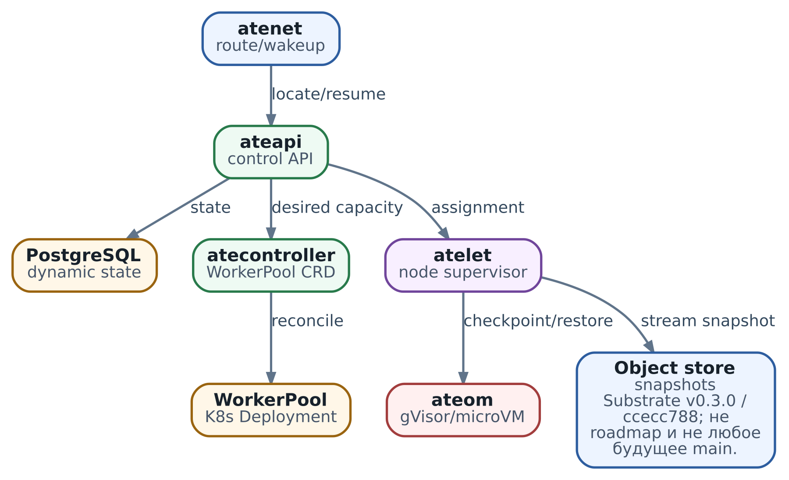

# Agent Substrate: как устроен runtime для stateful Actors

В главе 11 сессия ревью `review-42` научилась отличать текущий план от старого результата. Теперь инженер возвращается к этой сессии после перерыва. Её прикладное состояние сохранено, но обслуживающего процесса может не быть. Чтобы показать статус или продолжить работу, мало найти запись `review-42` в базе. Нужно выделить среду исполнения, восстановить нужные данные и направить запрос именно туда.

Agent Substrate решает эту инфраструктурную часть. Он связывает логический Actor с временной вычислительной ёмкостью и умеет останавливать и возобновлять sandboxed workload. Но инфраструктурный `RUNNING` не означает, что исправление принято, а восстановленная память не доказывает актуальность плана. В этой главе проследим путь запроса и научимся находить границу, на которой действительно возникла проблема.

**Срез реализации Substrate:** [v0.3.0 · ccecc788](https://github.com/agent-substrate/substrate/tree/ccecc788a327dc11dcd6c21ee153f3d0cbb5cc97). Конкретные компоненты, поля и поведение ниже относятся к этому commit. Experimental authz из главы 24 относится к другому профилю. Учебная сессия ревью - наш прикладной пример, не встроенный workflow Substrate.

## Что читатель сможет сделать после главы

- Объяснить, зачем Actor отделён от Worker и почему это не отменяет расходы на вычисления.
- Проследить запрос через router, ateapi, node runtime и tunnel.
- Различить сохранённое назначение, завершённый wake-up и готовность приложения.
- Выбрать источник восстановления без опасного предположения о fallback на пустой процесс.
- Рассчитать ограничения capacity и объяснить поведение parking при разных deadlines.
- Обосновать выбор обычного сервиса, WorkerPool и sandbox class под конкретную нагрузку.
- Локализовать отказ, сохранив сведения, нужные для восстановления.

## Зачем отделять Actor от Worker

Вернёмся к ревью. Человек может ответить на вопрос через минуту, завтра или никогда. Всё это время записи плана и разрешений нужны, но интерпретатор, загрузивший зависимости, не обязательно должен постоянно занимать RAM. При тысячах таких сессий цена ожидания становится заметной. Важна не красота Actor API, а разница между количеством существующих сессий и количеством одновременно работающих окружений.

**Actor** в Substrate - адресуемая логическая единица workload. **Worker** - заранее запущенный Pod с ёмкостью для sandbox. Actor может не иметь текущего Worker, а его identity и lifecycle metadata продолжат существовать. Несколько активных Actors могут разделять ёмкость Worker, если это допускают его actor slots и ресурсы. Долговечность прикладного state зависит ещё и от того, где приложение его сохраняет.

Такая схема похожа на рабочие места в лаборатории: записей о проектах больше, чем столов с оборудованием. Остановленный проект не исчезает, но возобновить все проекты одновременно нельзя. Аналогия помогает увидеть capacity, а не обещает переносимость любого состояния. Snapshot должен подходить выбранному backend, а внешняя база и уже выполненные действия живут по своим правилам.

### Какая работа исчезает из обычного resume

Kubernetes продолжает размещать Worker Pods на nodes. Но для очередного Actor не требуется каждый раз создавать новый Pod и снова проходить весь путь admission, scheduler, CNI и kubelet. Эти затраты заранее понёс тёплый Worker. Обычный resume использует уже существующую ёмкость и запускает или восстанавливает sandbox внутри неё.

Здесь важно слово «обычный». Если подходящего Worker нет, новый Pod или node всё равно придётся подготовить. Autoscaling не материализует ёмкость в момент прихода запроса. Тёплый пул сокращает путь только пока в нём есть подходящее место. Snapshot download, восстановление файлов и память sandbox тоже не становятся бесплатными.

Специализированная система оправдана, когда время простоя велико, окружение дорого и восстановление заметно дешевле повторной подготовки. Если сессия содержит несколько строк в SQL и быстро запускаемый stateless handler, обычный сервис может оказаться проще. Нам не нужно сохранять RAM только потому, что задача называется агентной.

### Что остаётся у harness и приложения

Substrate не выбирает модель, не планирует reasoning и не превращает HTTP в надёжный mailbox. В нашей сессии harness и прикладной код всё ещё проверяют revision, approval, call ID и результат. Сохранённая квитанция `tool_requested` не становится новым разрешением только потому, что sandbox восстановился.

Практическая граница такая: runtime возвращает среду, а приложение возвращает смысл работы. Если состояние ревью находится в отдельной SQLite или SQL-базе, надо обеспечить её реальную доступность после восстановления. Файл в удалённом эфемерном контейнере не становится durable от слова stateful. Если память содержит прежний r1, а authoritative прикладная база уже содержит r2, приложение должно согласовать их до новых действий.

## Как читать архитектуру по ответственности

Вместо списка процессов начнём с трёх вопросов. Кто готовит физические места? Кто решает, где сейчас Actor? Кто несёт конкретный запрос? Это разные задачи, хотя в одной трассировке они встречаются рядом.

| Плоскость | Какой вопрос решает | Где искать сведения |
| --- | --- | --- |
| Infrastructure plane | Есть ли подходящие Worker Pods и nodes | Kubernetes, WorkerPool CRD, atecontroller, atelet |
| Actor control plane | Какой lifecycle state и assignment у Actor | ateapi, PostgreSQL, lifecycle workflow |
| Request data path | Как довести этот HTTP-запрос до workload | atenet-router, dataplane, atunnel, Actor network |

Infrastructure plane готовит ёмкость и восстанавливает её после отказа. Control plane управляет часто меняющимися Actor records. Data path обслуживает запросы с чувствительностью к задержке. Такое разделение позволяет сначала назвать сломавшуюся ответственность, а уже затем смотреть конкретный процесс.

  
*Agent Substrate: operational data path*

Схема показывает связи компонентов, а не строгий порядок RPC. Ниже разберём последовательность отдельно. Object storage хранит bytes snapshots, но не назначает Worker. atelet работает на node и связывает control plane с исполнением. ateom внутри Worker управляет sandbox, а не определяет пользовательскую задачу. atunnel относится к пути трафика, а не к хранению state.

### Компоненты без магических полномочий

`atecontroller` превращает описание WorkerPool в Kubernetes resources. Его успешный reconcile ещё не означает успешный запуск конкретного Actor. `ateapi` обрабатывает lifecycle API и выдаёт актуальный Actor record. Сам sandbox исполняется не внутри API server.

PostgreSQL хранит metadata: state, assignment, version guards, snapshot references и сведения, по которым workflow продолжает операцию. Object storage хранит большие объекты snapshot. «База доступна» и «восстановление возможно» - разные утверждения: ссылка может существовать, а объект уже быть удалённым или недоступным.

Node-local `atelet` выполняет запросы запуска, checkpoint и restore через runtime Worker. `ateom` управляет sandbox выбранного класса. Router запрашивает resume и выбирает backend. `atunnel` принимает аутентифицированный tunnel на Worker и передаёт HTTP внутрь сети Actor. Ни один из этих компонентов не подтверждает, что человек принял результат ревью.

## Путь запроса к работающему Actor

Пусть gateway уже проверил право инженера обратиться к ревью. В ingress Substrate он передаёт `ate-target-actor: demo-tenant/review-42`. Это адрес workload. `Host` остаётся authority приложения и сам по себе не выбирает Actor. Имя в заголовке не является пользовательской аутентификацией или доказательством права доступа.

Для Envoy dataplane headers проходят через `ext_proc` - внешнюю обработку заголовков. Router вызывает `ResumeActor`. Несмотря на имя метода, это также fast path для уже `RUNNING` Actor: workflow читает текущую запись и возвращает её без нового restore и без actor lease для этой ранней ветки. Отдельного Pod на каждый HTTP-запрос не создаётся.

По Worker assignment router выбирает адрес `atunnel` на порту 443 и соединяется по mTLS. Tunnel проверяет доверенную router identity и целевой Actor относительно текущих назначений Worker. Только затем запрос проходит к workload через private network. Открытый порт 80 Worker не является предусмотренным публичным ingress Actor.

Это всё ещё распределённый путь. Actor может быть жив физически, но недоступный `ateapi` сорвёт lookup через router. Устаревший assignment нельзя превращать в вечный кэш Pod IP. Проверка назначения уменьшает риск неверного маршрута, но не обещает, что assignment никогда не изменится между чтением и отправкой. Ошибка на этой границе не означает автоматически потерю Actor state.

### Почему RUNNING не является health check

Fast path не повторяет `wakeup_probe`. Приложение могло успешно пройти проверку при пробуждении, а затем потерять подключение к базе или перестать отвечать. Слово `RUNNING` сообщает lifecycle state, а не непрерывное наблюдение за бизнес-функцией.

Если сессия долго работает, health monitoring и собственная проверка допустимости действия нужны отдельно. Pod Ready сообщает о Pod, wakeup probe - о конкретном пробуждении, а endpoint статуса ревью должен сообщать о прикладном состоянии. Смешав эти сигналы, оператор легко получит «всё зелёное» при зависшей пользовательской работе.

## Путь пробуждения остановленного Actor

Теперь `review-42` находится в `SUSPENDED`. Router начинает тот же `ResumeActor`, но ранний fast path уже не подходит. Workflow получает actor lifecycle lease, повторно читает запись и определяет источник запуска. Это lease инфраструктурной операции, не блокировка прикладного mailbox и не универсальная защита всех side effects.

Затем workflow при необходимости создаёт volumes, находит подходящий Worker, записывает назначение и состояние `RESUMING`, подключает volumes и вызывает atelet. Node runtime выбирает cold run или restore. После успешного ответа node-компонента ateapi заново читает Actor и фиксирует `RUNNING` с version precondition. Router получает record и направляет исходный HTTP-запрос.

```
HTTP request -> router -> ResumeActor
  read Actor; acquire lifecycle lease when work is needed
  resolve source; prepare volumes
  claim Worker; persist RESUMING and assignment
  attach volumes; call atelet Run or Restore
  run configured wakeup probes on the waking workload
  commit RUNNING -> return assignment -> atunnel -> application
```

У этого порядка две важные границы. Назначение Worker сохраняется раньше окончательного `RUNNING`, поэтому наличие assignment не доказывает завершение restore. И завершение wake-up содержит проверку готовности приложения только в пределах настроенных probes. Сама последовательность не подтверждает текущий план ревью и не восстанавливает потерянный HTTP response клиенту.

### Как выбирается источник запуска

Сначала рассматривается local snapshot, если он есть. Он ограничивает допустимые nodes. Иначе используется указанная external snapshot reference. Если источника snapshot нет, workload запускается из template spec. Этот третий случай - cold boot, а не разрешение игнорировать сломанный checkpoint.

Указанный external snapshot с отсутствующими bytes остаётся ошибкой restore. В ветке `ensureAteletRestored` ошибка вызова Restore переводит Actor в `CRASHED`; автоматической второй попытки с пустым процессом эта ветка не делает. Иначе можно было бы тихо потерять state и принять новую пустую сессию за восстановленную прежнюю.

Различайте «ссылка не предусмотрена для этого запуска» и «предусмотренный источник утрачен». В первом случае cold boot может быть правильным. Во втором сначала нужны причина, последний пригодный источник и решение о допустимой потере работы. Не исправляйте такую ошибку удалением Actor ради успешного HTTP 200.

### Full Data и golden snapshot

Full и Data описывают состав snapshot, а local и external - место хранения. Full включает captured guest state, в том числе память и filesystem delta в поддерживаемом runtime. Data сохраняет предусмотренные durable data, но не обещает продолжение с прежней heap. Выбор класса sandbox и поддерживаемого snapshot scope нужно проверять вместе.

Golden snapshot - прогретое исходное состояние template. Оно позволяет не повторять дорогую инициализацию каждого нового Actor. Это общая заготовка, а не индивидуальная память сессии `review-42`. Для Data resume политика template может выбрать cold guest или golden guest с индивидуальными данными. Это отличается от обычного Full restore.

Смена template тоже может изменить путь: несовпадение UID template, записанного в external snapshot, и текущего template приводит к Data restore с новым guest вместо переноса несовместимой памяти. Допустимость самого update отдельно ограничена API. Полный разбор полей и ownership находится в главе 13, lifecycle - в главе 14.

Golden memory не должна содержать действующие разрешения одного пользователя, его r1 или общие credentials, которые все клоны получат как свои. Метаинформацию конкретного Actor и вращаемые credentials нужно получать через соответствующий runtime contract, а не запекать в shared state. Успешное восстановление прогретого интерпретатора ничего не говорит о праве исполнить прошлое действие.

## Что означает готовность после wakeup

В закреплённом API у container можно настроить `wakeupProbe`; protobuf-поле называется `wakeup_probe`. При реальном wake-up runtime ждёт HTTP 200 от каждого контейнера, у которого probe задан. Без probe возврат `ResumeActor` может предшествовать началу listen приложения. При уже `RUNNING` Actor проверка заново не выполняется.

Поэтому фраза «router ждёт готовности Actor» требует уточнения. Он ждёт результат resume. Если нужные probes настроены и правильно написаны, это включает одноразовую проверку их endpoints. Если контейнер не имеет probe, его прикладная готовность из успеха resume не следует. Если endpoint отвечает 200 слишком рано, формально успешная probe тоже не доказывает безопасный приём работы.

### Как написать осмысленную probe

Для сервиса ревью endpoint может вернуть 200 после загрузки текущего state, проверки незавершённых операций и восстановления необходимых подключений. Это прикладной проект, не встроенный recovery hook Substrate. Важно не пытаться по одному слову healthy доказать, что все внешние эффекты завершены.

Probe не должна повторно запускать тест или выполнять approval. Иначе многократный GET проверки сам создаст действия. Она проверяет готовность безопасно принять запрос. Если восстановление требует дополнительной обработки, endpoint может оставаться неготовым до её завершения в пределах допустимого timeout.

Не стоит привязывать 200 к доступности всех необязательных сервисов мира. Это превратит отказ второстепенной зависимости в невозможность восстановить даже страницу статуса. Разделите минимальную безопасную готовность и возможность конкретной операции. Для запуска теста может понадобиться сервис тестирования, для чтения состояния - только authoritative state store.

### Wakeup probe и readinessProbe

Kubernetes `readinessProbe` может регулярно управлять доступностью Pod в Service. Substrate wakeup probe - одноразовый gate каждого пробуждения workload. Они работают на разных объектах и временных границах. Наличие здорового Worker Pod не означает, что его новый sandbox уже готов.

Timeout wakeup probe по умолчанию 30 секунд. Это предел конкретной проверки, а не обещанный end-to-end latency. В API guide неуспешный wake-up приводит к `CRASHED`; прямой resume из этого state не предназначен для бесконечного retry. Сначала требуется осмысленный recovery через `RevertActor` к допустимому источнику, с пониманием потери изменений после snapshot.

## Parking и три разных срока ожидания

Представим, что все подходящие места сейчас заняты. Router может не сразу отказать, а дождаться освобождения capacity и повторить resume. Это **request parking**: удержание запроса в пути ingress, не сохранение бизнес-команды в durable inbox. Router process, HTTP stream и deadlines всё ещё имеют срок жизни.

В этой версии при включённом parking retryable считаются `ResourceExhausted`, `FailedPrecondition`, `Unavailable` и `Aborted`. `NotFound`, `DeadlineExceeded` и ошибки доступа идут по fail-fast ветке. Классификация status code не доказывает, что каждая конкретная причина `FailedPrecondition` устранится сама: Actor в `CRASHED` или неверная конфигурация могут пережить весь budget.

### Общий flight для одного Actor

Одновременные callers к одному Actor присоединяются к одному resume flight внутри экземпляра resumer. **Flight** здесь означает общую выполняющуюся операцию resume с её retry sequence. Это не глобальный distributed singleflight всех router replicas и не устранение повторов прикладного HTTP-действия.

Clock budget начинается с первого caller. Пришедший позже caller наследует оставшийся срок, а не получает новый полный budget. Каждый реально parked request занимает собственный slot parking lot. Поэтому сто клиентов одного Actor могут дать один flight в этом resumer, но сто удерживаемых streams. Уменьшение числа control-plane RPC не устраняет давление на ingress.

Slot берётся после первого retryable результата, когда request действительно начинает parking. Успешная первая попытка не занимает parking slot. Даже долгий первый resume может не парковаться в этом смысле. Не путайте метрику parking с длительностью всех возможных холодных запусков.

### Budget не отменяет начатый restore

По умолчанию `--parked-request-budget` равен 5 секундам, а `--parked-request-max` - 1024. Budget ограничивает начало новых попыток resume. Попытка, начатая до исчерпания budget, может закончиться позже; router не отменяет её по этому budget и может обслужить request поздним успешным результатом.

Отдельно существуют deadline конкретного caller, timeout `ext_proc` и server-side maximum RPC deadline у ateapi. В Envoy-конфигурации message timeout связан с budget как `budget + 5s`. Успех resume после пяти секунд и timeout клиента не противоречат друг другу: это разные часы и разные результаты.

Для оператора здесь неприятный, но важный вывод. Если клиент перестал ждать, это не доказывает прекращение restore. Actor может перейти в `RUNNING` позже. Перед повтором команды нужны прежний operation ID и правила главы 10; новый HTTP stream не разрешает новый внешний эффект. Router не предоставляет application exactly-once.

### Parking lot не является capacity

Увеличение размера lot позволяет удержать больше запросов, но не создаёт sandbox slots, RAM или bandwidth object storage. Увеличение budget может скрыть shortage за более долгим ожиданием. Смотрите одновременно waiting time, rejection, число допустимых Workers и скорость освобождения ресурсов.

`ext_proc` circuit breaker тоже ограничивает число streams. В стандартной конфигурации его headroom выводится из размера parking lot; явный override меняет этот запас. Даже если уже `RUNNING` requests не занимают lot, общий ingress можно перегрузить другими лимитами. Локальная защита одной очереди не означает неограниченной доступности всего пути.

## Практический разбор общей операции resume

Программа `examples/ch12_wakeup_trace_demo.py` работает на Python 3.10+ со стандартной библиотекой. Это калькулятор заранее заданной трассы: времена поданы как числа, а не измерены. Нет threads, сети, router, Worker, настоящего checkpoint или лабораторного стенда. Мы используем его, чтобы сравнить несколько сигналов, которые часто ошибочно сводят к одному timeout.

Пусть budget равен 5000 мс. Первая попытка начинается в t=0 и в t=10 возвращает retryable error. Следующая заданная попытка начинается в t=100 и заканчивается успехом в t=5200. Это разрешённая поздняя развязка уже начатой операции, а не разрешение начинать новый resume после t=5000.

| Событие | Время относительно начала flight | Что означает |
| --- | --- | --- |
| Первый caller начинает flight | 0 мс | Запущены общая операция и её budget |
| Первый retryable результат | 10 мс | Requests переходят к parking |
| Вторая попытка resume | 100 мс | Она началась до budget |
| Два новых callers присоединяются | 4900 мс | Они разделяют старый flight |
| Один caller прекращает ждать | 5100 мс | Его deadline не отменяет общую попытку |
| Resume завершается | 5200 мс | Остальные могут получить assignment позже budget |

В калькуляторе принято, что поздние callers уже присоединились к одному существующему flight и приняты в lot. Полнота lot, создание новых flights, backoff с jitter, повторная проверка state и маршрутизация HTTP не моделируются. Нельзя перенести эти числа в SLO своего кластера.

### Запуск и чтение вывода

Из корня репозитория:

```
python3 examples/ch12_wakeup_trace_demo.py
python3 -m unittest discover -s examples -p 'test_ch12*.py'
```

```
{
  "source": "offline_supplied_trace",
  "cluster_contacted": false,
  "clock_or_latency_measured": false,
  "shared_flight": {
    "outcome": "routable",
    "finished_ms": 5200,
    "attempts": 2,
    "parked": true,
    "served_late": true
  },
  "first_caller": {
    "outcome": "routable",
    "wait_ms": 5200,
    "flight_outlives_caller": false
  },
  "late_joiner": {
    "outcome": "routable",
    "wait_ms": 300,
    "flight_outlives_caller": false
  },
  "short_deadline_caller": {
    "outcome": "caller_timeout",
    "wait_ms": 200,
    "flight_outlives_caller": true
  },
  "declared_snapshot_failure": {
    "state": "CRASHED",
    "automatic_cold_fallback": false
  },
  "one_unprobed_container": {
    "state": "RUNNING",
    "all_containers_probed": false,
    "continuous_health_verified": false,
    "business_safety_verified": false
  }
}
```

`routable` означает только, что в заданной трассе resume завершился успешно. Калькулятор не отправляет прикладной request и не получает от него 200. Первый caller ждёт 5200 мс, late joiner - 300 мс. Третий caller заканчивает ожидание раньше, но общий результат остаётся тем же. Реальная гонка ответа с deadline не детерминирована так, как учебное сравнение чисел.

`declared_snapshot_failure` показывает другое правило: выбранный external source с неуспешным restore не заменяется cold boot. Калькулятор не читает manifest и не проверяет криптографическую целостность, а отражает заданный failure outcome. Template migration, Full/Data и golden composition здесь не реализованы.

### Проверка готовности в примере

Короткая функция из программы:

```
def wakeup_gate(probe_results):
    """None = probe absent. True = observed HTTP 200. False = probe failed.

    This is a completed-wakeup observation, not a polling implementation.
    It cannot prove that an endpoint's 200 means business safety.
    """
    if not probe_results or any(x is not None and type(x) is not bool
                                for x in probe_results):
        raise ValueError("one bool or None per container required")
    passed = all(x is not False for x in probe_results)
    return {"state": "RUNNING" if passed else "CRASHED",
            "all_containers_probed": all(x is not None for x in probe_results),
            "continuous_health_verified": False,
            "business_safety_verified": False}
```

При `[True, None]` одна настроенная probe прошла, у другого контейнера её нет. Функция не превращает отсутствие наблюдения в доказанную готовность. Даже `[True, True]` не устанавливает `business_safety_verified`: смысл 200 задаёт приложение. Это расчёт уже завершённого wake-up, не реализация HTTP polling и не универсальная runtime state machine.

Тесты проверяют начало retry до budget, поздний результат, наследование завершения late joiner, отдельный deadline, отсутствие fallback и границы probes. Они проверяют наш учебный код, а не работоспособность pinned Substrate. Для интеграционной проверки понадобились бы реальные RPC, восстановление workload и наблюдение исходного HTTP-запроса. Такая проверка не заменена calculator output.

## Snapshot сохраняет не всю систему

После практического примера полезно назвать, какие данные мы вообще пытаемся вернуть. State Actor - не один объект, который можно целиком переложить в bucket. Metadata, память, пользовательский план и внешний тест находятся на разных слоях.

| Данные | Кто их хранит | Что нужно для восстановления |
| --- | --- | --- |
| Lifecycle state и assignment | PostgreSQL Substrate | Пригодная запись, version и согласованный workflow |
| Snapshot bytes и manifest | Object storage или node для local | Доступность нужных объектов и совместимый runtime |
| Текущий план и квитанции ревью | Прикладной state store | Актуальная revision и незавершённые операции |
| Запущенный внешний тест | Тестовый сервис и журнал вызовов | Проверка по operation ID, не предположение из heap |

Полный snapshot может вернуть код к прежней точке исполнения. Он не возвращает внешний мир к тому же времени. Если тестовый сервис уже завершил c1, а восстановленная память всё ещё ждёт c1, надо прочитать журнал или запросить результат по устойчивому ключу. Повтор без прежнего operation ID может создать второй внешний запуск.

### Pause Suspend и Revert

Pause оставляет local checkpoint, связанный с допустимыми nodes. Это удобная оптимизация внутри контролируемого окна, но не переносимый backup. Suspend публикует external snapshot и освобождает execution capacity после завершённого перехода. Для newly created `SUSPENDED` Actor собственный snapshot ещё не обязателен: источник может быть заимствован или запуск будет cold.

Revert прекращает текущий execution и возвращает Actor в `SUSPENDED`, сохраняя прежнюю external snapshot reference для последующего resume. Если её нет, последующий запуск может пойти cold path. Если bytes по сохранённой ссылке повреждены или удалены, сам revert их не починит: повторный restore снова встретит ту же проблему. Он также не отменяет изменения в внешней БД, письмо или тест. Успех revert не доказывает, что повтор приложения безопасен. Delete тем более не является способом восстановить потерянный response: он уничтожает lifetime Actor.

Для обслуживания node важна разница local и external. Нельзя считать local pause защитой от потери node. Сначала нужно обеспечить пригодный durable источник и проверить завершение перехода. Описание 30-минутного окна при graceful eviction в API guide не обещает, что Actor получит это время при внезапном отказе node или принудительном уничтожении Pod.

### Ссылка и bytes должны пережить восстановление вместе

При suspend сначала формируются внешние данные, а затем control plane фиксирует новую snapshot reference и итоговый state. Между этими шагами возможны частичные ошибки. Сам факт наличия объектов в bucket ещё не означает, что они выбраны текущей записью. Обратная ситуация - восстановленная база со ссылкой на уже удалённые bytes - тоже неработоспособна.

Disaster recovery должен возвращать согласованный набор metadata и объектов. Retention bucket нельзя проектировать независимо от Actor и Tag ownership. Клон может пользоваться tag-owned snapshot до первого собственного suspend; удаление source Tag способно лишить его источника. Детальные правила из главы 13 полезны именно потому, что источник нельзя угадывать по похожему имени.

Checksum подтверждает совпадение bytes с digest, но не доказывает доверие к snapshot, если атакующий может заменить и digest. Integrity, происхождение, доступ и совместимость - разные проверки. Рекомендация проверить эти свойства не означает, что любой backend выполняет полный набор автоматически.

## Capacity по ресурсам и допустимому placement

«Свободный Worker» - сокращение. Подходящее место должно одновременно удовлетворять sandbox class, selectors template и Actor, ограничениям local snapshot, actor slots и оставшимся ресурсам. Registry может показывать много Workers, но ни один не подходит `review-42`. При таком отказе бессмысленно увеличивать общий replica count без понимания, чего именно не хватает.

В pinned scheduler выбор кандидата использует текущую картину Workers. Затем bind перепроверяет eligibility и room под row lock Worker. Два претендента на последнее место не должны оба быть приняты по прежнему свободному значению. Но это не одна транзакция с runtime, volumes и object storage: сохранённый claim ещё должен пройти последующие этапы resume.

### Числовой пример без обещания benchmark

Допустим, в совместимом pool четыре Workers. Для учебного расчёта у каждого задана ёмкость 4 CPU, 8 GiB RAM и четыре actor slots. Template ревью декларирует 1 CPU и 2 GiB на Actor. По каждой из трёх границ получается четыре Actors на Worker, суммарно шестнадцать. Это placement envelope для однородной нагрузки, не измеренная производительность.

Если нужна способность пережить потерю одного такого Worker, для normal operation остаётся расчётный предел двенадцать одновременно выделенных Actors. Maintenance, восстановление и runtime overhead могут потребовать дополнительного запаса. Его нельзя снова использовать как свободную production capacity, сохранив прежнее обещание отказоустойчивости.

Теперь часть Actors требует 5 GiB. На Worker с двумя малыми Actors уже занято 4 GiB, и новый большой не поместится, хотя CPU и slots свободны. Сумма свободной RAM по всему pool не помогает одному Actor, если она распределена по разным Workers. Это fragmentation, а не ошибка подсчёта replica count.

### Какие значения являются договором

В этой версии placement сопоставляет declared limits и учёт allocated resources. Размер и фактическое ограничение sandbox зависят также от runtime. Отсутствующий CPU или memory capacity dimension может трактоваться scheduler как unconstrained, а не как доказательство бесконечного физического ресурса. Actor slots всё равно проверяются.

Поэтому до расчёта density задайте limits осмысленно и проверьте enforcement. «Scheduler принял» не равно «workload не способен исчерпать node». Для microVM учитывают VMM и virtiofsd overhead; Full restore может сохранить размер VM из snapshot. Изменение числа в template не является автоматическим resize уже captured memory.

Измеряйте одновременные allocations, active/idle intervals, размер snapshot, параллельные restore и suspend throughput. Сессию, которая ждёт внешнего теста три минуты, нельзя автоматически считать idle sandbox: приложение могло оставить процессы и память активными. Коэффициент oversubscription следует из реального поведения, не из общего числа Actors в registry.

## Как выбирать среду исполнения

Наша задача - не объявить один runtime лучшим. Нужно назвать, какой дорогой ресурс и какое повторяемое действие мы хотим убрать. Если можно восстановить всю сессию из небольшой durable записи, перенос RAM может оказаться ненужным. Если дорого прогревать тяжёлую среду, snapshot способен изменить стоимость ожидания.

| Потребность | Что рассмотреть | Что проверить до выбора |
| --- | --- | --- |
| Небольшой state и быстрый handler | Обычный сервис с транзакционной БД | Конкурентные переходы, retries и backup |
| Долго ждём человека или внешнее событие | Workflow runtime либо durable job model | История, activities, versioning и идемпотентность |
| Нужна дешёвая пауза дорогого sandbox | Substrate с тёплым pool | Scope snapshot, стоимость restore и burst capacity |
| Требуется sandbox для Linux workload | gVisor при подходящей совместимости | Syscalls, devices, сеть и выбранный threat model |
| Нужен guest kernel или VM boundary | microVM backend | KVM, runtime assets, overhead и restore compatibility |

gVisor и microVM не являются обещаниями «быстро» и «абсолютно безопасно». Один использует user-space kernel boundary, другой - guest kernel и VMM. Проверяют необходимый workload, host configuration и модель угроз. Требование VM boundary имеет смысл объяснять конкретной изоляцией, а не прилагательным «сильнее» без условий.

### Небольшая матрица испытаний вместо красивой цифры

Сравните cold boot, golden restore и restore индивидуального snapshot на малом и типичном state. Затем повторите с burst и почти занятым pool. Измерьте не только happy-path задержку, но ошибки, сумму held streams, время освобождения capacity и correctness приложения после восстановления.

README claims и aspirational targets architecture не являются SLO вашего кластера. Особенно опасно сравнивать цифры с разными snapshot sizes, backend, concurrency и границами измерения. End-to-end wake-up включает lookup, claim, возможное ожидание, download, runtime restore, настроенные probes и tunnel setup. Не складывайте отдельные p95 фаз как математически точный p95 суммы; используйте общую трассу и распределение полного запроса.

## Доступ и сеть по конкретным границам

Gateway должен проверять principal и разрешённый target до передачи запроса в Actor-aware ingress. mTLS между router и Worker защищает транспортный участок и доверенную identity router, но не даёт конечному пользователю права на любой Actor. Знание `demo-tenant/review-42` и возможность написать header не являются authorization.

Для закреплённого профиля authentication guide предупреждает об отсутствии полноценного control-plane RBAC. Настроенный JWT provider даёт доверенным пользователям широкое управление control plane, а не только «своей сессией». Ограничьте сеть ateapi и набор таких клиентов. Не переносите сюда возможности experimental authz из главы 24.

Snapshot содержит чувствительные prompts, код, файлы и иногда credentials. Bucket access Actor, node runtime и backup-оператора - разные полномочия. Изоляция sandbox не защищает от слишком широкого доступа к snapshots. При Worker reuse отдельно проверяют очистку файлов, процессов, mounts, маршрутов и credentials между Actors.

Egress policy и отсутствие широких secrets тоже требуют проверки конкретного dataplane. В pinned router есть ограничения реализации, например credential injection и часть passthrough policy не работают как универсальные возможности. Наличие policy object не доказывает обещанную функцию. Полный security-разбор находится в профильных главах; здесь важно не строить capacity и recovery на ложной модели доверия.

Для arbitrary-port ingress предусмотрен HTTP CONNECT с actor-aware обработкой HTTP(S) внутри tunnel. Это не универсальная поддержка SSH, произвольного raw TCP или inbound UDP. CONNECT создаёт транспортную форму, а фактическую совместимость определяет путь обработки выбранной версии.

## Как расследовать неотвечающую сессию

Начните с точного target, UID, времени и request ID. Actor с тем же именем после delete/create может принадлежать другой lifetime. Затем установите, где остановилась цепочка: control lookup, placement, restore, probe, tunnel или приложение. Это полезнее массового restart, который уничтожит часть evidence.

| Наблюдение | Первое подозрение | Что проверить до изменения state |
| --- | --- | --- |
| 404 | Target или ресурс не найден | Atespace, имя и lifetime; timeout здесь не поможет |
| 503 и parking exhaustion | Capacity либо retryable resume error | Конкретный status, eligible Workers и общий flight |
| RESUMING с assignment | Claim есть, последующий шаг не завершён | Volumes, atelet, snapshot и wakeup probe |
| RUNNING с 5xx | Lifecycle закончен, data path или приложение отказали | Assignment, atunnel, listen и зависимости приложения |
| CRASHED после restore | Неуспешный запуск или probe | Последний пригодный source и цена revert |
| Клиентский timeout при позднем RUNNING | Разные сроки caller и workflow | Flight trace и результат операции, не новый effect |

Коды помогают сузить слой, но 503 сам по себе не доказывает нехватку RAM, а 504 - повреждение snapshot. Router map, gateway и приложение могут давать похожие HTTP outcomes. Сохраните исходный gRPC code и место его возникновения.

### Наблюдаемость и безопасный следующий шаг

Соедините Actor name с UID, template, Worker и operation trace. Для ревью добавьте прикладную revision и tool operation ID. Это разные идентификаторы: lifecycle operation не равна test call, а новый Pod не равен новой пользовательской задаче. Высококардинальные Actor UID разумно держать в logs и traces, а не без ограничения в metric labels.

Полезны committed state transitions, restore timing, snapshot download/upload, parking wait outcome и eligible capacity. Учитывайте, что поздний joiner может иметь короткий wait при budget exhaustion, а успешная первая долгая попытка не даёт parking sample. Иначе dashboard легко направит расследование не туда.

Перед revert определите, какие изменения будут отброшены и какие внешние действия остаются актуальными. Перед retry приложения проверьте прежний operation ID. Перед новым rollout сохраните источник для восстановления и проверьте совместимость dataplane, node labels и snapshot runtime. Переносимость Actor не отменяет version skew и node maintenance.

## Практика для самостоятельного решения

Измените в demo начало второй попытки со 100 на 5000 мс. Объясните, почему она больше не выполняется и чем этот случай отличается от завершения первой допустимой попытки в t=5200. Затем оставьте раннее начало, но замените результат на retryable: бюджет исчерпан после поздней ошибки, а не превращается в новую попытку.

Подайте в `wakeup_gate` `[True, True]`, `[True, None]` и `[True, False]`. Для каждого результата назовите, что известно о containers, а чего нельзя утверждать о business state. Спроектируйте для ревью endpoint, который не выполняет действий при проверке, но не разрешает работу с устаревшим планом.

Рассчитайте pool для двенадцати одновременных малых Actors и потери одного Worker из числового примера. Затем добавьте два больших Actors и покажите placement, который действительно помещается по каждой размерности. Нельзя ограничиться суммарной RAM всех nodes.

Наконец, разберите случай «external snapshot reference есть, объект удалён retention policy». Что сохраните до вмешательства? Какой источник допустим? Как выясните, был ли внешний тест уже запущен? Ответ «запущу пустой Actor и повторю» не сохраняет прежнюю сессию и не решает неопределённый effect.

## Итоги главы

Substrate экономит повторную подготовку окружений, используя заранее поднятую ёмкость и Actor lifecycle. Kubernetes готовит Workers, control plane хранит metadata и управляет переходами, node runtime запускает sandbox, а router и tunnel доводят запрос до текущего placement. Эти обязанности связаны, но ни одна не заменяет прикладной протокол ревью.

Запомнить названия недостаточно. Assignment появляется раньше окончательного `RUNNING`; `RUNNING` не равно непрерывному health; wakeup probe проверяет только настроенные endpoints при пробуждении; parking budget ограничивает новые попытки, а не отменяет начатый restore. Отсутствие источника допускает cold path, но ошибка указанного snapshot не разрешает тихо начать всё заново.

Для выбора runtime нужно сравнить стоимость дорогого state с ценой snapshot, capacity и эксплуатации. Для восстановления - увидеть владельца каждого состояния и границу уже выполненного действия. Для диагностики - пройти конкретный request trace, а не требовать от зелёного Pod объяснения всей пользовательской задачи.

Дальше в главе 13 разберём ресурсы, которые выражают эти решения: Atespace, WorkerPool, SandboxConfig, ActorTemplate, Actor и Tag. Теперь поля selectors, snapshot references и version guards будут не списком настроек, а способом описать понятный runtime contract.

### Источники и дальнейшее чтение

- [Substrate API guide](https://github.com/agent-substrate/substrate/blob/ccecc788a327dc11dcd6c21ee153f3d0cbb5cc97/docs/api-guide.md) - capacity, probes, snapshot scope и ownership.
- [Resume workflow](https://github.com/agent-substrate/substrate/blob/ccecc788a327dc11dcd6c21ee153f3d0cbb5cc97/cmd/ateapi/internal/controlapi/workflow_resume.go) - ранний RUNNING path, claim, source и finalize.
- [Scheduler](https://github.com/agent-substrate/substrate/blob/ccecc788a327dc11dcd6c21ee153f3d0cbb5cc97/cmd/ateapi/internal/scheduling/scheduling.go) - eligibility, slots и resource dimensions.
- [Request parking](https://github.com/agent-substrate/substrate/blob/ccecc788a327dc11dcd6c21ee153f3d0cbb5cc97/docs/request-parking.md) и [resumer](https://github.com/agent-substrate/substrate/blob/ccecc788a327dc11dcd6c21ee153f3d0cbb5cc97/cmd/atenet/internal/router/ingress/resumer.go) - shared flight, budget и callers.
- [Router contract](https://github.com/agent-substrate/substrate/blob/ccecc788a327dc11dcd6c21ee153f3d0cbb5cc97/cmd/atenet/internal/router/README.md) - ingress, egress и ограничения dataplane.
- [Authentication](https://github.com/agent-substrate/substrate/blob/ccecc788a327dc11dcd6c21ee153f3d0cbb5cc97/docs/authentication.md) и [threat model](https://github.com/agent-substrate/substrate/blob/ccecc788a327dc11dcd6c21ee153f3d0cbb5cc97/docs/threat-model.md) - доверие и необходимые защитные границы.
- [Architecture](https://github.com/agent-substrate/substrate/blob/ccecc788a327dc11dcd6c21ee153f3d0cbb5cc97/docs/architecture.md), [observability](https://github.com/agent-substrate/substrate/blob/ccecc788a327dc11dcd6c21ee153f3d0cbb5cc97/docs/observability.md) и [upgrade](https://github.com/agent-substrate/substrate/blob/ccecc788a327dc11dcd6c21ee153f3d0cbb5cc97/docs/upgrade.md) - дальнейший эксплуатационный разбор.
