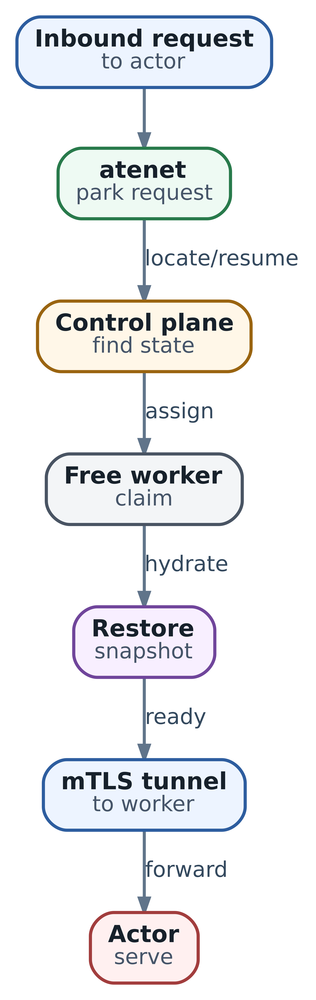

# Lifecycle stateful Actor: pause, suspend, resume и восстановление

Мы подготовили `review-42` к эксплуатации: выбрали версию среды, WorkerPool и место хранения её состояния. Пользователь получил результат ревью и ушёл обсуждать его с коллегой. Нужно ли всё это время держать sandbox в памяти? А если пользователь вернётся завтра, что именно мы обязаны ему вернуть: файлы, прежний процесс или подтверждённое состояние его задачи?

Так начинается выбор lifecycle policy. Он не сводится к команде «усыпить Actor». Можно освободить Worker, оставив checkpoint на node, или записать переносимую точку в object storage. Можно сохранить индивидуальную память программы или только данные, из которых она умеет стартовать заново. Можно вернуться к прошлой точке, но нельзя заставить уже опубликованный внешний результат исчезнуть вместе с откатом памяти.

**Срез реализации Substrate:** [v0.3.0 · ccecc788](https://github.com/agent-substrate/substrate/tree/ccecc788a327dc11dcd6c21ee153f3d0cbb5cc97). Поля, переходы и окна ошибок ниже относятся к этому commit. Прикладной журнал ревью - контракт нашего приложения, а не встроенный workflow Substrate. Experimental authz главы 24 относится к другому профилю.

## Что читатель сможет сделать после главы

- Выбрать между pause и suspend по сроку ожидания и требованиям к восстановлению.
- Разделить место хранения checkpoint и состав его Full/Data state.
- Найти подтверждённую external точку после timeout или потери node.
- Объяснить, когда повтор продолжает workflow, а когда требуется решение о rollback.
- Восстановить незавершённое прикладное действие по operation ID, не повторяя его вслепую.
- Проверять стоимость, совместимость и реальную пригодность restore, а не только наличие snapshot URI.

## Три состояния одной сессии

В сессии ревью есть исполняемая среда: процессы, heap, файлы и подключённые volumes. Heap - динамическая память программы, где могут находиться текущий план, объекты клиентов и ещё не записанный результат. Отдельно существует запись Actor в control plane: lifecycle, assignment и ссылки на checkpoints. Ещё дальше находится внешний мир: опубликованный patch, комментарий в системе ревью или запись в другой базе.

Эти слои могут соответствовать разным моментам времени. Snapshot сохранил память до отправки комментария, внешний сервис уже принял комментарий, а клиент не успел записать квитанцию. Restore возвращает старое локальное знание, не старое состояние внешнего сервиса. Поэтому восстановление среды и восстановление смысла работы - разные задачи.

| Вопрос | Где искать ответ | Чего ответ не доказывает |
| --- | --- | --- |
| Где Actor исполняется сейчас | Status и Worker assignment | Что приложение обслуживает запрос правильно |
| Из чего вернуть его среду | Local/external snapshot, scope, template provenance | Что внешний эффект не произошёл после capture |
| Как продолжить ревью | Прикладные данные, журнал и квитанции сервиса | Что любой старый клиент или lease ещё действителен |

Из главы 13 мы уже знаем, кто владеет snapshot. Здесь добавляем время: какая точка завершена, какие изменения появились после неё и какую работу придётся повторить или сверить.

## Pause и suspend сохраняют в разные места

`PauseActor` создаёт checkpoint на диске node. После успешного завершения Worker assignment освобождён, а status хранит имя checkpoint и node, где он находится. Для короткого ожидания это позволяет не отправлять большие данные в object storage. Однако место на диске и зависимость от node остаются. Pause не делает всё состояние «бесплатным».

`SuspendActor` создаёт external snapshot в object storage, либо загружает уже сделанный local checkpoint. После завершения Actor не удерживает Worker и имеет external точку для следующего запуска. Он может быть размещён на другом совместимом Worker, если выполнены требования к class, capacity, assets, данным и доступу к storage.

Разница проявляется при отказе. Если вместе с node потеряны local bytes, самый свежий pause не помогает. Нужна предыдущая пригодная external точка. Если её никогда не было, «восстановимся из последнего pause» уже не является планом. Если node жива, но на ней нет подходящего Worker, local snapshot может существовать, а resume пока не иметь места.

### Когда полезна двухступенчатая политика

После короткого idle можно сделать Full pause и удержать шанс на быстрый возврат на той же node. Если пользователь не вернулся, позже выполнить suspend, в том числе с Data scope при соответствующей policy. Так мы платим цену durable upload не за каждую короткую паузу.

Эта политика требует исправного пути upload и сохранности local checkpoint до его завершения. Она не равна правилу «через пять минут память автоматически становится durable». В template задаются scopes; решение, когда вызывать операции, принимает ваша orchestration. Если бизнес допускает потерю не более минуты изменений, десять минут только local pause не обеспечивают эту цель при потере node.

| Потребность | Вариант | Что проверить перед выбором |
| --- | --- | --- |
| Быстро вернуться после короткого idle | Pause на node | Диск, пригодный Worker на этой node, допустимость потери local state |
| Пережить потерю текущей node | Завершённый suspend | Доступность external bytes и проверенный restore |
| Не отправлять большой snapshot после каждой паузы | Pause, затем suspend | Scope conversion, upload failures и окно потери данных |
| Удержать особую точку дольше следующего suspend | Tag из suspended Actor | Отдельную copy и зависимости из главы 13 |

## Full и Data отвечают на вопрос о содержимом

Место хранения и состав snapshot - две независимые оси. Full может быть local или external. Data тоже может быть local или external. Слово Full не означает «переживает потерю node», а слово Data не означает «обязательно новый холодный процесс».

Full сохраняет поддерживаемый guest state, включая индивидуальную память, изменения writable rootfs и DurableDir. Writable rootfs - изменяемая часть файловой системы контейнера вне специально выделенных mounts. Data сохраняет поддерживаемые durable данные, прежде всего DurableDir, но не индивидуальную RAM и rootfs delta.

Если важный patch лежит только в `/tmp` на writable rootfs, нельзя рассчитывать вернуть его обычным Data restore. Приложение должно знать, какой каталог является DurableDir, и писать необходимый state туда. Название `/workspace` само по себе ничего не гарантирует: нужна соответствующая конфигурация mount.

### Как выбирается guest для Data

Data возвращает индивидуальные файлы, но гостевую среду надо получить отдельно. `onResume.fromData` выбирает `RESUME_SOURCE_COLD_BOOT` либо `RESUME_SOURCE_GOLDEN`. В первом случае containers стартуют из image с восстановленными данными; во втором общая память и файловая среда берутся из golden baseline, а индивидуальные данные - из Data snapshot.

Golden не возвращает heap нашей сессии в момент suspend. Он возвращает общий подготовленный старт. У приложения всё равно должен быть путь чтения индивидуального workspace и журнала после восстановления. Для Data-on-golden нужны оба пригодных источника: individual data и golden Tag текущего template. Удаление baseline может сломать этот путь даже после собственного suspend Actor.

Ниже фрагмент policy для restartable приложения, не полный ActorTemplate:

```
snapshotConfig:
  onPause: SNAPSHOT_CONTENT_SCOPE_FULL
  onCommit: SNAPSHOT_CONTENT_SCOPE_DATA
  onResume:
    fromData: RESUME_SOURCE_COLD_BOOT
```

Policy даёт Full local pause и Data durable suspend с холодным guest. Если выбрать GOLDEN, изменится источник guest, не факт сохранения индивидуальной памяти. В выбранном срезе default fromData - COLD\_BOOT; предпочтение должно быть осмысленным и проверенным, а не выводиться из слова Data.

### Почему нельзя увеличить scope после pause

`onCommit` должен быть подмножеством `onPause`. Из Full capture можно выделить Data; из Data capture нельзя получить уже не сохранённую RAM. Поэтому Data/Full отклоняется. Дополнительно running workflow проверяет реальный scope paused snapshot до перехода в SUSPENDING: недопустимое повышение не должно лишить Actor возможности resume.

Понижение Full до Data тоже требует, чтобы в capture были нужные durable files. Atelet проверяет наличие durable-dir archive; Full snapshot без durable данных не превращается в полезный Data upload только от переключения enum. До применения tiered policy проверьте mounts и backend на своём workload.

### Когда Full оправдан

Представим тяжёлый language server, который долго индексирует проект. Если повторная подготовка среды занимает значимую часть времени ответа, Full способен сохранить дорогой прогресс. Но snapshot может стать большим, restore создаст I/O burst, а перенос будет связан с совместимостью runtime и CPU features.

Когда агент умеет реконструировать состояние из небольшого журнала и быстро стартует, Data часто проще: меньше индивидуальной памяти в storage и меньше зависимости от старого heap. Это не универсальная рекомендация для любого backend. Сравните реальную цену capture, upload, download и повторной инициализации, а также результат восстановления приложения.

Full не обещает перенос GPU memory, любого device state и живого внешнего TCP-сеанса. Память отдельного inference-сервиса вообще находится вне Actor. Не сохраняйте огромный heap только потому, что системе можно передать enum Full: сначала найдите конкретный дорогой ресурс, который это экономит.

## Lifecycle хранит прогресс операции

Статус Actor нужен не только для красивого dashboard. Перед дорогим действием control plane фиксирует переход и сведения, по которым последующая попытка может найти незавершённую работу. Но re-entrant workflow не означает, что любой повтор любого RPC безопасен при любом state.

| State | Что он означает для оператора | Следующая проверка |
| --- | --- | --- |
| SUSPENDED | Нет текущего исполнения; external source может существовать либо отсутствовать | Пригодность source и constraints перед resume |
| RUNNING | Wake-up завершён по инфраструктурному контракту | Прикладной результат и актуальная health, не только state |
| PAUSED | Status указывает local checkpoint | Node, bytes, scope и место для resume |
| CRASHED | Выполнение или lifecycle шаг завершились ошибкой | Crash details, последнюю пригодную external точку и цену rollback |
| RESUMING, PAUSING, SUSPENDING | Операция ещё не финализирована | Сохранённые fields и незавершённый шаг именно этой операции |
| REVERTING, DELETING | Идёт отказ от исполнения или удаление ресурса | Progress cleanup и guards, а не запись status вручную |

RUNNING не является непрерывным health check. Уже работающий Actor может пройти fast path ResumeActor без новой probe. Не превращайте эту запись в доказательство, что HTTP request завершился или patch был принят.

### Какие повторы различаются

Pause начинается из RUNNING, продолжается из PAUSING, а для уже PAUSED возвращает завершённый результат. Suspend начинается из RUNNING или PAUSED, продолжается из SUSPENDING; уже SUSPENDED является no-op. Resume имеет свой путь из suspended/paused и продолжения RESUMING; CRASHED не лечится обычным resume.

Revert принимается из RUNNING, PAUSED и CRASHED, продолжение возможно из REVERTING. Он не является универсальной кнопкой выхода из любого переходного state. В частности, SUSPENDING не входит в список новых revert starts, а повтор после завершения revert в SUSPENDED не следует считать тем же no-op, что SuspendActor.

Поэтому после timeout сначала перечитайте Actor. Найдите state, UID/version, assignment, external/local source и in-progress destination. Если workflow ещё идёт, не запускайте конкурирующее «исправление». Если он завершён, не выполняйте повторную работу по одному лишь отсутствию клиентского ответа. Если он crashed, решение уже включает rollback и возможную потерю state.

## Resume возвращает среду по выбранному источнику

  
*Resume on demand: запрос может разбудить suspended actor*

Схема показывает путь запроса к восстановленной среде. На ней assignment и restore - разные этапы. При настоящем wake-up control plane подготавливает volumes, выбирает Worker и резервирует место. RESUMING и workerAssignment сохраняются до restore; RUNNING появляется после запуска/восстановления и объявленных probes. Не принимайте ранний assignment за готовое приложение.

Local checkpoint имеет приоритет и требует размещения на подходящей node. Если local source задан, но потерян, эта ветка не выбирает молча старую external точку. Ошибка выбранного Restore RPC ведёт к crash path. Возврат к предыдущей external точке после потери local state требует осмысленного отказа от текущего исполнения, а не скрытого fallback.

Для external snapshot учитываются scope и template UID. Совпадающий валидный Full source используется как собственный guest state. Data использует policy из предыдущего раздела. При разрешённой смене template старую индивидуальную RAM нельзя передать новому коду как совместимую: restore запрашивает Data и свежий guest. Это не миграция формата workspace; новый entrypoint обязан понимать его данные.

Если source отсутствует, возможен cold boot. Если source указан, но его bytes удалены или manifest непригоден, это другой случай. Не подменяйте потерянный workspace новым пустым процессом и не называйте это восстановлением прежней задачи.

### Что должна проверять wakeup probe

Настроенная probe конкретного container ждёт HTTP 200; отсутствие probe не доказывает его готовность. Это разовый gate запуска, не постоянный мониторинг и не проверка всей бизнес-операции. Для review-42 endpoint должен означать, что локальная среда восстановила нужные данные и может безопасно принять запрос данного типа.

Если endpoint возвращает 200 раньше чтения журнала, запрос может попасть в старое или пустое прикладное состояние. Если же probe без необходимости ждёт всю цепочку внешних систем, краткая недоступность одной зависимости может сорвать resume. Выберите точный контракт endpoint и проверьте его отрицательные случаи. Подробный путь исходного HTTP-запроса, parking и tunnel остаётся главе 15.

## Suspend имеет две границы завершения

Первая граница - пригодный набор bytes в object storage. Atelet отправляет snapshot files и затем manifest. Manifest перечисляет файлы и metadata; он загружается последним как маркер завершённой записи. Наличие нескольких больших objects до manifest ещё не делает snapshot завершённым.

Вторая граница - фиксация новой текущей точки в Actor status. До неё externalSnapshot остаётся прежней подтверждённой ссылкой, а inProgressSnapshotUri обозначает destination незавершённой операции. Нельзя считать один prefix в status подтверждением durable commit.

### Порядок running и paused путей

Для RUNNING workflow записывает SUSPENDING и destination, вызывает checkpoint текущего workload, затем отсоединяет external volumes. Для PAUSED workload уже не исполняется: atelet загружает local checkpoint с node, при допустимом выборе сужая Full до Data. Потеря соединения с atelet до Upload RPC может оставить операцию retryable; ошибка самого вызванного RPC в рассматриваемой ветке помечает Actor CRASHED.

После успешного capture/upload и detach финализация освобождает assignment и записывает новый externalSnapshot вместе с SUSPENDED, очищая local/in-progress references. Только затем best-effort собираются прежние actor-owned bytes. Borrowed Tag при такой замене не удаляют: его владелец другой.

Сбой между завершённой записью bytes и финализацией БД особенно неприятен. Новая копия может уже существовать, но current status ещё старый. Для paused-origin upload есть отдельная проверка уже загруженного remote manifest, когда local копия исчезла. Это конкретный путь восстановления прогресса, не общая exactly-once гарантия любого повторного Checkpoint.

### Почему одинаковый destination недостаточен

Persisted URI позволяет повтору находить ту же попытку. Детерминированные object names помогают не создавать новый набор имён на каждый retry. Но running-origin checkpoint включает действия sandbox; повторяемость всего пути зависит и от dataplane. В исходниках этого среза остаётся явно обозначенный reentrancy seam Checkpoint, поэтому «RPC можно безусловно повторять до успеха» является слишком сильным обещанием.

Для клиента практический алгоритм короче: перечитать status, найти этап и ошибку, продолжать публичную операцию только из допустимого состояния. Если Checkpoint или UploadPausedCheckpoint вернул ошибку и Actor уже CRASHED, новый SuspendActor не является продолжением SUSPENDING. Перед revert определите, к какой пригодной точке он вернёт сессию и какие изменения будут потеряны.

### Успешный suspend не означает отсутствие мусора

После записи нового current snapshot уборка прежних owned bytes может не удаться. Новая точка остаётся текущей, а старые objects - остатком cleanup. Не считайте их поддерживаемой историей восстановления и не превращайте cleanup warning в утверждение, что новый commit не состоялся. Проверяйте эти два результата отдельно. Если нужно удержать старую точку намеренно, используйте Tag по правилам главы 13.

## Revert отказывается от исполнения

Revert не восстанавливает process. Он уничтожает или освобождает текущий runtime, отсоединяет нужные volumes, удаляет незавершённые external objects по сохранённому destination и возвращает Actor в SUSPENDED. Последняя completed external ссылка остаётся для последующего resume.

Local snapshot references в status очищаются, но это нельзя выдавать за доказательство физического удаления всех local checkpoint files: в workflow этого среза pruning таких файлов отдельно отмечен как незавершённый шаг. Потеря ссылки и полная уборка диска - разные результаты.

Revert тоже не чинит deleted snapshot bytes. Если последняя external ссылка указывает на недоступный объект, Actor может стать SUSPENDED, а следующий restore снова отказать. Сначала установите пригодность точки и возможность вернуть доступ или данные из backup. Successful lifecycle cleanup не является successful disaster recovery.

### Какую цену имеет rollback

Все нужные изменения, которые остались только в отброшенном heap/rootfs/local checkpoint после последней пригодной external точки, могут потеряться. Но внешний комментарий или публикация patch не откатываются. То же относится к external CSI volume и отдельной базе: прошлый process может встретить более новые данные.

Для такого случая нужен reconciliation по стабильному operation ID. Не генерируйте новый ID потому, что в восстановленном журнале нет result. Сохранённый intent должен описывать прежнее действие и его payload, а найденная квитанция - подтверждать именно его. Если outcome пока неизвестен, конфликтующие writes остаются закрытыми, как в главах 4 и 10.

## Практический разбор потерянной квитанции

Пусть агент собирается опубликовать результат ревью. В durable данных уже лежит intent `review-42/publish-1` с payload `patch-sha-demo`; result ещё отсутствует. В этот момент сохранена external точка. Затем сервис принимает действие, но ответ теряется до записи квитанции агентом. После отказа у нас снова старые файлы с pending intent, а у сервиса уже есть выполненное действие.

Здесь Full возвращает память, где программа ждала receipt. Data с холодным guest возвращает entrypoint, который читает журнал. Обе среды видят незавершённый intent. Ни одна не может по отсутствующему local result заключить, что сервис ничего не сделал.

### Что выполняет программа

`examples/ch14_recovery_receipt_demo.py` работает на Python 3.10+ со стандартной библиотекой. Сервис в примере - отдельная локальная SQLite база: «публикация» создаёт строку с operation ID, payload и receipt. Snapshot Actor - глубокая копия Python values, не checkpoint реального процесса. База сервиса не копируется и не откатывается вместе с этими values.

Программа создаёт две точки с одинаковыми данными: Full сохраняет заданное поле heap phase, Data его не сохраняет. Затем сервис записывает одну квитанцию; его соединение закрывается и открывается снова. Из каждой точки восстанавливается прикладное представление, которое сверяет intent с сервисом. Всё происходит локально во временном каталоге; ни Kubernetes, ни Substrate, ни настоящий сервис ревью не вызываются.

```
python3 examples/ch14_recovery_receipt_demo.py
python3 -m unittest discover -s examples -p 'test_ch14*.py'
```

Функция восстановления результата не вызывает publish:

```
def reconcile(view, service):
    """Look up a pending intent; never publish another effect automatically."""
    intent = view["data"].get("pending")
    if intent is None:
        return "NO_PENDING_INTENT"
    try:
        receipt = service.lookup(intent["operation_id"])
    except LookupUnavailable:
        return "OUTCOME_UNKNOWN"
    if receipt is None:
        return "REQUIRES_DECISION"
    if receipt["payload"] != intent["payload"]:
        return "PAYLOAD_CONFLICT"
    view["data"]["result"] = receipt["receipt"]
    view["data"]["pending"] = None
    return "CONFIRMED_FROM_SERVICE"
```

Три отрицательных результата имеют разный смысл. Недоступный lookup сохраняет неопределённость. Отсутствующая квитанция требует отдельного решения, а не автоматического нового write. Несовпадающий payload показывает, что найденный ID нельзя использовать как подтверждение данного intent. Ни один из этих исходов не очищает pending запись.

### Чтение вывода

Полный вывод demo:

```
{
  "source": "local_toy_service_and_value_copies",
  "substrate_contacted": false,
  "recovered": [
    {
      "scope": "FULL",
      "heap_phase": "WAITING_FOR_RECEIPT",
      "outcome": "CONFIRMED_FROM_SERVICE",
      "receipt": "receipt-1",
      "service_effects": 1
    },
    {
      "scope": "DATA",
      "heap_phase": "ENTRYPOINT",
      "outcome": "CONFIRMED_FROM_SERVICE",
      "receipt": "receipt-1",
      "service_effects": 1
    }
  ],
  "lookup_unavailable": {
    "outcome": "OUTCOME_UNKNOWN",
    "pending_preserved": true,
    "service_effects": 1
  },
  "supplied_node_loss_window_s": 300
}
```

Full и Data имеют разные heap phase, но находят одну квитанцию. `service_effects=1` считает строки учебного сервиса, не реальную публикацию patch. Когда lookup отключён, pending intent остаётся, а число строк не увеличивается. Это наблюдаемый результат программы, не обещание exactly-once любого внешнего API.

### Где заканчивается доказательство примера

Учебный сервис хранит все свои receipts, привязывает ID к payload и работает последовательно. У реального provider нужно проверить scope и срок retention idempotency records, полноту lookup, авторизацию и гонки. Receipt также должен подтверждать нужный бизнес-результат, не только факт приёма запроса.

Копирование Python dict не проверяет gVisor или microVM restore, filesystems, process tree, совместимость памяти и Full/Data conversion. Закрытие и повторное открытие SQLite не является испытанием внезапной потери node или питания. DATA в demo моделирует только fresh entrypoint; Data-on-golden здесь не реализован. Для проверки Substrate понадобились бы отдельные интеграционные испытания на закреплённой сборке.

Важна именно переносимая мысль: журнал должен позволять найти прежнюю операцию после возврата к старым данным. Сохранять полный heap вместо такого журнала недостаточно. Если intent появился только после последнего completed snapshot и больше нигде не сохранён, rollback может потерять даже operation ID. Проектируйте порядок durable записи intent до внешнего действия и отдельный recovery store, если требования не допускают эту потерю.

## RPO задаёт цену допустимого отката

RPO - цель по допустимому окну потери изменений, а не timeout команды suspend. Чтобы обещать RPO, нужны пригодные согласованные точки с нужной частотой и проверенный restore. Самая свежая дата upload одного файла ещё не доказывает согласованное состояние сессии, её журнала и зависимостей.

В demo используются заданные секунды: последняя completed external точка - 120, отказ - 420. Разность 300 секунд показывает возраст этой точки. Более свежий local pause, например в момент 360, не уменьшает окно при потере node и local bytes. Это потенциальное окно возврата к старому state, не измеренный объём потерянной работы и не доказанный RPO системы.

Если external точка отсутствует, калькулятор возвращает null, а не нулевую потерю. Cold boot может запустить новый процесс, но не создаёт пропавшие индивидуальные данные. Если независимый прикладной журнал сохранил более свежую информацию, часть работы можно восстановить из него; это другой источник с собственной политикой и проверкой.

### Частота записи и цена простоя

Более частые snapshots сокращают возраст точки, но расходуют I/O и storage, могут останавливать полезную работу и создавать одновременный burst для множества Actors. В нашем срезе suspend заканчивается освобождением исполнения: это не незаметный continuous backup работающего агента. Для задачи, которая должна долго оставаться RUNNING, нужны прикладные checkpoints и продуманные моменты lifecycle commits.

Решение о Full/Data нельзя принимать только по размеру одного удачного snapshot. Рассчитайте частоту возвратов пользователей, стоимость тёплой capacity, размер и длительность upload, restore peaks, время чтения journal и предел параллельных восстановлений. Затем проверьте плохие случаи: почти заполненный pool, потерю Worker, холодный cache и недоступный source.

### Graceful eviction не является backup policy

В выбранном коде бюджет graceful drain workload равен 30 минутам. Worker Pod имеет отдельный termination grace 3600 секунд; это не дополнительный час работы Actor. Ожидание незавершённых RPC и обработка SIGTERM расходуют общий workload budget. Поэтому «у приложения всегда есть полчаса после сигнала» тоже может быть неверной оценкой оставшегося времени.

Graceful drain позволяет workload попытаться завершить suspend, но не создаёт snapshot сам по себе. Чистый exit процесса без durable фиксации не возвращает его in-memory progress. При внезапной потере node такого окна может вообще не быть. Допустимый RPO должен обеспечиваться до отказа, а не надеждой успеть сделать последнюю запись в shutdown hook.

## Как выбрать стратегию восстановления

Начните с вопроса, из чего приложение может восстановить полезную работу. Если из малого набора durable records, restartable service или job проще окружения с сохранённым heap. Если важна дорогая подготовка отдельного sandbox и возврат к сессии после долгого ожидания, Substrate может убирать этот повторный труд. При этом журнал внешних действий остаётся нужен обоим вариантам.

| Характер state | Что рассмотреть | Основная граница |
| --- | --- | --- |
| Небольшой план и проверяемые step results | Data и entrypoint восстановления | Все нужные файлы и format compatibility |
| Дорогая индивидуальная подготовка памяти | Full | Bytes, runtime/CPU compatibility и цена restore |
| Дорогая общая подготовка многих сессий | Golden baseline с individual Data | Общая identity без secrets, доступность обоих sources |
| Долгое ожидание внешнего события | Durable workflow или job model | History, activities и повторы; не замена sandbox isolation |
| Внешнее действие с высоким риском | Независимый journal, receipt lookup, idempotency | Scope/retention provider и разрешение unknown outcome |

Эти варианты решают разные задачи. Workflow runtime хранит историю шагов, но не автоматически все файлы sandbox. Full snapshot переносит поддерживаемое состояние среды, но не делает внешнюю транзакцию. Tag удерживает конкретную точку, но не создаёт бесконечную историю. Хорошая архитектура может сочетать их, если границы явно названы.

### Что мерить до выбора

Разделяйте local restore, external Full, Data cold boot и Data-on-golden: у них разные источники затрат. В traces сохраняйте Actor UID, template UID, snapshot source/scope, assignment и этап ошибки. Для storage нужны bytes, upload/download duration и cleanup warnings; для приложения - время чтения журнала и фактический результат.

Не складывайте независимые p95 фаз как точный p95 общего wake-up. Замеряйте весь путь запроса, включая ожидание места, restore, probes и доставку приложению. Отдельно измеряйте время возврата к полезной работе после failure и окно согласованного rollback. Быстрый resume с неверным result не является хорошим восстановлением.

## Безопасный разбор незавершённого lifecycle

Сначала сохраните evidence: resource UID/version, state, crash message, assignment и snapshot references. Установите последний completed source, текущий in-progress destination и наличие local bytes. Не очищайте эти сведения рестартом или ручной записью status до расследования.

Если RPC потерял ответ, перечитайте state и прогресс. SUSPENDED после suspend отличается от SUSPENDING в середине upload и CRASHED после Checkpoint error. Если операция ещё имеет допустимый путь продолжения, используйте тот же публичный lifecycle RPC. Не меняйте её destination вручную ради нового «чистого» retry.

Если нужен revert, сначала согласуйте цену возврата к external точке и проверьте её пригодность. После отказа от исполнения сделайте resume выбранным источником, обновите credentials и соединения, проверьте журнал и reconcile pending intents. Только после этого приложение открывает необходимые write gates. Если restore source недоступен или исход внешней операции неизвестен, действие остаётся остановленным, а не переименовывается в успех.

### Что проверять отдельными испытаниями

Проверка должна включать больше, чем «API вернул RUNNING». На выбранном backend потеряйте клиентский ответ lifecycle, остановите control plane между status и dataplane шагом, прервите upload, потеряйте node с local checkpoint и восстановите external source. Сверяйте реальный результат приложения, а не только enum state.

Отдельно проверьте явную ошибку Restore и отсутствие source: они не должны сливаться в один незаметный cold boot. Для смены template убедитесь, что новый код читает старые durable данные, а не старую несовместимую RAM. Для внешнего volume проверьте более новое содержимое после rollback. Для внешнего сервиса сохраните подтверждённый effect при потерянной local receipt и убедитесь, что recovery не выполняет второй logical write.

Это план интеграционных испытаний, не результат запуска данной редакции. Offline пример проверяет прикладную идею сверки; он не заменяет эти tests и не доказывает совместимость лабораторной пары AX/Substrate.

## Практика для самостоятельного решения

В toy demo после capture отправьте действие под другим operation ID. Почему восстановленный intent не находит его и требует решения? Затем оставьте прежний ID, но поменяйте payload. Почему найденная receipt уже не подтверждает намерение checkpoint?

Отключите lookup и объясните, какое evidence нужно для продолжения. Почему новый operation ID не является безопасным способом «разблокировать» pending запись? Включите lookup обратно и убедитесь, что результат можно сверить без второго effect.

Для сессии review-42 сравните Full local pause, Data external suspend и Data-on-golden. Назовите место хранения, индивидуальные данные и источник guest в каждом варианте. Что будет после потери node? Что будет после удаления golden Tag? Где находятся operation IDs, позволяющие восстановить бизнес-результат?

Наконец спроектируйте policy для двух требований: быстрый возврат через минуту и допустимая потеря не более минуты после любой node failure. Может ли их одновременно выполнить только local pause? Если нет, какие дополнительные durable записи и проверки нужны и во что они обойдутся?

## Итоги главы

Pause освобождает Worker и оставляет local зависимость от node. Suspend завершает external запись и делает её текущей точкой Actor. Full/Data задают содержимое, а onResume policy - источник guest для Data. Resume возвращает среду; revert отказывается от текущего исполнения, не чинит потерянные bytes и не откатывает внешний мир.

Хорошая политика отвечает на три вопроса: что допустимо потерять, из какой согласованной точки восстановиться и как установить outcome внешнего действия. Память экономит повторную подготовку, durable данные возвращают индивидуальное состояние, journal и квитанции помогают не принять старое знание за новый факт.

В следующей главе доведём пользовательский запрос до этой среды: разберём routing key, parking, Worker tunnel и egress. Успех lifecycle остаётся только частью этого пути, а не доказательством результата HTTP или полномочия caller.

### Источники и дальнейшее чтение

- [Ate API schema](https://github.com/agent-substrate/substrate/blob/ccecc788a327dc11dcd6c21ee153f3d0cbb5cc97/pkg/proto/ateapipb/ateapi.proto) - states и snapshot policy.
- [Pause workflow](https://github.com/agent-substrate/substrate/blob/ccecc788a327dc11dcd6c21ee153f3d0cbb5cc97/cmd/ateapi/internal/controlapi/workflow_pause.go) - local capture и finalization.
- [Suspend workflow](https://github.com/agent-substrate/substrate/blob/ccecc788a327dc11dcd6c21ee153f3d0cbb5cc97/cmd/ateapi/internal/controlapi/workflow_suspend.go) - destination, running/paused paths и cleanup.
- [Resume workflow](https://github.com/agent-substrate/substrate/blob/ccecc788a327dc11dcd6c21ee153f3d0cbb5cc97/cmd/ateapi/internal/controlapi/workflow_resume.go) - приоритет source и restore scope.
- [Revert workflow](https://github.com/agent-substrate/substrate/blob/ccecc788a327dc11dcd6c21ee153f3d0cbb5cc97/cmd/ateapi/internal/controlapi/workflow_revert.go) - допустимые starts и сохранение external source.
- [Atelet capture/upload/restore](https://github.com/agent-substrate/substrate/blob/ccecc788a327dc11dcd6c21ee153f3d0cbb5cc97/cmd/atelet/main.go) - manifest и границы dataplane.
- [gVisor worker shutdown](https://github.com/agent-substrate/substrate/blob/ccecc788a327dc11dcd6c21ee153f3d0cbb5cc97/cmd/ateom-gvisor/main.go) и [microVM shutdown](https://github.com/agent-substrate/substrate/blob/ccecc788a327dc11dcd6c21ee153f3d0cbb5cc97/cmd/ateom-microvm/shutdown.go) - общий drain budget.
- [Rolling upgrade](https://github.com/agent-substrate/substrate/blob/ccecc788a327dc11dcd6c21ee153f3d0cbb5cc97/docs/upgrade.md) - штатный suspend до потери Worker.
- [Глава 39](39-substrate-snapshot-ownership.md) - ownership и согласованное восстановление графа snapshots.
