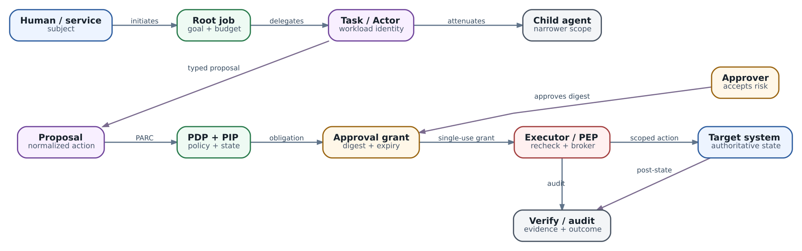

# Identity, authorization и human-in-the-loop: как безопасно делегировать authority агенту

> Снимок главы: **AX `ac233282` · Substrate `36d6d222` · исходники повторно проверены 16.10.2026**. Это закреплённые снимки, не заявление о текущем `main`. Экспериментальный authorization Substrate и предлагаемая архитектура приложения разобраны отдельно.

  
*Authority path: identity, policy и approval превращают proposal в ограниченный execution grant*

В предыдущей главе два агента работали над исправлением `billing`: tester запускал проверки, reviewer изучал diff. Теперь кандидат готов. Проверки прошли, reviewer написал замечания, разработчик их исправил. Остаётся обновить основную ветку.

Для инженера это знакомый момент: результат уже выглядит убедительно, но переносить его в основную ветку пока рано. Нужно понять, какой именно кандидат проверяли, кто вправе принять изменение и не появились ли за это время новые коммиты. Если поручить публикацию агенту, эти вопросы должны получить технический ответ. Иначе фраза пользователя «да, публикуй» останется текстом в чате, а исполняющий сервис будет действовать на основании собственных широких прав.

**Authority здесь означает техническую возможность совершить действие над ресурсом.** Например, прочитать закрытый diff, создать Task или обновить ветку. Наша задача - передать агенту ровно ту часть этой возможности, которая нужна для работы, и сохранить понятную связь между намерением человека и фактическим изменением.

Разберём путь одного действия: кто пришёл с запросом, от чьего имени работает, откуда получил права, что подтвердил человек и что проверяется перед записью. В конце проверим этот путь на локальной модели. Средства изоляции из главы 23 остаются необходимыми: правила доступа приносят пользу, когда у Task нет обходного пути к тому же ресурсу.

## От «опубликуй» к проверяемому разрешению

Начнём с самого короткого варианта. Алиса просит опубликовать исправление. Сервис узнаёт её по корпоративной сессии и находит разрешение работать с репозиторием `billing`. Но запрос к API хранилища отправляет publisher, а не браузер Алисы. Между ними находится Task, который мог вызвать дочернего агента и пережить перезапуск.

У этого действия несколько участников с разными обязанностями.

| Участник | Что означает его identity | На что она влияет |
| --- | --- | --- |
| Алиса, инициатор | От чьего имени поставлена задача | Какие ресурсы и действия вообще можно делегировать |
| Root Task | Какой запуск выполняет эту задачу | Связь с целью, родителем и выданными разрешениями |
| Child Task | Кто сейчас предлагает или запрашивает действие | Собственный ограниченный доступ, отдельный от root |
| Publisher | Какой сервис обращается к целевой системе | Проверка запроса и использование downstream credential |
| Борис, approver | Кто принял риск конкретного изменения | Разрешение выполнить согласованный переход при заданных условиях |

`root_job_id` и `task_id` помогают найти работу в журнале. Сам по себе UUID не аутентифицирует отправителя. Аналогично имя Actor не становится workload identity только потому, что оно есть в JSON. Доверенный сервис связывает эти идентификаторы с проверенной сессией или удостоверением workload. После пересоздания объекта с прежним именем связь должна учитывать новый UID, а не продолжать полномочия старого объекта автоматически.

Из этого вытекают четыре отдельных механизма. **Authentication** устанавливает, кто предъявил запрос. **Authorization** решает, разрешено ли этому участнику конкретное действие. **Approval** фиксирует принятие определённого риска уполномоченным человеком. **Credential** позволяет технически обратиться к следующему сервису. Один credential может переносить identity и сведения о правах, но эти проверки всё равно имеют разную семантику.

Представим, что у publisher есть credential на запись в десять репозиториев. Запрос Алисы относится к одному из них. Действующий от её имени Task не приобретает доступ ко всем десяти: publisher должен пересечь запрос с делегированными правами. Именно это предотвращает ситуацию confused deputy из главы 23, когда сервис использует собственные полномочия в интересах недостаточно привилегированного вызывающего.

### Где заканчивается аутентификация

На входе API проверяет предъявленное удостоверение и создаёт доверенный контекст запроса. В случае JWT нужно проверять подпись допустимым алгоритмом и доверенным ключом, issuer, предназначенную сервису audience и временные ограничения. Простое декодирование payload показывает, что написал отправитель, но не устанавливает его личность. Идентификатор пользователя следует интерпретировать вместе с доверенным issuer: одинаковый `sub` у двух поставщиков не обязан означать одного человека. Это следует из правил проверки JWT, а не из выбранного агентного framework. [RFC 8725](https://www.rfc-editor.org/rfc/rfc8725.html)

При mTLS сервис проверяет сертификат клиента в рамках настроенного доверия и сопоставляет удостоверенную workload identity с ожидаемым вызывающим. Это удобно для связи сервисов. Человек обычно входит через интерактивную сессию IdP; workload получает собственное удостоверение. Передача пользовательского пароля или долговременного токена внутрь Task смешала бы эти два жизненных цикла.

Внешний JSON может содержать просьбу «опубликуй кандидат B». Поля `subject=alice`, `actor=root`, `tenant=finance` из того же JSON нельзя принять за доказательство. Gateway получает subject из сессии, actor из проверенного контекста запуска, а repository UID разрешает по своему inventory с проверкой доступности ресурса для вызывающего. Модель предлагает действие и объяснение; доверенная граница устанавливает, от кого пришло предложение.

## Разрешение состоит из действия, ресурса и условий

Полезно произнести правило целиком: «Task `publisher-7`, действуя от имени Алисы, может продвинуть кандидат B в `billing/main`, если текущее значение ветки A, разрешение ещё действует и Борис подтвердил этот переход».

Здесь есть principal, action, resource и context - модель запроса, которую, например, использует Cedar. Principal обозначает действующую сторону; дополнительные сведения об инициаторе и делегировании приложение помещает в собственную схему entities/context. Policy engine принимает структурированные данные, а приложение отвечает за их происхождение и полноту. [Cedar: authorization](https://docs.cedarpolicy.com/auth/authorization.html)

Для нашего действия resource должен включать устойчивую identity репозитория и точную ветку, action - одну определённую операцию, context - проверяемые ограничения. Разрешение «работать с Git» слишком широко: чтение diff, создание ветки, обновление `main` и удаление репозитория имеют разные последствия. Также имя `billing` без владельца или UID может разрешиться в другой объект после переименования, переноса либо повторного создания.

Правило вида «Алиса - maintainer» полезно как исходное условие. Затем сервис выясняет, что ей разрешено делегировать в этом запуске, какое действие предложено и какие ограничения действуют сейчас. Если организация требует второго человека для обновления защищённой ветки, членство Алисы в maintainers не отменяет это требование.

В этой главе `candidate.promote` - **учебная операция публикации неизменяемого кандидата**, а не имя GitHub API. Она обозначает условное обновление одной ссылки с ожидаемого A на согласованное B. Для реального merge адаптеру потребуются правила целевой платформы: защищённая ветка, проверки конкретного commit, допустимый способ merge и доступные условия конкурентной записи. Эти свойства нельзя вывести только из нашего абстрактного названия операции.

## Как выдавать права дочерней задаче

Root получил право подготовить изменение и запросить его публикацию. Reviewer нужен доступ к кандидату и результатам тестов. Publisher понадобится право выполнить одну публикацию. Разделение этих разрешений позволяет изменить исполнителя, не копируя ему весь пользовательский доступ.

**Делегирование - выпуск нового разрешения для другого участника с установленными пределами.** Сервис выдачи, или broker, сначала проверяет, вправе ли родитель делегировать, а затем проверяет запрошенные ограничения. Этот сервис входит в доверенную часть системы. Если child может самостоятельно записать себе grant в хранилище broker, проверка scope уже ничего не ограничивает.

В простой системе grant можно хранить серверной записью. Она содержит инициатора, текущего actor, ссылку на родителя, разрешённые пары «действие - ресурс», получателя разрешения, срок и право дальнейшего делегирования. Случайный ID этой записи позволяет найти разрешение; дополнительно сервис проверяет identity вызывающего. Если одного знания ID достаточно для исполнения, такой ID уже является bearer capability и требует защиты как секрет.

В нашем примере root разрешены чтение кандидата и его публикация в `billing/main` до момента 100 по учебным часам. Reviewer получает только чтение до момента 50, publisher - только публикацию до 50. У обоих можно запретить дальнейшее делегирование. Запрос reviewer на `repo.delete`, другую ветку или более долгий срок отклоняется broker. Вариант с молчаливым пересечением scope тоже возможен, но вызывающий должен получить фактически выданные права, а не полагаться на запрошенные.

Права важно сравнивать как допустимые сочетания. Если родитель умеет читать репозиторий X и писать в Y, независимое объединение списков `actions=[read,write]` и `resources=[X,Y]` добавит право писать в X. Для сложных правил нужно сохранять условия и связи между полями, а не вычислять два независимых множества.

### Что даёт token exchange, а что остаётся вашей задачей

OAuth 2.0 Token Exchange описывает обмен удостоверений и различает subject и actor. Claim `act` может назвать текущего исполнителя; вложенные `act` сохраняют историю. По RFC прежние actors в этой истории информативны и не являются основанием для access-control решения потребителя. Ограничение прав при выдаче нового токена определяется политикой сервиса выдачи, а не наличием цепочки. Сам обмен также не создаёт автоматического каскадного отзыва полученных токенов. [RFC 8693, §2.1 и §4.1](https://www.rfc-editor.org/rfc/rfc8693.html)

Это имеет практическое последствие. Алиса отозвала root job, а child уже получил подписанный токен на пять минут. Если целевой API проверяет его локально и не обращается к состоянию отзыва, токен может оставаться пригодным до expiry. Короткий срок уменьшает окно, но не делает отзыв мгновенным.

Нужно выбрать требуемую семантику: остановить выдачу новых разрешений, запрещать новые claims по онлайн-проверке цепочки либо добиться прекращения уже начатой операции. Это три разных требования. Первое реализуется в broker, второе требует доступного актуального состояния на пути исполнения, третье - поддержки отмены или fencing у целевой системы. Далее наш локальный пример реализует второй вариант до claim; уже принятую запись он ретроактивно не отменяет.

## Какой механизм контроля выбрать

Начните с вопросов к доступу, а не со списка продуктов. Если в приложении один вид записи и несколько явно заданных ролей, небольшой типизированный gateway с тестируемыми правилами может быть понятнее отдельного распределённого policy-сервиса. Но он всё равно должен проверять каждый исполняемый путь, использовать доверенные атрибуты и закрываться при невозможности принять решение. С ростом числа ресурсов и правил меняется стоимость поддержки такого кода.

| Задача | Подход и возможный инструмент | Что дополнительно потребуется |
| --- | --- | --- |
| Раздать стабильные роли операторам платформы | RBAC; для Kubernetes API - Kubernetes RBAC | Отдельные правила бизнес-действий, которые Kubernetes API не видит |
| Вычислять доступ через owner, team, tenant и родительские объекты | ReBAC; например OpenFGA | Корректное обновление отношений, подходящая согласованность чтения, условия конкретной операции |
| Учитывать среду, тип действия и другие атрибуты запроса | Типизированная policy в Cedar или правила OPA | Доверенные данные, интеграция enforcement, тесты и обработка недоступности |
| Исполнить узкое разрешение без раскрытия upstream secret Task | Broker и специализированный tool gateway | Проверка аргументов, защита от обхода, жизненный цикл разрешений и результат операции |

OpenFGA удобен там, где доступ следует из графа отношений: пользователь состоит в команде, команда владеет пространством, ресурс принадлежит этому пространству. Модель и tuples задают смысл этих отношений. Сервис приложения всё равно должен связать результат проверки с конкретной операцией и обработать изменение отношений за время ожидания. [OpenFGA: authorization concepts](https://openfga.dev/docs/authorization-concepts)

OPA отделяет вычисление policy от её enforcement в приложении. Аналогичное разделение полезно и без отдельного продукта: **PDP** принимает решение, **PEP** не пропускает действие без допустимого решения, а источники атрибутов поставляют необходимые факты. Названия помогают распределить ответственность, но установка PDP не добавляет PEP во все API автоматически. [OPA: philosophy](https://www.openpolicyagent.org/docs/philosophy)

В нашем publisher PEP находится перед записью, вне управляемого моделью Task. Он принимает только известную операцию, загружает права и approval и использует credential целевого хранилища. Task не должен иметь другой credential или сетевой маршрут, позволяющий выполнить ту же запись напрямую. Downstream credential желательно ограничить средствами самой целевой системы. Если она умеет только широкий service credential, gateway остаётся доверенным посредником с широкими правами: нельзя называть этот credential однооперационным только потому, что перед ним стоит узкая policy.

Условия исполнения также требуют явной реализации. Если решение PDP говорит «допустимо после approval», middleware должен обеспечить это условие до вызова executor. Библиотека, вернувшая `allow`, не создаст workflow согласования, транзакцию claim или проверку целевой ревизии вместо приложения.

## Что именно подтверждает человек

В примере с `billing` человек принимает риск продвижения определённого кандидата в основную ветку. Чтобы решить осмысленно, Борису нужны четыре группы сведений: что изменится, почему это предлагают, какие проверки действительно выполнены и что делать при нежелательном результате.

Экран может начинаться так:

> **billing · основная ветка · публикация кандидата B.** Сейчас ветка указывает на A. Предложение относится к задаче Алисы и будет исполнено publisher. Изменяются расчёт округления и два теста. Проверки выполнены для B; подробности и источник результатов доступны отдельно. Если ветка уйдёт с A или кандидат изменится, потребуется новое согласование. Разрешение действует до указанного времени. После публикации сервис проверит целевую ссылку; откат оформляется отдельным контролируемым изменением.

В настоящем интерфейсе A и B заменяются полными устойчивыми идентификаторами с удобным сокращением и просмотром полного значения. Указание «проверки прошли» должно вести к проверенному источнику и конкретному кандидату. Если runner или evidence store не доверены, экран сообщает этот предел; уверенная формулировка модели не улучшает происхождение доказательства.

Согласование связывается с записью примерно такого вида:

```
{
  "schema": 1,
  "subject": "human:alice",
  "actor": "task:publisher",
  "grant_id": "grant-1",
  "audience": "billing-publisher",
  "action": "candidate.promote",
  "resource": "repo:billing-uid/ref:refs/heads/main",
  "expected": "A",
  "candidate": "B",
  "approver": "human:boris",
  "policy_version": 1,
  "expires_at": "2026-10-16T12:30:00Z"
}
```

Это иллюстрация полей, не полный production-формат. В локальной программе A и B представлены 64 hex-символами, а время - целыми значениями для воспроизводимости. В приложении нужно также связать ticket, evidence и иные данные, на основании которых человек принимает решение, если их изменение влияет на допустимость действия. Например, новый результат проверки, отменяющий прежний, должен инвалидировать решение или приводить к повторной оценке, а не оставаться незамеченным приложением к старому approval.

При изменении кандидата создаётся новое предложение. Если Борис поправил аргументы на экране, он подтверждает уже новую нормализованную операцию. Интерфейс и executor должны читать одну сохранённую версию: отдельно отрисованный summary и отдельно изменяемые arguments позволяют согласовать одно, а выполнить другое.

### Digest связывает содержимое, но не удостоверяет автора

Для неизменяемого предложения удобно считать digest канонического представления. Требуется определить схему, допустимые поля, значения по умолчанию, единицы и кодировку. Просто сортировать ключи произвольного JSON недостаточно: разные типы чисел, повторяющиеся ключи или несовпадающие правила нормализации могут изменить смысл. В нашем примере схема намеренно мала: фиксированные идентификаторы и два значения из 64 строчных hex-символов.

Хеш отвечает на вопрос о совпадении содержимого. Если атакующий переписал и payload, и лежащий рядом хеш, проверка их соответствия пройдёт. Поэтому proposal и approval хранятся в доверенном сервисе с контролем изменений либо удостоверяются подписью/MAC с надлежащей проверкой и управлением ключами. Поле `approved=true` из запроса Task не является approval.

### Когда ставить человека в цикл

Место approval определяется последствиями действия и возможностью человека на них повлиять. В `billing` чтение разрешённого diff можно автоматизировать, а обновление основной ветки - поставить на согласование по правилам команды. При этом чтение закрытых персональных данных или передача их внешнему сервису тоже может быть высокорисковым действием: отсутствие записи не означает отсутствие ущерба.

Human-in-the-loop означает, что конкретный переход ждёт решения. Human-on-the-loop подходит, когда действие может происходить автоматически, а оператор успевает заметить отклонение и остановить дальнейший ущерб. Для необратимой отправки денег возможность увидеть alert после записи уже не заменяет предварительное решение. Автоматическое выполнение без участия человека уместно там, где policy, лимиты и восстановление соответствуют принятому риску.

Separation of duties задаётся правилами организации. В учебной модели инициатор и approver должны быть разными людьми, а Task не входит в список approvers. Для критичного изменения могут потребоваться два независимых подтверждения. Количество кнопок само по себе не обеспечивает независимость: если обе роли контролирует одна скомпрометированная сессия, разделения нет.

Человеку также нужны нормальный отказ и понятный путь исправить предложение. Если отказ останавливает работу без объяснения, а approve постоянно требует читать десятки бессодержательных полей, интерфейс подталкивает к формальному согласию. Показывайте конкретный diff, существенные риски и происхождение evidence; журнальные идентификаторы оставляйте доступными, но не делайте их главным содержимым экрана.

## Между approval и записью проходит время

Пока Борис смотрел diff, Алиса могла отозвать задачу, политика - измениться, а другая публикация - обновить ветку. Действие надо оценить ещё раз по текущим данным. В нашем примере новая версия policy консервативно инвалидирует approval целиком. Production-сервис может определить более точные правила совместимости, но должен уметь их объяснить и проверить.

Publisher загружает действующий grant и его цепочку, проверяет actor и audience, затем сверяет точное предложение, срок, статус approval и актуальное право approver. После этого он атомарно занимает разрешение - делает **claim**. Два конкурентных исполнителя не должны оба перейти из `approved` в `claimed`. Для надёжного сервиса это условная запись или транзакция в устойчивом хранилище, а не независимые операции «прочитать статус» и «поменять статус».

Claim означает, что одна попытка получила право начать исполнение. Между ним и внешней записью остаётся граница. Если publisher упал, система должна знать, было ли действие отправлено, можно ли безопасно повторить его и где искать результат. Одноразовое approval блокирует повторный claim, но **не обеспечивает exactly-once во внешней системе**. Механика восстановления из глав 22 и 37 нужна отдельно.

### Проверка версии должна дойти до целевой записи

Проверить «ветка всё ещё A» и затем отправить безусловную запись недостаточно: другой клиент может изменить ветку между этими вызовами. Это time-of-check to time-of-use, TOCTOU. Защита требует условной операции, которая проверит ожидаемую версию в той же точке, где применяется изменение. При несовпадении publisher прекращает эту попытку и возвращает задачу к новому предложению.

Нужно выяснить, какие именно условия поддерживает конкретный API. Например, параметр `sha` в GitHub merge API проверяет head pull request; из него нельзя заключить, что та же операция сравнивает согласованную base revision. Требования к base, merge queue и branch protection проектируются с учётом реальных возможностей платформы. Если API не позволяет атомарно обеспечить необходимое условие, дополнительный GET не создаст эту гарантию: нужен другой путь записи, подходящая сериализация всех writers или более узкое обещание пользователю. [GitHub: merge a pull request](https://docs.github.com/en/rest/pulls/pulls#merge-a-pull-request)

После успешного ответа сервис отдельно проверяет целевое состояние. При timeout результат может быть неизвестен: запись уже произошла, а ответ потерялся. Поэтому нельзя возвращать approval в `approved` и бездумно повторять операцию. Сначала требуется reconciliation по authoritative состоянию и доступному operation ID; для некоторых API одного сравнения конечного значения недостаточно, чтобы доказать, какая попытка его установила.

### Отзыв тоже имеет границу

Новый запрос должен увидеть отзыв root или approval. Но если claim уже выдан и запись принята target, последующий отзыв не удалит произошедшее изменение. Даже онлайн-проверка непосредственно перед отправкой оставляет промежуток до применения в другой системе. Строгое требование «после отзыва ни одна старая попытка не применится» потребует общей упорядоченной границы с target, например проверяемой им fencing epoch. Если её нет, в документации указывают момент, после которого операция считается начатой, и процедуру остановки/компенсации.

Emergency, или break-glass, доступ также проектируют как отдельный путь: определённые операторы, короткий срок, ограниченный scope, причина, усиленный audit и последующий review. Он полезен при аварии штатного механизма, но должен оставлять проверяемые следы. Недоступность policy store не должна незаметно переключать обычный publisher на admin credential.

## Локальный опыт: выдача прав, approval и условная публикация

Пример `examples/ch24_delegated_approval.py` использует только стандартную библиотеку Python. Он не обращается к GitHub, модели, AX или Substrate и не меняет файлы репозитория. Цель опыта - увидеть, на какой границе запрос отклоняется и изменилось ли состояние после попытки.

У модели три части. `Authority` хранит root/child grants, разрешения approvers и approvals. `Operation` задаёт неизменяемый переход ссылки A → B. `FakeRef` - отдельная учебная цель с compare-and-set. Identity передаются как доверенные fixtures: программа **не проверяет JWT, сертификаты и подлинность сессий**. Хранилище и модель приложения находятся в одном процессе; это проверка логики, не security boundary для вредоносного Python-кода.

Перед claim сервис проверяет живую цепочку grant и срок approval. Затем вызывается чистая функция, сверяющая загруженные записи:

```
def authorize(grant, actor, operation, approval, policy_version, approvers):
    """Pure decision over records already loaded from trusted stores."""
    if actor.principal != grant.actor:
        raise Denied("actor_mismatch")
    if (operation.action, operation.resource) not in grant.rights:
        raise Denied("scope_denied")
    if (approval.grant_id, approval.subject, approval.actor, approval.audience) != (
        grant.id, grant.subject, grant.actor, grant.audience
    ):
        raise Denied("approval_binding_mismatch")
    if operation.digest() != approval.operation_digest:
        raise Denied("proposal_changed")
    if approval.policy_version != policy_version:
        raise Denied("policy_changed")
    if approval.approver == grant.subject or approval.approver not in approvers:
        raise Denied("approver_denied")
```

Это часть executor, а не полная проверка запроса: загрузка доверенных данных, audience сервиса, expiry, отзыв и одноразовый claim находятся снаружи этой функции. Такое разделение позволяет проверить само правило независимо от способа хранения. Атомарность claim в модели обеспечивает один `Lock`; после перезапуска процесс потеряет записи. Production-хранилище и распределённая конкуренция здесь не реализованы.

Запуск из корня репозитория:

```
python3 examples/ch24_delegated_approval.py
python3 -m unittest discover -s examples -p 'test_ch24*.py' -v
```

Каждая строка демонстрации начинает с нового состояния. В `replay` сначала выполняется разрешённая публикация, затем делается повторная попытка. В `stale_target` отдельный callback меняет цель **после claim**, чтобы проверить защиту именно у записи. В `lost_reply` исключение возникает после изменения цели.

| Опыт | Результат попытки | Записей publisher | Состояние approval |
| --- | --- | --- | --- |
| `approved` | `applied` | 1 | `applied` |
| `changed_candidate` | `proposal_changed` | 0 | `approved` |
| `stale_target` | `target_changed` | 0 | `precondition_failed` |
| `root_revoked` | `grant_revoked_or_missing` | 0 | `approved` |
| `policy_changed` | `policy_changed` | 0 | `approved` |
| `other_actor` | `actor_mismatch` | 0 | `approved` |
| `approval_expired` | `approval_expired` | 0 | `approved` |
| `replay` | `approval_unavailable` | 1 | `applied` |
| `lost_reply` | `uncertain` | 1 | `uncertain` |
| `authority_down` | `authority_unavailable` | 0 | `approved` |

Состояние `approved` в отклонённых до claim опытах означает сохранённую запись, а не пригодность разрешения сейчас: истёкший срок или отзыв снова запретят исполнение. Отдельный sweeper для смены таких статусов модель не реализует. Счётчик показывает записи publisher, не изменения стороннего writer: в `stale_target` цель уже изменилась, хотя publisher не сделал ни одной записи.

Сначала сопоставьте `changed_candidate` и `stale_target`. В первом случае нарушена связь с человеческим решением; во втором человек согласовал прежний переход, но изменилась среда. Одной проверки digest для второго случая недостаточно. Затем сравните `replay` и `lost_reply`: одинаковое число записей соответствует разной известности результата. Это причина хранить состояние попытки отдельно от разрешения человека.

Тесты дополнительно проверяют расширение scope, срока, audience и права дальнейшего делегирования, чтение без права публикации, самоодобрение, смену approver membership и двух конкурентных претендентов на один claim. Есть и тест ограничения: отзыв root после claim не останавливает уже разрешённую запись. В модели реальная аутентификация и криптографическая защита отсутствуют, durable recovery и live policy engine не тестируются. AX/Substrate стенд не запускается; доказательства совместимости этих систем опыт не даёт.

## Как это соотносится с AX и Substrate

До этого мы проектировали control path приложения. Его нельзя считать встроенным свойством runtime только потому, что runtime умеет запускать Task или выдавать workload identity.

### AX: внешний контроль нужен перед control plane

В AX `ac233282` стандартный `grpcServer()` создаёт `grpc.NewServer()` без встроенных transport credentials и authn/authz interceptors. В `GetTask` atespace берётся из запроса. Это подтверждает ограничение стандартного пути в закреплённом коде, но не описывает любой deployment: внешний proxy может добавлять защиту, и его конфигурацию нужно проверять отдельно. Caller-supplied atespace сам по себе не доказывает доступ к объекту. [AX: server.go](https://github.com/google/ax/blob/ac2332829f22360ff97b0ba34d94dd0dd782f17e/internal/server/server.go)

Практический вывод для издателя `billing`: отдельно защищают создание и управление Task, отдельно - доступ Task к publisher и бизнес-ресурсу. Approval над публикацией не закрывает прямой вход к AX control plane. Историческое обсуждение issue #376 полезно как контекст, а утверждения о конкретных методах нужно связывать с проверенным commit, как в главе 23.

### Substrate: проверяем режим и покрытие, а не название функции

В Substrate `36d6d222` authentication подключена к unary и streaming gRPC. `apiauthn` сначала использует удостоверение mTLS peer с первым URI SAN; при его отсутствии проверяет bearer JWT через настроенного provider. Конфигурация OIDC задаёт issuer и audiences. На этом же снимке присутствуют модель OpenFGA, отношения owner/editor/viewer и экспериментальный флаг `--experimental-enable-authz`, по умолчанию выключенный. Для его включения требуется хотя бы один bootstrap owner. [Substrate: main.go](https://github.com/agent-substrate/substrate/blob/36d6d222a04051cbe05e6877e67bf13498cc558d/cmd/ateapi/main.go), [apiauthn.go](https://github.com/agent-substrate/substrate/blob/36d6d222a04051cbe05e6877e67bf13498cc558d/cmd/ateapi/internal/apiauthn/apiauthn.go)

Нужна важная точность: `authz.UnaryServerInterceptor` проверяет зарегистрированные правила. Если метод отсутствует в registry, interceptor передаёт запрос handler **даже при включённом enforcement**. Это не означает доступ без authentication: она подключена ранее, и handler может иметь собственные проверки. Но гарантии «новый RPC без правила автоматически запрещён» здесь нет. Ветка bypass также существует; её доступность и назначение входят в проверку доверенных путей. [Substrate: authz/interceptor.go](https://github.com/agent-substrate/substrate/blob/36d6d222a04051cbe05e6877e67bf13498cc558d/cmd/ateapi/internal/authz/interceptor.go)

Правила AccessPolicy в registry отмечены `alwaysEnforce` и проверяются даже при выключенном общем enforcement. Вместе с тем `docs/authentication.md` на том же commit ещё сообщает об отсутствии authorization/RBAC. Это расхождение между документацией и экспериментальной реализацией, а не основание считать все вызовы защищёнными или объявлять весь код отсутствующим. Для своего образа надо сверить flag, bootstrap owners, registry, streaming/внутренние пути и реальные отрицательные тесты между ресурсами. [Substrate: registry.go](https://github.com/agent-substrate/substrate/blob/36d6d222a04051cbe05e6877e67bf13498cc558d/cmd/ateapi/internal/authz/registry.go), [authentication.md](https://github.com/agent-substrate/substrate/blob/36d6d222a04051cbe05e6877e67bf13498cc558d/docs/authentication.md)

Egress credential injection решает другую часть задачи: gateway заменяет placeholder в исходящем разрешённом HTTP/HTTPS-запросе настоящим credential. Это позволяет не хранить secret в Actor, но ещё не связывает запрос с approval Алисы или Бориса. И Actor может пользоваться authority инъецируемого credential, даже не видя его байтов. Поэтому разрешённый hostname, path и операция должны соответствовать делегированию. Широкий secret за gateway остаётся широким secret; human approval workflow добавляет приложение. [Substrate: egress credential injection](https://github.com/agent-substrate/substrate/blob/36d6d222a04051cbe05e6877e67bf13498cc558d/docs/egress-credential-injection.md)

## Что проверить перед реальной интеграцией

Перенос модели в сервис начинают с **одной** операции и положительного контроля: законный вызов должен действительно изменить учебную цель. После этого проверяют отказы с наблюдением post-state, а не только текста ошибки. Для нашего сценария это чужой actor/репозиторий, child без write, подмена кандидата после согласования, истёкшее approval, отзыв root, смена policy и недоступное хранилище прав. Прямой путь к target должен проверяться отдельно от корректного gateway-вызова.

Следующий шаг - конкуренция и отказы между системами. Два экземпляра publisher пытаются занять одно approval; процесс завершается после claim; целевая запись проходит, а ответ теряется; права отзывают во время выполнения. У каждого опыта заранее задают допустимый результат и источник доказательства. Набор тестов локальной программы помогает сформулировать эти проверки, но не заменяет их на настоящем backend.

Сразу определите, какие события попадут в audit: initiator/actor/executor, grant и его родитель, digest предложения, approver, версия policy, claim, внешний operation ID, известность результата и verification. Credential, сырой JWT и приватный reasoning в эти события не нужны. Решение `allow` свидетельствует о допуске, `claimed` - о начале попытки, receipt от target - о принятом действии, независимая проверка - о наблюдаемом результате. Эти факты полезно сохранять раздельно.

## Итог

Для публикации исправления мало узнать Алису и показать Борису кнопку. Нужна непрерывная связь: доверенная identity → ограниченное делегирование → конкретное предложение → решение уполномоченного человека → актуальная проверка → claim → условная запись → проверенный результат. У каждого перехода есть свой источник истины и свой предел гарантии.

Начать можно с небольшого gateway и одной хорошо описанной операции. Затем выбирать policy engine, broker и хранилище исходя из числа отношений, нужной согласованности, требований к отзыву и характера внешних side effects. Это делает выбор инструментов следствием задачи. Следующая глава разберёт, как увидеть этот путь целиком: отличить ожидание approval от зависшего runtime, отказ policy от сбоя инструмента и принятый вызов от достигнутого результата.

### Источники и дальнейшее чтение

- [JWT BCP: RFC 8725](https://www.rfc-editor.org/rfc/rfc8725.html)
- [Token Exchange: RFC 8693](https://www.rfc-editor.org/rfc/rfc8693.html)
- [Cedar: authorization](https://docs.cedarpolicy.com/auth/authorization.html) · [OpenFGA: concepts](https://openfga.dev/docs/authorization-concepts) · [OPA: philosophy](https://www.openpolicyagent.org/docs/philosophy)
- [GitHub: merge API](https://docs.github.com/en/rest/pulls/pulls#merge-a-pull-request)
- [AX ac233282: server.go](https://github.com/google/ax/blob/ac2332829f22360ff97b0ba34d94dd0dd782f17e/internal/server/server.go)
- [Substrate 36d6d222: wiring](https://github.com/agent-substrate/substrate/blob/36d6d222a04051cbe05e6877e67bf13498cc558d/cmd/ateapi/main.go) · [authn](https://github.com/agent-substrate/substrate/blob/36d6d222a04051cbe05e6877e67bf13498cc558d/cmd/ateapi/internal/apiauthn/apiauthn.go)
- [Substrate: authz interceptor](https://github.com/agent-substrate/substrate/blob/36d6d222a04051cbe05e6877e67bf13498cc558d/cmd/ateapi/internal/authz/interceptor.go) · [registry](https://github.com/agent-substrate/substrate/blob/36d6d222a04051cbe05e6877e67bf13498cc558d/cmd/ateapi/internal/authz/registry.go) · [model](https://github.com/agent-substrate/substrate/blob/36d6d222a04051cbe05e6877e67bf13498cc558d/cmd/ateapi/internal/authz/model.fga)
- [Substrate: authentication docs](https://github.com/agent-substrate/substrate/blob/36d6d222a04051cbe05e6877e67bf13498cc558d/docs/authentication.md) · [credential injection](https://github.com/agent-substrate/substrate/blob/36d6d222a04051cbe05e6877e67bf13498cc558d/docs/egress-credential-injection.md)
