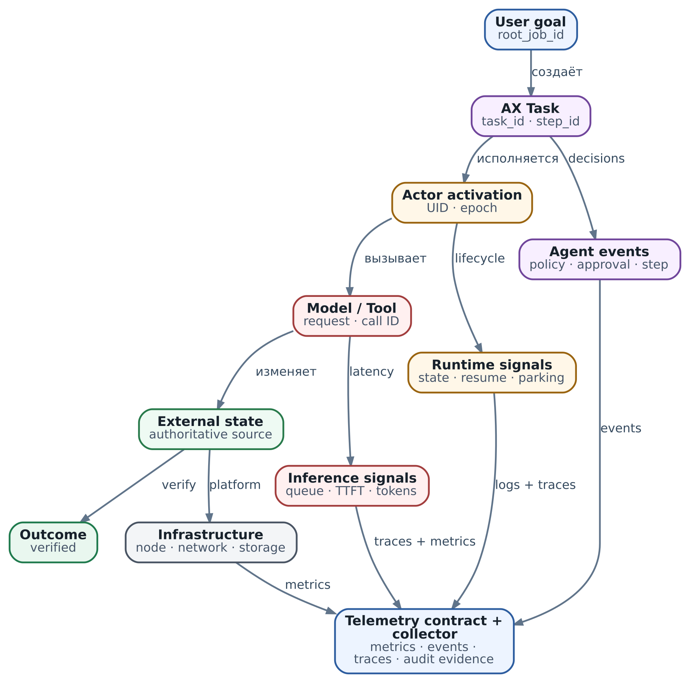

# Observability: от user goal до подтверждённого результата

> Снимок главы: **AX `ac233282` · Substrate `df788825` · повторная сверка 16.10.2026**. Это закреплённые снимки, не текущий `main`. Реализованные сигналы runtime, предлагаемый контракт приложения и ограничения учебного примера разделены.

Алиса возвращается к задаче `billing` из главы 24: «Борис подтвердил публикацию. Почему ветка всё ещё старая?» Дежурный открывает dashboard: CPU свободен, Actor работает, последний запрос к модели успешен. Publisher записал `HTTP 200`. По отдельности компоненты выглядят исправными, но ответить Алисе пока нечего.

Возможно, согласование относится к другому кандидату. Возможно, publisher принял команду, но ещё не выполнил запись. Или запись произошла, ответ потерялся, а verification не запустилась после перезапуска. Наконец, работа могла закончиться правильно, а событие об этом не дошло до хранилища логов. Для каждого случая требуется своё следующее действие.

**Наблюдаемость, observability, - возможность объяснять поведение системы по доступным сигналам и проверяемому состоянию.** Она помогает двигаться от пользовательского симптома к конкретному участку работы, отличать установленный факт от гипотезы и понимать, каких данных не хватает. Monitoring обычно проверяет заранее выбранные условия: растёт очередь, увеличилась доля ошибок, заканчивается место. Эти подходы дополняют друг друга: alert сообщает о проблеме, а наблюдаемость помогает её исследовать.

В этой главе спроектируем путь расследования одной публикации и выберем сигналы и инструменты. Затем испортим доставку событий в offline-модели и передадим настоящий trace context между mini-harness и локальным tool. Нас интересует инженерный результат: сможет ли дежурный обосновать вывод и выбрать безопасное действие, когда часть картины потеряна.

  
*Observability graph: один user goal связывает outcome, agent, runtime и infrastructure signals*

## Сначала договоримся, что считается результатом

У задачи `billing` есть несколько разных успехов. Модель сформировала предложение. Человек подтвердил определённый переход. Publisher принял запрос. Целевая система обновила ссылку. Verifier прочитал её состояние и сопоставил с согласованным кандидатом. Успешный ответ на одном шаге ничего не говорит о завершении остальных без явного контракта.

В нашем сценарии пользовательский результат - **подтверждённая публикация согласованного кандидата в нужную ветку**. Для другого workflow определение будет другим: доставленный ответ, принятая заявка или проверенное изменение конфигурации. Его задают до выбора dashboard, иначе удобная метрика незаметно заменит цель работы.

Затем определяют источники истины. Workflow store хранит состояние задачи и ожидания. Approval service - решение человека и его актуальность. Журнал попыток publisher - claim и известность внешнего результата. Целевая система - собственное состояние и доступный receipt. Verification связывает наблюдаемое состояние с критерием результата. Telemetry backend помогает найти эти факты и понять причинный путь, но не становится автоматически главным хранилищем каждого из них.

Например, запись `tool.verified` в diagnostic log удобна для поиска. Если она потерялась, устойчиво сохранённый результат verification продолжает существовать. Если запись пришла от недоверенного workload, одного её имени недостаточно, чтобы считать изменение проверенным. Нужно знать, кто её выпустил, на каком основании и через какой доверенный путь она попала к читателю.

Отсюда первое правило расследования: **отсутствие события означает отсутствие наблюдения, пока не доказана полнота соответствующего канала**. Оно может объясняться потерей, sampling, задержкой, retention или тем, что событие вообще не было сформировано. Отсутствие `tool.sent` не даёт права безопасно повторить запись. Состояние `uncertain` из главы 24 требует reconciliation с target, а не догадки по логам.

## Какие сигналы отвечают на разные вопросы

Представим, что за час поступило сто задач. По каждой читать полный журнал неудобно. Но и один процент успешных запросов не объяснит судьбу конкретной публикации. Поэтому сигналы имеют разное назначение.

| Сигнал | На какой вопрос отвечает | Что полезно для `billing` | Предел вывода |
| --- | --- | --- | --- |
| Metrics | Насколько широко и долго проявляется проблема? | Доля результатов в срок, возраст ожидающих задач, длительность записи | Агрегат не объясняет конкретную задачу |
| Structured logs / events | Какой наблюдаемый факт записал компонент? | Claim approval, отправка запроса, timeout, результат verification | Запись может отсутствовать, повторяться или содержать ошибочное утверждение |
| Traces | Какие операции связаны и где прошло время? | Gateway → publisher → target, отдельная verification | Неполная instrumentation и sampling оставляют пробелы |
| Profiles | На что процесс тратит CPU или память? | Горячий участок publisher либо collector | Не объясняют, почему задача ждёт человека |

Metric - измерение с определённой семантикой и единицей. Counter считает накопленные события, gauge показывает текущее значение, histogram хранит распределение наблюдений. Structured event описывает факт вроде «запрос принят» или «попытка получила timeout». Он может передаваться как log record; отдельный транспорт для каждого слова «event» не обязателен. Span описывает одну операцию со временем начала/окончания, атрибутами и связями. Trace объединяет связанные spans.

**Audit evidence имеет отдельные требования.** Если организация должна установить, кто разрешил изменение и что именно исполнили, нужны защищённые записи с установленным происхождением, сроком хранения и правилами доступа. Длинный retention обычных логов не обеспечивает ни полноту, ни неизменность. Для критического действия заранее решают, где admission зависит от сохранения evidence, как устроены транзакция/outbox и восстановление. Очередь OpenTelemetry сама по себе этой обязанности не выполняет.

В результате можно иметь быстрый диагностический канал с допустимыми потерями и устойчивый журнал значимых переходов. Это не обязательно две дорогие платформы: различаются прежде всего контракт записи, доступ и режим отказа. Дежурный должен понимать, какой именно источник он сейчас читает.

## Как найти одну работу после retries и resume

Для истории Алисы нужен устойчивый `root_job_id`. Он связывает пользовательскую цель с Tasks и не меняется при переносе на другой Worker. У дочерней задачи собственный `task_id` и ссылка на родителя. Actor UID идентифицирует runtime-объект, activation/epoch - период исполнения после запуска или восстановления. Попытка обращения к инструменту получает отдельный `attempt_id` или `tool_call_id`.

Эти идентификаторы отвечают на разные вопросы. Root говорит «для какой цели?», Task - «какая подзадача?», Actor - «какая исполняемая сущность?», activation и attempt - «какой проход?». Pod и node добавляют физическое размещение. Если после resume искать только прежний Pod, история закончится посередине. Если повторно созданный Actor с тем же именем склеить по имени, в историю попадёт другая сущность.

Idempotency key тоже имеет отдельную роль: он связывает повторные отправки одной логической операции там, где target поддерживает такую семантику. Новый trace не должен автоматически менять этот key; одинаковый trace не даёт права повторно применить запись. Связи между Task и Actor нужно сохранять как данные приложения. Их нельзя восстановить надёжно одним совпадением timestamps.

Полезный **telemetry contract** описывает имена полей, владельцев, единицы, допустимые значения, происхождение и совместимость версий. Например, gateway добавляет root и subject из доверенного контекста, runtime - Actor UID, publisher - ID внешней попытки. Содержимое запроса модели не должно переписывать эти поля. Инициатор и actor из главы 24 остаются разными участниками; поле `trace_id` не заменяет ни одного из них.

### Как проходит context между сервисами

При обычном HTTP/gRPC-вызове отправитель создаёт client span, внедряет context в metadata, а принимающая instrumentation извлекает его и создаёт server span. W3C Trace Context определяет `traceparent`/`tracestate` для переносимой correlation. При очереди context должен попасть в envelope сообщения; из наличия HTTP middleware это не следует. Также propagation необходимо проверить у MCP/tool adapter и при создании child Task. [W3C Trace Context](https://www.w3.org/TR/trace-context/)

Входной trace context - данные вызывающего, а не authentication. На внешней границе можно начать собственный trace и связать его с входным, сохранив полезную correlation без доверия к чужой identity. Произвольный baggage не следует копировать во все запросы: он способен разнести чувствительные сведения и лишние атрибуты по внешним сервисам.

Доступ к самой истории тоже требует authorization. Знание `root_job_id` или `trace_id` не должно открывать чужой tenant: backend и интерфейс проверяют права читателя, включая drill-down и ссылки на evidence. Ingestion также разделяет доверенные platform records и workload assertions. Иначе тщательно ограниченный gateway может раскрыть закрытый diff через общий log store или принять подложное событие от Actor за решение control plane.

В асинхронном workflow логическая цель может ждать час, а активная работа занимать секунды. Держать один незавершённый span на весь час часто неудобно: данные буферизуются до завершения, процесс может исчезнуть, sampling и поиск усложняются. Это инженерный выбор, не запрет спецификации на длинные spans. Обычно удобнее закончить trace постановки задачи, сохранить context и открыть следующий активный участок при resume.

OpenTelemetry позволяет связать spans через parent и links, в том числе между traces. Parent подходит для одного непосредственного причинного предшественника; links полезны для fan-in, возобновления и нескольких причин. Добавлять известные links лучше при создании span, чтобы sampler мог их учесть. Новая activation не обязана всегда создавать новый trace: важнее явно выбрать правило и сохранить связь с root job и предыдущей работой. [OpenTelemetry tracing API](https://opentelemetry.io/docs/specs/otel/trace/api/)

### Время на диаграмме требует интерпретации

Если reviewer и tester работают параллельно 4 и 6 секунд, их общий участок занимает примерно 6 секунд плюс coordination, а не 10. Parent span уже включает время дочерних вызовов; складывать его duration с durations children тоже нельзя. Для длительности пользовательского пути ищут critical path и интервалы ожидания, а для потребления ресурсов могут понадобиться другие суммы.

Wall-clock timestamps нужны для сопоставления компонентов, но часы разных hosts могут расходиться. Внутри процесса длительность измеряют подходящими monotonic часами; причинные ссылки и sequence/version помогают интерпретировать порядок. При этом sequence одного producer не упорядочивает всю распределённую систему. После потери событий «последнее по времени в backend» не становится доказанным текущим состоянием.

## Наблюдаемая публикация по шагам

У принятой цели сначала появляется запись о приёме и критерии результата. Согласование описывается как ожидание с ID и deadline, а не как долгий tool call с неизвестной причиной паузы. После approval publisher сохраняет claim и связывает попытку с digest согласованной операции. Diagnostic events отражают эти переходы, не управляя ими.

При обращении к target полезно различать `request_sent`, protocol response и verification. `HTTP 200` может означать окончательный результат либо лишь приём команды - это определяет API. Называть любую такую запись `executed` без уточнения опасно: дежурный должен увидеть, что известно о внешнем эффекте. В нашем приложении protocol-успех и подтверждение результата имеют разные события.

Минимальный диагностический record может выглядеть так:

```
{
  "schema": 1,
  "event": "tool.protocol_ok",
  "root_job_id": "billing-742",
  "task_id": "publisher-7",
  "activation_id": "activation-2",
  "attempt_id": "attempt-3",
  "producer": "publisher",
  "source_event_id": "publisher-event-981",
  "trace_id": "4bf92f3577b34da6a3ce929d0e0e4736",
  "span_id": "00f067aa0ba902b7",
  "operation_id": "target-op-81",
  "result": "accepted"
}
```

Это schema нашего приложения, не новая OpenTelemetry semantic convention. SDK/adapter сопоставляет её с соответствующими полями выбранного формата. В настоящий контракт добавляют время события, время наблюдения, тип ошибки и необходимые ссылки на approval/операцию. Sensitive payload хранится отдельно, если для него есть обоснование и разрешение. Локальный опыт ниже намеренно использует меньшую схему.

Затем verifier получает данные через предусмотренный read path и сохраняет, что именно проверено: target, ожидаемый кандидат, наблюдаемая версия, источник и время чтения. Совпадение конечного значения может подтвердить критерий цели, но не всегда докажет, какая попытка его установила. Для attribution могут потребоваться receipt и журнал target. Эта граница важна при потерянном ответе и нескольких writers.

Чтобы получить полезный dashboard, нужны и ожидающие задачи. Панель «100% успешных завершений» может выглядеть отлично, когда половина принятых целей навсегда осталась в очереди. Поэтому покажем отдельно достигнутые результаты, просроченные цели, backlog по состояниям и возраст самого старого ожидания. Если включаем ожидание человека в пользовательское время, так и называем SLI; техническое время без approval можно измерять вторым показателем с явными границами.

## Metrics: сначала семантика и бюджет размерностей

Предположим, у counter есть `stage` из трёх значений и `result` из четырёх. Полный набор даёт до 12 комбинаций на один набор остальных dimensions. Добавим 10 000 `task_id` - получим до 120 000 комбинаций; replicas, environments и другие labels умножат число дальше. Не все сочетания обязательно возникнут, но архитектура должна учитывать возможный рост и churn. [Prometheus: labels](https://prometheus.io/docs/practices/naming/)

Высокая cardinality сама по себе не делает данные бесполезными. ID нужны для поиска в events и traces, однако там они тоже стоят денег: влияют на индексы, объём и доступ. Практический выбор - bounded labels для агрегатов и контролируемый поиск по IDs для расследования. Exemplar может связать измерение с trace без превращения `trace_id` в label; он не обеспечивает полную выборку всех задач.

Counter `tool_requests_total` должен иметь однозначную единицу учёта: логическая операция, отправленная попытка или protocol response. Retry увеличит число попыток, но не количество принятых целей. Для длительности задают секунды либо другую явно указанную единицу и проверяют преобразование на границе OTLP/Prometheus. Успех и отказ можно наблюдать в одной histogram с bounded outcome, если эта семантика осмысленна для запроса.

Для вопроса «какая доля укладывается в 30 секунд?» bucket на этом пороге часто полезнее приблизительного p99. У classic histogram число series включает buckets, count и sum; увеличение числа buckets тоже имеет цену. Quantiles отдельных replicas нельзя просто усреднить и назвать общим p95: распределения сначала агрегируют совместимым способом. При использовании native histogram учитывают поддержку выбранного backend и тип данных. [Prometheus: histograms](https://prometheus.io/docs/practices/histograms/)

Данные о ресурсах требуют своей семантики. Отсутствующее measurement означает «не измерено», пока источник не определил иное. Накопительный CPU counter читают как прирост в рамках соответствующего epoch, учитывая reset; складывать все накопленные readings нельзя. По этой причине в контракт входят не только названия полей, но и источник, units и жизненный цикл счётчика.

## SLI: как не потерять зависшие задачи в знаменателе

**SLI** - определённый показатель качества, **SLO** - согласованная цель для него на заданном окне. Для `billing` выберем учебный показатель: доля принятых целей, результат которых подтверждён не позднее индивидуального deadline. Плановое ожидание approval входит в это время. Смена такой политики требует новой явной версии измерения, а не исключения неудобных задач задним числом.

Берём cohort по времени принятия `[start, end)`. На момент наблюдения `now` в denominator включаем все eligible цели этого cohort, чей deadline уже наступил. Good - verification зафиксирована к этому deadline. Просроченное ожидание и неизвестный результат учитываются как bad для данного обязательства; они не обязаны быть terminal в workflow. Цели, чей deadline впереди, показываются отдельно как `not_due`. Поздний успех полезен пользователю, но не исправляет факт нарушения срока.

Это один конкретный deadline-based SLI, не универсальная формула надёжности. Для непрерывной отчётности можно группировать по наступлению deadlines или использовать другое документированное правило окна. Главное - сохранить учёт принятых работ, явно определить исключения, запаздывание данных и пересчёт. Пустой denominator означает «нет наблюдений», а не 100% успеха. Общий подход к определению пользовательских SLIs и SLOs изложен в [Google SRE Workbook](https://sre.google/workbook/implementing-slos/).

Источник population должен быть полным настолько, насколько требует измерение. Даже unsampled events могут потеряться, продублироваться или не быть записаны при аварии. Для точного расчёта нужны устойчивые acceptance records, дедупликация и проверка полноты, например сверка с workflow store. При недоступном источнике показатель становится неизвестным или помечается неполным; исчезновение источника нельзя интерпретировать как отсутствие ошибок.

## Локальный опыт: сломаем доставку, сохранив смысл результата

`examples/ch25_observability_contract.py` - программа на стандартной библиотеке Python. Сеть, OTel SDK, collector service, модель и AX/Substrate не используются. `Goal` и ledger - **доверенные fixtures состояния**, а не реализация устойчивого хранилища. Программа не публикует кандидатов; она рассматривает заранее заданные результаты работы.

У пяти целей acceptance time равен 0, deadline - 50; шестая принята в 45 и имеет deadline 95. Смотрим cohort `[0, 50)` при `now=60`. Все числа - условные единицы времени, а не реальная длительность запуска. `happy` проверена в 20, `telemetry_lost` - в 30, `late_verified` - в 55. Две другие старые цели ещё ждут approval либо выяснения результата записи.

Diagnostic collector имеет очередь вместимостью один record. В опыте `telemetry_lost` она занята записью приёма, поэтому событие verification отбрасывается. Сам результат verification остаётся в ledger. Другая запись доставляется повторно, а старое событие `tool.sent` приходит последним с более поздним wall-clock timestamp, имитируя рассогласование часов. Collector считает потери и дубликаты; в пределах одного producer/activation выбирает событие по sequence.

Запуск из корня репозитория:

```
python3 examples/ch25_observability_contract.py
python3 -m unittest discover -s examples -p 'test_ch25*.py' -v
```

Функция расчёта SLI намеренно вообще не принимает diagnostic events:

```
def outcome_sli(goals, start, end, now):
    """Deadline-matured acceptance cohort; diagnostics are deliberately absent."""
    if not start < end <= now:
        raise ValueError("invalid observation window")
    if len({g.job for g in goals}) != len(goals):
        raise ValueError("duplicate goal")
    if any(g.deadline < g.accepted_at or (g.verified_at is not None and
           not g.accepted_at <= g.verified_at <= now) for g in goals):
        raise ValueError("invalid goal time")
    cohort = [g for g in goals if g.eligible and start <= g.accepted_at < end]
    due = [g for g in cohort if g.deadline <= now]
    good = sum(g.verified_at is not None and g.verified_at <= g.deadline for g in due)
    return {"eligible": len(cohort), "due": len(due), "not_due": len(cohort) - len(due),
            "good": good, "bad": len(due) - good,
            "ratio": good / len(due) if due else None}
```

`investigate` выбирает следующую проверку по доверенному состоянию, а events использует для обнаружения расхождения наблюдений. Она не исправляет workflow и не повторяет side effect. Результат получается таким:

| Цель | Состояние по ledger | Следующая проверка | Результат по deadline |
| --- | --- | --- | --- |
| `happy` | `verified` | `none` | `good` |
| `approval_wait` | `approval` | `check_approval_deadline` | `bad` |
| `reply_lost` | `uncertain` | `reconcile_target` | `bad` |
| `telemetry_lost` | `verified` | `inspect_telemetry` | `good` |
| `late_verified` | `verified` | `none` | `bad` |
| `young` | `running` | `follow_activation` | `not_due` |

По выбранному SLI good = 2, due = 5, ratio = **40%**; одна цель ещё не созрела для оценки. Если оставить только три завершившиеся verification, получится 2/3, около **66,7%**. Разница вызвана знаменателем, а не улучшением системы. Отбрасывание ещё и позднего результата исказило бы картину сильнее.

В диагностическом канале 11 предложенных к доставке records: один потерян из-за очереди, одна повторная копия удалена при дедупликации, сохранено девять уникальных записей. Последним по sequence для `happy` остаётся `tool.verified`, хотя старое событие пришло позже и имеет больший timestamp. Это правило действует только в отдельном stream; программа не строит глобальные распределённые часы.

Попробуйте мысленно удалить все diagnostics для `happy`. По ledger цель останется verified, но потребуется исследовать instrumentation или доставку. Теперь сделайте ledger недоступным: результат расследования должен стать `unknown`, даже если в diagnostics есть `tool.verified`. Эти два случая включены в тесты и показывают, почему источники имеют разный вес.

В примере также проверяются bounded metric labels и allowlist атрибутов. Данные `Authorization`, prompt, произвольные strings и попытки подменить identity не попадают в диагностические атрибуты. Это конечная учебная schema, не универсальное DLP: доверенные Context и хранилище не аутентифицированы, строки IDs сами требуют защиты, а допустимые числа могут быть covert channel. Очередь ограничена, но история records хранится без retention в памяти. В этой offline-модели нет disk buffer, реального sampling, OTLP-export, передачи trace context по сети, span links и устойчивости после рестарта. Тесты этих преобразований не заменяют интеграцию.

## Живой опыт: проследим чтение файла через HTTP

Теперь проверим передачу context на настоящем вызове. Для этого возьмём безопасный `read_file` из сквозного harness главы 4. Mini-harness отправит запрос локальному HTTP-tool, tool прочитает свой временный `batching.py` и вернёт текст с SHA256. Мы знаем ожидаемые bytes, поэтому можем отдельно ответить на два вопроса: файл прочитан правильно и сохранилась ли причинная связь между компонентами.

Код находится в `examples/trace_context/demo.py` этой рабочей редакции. Это один процесс с двумя потоками и двумя явными `TracerProvider`: `learning-harness` и `learning-tool`. Между ними действительно проходит HTTP-запрос через 127.0.0.1 на свободном порту. Отдельные providers позволяют увидеть resources двух компонентов; явное извлечение context проверяет транспортную границу. Такой малый опыт удобен для первого разбора без контейнеров и backend.

### Подготовим отдельное окружение

Проверенный профиль — Linux x86\_64, Python 3.13.5, OpenTelemetry API/SDK 1.45.1. SDK и три остальные зависимости перечислены с hashes в `requirements.txt`; это отдельное дополнение к прежним stdlib-программам. Возьмите полную рабочую копию этой редакции, как указано во входе в практику главы 0. Из корня книги выполните блок ниже; `.venv-trace-l04` должен быть новым каталогом:

```
set -eu
test ! -e .venv-trace-l04
python3 -m venv .venv-trace-l04
.venv-trace-l04/bin/python -m pip install \
  --only-binary=:all: --require-hashes \
  -r examples/trace_context/requirements.txt
.venv-trace-l04/bin/python -m unittest discover \
  -s examples/trace_context -p 'test_*.py' -v
.venv-trace-l04/bin/python -m examples.trace_context.demo \
  --scenario propagated
```

Только установка пакетов требует внешней сети. Сам опыт работает на loopback, создаёт и удаляет собственный fixture и завершает сервер после вызова. У него нет настройки внешнего endpoint или произвольного root. Требуются POSIX и разрешение слушать локальный порт. Venv здесь отделяет SDK от окружения остальных примеров; запускать все последующие команды нужно из того же корня, используя его Python.

### От span в памяти до context в заголовке

API даёт операции создания span, текущий context и links. SDK назначает реальные trace/span IDs, принимает решение sampling и завершает spans. `SimpleSpanProcessor` передаёт каждый завершённый span в `ConsoleSpanExporter`. В примере exporter сначала пишет в отдельный буфер каждого компонента, а программа выводит полученные SDK records в JSON. Так в одном stdout видны обе половины опыта. Короткий formatter берёт поля `ReadableSpan`; IDs и parent relationships не подготовлены заранее.

Для опыта sampler явно задан как `ALWAYS_ON`, resource содержит только выбранное имя сервиса, глобальный provider не заменяется. Это помогает получить все четыре spans в маленьком запуске. Синхронный exporter делает вывод понятным: завершение span сразу вызывает export. В рабочем сервисе стоимость такого вызова нужно учитывать; batch/exporter и потери при shutdown проверяют отдельно. Локальный stdout ещё не проверяет доставку OTLP до collector. Устройство этих частей описано в [OTel Python exporters](https://opentelemetry.io/docs/languages/python/exporters/).

При обычном вызове получается такое дерево. Буквы обозначают IDs вашего запуска, а не фиксированные значения программы:

```
trace T1
harness.attempt  span A
  tool.read.client  span C, parent A
    tool.read.server  span S, parent C (remote)
      file.read  span F, parent S
```

Сначала mini-harness открывает span попытки. Внутри него создаётся client span инструмента. Пока именно client span является текущим, propagator внедряет его context в carrier — обычный словарь HTTP-заголовков. На принимающей стороне извлечённый context становится parent для server span:

```
# Отправитель, внутри текущего tool.read.client:
carrier = {}
PROPAGATOR.inject(carrier)

# Получатель, из реально полученных HTTP-заголовков:
parent = PROPAGATOR.extract(carrier, context=Context())
with tool_tracer.start_as_current_span(
        'tool.read.server', context=parent, kind=SpanKind.SERVER):
    ...  # file.read и ограниченный read_file
```

`Context()` задаёт пустую исходную основу на входе сервера: потерянный заголовок не будет незаметно заменён случайным ambient context этого процесса. В реальном adapter ту же проверку проводят на каждой границе транспорта и смены исполнения. Автоматическая instrumentation удобна для поддерживаемых HTTP/async библиотек, но полезность её hooks проверяют таким же сквозным запросом. В этой первой работе границу видно непосредственно в двух вызовах `inject`/`extract`. [OTel Python propagation](https://opentelemetry.io/docs/languages/python/propagation/)

В JSON смотрите `wire[0].received_traceparent` и записи `spans`. У server span должен быть тот же `trace_id`, что у client, а `parent_span_id` должен равняться `span_id` client. Поле `remote_parent=true` показывает извлечение удалённого span context. В заголовке переносится ID client, а не самый верхний ID попытки: иначе исчезнет один уровень вызова.

Последний байт `traceparent` — битовая маска, а не одно булево число. В выбранном SDK вы увидите `03`: sampled `0x01` и random-trace-id `0x02`. Проверяйте sampled через маску, а перенос оставьте propagator. Поддержка второго бита есть в [TraceFlags этого SDK](https://github.com/open-telemetry/opentelemetry-python/blob/14971cef9c84c2354cbaf6871090896fad0f9a1a/opentelemetry-api/src/opentelemetry/trace/span.py) и описана в [Trace Context Level 2, Candidate Recommendation Draft](https://www.w3.org/TR/2024/CRD-trace-context-2-20240328/); это не утверждение, что все реализации поддерживают один профиль flags.

### Уберём заголовок и найдём разрыв

```
.venv-trace-l04/bin/python -m examples.trace_context.demo \
  --scenario dropped
```

Этот режим очищает tracing carrier перед HTTP-вызовом. Прикладные заголовки `x-learning-operation-id` и `x-learning-attempt-id` остаются. Чтение всё ещё возвращает правильный hash, но принимающий SDK создаёт новый root: у server span другой trace ID и нет parent. В выводе будет два traces, а проверки `same_client_server_trace` и `server_parent_is_client` станут false. Код выхода 0 означает, что программа успешно воспроизвела заданный разрыв; поле `summary.meaning` прямо называет его намеренным.

Совпадение `learning.operation.id` помогает найти обе части истории по одной прикладной работе. Оно не восстанавливает потерянный parent: внутри работы могли быть параллельные вызовы и повторы. Для дерева нужны исходный context или другая явно сохранённая причинная связь. Здесь мы знаем, какой заголовок удалили, потому что сами контролируем опыт. В инциденте проверяйте отправку, получение и extractor на границе; близость timestamps не выбирает правильного родителя.

Есть и вариант `--scenario invalid`: он передаёт `traceparent` с нулевыми trace/span IDs. Настоящий propagator отвергает такой context, и сервер начинает новый trace. Поэтому при расследовании важно различать «заголовка нет» и «заголовок дошёл, но не принят». Начните с wire-поля, затем сравните IDs и parent у экспортированных spans.

### Возобновим попытку с явной связью

```
.venv-trace-l04/bin/python -m examples.trace_context.demo \
  --scenario resumed
```

Первая попытка помечается `waiting`, её span завершается, а context сохраняется в словарь checkpoint. Вторая получает тот же operation ID, новый attempt ID и новый root trace. При создании root ей передаётся `Link` на первую попытку:

```
# Предыдущий span уже завершён; saved содержит его context.
previous = PROPAGATOR.extract(saved, context=Context())
link = Link(get_current_span(previous).get_span_context())
with harness_tracer.start_as_current_span(
        'harness.attempt', context=Context(), links=[link]):
    ...  # новый client/server/file участок
```

У нового root `parent_span_id=null`, а в `links` — trace/span IDs завершённой попытки. Так видно и разделение активных участков, и их причинное продолжение. Вторая попытка снова передаёт обычный context своему tool, поэтому внутри неё сохраняется полный client/server путь. Общий operation ID служит для поиска работы целиком, attempt ID — для различения проходов, link — для явной связи между ними. Links известны до создания span, что позволяет sampler учитывать их. [OTel Python links](https://opentelemetry.io/docs/languages/python/instrumentation/#adding-links)

Checkpoint в этой вариации хранится только в памяти. Долгое ожидание и отказ процесса не исполняются; отсутствуют устойчивое сохранение, новый Actor и restore. Для настоящего resume нужно отдельно проверить запись context вместе с состоянием работы, его чтение после сбоя и поддержку links в backend. Восстанавливать можно ту причинную связь, которая была сохранена, а не произвольного «последнего соседа по времени».

| Режим | Наблюдаемый граф | Прикладной результат |
| --- | --- | --- |
| propagated | 4 spans, один trace; server parent — client | Синтетический файл прочитан |
| dropped / invalid | 4 spans, два traces; server стал root. Operation ID общий | Тот же файл прочитан, но propagation нарушен |
| resumed | 5 spans, два traces; второй attempt — root с link на первый | Один вызов чтения во второй попытке |

### Как перенести этот опыт в свой harness

Сначала назовите операции, которыми владеет приложение: попытка controller, обращение к модели, proposal/admission инструмента, вызов и verification результата. Затем инструментируйте одну границу и проверьте фактический context на обеих сторонах. В нашем опыте mini-harness делает один известный вызов без модели, а ограниченный `read_file` заимствован из неизменённого L01. Полный model loop L01 не переоборудован автоматически; этот шаг показывает механизм для вашего adapter.

Начните самостоятельную проверку с небольшого изменения: перенесите `inject` наружу client span. До запуска предскажите, какой ID окажется parent у server и какой уровень пропадёт. Затем удалите прикладной operation header: текущая schema отклонит запрос до чтения; объясните, какие IDs принадлежат tracing-протоколу, а какие введены самим приложением. Наконец, представьте две причины для одного возобновления и обоснуйте выбор нескольких links вместо выдуманного единственного parent.

В traces экспортируются только выбранные IDs, hash и размер fixture, состояние ожидания и имена операций. Текст файла, arguments и credentials не включаются в атрибуты; автоматического экспорта всех заголовков или baggage нет. Имена resource и прикладные headers здесь задаёт доверенный учебный процесс: они дают correlation, но не authentication. Сервер остаётся локальным учебным HTTP-tool без auth; не открывайте его наружу. Нет OTLP, collector/backend, persistent queue, проверки crash/restore или production sampling. Прежняя offline-модель SLI продолжает отвечать на свой вопрос о population и результате; число полученных spans не становится новым знаменателем качества.

## Как выбирать инструменты под получившийся контракт

Теперь понятно, какие обязанности распределять между инструментами. Instrumentation рождает сигналы в контролируемых сервисах. Collector принимает и преобразует их. Backend хранит и ищет. UI помогает переходить от агрегата к конкретной истории. Ни один слой автоматически не реализует остальные.

| Потребность | Подходящий класс инструмента | Что проверить при выборе |
| --- | --- | --- |
| Единая schema и перенос context между сервисами | OpenTelemetry SDK и instrumentation библиотек | Поддержку используемых протоколов, async context, версию conventions и реальную полноту hooks |
| Приём, redaction, batch и маршрутизация сигналов | OpenTelemetry Collector | Пропускную способность, queue/retry/storage, безопасность входов и наблюдаемость потерь |
| Агрегаты и alerts по bounded dimensions | Prometheus-совместимый metrics backend | Series budget, retention, histogram support, полноту ingestion и стоимость эксплуатации |
| Поиск по job/attempt и просмотр причинного пути | Log store и trace backend, например Jaeger | Индексацию IDs, доступ, links, sampling, retention и переходы из metrics |

Для небольшой системы можно начать с одного instrumented gateway, структурированных logs и понятной метрики принятия/результата. Дополнительный collector оправдан, когда нужны общая обработка, несколько экспортёров и контроль pipeline. Отдельный trace backend полезен, когда ручное соединение операций уже мешает расследованию. UI вроде Grafana объединяет views, но не создаёт отсутствующие causal links или недостающие acceptance records.

Проверяйте выбор на своём отказном сценарии: можно ли найти `billing-742`, увидеть ожидание approval, перейти к конкретной попытке после resume и отличить потерянный response от неподтверждённого результата? Это более содержательный acceptance test, чем количество встроенных dashboards. Для tracing и поиска первичны [документация Jaeger](https://www.jaegertracing.io/docs/) и возможности конкретного backend; для обработки доставки - [Collector resiliency](https://opentelemetry.io/docs/collector/resiliency/).

### LLM telemetry как часть этого пути

Модель - один из участников workflow. Её request нужно связать с Task и попыткой, а latency разделить по реально наблюдаемым границам. TTFT со стороны клиента уже может включать сеть и очередь provider. Server-side queue time и prefill duration имеют другую точку отсчёта; суммировать всё без определения интервалов нельзя. Подробные измерения inference разобраны в главе 21.

Для штатной диагностики обычно достаточно operation/model identifiers, token counts, finish/error class и измеренных durations. Provider request ID полезен для расследования, но не для metric label. Если оценивается стоимость, сохраняют версию pricing и различают оценку от итогового bill. Качество ответа или корректность изменения измеряются отдельно: быстрый `finish_reason` ещё не подтверждает пользовательский outcome.

GenAI semantic conventions помогают согласовать имена spans, metrics и events, но версию нужно закрепить вместе с instrumentation. При сверке этой редакции прежний раздел сайта OTel уже перенаправляет к отдельному [репозиторию GenAI conventions](https://github.com/open-telemetry/semantic-conventions-genai). Поэтому в книге не следует обещать, что произвольный набор `gen_ai.*` универсально стабилен или что смена SDK автоматически мигрирует старые queries.

Prompt, completion, tool arguments и results собирают только при понятной необходимости, с разрешением, ограничениями размера, доступом и retention. Лучше не собирать содержимое по умолчанию, чем надеяться удалить всё секретное одной regex. В частности, скрытый reasoning не нужен для обычного incident timeline: используйте наблюдаемые операции и подтверждённые решения.

## Что произойдёт при отказе самой телеметрии

Collector и exporter имеют очереди, пределы памяти, retry и shutdown. При переполнении данные могут быть отброшены; crash до flush тоже оставляет пробел. Для важного потока нужен подходящий persistent buffer, но и он ограничен размером диска и отказным доменом. Retry может дать повторную доставку. Формулировка «у нас OTLP» не задаёт end-to-end exactly-once и не доказывает полноту audit. [OpenTelemetry Collector resiliency](https://opentelemetry.io/docs/collector/resiliency/)

В модели дедупликация использует `(producer, source_event_id)` и сравнивает содержимое повторов. В настоящем приложении нужно определить уникальность, срок хранения ключа и поведение при конфликте. Не всякая native log-запись уже имеет такой ID. Если source их не предоставляет, произвольный хеш текста не всегда отличит дубль от двух действительно одинаковых событий.

Sampling выбирает часть диагностических данных ради стоимости. Head sampling принимает решение рано и ещё не знает, произойдёт ли ошибка позже. Tail sampling может учитывать пришедшие spans, но не вернёт уже отброшенное на входе. Чтобы обещать сохранение всех ошибок, нужно обеспечить полный вход нужного класса, маршрутизацию связанных spans, достаточный буфер и обработку поздних данных; даже тогда доставка имеет свои ограничения. Комбинировать head/tail можно, но обещание относится только к реально дошедшей population. [OpenTelemetry: sampling](https://opentelemetry.io/docs/concepts/sampling/)

Критичные audit/state records не следует намеренно сэмплировать. Но отсутствие sampling не равно гарантированной доставке. Если диагностический pipeline недоступен, обычный запрос не должен зависать бесконечно. Если отсутствует обязательное audit evidence, поведение критической записи определяется policy главы 24: остановить admission, использовать предусмотренный устойчивый путь или перейти к явно разрешённой аварийной процедуре. Это разные режимы, а не один глобальный `fail open`.

У pipeline должны быть собственные наблюдаемые счётчики: принято, отказано, потеряно, повторено, заполнение очереди и возраст старейшей записи. Их проверяют независимым от этого же канала способом, где это оправдано. «В логах collector нет ошибок» ничего не доказывает, если его logs уходят через тот же отказавший exporter.

## Что дают закреплённые AX и Substrate

### AX: полезные локальные записи и работа для adapter

На снимке AX `ac233282` стандартные `ax-server` и `ax-task-runner` настраивают `slog.NewTextHandler` в stdout. Стандартный `grpcServer()` создаёт `grpc.NewServer()` без OTel interceptors. В roadmap автоматический сбор OpenTelemetry trajectory на runner layer обозначен будущей работой. Это подтверждает отсутствие такого готового пути в проверенных точках входа, но не запрещает внешнюю instrumentation в конкретном deployment. [AX: server entry point](https://github.com/google/ax/blob/ac2332829f22360ff97b0ba34d94dd0dd782f17e/cmd/ax-server/main.go), [runner entry point](https://github.com/google/ax/blob/ac2332829f22360ff97b0ba34d94dd0dd782f17e/cmd/ax-task-runner/main.go), [roadmap](https://github.com/google/ax/blob/ac2332829f22360ff97b0ba34d94dd0dd782f17e/docs/roadmap.md)

Практический путь - инструментировать границы, которыми владеет приложение: приём goal, mapping Task/Actor, harness, model gateway и publisher. Если downstream trace context не переносится, adapter сохраняет хотя бы явную связь job/attempt и описывает этот пробел. Установка collector возле AX не создаст отсутствующие spans внутри runner и не определит verification за автора приложения.

### Substrate: runtime-события с известными ограничениями

В `df788825` есть собственные metadata `ate.*`, JSON-обёртка container output, actor-aware CLI logs, метрики и traces компонентов. Три native event names - `ate.actor.state_changed`, `ate.actor.crashed`, `ate.actor.usage_sampled` - присутствуют в коде `actorevent` и registry. Runtime attribution помогает связать смену Worker, restore и измерения, а бизнес-цель `billing` и критерий её успеха добавляет приложение. [Substrate: observability](https://github.com/agent-substrate/substrate/blob/df788825e6fc13dd7aa5fd283c8f14bd4c818247/docs/observability.md), [actorevent](https://github.com/agent-substrate/substrate/blob/df788825e6fc13dd7aa5fd283c8f14bd4c818247/internal/actorevent/actorevent.go)

По документированному контракту `ateapi` пишет state transition после commit. Событие свидетельствует о состоявшемся переходе при доверенном происхождении, но потерянный следующий record оставит derived view устаревшим. Для current state обращаются к control plane. `otlp,console` даёт две копии и может помочь пережить отказ одного пути, но общий отказный домен и duplicate ingestion остаются. CLI stream также не заменяет central history после migration.

Container stdout получает runtime metadata, но trace context конкретного concurrent request должен прийти из actor SDK: forwarder общего потока не может достоверно угадать, какой запрос породил строку. Для прямого OTLP-export из Actor в этом снимке требуется отдельный egress path; stdout проходит через worker другим путём. Наличие логов поэтому не доказывает, что traces и metrics SDK из sandbox доходят до collector.

Особенно важно происхождение metadata. В коде `otlprelay` allowlist по `service.name` прямо назван protocol contract, а не security boundary: имя задаёт клиент, скомпрометированный процесс может заявить разрешённое. Поэтому `service.name=ateapi` или `ateom-gvisor` не является криптографическим доказательством отправителя. Для доверенного attribution нужны защищённый ingress, проверенная workload identity и контролируемое добавление reserved fields. Это продолжение модели прав из главы 24, а не свойство одной строки в record. [Substrate: relay source gate](https://github.com/agent-substrate/substrate/blob/df788825e6fc13dd7aa5fd283c8f14bd4c818247/internal/otlprelay/relay.go)

В диагностике ожидания полезна семантика request parking. `budget_exhausted` означает исчерпание бюджета при retryable условии, а не обязательно нехватку Worker: возможны lifecycle contention или недоступность control plane. Значение `served` означает, что запрос маршрутизирован к Worker; оно не подтверждает завершение бизнес-задачи. Аналогично фазы restore могут перекрываться, а разные usage formats иметь разные units/epochs. Перед запросом к backend проверяют registry и источник измерения, а не угадывают смысл по похожим названиям. [Substrate: request parking](https://github.com/agent-substrate/substrate/blob/df788825e6fc13dd7aa5fd283c8f14bd4c818247/docs/request-parking.md)

## Как этим пользоваться дежурному

Вернёмся к вопросу Алисы. Найдите job и сохранённый критерий результата. Если workflow ждёт approval, сверьте его ID, кандидат и deadline; свободный CPU здесь ожидаем. Если попытка помечена `uncertain`, найдите operation ID и выполните предусмотренную проверку target. Если ledger уже хранит verified outcome, а UI его не показывает, исследуйте projection и доставку, не публикуйте изменение повторно ради появления зелёной строки.

Если активная работа действительно выполняется, переходите к текущей activation и связанным model/tool spans. Найдите интервал, на котором прошло время: orchestration queue, Actor resume, модель или запись. Затем смотрите runtime и infrastructure metrics этого участка. Причинность требует проверки: совпадение высокой CPU и долгого ответа - повод для гипотезы, не доказательство bottleneck без дальнейших наблюдений.

Alert для ночного дежурства должен выражать impact и требуемое действие: растёт число просроченных целей, потеряна возможность проверить результат либо быстро расходуется согласованный error budget. Порог CPU может быть полезным диагностическим alert, но сам по себе не определяет срочность. Уведомление должно вести к population, affected jobs, состоянию pipeline и первым проверкам; при малом трафике смотрят и абсолютное число затронутых целей. [SRE Workbook: alerting](https://sre.google/workbook/alerting-on-slos/)

## Итог

Хорошая наблюдаемость позволяет сказать: «эта цель ждёт решения до такого-то срока», «эта запись могла произойти, нужен reconciliation» или «результат подтверждён, но диагностика неполна». Эти ответы помогают продолжить работу и оставляют неопределённость видимой.

Для этого нужны критерий результата, надёжный учёт принятых целей, идентификаторы разных масштабов и согласованный смысл сигналов. SDK, collector и backend выбирают под этот контракт, проверяя propagation, cardinality, потери и безопасность ingestion на одном сквозном сценарии. Следующая глава переносит инженерную проверку в Proxmox/KVM-лабораторию. Здесь мы подготовили вопросы и критерии наблюдения; сам стенд не запускали и совместимость закреплённой пары AX/Substrate этим опытом не доказывали.

### Источники и дальнейшее чтение

- [W3C Trace Context](https://www.w3.org/TR/trace-context/) · [OTel tracing API](https://opentelemetry.io/docs/specs/otel/trace/api/)
- [Prometheus: labels](https://prometheus.io/docs/practices/naming/) · [histograms](https://prometheus.io/docs/practices/histograms/)
- [OTel sampling](https://opentelemetry.io/docs/concepts/sampling/) · [Collector resiliency](https://opentelemetry.io/docs/collector/resiliency/)
- [SRE Workbook: SLIs/SLOs](https://sre.google/workbook/implementing-slos/) · [alerts](https://sre.google/workbook/alerting-on-slos/)
- [GenAI conventions](https://github.com/open-telemetry/semantic-conventions-genai) · [Jaeger docs](https://www.jaegertracing.io/docs/)
- [AX ac233282: server](https://github.com/google/ax/blob/ac2332829f22360ff97b0ba34d94dd0dd782f17e/internal/server/server.go) · [roadmap](https://github.com/google/ax/blob/ac2332829f22360ff97b0ba34d94dd0dd782f17e/docs/roadmap.md)
- [Substrate df788825: observability](https://github.com/agent-substrate/substrate/blob/df788825e6fc13dd7aa5fd283c8f14bd4c818247/docs/observability.md) · [parking](https://github.com/agent-substrate/substrate/blob/df788825e6fc13dd7aa5fd283c8f14bd4c818247/docs/request-parking.md)
- [Substrate: actorevent](https://github.com/agent-substrate/substrate/blob/df788825e6fc13dd7aa5fd283c8f14bd4c818247/internal/actorevent/actorevent.go) · [event registry](https://github.com/agent-substrate/substrate/blob/df788825e6fc13dd7aa5fd283c8f14bd4c818247/docs/metrics/registry/events.yaml) · [relay](https://github.com/agent-substrate/substrate/blob/df788825e6fc13dd7aa5fd283c8f14bd4c818247/internal/otlprelay/relay.go)
