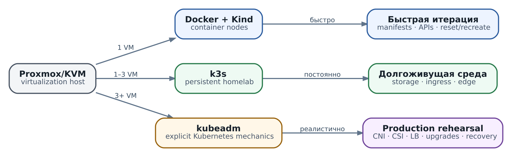

# Лабораторный стенд на Proxmox/KVM: от первого запуска до production rehearsal

**Профиль главы на 16.10.2026:** исходники AX `ac2332829f22360ff97b0ba34d94dd0dd782f17e` и Substrate `df788825e6fc13dd7aa5fd283c8f14bd4c818247`. Ниже разобраны эти ревизии, а не текущие ветки `main`. Совместимость пары требует отдельного интеграционного опыта. При подготовке этой редакции стенд не запускался; выполнен только локальный учебный пример на искусственных данных.

В главе 25 мы разбирали, как понять, продвигается ли работа над изменением в `billing`. Теперь представим, что Task перестала отвечать, а инженер хочет воспроизвести проблему. На рабочей машине одновременно живут VPN, старый Kubernetes-кластер, несколько registry и локальная модель. Повторный запуск может случайно помочь, но объяснение причины от этого не появится.

Лаборатория даёт возможность упростить вопрос. Сначала запустим маленький Actor, который увеличивает счётчик. Затем проверим его восстановление. Только после этого добавим AX и работу с Workspace. Если счётчик уже не восстанавливается, разбирать prompt пользовательского harness пока рано: наблюдаемая проблема возникла на более простом пути. Если счётчик исправен, а AX Task не получает рабочее окружение, появится основание исследовать следующую границу. Успех простого опыта сужает поиск, хотя и не исключает последующего отказа того же слоя.

К концу главы у нас должен получиться паспорт среды и протокол опыта: что было установлено, какой результат ожидался, что наблюдалось и до какого вывода эти наблюдения позволяют дойти. Такой протокол полезнее единственного скриншота с зелёными Pods: другой инженер сможет повторить проверку и сравнить результаты.

  
*Три лабораторные топологии: растёт не «мощность Kubernetes», а реалистичность отказов и операционная цена*

## 1. Какой вопрос должен выдержать стенд

Начнём с опыта, а не с покупки сервера. Для истории с `billing` первый вопрос звучит так: «Может ли платформа создать Actor, принять обращение, приостановить его и восстановить ожидаемое состояние?» Здесь ещё нет LLM, доступа к Git и публикации изменений. Это наш положительный контроль — небольшой сценарий с понятным результатом, на фоне которого легче разбирать более сложный сбой.

Перед установкой запишем четыре вещи. **Воздействие:** один явный suspend после известного числа запросов. **Ожидание:** поведение счётчика соответствует выбранному режиму snapshot. **Наблюдение:** ответы приложения, состояние Actor, назначенный Worker и время событий. **Восстановление:** среду можно вернуть к исходному состоянию, не затронув чужие ресурсы. Если любой из пунктов отсутствует, повторение опыта будет зависеть от памяти автора.

Развёртывание проходит через несколько границ. Физический host предоставляет ресурсы. Proxmox управляет VM, а QEMU/KVM исполняют гостевую систему; KVM обеспечивает аппаратное ускорение виртуализации, QEMU — в том числе модель виртуальных устройств. Внутри guest Linux работают Docker и контейнерные nodes Kind. Kubernetes размещает компоненты Substrate; Substrate обслуживает Actor lifecycle; AX связывает Task с рабочим окружением. Так становится понятным, почему «кластер работает» — слишком широкая формулировка: она не указывает, какой путь мы проверили. [Устройство VM в документации Proxmox](https://github.com/proxmox/pve-docs/blob/master/qm.adoc).

У каждой границы есть свой наблюдаемый результат. Свободное место в guest ещё не означает, что node может получить runner image. Готовность Kubernetes API не означает, что Worker способен восстановить Actor. Наличие AX Service не показывает, что CLI подключён именно к этому серверу. Поэтому мы будем наращивать сценарий по одному слою и сохранять свидетельства каждого перехода.

## 2. Выбор топологии: какие отказы станут видны

Kind запускает Kubernetes nodes в контейнерах. Это удобно для проверки API и контроллеров: среду легко пересоздать, а число дополнительных решений невелико. Несколько nodes внутри одной VM при этом используют общий guest kernel, Docker daemon и физические ресурсы. Для нашего первого опыта это подходящая экономия. Для опыта «переживёт ли система выключение физического сервера?» потребуется другая топология. [Модель и запуск Kind](https://kind.sigs.k8s.io/docs/user/quick-start/).

| Размещение трёх nodes | Разных guest VM | Разных физических hosts | Какое воздействие имеет смысл |
| --- | --- | --- | --- |
| Три контейнерных node в одной VM | 1 | 1 | Остановка отдельного node-контейнера, поведение scheduler |
| Три VM на одном Proxmox-host | 3 | 1 | Перезапуск одной guest-системы, её kernel или сетевого интерфейса |
| Три VM на трёх hosts | 3 | 3 | Потеря одного host, если остальные зависимости действительно доступны |

Таблица считает размещение, а не доказывает HA. Три hosts могут зависеть от одного storage, коммутатора, питания или DNS. Кроме того, приложение должно иметь подходящую репликацию и quorum. Даже три исправные VM не помогают сервису, если единственный экземпляр его базы находился на отключённой машине. Количество VM на схеме выше иллюстрирует профили стенда; схема не показывает независимость физических hosts. Число nodes выбирают из схемы конкретного опыта; универсального правила «три VM достаточно для отказоустойчивости» здесь нет.

Для первого пути выберем **одну выделенную disposable VM с Kind**. Disposable означает, что её разрешено пересоздать и в ней нет единственной копии нужных данных. Выделенная VM особенно важна из-за поведения установочных скриптов, которое разберём ниже. Proxmox удобен управлением жизненным циклом таких VM; если он уже установлен, можно использовать чистый template и записывать конфигурацию каждого клона. Сам Proxmox не является обязательной зависимостью AX: другую среду виртуализации нужно оценивать по тому же контракту ресурсов, сети и runtime.

### Когда выбрать k3s или kubeadm

Выбор меняется вместе с вопросом. Если нужно неделями наблюдать работу платформы, обслуживание гостевых узлов и устойчивость storage, постоянный кластер на отдельных VM может быть удобнее постоянно пересоздаваемого Kind.

**K3s** объединяет Kubernetes и ряд готовых компонентов в дистрибутив. Он полезен, когда важнее быстрее получить управляемый постоянный стенд, чем самостоятельно выбирать каждую деталь bootstrap. Нужно записать используемые datastore, сеть и включённые компоненты: результат будет относиться именно к этой конфигурации. [Архитектура K3s](https://docs.k3s.io/architecture).

**Kubeadm** помогает собрать и обслуживать Kubernetes-кластер, оставляя инженеру выбор дополнительных компонентов. Его стоит брать для вопросов о присоединении узлов, обновлении control plane, CNI и storage integration. Времени на подготовку будет больше, зато решения, от которых зависит опыт, станут явными. [Создание кластера с kubeadm](https://kubernetes.io/docs/setup/production-environment/tools/kubeadm/create-cluster-kubeadm/).

Ни один из этих вариантов не получает совместимость с нашей парой AX/Substrate автоматически. В зафиксированном Substrate есть development-маршрут через Kind, поэтому начинаем с него. Переход на другой дистрибутив — отдельный опыт: нужно сверить API, feature gates, runtime, сеть и хранение, затем повторить проверки. Глава 32 использует другой профиль — AX `v0.3.1` с отдельным controller. Нельзя смешивать его manifests с direct reconciliation AX `ac233282` и считать, что обновился только CLI.

## 3. Подготовка VM: ресурсы, сеть и KVM

### Считать бюджет, а не угадывать минимальный сервер

Ресурсы нужны не только Pods. В guest работают ОС, Docker, Kind nodes, registry и процессы сборки. Substrate использует управляющие компоненты, workers и хранилища; AX добавляет свои процессы и Redis. Параллельная сборка и распаковка images может давать кратковременный пик, которого не видно после завершения установки.

Например, инженер может предварительно заложить 3 GiB на ОС и контейнерную инфраструктуру, 6 GiB на компоненты и один лёгкий Actor, 4 GiB на сборку и 3 GiB резерва: получится 16 GiB. **Это иллюстрация расчёта, а не измеренный minimum этой пары.** Затем оценку заменяют наблюдениями: peak usage, OOM, eviction, время сборки и восстановления. Если 6 GiB не вмещают выбранные workers, исходный бюджет пересматривают. vCPU также нужно сопоставлять с загрузкой физического host: выделение восьми vCPU не резервирует восемь свободных физических ядер.

На диске отдельно учитывают images, build cache, registry, базы, логи и Actor snapshots, а также место для самого опыта восстановления. Важны свободные bytes, inodes и задержка I/O. Для первого воспроизводимого измерения полезнее умеренная стабильная нагрузка, чем одновременная сборка, локальная LLM и несколько конкурирующих VM. Модель подключим позже, когда инфраструктурный путь станет наблюдаемым.

### Проследить адрес от того, кто им пользуется

Сеть нужно разобрать с точки зрения конкретного процесса. `localhost` в shell гостевой VM, внутри Kind node и внутри sandbox обозначает разные сетевые окружения. Если image виден Docker в guest, это ещё не означает, что его сможет получить runtime в node. Если имя Kubernetes Service не разрешается на ноутбуке, это само по себе не дефект CoreDNS: такое имя предназначено для кластерного DNS-контекста.

В паспорте записывают management LAN/VLAN, Docker network, Pod CIDR, Service CIDR и внешние VPN-маршруты. Для выбранного простого стенда выделяют непересекающиеся диапазоны, проверяя их против **реальных** маршрутов, а не только друг против друга. Затем отдельно проверяют DNS, route, TCP-соединение, TLS и credentials. Таймаут скачивания image и ответ registry `unauthorized` требуют разных исправлений.

В Kind параметры сетей и отображения портов задаются конфигурацией; установка за proxy требует согласованного исключения внутренних адресов из proxy-маршрута. Эти настройки нужно сохранять вместе с паспортом, поскольку они влияют на воспроизводимость. [Конфигурация Kind](https://kind.sigs.k8s.io/docs/user/configuration/).

Первый доступ к API лучше ограничить management-сегментом и локальным port-forward. Публикация на всех интерфейсах расширяет круг доступных клиентов; Kubernetes namespace не добавляет аутентификацию внешнему AX API. Для лаборатории используйте отдельные credentials с минимальными правами и коротким сроком действия. Значения токенов в паспорт, transcript и Git не включают. Модель доступа и защищённую границу API мы уже разбирали в главе 24.

### Зачем проверять nested virtualization

При запуске microVM внутри гостевой VM появляется ещё один уровень аппаратной виртуализации. Возможность должна пройти от физического CPU и host через конфигурацию VM к guest, затем к контейнеру и процессу, который запускает runtime. Появление `/dev/kvm` — лишь один участок этой цепочки. Наличие устройства не подтверждает права процесса, допустимость нужных операций KVM и успешный запуск microVM. Сам интерфейс KVM состоит из открытия устройства и вызовов API, а не проверки существования файла. [Linux KVM API](https://docs.kernel.org/virt/kvm/api.html).

Kind как контейнерный Kubernetes не требует nested KVM. Для gVisor требование зависит от platform `runsc`: `systrap` и `kvm` используют разные механизмы. При выборе KVM внутри VM нужно отдельно учитывать nested virtualization и её накладные расходы. Поэтому в первом паспорте указывают фактически выбранный runtime и его platform, а microVM добавляют отдельным опытом с runtime-specific запуском и восстановлением. [Platforms gVisor](https://gvisor.dev/docs/user_guide/platforms/).

## 4. Паспорт и свидетельства: небольшой локальный опыт

Паспорт отвечает на вопрос «что собирались проверить». Отчёт запуска отвечает на вопрос «что произошло». Между ними нужна явная связь: идентификатор опыта, hash конфигурации, время и результат каждого этапа. Иначе легко приложить вчерашний успешный counter к сегодняшней среде с другим runtime.

В репозитории есть `examples/ch26_lab_evidence.py` и его тесты. Это **офлайн-модель работы с записями**, использующая только стандартную библиотеку Python. Она не подключается к гипервизору, не открывает `/dev/kvm`, не вызывает Docker, Kubernetes, AX или Substrate. В ней намеренно используются вымышленный runner `example.invalid/...` и документационная management-сеть `192.0.2.0/24`. Их нельзя переносить в настоящий install plan.

Учебный `Plan` хранит lab ID, kube-context, runtime, два полных SHA исходников, runner reference с digest и четыре IPv4-диапазона. Его ветка `gvisor` моделирует вариант без требования KVM; выбор `runsc --platform=kvm` эта упрощённая модель отдельно не описывает. Проверка отклоняет пересекающиеся сети и незакреплённые версии. Однако форма SHA не доказывает существование commit, а строка `@sha256:` не подтверждает доступность, происхождение или содержимое image. Полный инженерный паспорт должен дополнительно содержать версию Proxmox/QEMU, VM template, guest OS и kernel, параметры CPU, памяти и дисков, версии инструментов, все применённые manifests и image digests, storage, маршруты и ссылки на очищенные от секретов свидетельства.

Порядок этапов задаёт короткая функция из примера:

```
def required_gates(plan):
    return ("guest",) + (("kvm",) if plan.runtime == "microvm" else ()) + (
        "kubernetes", "substrate", "ax_integration")
```

`review` ищет первый этап, для которого нет подходящего успешного отчёта. Он сверяет run ID, digest паспорта и возраст записи. В демонстрации время условное: `now=40`, допустимый возраст `30`, обычная запись датирована `10`. Равенство границе допустимо; запись с временем `0` уже устарела. Эти числа выбраны для теста, а не задают эксплуатационную норму свежести.

Запуск из корня репозитория:

```
python3 examples/ch26_lab_evidence.py
python3 -m unittest discover -s examples -p 'test_ch26_lab_evidence.py'
```

Ожидаемые результаты синтетических сценариев:

| Сценарий | Первый незакрытый этап | Результат модели |
| --- | --- | --- |
| `no_evidence` | `guest` | `missing` |
| `guest_passed` | `kubernetes` | `missing` |
| `cluster_passed` | `substrate` | `missing` |
| `substrate_passed` | `ax_integration` | `missing` |
| `synthetic_complete` | `-` | `records_complete` |
| `foreign_run` | `guest` | `wrong_run` |
| `changed_plan` | `guest` | `wrong_plan` |
| `overlap` | `-` | `network_overlap` |
| `microvm_guest_passed` | `kvm` | `missing` |
| `stale_report` | `guest` | `stale_or_future` |

Во всех строках `compatibility_proven=false`, включая `records_complete`. Записи создаёт сам пример, их никто не подписывает и не получает из работающего стенда. Даже настоящий hash паспорта связывает данные, но не удостоверяет автора и правдивость отчёта. Модель учит обнаруживать неподходящие свидетельства; доверенный сборщик и интеграционные проверки остаются отдельной работой.

Вторая часть примера считает guest- и host-домены для трёх размещений из первой таблицы: `(3, 1, 1)`, `(3, 3, 1)` и `(3, 3, 3)` — nodes, guest VM, hosts. Она всегда возвращает `ha_proven=false`: декларация размещения не сообщает, выдержаны ли quorum и зависимости хранения. Попробуйте сменить только kube-context или runner digest и посмотреть, почему прежний комплект записей больше не относится к новому плану.

## 5. Маршрут реального опыта: от guest до Actor

Следующие команды — **план будущей ручной проверки**, не transcript выполненной установки. На момент редакции результат каждого реального этапа — `not_run`. Версии и поведение скриптов сверены по указанным исходникам, но сочетание ОС, Kubernetes, runtime и images нужно подтвердить на выбранной машине.

### Этап A. Чистая guest-система

Подготовьте отдельную VM, сетевые ограничения и журнал опыта. Сохраните конфигурацию и перечень дисков, включая то, что находится вне VM. Затем соберите baseline: `uname -a`, состояние синхронизации времени, `df -h`, `df -i`, `ip route`, DNS для выбранного registry и `docker info`. Здесь важен вывод каждой проверки, а не количество выполненных команд.

Критерий перехода — guest располагает нужными ресурсами, время согласовано, а выбранный image доступен из ожидаемого окружения и запускается. Для microVM требуется дополнительный runtime-specific smoke test из того же контекста прав и устройств, что будет у рабочего процесса. Его результат записывают отдельно. Пример из предыдущего раздела такого теста не выполняет.

### Этап B. Kind и Kubernetes без платформы

**Перед созданием прочитайте скрипт.** В Substrate `df788825` файл `hack/create-kind-cluster.sh` удаляет кластер с выбранным именем перед созданием. Кроме того, он использует общий контейнер `kind-registry` и сеть Docker `kind`; в некоторых ветках скрипта они также изменяются. Новое имя кластера не изолирует эти общие объекты. Выполнять этот путь следует только в выделенной disposable VM с отдельным Docker daemon, без чужих кластеров и данных. [Зафиксированный create-kind-cluster.sh](https://github.com/agent-substrate/substrate/blob/df788825e6fc13dd7aa5fd283c8f14bd4c818247/hack/create-kind-cluster.sh).

В отдельном checkout Substrate, после сверки полного commit и подготовленных зависимостей:

```
git rev-parse HEAD
export KIND_CLUSTER_NAME=ax26
export KUBECTL_CONTEXT=kind-ax26
hack/create-kind-cluster.sh
kubectl --context="$KUBECTL_CONTEXT" cluster-info
kubectl --context="$KUBECTL_CONTEXT" get nodes -o wide
kubectl --context="$KUBECTL_CONTEXT" get pods -A
```

Значения контекста здесь выбраны согласованно: install-wrapper позволяет уже заданному `KUBECTL_CONTEXT` переопределить вычисленное имя. До любых изменений проверяйте, куда действительно направлена команда. Полный source SHA фиксирует скрипт, но не делает неизменными все скачиваемые инструменты, base images и tags; их реальные версии и digests также заносят в паспорт.

В этом скрипте есть специальная конфигурация API и feature gates, а также проверка возможности передать `/dev/kvm` контейнеру. Эта проверка не запускает microVM. Простая замена скрипта обычным `kind create cluster` может потерять нужные настройки; вид `Ready` у nodes сам по себе этого не выявит.

До Substrate проверьте обычный Pod, разрешение Service DNS, нужный исходящий HTTPS и ожидаемую семантику volume. Запишите, что именно сохраняется после пересоздания Pod. Отдельно проверьте получение image из node-контекста. Если этот этап не пройден, добавление AX только увеличит число непроверенных зависимостей.

### Этап C. Counter и восстановление состояния

В том же pinned checkout предусмотрен путь установки development-компонентов и counter demo:

```
hack/install-ate-kind.sh \
  --deploy-ate-system \
  --credential-provider='{"name":"k8s.io"}'
hack/install-ate-kind.sh --deploy-demo-counter
go install ./cmd/kubectl-ate
kubectl ate create actor my-counter-1 \
  -a ate-demo-counter --template counter
kubectl --context="$KUBECTL_CONTEXT" port-forward \
  -n ate-system svc/atenet-router 8000:80
```

Перед `kubectl ate` отдельно сверьте текущий kube-context: переменная wrapper не является универсальной настройкой всех CLI. Установка разворачивает зависимости для разработки; это не готовая HA-конфигурация PostgreSQL и object store. Credential provider начинает с ограничивающей политики доступа: выбор provider не выдаёт Actor произвольные секреты. [Quickstart зафиксированного Substrate](https://github.com/agent-substrate/substrate/blob/df788825e6fc13dd7aa5fd283c8f14bd4c818247/README.md).

В другом терминале выполните один запрос и сохраните ответ вместе со временем:

```
curl --fail-with-body -X POST \
  -H 'ate-target-actor: ate-demo-counter/my-counter-1' \
  -i http://127.0.0.1:8000/
```

Counter изменяет состояние при POST. Повтор после таймаута может увеличить его ещё раз, даже если первый ответ не дошёл до клиента. Поэтому в протокол входят все попытки, а при неоднозначном исходе нельзя автоматически приписывать скачок счётчика ошибке snapshot. Для простого опыта избегайте автоматических retry и параллельных запросов; неоднозначный запуск лучше отметить отдельно и повторить с новым Actor.

В demo есть счётчик в памяти и счётчик в файле на durable volume. При snapshot режима **Full** сохраняются память и durable volumes; режим **Data** сохраняет durable-данные, а приложение загружается заново. Ожидание для in-memory counter зависит от этого выбора. Перед suspend посмотрите ActorTemplate и фактическую конфигурацию, запишите значения обоих счётчиков. [Поведение counter demo](https://github.com/agent-substrate/substrate/blob/df788825e6fc13dd7aa5fd283c8f14bd4c818247/demos/counter/README.md).

Затем выполните `kubectl ate suspend actor my-counter-1 -a ate-demo-counter`, дождитесь наблюдаемого завершения suspend и повторите один POST. В demo обращение через router может вызвать автоматическое пробуждение. Сравните значения согласно режиму, сохраните Actor state и Worker assignment до и после. Смена Worker возможна, но сама по себе не является обязательным критерием успеха. HTTP 200 подтверждает обработку запроса; восстановление состояния проверяется содержимым ответа и остальными свидетельствами.

## 6. Добавить AX и связать опыт с Task

Теперь цель — проверить путь от Task к доступному Workspace, сохранив простой workload. В pinned checkout AX подготовьте Go, `kubectl`, `ko` и registry, доступный кластеру. Собирайте CLI из checkout (`go install ./cmd/ax`), а не через `@latest`, чтобы не получить другой API-клиент. [README AX выбранной ревизии](https://github.com/google/ax/blob/ac2332829f22360ff97b0ba34d94dd0dd782f17e/README.md).

Перед развёртыванием проверьте текущий kube-context и Service Substrate API. Затем в AX используется `make deploy AX_IMAGE_REPO=<ваш-registry>`. Подставляемое значение и права на него должны быть подготовлены заранее; это не буквальная исполнимая команда из книги.

Здесь есть существенная деталь: в данном Makefile `deploy` зависит от развёртывания Redis и сервера, **но не от сборки runner image**. Runner нужно подготовить и проверить отдельно, включая архитектуру, доступность для узлов и digest. Наличие локального image или скопированного digest из примера не доказывает, что внутри находится нужная версия runner. Также не переносите `push-task-runner` на произвольный registry без чтения рецепта: в нём есть обращение к `gcloud`. [Makefile AX](https://github.com/google/ax/blob/ac2332829f22360ff97b0ba34d94dd0dd782f17e/Makefile).

Сначала сверьте выбранный AX context и адрес сервера; это отдельная настройка от Kubernetes context. Подготовьте отдельные manifests Workspace и Task по схеме этой ревизии. В upstream `examples/task.yaml` несколько документов, причём Task идёт перед Workspace. Это удобный пример полей, но не транзакция установки. Для диагностического опыта примените Workspace отдельно, проверьте его существование, затем создайте Task с `spec.debug: true` и проверенным runner. Model подключайте, когда действительно понадобится платформенный model client; для проверки доступа к Workspace вызов LLM не требуется. [Состав примера Task](https://github.com/google/ax/blob/ac2332829f22360ff97b0ba34d94dd0dd782f17e/examples/task.yaml).

На этой ревизии создание Task устанавливает фазу `Suspended`. После создания нужен явный resume; затем наблюдайте готовность Task, Workspace и соответствующего Actor. `ax watch task <имя>` держите в отдельном терминале: это поток наблюдения, а не команда с завершением по окончании пользовательской работы. Когда окружение готово, проверьте доступ через `ax ssh <имя> -- ls -la /workspace`, выполните suspend/resume и повторите проверку. Зафиксируйте, какие файлы по контракту Workspace должны сохраниться. Точная проверка проходит через статусы и содержимое, а не только через код возврата resume. [Создание Task в AX](https://github.com/google/ax/blob/ac2332829f22360ff97b0ba34d94dd0dd782f17e/internal/server/server.go).

Для подготовленных файлов `lab-workspace.yaml` и `lab-task.yaml`, где Task названа `lab26-task`, последовательность выглядит так. Команды наблюдения и дальнейший ssh выполняются только после проверки соответствующего состояния:

```
ax apply -f lab-workspace.yaml
# Проверьте созданную Workspace в выбранном AX context.
ax apply -f lab-task.yaml
ax get tasks
ax resume task lab26-task
# В отдельном терминале: ax watch task lab26-task
# Дождитесь готовности Task, Workspace и Actor.
ax ssh lab26-task -- ls -la /workspace
ax suspend task lab26-task
# Дождитесь завершения suspend, затем:
ax resume task lab26-task
```

Перенесём из главы 25 правило связи событий: для одного запуска сохраняются lab ID, версия паспорта, Task, Actor, Worker и размещение Kubernetes. Не все эти поля должны становиться labels метрик; идентификаторы отдельных запусков удобно хранить в журнале или trace. Сначала покажите, что можете пройти эту цепочку в исправном опыте. Тогда при сбое будет видно, на какой границе исчезло ожидаемое наблюдение.

## 7. Один управляемый отказ и честный вывод

После успешного baseline выберите воздействие, которое отвечает исходному вопросу. Например, остановка одной guest VM проверяет потерю её узлов, но не отказ всего физического host. Ограничение исходящего доступа к тестовому registry проверяет новый image pull, если image ещё не находится в cache. Удаление Pod с уже прогретым image такой опыт не заменяет. Заранее задайте срок ожидания, условия прекращения и способ возврата настройки; используйте только ресурсы лаборатории.

| Наблюдение | Следующая проверка | Почему она полезна |
| --- | --- | --- |
| Новая Task не получает окружение | Task conditions → Actor → Worker capacity | Разделяет создание Actor и возможность разместить его |
| Pod не запускает runner | Events, pull error, registry из node | Разделяет сеть, credentials, отсутствие image и архитектуру |
| Resume принят, ответа нет | Actor state, restore, router и post-resume probe | Отделяет приём команды от готовности обслуживать запрос |
| После восстановления изменились данные | Режим snapshot, durable paths, все POST-попытки | Позволяет проверить ожидание опыта до вывода о потере состояния |

Эта последовательность — способ сузить поиск, а не запрет вернуться вниз. DNS или storage могли отказать после предыдущего успешного этапа. Проверки привязаны ко времени и конфигурации; после смены kernel, runtime, manifests или image нужно повторить затронутые этапы, а при неясной зависимости — весь базовый путь.

Перед изменениями полезно иметь точку возврата VM, но её смысл нужно назвать точно. Snapshot на том же storage разделяет его отказ. Копирование работающей VM не означает согласованного состояния нескольких баз и внешнего object store. Даже filesystem freeze через guest agent улучшает согласованность файловой системы, не заменяя проверку восстановления приложения. В Proxmox режим backup `snapshot` — название режима live backup; его нельзя смешивать с обычным локальным VM snapshot. [Режимы backup Proxmox](https://github.com/proxmox/pve-docs/blob/master/vzdump.adoc).

Завершая опыт, сначала сохраните очищенные логи и результат. Затем сверьте inventory: VM, cluster, Actor/Task, volumes, registry objects и временные credentials. Удаляйте только перечисленные лабораторные ресурсы в подтверждённых контекстах; общую команду «удалить всё» сюда включать опасно. Проверьте также, не остались ли внешние volumes и доступы после удаления VM. Snapshot с credentials хранит их копию, поэтому срок жизни такого снимка и отзыв доступа входят в завершение работы.

## 8. Что инженер должен уметь объяснить после опыта

Итоговый протокол может быть коротким: «В среде с таким паспортом counter в режиме Full прошёл обращение, suspend и восстановление; AX Task с таким runner получила Workspace; после выбранного воздействия результат оказался таким». Рядом должны находиться времена, наблюдения и границы вывода. Если проверена только одна VM на одном host, протокол не должен обещать физическую отказоустойчивость. Если есть только записи офлайн-примера, результат ограничивается проверкой этих записей.

Попробуйте ответить без подсказки: почему новый kube-context не изолирует общий registry, почему успешный `make deploy` не гарантирует runner и почему готовые nodes не подтверждают восстановление Actor? Если ответ сводится к «так написано в инструкции», вернитесь к соответствующей границе и проследите, кто выполняет действие, к каким ресурсам обращается и какой результат наблюдаем.

В следующей главе лабораторный протокол станет отправной точкой для production engineering: нужно будет решить, какие состояния восстанавливать, какие отказы выдерживать и чем подтверждать допустимое время простоя. Лаборатория уже помогает получить эти свидетельства, но границы достоверности каждого опыта остаются частью инженерного результата.

### Источники и дальнейшее чтение

- Официальная документация: [Proxmox VM](https://github.com/proxmox/pve-docs/blob/master/qm.adoc), [backup](https://github.com/proxmox/pve-docs/blob/master/vzdump.adoc), [Linux KVM API](https://docs.kernel.org/virt/kvm/api.html), [gVisor platforms](https://gvisor.dev/docs/user_guide/platforms/).
- Выбор Kubernetes-среды: [Kind quick start](https://kind.sigs.k8s.io/docs/user/quick-start/), [Kind configuration](https://kind.sigs.k8s.io/docs/user/configuration/), [K3s architecture](https://docs.k3s.io/architecture), [kubeadm](https://kubernetes.io/docs/setup/production-environment/tools/kubeadm/create-cluster-kubeadm/).
- Исходники конкретного профиля: [Substrate `df788825`](https://github.com/agent-substrate/substrate/tree/df788825e6fc13dd7aa5fd283c8f14bd4c818247), [AX `ac233282`](https://github.com/google/ax/tree/ac2332829f22360ff97b0ba34d94dd0dd782f17e). Открывайте ссылки на commit, чтобы не смешивать эту главу с изменившейся веткой `main`.
