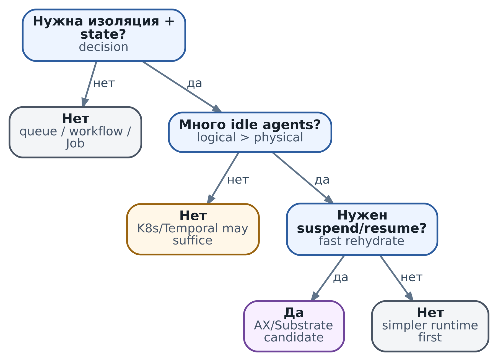

# Когда AX нужен, а когда проще другой инструмент

**Профиль главы на 16.10.2026:** AX `ac233282` поверх Substrate `df788825`; полные SHA приведены в главе 26. Для сравнения используется стандартный AX template с Data snapshot и Data-on-golden. Пример выбора и его цены учебные: они не являются измерениями платформы или подтверждением совместимости стенда.

Команда сервиса исследования `billing` хочет дать инженеру возможность вернуться к незавершённой работе после совещания. Агент уже скачал репозиторий, построил индекс и подготовил промежуточный отчёт. Можно оставить среду работающей, завершить её и потом собрать заново или сохранить данные и освободить вычислительные ресурсы. У каждого решения понятная выгода. У каждого есть работа, которую придётся взять на себя команде.

В предыдущих главах мы научились считать ёмкость и разбирать отказы AX/Substrate. Теперь используем эти знания для выбора самой платформы. Начнём с требований сервиса, сравним несколько способов их выполнить и посчитаем небольшой пример. В конце получится решение с условиями пересмотра, которое можно объяснить коллеге и проверить на пилоте.

## 1. Описать работу до выбора продукта

Представьте разговор с владельцем сервиса. Он говорит: «Нужны тысяча stateful agents и быстрый resume». Инженеру пока трудно понять, что покупать и разворачивать. Тысяча означает одновременно работающие процессы или сохранённые исследования за месяц? Stateful означает историю разговора, файлы репозитория или память запущенного Python-процесса? Resume заканчивается при ответе runtime API или когда инженер снова видит полезный ответ?

Переведём пожелание в наблюдаемое поведение. В нашем учебном сервисе существует 1000 исследований. Каждое связано с определённым repository commit. Пользователь может остановить работу и вернуться позже; продолжение должно учитывать уже проверенные файлы и сохранённый отчёт. Индекс можно восстановить из данных. Сохранение стека и heap текущего процесса не требуется. Код из репозитория считается недоверенным, поэтому команды исследования выполняются в отдельно ограниченной среде.

| Требование сервиса | Что именно принимаем |
| --- | --- |
| Изоляция | У среды нет доступа к чужим исследованиям; credentials и egress ограничены разрешённой работой |
| Сохранение прогресса | Подтверждённый checkpoint harness и необходимые файлы доступны после освобождения среды; результат связан с исходным commit |
| Возврат к работе | От запроса пользователя до первого полезного ответа после паузы проходит не более 30 s в p95 при оговорённой нагрузке |
| Эксплуатация | Назначена команда, которая умеет обновлять выбранную конфигурацию и восстанавливать сервис по согласованному сценарию |

Это обязательные условия, которые вариант должен выполнить вместе. Дополнительное удобство, например знакомый CLI, можно обсуждать после них. Такой порядок экономит время: низкая цена среды с неподходящей изоляцией не приближает нас к рабочему решению.

Для каждого условия нужны три возможных ответа: выполнено, нарушено, ещё неизвестно. «Неизвестно» означает конкретную следующую проверку. Если команда не испытывала обновление старых snapshots, ставить зелёную отметку за эксплуатацию рано. При этом неизвестность не утверждает, что обновление невозможно.

## 2. Разобрать обязанности инструментов

Выбор облегчится, если представить путь одного запроса. Кто-то хранит цель исследования и ждёт пользователя. Harness решает, какой файл прочитать следующим. Исполнитель получает CPU, память и доступ к файлам. Очередь может сгладить наплыв новых запросов. Эти обязанности возникают независимо, поэтому иногда понадобятся два инструмента, а иногда достаточно одного приложения.

| Обязанность | Подходящий инструмент | Что остаётся определить |
| --- | --- | --- |
| Постоянно принимать запросы к доверенному приложению | Service или Deployment | Хранение состояния, лимиты и восстановление приложения |
| Распределять фоновую работу | Queue и workers | Семантику повторной доставки и границу доверия исполнителя |
| Довести отдельный запуск до завершения | Kubernetes Job | Checkpoint приложения и подходящую изоляцию |
| Хранить ход долгого процесса | Durable workflow engine, например Temporal | Выполнение и внешние эффекты отдельных шагов |
| Управлять шагами агента | Harness или graph framework, например LangGraph | Права tools и физическую среду исполнения |
| Распределять вычисления и данные | Ray | Доверие к коду, восстановление прикладного состояния |
| Управлять отдельными средами с паузами | AX поверх Substrate | Протокол продолжения harness и эксплуатацию платформы |

На этой стадии полезно нарисовать всего одну границу: где исполняется код, которому мы не доверяем? Если graph coordinator живёт в обычном сервисе, запуск тестов чужого репозитория можно вынести в отдельную sandbox. Весь coordinator переносить вместе с ним необязательно. Если у исследования одна среда, один набор прав и общий срок жизни, последовательные шаги harness могут оставаться внутри одной Task.

Число узлов графа само по себе не подсказывает число Tasks. Отдельная Task оправдана самостоятельной границей: другими данными, полномочиями, образом, ресурсами или восстановлением. Эту же границу мы использовали при делегировании в главе 22; в главе 31 вернёмся к цене слишком мелкого разбиения.

## 3. Понять, какое состояние предстоит сохранять

Прежде чем сравнивать resume, разложим исследование на несколько видов состояния. Это определит и возможности восстановления, и переносимость между инструментами.

| Состояние исследования | Как можно продолжить работу |
| --- | --- |
| Цель, approval, deadline и ссылка на результат | Прочитать durable запись процесса или workflow history |
| Прогресс harness: проверенные файлы, шаг, ссылки на артефакты | Загрузить checkpoint приложения и выполнить следующий допустимый шаг |
| Репозиторий, индекс и промежуточные файлы | Подключить сохранённые данные либо восстановить их из версионированного источника |
| Стек, heap и текущие процессы | Использовать совместимый Full snapshot либо изменить приложение для явного восстановления |

Для `billing` первые три строки достаточны. Значит, у нас есть несколько кандидатов: Job с внешними данными, сохраняемая sandbox или обычный процесс, который остаётся живым. Если бы требовалось продолжить непрозрачную программу с тем же состоянием памяти, список изменился бы ещё до расчёта стоимости.

В [стандартном template AX](https://github.com/google/ax/blob/ac2332829f22360ff97b0ba34d94dd0dd782f17e/internal/substrate/client.go) закреплённого среза заданы Data scope, durable volume `/workspace` и восстановление Data через golden. Это позволяет сохранить предусмотренные данные среды. Продолжение исследования требует, чтобы harness читал свой checkpoint и восстанавливал необходимые прикладные объекты. Переменная Python в heap конкретного исследования в этот контракт не входит.

Full snapshot Substrate относится к другому контракту: он включает память и предусмотренное runtime состояние. Его применимость зависит от template, runtime и совместимости восстановления. Даже при сохранённой памяти внешние соединения и credentials требуют проверки актуальности. Возврат старого socket или token не делает удалённый сервис участником snapshot. Подробности ownership и совместимости разобраны в главах 14 и 39.

Checkpoint harness тоже должен иметь определённый смысл. Допустим, отчёт записан в файл, но checkpoint о завершении шага ещё не опубликован. После restart агент может повторить шаг. Для чтения это обычно лишняя работа; для открытия pull request уже нужен журнал действия и проверка существующего результата. Выбор runtime сохраняет выбранные байты, а согласованность файлов, логического шага и внешнего эффекта обеспечивает протокол приложения.

## 4. Начать с Job или очереди, если они закрывают задачу

**Kubernetes Job** удобен, когда работа имеет завершение: получить вход, выполнить программу, записать результат. Контроллер отслеживает успешные завершения и управляет повторными запусками по конфигурации. При suspend активные Pods завершаются; дальнейшее продолжение зависит от сохранённого приложением прогресса. Эта семантика описана в [документации Jobs](https://kubernetes.io/docs/concepts/workloads/controllers/job/#suspending-a-job).

Для исследования репозитория Job может загружать checkpoint и индекс, выполнять ограниченную порцию работы, сохранять следующий checkpoint и завершаться. Пауза между порциями тогда не занимает процесс. Цена такого решения зависит от времени загрузки образа, подготовки среды, подключения данных и восстановления harness. Общий image cache и готовый индекс способны сделать повторный запуск достаточно быстрым. Сначала стоит измерить этот путь на привычной инфраструктуре.

Изоляция Job определяется выбранным runtime, настройками и правами. Сам факт запуска в Pod не отвечает на вопрос о допустимости чужого кода. Сравнивать нужно Job с подходящей sandbox-конфигурацией и AX с подходящим template. Сопоставление защищённого варианта с общим привилегированным контейнером заранее искажает результат.

**Очередь с workers** полезна, когда запросы приходят неравномерно, а работу выполняет общий развёрнутый код. Например, доверенная программа извлекает metadata из уже подготовленных отчётов. Очередь держит накопившиеся сообщения, worker получает задание и освобождается для следующего. Для такого этапа отдельная среда на каждое исследование может оказаться лишней.

Нужно заранее выбрать поведение при повторной доставке. Если worker записал результат и потерял соединение до подтверждения сообщения, новое выполнение должно распознать уже сделанную работу. [Руководство Celery](https://docs.celeryq.dev/en/stable/userguide/tasks.html) связывает выбор acknowledgement с идемпотентностью и отдельно описывает оговорки при завершении worker process. Конкретная настройка доставки требует своего разбора; наличие broker не доказывает ровно один внешний эффект.

Обычный worker также не становится безопасным исполнителем произвольного shell только потому, что получил команду через очередь. Для недоверенного шага worker может запрашивать отдельную sandbox и следить за её результатом. Тогда очередь отвечает за доставку, а sandbox — за выбранную границу исполнения.

## 5. Выбрать владельца долгого процесса

Пользователь может ждать approval два дня, сменить цель исследования или отменить его после перезапуска сервиса. В этот момент нужен устойчивый ответ на вопрос: что система уже решила и какой шаг теперь допустим? Такую обязанность можно реализовать в своей базе и state machine. При сложных timers, retries и ожиданиях стоит оценить durable workflow engine.

В Temporal [Workflow Execution продолжает работу через replay event history](https://docs.temporal.io/workflow-execution). Workflow code должен соблюдать ограничения детерминизма; внешнюю работу выполняют Activities. Это удобно для координации исследования, approval и публикации результата. Сохранение истории не требует держать sandbox исследования занятой всё время ожидания человека.

Интеграцию Activity с AX придётся спроектировать. Представим, что Activity создала Task, но не получила ответ и была повторена. Адаптер сначала ищет ранее созданную работу по устойчивой связи с логическим шагом, сверяет её spec и принимает существующий результат. Неопределённый исход create требует такого чтения до следующего создания. При несовпадении spec адаптер останавливается для разбора. В этом профиле Task immutable; «поправить найденную Task под новый запрос» не является способом дедупликации.

Workflow хранит решение «исследование ожидает approval», AX хранит состояние исполнения Task, harness хранит собственный прогресс. На границе нужны идентификаторы, ссылка на результат, правила cancellation и сроки cleanup. После отмены workflow запоздавшее завершение Task не должно само опубликовать отчёт. Это часть прикладного адаптера; готовую интеграцию Temporal→AX здесь не предполагаем.

LangGraph полезен на другом участке: он описывает шаги и состояние graph приложения. Его [checkpointers](https://docs.langchain.com/oss/python/langgraph/persistence) сохраняют состояние thread; для переживания restart нужен persistent backend, поскольку InMemorySaver хранит данные в памяти. Такой checkpoint может быть удобным способом продолжить harness после запуска среды.

Для небольшого сервиса одного graph с durable checkpoint и понятным протоколом tools может хватить. Добавление Temporal оправдывается отдельной обязанностью долгого процесса. Если используются оба инструмента, решение о business approval хранится у одного владельца, а второй получает его как проверяемый вход. Два независимых ответа «публикация разрешена» создают риск рассогласования.

## 6. Определить, что именно добавляет AX/Substrate

AX становится интересен, когда команда регулярно управляет множеством отдельных сред: создаёт их, готовит Workspace, возобновляет, приостанавливает и удаляет. Если исследования подолгу хранят данные, а вычисления нужны эпизодически, имеет смысл отделить количество логических сред от физической ёмкости для активной работы. Substrate предоставляет lifecycle Actors и Worker pools, а AX добавляет прикладные Task и Workspace.

Самая заметная польза для нашего сценария — сохранение подготовленных данных при освобождении ресурса исполнения. Её величина зависит от того, что дорого повторять: checkout, индекс, установку зависимостей или инициализацию приложения. Часть этих затрат иногда снимает общий image или явный cache. Поэтому сравниваем AX с уже разумно подготовленным Job, а не с намеренно холодным запуском, который заново скачивает всё при каждом шаге.

  
*Когда AX является разумным кандидатом, а когда это избыточный слой*

Схема показывает удобный путь к кандидату при множестве простаивающих сред. Она помогает найти возможный выигрыш от suspend/resume; обязательную изоляцию нужно обеспечить при любом размере нагрузки. Небольшая команда может выбрать иной sandbox runtime, а уже действующая платформа AX может быть удобна и без большого oversubscription. Количество idle agents само по себе не устанавливает безопасность или экономическую выгоду.

Здесь особенно важно правильно измерить долю занятости среды. Пока агент ждёт model endpoint и удерживает Worker slot, ресурс занят, даже если CPU почти не работает. Освободить его можно после безопасной остановки по протоколу приложения. Низкая загрузка CPU не равна низкому duty cycle исполнения. Метрики занятости, одновременно активные среды и wakeup bursts из главы 28 нужны именно для этого различия.

До пилота зафиксируйте фактические ActorTemplate, SandboxConfig, limits и сетевые правила. В AX `ac233282` наличие `TaskSpec.resources` не гарантирует переноса CPU/RAM limits в Actor; отдельного ресурса AX Gateway и автоматической Task→Model привязки тоже нет. Для типового template из исходников выбран gVisor. Другой класс изоляции и Full scope нельзя считать включёнными только по возможностям нижнего слоя. Профиль конфигурации и фактическое enforcement разбираются в главах 18, 19 и 26.

## 7. Отдельно проверить вычислительную задачу

Иногда обсуждение агентов скрывает обычную задачу распределённых вычислений: обработать много независимых массивов, разместить данные ближе к вычислению, загрузить GPU. Тогда стоит начать с инструментов этого слоя.

[Ray Core](https://docs.ray.io/en/latest/ray-core/key-concepts.html) предоставляет распределённые functions/tasks, stateful actors, object references и планирование по CPU/GPU/custom resources. Ray Actor — worker с состоянием, методы которого выполняются на этом worker. Это полезная модель для доверенной Python/ML обработки. Одноимённый Actor Substrate имеет другой lifecycle; совпадение термина не переносит между продуктами sandbox или snapshot contract.

Например, доверенная программа индексации может отправлять разрешённые вычисления в отдельный Ray service, а исследовательский harness работать в ограниченной среде. Граница API тогда должна ограничивать тип операции, данные и ресурсы. Передача произвольной функции от недоверенного агента в общий Ray cluster переносит риск туда, куда его пытались не допустить.

Обязательное оборудование тоже отсекает варианты. В [API guide закреплённого Substrate](https://github.com/agent-substrate/substrate/blob/df788825e6fc13dd7aa5fd283c8f14bd4c818247/docs/api-guide.md) passthrough GPU devices в Actors помечен временно неподдерживаемым. Если GPU нужен внутри этой sandbox, выбранный профиль не выполняет требование. Если агент только вызывает внешний inference endpoint, это другая конфигурация и другой вопрос. Наличие GPU на Worker node не устраняет разницу.

## 8. Разобрать выбор на числах

Вернёмся к `billing`. Рассмотрим три устройства среды: постоянно выделенный slot на исследование, Job с восстановлением данных при возвращении и AX/Data с освобождением исполнения на время паузы. Во всех вариантах slot означает одинаковый набор CPU/RAM. Изоляция, сохранение данных и действия приложения должны отдельно пройти требования; расчёт ниже их не оценивает.

Для упражнения примем месяц из 720 часов, 1000 логических исследований и 120 возвращений на исследование за месяц. Полезная работа вместе с ожиданиями, удерживающими slot, занимает 5% времени. Отдельно добавляется время подготовки и сохранения среды на один возврат: в среднем 120 s для Job и 10 s для AX/Data. Это суммарные оплачиваемые slot-seconds переходов, включая отнесённую к возврату стоимость suspend/export. Эти средние длительности выбраны для арифметики; p95 пользовательской задержки из них не выводится.

Пусть slot-hour стоит 0,04 условной денежной единицы. В каждом варианте хранится по 4 GiB оплачиваемых данных на исследование по 0,025 единицы за GiB-month. Для упражнения это весь учитываемый объём хранения. В реальном расчёте надо раздельно оценить retained snapshots, дублирование данных и golden images, операции storage и трафик.

На платформу и сопровождение отнесём 500 единиц в месяц для постоянно выделенных сред и Jobs, 800 для AX. Для AX добавим 20 эквивалентных slots свободного резерва на весь месяц. Резерв считается сверх часов занятого исполнения и переходов, поэтому его нельзя снова включать в цену этих часов.

Получается такая оценка в условных денежных единицах за месяц:

| Статья | Постоянные среды | Jobs | AX/Data |
| --- | --- | --- | --- |
| Занятое исполнение | 28 800,00 | 1 440,00 | 1 440,00 |
| Подготовка и сохранение | 0,00 | 160,00 | 13,33 |
| Свободный резерв | 0,00 | 0,00 | 576,00 |
| Хранение | 100,00 | 100,00 | 100,00 |
| Платформа и сопровождение | 500,00 | 500,00 | 800,00 |
| Итого | 29 400,00 | 2 200,00 | 2 929,33 |

Проверьте одну строку вручную. Для AX переходы занимают `1000 × 120 × 10 / 3600 = 333,33…` slot-hours. Умножение на 0,04 даёт 13,33 единицы после округления. Резерв стоит `20 × 720 × 0,04 = 576`. Постоянные среды оплачивают все `1000 × 720` slot-hours, поэтому 5% активности не уменьшают их строку исполнения.

В этих допущениях Jobs дешевле AX/Data. Теперь вернём требования. Учебная карточка варианта Jobs содержит провал проверки возврата за 30 s. Карточка AX/Data содержит успех этой проверки, но неизвестный результат эксплуатационной проверки. Для постоянных сред все четыре обязательные отметки заданы успешными. Это отдельные искусственные входы упражнения, а не результаты benchmark или следствие расчётных 120 s и 10 s.

Мы получили три разных вывода. Постоянные среды остаются допустимым baseline с высокой ценой. Jobs требуют улучшить возврат или пересогласовать SLO. AX/Data стоит проверить на оставшуюся пригодность к эксплуатации. Объявлять AX победителем уже сейчас рано: одна незакрытая обязательная проверка сохраняет его в статусе кандидата.

## 9. Воспроизвести расчёт и проверку требований

В `examples/ch30_platform_choice.py` находятся этот расчёт и отдельная функция разбора обязательных проверок. Скрипт работает локально со стандартной библиотекой Python. Он не обнаруживает возможности инструментов автоматически и не обращается к платформам.

Функция рассматривает все переданные обязательные требования. Отсутствующее наблюдение, как и `None`, оставляет неизвестность; явный `False` отклоняет вариант:

```
def review(requirements, checks):
    validate_checks(requirements, checks)
    failed = [name for name in requirements if checks.get(name) is False]
    unknown = [name for name in requirements if checks.get(name) is None]
    if failed:
        status = "reject"
    elif unknown:
        status = "needs_evidence"
    else:
        status = "passes_supplied_checks"
    return {"status": status, "failed": failed, "unknown": unknown}
```

Валидация запрещает пустой список требований, неизвестные ключи и значения вроде строки `"false"`. Иначе опечатка или формальная истинность непустой строки могли бы превратиться в ложное прохождение. Сами проверки, их происхождение и привязку к конфигурации программа не удостоверяет: `passes_supplied_checks` означает только успех всех заданных отметок.

Запуск из корня репозитория:

```
python3 examples/ch30_platform_choice.py
python3 -m unittest discover -s examples -p 'test_ch30_platform_choice.py'
```

Основные результаты запуска:

| Учебный случай | Статус | Причина |
| --- | --- | --- |
| pinned | passes\_supplied\_checks | Четыре обязательные отметки заданы успешными |
| jobs | reject | return\_slo задан как False |
| ax\_data | needs\_evidence | operations задан как None |
| relaxed\_jobs | passes\_supplied\_checks | После изменения условий все отметки заданы успешными |
| ax\_full\_required | reject | Для стандартного Data-профиля individual\_ram задан как False |

Последний случай показывает раннее отсечение по состоянию. Если обязательна индивидуальная RAM, более низкая цена стандартного AX/Data не меняет его непригодности под это условие. Другой Full template потребует отдельной карточки и проверок, включая интеграцию с выбранным способом запуска приложения.

Модель считает статьи в Decimal и округляет денежный вывод до двух знаков. Она отвергает отрицательные и нечисловые значения, бесконечность, некорректные доли занятости и невозможное сочетание часов исполнения с переходами. Так мы проверяем арифметику и правила упражнения, сохраняя отдельным вопрос о реальной работоспособности системы.

## 10. Проверить, насколько вывод зависит от допущений

Хорошее решение выдерживает неудобные вопросы. Что изменится, если исследований всего десять? При том же условном резерве и фиксированных затратах скрипт получает 789,00 единицы для постоянных сред и 1 391,53 для AX/Data. Небольшая нагрузка не успевает окупить отдельную платформу. Эти числа описывают выбранный размер резерва; уменьшив его, придётся заново проверить достаточность ёмкости и SLO.

Что изменится, если пользователь готов ждать дольше либо Job научился восстанавливать среду за допустимое время? В упражнении это `relaxed_jobs`: исправлена отметка `return_slo`, остальные условия сохранены. Тогда Jobs проходят заданные проверки и имеют меньшую расчётную стоимость при исходных ценовых допущениях. В реальном решении вместе с новой конфигурацией нужно обновить измерения и цену. Переход на AX может стать ненужным — это полезный результат анализа.

Обратный вопрос тоже важен: что если возвраты участятся, snapshots вырастут, а очередь storage начнёт удлинять tail latency? Простое среднее не покажет этот эффект. Модель не планирует burst, не моделирует потери node и не оценивает вероятность нарушения deadline. Здесь нужны расчёт и измерения главы 28. Нельзя компенсировать неизвестную p95 красивым итогом месячной таблицы.

Полная стоимость должна учитывать и различия в полезном результате. В упражнении вне сравнения оставлены одинаковые model calls и business storage. Если вариант повторяет больше исследований после restart, эти расходы уже неодинаковы. Сравнивайте стоимость проверенного и доставленного результата в пределах SLO, включая повторные model/tool calls, сопровождение, миграции и ожидаемую нагрузку инцидентов.

## 11. Спроектировать пилот под нерешённые вопросы

Пилот начинается с известного baseline и ограниченного участка работы. Для `billing` можно выбрать один тип репозитория и read-only отчёт, сохранить отдельный durable checkpoint harness и запускать тот же вход в двух средах. Ограничение области помогает отделить ошибки приложения от различий платформ.

Сначала закрываются обязательные условия, затем измеряется преимущество. Для нашего кандидата AX/Data план проверки выглядит так:

| Вопрос | Что должно появиться в результате пилота |
| --- | --- |
| Сохраняется ли нужный прогресс? | После согласованной паузы harness читает checkpoint, проверяет commit и продолжает с предусмотренного шага; отдельно описан предел потерь при аварии |
| Выполняется ли SLO возврата? | Измерен путь до первого полезного ответа на репрезентативных данных, при steady load и оговорённом burst |
| Работает ли граница доступа? | Разрешённые обращения проходят; чужие данные, лишние destinations и credentials недоступны в выбранной конфигурации |
| Можно ли обслуживать платформу? | Назначенная команда проходит сценарий отказа, обновления и возврата к совместимой конфигурации с сохранёнными данными |
| Есть ли выигрыш относительно baseline? | Сопоставлены одинаковые результаты, нагрузка, retries, хранение, резерв и время инженеров |

Записи должны называть версии, image digests, template и нагрузку. Один успешный запуск подтверждает конкретный проход, но не хвост задержки при массовом wakeup. Успешная плановая пауза не доказывает RPO при внезапной потере node. Для каждого обещания нужен соответствующий сценарий; как отличать эти наблюдения, мы разобрали в главе 29.

До начала пилота запишите и условие отказа от кандидата. Например: «Если после согласованных улучшений AX/Data не выполняет SLO на рабочем индексе или команда не может обслуживать snapshot path, остаёмся на baseline». Тогда результатом пилота может быть обоснованное сохранение текущего решения.

## 12. Зафиксировать решение и способ выхода

Короткая запись решения должна позволять другой команде повторить рассуждение. Для нашего учебного случая она может звучать так: «Сохраняем постоянно выделенные среды как baseline. Jobs возвращаются в рассмотрение после улучшения возврата или изменения SLO. AX/Data проверяем для эпизодических исследований с durable checkpoint, без требования индивидуальной RAM. До закрытия эксплуатационной проверки production-переход не принимаем».

К этой записи приложите карточку требований, профиль конфигурации, сравнение стоимости, владельца нерешённой проверки и условия пересмотра. Часть обратимости обеспечивается приложением: repository commit, checkpoints и отчёты должны иметь понятный формат и путь выгрузки. Если продолжение возможно только из непрозрачного snapshot, миграция потребует восстановления старой среды или повторного исследования. Это самостоятельная цена выбора.

Для самопроверки измените в упражнении одно условие. Если вся работа доверенная, короткая и сохраняет результат во внешней базе, начните сравнение с обычного worker. Если код остаётся недоверенным, а исследования постоянно активны, граница изоляции сохраняет смысл, но выигрыш от освобождения простаивающих сред уменьшается. Объясните оба вывода через требования и профиль нагрузки, прежде чем называть продукт.

Мы выбираем инструмент, когда можем назвать его обязанность, показать подходящий контракт и проверить цену выполнения этой обязанности. Для AX/Substrate сильный кандидат — множество отдельных сред с сохраняемыми данными и паузами, где управление lifecycle действительно сокращает повторную подготовку или занятое исполнение. Окончательный выбор определяется конкретной конфигурацией и сравнением с подходящими альтернативами. Следующая глава разбирает архитектурные привычки, которые постепенно размывают эти границы: общий privileged token, состояние только в prompt, бесконечные retries и Task на каждую мысль.

### Источники и дальнейшее чтение

- [AX concepts на снимке ac233282: Task, Workspace и Model](https://github.com/google/ax/blob/ac2332829f22360ff97b0ba34d94dd0dd782f17e/docs/concepts.md)
- [AX BuildActorTemplate: Data scope, golden, gVisor и durable Workspace](https://github.com/google/ax/blob/ac2332829f22360ff97b0ba34d94dd0dd782f17e/internal/substrate/client.go)
- [AX README: предупреждение о breaking changes до стабильного выпуска](https://github.com/google/ax/blob/ac2332829f22360ff97b0ba34d94dd0dd782f17e/README.md)
- [Substrate architecture на снимке df788825: Actors, Workers и snapshots](https://github.com/agent-substrate/substrate/blob/df788825e6fc13dd7aa5fd283c8f14bd4c818247/docs/architecture.md)
- [Substrate API guide: ресурсы, snapshot ownership и ограничения devices](https://github.com/agent-substrate/substrate/blob/df788825e6fc13dd7aa5fd283c8f14bd4c818247/docs/api-guide.md)
- [Kubernetes Jobs и семантика suspension](https://kubernetes.io/docs/concepts/workloads/controllers/job/#suspending-a-job)
- [Celery tasks: idempotency и acknowledgement](https://docs.celeryq.dev/en/stable/userguide/tasks.html)
- [Temporal Workflow Execution и replay](https://docs.temporal.io/workflow-execution)
- [LangGraph persistence: checkpointers, stores и InMemorySaver](https://docs.langchain.com/oss/python/langgraph/persistence)
- [Ray Core: tasks, actors, objects и ресурсы](https://docs.ray.io/en/latest/ray-core/key-concepts.html)
