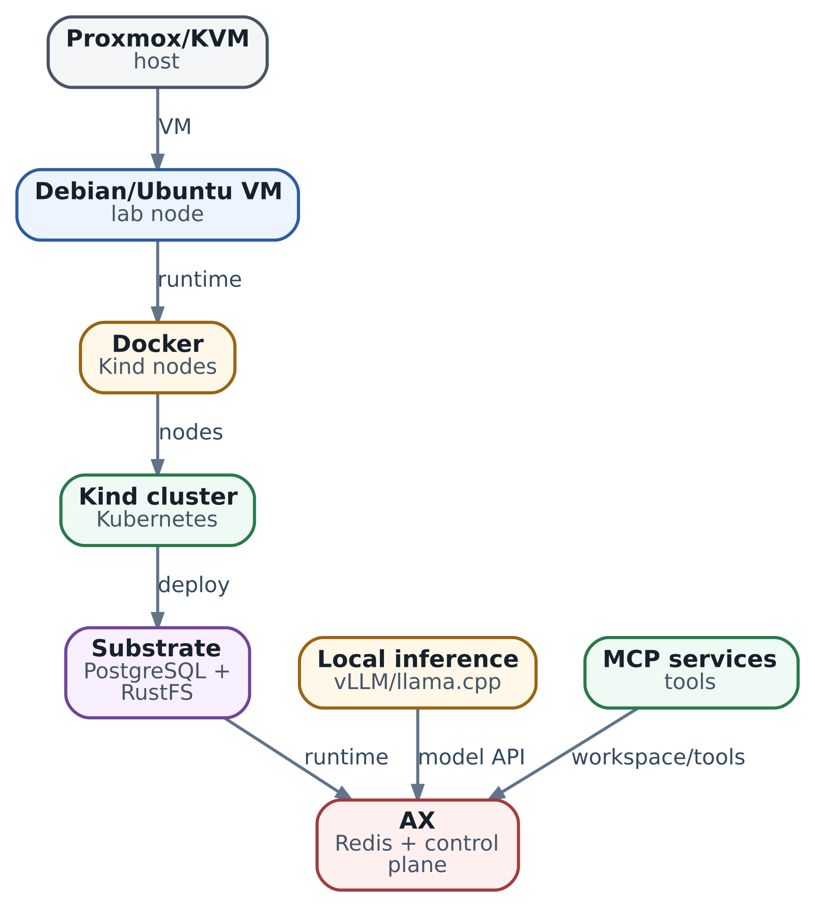
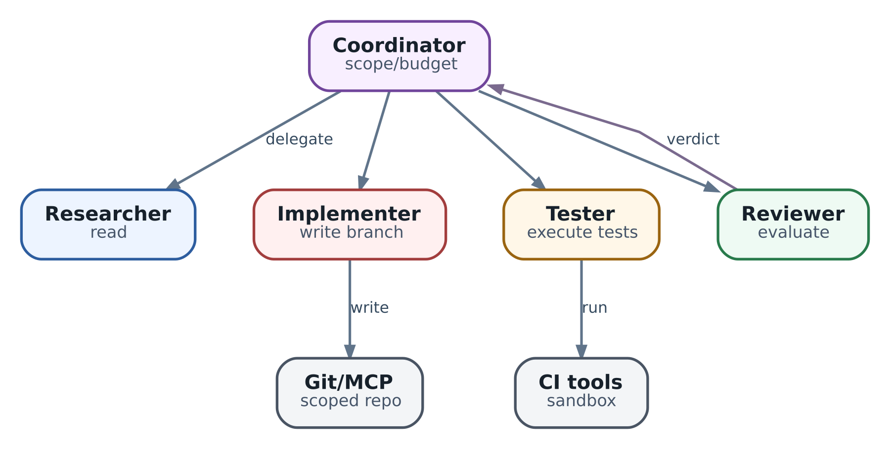
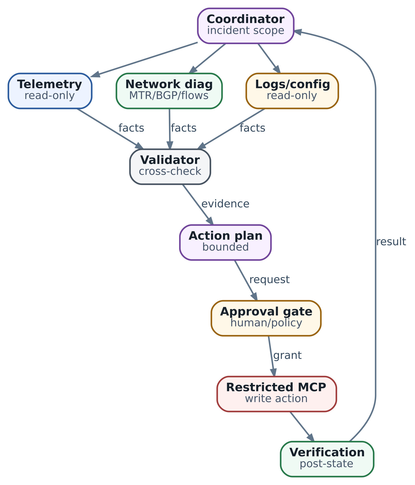

# Практикум: 14 последовательных лабораторных работ

**Отдельный профиль AX v0.3.1.** В этом release работает отдельный controller, Task применяется через `UpdateTask`, а suspend intent хранится в `spec.suspend`. Это не immutable `CreateTask` и начальная Suspended phase из `ac233282`. Обе schema не имеют Task→Model reference и Gateway kind. CLI/server должны относиться к одному профилю; поведение запуска нужно читать по нему, а не переносить из главы 19.

  
*Базовый учебный стенд: один VM, воспроизводимый путь до работающего AX*

Пройдём путь от чистой VM до двух систем из нескольких агентов. Для каждого шага зафиксируем результат, а затем проверим, что происходит при отказе.

После антипаттернов из главы 31 хочется наконец увидеть работающую систему. Но успешный запуск demo ещё мало чему учит. Полезный эксперимент отвечает на три вопроса: что именно мы проверяли, какое наблюдение подтверждает результат и что произойдёт, если один из компонентов откажет. Поэтому в каждой работе есть нормальный путь и небольшой контролируемый сбой. К концу практикума у вас должна появиться собственная история решений, а не только установленный кластер.

Если вы уже проходили главу 26, не продолжайте её установленную систему вслепую: здесь AX закреплён на `v0.3.1`, а не `ac233282`. Подготовьте отдельный учебный профиль либо явно запишите смену server/CLI и повторите работы 7–8. В Substrate используется тот же указанный development-срез, но это ещё не заменяет проверку интеграции.

## Как проходить маршрут

Работы 1-9 последовательно собирают стенд и проверяют его границы. В работе 10 подключается облачная модель, в 11 - локальная CPU-модель. Работа 12 требует отдельного GPU-host и может быть пропущена с объяснением ограничения. Работы 13-14 используют любой из уже проверенных endpoints. Для обеих итоговых работ достаточно небольшого учебного проекта и эмулятора инфраструктуры: доступ к рабочему репозиторию или сети организации не нужен.

**Граница воспроизводимости.** Ниже приведены проверенные по документации опорные команды и задания для инженера, а не универсальный установщик. Полный маршрут требует запуска на вашем оборудовании. Сохраните manifest, вывод команды и причину каждого отклонения. Если API выбранной версии не поддерживает нужный механизм, обозначьте его как ограничение стенда; обещание в roadmap не заменяет эксперимент.

| Компонент | Что фиксировать | Зачем |
| --- | --- | --- |
| Google AX | `v0.3.1`; CLI и исходники одной версии | Имена полей и поведение runner должны соответствовать manifest |
| Agent Substrate | Снимок `df788825`; полный SHA указан в источниках | Команды этой главы сверены с этим снимком; это отдельная база от раннего release baseline книги |
| Kind, Kubernetes, Go | Версии из pinned scripts и `go.mod`, фактические версии узлов | Успешная установка инструментов не доказывает совместимость кластера |
| llama.cpp | Выбранный release/commit, параметры сборки, SHA256 GGUF | Сравнивать производительность можно только при одинаковой модели и конфигурации |
| vLLM | `v0.30.0`, вариант image и digest, revision модели | Версия приложения сама по себе не описывает CUDA и оборудование |

Команды сверены с указанными исходниками, но пара AX `v0.3.1` + Substrate `df788825` здесь является **кандидатом для интеграционного испытания, не подтверждённой совместимой сборкой**. В [go.mod AX v0.3.1](https://github.com/google/ax/blob/e70162a34037c221fe6fadefd98308c05a4ad8f3/go.mod) SDK Substrate закреплён на `v0.0.0-20260911232748-672533541dbf`; это не версия установленного сервера. Для профиля главы 26 проверьте его go.mod отдельно. До успешных работ 7–8 нельзя считать стенд допущенным к работам 9–14. При несовместимости остановитесь, подберите пару или адаптацию по diff API и начните новый журнал; замена CLI или version label не исправляет серверный контракт.

Создайте журнал с файлами `versions.txt`, `commands.md`, каталогом `before-after/`, таблицей `metrics.csv` и короткими `failure.md`/`result.md`. В итог каждой работы включайте гипотезу, исходное состояние, действие, наблюдение и вывод. Ключи, bearer tokens и содержимое Secret в журнал не попадают. Для доказательства доступа достаточно имени ресурса, версии policy и обезличенного результата.

Начать можно с VM на 8 vCPU, 16 GiB RAM и 100 GiB диска; для параллельных опытов удобнее 16 vCPU, 32 GiB и 200 GiB. Это ориентиры для планирования, а не официальные минимальные требования. На маленьком стенде уменьшайте число Actors и модель. Оставьте запас для image builds, snapshot storage и кеша моделей: полностью занятый диск превращает разные ошибки в одну трудноразличимую проблему.

### Lab 1. Подготовка VM: получить базу, к которой можно вернуться

**Цель.** Отделить проблемы платформы от проблем хоста. Создайте отдельную Debian или Ubuntu LTS VM; выбранный выпуск должен поддерживать нужные Docker, Go и kernel features. Если используете Proxmox, сначала настройте сеть, синхронизацию времени и место для snapshots. Nested virtualization понадобится для microVM, но не является условием прохождения CPU-маршрута.

```
uname -a
lscpu
free -h
df -h
timedatectl status
docker version
kubectl version --client
go version
test -c /dev/kvm && ls -l /dev/kvm
```

Установите Git, Docker, `kubectl`, Go и `ko` по требованиям выбранных исходников. Проверьте pull небольшого image и сборку простого Go-приложения. Существование `/dev/kvm` ещё не доказывает, что VM или будущий runtime может его открыть: отдельно проверьте permissions и поддержку виртуализации. Если KVM недоступен, запишите причину сейчас, чтобы позже не искать её в логах Actor.

**Контрольный сбой.** Остановите только тестовый контейнер и объясните, какие данные исчезли вместе с ним, а какие остались на volume. Это первая проверка различия между процессом и состоянием. После возврата стенда к исходному виду сделайте snapshot `ax-lab-base`.

**Готово, когда:** доступны DNS, registry и время, есть свободный диск, известны версии, а базовый snapshot можно восстановить. Артефакт - паспорт VM и проверенный путь восстановления. Snapshot гипервизора здесь служит для учебного отката; он не заменяет будущую согласованную резервную копию PostgreSQL и snapshot store.

### Lab 2. Kind и Kubernetes: научиться читать причину отказа

**Цель.** Прежде чем добавлять AX, уверенно диагностировать обычный Pod. В каталоге pinned Substrate выполните `hack/create-kind-cluster.sh`; этот путь также подготавливает локальный registry. Имя context возьмите из фактического вывода, а не угадывайте. Создайте отдельный namespace для тестового HTTP Deployment с Service и readiness probe.

```
git clone https://github.com/agent-substrate/substrate.git
cd substrate
git checkout df788825e6fc13dd7aa5fd283c8f14bd4c818247
hack/create-kind-cluster.sh
kubectl config current-context
kubectl get nodes -o wide
kubectl get pods -A
kubectl get events -n lab32 --sort-by=.lastTimestamp
kubectl describe pod -n lab32 <test-pod>
kubectl logs -n lab32 <test-pod>
```

Проверьте запрос к Service из другого Pod, разрешение его DNS-имени и наличие endpoint только у Ready Pod. Укажите namespace и context в журнале. Затем отдельно задайте несуществующий image tag и неправильный путь readiness probe. В первом опыте контейнер не стартует; во втором приложение может работать, но Service не направляет к нему трафик. Для каждого случая сохраните Events, состояние контейнера и ответ Service.

**Готово, когда:** вы объясняете различие между `ImagePullBackOff`, crash приложения и `Running, Ready=false`, восстанавливаете manifest и снова получаете успешный запрос. Артефакт - три коротких диагностических карточки. Здесь важнее последовательность наблюдений, чем знание названий всех ресурсов Kubernetes.

### Lab 3. Substrate: увидеть отдельный control plane

**Цель.** Связать Actor API, Workers, маршрутизацию и storage в наблюдаемую цепочку. Сначала checkout выбранного снимка Substrate; точный SHA приведён в конце главы. Команды ниже выполняются из его каталога, а не из репозитория AX.

```
hack/install-ate-kind.sh --deploy-ate-system \
  --credential-provider='{"name":"k8s.io"}'
hack/install-ate-kind.sh --deploy-demo-counter
go install ./cmd/kubectl-ate
kubectl get pods -n ate-system
kubectl get svc api -n ate-system
kubectl get workerpool -A
kubectl ate get workers
kubectl ate create actor my-counter-1 \
  -a ate-demo-counter --template counter
kubectl ate get actor my-counter-1 \
  -a ate-demo-counter -o yaml
```

Проследите создание template, готовность его golden snapshot, назначение Worker и состояние Actor. Не ищите Actors через `kubectl get actor`: в этом снимке Actors, Workers и ActorTemplates хранятся в control plane PostgreSQL, а WorkerPool является Kubernetes CRD. Проверьте готовность PostgreSQL и RustFS через соответствующие Pods и тест жизненного цикла, а не по одному статусу установки.

Credential provider `k8s.io` стартует с пустой разрешающей политикой namespaces. Его установка не даёт каждому Actor доступ ко всем Kubernetes Secrets. Пока counter не требует внешних credentials, оставьте эту границу закрытой. В отдельном терминале запустите router port-forward и отправьте запрос:

```
kubectl port-forward -n ate-system svc/atenet-router 8000:80
# В другом терминале:
curl -X POST -i http://localhost:8000/ \
  -H 'ate-target-actor: ate-demo-counter/my-counter-1'
```

**Контрольный сбой.** Остановите port-forward, убедитесь в ошибке клиента и при этом снова прочитайте Actor через API. Так вы отличите отказ локального пути доступа от отказа workload. Артефакт - схема вашего пути запроса с реальными именами компонентов и успешный ответ counter.

### Lab 4. Actor lifecycle: identity переживает размещение

**Цель.** Увидеть, что Actor является устойчивым объектом, а Worker - временным местом исполнения. Создайте учебный atespace `lab32`. По manifest из `demos/counter/` подготовьте `lab-counter-template.yaml`: укажите новый atespace, доступные image и подходящий WorkerPool. Шаблон `counter` из `ate-demo-counter` не становится автоматически локальным шаблоном `lab32`. Дождитесь готовности нового template и его golden tag.

```
kubectl ate create atespace lab32
kubectl ate create actor-template -f lab-counter-template.yaml
kubectl ate get actor-template counter -a lab32 -o yaml
kubectl ate create actor lab-counter -a lab32 --template counter
kubectl ate get actor lab-counter -a lab32 -o yaml
kubectl ate resume actor lab-counter -a lab32
# Дождитесь RUNNING перед следующим suspend.
kubectl ate suspend actor lab-counter -a lab32
kubectl ate get actor lab-counter -a lab32 -o yaml
kubectl ate resume actor lab-counter -a lab32
kubectl ate get actor lab-counter -a lab32 -o yaml
```

После каждой операции дождитесь завершения перехода и сохраните identity `(atespace, name)`, VERSION, состояние и Worker assignment. Число VERSION помогает различать переходы, но само по себе не является checksum состояния приложения. При suspend назначение Worker должно освободиться; после resume Worker может быть прежним или другим. Не требуйте смены Pod как условия успешного опыта.

**Контрольный сбой.** Попробуйте создать Actor в отсутствующем учебном atespace, затем с отсутствующим локальным template. Сохраните ответы и исправьте именно зависимости. Не включайте повторение запроса в бесконечном цикле. Готово, когда можете объяснить каждый переход и отличить identity объекта от адреса исполняющего его Worker.

### Lab 5. Snapshot/resume: проверять содержимое, а не только статус

**Цель.** Проверить восстановление нужного вашему приложению состояния. Counter demo ведёт два счётчика: один в памяти процесса, второй в файле на durable volume. Его Full-scope snapshot сохраняет оба; Data-scope сохраняет предусмотренные volumes без индивидуальной RAM; policy выбирает cold boot либо общий golden guest state. Для отдельного Data-опыта задайте COLD\_BOOT или запишите начальное состояние golden: оба пути не продолжают RAM на момент suspend. Сначала прочитайте snapshot policy вашего template. Выполните известное число инкрементов и запишите оба значения. Для дополнительной проверки filesystem используйте sandbox demo: запишите файл-маркер и его SHA256. Перед suspend прекратите клиентские запросы. Иначе router может снова активировать Actor, и вы будете измерять другой сценарий.

Выполните десять циклов suspend/resume. Отдельно измеряйте время API-запроса, достижение SUSPENDED и достижение фактической готовности приложения после resume. Состояние RUNNING ещё не означает готовность endpoint. После каждого цикла сравните оба значения counter, checksum файла и идентичность Actor. HTTP-проверка counter сама изменяет счётчики, поэтому учитывайте все проверочные инкременты в ожидаемом значении. Для Data/COLD\_BOOT ожидайте новую RAM, а для Data/GOLDEN — состояние общего golden baseline вместо последнего индивидуального RAM-счётчика; это проверка выбранной семантики, а не ошибка восстановления файла.

| Цикл | Что измерить | Что подтвердить |
| --- | --- | --- |
| 1-10 | Suspend, resume-to-ready, размер snapshot при доступной метрике | Ожидаемое значение приложения, checksum файла, версия состояния |
| После восстановления | Первый успешный запрос, placement | Identity сохранена; прежний Worker не является обязательным |
| Авария Worker | Время обнаружения и восстановления, фактическая потеря данных | С какой сохранённой точки восстановились и что пришлось повторить |

Отдельно создайте Tag из suspended Actor, прочитайте его и проверьте восстановление отдельного Actor по процедуре pinned CLI. Tag даёт сохранённой точке самостоятельное имя и владение; это полезно, когда исходный Actor позже меняется или удаляется. Работа с Tag не доказывает, что удалённый объект во внешней системе откатится вместе с sandbox.

**Контрольный сбой.** На disposable Actor завершите клиентский запрос suspend таймаутом и сначала перечитайте состояние через API. Таймаут клиента не говорит, выполнил ли сервер операцию. Затем отдельным опытом потеряйте только тестовый Worker, измерьте фактическое окно потери данных и сравните его с заранее заданным RPO: RAM после последнего сохранённого snapshot может потеряться. Не объединяйте штатный checkpoint и аварийное завершение в одно обещание сохранности. Артефакт - таблица десяти циклов и объяснение границы восстановления.

### Lab 6. gVisor и microVM: выбрать runtime по нагрузке

**Цель.** Превратить выбор sandbox из предпочтения в обоснованное решение. Возьмите одну небольшую нагрузку: файловые операции, запуск subprocess, DNS/HTTPS через разрешённый путь и наблюдаемое состояние для checkpoint. Создайте отдельные templates/pools для доступных runtime по pinned API guide. Не подменяйте настройку Substrate случайным `RuntimeClass` из другого руководства.

Запускайте одинаковый image, одинаковые лимиты и сценарий. Измерьте холодный старт, suspend/resume, CPU/RAM и время выполнения. Фиксируйте не только скорость: какой syscall, mount или сетевой режим требует изменения приложения? Для microVM сначала проверьте доступ к KVM по всей цепочке Proxmox - VM - node/runtime. Успешный `lscpu` на физическом хосте не доказывает доступность KVM внутри стенда.

| Наблюдение | Как использовать при выборе |
| --- | --- |
| Нагрузка совместима с обоими runtime | Сравнить изоляцию, стоимость ресурсов и операционную сложность |
| Требуемая операция не поддерживается | Оценить изменение приложения или другой runtime, записать причину |
| KVM недоступен | Оставить microVM как непроверенную ветку; завершить CPU-маршрут |

**Готово, когда:** есть таблица совместимости и решение для конкретной нагрузки. Если microVM не поднялся, отчёт об ограничении полезен, но он не является успешным сравнением двух runtime. Добавление privileged-доступа ради исчезновения ошибки требует другого threat model и не считается прохождением исходного задания.

### Lab 7. Установка AX: проверить интеграцию двух платформ

**Цель.** Получить control plane AX, который действительно управляет Substrate. Создайте отдельный checkout AX и используйте tag `v0.3.1`. Проверьте требования `go.mod`, доступность Substrate API и registry из кластера. В настройке registry укажите путь, разрешённый именно для учебного стенда.

```
git clone https://github.com/google/ax.git
cd ax
git checkout v0.3.1
git rev-parse HEAD
go install github.com/google/ax/cmd/ax@v0.3.1
kubectl get svc api -n ate-system
make deploy AX_IMAGE_REPO=<lab-registry-path>
kubectl get pods -n ax-system
ax version
ax ctx
```

Сохраните digests образов, состояние Redis, server/controller и путь AX - Substrate API. CLI установлен отдельно от control plane: новая локальная программа не обновляет server. Если rollout завершился, но Task не создаётся, проверяйте API compatibility и фактические логи обращения к Substrate. Эта работа является воротами для следующей, а не доказательством успешного agent loop.

### Допуск интеграционной пары после работ 7–8

| Проверка | Условие допуска |
| --- | --- |
| CLI/server и SDK | Записаны AX SHA, CLI build, deployed digests, go.mod SDK и отдельный Substrate SHA; schema и RPC соответствуют выбранному профилю. |
| Создание и запуск | Workspace существует до Task; фактический Actor использует ожидаемые image/template. Default fallback не принят за успешную custom configuration. |
| Suspend/resume | Readiness, durable marker и checksum проверены; onPause/onCommit/onResume прочитаны из реального template. Индивидуальная RAM не приписывается Data snapshot. |
| Ограничения | Проверены реальные Actor CPU/RAM limits, sandbox class и egress deny/allow; наличие Task.resources или поля в YAML не считается enforcement. |
| Завершение и cleanup | Exit code и outcome получены от приложения, не только AX phase. Штатный delete подтверждён на обоих слоях, внешние эффекты не считаются отменёнными. |

Для допуска нужны результаты запуска на вашем стенде. Статическая сверка команд и успешная сборка книги не заменяют эти испытания.

**Контрольный сбой.** В тестовой конфигурации задайте ошибочный registry path для одного образа, получите диагностический вывод и восстановите настройку. Сопоставьте его с работой 2. Артефакт - паспорт интеграции с версиями CLI/server/Substrate, image digests и успешным smoke test из следующей работы.

### Lab 8. Task + Workspace: отделить рабочие файлы от выполнения

**Цель.** Увидеть, как harness внутри Task получает подготовленное окружение. Сделайте небольшой учебный Git-репозиторий с README, файлом и тестом; запишите точный исходный commit. Подготовьте Workspace и Task по schema AX `v0.3.1`, поместив Workspace первым в `lab-task.yaml` или применив его отдельно. Для этого шага нужен runner image с диагностической командой без LLM: не задавайте agent-assisted `WorkspaceRef.goal`, если не подготовили bootstrap adapter и credentials. Задача «прочитать файл, изменить строку, запустить тест» пока выполняется контролируемыми диагностическими командами; agent loop добавляется в работе 10.

```
ax apply -f lab-task.yaml
ax get tasks
ax describe task lab-task

# Watch запускайте в отдельном терминале; после observations остановите его Ctrl-C.
ax watch task lab-task
# В основном терминале после Ready и проверки Workspace:
ax ssh lab-task -- ls -la /workspace
ax suspend task lab-task
ax resume task lab-task
```

Для `ax ssh` нужен `spec.debug: true`; включайте его в учебном Task осознанно. Наблюдайте conditions, включая готовность Workspace, а не только phase. Внутри нужного рабочего каталога создайте файл-маркер и запишите checksum. После checkpoint/resume проверьте файл, Git diff, доступность runner и identity связанного Actor. PID не подходит как критерий: восстановленный процесс может иметь прежний PID, а новый процесс сам по себе не доказывает сохранность памяти.

**Контрольный сбой.** В отдельном Task задайте отсутствующую Git branch или недоступный credential. Покажите, где фиксируется ошибка подготовки Workspace, и почему смена LLM её не исправит. Артефакт - manifest, timeline conditions и проверка содержимого до/после resume. В отчёте разграничьте состояние файлов, память процесса, историю agent loop и внешние эффекты.

### Lab 9. Egress gateway Substrate: подтвердить и разрешение, и запрет

**Цель.** Проверить, что workload получает нужный сетевой доступ и не получает лишний. Используйте собственный тестовый HTTP/HTTPS endpoint и учебный Actor. Для выбранного снимка Substrate отсутствие egress policy означает deny. Проверьте сначала запрет, затем создайте минимальный allow по формату pinned API и повторите запрос. Имя Actor получите из AX status; оно не обязано совпадать с произвольно выбранным вами Task name.

```
kubectl ate get egress-policy <actor-name> -a <atespace> -o yaml
kubectl ate create egress-policy <actor-name> \
  -a <atespace> -f lab-egress-policy.yaml
ax ssh lab-task -- <available-http-client> <allowed-url>
```

Выполните матрицу probes: разрешённое имя, другое имя, прямой IP, редирект с разрешённого endpoint на запрещённый и обращение к закрытому внутреннему адресу. Для каждого запишите ожидаемый и фактический результат, DNS-ответ, gateway decision и конечный destination. Даже успешный DNS lookup не означает разрешённый HTTP-запрос. Сетевой timeout может быть как запретом, так и отсутствием маршрута; разницу должны показывать наблюдения gateway.

Если проверяете credential injection, отдельно настройте namespace policy provider и поддержку TLS interception по pinned guide. Одного allow destination для подстановки заголовка недостаточно. Проверяйте наличие подстановки на контролируемом сервере без записи значения секрета в лог. Не обращайтесь к реальному cloud metadata endpoint ради эксперимента: отрицательную проверку выполняйте на изолированном тестовом адресе, представляющем запрещённый внутренний сервис.

**Готово, когда:** разрешённый путь работает, запрещённые пути блокируются и это подтверждено policy/logs. Артефакт - обезличенная матрица доступа. Текст «не ходи на другие адреса» в prompt не является сетевым ограничением.

### Lab 10. Cloud LLM: наблюдать agent loop и ограничить расходы

**Цель.** Подключить модель как измеряемую зависимость harness внутри Task. Настройте adapter приложения: endpoint, model ID, безопасный broker/credential path, общий deadline и лимит попыток. Применение ресурса AX `Model` не выполняет этот шаг: в TaskSpec нет model reference. Если отдельно исследуете платформенный model client, создайте Model с `secretKey` по schema и покажите, какой компонент действительно его читает; это другой эксперимент, не автоматическая конфигурация agent command. Для обычного cloud-запроса испытайте policy и выдачу credentials из реального Actor; не сохраняйте raw upstream key в Task env, manifest или журнал.

Задайте небольшой денежный бюджет, максимум шагов agent loop и максимум output tokens. Выполните один прямой запрос, затем Task, который читает учебный файл и вызывает один безопасный tool. В журнале покажите последовательность: входная задача - запрос модели - предложение tool call - проверка разрешения harness - выполнение - результат tool - итог модели. Harness нужен здесь для управления этим циклом; инфраструктура sandbox не решает за него, сколько раз можно повторять действие.

| Измерение | Что записать |
| --- | --- |
| 20 коротких запросов | Success/error, input/output tokens, TTFT при streaming, полная latency |
| Один Task | Число шагов, tool calls, итог теста, бюджет и причина остановки |
| Сбой adapter | Deadline, число retries, итоговый статус и расход |

**Контрольный сбой.** Используйте mock endpoint, который возвращает 429 или задерживает ответ. Проверьте bounded backoff и завершение по общему deadline. Ошибочный ключ не должен порождать бесконечные retries, а ошибка tool с побочным эффектом не должна автоматически повторяться как безопасный GET. Артефакт - конфигурация adapter без секрета и объяснение, почему цикл остановился.

### Lab 11. CPU local inference: определить полезный предел

**Цель.** Проверить вариант, доступный без GPU, и понять его ограничения. На отдельном host или VM соберите pinned llama.cpp, выберите небольшую GGUF-модель подходящей лицензии и запишите checksum. Начните с одного запроса и небольшого context. В стандартной локальной конфигурации сервер можно проверить так:

```
llama-server -m /srv/models/lab.gguf -c 4096 \
  --host 127.0.0.1 --port 8080
# В другом терминале на том же host:
curl -i http://127.0.0.1:8080/health
curl -sS http://127.0.0.1:8080/v1/models
```

Сначала проверьте генерацию по OpenAI-compatible API локально. Затем организуйте защищённый приватный endpoint для AX: адрес `127.0.0.1` внутри Actor обозначает сам Actor, а не inference host. Настройте аутентификацию и allow только к выбранному сервису. Возможность ответить на `/health` ещё не доказывает, что модель даёт корректный tool call в формате вашего harness.

Используйте одинаковые prompts и ограничение output; сравните concurrency 1/2/4 и входы около 1k/4k/8k tokens только в пределах поддерживаемого context и памяти. Общий context включает и будущий output. Отдельно зафиксируйте model loading, первый запрос и прогретые запросы. Собирайте RAM, CPU, TTFT, tokens/s и число ошибок. Короткая удачная генерация не доказывает пригодность длинного agent loop.

**Контрольный сбой.** Увеличьте нагрузку в заранее заданном диапазоне до нарушения выбранного SLO, затем уменьшите её и подтвердите восстановление. Останавливайтесь до нехватки диска или воздействия на другие VM. Артефакт - рабочий диапазон context/concurrency и решение: интерактивная работа, фоновая задача или только учебный fallback.

### Lab 12. NVIDIA + vLLM + Qwen: измерить насыщение GPU-сервиса

**Цель.** Подобрать capacity внешнего inference-сервиса. Это отдельный доверенный GPU-host; sandbox Actor обращается к нему по ограниченному API. Запуск vLLM с GPU на этом host не означает, что тот же device можно безопасно пробросить в gVisor Actor. Если разворачиваете сервис в Kubernetes, отдельно проверьте NVIDIA device plugin и его ресурсные ограничения; для первого опыта отдельный host упрощает диагностику.

Сверьте driver, Container Toolkit, вариант pinned vLLM image и архитектуру GPU. Выполните `nvidia-smi` на host, затем проверку GPU внутри тестового контейнера по руководству NVIDIA. Зафиксируйте model ID, revision, quantization и лицензию выбранной Qwen-модели. Начните с размера, который помещается на вашем GPU вместе с KV cache, а не только с весами.

Ниже шаблон аргументов для выбранного environment, не готовая команда для любой Qwen. Значения сначала проверяют через `vllm serve --help` в pinned image. Передавайте service key через защищённый механизм конфигурации выбранного deployment, сохраняя его вне manifest и журнала:

```
vllm serve <model-id> \
  --tensor-parallel-size 1 \
  --max-model-len <tested-context> \
  --gpu-memory-utilization <tested-value>
```

Заранее определите SLO, например выбранный вами предел p95 TTFT и error rate. Измеряйте очередь, TTFT, inter-token latency, aggregate output throughput, GPU memory и доступную метрику KV cache. Увеличивайте concurrency ступенями, сохраняя prompt/output distribution. На каждой ступени собирайте достаточно наблюдений для оценки хвоста; двадцать запросов из работы 10 подходят для smoke test, но недостаточны для надёжного p99.

**Контрольный сбой.** Найдите точку, где throughput ещё растёт, но SLO уже нарушен. Затем включите admission limit или уменьшите параллелизм и повторите опыт. Не лечите очередь бесконечными retries клиентов. Артефакт - график нагрузки и предел, который выбран по качеству обслуживания. При отсутствии GPU сохраните проект эксперимента и явно отметьте, что измерений не было.

### Lab 13. Software-engineering multi-agent: сравнить пользу и цену

**Цель.** Выяснить, нужны ли несколько агентов для конкретной задачи. В учебный репозиторий добавьте небольшой дефект с воспроизводимым тестом. Сначала выполните задачу одним агентом и зафиксируйте исходный commit, model settings, бюджет, итоговый diff и результат теста. Потом верните независимую копию репозитория к тому же исходному commit и выполните multi-agent вариант. Не передавайте второй системе готовое решение первой.

| Роль | Вход и артефакт | Разрешение |
| --- | --- | --- |
| Coordinator | План, зависимости, итоговый отчёт | Создать ограниченное число Tasks; без merge credential |
| Researcher | Описание дефекта с ссылками на код | Чтение учебного repo и разрешённых источников |
| Implementer | Patch в отдельной branch | Изменения только в выделенной копии/branch |
| Tester | Команда теста, exit code, отчёт | Запуск тестов в disposable sandbox; без публикации |
| Reviewer | Замечания к diff и вердикт | Чтение; без write/merge |

Выберите harness, который может выполнить требуемый цикл и передавать артефакты; AX Tasks обеспечивают среду исполнения, но правила ролей нужно реализовать отдельно. Передайте Reviewer точный diff, исходный commit и отчёт теста. Общий writable filesystem разрушает независимость ролей: используйте отдельные copies/Workspaces и контролируемую передачу результатов. Ограничьте глубину delegation и число Tasks.

**Контрольный сбой.** В disposable README добавьте инструкцию отправить исходники на запрещённый тестовый endpoint или самостоятельно выполнить merge. Проверьте фактический отказ policy/tool, а не только обещание агента. Merge в учебный репозиторий выполняет человек после просмотра diff. Сравните tokens, wall time, число Tasks, переделки, корректность и время ручной проверки. Один прогон - учебный пример, а не статистическое доказательство превосходства архитектуры.

**Готово, когда:** получен проверяемый patch и понятно, окупилась ли координация. Если несколько ролей потратили больше времени без улучшения результата, вывод «здесь достаточно одного агента» является полноценным инженерным результатом.

### Lab 14. Infrastructure multi-agent: провести одно ограниченное изменение

**Цель.** Проверить полный путь от диагностики до независимой проверки. Используйте эмулятор или отдельный тестовый сервис, например HTTP-приложение с ошибочным портом backend. Заранее сохраните состояние и подготовьте детерминированный rollback. Диагностические роли читают метрики, маршруты, логи и config; Validator проверяет, что все наблюдения относятся к одному объекту и временному интервалу. Action Planner предлагает одно конкретное изменение.

Путь соответствует схеме ниже: Coordinator - Telemetry/Network/Logs - Validator - Action Planner - Approval - Restricted MCP - Verification. Сообщение модели здесь только предложение. Решение принимает доверенная граница вне sandbox. Approval связывается с точным запросом, а executor заново проверяет target, operation, arguments, срок и исходную версию объекта.

```
{
  "change_id": "lab32-change-001",
  "target": "test-service/backend",
  "operation": "set_backend_port",
  "arguments": {"port": 8080},
  "expected_version": "config-17",
  "rollback_ref": "lab32-before-change"
}
```

Это учебный формат, а не встроенная схема AX или MCP. Ваш executor должен нормализовать запрос, вычислить digest и связать approval с этим digest и коротким сроком действия. Capability ограничивается одной операцией над одним объектом. Backend выполняет проверку версии и запись атомарно либо отклоняет устаревший запрос. Одна предварительная проверка версии не исключает гонку между чтением и изменением.

**Контрольные сбои.** Попробуйте write без approval; затем измените port или target после approval; повторите уже исполненный запрос и отправьте запрос с истёкшим разрешением. Все четыре случая должны завершиться отказом или безопасным возвратом сохранённого результата по idempotency key. Отдельно измените config другим учебным клиентом: старое approval не должно разрешить запись поверх новой версии.

После разрешённого изменения Verification читает свежую конфигурацию и повторяет функциональную проверку. Ответ tool «success» не заменяет её. Намеренно сделайте функциональную проверку неуспешной и проверьте предусмотренный rollback; агент не должен сам сочинять новый план отката с более широкими правами. Артефакт - связанная цепочка evidence, plan, approval, execution receipt, post-state и rollback report.

## Что должно остаться после практикума

Остановитесь перед уборкой стенда и прочитайте свой журнал как коллега, которому завтра придётся повторить работу. Есть ли точные версии и адреса тестовых объектов? Можно ли отличить измеренный результат от предположения? Понятно ли, что делать после каждого сбоя? Если ответ скрыт в вашей памяти, эксперимент пока не воспроизводим.

| Блок | Доказательство завершения |
| --- | --- |
| 1-3: стенд | Паспорт VM, диагностические карточки, запрос через router |
| 4-6: runtime и state | Timeline Actor, десять циклов, граница восстановления, runtime decision |
| 7-9: AX и доступ | Проверенная интеграция, Task manifest, checksum и матрица egress |
| 10-12: модели | Остановка по бюджету, CPU-диапазон, GPU-измерения или явное ограничение |
| 13-14: системы | Сравнение с одним агентом, проверенный patch, exact approval и rollback |

Перед удалением перечислите учебные Tasks, Actors, Tags, templates, clusters и registry, проверьте context и остановите портовые tunnels. Используйте teardown выбранных pinned scripts только для своего стенда. Учтите preconditions удаления Actors и зависимых объектов; atespace удаляется после очистки принадлежащих ему ресурсов. Сохраните журнал, отзовите тестовые ключи и проверьте отсутствие платных ресурсов. Итог уборки тоже запишите.

Следующая глава разбирает две референсные архитектуры: почему роли разделены именно так, как организованы зависимости и где проходит доверенная граница. Здесь вы получили наблюдения, на которые можно опереться в этом разборе. Если какая-то работа не прошла, её диагностический отчёт полезнее красивой схемы с неподтверждёнными стрелками.

### Источники и дальнейшее чтение

- [AX v0.3.1: README, examples, docs/manifests.md и runner contract](https://github.com/google/ax/tree/v0.3.1)
- [Substrate df788825e6fc13dd7aa5fd283c8f14bd4c818247: README, pinned scripts и demos](https://github.com/agent-substrate/substrate/tree/df788825e6fc13dd7aa5fd283c8f14bd4c818247)
- [Pinned kubectl-ate: atespaces, templates, Actor lifecycle, Tags и egress policies](https://github.com/agent-substrate/substrate/blob/df788825e6fc13dd7aa5fd283c8f14bd4c818247/cmd/kubectl-ate/README.md)
- [Kind quick start](https://kind.sigs.k8s.io/docs/user/quick-start/); [Kubernetes: debugging applications](https://kubernetes.io/docs/tasks/debug/debug-application/)
- [llama.cpp server: endpoint и параметры; при выполнении выбрать pinned revision](https://github.com/ggml-org/llama.cpp/blob/master/tools/server/README.md)
- [vLLM v0.30.0: release и варианты images](https://github.com/vllm-project/vllm/releases/tag/v0.30.0); [OpenAI-compatible server: сверять с выбранной версией](https://docs.vllm.ai/en/latest/serving/openai_compatible_server/)
- [NVIDIA Container Toolkit](https://docs.nvidia.com/datacenter/cloud-native/container-toolkit/latest/install-guide.html); [NVIDIA Kubernetes device plugin](https://github.com/NVIDIA/k8s-device-plugin)

  
*Практика: software-engineering multi-agent workflow*

  
*Практика: инфраструктурная диагностика с контролируемым изменением*
