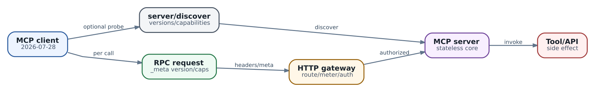

# MCP 2026: протокол, discovery, transport и trust boundaries

В главе 35 мы собрали контекст для незавершённого расследования. На `lab-edge-1` видна `config-18`, у пути A local preference 150, а исход прежней операции `lab33-net-001` ещё нужно установить. Следующий шаг требует чтения устройства или журнала controller. Теперь разберём, как harness получает такое наблюдение через MCP и где может ошибиться интеграция.

Представьте, что сетевой adapter уже умеет читать маршрут. Его хотят использовать в IDE, внутреннем SRE-помощнике и другом harness. Предметная операция одна, но приложения по-разному описывают инструменты и вызывают их. **Model Context Protocol задаёт общий интерфейс между приложением и поставщиком инструментов и данных.** Он помогает переиспользовать adapter, сохраняя за приложением выбор следующего действия и проверку результата.

В этой главе мы подключим учебный `network-lab`, получим каталог и прочитаем маршрут. Сначала разберём роли и сообщения, затем выполним обмен между двумя локальными процессами. После этого будет проще выбрать transport, оценить готовый SDK и разобраться, почему подключение работает в терминале, но ломается за proxy или внутри Actor. Профиль книги — MCP `2026-07-28`; особенности более ранних revisions будем называть отдельно.

  
*MCP 2026-07-28: stateless request model and discovery*

## Где проходит граница MCP

У интеграции есть три участника. **Host** — приложение с агентом, которое ведёт задачу, собирает контекст и выбирает доступные действия. **Client** — компонент host для связи с определённым MCP server. **Server** — программа, которая предоставляет операции и данные. Она может работать дочерним процессом рядом с host или общим удалённым сервисом. Эти роли определены в [архитектуре MCP](https://modelcontextprotocol.io/docs/2026-07-28/learn/architecture).

Модель предлагает вызвать `network.read_route`. Host связывает это имя с настроенным server, проверяет область задачи и передаёт вызов client. Client сериализует сообщение, получает ответ и возвращает его приложению. Server переводит предметную операцию в запрос к устройству. Для модели это один tool call; в исполнении участвуют несколько программ с разными обязанностями.

MCP заканчивается на границе client/server. С другой стороны server может использовать REST, gRPC, библиотеку или CLI. Чтобы вернуть полезное наблюдение, сетевой adapter должен знать, что означает VRF, как читать revision и где получить время измерения. Эти знания остаются частью adapter. Host, в свою очередь, решает, достаточно ли наблюдения для следующего шага расследования.

Такое разделение помогает при диагностике. Если server вернул другую VRF, ищите ошибку в contract или adapter. Если корректный ответ оказался среди потерянных фрагментов контекста, проверяйте assembler главы 35. Если модель получила все сведения и всё равно предложила повторить неизвестный write, исследуйте её решение и проверку у executor. Замена одного слоя полезна, когда установлено, что именно в нём нарушено.

## Сначала спроектируем одно полезное чтение

Нашему шагу нужен маршрут `192.0.2.0/24` в `VRF LAB` на `lab-edge-1`. Назовём операцию `network.read_route`. В arguments обязательны три строки: device, vrf и prefix. В ответе нужны сам объект чтения, признак наличия маршрута, revision, local preference, время и ссылка на исходный материал. Название tool и эти предметные поля — учебный contract, а не методы AX или API производителя оборудования.

На этапе проектирования задайте вопрос: какое решение поможет принять этот ответ? Чтение текущего маршрута позволяет проверить конфигурацию, но для установления исхода `lab33-net-001` понадобится отдельный lookup по controller или журналу операций. Поэтому `config-18` сохраняется как наблюдение, а прежний `OUTCOME_UNKNOWN` остаётся в ledger. Эта связь будет важна и в примере, и в следующей главе об исполнении writes.

MCP предлагает несколько способов предоставить сведения. Для нашей интеграции можно выбрать их по назначению:

| Что нужно приложению | Интерфейс | Пример и смысл |
| --- | --- | --- |
| Получить результат конкретной операции | Tool через tools/call | network.read\_route читает маршрут с заданными аргументами |
| Прочитать адресуемый материал | Resource через resources/read | inventory://lab/devices/lab-edge-1 обозначает карточку устройства |
| Получить начало диагностического разговора | Prompt через prompts/get | diagnose\_packet\_loss возвращает сообщения с параметрами задачи |

[Resources](https://modelcontextprotocol.io/specification/2026-07-28/server/resources) имеют URI; resource templates описывают семейство адресов с параметрами. Host выбирает подходящий материал и способ включения в контекст. Это удобно для inventory и документации, где важна ссылка на объект. [Prompts](https://modelcontextprotocol.io/specification/2026-07-28/server/prompts) предоставляют шаблоны сообщений. Их можно показать пользователю как начало процедуры; обязательные проверки всё равно выполняет приложение. Skill главы 6 может включать более широкую инструкцию, scripts и references — это другой формат организации процедуры.

Начать достаточно с одного read tool. Общий `run_command(text)` вынудил бы модель и executor снова разбирать намерение из строки, а десятки почти одинаковых reads увеличили бы трудность выбора. Границу tool лучше провести там, где получается понятная операция с проверяемым результатом.

## Версия определяет порядок обмена

В [профиле 2026-07-28](https://modelcontextprotocol.io/specification/2026-07-28/basic/versioning) каждый запрос сам сообщает revision и возможности client через `params._meta`. Server принимает или отклоняет его независимо от предыдущих обращений. Открытое соединение позволяет доставлять сообщения, но не задаёт контекст разговора. Поэтому два чтения можно выполнить через разные процессы server, если необходимые прикладные данные доступны обоим.

Термин capability означает поддерживаемую возможность протокола. Server, предоставляющий tools, сообщает `tools: {}`. Client с пустым `clientCapabilities: {}` не предлагает дополнительных возможностей со своей стороны, например получения пользовательского ввода. Эти объекты описывают поведение участников, а право прочитать конкретное устройство проверяется отдельно.

Для сравнения, в [legacy 2025-11-25](https://modelcontextprotocol.io/specification/2025-11-25/basic/lifecycle) client сначала посылает `initialize`, получает согласованную версию и capabilities, затем отправляет `notifications/initialized`. У старого Streamable HTTP server мог назначить `Mcp-Session-Id`; наличие transport session было необязательным. Переносить такой handshake в modern-only client следует только как явно реализованный legacy режим.

| Свойство | Legacy 2025-11-25 | Профиль 2026-07-28 |
| --- | --- | --- |
| Подготовка protocol context | Initialization handshake | Metadata каждого request |
| Проверка совместимых revisions | Ответ initialize | server/discover или ошибка UnsupportedProtocolVersion |
| Дополнительный запрос от server | Server-initiated request | InputRequiredResult и продолжение исходного метода |
| Долгие notifications на HTTP | Возможен отдельный GET stream | Stream ответа subscriptions/listen |

Modern-only реализация и legacy-only реализация требуют совместимого режима или замены одной из сторон. Если нужны обе эпохи, выбирайте dual-era client/server и проверяйте оба пути. При распознанной modern-ошибке исправляют версию или metadata; это не повод произвольно переключаться на `initialize`. Транспортные правила такого распознавания описаны в bindings, а в учебном коде ниже legacy fallback отсутствует намеренно.

Фиксируйте protocol revision, версию SDK, пакет или image server и revision предметного tool contract отдельно. По этим четырём значениям можно повторить acceptance test и понять, что изменилось после upgrade. Имя `network.read_route` может сохраниться, хотя новая версия adapter стала возвращать local preference другой записи или перестала указывать усечение результата.

## Discovery и каталог дают разные сведения

Адрес server или команда запуска приходят из управляемой конфигурации host. По ним client выполняет `server/discover` и узнаёт поддерживаемые revisions и capabilities. Метод обязателен для modern server, а предварительный вызов необязателен для client. Самоописание `serverInfo` полезно для журнала, но не удостоверяет поставщика: это оговорено в [Discovery specification](https://modelcontextprotocol.io/specification/2026-07-28/server/discover).

Затем `tools/list` возвращает определения инструментов: name, description, inputSchema и, при наличии, outputSchema. `server/discover` отвечает «какие виды обмена здесь поддерживаются», а `tools/list` — «какие конкретно операции сейчас доступны». Host сопоставляет каталог с проверенной конфигурацией и выбирает небольшой набор для текущего шага. Внутренний alias должен сохранять связь с исходными server и tool name: одинаковый `search` у двух поставщиков может иметь разные scope и смысл.

Большой каталог читают постранично, следуя `nextCursor`, с пределом числа страниц и суммарного объёма. Лимит предотвращает бесконечный обход, но должен давать явный результат «каталог получен не полностью». Отсутствие tool на первой странице ещё не устанавливает его отсутствие у server. Cache связывают с endpoint или package, authenticated scope и версией контракта. При смене credentials и contract каталог проверяют заново. Уведомление об изменении сокращает задержку обновления, а периодическая проверка помогает восстановиться после потерянного уведомления.

Description и annotations относятся к содержимому каталога. Host использует `readOnlyHint` как подсказку от поставщика с известным уровнем доверия; реальный риск операции определяет проверенный adapter и policy. Наличие инструмента в списке облегчает выбор, но server проверяет допустимость каждого обращения независимо от того, откуда caller узнал его имя.

## Из чего состоит запрос и что проверять в ответе

Обмен использует JSON-RPC. Method `tools/call` выбирает протокольную операцию, `params.name` — предметный tool, а `params.arguments` — его вход. У каждого незавершённого request свой ID, чтобы client мог сопоставить ответы. В примере запрос выглядит так; для чтения он отформатирован в несколько строк:

```
{
  "jsonrpc": "2.0",
  "id": "r1",
  "method": "tools/call",
  "params": {
    "name": "network.read_route",
    "arguments": {
      "device": "lab-edge-1",
      "vrf": "LAB",
      "prefix": "192.0.2.0/24"
    },
    "_meta": {
      "io.modelcontextprotocol/protocolVersion": "2026-07-28",
      "io.modelcontextprotocol/clientInfo": {
        "name": "lab-harness", "version": "1.0.0"
      },
      "io.modelcontextprotocol/clientCapabilities": {}
    }
  }
}
```

Обязательны version и clientCapabilities; clientInfo рекомендовано передавать, но оно необязательно. Это сведения о программе, а не authenticated principal. Требования к metadata и envelope заданы в [base protocol](https://modelcontextprotocol.io/specification/2026-07-28/basic/index). ID `r1` коррелирует сообщения; дедупликацию внешней операции нужно строить на application key и contract принимающей системы, как в главе 37.

Server сначала проверяет envelope, revision и параметры вызова. Далее предметный validator разбирает arguments. `inputSchema` может требовать строки и запрещать лишние поля; корректный CIDR и допустимое устройство требуют содержательных проверок. Например, `192.0.2.1/24` содержит host bits: в нашем contract принимается каноническая сеть, поэтому validator отклонит её. При другом contract adapter мог бы нормализовать ввод, но это поведение нужно явно согласовать.

Результат успешного учебного чтения имеет `resultType: complete`, `isError: false` и `structuredContent` с наблюдением. Текстовый блок `content` содержит сериализованный JSON для представления данных. `outputSchema` описывает структуру structuredContent. В этой интеграции выбран объект; сам MCP допускает и другие JSON-значения по schema. Различия форматов и ошибки определены в [Tools specification](https://modelcontextprotocol.io/specification/2026-07-28/server/tools).

Host принимает результат по нескольким признакам. Envelope должен соответствовать request ID; variant результата должен поддерживаться client; данные должны иметь нужные типы и относиться к запрошенному объекту. Затем проверяются время и происхождение наблюдения. Если server прислал верный JSON о другом устройстве, schema может пройти, а шаг расследования всё равно не получит нужного evidence. Свежесть тоже относится к конкретному решению, как разобрано в главе 35.

## Выполняем обмен между двумя процессами

В `examples/ch36_mcp_stdio.py` находятся маленький server и client для одного фиксированного contract. Используется стандартная библиотека Python. Server понимает `server/discover`, `tools/list` и `tools/call`; единственный tool читает заранее заданный fixture. Сетевых credentials и модели для упражнения не требуется.

Запустите из корня репозитория:

```
python3 examples/ch36_mcp_stdio.py
python3 -m unittest discover -s examples \
  -p 'test_ch36_mcp_stdio.py'
```

`exchange()` запускает этот же файл с `--server`, пишет сообщения в stdin, читает stdout и stderr и закрывает процесс. На проводе каждое сообщение занимает одну UTF-8 строку с завершающим newline. Переносы внутри JSON-строк экранируются. Debug log идёт в stderr, поэтому не становится частью протокольного ответа. Это framing [stdio binding](https://modelcontextprotocol.io/specification/2026-07-28/basic/transports/stdio).

Демо последовательно получает discovery, каталог и read, каждый раз через новый child process. Это специально убирает возможность «помнить initialization» между шагами. Тест дополнительно отправляет три сообщения через один child. Они образуют три JSON-RPC messages, а не один JSON array batch. Ответы фиксированного server последовательны; полноценный client должен уметь обрабатывать interleaved replies и notifications.

Результат демо можно сверить с таблицей:

| Поле результата | Полученное значение | Что произошло |
| --- | --- | --- |
| config\_revision | config-18 | Принято наблюдение запрошенного маршрута |
| local\_pref | 150 | Прочитано значение из локального fixture |
| unsupported\_version | -32022 | Запрошенная 2025-11-25 отсутствует в поддерживаемых revisions |
| missing\_metadata | -32602 | Server отклонил request без обязательного \_meta |
| invalid\_prefix | invalid\_prefix | Tool вернул isError для некорректного CIDR |
| outside\_scope | outside\_fixture\_scope | Разрешённый fixture ограничен lab-edge-1 и заданной сетью |
| unknown\_write | -32602 | network.apply\_config отсутствует в этом server |
| wrong\_object | wrong\_object | Client отклонил подменённое наблюдение другого устройства |

Разберите один путь: request строится в `request()`, `line()` сериализует его, `serve()` выделяет строку, а `dispatch()` выбирает обработчик. После обратной доставки `validate_response()` проверяет envelope и `validate_observation()` — предметные данные. В реальной интеграции между validation и result появился бы upstream adapter. В упражнении там только копия заранее определённого наблюдения.

Время тоже фиксировано: observation получено в `07:00:00Z`, проверка выполняется относительно `07:00:30Z`, TTL равен 60 секундам. Поэтому запуск на следующий день всё ещё воспроизводит тот же результат; это проверка вычисления возраста, а не актуальности настоящего маршрута. Строка `source: local-fixture` лишь маркирует происхождение учебных данных. Подлинность устройства и authorization service здесь не моделируются.

Обратите внимание на асимметрию ограничений. Server читает не более 16384 bytes на строку и прекращает работу при превышении до JSON parsing. Client использует `communicate()`: он проверяет длину уже после получения stdout. Такой приём удобен для конечного доверенного fixture, но не ограничивает память при работе с произвольным server. Для него нужен постепенный bounded read, управление backpressure и отдельные лимиты stderr. Таймер ожидания тоже не заменяет эти пределы.

42 теста упражнения проверяют ошибки, framing, сопоставление IDs, точные типы, scope и время. Перезапуск child действительно выполнен; timeout cleanup проверен с подменой объекта процесса, без испытания зависшего внешнего server. Вызовов LLM и сети нет. Результат `operation_outcome` остаётся `OUTCOME_UNKNOWN`: упражнение прочитало конфигурацию, но не нашло receipt прежнего изменения.

## Разные ошибки требуют разных следующих шагов

Практически полезно различать три исхода. JSON-RPC error означает, что операция протокола не дала обычного результата. Tool execution error возвращается внутри result с `isError: true`: например, adapter смог разобрать вызов, но обнаружил недопустимый prefix. Наконец, локальный timeout означает, что client не получил завершённого ответа за отведённое время. Его нужно хранить как локальное событие, а не приписывать peer выдуманный error code.

Поэтому `unknown_write` и `invalid_prefix` в демо лежат на разных уровнях: server вообще не предоставляет запрошенный write, а знакомый read сообщил ошибку аргумента. Неверный prefix можно исправить по обратной связи. Для неподдерживаемой версии выбирают общий revision из `supported` или объясняют несовместимость. Повтор того же ошибочного запроса с увеличенной паузой не меняет условия.

| Наблюдение | Где искать причину | Разумный следующий шаг |
| --- | --- | --- |
| DNS, TLS или connect failure | Путь до endpoint | Проверить адрес, trust store, egress и proxy |
| RPC error с кодом версии | Совместимость client/server | Сравнить revisions, затем выбрать поддерживаемый режим |
| isError у tool | Arguments или upstream contract | Прочитать предметную причину и условия повторения |
| Валидный envelope о другом объекте | Adapter или result validation | Изолировать ответ, сохранить диагностику, остановить приёмку |
| Timeout после возможной отправки write | Внешний эффект неизвестен | Сохранить OUTCOME\_UNKNOWN и выполнить reconciliation |

Разрыв во время read допускает новую попытку в пределах deadline и budget, если стоимость и побочные эффекты этого read понятны. Новое чтение может вернуть другую revision — это новый факт, а не восстановление прежнего ответа. После write timeout сначала устанавливают исход по application operation ID, receipt и authoritative state. Даже `isError: true` у изменяющего tool следует читать по его contract: частичный эффект уже мог произойти.

## Как выбрать transport и реализацию

Для локального adapter естественно начать со stdio: host управляет запуском, пакет можно закрепить, а доступные файлы и environment — ограничить. Отдельно продумайте остановку child и обработку stderr. Pipe переносит сообщения, а изоляцию обеспечивает ОС, container или sandbox. Не передавайте subprocess весь environment только потому, что он запущен рядом с harness.

Для общего сервиса удобнее [Streamable HTTP](https://modelcontextprotocol.io/specification/2026-07-28/basic/transports/streamable-http). Каждый request — отдельный POST; ответ приходит JSON или request-scoped SSE. Client принимает оба типа. В `2026-07-28` нет protocol session и отдельного GET stream; длительные notifications получают через `subscriptions/listen`. Версия, method и name зеркалируются в `MCP-Protocol-Version`, `Mcp-Method`, `Mcp-Name`; значения должны совпадать с body. У запроса задаются `Content-Type: application/json` и `Accept: application/json, text/event-stream`. Параметры с `x-mcp-header` тоже требуют зеркалирования по правилам binding. Для локального HTTP endpoint проверяют Origin и привязку к loopback, чтобы сайт в браузере не получил произвольный доступ к локальному server.

HTTP добавляет эксплуатационный путь: DNS, TLS, authentication, балансировщик, очередь server и target API. Если короткий JSON приходит быстро, а progress виден только в конце, проверьте buffering proxy. Если поток рвётся на одинаковом интервале — сопоставьте idle timeout и deadline. Увеличение retries может лишь умножить очередь; сначала определите, на каком участке возникает задержка.

| Условие задачи | Начальный выбор | Что проверять |
| --- | --- | --- |
| Один harness и несколько фиксированных reads | Прямой API или library adapter | Достаточен ли существующий contract без нового слоя |
| Одна локальная интеграция для разных hosts | MCP через stdio | Package, cwd, environment и поддерживаемый revision |
| Общая интеграция для нескольких пользователей | MCP через HTTP | Identity, scope, quotas, streams и владелец сервиса |
| Жёсткий порядок действий перед write | Workflow и отдельный executor | Где обеспечены transitions, approval и проверка эффекта |

При выборе SDK проверьте его на своём contract, а не только по списку decorators. Нужны заявленный revision, transport, обработка variants результата, schema validation, deadlines и управление credentials. Учебный файл раскрывает механику, но не заменяет SDK: он не реализует HTTP, MRTR, subscriptions или параллельный диспетчер сообщений. Опубликованные inputSchema и outputSchema описывают фиксированный contract; проверки в коде написаны вручную и не являются универсальным JSON Schema validator. Для изменяемых schemas нужен соответствующий validator с ограничением сложности и отключённым автоматическим скачиванием сетевых `$ref`. Зафиксированный JSON fixture полезен для regression test даже тогда, когда рабочий обмен полностью обслуживает библиотека.

## Identity проходит через две границы

Для защищённого HTTP server [authorization flow](https://modelcontextprotocol.io/specification/2026-07-28/basic/authorization) связывает client, resource server и authorization server. Client получает access token для обращения к MCP endpoint, а server проверяет его. В stdio этот HTTP OAuth flow не применяется; локальная программа обычно получает нужные credentials из ограниченного environment. Сама поддержка MCP допускает разные схемы защиты, поэтому deployment должен явно задавать, как установлен caller.

При `401` client может узнать resource metadata из `WWW-Authenticate`, затем по metadata определить authorization server и поддерживаемый flow. Проверка issuer защищает от подмены поставщика identity; credentials и tokens хранятся отдельно для разных authorization servers. Это отличается от `server/discover`: одна процедура описывает OAuth endpoint, другая — MCP capabilities. Требования заданы в [Authorization Server Discovery](https://modelcontextprotocol.io/specification/2026-07-28/basic/authorization/authorization-server-discovery).

Следующая граница — от MCP server к сетевому API. У access token client должно быть назначение MCP server; credential сетевого adapter предназначен upstream. [Security requirements](https://modelcontextprotocol.io/specification/2026-07-28/basic/authorization/security-considerations) запрещают пересылать входной token downstream как есть. Для OAuth upstream используется отдельный token. Иначе сервисы начинают принимать чужие credentials, а границы доступа становятся неразличимыми.

В нашем случае application policy сопоставляет проверенного principal, tenant, задачу, device и action. Caller может иметь право читать `lab-edge-1`, но не production. Широкий service account adapter должен сужаться на каждом обращении. Поле `tenant` в arguments и `clientInfo.name` остаются caller-controlled данными; ими нельзя доказывать identity. В fixture это особенно наглядно: замена имени client на `admin` ничего не меняет, но полноценной аутентификации там вовсе нет.

Заранее решите, какие сведения вообще разрешено отправлять выбранному server. Даже read tool может передать приватный prefix, путь к файлу или содержимое ticket стороннему сервису. Этот egress проверяется до отправки, как endpoint policy главы 35. Ответ и description также могут содержать инструкции постороннего автора. Host сохраняет их происхождение, а допустимость дальнейшего действия проверяет независимо от текста.

[Security best practices](https://modelcontextprotocol.io/docs/2026-07-28/tutorials/security/security_best_practices) отдельно рассматривают SSRF через metadata и redirects, компрометацию локальных servers и перехват handles. На практике доверие к поставщику закрепляют endpoint или package digest, разрешёнными сетями и контролируемым credential scope. Секреты исключают из model input и обычных logs; audit хранит principal, contract revision, IDs и защищённые references. Для расширения прав нужен отдельный обоснованный шаг, а не цикл получения всё более широкого token после каждого отказа.

## Дополнительный ввод и длительная работа

Предположим, `network.start_capture` требует уточнить interface. В modern MCP server может вернуть `resultType: input_required`. В [MRTR](https://modelcontextprotocol.io/specification/2026-07-28/basic/patterns/mrtr) `inputRequests` задаёт запросы дополнительного ввода, а `requestState` переносит opaque состояние продолжения. Client обслуживает поддерживаемый ввод и повторяет исходный метод с новым JSON-RPC ID, соответствующими `inputResponses` и точным requestState. Server защищает его integrity, если от него зависят права или бизнес-логика.

Это управляемое продолжение: host решает, допустим ли вопрос, кому его показать и какие данные раскрыть. Для цепочки нужны предел раундов, общий deadline и budget. Вопрос об interface помогает собрать arguments; подтверждение применения конфигурации требует более точного approval с target, diff и preconditions главы 37. Client упражнения заявляет пустые capabilities и останавливается на неизвестном variant результата. Он не притворяется, что `input_required` уже является успешным наблюдением.

Отдельный случай — sampling, запрос server к модели через host. В профиле `2026-07-28` эта возможность deprecated, как указано в architecture overview. Если существующий adapter на неё опирается, поддержку проверяют явно. Дополнительный model call требует собственного допуска данных и расходует budget host; эти расходы следует учитывать наряду с исходным запросом, а не прятать внутри tool latency.

Для захвата пакетов на несколько минут полезен явный job handle. Backend должен сохранять соответствующее состояние и разрешать доступ к нему по policy, тогда reconnect не теряет работу. Если `capture_id` существует только в RAM одной replica, общий HTTP endpoint этого не исправит. В журнале harness сохраняются handle, server, владелец, TTL и связь с application operation.

Вместо собственного job API можно выбрать согласованное [Tasks extension](https://modelcontextprotocol.io/extensions/tasks/overview). Обе стороны заявляют `io.modelcontextprotocol/tasks` в extensions capabilities. Server может вернуть `resultType: task` с taskId; client сохраняет ID и опрашивает `tasks/get` по рекомендованному интервалу. Дополнительный ввод передаётся через `tasks/update`. Cooperative `tasks/cancel` сообщает намерение остановить работу, но не гарантирует остановку downstream и не отменяет уже произошедший эффект.

Здесь три разных имени: MCP taskId, AX Task identity и операция harness. Храните их соответствие явно. Потеря ответа при создании job оставляет открытым вопрос, появился ли он; повтор должен учитывать contract дедупликации backend. Даже долговечный handle помогает только после того, как client смог его получить или восстановить через отдельный lookup.

## Подключение внутри AX и приёмка интеграции

В срезе AX `ac233282` [SetupWorkspace](https://github.com/google/ax/blob/ac2332829f22360ff97b0ba34d94dd0dd782f17e/internal/workspace/setup.go) подготавливает файлы, Git repos и skills path. [Runner](https://github.com/google/ax/blob/ac2332829f22360ff97b0ba34d94dd0dd782f17e/runner/runner.go) запускает команду Task. Установка пакета или готовый Workspace ещё требуют прикладного probe: protocol client должен запуститься из фактического окружения harness, прочитать нужный объект и принять его результат.

Для stdio проверьте executable, cwd, зависимости, environment и OS permissions именно внутри Actor. Для HTTP — путь DNS/TLS, proxy, credentials и доступность upstream. После resume runtime соединения создаются заново; состояние незавершённых operations сверяется по журналу. Сохранённый на диске config не доказывает, что token ещё действителен, а восстановленная память процесса не превращает прежний TCP connection в работающий канал.

Перед подключением к настоящему устройству замените fixture на ограниченный lab adapter и пройдите три уровня проверки. Сначала protocol: discovery, каталог, реальный read и понятный отказ несовместимой стороны. Затем предметный contract: тот же target, VRF, units, revision и границы output. Наконец, эксплуатация: expiry credentials, restart, задержка upstream, большой result и потеря ответа. Локальные тесты этой главы покрывают только указанные в примере проверки; HTTP, OAuth, реальный SDK и устройство требуют собственных integration tests.

У каждого отказа сохраняйте его уровень и связь с request: connect/auth, protocol, tool execution, result validation или неизвестный исход внешнего действия. Отдельно измеряйте время очереди, upstream и получения полного ответа. Тогда «MCP недоступен» превращается в проверяемое утверждение: например, client подключился, но adapter не успел прочитать устройство за deadline. Исправление становится конкретным.

Для рабочего начала достаточно узкого read contract, совместимого client и понятной приёмки evidence. MCP оправдан, если общий интерфейс действительно нужен нескольким приложениям или командам. Возможность сделать write через тот же transport — следующий инженерный шаг: там потребуются approval, conditional execution и reconciliation. Их подробно разберём в главе 37.

### Источники и дальнейшее чтение

- [MCP architecture](https://modelcontextprotocol.io/docs/2026-07-28/learn/architecture): роли host, client и server.
- [Base protocol](https://modelcontextprotocol.io/specification/2026-07-28/basic/index) и [schema](https://modelcontextprotocol.io/specification/2026-07-28/schema): envelope, metadata и error codes.
- [Versioning](https://modelcontextprotocol.io/specification/2026-07-28/basic/versioning) и [legacy lifecycle](https://modelcontextprotocol.io/specification/2025-11-25/basic/lifecycle): самостоятельные requests и initialization.
- [Discovery](https://modelcontextprotocol.io/specification/2026-07-28/server/discover) и [Tools](https://modelcontextprotocol.io/specification/2026-07-28/server/tools): каталог, schemas и ошибки.
- [Resources](https://modelcontextprotocol.io/specification/2026-07-28/server/resources) и [Prompts](https://modelcontextprotocol.io/specification/2026-07-28/server/prompts): адресуемый контент и шаблоны сообщений.
- [stdio](https://modelcontextprotocol.io/specification/2026-07-28/basic/transports/stdio) и [Streamable HTTP](https://modelcontextprotocol.io/specification/2026-07-28/basic/transports/streamable-http): framing, headers и streams.
- [Authorization](https://modelcontextprotocol.io/specification/2026-07-28/basic/authorization), [metadata discovery](https://modelcontextprotocol.io/specification/2026-07-28/basic/authorization/authorization-server-discovery) и [security requirements](https://modelcontextprotocol.io/specification/2026-07-28/basic/authorization/security-considerations): identity и назначение credentials.
- [Security best practices](https://modelcontextprotocol.io/docs/2026-07-28/tutorials/security/security_best_practices): угрозы интеграциям.
- [MRTR](https://modelcontextprotocol.io/specification/2026-07-28/basic/patterns/mrtr) и [Tasks extension](https://modelcontextprotocol.io/extensions/tasks/overview): дополнительный ввод и длительные operations.
- [AX SetupWorkspace](https://github.com/google/ax/blob/ac2332829f22360ff97b0ba34d94dd0dd782f17e/internal/workspace/setup.go) и [runner](https://github.com/google/ax/blob/ac2332829f22360ff97b0ba34d94dd0dd782f17e/runner/runner.go) на ac233282: подготовка среды и запуск команды.
