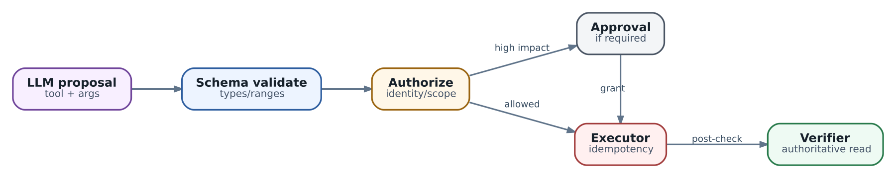
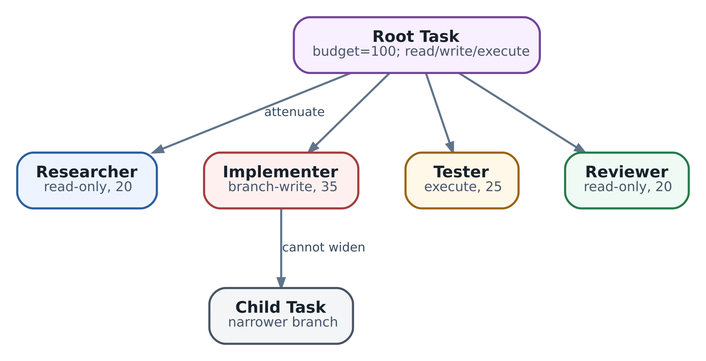

# Безопасное выполнение tools: idempotency, approvals и attenuation полномочий

Агент предложил изменить маршрут на лабораторном `lab-edge-1`. Оператор посмотрел diff и подтвердил действие. Executor отправил запрос, устройство применило конфигурацию, но соединение оборвалось раньше, чем пришёл ответ. На экране остался timeout. Что теперь делать: повторить вызов, отменить изменение или объявить задачу неудачной?

Ни один из этих ответов нельзя выбрать только по timeout. Он означает, что клиент не дождался результата, а не что устройство ничего не сделало. Даже правильное предложение модели становится опасным, если окружающая система путает потерянный ответ с отсутствующим эффектом. В главе 24 мы связывали identity, policy и approval. Здесь следующий шаг: как исполнитель фиксирует попытку, устанавливает неизвестный исход и не выполняет одно действие дважды. Не будем заново строить всю модель прав; сосредоточимся на поведении после передачи запроса.

В главе 35 мы сохранили `op-17` в состоянии `OUTCOME_UNKNOWN`, а в главе 36 отделили MCP request ID от идентификатора бизнес-операции. Теперь разберём, как довести предложение до проверенного результата: кто разрешает действие, как ограничить полномочия, когда допустим повтор и что восстановить после сбоя. Сценарий остаётся лабораторным; описанные записи и состояния являются контрактом проектируемого executor, а не готовыми полями AX или MCP.

  
*Safe tool execution: model proposal is only the first stage*

## Предложение модели и исполнение действия

Tool call в ответе LLM - предложение выполнить операцию с определёнными аргументами. Модель может объяснить, зачем она нужна, но не выдаёт себе разрешение. Harness, то есть управляющий агентом программный контур из главы 4, передаёт предложение через проверки и фиксирует ход работы. Trusted executor обращается к целевой системе с подходящим credential. В небольшой реализации эти роли могут находиться в одном сервисе, но их ответственность всё равно стоит разделить.

Рабочая последовательность выглядит так: проверить форму аргументов, проверить их смысл, установить identity и права, получить approval при необходимости, записать намерение, выполнить действие, проверить эффект и сохранить доказательства. У каждого перехода есть причина остановиться. Корректный JSON может содержать чужой router; разрешённый router может иметь новую конфигурацию; одобренное изменение может уже быть выполнено предыдущей попыткой.

Полезно мыслить об операции как о небольшой транзакции, но не приписывать ей атомарность базы данных. Запись в нашем журнале и изменение удалённого устройства обычно не входят в одну общую транзакцию. Между ними остаётся окно сбоя. Журнал, idempotency и reconciliation нужны, чтобы управлять этим окном, а не притвориться, что его нет.

## Как определить риск инструмента

Название tool мало говорит о его свойствах. `read_config` может раскрыть секреты, перегрузить controller или вернуть устаревший cache. `set_route` может каждый раз перезапускать процесс, хотя итоговая конфигурация одинакова. Оценивайте реальное поведение target API и adapter, включая скрытые побочные эффекты.

| Операция | Главный риск | Что нужно для повтора |
| --- | --- | --- |
| Чтение telemetry | Утечка, нагрузка, устаревший результат | Разрешённый scope, deadline и лимит запросов |
| Установка desired state | Перезапись чужого изменения, повторный restart | Проверенные semantics, precondition и contract повторов |
| Создание VM или ticket | Дубликат ресурса | Серверная дедупликация либо доказанная сверка результата |
| Delete, reset, reboot | Потеря данных или доступности | Policy, approval по риску, preconditions и план восстановления |
| Отправка письма или внешнего поручения | Эффект нельзя полностью отозвать | Учёт операции и строгий запрет неподтверждённых повторов |

Idempotency означает, что повтор одной логической операции не создаёт дополнительного предусмотренного эффекта. Это свойство контракта, а не синоним «вызов безопасен». Дважды установить одинаковую конфигурацию может быть безвредно для её текста и вредно для трафика, если каждое применение запускает reload. Read-only также не означает «доступен всем». Отдельно задаются permissions, стоимость, чувствительность данных и допустимая свежесть.

## Аргументы нужно проверить до получения approval

Schema validator проверяет обязательные поля, типы, диапазоны и отсутствие неизвестных аргументов. Semantic validator отвечает на другие вопросы: существует ли VRF, корректен ли prefix, относится ли next hop к нужной сети, не затрагивает ли diff соседние объекты? Например, строка `192.0.2.0/24` проходит проверку типа `string`, но принадлежность этого prefix разрешённому scope доказывает не JSON Schema.

Для лаборатории сформируем следующий внутренний объект намерения. `192.0.2.2` здесь - условный next hop нашего стенда, не рекомендация для реальной сети. Identity вызывающего субъекта и принадлежность устройства tenant берутся из доверенного контекста соединения и inventory, а не из свободных полей, присланных моделью.

```
{
  "operation_id": "op-17",
  "tool_contract": "network.set_route/v1",
  "target": {
    "device": "lab-edge-1",
    "vrf": "LAB",
    "prefix": "192.0.2.0/24"
  },
  "expected_revision": "config-17",
  "desired": {"next_hop": "192.0.2.2"},
  "idempotency_key": "lab-network-017:op-17",
  "approval_ref": "approval-17"
}
```

Executor нормализует адреса, разрешает aliases в устойчивые resource IDs и формирует конкретный diff. Именно эту версию нужно показать approver. Иначе человек подтвердит строку «исправить маршрут», а фактически будут отправлены дополнительные аргументы или другая цель. Если adapter добавляет default или меняет смысл аргумента, это должно учитываться до подтверждения. Для произвольной shell-команды такой контроль существенно труднее; узкий typed tool обычно проще проверить и ограничить.

## Что разрешает policy и что подтверждает человек

Глава 24 разделила authentication, authorization, approval и credential. Здесь различие становится практическим. Authentication устанавливает caller. Policy решает, может ли этот caller изменить этот объект в текущих условиях. Approval фиксирует принятие конкретного риска. Credential даёт executor техническую возможность обратиться к target. Наличие одного механизма не заменяет остальные.

Approval связывается с principal и контекстом задачи, нормализованными target и action, ожидаемой revision, версией tool contract, сроком действия и условиями проверки результата. Ссылка `approval-17` сама по себе не является разрешением: executor получает запись из доверенного хранилища и проверяет, кем и на что она выдана. Решение policy и отсутствие revocation проверяются непосредственно перед новой изменяющей отправкой.

Для сравнения предложений удобно хранить digest нормализованного действия. Правила нормализации должны быть однозначны для issuer и executor. Hash обнаруживает подмену содержимого при сравнении, но не удостоверяет approver и не защищает изменяемое хранилище. Подлинность подтверждения обеспечивают защищённая запись или проверяемая подпись, authentication approver и policy выдачи.

Если изменился next hop, revision или contract, старое approval не переносится автоматически. Нужно заново оценить proposal; для high-impact изменения обычно потребуется новое подтверждение. И наоборот, требовать ручную кнопку для каждого bounded read неразумно. Policy может разрешать ограниченные операции автоматически. Главное, чтобы граница была выражена в проверяемых условиях, а не в пожелании «агент должен быть осторожен».

## Preconditions защищают от устаревшего решения

Пока оператор читал diff для `config-17`, другой инженер мог сохранить `config-18`. Повторный read перед write уменьшает окно риска, но не закрывает его: между двумя запросами конфигурация опять может измениться. Это race между проверкой и использованием состояния, обычно называемый TOCTOU.

Нужен target contract, который атомарно сравнит ожидаемую revision и применит изменение только при совпадении. Такой подход называют compare-and-swap, или CAS. В Kubernetes аналогичную защиту даёт условное обновление с `resourceVersion`: устаревший PUT отклоняется с `409 Conflict`. Это поведение описано в [документации Kubernetes API](https://kubernetes.io/docs/reference/using-api/api-concepts/#updates-to-existing-resources); наличие поля `expected_revision` в нашем JSON ещё не делает сетевой API таким же.

При конфликте нельзя просто заменить ожидаемую revision на свежую и отправить старый diff. Изменились исходные условия решения. Executor возвращает conflict, harness перечитывает состояние и пересматривает план, а approval проверяется для нового proposal.

Если target не поддерживает conditional write, рассмотрите controller с эксклюзивным владением конфигурацией или механизм блокировки, который понимает само устройство. Локальный mutex не защищает от другого controller. Lease с истёкшим сроком тоже не остановит старого worker без fencing: target должен отвергать запросы владельца с устаревшим номером владения. Если такой защиты нет, это остаётся ограничением системы; начните с read-only или ручного исполнения опасных изменений.

## Idempotency key обозначает намерение а не сетевой запрос

Одна операция может породить несколько transport attempts. Для них сохраняются один `operation_id`, один idempotency key и неизменные значимые параметры. Новый JSON-RPC request ID допустим для корреляции нового обмена, но не означает новое намерение. После resume из snapshot нельзя генерировать новый ключ только потому, что процесс запустился заново.

Не выводите ключ только из hash аргументов. Две одинаковые заявки на создание VM могут означать две нужные VM, а два вызова после timeout - одну. Различить намерения помогает отдельный устойчивый ID операции. [Amazon Builders' Library](https://aws.amazon.com/builders-library/making-retries-safe-with-idempotent-APIs/) объясняет подход с caller-provided request identifier и отклонение повторов, у которых прежний identifier сочетается с другими параметрами.

Защиту обеспечивает принимающая сторона. Она должна согласованно учитывать key и эффект, в том числе при конкурентных запросах. Запись key только в нашем harness не предотвращает повторную отправку после сбоя между внешним изменением и сохранением receipt. Обычный proxy не может обещать exactly-once для произвольного downstream API, добавив таблицу ключей перед ним.

Проверьте конкретный contract: scope ключа, срок хранения, обработку параллельных запросов и какие результаты сохраняются. Например, [Stripe API v1](https://docs.stripe.com/api/idempotent_requests) сохраняет первый результат после начала выполнения, включая `500`; ключи могут быть удалены после как минимум 24 часов, и повтор после удаления создаёт новый запрос. Это пример ограниченного contract, а не универсальный срок для других API. Срок восстановления нашей задачи должен укладываться в гарантии выбранного backend либо предусматривать отдельную сверку.

## Журнал операции сохраняет неопределённость после сбоя

Перед изменяющей отправкой executor сохраняет намерение в durable ledger - устойчивом журнале операций. В нём нужны разрешённое действие, identity, approval, key, история попыток и доказательства результата. Транзакция в ledger позволяет двум workers не захватить одну запись одновременно. Но она не объединяет ledger с внешним устройством: даже единственный worker может упасть сразу после эффекта.

Минимальная учебная запись для потерянного ответа выглядит так. `last_dispatch_at` отмечает попытку отправки, а не доказывает применение; неизвестная revision и отсутствующий receipt остаются явными.

```
run_id: lab-network-017
operation_id: op-17
ledger_version: 8
status: OUTCOME_UNKNOWN
target: lab-edge-1/vrf/LAB/192.0.2.0/24
expected_revision: config-17
idempotency_key: lab-network-017:op-17
approval_ref: approval-17
last_dispatch_at: 2026-10-03T08:12:00Z
external_operation_id: null
receipt_ref: null
observed_revision: null
next_step: reconcile_before_conflicting_write
```

| Состояние ledger | Что известно | Следующее действие |
| --- | --- | --- |
| PLANNED | Намерение сохранено, отправки не было | Проверки и approval по policy |
| APPROVED | Есть подтверждение конкретного proposal | Проверить актуальность и получить право отправки |
| DISPATCHING | Попытка подготовлена или уже отправляется | Не запускать конкурирующую отправку |
| OUTCOME\_UNKNOWN | Эффект не доказан и не опровергнут | Reconciliation, а не новый plan поверх неизвестности |
| APPLIED | Есть авторитетное подтверждение применения | Проверить postconditions и цель |
| VERIFIED / VERIFICATION\_FAILED | Проверка завершена с доказательствами | Закрыть операцию или запустить recovery |

Состояния - наше проектное решение; для отказов до исполнения отдельно сохраняется причина rejection. После crash запись `DISPATCHING` нельзя просто вернуть в очередь как заведомо неисполненную. Worker мог успеть отправить запрос. Она переходит в сверку неизвестного исхода. Transactional outbox помогает не потерять намерение доставки, но доставка с повторами по-прежнему требует дедупликации внешнего эффекта.

Храните journal вне эфемерного процесса либо обеспечьте отдельную проверенную durability. Snapshot Actor из главы 14 может восстановить старую память клиента, но не откатывает уже изменённое устройство. Поэтому resumed harness сначала сверяет незавершённые операции с ledger и target, а не доверяет одному локальному checkpoint.

## Как выяснить исход после timeout

Reconciliation - сопоставление сохранённого намерения с фактическим результатом. Начните с API статуса по external operation ID или idempotency key, если backend это поддерживает. Затем прочитайте authoritative состояние target и его журнал изменений. Для `op-17` важно установить не только наличие нужного next hop, но и связь изменения с этой операцией.

Совпадение текущей конфигурации не всегда доказывает, что выполнилась именно наша попытка: такую же запись мог сделать коллега. Отсутствие изменения тоже не всегда доказывает отсутствие эффекта: асинхронная операция могла ещё выполняться или результат уже отменили. Правила доказательства зависят от controller, его истории и consistency чтения. При недостаточных данных честный результат - всё ещё `OUTCOME_UNKNOWN`.

Есть три практических исхода. Backend подтвердил применение - сохраняем receipt и переходим к verification. Backend надёжно подтвердил отсутствие применения и отсутствие незавершённой работы - можно оценить повтор по действующим permissions и preconditions. Если исход остаётся неизвестным, допустим только повтор по явно поддержанному idempotent contract с тем же ключом и параметрами либо остановка для ручного разбора. Генерация нового ключа обходит защиту от дубля.

Истёкшее approval не запрещает само по себе разрешённое policy чтение для сверки. Но оно не даёт права на новое изменение. Даже retry, который backend способен дедуплицировать, должен проходить действующую policy: если первая попытка не выполнилась, повтор может создать эффект сейчас. Пока `op-17` не разрешена, блокируйте конфликтующие writes на тот же объект; независимые reads могут продолжаться в своём scope.

## Как сужать полномочия при delegation

Attenuation означает уменьшение передаваемой authority. Coordinator выдаёт child не свою копию admin token, а ограниченный grant: конкретные actions и resources, audience, срок, budget и условия. Эффективные права child являются пересечением прав parent, выданного grant и текущей policy. Сужение каждой ветви не должно позволять суммарно превысить общий budget.

  
*Authority attenuation: child may narrow scope, never silently widen it*

Подписи на схеме обозначают роли, а не полный grant: одно `broad read` у parent не разрешает выдать `branch-write` child. Policy должна отдельно разрешать делегирование соответствующих actions. В лаборатории researcher читает telemetry для `lab-edge-1`, verifier - маршрут и выполняет ограниченный probe, implementer предлагает diff. Ровно одобренное действие применяет executor. Необходимость изменить второе устройство child возвращает coordinator как предложение, не расширяя scope самостоятельно.

Ограничение списка tools в prompt или UI не является такой защитой. Child с широким credential может вызвать API другим способом. Broker выдаёт ограниченный credential либо executor проверяет grant на каждой операции, включая resource ownership и delegation chain. Budget должен списываться в общем trusted контуре, иначе два children одновременно потратят один и тот же остаток. Подпись grant защищает его содержимое, но не заменяет проверку срока, revocation и условий исполнения.

Меньшие права также не устраняют конфликты между двумя разрешёнными agents. Оба могут иметь доступ к одному prefix. Нужны operation ownership, conditional write и понятное правило, кто принимает решение при конфликте. Identity отвечает на вопрос «кто», а CAS и journal помогают ответить на вопрос «когда и на основании какого состояния».

## Проверка результата и восстановление

Успешный transport response доказывает только то, что описывает contract этого ответа. Иногда это приём задания, иногда завершение изменения. Затем нужны два уровня verification. Технический postcondition проверяет нужный маршрут, next hop, revision и отсутствие неожиданных изменений. Проверка цели оценивает, улучшилась ли связность, ради которой агент начал работу.

В главе 35 наблюдение 18% потерь поддерживало гипотезу, но не доказывало причину и не разрешало запись. Для учебного стенда заранее зададим условие: после применения loss для проверяемого пути ниже 1% в двух последовательных минутных окнах при не менее 100 probes в каждом, а контрольный путь не ухудшился относительно согласованного baseline. Эти числа - условия упражнения; реальные thresholds выбираются по SLO и характеру измерений. Без достаточной выборки результат остаётся «проверка не завершена», а не «успех».

Verifier получает данные из независимого read/probe, сохраняет время и provenance. Повторить текст executor «изменение успешно» недостаточно. Если маршрут применён, а цель не достигнута, запись переходит в `VERIFICATION_FAILED`, сохраняя receipt применения, а не превращается в «ничего не произошло». Следующий план должен учитывать уже изменённое состояние.

План компенсации готовят до write. Compensation - отдельное действие, которое уменьшает последствия, а не магическая обратная функция. В нашем сценарии восстановление прежнего next hop допустимо только при подходящей текущей revision, подтверждённом ownership и разрешении на восстановление. Безусловно вернуть весь `config-17` значит рисковать чужими последующими изменениями.

[Compensating Transaction Pattern](https://learn.microsoft.com/en-us/azure/architecture/patterns/compensating-transaction) подчёркивает, что компенсация зависит от приложения, может сама завершиться неудачно и не обязана возвращать систему к исходному состоянию. Для неё тоже нужны журнал, key, preconditions и verification. Иногда правильнее forward fix или ручное восстановление. Отправленное письмо нельзя сделать непрочитанным; для необратимых эффектов ограничение риска до исполнения особенно важно.

## Лимиты останавливают повторяющийся ущерб

Повторы полезны при кратковременном отказе, но могут усиливать перегрузку. Если harness, adapter и SDK каждый выполняют до трёх попыток, один вызов верхнего уровня в предельном случае породит 27 обращений вниз. Назначьте одного владельца retry policy либо явно согласуйте budgets всех слоёв. [Рекомендации AWS о timeouts и backoff](https://aws.amazon.com/builders-library/timeouts-retries-and-backoff-with-jitter/) объясняют, почему задержка с jitter уменьшает синхронные всплески повторов.

Для каждого tool задайте deadline, максимальное число attempts, лимит concurrency и стоимость в task budget. Circuit breaker временно прекращает новые обращения к деградирующей зависимости после заданных failures; восстановление проверяется ограниченными пробами. Он не доказывает исход уже отправленного write. Authentication error, validation error и stale revision нельзя автоматически лечить теми же повторами, что кратковременную недоступность.

Emergency deny switch блокирует новые изменяющие действия, в том числе descendants. Он не отменяет запросы, которые target уже принял. Cancellation и timeout прекращают ожидание или просят остановиться, но не гарантируют rollback. После остановки сохраняется отдельный путь reconciliation и разрешённого recovery, чтобы система не потеряла возможность выяснить последствия собственной работы.

## Что относится к AX а что к прикладному executor

В зафиксированном срезе AX из глав 16-19 Task задаёт работу runtime, runner запускает команду, Workspace подготавливает рабочую среду, а Actor предоставляет изолированное исполнение. Эти механизмы помогают разместить harness и переживать часть runtime-сбоев. Они не являются готовым ledger сетевых изменений и не подтверждают бизнес-результат.

Прикладной слой владеет operation IDs, approvals, policy integration, downstream credentials и проверками цели. Его durable state связывается с root run и AX Task identity, но не заменяется phase платформенного Task. MCP доставляет вызов и структурированный result; нужные гарантии conditional write и idempotency предоставляет выбранный target contract или специально построенный controller. WorkspaceReady не означает «маршрут проверен», а resume Actor не означает «операцию можно выполнить заново».

Для начала достаточно небольшого executor с одним typed write, durable journal и надёжным read-back. Если backend не позволяет установить исход и ограничить повтор, оставьте применение оператору, а агенту поручите сбор доказательств и подготовку diff. Переход к автономной записи оправдан качеством этих гарантий, а не количеством подключённых tools.

## Проверки перед разрешением автономных writes

Испытайте executor не только успешным вызовом, но и сбоями в точках перехода. Следующие проверки являются планом испытаний реализации: написанный contract ещё не доказывает, что конкретный backend его соблюдает.

1. Потеряйте ответ после реального применения. Ожидается `OUTCOME_UNKNOWN`, затем сверка без второго эффекта.
2. Измените конфигурацию между approval и write. Ожидается conflict, а не принудительное применение старого diff.
3. Отправьте прежний key с другими параметрами. Ожидается rejection, а не обновление значения под старым approval.
4. Запустите две попытки одновременно. Проверьте claim в ledger и серверную дедупликацию, а не только отсутствие дубля в одном процессе.
5. Завершите worker после отправки, но до receipt. После resume ожидается reconciliation, а не новый key.
6. Отзовите grant или дождитесь expiry. Новая изменяющая отправка должна быть запрещена; разрешённая сверка результата остаётся отдельным действием.
7. Примените маршрут, не улучшив loss. Ожидается failed verification с сохранённым фактом применения.
8. Измените target перед компенсацией. Устаревшее восстановление должно остановиться, не затерев новую конфигурацию.

Audit связывает initiator, acting Task, executor, approver, нормализованное действие, policy decision, key, время попыток, external operation ID и verification evidence. Храните защищённые ссылки на чувствительные материалы вместо tokens и полного secret-bearing payload. Hash результата помогает сверять содержимое, но не является доказательством его подлинности без доверенного происхождения.

Для эксплуатации особенно полезны возраст незавершённых `OUTCOME_UNKNOWN`, количество конфликтов revision, остановленных повторов и failed verification. «Все вызовы вернули 200» ничего не говорит о достигнутой цели. Хороший executor умеет не только выполнить действие, но и объяснить, почему он не выполнил его или почему пока не знает исход.

Главный принцип главы: модель предлагает, доверенный контур разрешает и исполняет, а результат доказывается отдельной проверкой. В следующей главе разберём источники истины control plane AX. Их состояние важно для исполнения Task, но внешняя операция и её бизнес-результат остаются отдельными объектами учёта.
