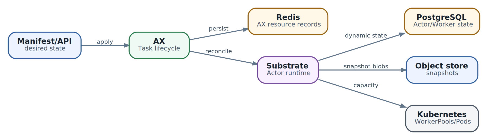
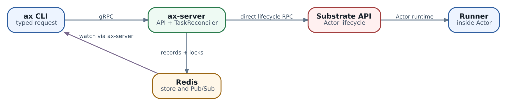
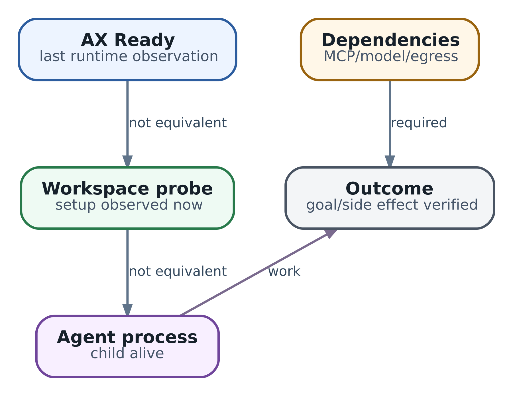

# AX control plane: state, event flow и operational truth

На dashboard задача зелёная. AX показывает `Running`, runner отвечает на HTTP, но новых результатов нет. Инженер начинает проверять модель, хотя agent command уже завершилась, а runner намеренно остался работать. Возможен и обратный случай: Workspace готов, агент выполняется, но сохранённая condition всё ещё говорит `Initializing`. Проблема не обязательно в исполнении. Иногда мы неверно понимаем, какой факт описывает индикатор.

Operational truth - это доказанная картина работы системы, собранная из источников с разной ответственностью. Redis знает AX resource record; Substrate знает runtime Actor; runner знает своё окружение; harness знает прикладной прогресс. Никакой из этих источников не отвечает за все остальные. Чтобы диагностировать задачу, нужно связать их по identity, времени наблюдения и конкретному утверждению.

Глава опирается на **AX `ac233282`**, тот же зафиксированный срез, что главы 16-19. Это не заявление о любом будущем `main`. [Изменение ac233282](https://github.com/google/ax/commit/ac2332829f22360ff97b0ba34d94dd0dd782f17e) удалило отдельный `ax-controller` и Redis Streams queue: lifecycle reconciliation выполняется внутри `ax-server`. В этой главе проследим поток работы и научимся отличать устаревшее наблюдение от реальной неисправности. Внешние операции из главы 37 остаются отдельным слоем учёта.

## Кто владеет состоянием и что означает источник истины

Source of truth - источник, которому доверяют для определённого вопроса. Это не обязательно «главная база всего продукта». Manifest в Git фиксирует намерение команды, но не доказывает, что его применили. Redis содержит принятую AX запись, но не гарантирует актуальность Worker assignment. Текущее состояние устройства подтверждает внешний эффект, но не объясняет, какой AX Task его инициировал.

| Вопрос | Авторитетный источник | Что нужно проверить отдельно |
| --- | --- | --- |
| Какую Task и Workspace принял AX | AX API и resource records в Redis | Совпадение с утверждённым manifest |
| Существует ли Actor и где он выполняется | Substrate Control API | Доступность текущего runtime path |
| Что хранится в Workspace или snapshot | Соответствующий storage и его metadata | Целостность и совместимость восстановления |
| Подготовлена ли среда и жив ли child | Runner probe, process inspection, logs | Прикладной прогресс harness |
| Достигнута ли цель и применено ли изменение | Harness journal и authoritative внешняя проверка | Связь результата с нужной операцией |

  
*State ownership: четыре хранилища отвечают за разные истины*

Схема показывает границы хранения, а не общую транзакцию. PostgreSQL относится к runtime metadata Substrate, object storage - к выбранному snapshot backend, Kubernetes - к инфраструктуре. Их конкретная конфигурация зависит от развёртывания. Успешная запись AX в Redis не коммитит одновременно runtime metadata, filesystem и действие сетевого инструмента. Отсюда возникают расхождения, которые оператор должен уметь обнаружить, не стирая следы.

## Путь запроса в зафиксированной версии AX

Control plane - управляющий слой: он принимает ресурсы и меняет lifecycle, но не выполняет модельный loop внутри себя. CLI разбирает YAML и отправляет typed RPC. `ax-server` валидирует запрос, берёт resource lock, работает с Redis и вызывает `TaskReconciler` как зависимость того же процесса. Название каталога `internal/controller` не означает отдельный deployment.

  
*AX control path at ac233282: direct reconciliation and Pub/Sub watch*

Сборка компонентов видна в [entrypoint ax-server](https://github.com/google/ax/blob/ac2332829f22360ff97b0ba34d94dd0dd782f17e/cmd/ax-server/main.go). Redis находится рядом с direct path как resource store и механизм блокировок. Pub/Sub отправляет уведомления клиентам watch; это не очередь, из которой reconciler получает задания. При деградации Substrate тормозит сам lifecycle RPC, а не скрытый controller backlog.

Есть существенное условие: server может стартовать без reconciler, если не удалось инициализировать Substrate client. В этой ветви resource API продолжает работать, но runtime orchestration отсутствует. Поэтому доступный listener и успешное сохранение Task ещё не доказывают, что AX подключён к runtime. Проверяйте startup warning и работоспособность lifecycle path на отдельной безопасной canary Task.

Фоновая сверка всех Tasks с Actors в этом срезе не выполняется. Direct reconcile запускается конкретным create, resume или suspend; delete имеет отдельную процедуру очистки. После частичного сбоя система не обязана исправиться сама только потому, что server снова доступен. Для автоматической convergence, то есть возвращения к согласованному состоянию, нужен отдельный механизм наблюдения и repair либо дальнейшее развитие control plane.

## Как проходят create и resume

Проследим лабораторный AX Task `lab/network-017`, связанный нашим harness с run `lab-network-017`. Это два разных идентификатора: Task принадлежит платформе, run - приложению. Имя Actor внутри того же atespace совпадает с именем Task; correlation record помогает связать их с операцией `op-17` из предыдущей главы.

`CreateTask` под lock проверяет отсутствие записи и сохраняет новую Task с phase `Suspended`. Затем читает связанные Workspace resources и вызывает reconciler. Тот обеспечивает Atespace, ActorTemplate и Actor, выполняет suspended branch и возвращает status для записи в Redis. Task immutable: повторный create существующего имени не обновляет её spec.

`ResumeTask` читает существующую запись и меняет phase на `Running` сначала в памяти обработчика. Reconciler выполняет ensure-шаги, вызывает `ResumeActor`, получает Worker address, проверяет Workspace readiness и возвращает результат. Лишь затем handler сохраняет status. Это важно: текущий resume не записывает отдельный durable intent «resume requested» перед внешним вызовом. Crash между runtime action и status save может оставить Redis в прежнем состоянии.

Порядок проверяется по [lifecycle handlers](https://github.com/google/ax/blob/ac2332829f22360ff97b0ba34d94dd0dd782f17e/internal/server/server.go), а runtime translation - по [TaskReconciler](https://github.com/google/ax/blob/ac2332829f22360ff97b0ba34d94dd0dd782f17e/internal/controller/reconciler.go). Не переносите на него привычную модель асинхронного Kubernetes controller: здесь API request и работа reconciler связаны во времени. Успешный ответ подтверждает завершение соответствующего handler path, а не просто попадание задания в очередь.

Если клиент получил timeout, сначала прочитайте Task по тому же atespace/name и проверьте Actor. Новый create с другим именем может породить лишний runtime; повтор того же create может упереться в уже сохранённую immutable запись. Как и с tools в главе 37, ошибка транспорта не доказывает отсутствие эффекта.

## Phase и conditions описывают разные факты

Phase - короткое lifecycle summary. Conditions - именованные утверждения с отдельными status, reason, message и временем. В AX `Running`, `Suspended`, `Failed` и `Terminating` встречаются как phase; `Ready` и `WorkspaceReady` - conditions. Делать из них один линейный ряд «Pending, Running, Ready, WorkspaceReady» неверно.

Ниже учебный фрагмент ответа `GetTask`, а не полный manifest для создания ресурса. Используются реальные wire names AX, включая `workerIP`; значение condition `status` является строкой, поэтому кавычки существенны.

```
status:
  phase: Running
  actor: network-017
  workerIP: "10.0.0.12"
  conditions:
    - type: WorkspaceReady
      status: "False"
      reason: Initializing
      message: "Workspace is initializing at 10.0.0.12"
      lastTransitionTime: "2026-10-03T08:12:00Z"
    - type: Ready
      status: "False"
      reason: WorkspaceInitializing
      message: "Waiting for workspace setup to complete"
      lastTransitionTime: "2026-10-03T08:12:00Z"
```

Actor был resumed, но сохранённая проверка setup ещё не подтвердила готовность. Это не обязательно failure. Читайте reason, момент наблюдения и текущий probe. В другом случае `Failed` означает ошибку последнего reconcile, но уже созданный Actor может остаться. А `Suspended` требует проверки runtime: в suspended branch ошибка `SuspendActor` записывается как warning, после чего AX всё равно может сохранить suspended status.

В [AX schema](https://github.com/google/ax/blob/ac2332829f22360ff97b0ba34d94dd0dd782f17e/pkg/apis/v1alpha1/ax.proto) нет `metadata.generation`, `resourceVersion` или `observedGeneration`. Это полезные механизмы других API или возможного расширения, но не существующая гарантия данного AX. Для воспроизводимости rollout сохраняйте digest manifest и configuration references в своём deployment journal. Такие поля не следует просто дописывать в AX YAML: неизвестные поля strict decoder отвергнет.

Даже имя `lastTransitionTime` требует осторожности. Метод `setCondition` переписывает timestamp при повторной установке существующей condition, независимо от изменения её значения. Поэтому по одному полю нельзя восстановить точную историю переходов или возраст первого появления `True`. Для timeline нужен отдельный journal, а для свежести наблюдения - понятный источник и время конкретной проверки.

## Почему readiness бывает устаревшей

После resume AX опрашивает `/readyz?check=workspace` в ограниченном окне: default timeout 15 секунд, poll interval 500 миллисекунд. Если setup ещё не завершён, Task остаётся `Running` с отрицательными conditions. Workspace может стать готов позже, но нового фонового reconcile, который обязательно сохранит это в Redis, здесь нет.

Представим временную последовательность. В 08:12:00 начался resume; к окончанию polling setup ещё работает, и handler сохраняет `Initializing`. В 08:12:20 runner начинает возвращать 200. Чтение Task после этого может всё ещё показать прежнее False. Два наблюдения не противоречат друг другу: Redis хранит прошлую observation, а probe сообщает текущее состояние.

После первого успешного setup `WorkspaceReady=True` становится sticky: reconciler сохраняет её через suspend/resume и больше не опрашивает setup для этого condition. Это оптимизация, основанная на однократной подготовке Workspace. Но она не является проверкой целостности восстановленных файлов, запуска нового child или доступности Git, MCP и model endpoint сейчас.

Поэтому перед назначением работы проверяйте необходимые текущие prerequisites. Если нужен observer, он должен сначала читать и сравнивать источники, а не постоянно выполнять resume ради обновления индикатора. Lifecycle RPC - изменяющая операция с locks и runtime calls. Настоящий repair требует отдельной policy, budget и защиты от конкуренции, как любая автоматическая запись.

## Watch обновляет экран но не хранит историю

В [Redis store](https://github.com/google/ax/blob/ac2332829f22360ff97b0ba34d94dd0dd782f17e/internal/store/redis/store.go) запись Task использует JSON value и sorted-set indexes. `SaveTask` и `UpdateTaskStatus` публикуют уведомление через `PUBLISH`. Даже если старый комментарий возле функции упоминает stream, исполняемый код использует Pub/Sub, не `XADD` и не consumer group.

`WatchTask` устанавливает подписку и затем читает текущую Task для события `INITIAL`; сохранения передаются как `MODIFIED`. Подписка до чтения уменьшает одно окно потери, но не создаёт versioned watch contract: initial snapshot и уже поставленные в буфер notifications могут пересекаться. Не считайте их журналом ровно однократных переходов.

[Redis Pub/Sub](https://redis.io/docs/latest/develop/pubsub/#delivery-semantics) не сохраняет сообщения для воспроизведения отключившимся subscriber. Reconnect watch возвращает новую текущую картину, но пропущенные промежуточные события не восстанавливаются. Это подходит для live UI, где важнее последнее состояние, чем каждый переход.

Для approvals, биллинга, forensic audit и восстановления операций нужен durable journal с устойчивыми IDs и retention. Отдельный collector, подписанный на Pub/Sub, тоже может пропустить событие при disconnect. Строгая полнота требует надёжной записи у производителя либо durable delivery contract, а не только более старательного subscriber.

Streams можно выбрать при проектировании другой event-driven архитектуры, но они сами не обеспечивают exactly-once внешних effects. Понадобятся повторная доставка, deduplication, ownership и reconciliation. Для этого среза AX метрика «lag consumer group reconciler» описывала бы несуществующий путь; измерять нужно реальный handler path.

## Здоровье платформы не равно прогрессу агента

  
*Readiness hierarchy: each green light proves only its own layer*

`ax-server /healthz` в проверенном handler возвращает 200 без обращения к Redis или Substrate. Он показывает, что HTTP handler доступен, а не что зависимости исправны. Runner health endpoint относится уже к другому процессу. Одинаковое имя endpoint на двух слоях не делает их взаимозаменяемыми.

Workspace readiness означает завершённый setup по contract runner. Child process может ещё не запуститься или уже завершиться. [Default runner](https://github.com/google/ax/blob/ac2332829f22360ff97b0ba34d94dd0dd782f17e/runner/runner.go) после выхода command сохраняет sandbox доступным для inspection и пишет результат в log/callback; он не переводит AX Task автоматически в `Completed`. Поэтому `ax watch` не является надёжным ожиданием завершения бизнес-задачи.

Прикладной heartbeat тоже полезно определить точнее. «Процесс жив» - liveness. «Завершён следующий проверяемый шаг» - progress. Агент может регулярно отправлять heartbeat и повторять одну ошибку. Progress watchdog должен учитывать последнюю meaningful transition, текущий шаг, retries, checkpoint age и deadline, а не только наличие HTTP response или новых строк log.

Для сетевого run отсутствие прогресса может означать ожидание approval, медленный probe или запрет конфликтующей записи из-за `op-17` в `OUTCOME_UNKNOWN`. Это разные причины. Если UI показывает reason и ожидаемое внешнее событие, оператор не станет перезапускать исправно ожидающий процесс. Статус «ожидает подтверждения» относится к harness, а не автоматически к AX condition.

## Где возникают частичные состояния

AX и Substrate выполняют dual write: один logical lifecycle затрагивает две системы без общей атомарной транзакции. Redis transaction может объединить запись value, indexes и публикацию внутри Redis, но не включает `ResumeActor` или snapshot creation. Потеря ответа, crash server и failure status save оставляют разные сочетания.

| Наблюдение | Возможная причина | Первый безопасный шаг |
| --- | --- | --- |
| Task есть, Actor отсутствует | Сбой после первичной записи, до provisioning | Проверить handler error и runtime inventory |
| Redis говорит Suspended, Actor running | Resume выполнен без status save или suspend не удался | Проверить assignment и последнюю lifecycle operation |
| Task Initializing, probe ready | Setup завершился после polling window | Проверить свежесть AX observation |
| Actor есть, Task отсутствует | Потеря, expiry или удаление control record | Сверить ownership и journal, не удалять Actor вслепую |
| Task Terminating, Actor отсутствует | Cleanup runtime завершён, Redis cleanup прерван | Проверить контекст и продолжить штатную очистку |

Это диагностические гипотезы, а не однозначные причины по одному статусу. Inventory diff полезно строить по atespace/name и доступным runtime identities, сохраняя provenance. Совпадение имени после delete/recreate не доказывает принадлежность прежнему run: в AX metadata этого среза нет resource UID. App correlation record должен различать incarnations Task.

Resource lock снижает вероятность параллельных lifecycle operations одной Task. Default Redis lease - 30 секунд; автоматического renewal и target fencing здесь нет. Операция может пережить TTL и встретиться со следующим владельцем. Locks разных Workspace и Task также не составляют одну общую транзакцию. Держите timing budget под контролем и проверяйте длинные RPC, не принимая mutex за распределённую гарантию.

Восстановление начинается с чтения, а не с удаления Redis keys. Если Actor уже удалён, повтор штатного delete может завершить record cleanup; если он ещё существует, сначала установите его состояние и policy. Удаление Task вручную способно скрыть ownership runtime. Оно также не компенсирует внешний эффект инструмента: ledger главы 37 нужен независимо от lifecycle платформы.

## Redis здесь не просто cache

Потеря control record отличается от потери кешированного ответа. Task может продолжить выполняться, но AX потеряет принятую spec и возможность обычного управления по записи. Поэтому Redis для этой роли требует выбранной durability, memory policy и проверенного восстановления. Restart доступного service не доказывает сохранность данных.

В [примерном deploy/redis.yaml](https://github.com/google/ax/blob/ac2332829f22360ff97b0ba34d94dd0dd782f17e/deploy/redis.yaml) задана одна replica Deployment, но нет PVC или volume mount и явной persistence configuration. Это не готовый production persistence contract. Не делайте вывод, что доступный `redis:7-alpine` автоматически переживёт замену Pod с прежними AX records.

[Redis persistence](https://redis.io/docs/latest/operate/oss_and_stack/management/persistence/) предлагает RDB snapshots и AOF с разными trade-offs между latency и возможной потерей последних writes. Выбор начинается с допустимого RPO, то есть объёма потери данных, и RTO, то есть времени восстановления. Затем проверяется restore на практике вместе с runtime inventory. Replication не заменяет backup, а backup Redis не содержит filesystem Actor или внешний operation ledger.

Для control records обычно предпочтительнее отказ новой записи, чем незаметное вытеснение старой. [`noeviction`](https://redis.io/docs/latest/develop/reference/eviction/#eviction-policies) не удаляет keys при memory pressure, но часть writes завершается ошибкой. Это требует reserves, alerts и admission control. `allkeys-lru` полезен для cache, где потерянное значение восстанавливается; применять его к AX intent без recovery policy рискованно.

Expiry и eviction - разные события. Store поддерживает optional Task TTL; entrypoint использует default options без заданного TTL. Workspace и Model сохраняются без expiry. Если TTL включён в вашей сборке, продумайте cleanup Actor и indexes: исчезновение Task key само по себе не является вызовом `DeleteTask`. Настройка retention не должна незаметно превращаться в потерю ownership.

## Как измерять масштабирование direct path

API replica в этой архитектуре одновременно выполняет lifecycle work. Медленный Substrate request или readiness polling удерживает handler и resource lock. Добавление replicas увеличивает concurrency разных Tasks, но не ускоряет две конфликтующие операции одной Task и может увеличить нагрузку на Redis, Substrate и workspace sources.

Начните с измерения latency create/resume/suspend/delete по отдельности, времени ожидания lock, длительности Substrate calls и readiness wait. Считайте active lifecycle RPC, errors по причине и число несовпадений AX/Actor inventory. Для записи progress в приложении нужны собственные показатели; перечисленные метрики - план instrumentation, не обещание встроенных series AX.

Среднее время недостаточно. p95 и p99 показывают хвост, в котором deadlines и leases становятся опасными. Полезный симптом: HTTP health остаётся зелёным, но resume latency растёт и requests ждут locks. Это повод искать saturation управляющего пути, а не сразу добавлять Worker capacity. Контролируйте одновременно admission rate и число незавершённых operations.

Отдельный asynchronous reconciler оправдан, если долгие переходы нужно отвязать от API deadlines и гарантировать repair после crash. Но это новый contract: durable intent, повторная обработка, per-object ownership, stale request handling, cancellation и observation freshness. Нельзя просто добавить очередь и считать dual-write проблему решённой. До смены архитектуры полезнее ограничить concurrency и доказать recovery для фактического direct path.

## Обновление shared resources не равно rollout

Task immutable, а Workspace и Model можно обновлять. Но `UpdateWorkspace` и `UpdateModel` в данном server сохраняют соответствующий resource; они не обходят автоматически все running Tasks. Workspace specs собираются для launch envelope при reconciliation и материализуются runner по его setup contract. Обновление Redis record не изменяет уже подготовленные файлы в работающем Actor.

Следующий reconcile способен увидеть другую Workspace configuration и сформировать другую ActorTemplate. Это ещё не гарантирует переустановку существующего Actor на новый template: `EnsureActor` может вернуть уже имеющийся runtime. sticky readiness также не валидирует новый setup. Отсюда правило: rollout подтверждается проверкой фактического launch/runtime contract, а не только успешным update shared object.

Для предсказуемого изменения используйте versioned names и pinned Git revision, фиксируйте image digest и external tool contract в deployment journal. Создайте новую canary Task, проверьте setup и application prerequisites, затем переносите новые runs. Продолжение старого run требует отдельного migration plan для checkpoints и незавершённых operations; delete/recreate не является универсальным способом обновить всё безопасно.

Model update не следует трактовать как замену модели любого live harness. Реальная propagation зависит от того, читает ли клиент resource на каждый вызов, кеширует ли его или использует launch configuration. Поэтому в evidence полезно сохранять фактически выбранные model ID и параметры, а не только имя shared Model. Это та же дисциплина, что для версий MCP adapters и approvals главы 37.

## Разбор инцидента по проверяемым утверждениям

Возьмём исходный симптом «Task Running, результатов нет». Прежде чем чинить, зафиксируйте atespace/name, root run, время последнего успешного шага и последнюю lifecycle operation. Дальше двигайтесь по слоям, но не превращайте порядок в обязательную последовательность для любого инцидента: если уже доказан отказ конкретного tool, нет смысла заново диагностировать каждый listener.

1. **API и record.** Прочитайте Task, conditions и logs нужного handler. Health 200 отдельно от успешного gRPC и доступности Redis.
2. **Actor и route.** Проверьте существование, текущий state и Worker assignment через Substrate. `workerIP` в AX - сохранённый routing hint, не вечный адрес Actor.
3. **Runner и child.** Сравните текущий workspace probe с AX condition; посмотрите setup и command exit logs. Живой runner не доказывает живую command.
4. **Harness progress.** Проверьте checkpoint, следующий шаг, retries, budgets и ожидаемое approval. Отличите нормальное ожидание от stuck loop.
5. **Dependencies и outcome.** Проверьте нужный MCP/model/egress path и ledger операции. Сверьте внешний эффект независимо от process exit.

Если child завершился с ошибкой, а runner продолжает отдавать 200, лечить Redis не нужно. Если runner ready, а AX всё ещё Initializing, проблема может быть только в observation. Если Actor работает, но `op-17` имеет неизвестный исход, restart не даст права повторить сетевое изменение. Такой разбор уменьшает риск восстановить платформенный индикатор ценой повторного бизнес-эффекта.

В итоговой incident record разделяйте факт, источник, время и гипотезу. «Task failed» слишком расплывчато. «Resume handler вернул error после успешного ResumeActor; Actor назначен Worker; запись Redis осталась прежней» уже задаёт проверяемый recovery plan. Снимки разных систем могут относиться к разным моментам, поэтому сохраняйте время и interval наблюдений, не выдавая их за атомарный общий snapshot.

## Что проверить в лаборатории

До автономного repair отработайте следующие сценарии на изолированных Tasks. Это план fault-injection испытаний вашей сборки, а не результаты испытаний production cluster.

- Crash после SaveTask, но до provisioning: inventory находит запись без Actor и не создаёт дубликат новым именем.
- Timeout после ResumeActor: сверка обнаруживает работающий Actor независимо от ответа клиента.
- Setup дольше 15 секунд: observer различает stale condition и текущий ready probe.
- Child exits while runner alive: application outcome фиксируется независимо от AX phase.
- Disconnect watch: reconnect возвращает текущую картину; audit не объявляет пропущенные transitions отсутствовавшими.
- Lifecycle дольше lock TTL: обнаруживается возможность overlap, а не предполагается вечная serialization.
- Redis memory pressure или потеря Pod: проверяются ошибки writes и восстановление records с последующей runtime сверкой.
- Update Workspace у running Task: проверяется фактическая конфигурация Actor, а не только обновлённый resource.

Практический результат этой главы - умение назвать для каждого зелёного индикатора точное утверждение и предел его достоверности. AX status полезен, когда его сопоставляют с runtime и application evidence, а не принимают за универсальное доказательство успеха. В следующей главе углубимся в snapshot ownership и совместимость: сохранённая Task spec не гарантирует, что существует пригодное для восстановления состояние Actor.
