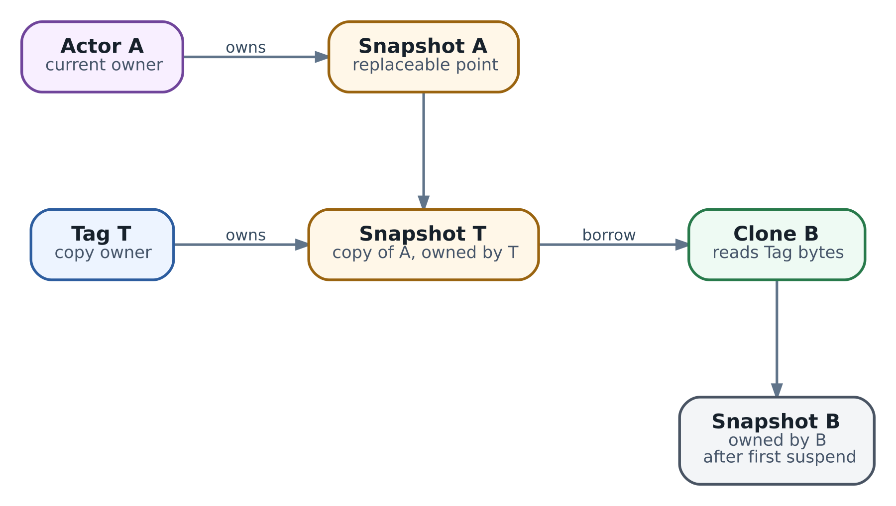

# Substrate snapshots: ownership, storage и совместимость

Продолжим инцидент из главы 38. Task `lab/network-017` существует в AX, Actor найден в Substrate, но после потери node работа не продолжается. В object storage есть несколько каталогов с похожими именами. Какой из них можно восстановить? Не удалит ли следующий suspend нужную точку? И не выполнит ли агент повторно изменение, которое внешний сервис уже принял?

На эти вопросы не отвечает фраза «у нас включены snapshots». Snapshot - сохранённая часть исполняемой среды с конкретным владельцем, составом и требованиями к восстановлению. Глава 14 объяснила состав снимка и lifecycle. Здесь разберём владение и зависимости: кто создал данные, какая запись на них указывает, какие Actors их заимствуют и какой runtime способен их восстановить. Потеря любого звена способна оставить исправные файлы без пригодного пути восстановления.

Здесь используем контракт Substrate [v0.3.0, commit ccecc788](https://github.com/agent-substrate/substrate/tree/ccecc788a327dc11dcd6c21ee153f3d0cbb5cc97): `Full`/`Data`, `externalSnapshot`, `localSnapshot` и `snapshotConfig`. Эти имена соответствуют зафиксированной версии, а не любой будущей ветке `main`. Глава 14 объяснила lifecycle; теперь разберём долговечность, заимствование, совместимость и эксплуатационную цену сохранённых точек.

## Что snapshot сохраняет и что остаётся снаружи

Представьте ноутбук, который уснул с открытым терминалом. После пробуждения терминал может выглядеть прежним, но сервер уже закрыл SSH session, пароль сменился, а коллега обновил репозиторий. Runtime snapshot даёт похожую иллюзию непрерывности. Он возвращает захваченное вычислительное состояние, но не останавливает внешний мир.

| Механизм | Что помогает восстановить | Чего сам по себе не доказывает |
| --- | --- | --- |
| Actor snapshot | Поддерживаемое состояние sandbox по выбранному scope | Завершение tool call или актуальность внешней конфигурации |
| Checkpoint harness | План, шаг, evidence и pending operations в формате приложения | Сохранность process RAM и доступность runtime |
| Operation ledger | Identity и результат внешних действий, правила повторения | Наличие workspace и готовность Actor |
| Backup платформы | Согласованную recovery point после потери metadata и storage | Успех восстановления без restore rehearsal |

Это взаимодополняющие механизмы. Snapshot может ускорить возвращение к работе; checkpoint объясняет, что делать дальше; ledger предотвращает опасный повтор. Backup позволяет восстановить сами компоненты, которые хранят первые три сущности. Ни один из них не становится заменой остальных только потому, что лежит в долговечном хранилище.

## Состав snapshot определяет путь восстановления

Scope описывает *что* захвачено, а pause или suspend - *где* это хранится. Full checkpoint на локальном диске не становится durable от полноты содержимого. Data snapshot в object storage, напротив, может пережить node loss, хотя памяти прежнего процесса в нём нет.

| Scope | Содержимое | Что увидит приложение после resume |
| --- | --- | --- |
| `Full` | Process memory, writable rootfs changes и поддерживаемые durable data | При совместимости продолжение захваченной execution; внешние соединения и права требуют перепроверки |
| `Data` | Данные snapshot-capable volumes, прежде всего `DurableDir`; без прежней памяти и rootfs changes | Сохранённые данные плюс cold boot либо общий golden baseline |

`DurableDir` - управляемый runtime каталог, включаемый в Actor checkpoint. Это не обещание непрерывной репликации каждой записи. Изменения между успешными external snapshots остаются под риском потери node. Файл в другом каталоге writable rootfs не попадёт в Data snapshot только потому, что приложение считает его важным.

Для `Data` есть существенная настройка `onResume.fromData`. При `COLD_BOOT` runtime запускает containers из OCI image с восстановленными данными. При `GOLDEN` он сочетает durable data конкретного Actor с guest state общего golden snapshot. Второй путь сохраняет подготовленную общую среду, но не возвращает индивидуальный heap агента на момент его suspend.

В [срезе AX из глав 16-19](https://github.com/google/ax/blob/ac2332829f22360ff97b0ba34d94dd0dd782f17e/internal/substrate/client.go) функция `BuildActorTemplate` создаёт `/workspace` как `DurableDir`, выбирает Data для pause и commit и golden как источник Data resume. Поэтому «workspace сохранился» не означает «тот же agent loop продолжился с прежней RAM». Для Task, использующей другой базовый template, проверяйте его фактическую policy, а не переносите этот вывод автоматически.

Практическое следствие простое: state, необходимый следующему шагу, должен быть сериализован в восстановимый формат. Убедитесь, что путь checkpoint действительно находится в snapshot-capable volume. Full можно использовать как оптимизацию непрерывности, но возможность восстановить progression после Data resume или revert всё равно должна быть частью harness contract.

## Владелец bytes и пользователь snapshot могут различаться

Ownership означает обязанность хранить и право удалять конкретные objects. Это не то же самое, что ссылка на них. Actor может читать snapshot, который принадлежит Tag; в таком случае удаление Actor не должно затрагивать чужую копию. Обратное тоже важно: владелец способен удалить bytes, на которые ещё ссылаются живые потребители.

В v0.3.0 Actor держит одну текущую `externalSnapshot`. После следующего успешного suspend новая точка заменяет предыдущую. Это не встроенная история версий и не retention на неделю. Если точка должна пережить последующие suspend исходного Actor, пока он suspended создают Tag - отдельную копию с отдельным владельцем.

  
*Snapshot ownership: copy and borrowing have different lifetimes*

`CreateActor(sourceTag=T)` не копирует bytes ещё раз. Новый Actor B сначала заимствует URI Tag T. Его первая собственная успешная suspend создаёт actor-owned snapshot B. Теперь замена snapshot A или удаление исходного Actor A не затрагивает T, а удаление B не затрагивает T ни до, ни после этого перехода.

Клонирование не является универсальным переносом любой сохранённой среды. В v0.3.0 source Tag должен принадлежать тому же ActorTemplate UID, даже если содержит Data. Явный `sourceTag` также не допускается для template с external volumes: snapshot Actor не умеет клонировать их содержимое. Новый clone не является автоматически копией подключённой database или CSI volume.

Но удаление T *до* собственного suspend B лишает B заимствованной точки. Запущенный clone некоторое время может выглядеть исправным: данные уже загружены на node. Ошибка проявится при следующем restore или после node loss. В этой версии `DeleteTag` не блокируется автоматически наличием borrowers. Inventory зависимостей и остановка конкурентного создания clones - обязанность процедуры cleanup.

Даже после собственного Data suspend B может отдельно зависеть от golden Tag своего template через `onResume.fromData=GOLDEN`. Исчезновение прямой ссылки на T не доказывает независимость от всех Tags. Retention должна учитывать и явное заимствование текущей точки, и источник общего guest state.

## Ownership URI и права доступа к storage

`snapshotConfig.storageLocation` задаёт базовый prefix. Control plane дописывает Atespace, вид владельца, его UID и snapshot ID. Например, логическая структура имеет следующий вид:

```
<location>/atespaces/<atespace>/actors/<actor-uid>
  /snapshots/<snapshot-id>
<location>/atespaces/<atespace>/tags/<tag-uid>
```

Перенос строки в первом пути сделан только для чтения; это один URI. UID отделяет lifetimes: новый `lab/network-017` с тем же human-readable name не становится владельцем objects удалённого Actor. Используйте возвращённый server URI как authoritative reference. Не собирайте production destination из имени и не меняйте status вручную, чтобы «подцепить» найденный каталог.

Manifest Tag копируется вместе с payload и может содержать identity исходного Actor. Это происхождение захваченных данных, а не identity текущего владельца копии. Для cleanup сопоставляйте Tag metadata и его owner prefix; совпадение Actor UID внутри manifest не даёт права удалить tag-owned objects.

Prefix позволяет runtime ограничивать cleanup собственными objects. Однако имя пути не является security boundary. Изоляцию обеспечивает IAM или policy storage backend. Для cross-Atespace clone published Tag остаётся в source Atespace: читающая runtime identity должна получить разрешение на source prefix. Право читать только target prefix не поможет.

`PUBLISHED` означает допустимость использования Tag Actors из других Atespaces, а не анонимный публичный bucket. Перед такой публикацией проверьте содержимое и доступы. В копии могут оставаться приватный checkout, credentials и данные клиента, даже если интерфейс Tag содержит лишь безобидное имя baseline.

## Durable commit проходит через две системы

Suspend затрагивает metadata store и object storage без общей транзакции. Поэтому важен не сам факт появления файлов, а порядок публикации пригодной точки. В [suspend workflow](https://github.com/agent-substrate/substrate/blob/ccecc788a327dc11dcd6c21ee153f3d0cbb5cc97/cmd/ateapi/internal/controlapi/workflow_suspend.go) сначала записываются `SUSPENDING` и `inProgressSnapshotUri`. Старый `externalSnapshot` ещё обозначает предыдущую завершённую точку.

Atelet загружает snapshot payload files, затем `manifest.json`. Manifest перечисляет файлы и сведения о sandbox. После подтверждения checkpoint и detach workflow освобождает assignment и фиксирует новую external snapshot вместе с `SUSPENDED` и очисткой in-progress fields. Только затем выполняется best-effort удаление прежней actor-owned точки.

Отсюда следуют три разных наблюдения. Objects без manifest могут быть частичным upload. Manifest без final status может означать, что bytes записаны, а workflow ещё не закончен. Новый final status с оставшимися старыми objects может означать успешный suspend и ошибку cleanup. Удалять «лишний каталог» только по возрасту во всех трёх случаях опасно.

Повторный `SuspendActor` использует persisted progress; уже suspended Actor возвращается без нового checkpoint. Но re-entrant workflow не делает любое повреждение исправимым повтором. При ошибке checkpoint Actor может стать `CRASHED`; тогда нужно прочитать status, определить последнюю completed точку и выбрать recovery с принятым RPO.

Успех suspend не гарантирует нулевое количество orphan objects. Если очистка предыдущего snapshot не удалась, новая точка остаётся current, а старые bytes могут лежать до удаления Actor. Такой остаток не является поддерживаемой историей восстановления. Наблюдайте cleanup errors отдельно от успешности durable commit.

## CreateTag после сбоя требует отдельного recovery

У Tag тоже есть три шага: зарезервировать имя и storage location, скопировать snapshot source Actor под UID Tag, затем заполнить `status.snapshot`. До финализации Tag является pending и не годится для clone. Lease source Actor защищает копирование от одновременного suspend, который удалил бы исходные bytes.

Важное отличие v0.3.0: [CreateTag не является idempotent continuation](https://github.com/agent-substrate/substrate/blob/ccecc788a327dc11dcd6c21ee153f3d0cbb5cc97/cmd/ateapi/internal/controlapi/workflow_tag.go). Если процесс упал после reservation, повтор под тем же именем получает `AlreadyExists`. Нельзя считать такой ответ доказательством готовой копии.

После timeout перечитайте Tag по имени. Если `status.snapshot` заполнен и соответствует ожидаемому source/template, операция могла завершиться. Если осталась pending запись, сохраните evidence, исключите продолжающуюся исходную операцию и конкурентное создание/использование Tag. Штатный recovery - удалить именно эту незавершённую запись с UID/version guards, собрать partial copy через `DeleteTag` и создать Tag заново. Не удаляйте ready Tag автоматически в ответ на `AlreadyExists`.

Новая попытка захватит ту completed точку, которую source Actor держит *теперь*. Если Actor успел ещё раз resume/suspend, это уже другой checkpoint. Для сохранения конкретной диагностической точки удерживайте source suspended до успешной финализации Tag и сверки его provenance. Lease одной RPC не резервирует выбранную точку навсегда.

## Совместимость проверяется на нескольких уровнях

Совпадение ActorTemplate UID - необходимый сигнал происхождения guest state, но не универсальное доказательство restore compatibility. UID отвечает, под каким template сделан snapshot. Он не заменяет совместимость sandbox binary, CPU architecture, host environment, images и mounts.

| Уровень | Что сопоставить | Чем опасна ошибка |
| --- | --- | --- |
| Template | Записанный `actorTemplateUid` и текущий template | Прежняя память используется с другой средой |
| Runtime | Sandbox class, binary digests, snapshot format и node capability | Restore отклоняется или нарушает runtime assumptions |
| Filesystem | Image digest, rootfs delta, volumes и mount paths | Процесс получает не те данные или layout |
| Application | Версия state schema и ожидаемые invariants harness | Технически успешный boot продолжает работу неверно |

ActorTemplate immutable для клиентов; смена ссылки Actor допускается только в `SUSPENDED`. При существующем старом template проверяются одинаковый SandboxConfig, равные volumes и mounts общих containers. Отдельного запрета на смену `storageLocation` в исполняемом UpdateActor этого среза нет: прежний snapshot URI остаётся в status, а будущие записи могут идти под новым prefix. Доступ и retention нужно согласовать для обоих мест. Если записанный template UID external snapshot отличается, resume workflow запрашивает Data restore и свежий запуск вместо прежнего memory image. Это защитное понижение, а не автоматическая migration файлов: новый код обязан понимать восстановленные данные.

После repoint Tag, снятый со старого snapshot, сохраняет identity template, под которым guest state действительно был создан, а не просто текущую ссылку Actor. Иначе clone получил бы старую RAM под видом новой среды. В incident inventory фиксируйте оба значения и не исправляйте provenance вручную.

Manifest содержит sandbox assets и их SHA-256, pause image, identity, scope и список payload files. Но в проверенной [реализации Restore](https://github.com/agent-substrate/substrate/blob/ccecc788a327dc11dcd6c21ee153f3d0cbb5cc97/cmd/atelet/main.go) runtime assets берутся из запроса, разрешённого через текущий SandboxConfig. Наличие старых digests в manifest само по себе не означает, что restore автоматически выберет прежний binary. Меняя cluster runtime, проверяйте восстановление старых snapshots и сохраняйте доступность нужных assets.

[gVisor checkpoint/restore](https://gvisor.dev/docs/user_guide/checkpoint_restore/) также проверяет CPU features целевой машины. Не переносите обещание «можно восстановить на другом Worker» на любой CPU pool или на другой sandbox class. Golden snapshot для gVisor не становится microVM snapshot. При отсутствии проверенного migration path создают новый baseline и восстанавливают приложение из совместимых durable данных.

## Приложение должно переживать откат и новую execution

В нашем сценарии операция `op-17` меняет сетевую конфигурацию. Агент записал intent, отправил request, внешний сервис применил изменение, но ответ потерялся до следующего completed checkpoint. После revert память и workspace могут вернуться к состоянию «действие ещё не подтверждено». Внешний сервис не откатится вместе с ними.

Нельзя повторять write потому, что в восстановленном journal нет result. Harness сверяет operation ID и фактическое состояние target. Если effect подтверждён, он записывает результат и продолжает; если доказано отсутствие effect, выбирает разрешённый retry; если outcome неизвестен, блокирует конфликтующие writes до разрешения неопределённости. Это тот же контракт из главы 37, теперь на границе rollback.

Есть неприятная деталь: ledger, лежащий только в `/workspace`, откатывается вместе с Data snapshot. Он полезен для progression, но не обеспечивает независимое доказательство внешнего commit. Для критичных actions authoritative operation record должен переживать потерю и откат Actor - например, находиться во внешней транзакционной системе. Запись intent и выполнение HTTP request всё равно требуют отдельного протокола; одно слово «durable» не создаёт распределённую атомарность.

External CSI volumes тоже не откатываются вместе с Actor snapshot. После revert process state может быть старым, а volume новым. Full/Data checkpoint не заменяет database flush/transaction protocol. Перед lifecycle transition завершайте локальные writes по правилам приложения и входите в recovery-safe boundary; после restore проверяйте schema, pending transactions и версии внешних records.

Full restore требует особой осторожности: процесс может продолжить не с entrypoint, а с захваченной инструкции. Код обновления credentials и проверки leases должен срабатывать на восстановление или перед следующим действием, а не только при boot. TCP sessions, DNS caches и tokens могут устареть; старый lease token в heap не возвращает владение. Только после revalidation можно снова открывать mutation gate.

## Golden snapshot ускоряет общий baseline

Golden полезен, когда многие Actors выполняют одинаковую дорогую инициализацию: загружают libraries, подготавливают interpreter или общие tools. Controller создаёт временный Actor в `ate-golden`, готовит среду, делает Full suspend и публикует tag-owned копию. Full здесь нужен даже при Data commit обычных Actors: общий guest state служит основой последующих restores.

Golden не должен содержать готовую пользовательскую задачу. Если заморозить tenant credential, уникальный lock, pending write или уже выбранный run ID, clones могут наследовать одну identity и одно намерение. Общая точка должна быть безопасна для многократного старта независимых executions. Dynamic identity и secrets читают из подходящего механизма после restore или непосредственно перед использованием.

Одной очистки secret-файла недостаточно для Full baseline: значение могло остаться в памяти процесса. Безопаснее не выдавать пользовательский secret во время golden preparation. Проверьте и tenant data в caches, temporary files, Git config, logs и environment. При компрометации нужен вывод старого baseline из использования и rotation credentials, а не только пересборка image.

У Actor, созданного до готовности golden Tag, исходная ссылка может остаться пустой: поздняя готовность template не перепривязывает его автоматически. Отдельно Data-on-golden требует доступного, завершённого golden Tag правильного template; при его отсутствии resume отклоняется. Поэтому template readiness и сохранность golden dependencies входят в deployment gate.

## Storage performance измеряется по выбранному пути

«Snapshot маленький» и «resume быстрый» - разные утверждения. Data commit может существенно уменьшить upload индивидуального Actor. Но Data-on-golden restore читает и индивидуальные данные, и общий guest baseline, если он не доступен локально. Маленькая собственная snapshot не гарантирует маленький cold-node download.

Разделяйте ожидание Worker, mount/attach, получение manifests, download/decompression, подготовку runtime assets и OCI bundles, восстановление sandbox, probe и первый полезный шаг harness. В atelet часть download и подготовки assets выполняется параллельно. Простая сумма длительностей параллельных spans завышает wall-clock latency; анализируйте critical path.

```
T_ready примерно равен:
  ожидание capacity и lifecycle lease
  + mount и manifests
  + max(download с decompression, assets и OCI preparation)
  + sandbox restore и readiness probe

T_useful = T_ready + recovery harness + проверенный полезный шаг
```

Это модель измерения, не универсальная формула SLO: конкретные overlaps и cache hits нужно смотреть в traces. Для грубой оценки transfer floor предположим 2 GiB данных и эффективные 256 MiB/s. Одно чтение займёт не меньше примерно восьми секунд до остальных расходов. Десять таких restores создают 20 GiB совокупного трафика; общий канал не даст каждому независимые 256 MiB/s.

Benchmark должен различать local Full, external Full, Data cold boot, Data-on-golden и первый boot без snapshot. Для каждого пути нужны warm/cold node, размер memory/data, concurrent restores и p50/p95/p99 до полезного результата. Проверяйте также пик disk/RAM и CPU decompression: быстрое чтение объекта может просто перенести bottleneck на node.

Full выбирают ради измеренной цены повторной инициализации или нужного in-memory state. Data cold boot подходит restartable приложению с понятным recovery protocol. Data-on-golden полезен для общего warm baseline, но добавляет зависимость и сложность проверки identity. Если преимущество golden не доказано нагрузкой и recovery tests, более простой cold boot может быть лучшим инженерным выбором.

## Защита и сроки хранения snapshot

Snapshot нужно считать чувствительным исполняемым артефактом, а не безобидным архивом. Full может содержать plaintext secrets и private data в RAM; Data - те же сведения в workspace. Возможность прочитать bytes должна быть ограничена так же строго, как доступ к живой среде. Запрещённое чтение другим tenant является обязательным negative test.

Разделяйте защиту от случайной порчи и защиту от подмены. SHA-256 runtime asset в manifest помогает проверить загруженный binary; он не означает, что все checkpoint payloads имеют собственные проверяемые digests или что manifest подписан. Если attacker может заменить и файл, и ожидаемый hash, один checksum не доказывает доверенное происхождение. Для вашего storage contract отдельно определите integrity checks, доверенный каталог metadata и контроль изменений.

Encryption at rest и in transit, scoped runtime credentials и audit read/write/delete выбираются для конкретного backend. Snapshot URI не является credential, но может раскрывать tenant и структуру среды, поэтому не публикуйте его без необходимости. Для encrypted backups сохраняйте возможность получить правильную key version в recovery environment.

Возраст объекта нельзя использовать как единственный критерий удаления. Старый Tag может быть текущим источником тысяч clones; свежий prefix может содержать abandoned partial copy. Retention inventory должен учитывать owner, readiness копии, borrowers, golden dependencies и незавершённые workflows. Физические версии objects и replicas могут пережить логическое удаление - это важно и для расходов, и для требований к удалению чувствительных данных.

Garbage collector должен работать с lifecycle ownership, а не запускать массовую очистку bucket по предположению. Перед удалением Tag остановите создание новых зависимостей, получите актуальный inventory, проверьте guards и только затем выполняйте точечный cleanup. List Actors без такого барьера оставляет гонку: clone может появиться между проверкой и удалением.

## Backup восстанавливает граф зависимостей

Даже завершённый Tag остаётся объектом runtime lifecycle: его могут удалить вместе с owner или испортить ошибочным storage cleanup. Backup policy должна отдельно удерживать recovery point и описывать, как вернуть metadata, bytes, keys и совместимую среду. Object replication не исправляет удаление, которое реплицируется, а backup одной database не содержит snapshot payloads.

В recovery inventory сопоставьте Substrate Actor/Tag metadata, полные prefixes referenced snapshots, golden Tags, template и image identities, SandboxConfig assets, key versions и внешние данные приложения. Для AX добавьте Redis resource records и mapping Task к Actor. Не выдавайте backup этих систем в произвольные моменты за один согласованный срез.

RPO - целевое допустимое временное окно потери изменений перед отказом; RTO - допустимое время возвращения к полезной работе. Последний успешный external suspend задаёт возможную точку отката Actor, но внешний ledger может быть новее. Recovery выбирает completed snapshot, восстанавливает progression и согласует его с authoritative operations. Нельзя добиться business consistency простым выравниванием часов файлов.

Практический restore начинается в изолированной среде с отключёнными mutation credentials и ограниченным egress. Сначала доказывают целостность и совместимость, затем проверяют application state и незавершённые операции. Только после reconciliation разрешают реальные writes. Так тест backup не превращается в повторное выполнение production tool calls.

## Как разбирать неудачный restore

Если `network-017` не восстановился, сохраните evidence до restart или удаления. Нужны Actor UID и state, current/local/in-progress snapshot references, template UID, выбранный boot source, node/runtime version и точная стадия ошибки. В AX проверьте, не произошёл ли уже автоматический recovery: `EnsureActor` в зафиксированном срезе пытается revert crashed Actor, а при неудаче может удалить и создать его заново. Прежнее имя не доказывает прежнюю lifetime и сохранность state.

| Наблюдение | Что проверить первым | Чего не делать вслепую |
| --- | --- | --- |
| Object не найден | Source URI, owner lifetime, deletion и выбранный source prefix | Подставлять каталог с похожим именем |
| Permission denied | Runtime identity и read grant на source Atespace | Открывать весь bucket |
| Full стал Data restore | Template UID mismatch и restore scope | Считать исчезновение RAM случайной потерей |
| Data-on-golden не стартует | Готовность, UID и доступность golden Tag | Удалять индивидуальный workspace snapshot |
| Actor running но шаг неверен | Harness schema, ledger, leases и внешний effect | Повторять write по старому intent |

Storage error, runtime incompatibility и application inconsistency требуют разных исправлений. Revert допустим, когда понятна completed точка и принята потеря изменений после неё. Отсутствующие или несовместимые bytes не становятся корректными от повторного reboot. Перед автоматизацией recovery определите, где требуется остановка и решение оператора.

## Практикум ownership и восстановления

Используйте изолированный Atespace и безопасный внешний сервис, который сохраняет operation IDs. Следующие проверки образуют план лабораторной работы, а не обещание свойств вашего production backend:

1. Создайте Actor A, запишите marker в `DurableDir`, выполните suspend и сохраните UID, scope, URI и manifest. Сопоставьте завершённый status с доступными payload files.
2. Создайте ready Tag T, затем clone B. Докажите, что T содержит отдельную копию, а B пока ссылается на T. Suspend A ещё раз и проверьте неизменность копии T.
3. В B измените marker и выполните собственный suspend. Проверьте новый actor-owned URI. Отдельно определите, нужен ли B golden Tag для следующего Data resume.
4. На расходуемом clone воспроизведите удаление source Tag до собственного suspend. Зафиксируйте ошибку следующего restore. Не используйте этот тест для реальных baseline или чужих borrowers.
5. Прервите CreateTag после reservation. Перечитайте pending status, проверьте `AlreadyExists` и отработайте guarded cleanup перед новой попыткой; не считайте retry финализацией.
6. Сравните Full, Data cold boot и Data-on-golden: marker в volume, индивидуальный RAM counter и rootfs file должны вести себя согласно выбранному составу, а не одинаково.
7. Обновите Actor на допустимый другой template и проверьте Data fallback, state schema recovery и сохранность provenance. Отдельно испытайте старую точку с планируемым runtime upgrade.
8. Потеряйте node после успешного external suspend и после только local pause. Сравните recovery point, потерянные изменения и время до полезного шага.
9. Оборвите ответ внешней операции `op-17`, восстановите более старую точку и докажите, что harness сверяет effect, а не дублирует mutation.
10. Проверьте cross-Atespace allow и deny, затем восстановите backup в изолированную среду без production writes. Сохраните dependency inventory и измеренные потери и время восстановления, сопоставленные с целями RPO/RTO.

Результат практикума - таблица конкретных recovery paths: источник, owner, scope, совместимый runtime, возможная потеря и первое разрешённое действие приложения. Пока такую таблицу нельзя заполнить по evidence, фраза «snapshot работает» означает только один удачный happy path.

Главный вывод: snapshot ценен не наличием файла, а проверенным способом вернуть полезную работу без потери ownership и повторного внешнего действия. После успешного restore остаётся ещё одна граница: приложение должно дойти до нужных сервисов и не получить лишний доступ. Следующая глава разбирает этот путь через Gateway, DNS, TLS и egress.

### Источники и дальнейшее чтение

- [Substrate v0.3.0 API](https://github.com/agent-substrate/substrate/blob/ccecc788a327dc11dcd6c21ee153f3d0cbb5cc97/pkg/proto/ateapipb/ateapi.proto): scopes, snapshot references и resume sources.
- [Tag workflow](https://github.com/agent-substrate/substrate/blob/ccecc788a327dc11dcd6c21ee153f3d0cbb5cc97/cmd/ateapi/internal/controlapi/workflow_tag.go) и [snapshot ownership](https://github.com/agent-substrate/substrate/blob/ccecc788a327dc11dcd6c21ee153f3d0cbb5cc97/internal/resources/snapshot.go): copy, borrowing, guards и deletion.
- [Resume workflow](https://github.com/agent-substrate/substrate/blob/ccecc788a327dc11dcd6c21ee153f3d0cbb5cc97/cmd/ateapi/internal/controlapi/workflow_resume.go) и [Suspend workflow](https://github.com/agent-substrate/substrate/blob/ccecc788a327dc11dcd6c21ee153f3d0cbb5cc97/cmd/ateapi/internal/controlapi/workflow_suspend.go): Data-on-golden, template fallback и finalization.
- [Atelet checkpoint/restore](https://github.com/agent-substrate/substrate/blob/ccecc788a327dc11dcd6c21ee153f3d0cbb5cc97/cmd/atelet/main.go) и [sandbox manifests](https://github.com/agent-substrate/substrate/blob/ccecc788a327dc11dcd6c21ee153f3d0cbb5cc97/cmd/atelet/sandbox_assets.go): порядок upload и runtime assets.
- [AX template construction и EnsureActor](https://github.com/google/ax/blob/ac2332829f22360ff97b0ba34d94dd0dd782f17e/internal/substrate/client.go): workspace Data policy и crash recovery.
