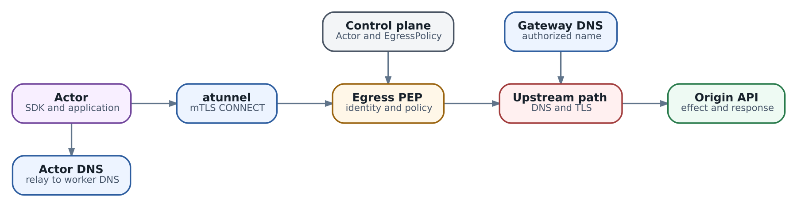

# Gateway и egress: DNS, TLS и проверка реальной доступности

Actor `lab/network-017` из предыдущей главы восстановлен. Workspace на месте, runner отвечает, но агент не может продолжить работу: вызов model API заканчивается timeout. Оператор открывает сетевой доступ шире, запрос проходит, и инцидент кажется закрытым. На деле исправление могло одновременно разрешить доступ к чужим внутренним сервисам. Мы ещё не знаем, что сломалось и какую границу только что убрали.

Сетевую доступность нужно доказывать в двух направлениях: разрешённая операция работает, а запрещённая не достигает назначения. Глава 15 дала общую схему routing и egress. Здесь проследим один запрос по конкретным DNS/TLS этапам и научимся выбирать шлюз под задачу. Мы разберём путь запроса из sandbox, DNS на обеих сторонах proxy, несколько TLS-соединений внутри одного обращения, выдачу credentials и проверку прикладного протокола. Инженерный результат - минимальный доступ с понятным местом отказа, а не просто зелёный health check.

## Какую задачу решает Gateway

Egress означает исходящий трафик: агент обращается к model API, MCP server, Git или другому сервису. Gateway - управляемая точка, через которую проходит этот трафик. Она может выбирать destination, проверять identity вызывающего workload, применять правила доступа и устанавливать следующее соединение. Какие именно действия доступны, зависит от реализации. Обычный TCP proxy не становится MCP-aware шлюзом оттого, что через него идут MCP requests.

Не путайте этот путь с ingress из главы 15. Ingress router доставляет запрос *к* logical Actor и при необходимости запускает resume. Egress gateway решает, *куда* работающий Actor вправе обратиться. Также отдельным продуктовым контрактом является Kubernetes Gateway API: наличие слова Gateway в книге не означает, что правила Substrate записываются в Kubernetes `Gateway` или `HTTPRoute`.

Для конкретных примеров здесь используется Substrate `v0.3.0`, commit `ccecc788`. Его разрешения исходящего трафика задаёт вложенный ресурс Actor `EgressPolicy` с именем `default`. Название `GatewayReady` из старого диагностического примера нельзя считать универсальным полем этого API. Проверять нужно реальные resource schema, режим установки, image digest и dataplane. Различайте «API принял правило», «шлюз умеет его исполнить» и «нужная операция действительно прошла».

| Инструмент | Когда выбирать | Чего он сам не доказывает |
| --- | --- | --- |
| Firewall или CNI NetworkPolicy | Ограничить сетевые пути между Pods, узлами и адресными диапазонами | Разрешение конкретного HTTPS method, tool или пользовательского действия |
| TCP или TLS passthrough proxy | Передать поддерживаемый protocol, сохранив TLS до origin | Контроль HTTP body, credential injection или содержание encrypted stream |
| HTTP egress proxy с TLS interception | Авторизовать HTTP requests и изменить headers перед отправкой | Бизнес-смысл операции и отсутствие утечки через разрешённый API |
| MCP-aware gateway или tool broker | Контролировать tool-level операции, identity, quotas и выдачу credentials | Полноту policy, безопасность всех tools и совместимость каждого transport |

Эти инструменты дополняют друг друга. NetworkPolicy уменьшает сетевую поверхность gateway, а HTTP policy ограничивает то, что gateway делает по поручению Actor. В стандартной Kubernetes NetworkPolicy разрешения нескольких policy складываются: отдельное широкое allow может открыть путь несмотря на наличие default-deny. Нужен поддерживающий enforcement сетевой plugin и проверка совокупного результата, а не только одного manifest.

## Путь запроса из реального sandbox

В Substrate исходящее TCP-соединение Actor, кроме DNS на port 53, перехватывается сетевыми правилами и передаётся `atunnel`. Тот открывает mTLS HTTP CONNECT к egress policy enforcement point, или PEP - компоненту, который исполняет решение о доступе. CONNECT несёт original `IP:port`, а не достоверное hostname. Gateway подтверждает Actor identity по сертификату и сверяет его UID и running state через control plane. Затем обрабатывает трафик внутри tunnel согласно доступным правилам.

На HTTP-пути proxy сам разрешает и набирает имя, которое разрешила policy. Actor не должен получать право dial'ить произвольный IP только потому, что прислал разрешённый Host или SNI. Запрос из admin Pod обходит часть этих звеньев. Его успех доказывает доступность с admin Pod, но не работу перехвата, сертификата Actor, per-Actor policy или trust bundle внутри sandbox.

  
*Gateway validation: Actor path and gateway upstream are separate checks*

Схема показывает границы диагностики, а не буквальную последовательность всех байтов. DNS Actor и DNS proxy могут выполняться в разные моменты и давать разные ответы. TLS приложения внутри CONNECT и TLS самого CONNECT - разные sessions. В режиме interception появляется ещё TLS от gateway к origin. Поэтому один успешный connect не подтверждает весь путь.

## Что правила позволяют в этой версии

Правила `EgressPolicy` являются набором allow; отсутствие совпадения означает deny. `http` решает по authority cleartext HTTP request, `https` предполагает TLS interception и последующую проверку HTTP authority. Exact hostname имеет приоритет перед wildcard, а конкретный port - перед всеми ports. `*.example.com` совпадает с одним непустым label: `api.example.com`, но не с `example.com` или `a.api.example.com`. Hostname записывается без scheme, path и port.

В v0.3.0 port для HTTP-решения берётся из исходного dial Actor, переданного CONNECT. Port, написанный внутри Host, не заменяет его. На HTTPS-пути также проверяется SNI connection. Совпавший SNI не освобождает каждый decrypted request от проверки его authority. Это существенно при HTTP/2 и повторном использовании соединений.

**API и рабочий dataplane не равнозначны**

В schema v0.3.0 есть `tls_passthrough`, но реализация `SNIRules` этой версии не передаёт такие rules в Envoy listener classifier. Passthrough нельзя считать рабочим способом сохранить end-to-end TLS только на основании принятого manifest. Для описанного здесь Envoy/sdsmint пути HTTPS требует поддерживаемого interception и gateway CA. Другой dataplane или версия должны отдельно пройти compatibility tests.

На уровне sandbox обычный UDP, кроме DNS, блокируется; HTTP/3 поверх QUIC нельзя получить простым разрешением port 443. Требование WebSocket, raw TCP, STARTTLS или TLS с certificate pinning тоже следует проверить до переноса приложения. Общая схема API не обещает поддержку этих transports. В частности, замена origin certificate на gateway certificate несовместима с обычным pinning origin leaf.

```
# Body EgressPolicy, не самостоятельный Kubernetes manifest.
# Parent Actor задаётся отдельно в API request.
metadata:
  atespace: lab
  name: default
rules:
- https:
    hostnames: ["models.example.test"]
    ports:
      numbers: [443]
```

`models.example.test` здесь обозначает ваш управляемый лабораторный endpoint. Одного такого body недостаточно для HTTPS: нужны работающий gateway в нужном режиме, DNS и CA projection в Actor. Не добавляйте `*` для компенсации отсутствующей возможности transport.

## DNS проверяется на обеих сторонах proxy

DNS переводит имя в адрес, но ответ DNS не является разрешением на connection. Actor может успешно получить A record, а gateway отказать по policy. И наоборот, runtime resolver Actor может ошибаться, хотя DNS на gateway исправен. На intercepted HTTP-пути gateway затем резолвит разрешённое имя самостоятельно; локальный `/etc/hosts` Actor не задаёт ему конечный upstream.

Начните с настроек разрешения имён реального sandbox и того же SDK, который выдаёт ошибку. `getent` использует системный механизм, включая hosts и источники имён, настроенные через NSS; `dig` обращается к DNS и помогает увидеть records и TTL. Они не обязаны повторять поведение клиента со своим resolver, proxy или DNS cache. Полезно зафиксировать имя из URL, search domains, A/AAAA, время ответа и gateway DNS result. Не переносите «работает с IP» на «работает с hostname».

В v0.3.0 DNS Actor идёт через relay к configured resolvers Worker, вне внешнего egress gateway. `EgressPolicy` не фильтрует эти DNS-запросы и не выключает relay. Поэтому default-deny TCP egress не означает отсутствие DNS-канала. Если threat model требует контроля доменов или защиты от утечек через DNS, это отдельная задача resolver и сетевого enforcement, включая допустимые encrypted DNS endpoints.

CDN может возвращать несколько адресов и менять их. В dual-stack окружении отдельно проверяют IPv4/IPv6, но наличие AAAA не означает, что выбранный sandbox и proxy умеют этот путь. Тайм-аут только на одном address family легко принять за случайный отказ API. С другой стороны, закреплённый IP полезен для изоляции причины, но плохо подходит как постоянная конфигурация динамического сервиса.

Hostname allowlist также не защищает автоматически от DNS rebinding: разрешённое имя может начать указывать на private или link-local address. Gateway, способный резолвить пользовательские назначения, рискует стать *confused deputy* - доверенным посредником, использующим собственный доступ в интересах недоверенного Actor. Нужны ограничения сети самого gateway и проверки resolved destinations. Учитывайте разрешённые внутренние model/MCP endpoints; нельзя бездумно запрещать весь RFC1918 и одновременно ожидать доступ к internal inference.

## Какие имена участвуют в TLS

В HTTPS есть как минимум три разных имени. URL задаёт logical destination клиента. SNI передаётся в TLS ClientHello и помогает выбрать certificate или TLS route. HTTP Host либо HTTP/2 `:authority` задаёт приложение назначения уже внутри соединения. SAN, Subject Alternative Name, перечисляет допустимые имена в certificate; его проверка подтверждает соответствие ожидаемому имени. Подставить только Host при обращении к IP недостаточно: SNI и certificate verification могут всё ещё использовать IP.

В transparent Substrate path приложение обычно не знает о внешнем CONNECT. `atunnel` проверяет server certificate PEP и предъявляет Actor-specific client certificate. Это первая trust boundary. Если gateway перехватывает HTTPS, приложение проверяет выданный им leaf через gateway CA, а gateway устанавливает и проверяет TLS к origin. Это ещё две границы. Ошибка CA внутри Actor и ошибка upstream CA на gateway требуют разных исправлений.

Trust bundle должен попасть в filesystem и быть подключён к используемой TLS library. Для этой версии projection `egress-mitm.ate.dev` задаётся через `systemInfo` volume. В примере ниже файл уже смонтирован как `/run/ate/trust-bundle.pem`. Это public CA material, не private key. Его наличие на диске ещё не означает, что Python, Node.js, Java, Git и curl используют один и тот же trust store.

Укажите доверенный bundle явно в диагностике и затем настройте *реальный* клиент. Для Python [requests](https://requests.readthedocs.io/en/latest/user/advanced/#ssl-cert-verification) задайте `verify` с path CA либо `REQUESTS_CA_BUNDLE` и проверьте, учитывает ли используемый flow environment. У Java отдельный truststore. У Node.js [`NODE_EXTRA_CA_CERTS`](https://nodejs.org/api/cli.html#node_extra_ca_certsfile) добавляет anchors и читается при старте процесса; явно заданный клиентом `ca` меняет этот путь. Решение о добавлении public roots или gateway-only trust должно быть осознанным. Не превращайте `curl -k` в исправление: с ним исчезает проверка identity TLS peer, которую вы пытаетесь доказать.

Projection текущих anchors обновляется на Run/Restore, но процесс может держать старый trust store в памяти, особенно после Full restore. Rotation требует overlap, reconnect и при необходимости reload TLS client или перезапуск процесса. Snapshot из главы 39 не делает старый certificate, token или cached session вновь действительным.

## Что на самом деле проверяют команды

Следующие команды выполняются *внутри нужного Actor* на безопасном лабораторном endpoint. Диагностические утилиты лучше заранее включить в отдельный debug image, а не устанавливать packages через открытый internet во время инцидента. Здесь предполагается Linux, GNU `timeout`, OpenSSL 3 и смонтированный gateway CA. Команды - примеры проверок, а не основание автоматически повторять изменяющий запрос.

```
getent ahosts models.example.test

timeout 5s nc -vz models.example.test 443

timeout 10s openssl s_client \
  -connect models.example.test:443 \
  -servername models.example.test \
  -verify_hostname models.example.test \
  -verify_return_error \
  -CAfile /run/ate/trust-bundle.pem </dev/null

curl --noproxy '*' --cacert /run/ate/trust-bundle.pem \
  --connect-timeout 5 --max-time 15 --fail-with-body \
  -sS -o /dev/null \
  -w 'http=%{http_code} peer=%{remote_ip}\n' \
  https://models.example.test/health
```

`nc` сообщает о TCP connect, но в перехваченном пути это может быть принятие connection локальным tunnel, а не достижение origin. Без ClientHello или HTTP request ещё не сработала проверка destination. `openssl s_client` показывает TLS; `-verify_hostname` и `-verify_return_error` важны, потому что простой диагностический handshake может продолжаться после ошибки проверки certificate. Timeout ограничивает зависание, а не подтверждает deny.

`curl` добавляет HTTP outcome. `--fail-with-body` превращает HTTP 4xx/5xx в ненулевой exit code, но 3xx не становится успешной проверкой API: проверяйте ожидаемый status. Здесь redirect намеренно не следует автоматически. `--noproxy '*'` отключает proxy из environment для этого клиента, но не обходит transparent interception Substrate. Если приложение использует explicit proxy, проведите отдельный test с той же настройкой; для HTTPS proxy его CA проверяется отдельно от CA конечного server.

Не выгружайте весь environment, headers и verbose trace в общий incident ticket: там могут быть proxy credentials, bearer tokens, cookies и чувствительные response bodies. Для расследования достаточно очищенных адресов, verdict, certificate issuer/SAN, timing и correlation IDs. Debug output с secrets хранится только в разрешённом защищённом месте.

## Как отделить DNS от SNI и маршрута

Для обычного direct HTTPS client полезен `--resolve`: адрес меняется, а имя URL, SNI и certificate verification сохраняются. На своём стенде подставьте актуальный адрес тестового origin:

```
curl --noproxy '*' --cacert /run/ate/trust-bundle.pem \
  --resolve models.example.test:443:192.0.2.20 \
  --connect-timeout 5 --max-time 15 --fail-with-body \
  -sS -o /dev/null https://models.example.test/health
```

`192.0.2.20` - documentation address, не готовый working endpoint. На intercepted hostname-routing path gateway может снова dial'ить hostname по собственному DNS. Тогда этот test изолирует client-side resolver, но *не* закрепляет upstream gateway. Проверяйте proxy logs и реальный dial address, прежде чем делать вывод «конкретный backend исправен». При explicit proxy DNS также может выполняться на proxy.

Если TLS завершается ошибкой, сопоставьте ожидаемое имя, отправленный SNI, полученный leaf, issuer, SAN, validity interval и доверенные anchors. Затем отдельно проверьте trust и route gateway к origin. Сертификат с подходящим SAN не доказывает policy allow; разрешённая policy не заставляет принять просроченный certificate. ECH и нестандартный ClientHello нужно проверять на выбранной реализации: схема, основанная на видимом SNI, не получает доступ к скрытому inner name автоматически.

## HTTP response ещё не означает работоспособность агента

`/health` может вернуть 200 без model availability, нужных permissions или поддерживаемого API. Следующий test должен воспроизвести минимальную безопасную операцию тем же SDK: правильный URL path, method, content type и authentication. Для inference это короткая ограниченная generation с нужной моделью; для MCP over HTTP - разрешённый read-only вызов по выбранной revision. В modern `2026-07-28` используется per-request `_meta`, а discovery клиента не является обязательным предварительным вызовом; legacy `2025-11-25` использует initialize и свои session/version semantics. Не смешивайте эти профили. Local stdio MCP server имеет другой сетевой путь: outbound connections создаёт его процесс, а не «MCP» как абстракция.

Streaming проверяют отдельно: появился ли первый полезный chunk, дошёл ли завершающий message, корректно ли работает cancellation. Gateway может буферизовать response, оборвать idle stream или не поддерживать нужный upgrade. Успех короткого GET не доказывает HTTP/2, gRPC или долгую generation. Согласуйте connect, request, idle и end-to-end deadlines с реальной длительностью работы, а не увеличивайте все timeouts до бесконечности.

HTTP 401/403 может прийти от origin, egress policy, credential provider или другого reverse proxy. Один status без emitter и correlated logs неоднозначен. 502/503 тоже не всегда «model упала»: возможны DNS, upstream TLS, provider failure или перегрузка gateway. А timeout после отправки изменяющей операции оставляет outcome неизвестным. Для `op-17` из глав 37-39 сначала сверяйте внешний operation ledger или effect; сетевой retry не заменяет idempotency.

## Credentials остаются отдельной границей доступа

Credential injection позволяет gateway добавить API credential перед отправкой upstream, не помещая его в env, filesystem или snapshot Actor. Это полезно для длительно живущих агентов с недоверенным кодом. Но «Actor не видит token» не означает «Actor не может использовать его полномочия»: разрешённые вызовы всё равно выполняются с этим credential. Нужны узкие permissions origin, destination allowlist и при необходимости method/tool-level ограничения.

В Substrate v0.3.0 на Envoy injection требует HTTPS MITM leg и подключённого provider. Если provider отсутствует или leg cleartext, реализация пропускает injection и отправляет request без добавленного credential. Когда provider подключён и FetchSecret действительно выполняется, missing secret или запрещённый scope дают 403, временная недоступность provider - 503. Поэтому само наличие `replaceHeaders` в policy не является fail-closed проверкой готовности всей установки.

Есть ещё точное ограничение этой версии: `applyEffects` использует `OVERWRITE_IF_EXISTS_OR_ADD` и не проверяет presence placeholder header перед FetchSecret. Нельзя использовать отсутствие Authorization в request как надёжный способ отказаться от injection. Если нужен opt-in отдельного вызова, выделите отдельный route/endpoint и policy boundary либо проверьте реализацию версии, где этот контракт обеспечен.

Проверка injection выполняется на *собственном* canary origin с тестовым credential. Origin подтверждает нужную identity и возвращает только безопасный marker, а не значение token. Public echo service, возвращающий входные headers, может раскрыть secret обратно Actor и записать его в workspace или snapshot. Не тестируйте credential brokering посредством отправки production key в чужой diagnostic API.

## MCP gateway выбирают по операциям и trust model

Если агенту нужны десятки сервисов, общий gateway может централизовать authentication, quotas и audit. Но сначала выпишите необходимую функцию. Для hostname restriction хватит сетевого proxy. Для запрета конкретного MCP tool, проверки arguments, user-scoped identity или approval нужен processor, понимающий прикладной протокол. Для DLP, контроля утечки данных, требуется отдельная реализация анализа содержимого; обычная EgressPolicy её не добавляет.

Проверьте, какие transports, streaming, session IDs, redirects и versions поддерживает выбранный шлюз. Кто аутентифицирует Actor и конечного пользователя? Какие права он выдаёт upstream? Как различает два Tasks, восстанавливается после resume и отзывает access? Не передавайте один общеплатформенный token всем downstream services. Шлюз может стать единой точкой отказа и чрезмерно доверенным посредником, поэтому его собственные RBAC, сети, credentials и audit требуют той же дисциплины, что control plane.

Destination allowlist не запрещает отправлять конфиденциальные данные в разрешённый model API или выполнять нежелательный tool на разрешённом MCP server. Эта граница остаётся у harness, tool authorization и origin. При выборе инструмента используйте главы 24, 36 и 37: сеть уменьшает поверхность, но не понимает автоматически смысл агентного действия.

## Проверки deny должны исключать ложный успех

Отказ засчитывается, только если он произошёл на ожидаемой границе и запрос не достиг origin. Несуществующий hostname даёт «ошибку», но ничего не говорит о egress policy. Для отрицательной проверки используйте живой, контролируемый canary endpoint и подтвердите gateway verdict вместе с отсутствием request на canary. Это отличает policy deny от DNS failure, недоступного server и client timeout.

| Проверка на стенде | Ожидаемое доказательство |
| --- | --- |
| Разрешённый hostname и port | Ожидаемый application result, gateway allow и request на нужном origin |
| Живой запрещённый hostname или другой port | Policy deny; origin не получил request |
| Wildcard, apex и nested label | Работает только предусмотренная область совпадения |
| Подмена имени и попытка direct IP к canary | Нет обращения к произвольному адресу за счёт разрешённого Host/SNI |
| Redirect к другому canary hostname | Каждое новое назначение проходит отдельную проверку |
| Revoke policy и уже открытый stream | Измерен момент отказа новых requests и отдельная судьба in-flight stream |

Private ranges, loopback и link-local проверяют только согласованными безопасными probes к собственным canaries или по инфраструктурным policy tests. Не читайте реальные cloud metadata credentials и не сканируйте чужие internal services. Для DNS rebinding используйте свою test zone и безвредный backend. Задача - подтвердить ограничение, а не получить доступ к секрету.

## Rollout policy и зависимости после resume

У gateway несколько независимых caches: policy, DNS, connections, TLS sessions, provider credentials и данные приложения. В Envoy handler v0.3.0 per-Actor policy cache по умолчанию живёт 10 секунд; TTL можно настроить или отключить. Сохранённая новая policy поэтому не означает мгновенный verdict на всех replicas. Сверяйте version и наблюдайте новые requests после обновления, а не только результат PUT.

Решение для HTTP принимается на request headers, не на каждом байте response. Уже разрешённый stream может продолжаться после revoke. Для настоящего passthrough в реализации, где он поддержан, решение обычно привязано к connection. Срочный отзыв требует отдельного плана: закрытие sessions, блокировка сети или upstream credential revocation с измеренным временем. Ни policy TTL, ни Full snapshot не дают гарантии мгновенно отменить уже отправленное действие.

До rollout составьте dependency inventory. Model API и MCP принадлежат runtime Actor. Pull OCI image выполняет инфраструктура, а не agent process. NTP и получение certificate могут быть обязанностью host/control plane; разрешать Actor произвольный UDP ради них не нужно. Git clone, package installation и telemetry из Actor, напротив, требуют его egress path. Перенос dependencies в immutable image позволяет оставить production policy уже, но не отменяет DNS и runtime API.

После resume заново проверьте полезную операцию и deny boundary. Старые connections, loaded trust store, credentials и DNS cache могут не соответствовать новой execution. Сравните непрерывно работающий Actor, fresh boot и восстановленный Actor: единичный успех до suspend не закрывает acceptance восстановления.

## Как разбирать инцидент и измерять задержку

Сначала запишите `atespace/name` Task и её прикладную incarnation, отдельно Actor name и UID, execution identity, URL без secrets, timestamp, SDK/image versions, gateway mode и policy version. В AX `ac233282` нет Task metadata UID; Actor UID принадлежит API Substrate. Затем двигайтесь от первого неподтверждённого слоя. Если даже DNS Actor не работает, не начинайте с расширения destination allowlist. Если gateway отказал по имени, не меняйте CA. Если TLS прошёл и origin вернул 401, ищите authentication boundary, а не WorkerPool capacity.

| Симптом | Следующая проверка | Опасный поспешный вывод |
| --- | --- | --- |
| Имя не разрешается | Resolver Actor, DNS relay, worker DNS, затем отдельно gateway DNS | «Надо разрешить всё в egress» |
| TCP connect есть, дальше timeout | Inner protocol, ClientHello, gateway classification и upstream dial | «Сеть уже точно исправна» |
| Certificate validation failure | На какой TLS leg отказ; expected name, CA и validity | «Надо выключить verification» |
| 403 или 503 | Emitter, Actor identity, rule match, provider и origin logs | «Это однозначно ответ model API» |
| Health 200, generation не работает | Actual SDK, protocol, streaming, auth и model queue | «Gateway проверен полностью» |

Для curl можно собрать `time_namelookup`, `time_connect`, `time_appconnect`, `time_starttransfer` и `time_total`. Это накопленные времена от начала transfer; их нельзя сложить как независимые интервалы. В proxied path они включают видимые клиенту legs и не разделяют автоматически все DNS/TLS upstream. Сопоставляйте их с proxy logs, origin timing и model request ID. Точное совпадение таймеров не заменяет correlation.

Под нагрузкой отдельно наблюдайте gateway connection/stream limits, pending DNS lookups, ext\_proc latency, provider latency и origin queue. Retries нескольких слоёв могут усилить перегрузку. Один удачный request через gateway подтверждает функциональность, но не capacity для десятков одновременно активных агентов. Это подводит к главе 41: после проверки пути до inference endpoint нужно разобраться, сколько полезных generations он способен обслужить.

## Практикум сетевой границы

Используйте изолированный Actor, два управляемых HTTPS origins и только тестовые credentials. Подготовьте протокол проверки: input, ожидаемый verdict, наблюдение внутри Actor, gateway record, origin record и итог. Следующие восемь шагов можно выполнять постепенно:

1. Зафиксируйте version, dataplane и реальный маршрут Actor. Сравните probe из admin Pod и из sandbox, не принимая первый за доказательство второго.
2. Проверьте DNS Actor и gateway отдельно. Временно задайте свой controlled resolver failure и убедитесь, что отличаете его от policy deny.
3. Разрешите один hostname и port. Проверьте CA, SAN и read-only application operation тем же SDK, который использует агент.
4. Добавьте живой denied canary, неверный port и wildcard boundaries. Подтвердите gateway deny и отсутствие request у origin.
5. Проверьте redirect и сохранение hostname при `--resolve`. По proxy logs определите, чей DNS выбрал upstream.
6. На canary credential проверьте configured provider, отказ authorization и provider outage. Не возвращайте token Actor; зафиксируйте поведение request без placeholder.
7. Отзовите доступ при открытом stream. Измерьте cache propagation, новые requests и время закрытия существующей операции отдельно.
8. Повторите allow/deny и SDK probe после suspend/resume и контролируемой CA rotation. Сохраните recovery evidence без секретов.

Граница считается проверенной, когда инженер может объяснить, кто выбрал destination, кто подтвердил identity, где принято решение allow/deny, какие TLS legs проверены и что произошло с прикладной операцией. Зелёный status объекта полезен, но он не заменяет эту цепочку.

### Источники и дальнейшее чтение

- [Substrate v0.3.0 EgressPolicy API](https://github.com/agent-substrate/substrate/blob/ccecc788a327dc11dcd6c21ee153f3d0cbb5cc97/pkg/proto/ateapipb/ateapi.proto) и [policy evaluator](https://github.com/agent-substrate/substrate/blob/ccecc788a327dc11dcd6c21ee153f3d0cbb5cc97/internal/egresspolicy/egresspolicy.go): matching и ограничение passthrough.
- [Request authorization](https://github.com/agent-substrate/substrate/blob/ccecc788a327dc11dcd6c21ee153f3d0cbb5cc97/cmd/atenet/internal/router/egress/request.go), [credential implementation](https://github.com/agent-substrate/substrate/blob/ccecc788a327dc11dcd6c21ee153f3d0cbb5cc97/cmd/atenet/internal/router/egress/credentials.go) и [policy cache](https://github.com/agent-substrate/substrate/blob/ccecc788a327dc11dcd6c21ee153f3d0cbb5cc97/cmd/atenet/internal/router/egress/policycache.go): actual v0.3.0 behavior.
- [DNS relay и CA projection](https://github.com/agent-substrate/substrate/blob/ccecc788a327dc11dcd6c21ee153f3d0cbb5cc97/docs/egress-trust-bundle.md) и [Envoy/sdsmint configuration](https://github.com/agent-substrate/substrate/blob/ccecc788a327dc11dcd6c21ee153f3d0cbb5cc97/manifests/ate-install/atenet-egress-with-sdsmint.yaml): раздельные TLS legs.
- [curl options](https://curl.se/docs/manpage.html), [certificate verification](https://curl.se/docs/sslcerts.html) и [name resolution overrides](https://everything.curl.dev/usingcurl/connections/name.html); [OpenSSL 3 s\_client](https://docs.openssl.org/3.0/man1/openssl-s_client/): пределы diagnostic probes.
- [Kubernetes NetworkPolicy](https://kubernetes.io/docs/concepts/services-networking/network-policies/) и [Envoy dynamic forward proxy](https://www.envoyproxy.io/docs/envoy/latest/configuration/http/http_filters/dynamic_forward_proxy_filter): enforcement layers и защита самого proxy.
