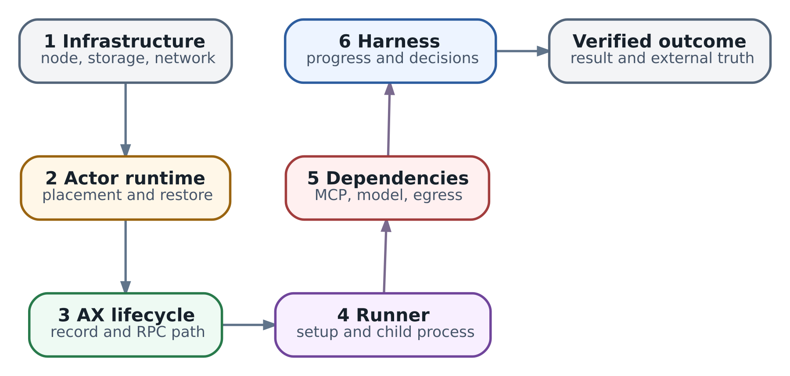

# Operations runbook: диагностика по слоям и release acceptance

Дежурному пишут: «После обновления агент завис». Ожидался отчёт проверки `lab/network-017`, но отчёта нет. Task показывает `Running`, runner отвечает на probes. С чего начать: добавлять Workers, перезапускать команду или искать ошибку в harness?

Глава 42 показала порядок безопасного восстановления. Предположим, на отдельном учебном стенде он пройден: история `op-17` установлена, повторять изменение конфигурации не требуется. Теперь нужно выполнить следующий шаг - проверить инженерную цель и вернуть результат пользователю. Это даёт точный ориентир для диагностики: мы ищем место, где прекратилось получение проверочного отчёта, а не пытаемся сделать зелёными все индикаторы сразу.

**Runbook** - инструкция, по которой другой инженер может принять решение: определить ситуацию, собрать нужные наблюдения, выбрать допустимое действие и проверить результат. **Release acceptance**, приёмка релиза, использует такие же проверяемые условия до расширения новой сборки. Свяжем эти задачи: разберём один инцидент, сформулируем критерий восстановления и превратим обнаруженный пробел в автоматический тест.

Основы наблюдения даны в главах 25 и 29. Здесь используем конкретные границы AX `ac233282` и Substrate v0.3.0 `ccecc788`, а также договорённости о внешних действиях из глав 37 и 42. Команды диагностики относятся к отдельному разрешённому стенду; имена ресурсов и доступ всегда сверяются с вашей установкой.

## Сначала опишите потерянный результат

Фраза «агент завис» объединяет разные ситуации. Task может ждать approval, команда - завершиться, model server - держать запрос в очереди. Поэтому первый разговор дежурного с заявителем короткий и предметный: какой результат ожидался, для какого run, к какому времени и когда последний раз было видно полезное продвижение?

Для нашего случая запись может выглядеть так: «После candidate R2 у `lab/network-017` нет нового отчёта проверки. Последний подтверждённый шаг - сохранение receipt `op-17`; проверка цели ещё не завершена. Новые сетевые изменения не запрашивались». В рабочем ticket R2 заменяется ссылкой на точный inventory. Эта запись задаёт границы расследования и защищает от случайного повторения уже выполненного write.

**Triage** - первичная оценка ущерба и срочных мер. Сравните один run с контрольными: не работают все новые Tasks или только эта, один tenant или несколько, только новая сборка или также старая? Размер инцидента влияет на выбор действий. При массовом отказе разумно ограничить rollout и назначить координатора; для одной Task может хватить её владельца и дежурного.

Если система продолжает делать ошибочные изменения, сначала остановите опасный путь по утверждённой процедуре. Сохраняйте доступные свидетельства, но не откладывайте containment до идеального набора logs. Если новых повреждений нет, зафиксируйте текущие данные до restart: после него прежний процесс и его локальные logs могут исчезнуть. Такой порядок соответствует [методу troubleshooting Google SRE](https://sre.google/sre-book/effective-troubleshooting/).

У существенного инцидента должен быть один журнал решений. В нём фиксируются impact, время, выполненные меры и их результат. Два инженера, одновременно меняющие policy и image без общей записи, оставят следующему дежурному систему с неизвестной историей. Роли координатора и автора timeline можно совмещать, ответственность за запись от этого не исчезает.

## Из чего состоит проверяемая процедура

Начните runbook с области применения и условий входа. Например: runner текущего Actor доступен, отчёт отсутствует, команда уже могла закончиться, outcome ранее отправленного write требует отдельной сверки. Рядом укажите необходимые права, безопасные источники данных и предел диагностики до escalation.

Далее опишите развилки. Каждая проверка должна отвечать на вопрос и менять следующее решение. «Прочитать logs» слишком неопределённо. «Найти exit текущей command и последний application checkpoint; при неизвестном outcome не запускать write повторно» уже помогает действовать. Полезно записать также, что опровергнет текущую гипотезу: тогда runbook не превращается в поиск подтверждений первой догадки.

Для state-changing шага нужны владелец решения, prerequisites, предел воздействия, критерий успеха и stop condition. Если повтор запуска разрешён только для read-only verifier, это условие должно стоять рядом с командой, а не в другом документе. Таймаут проверки означает, что нужного ответа пока нет; он не выбирает следующую опасную операцию автоматически.

**Критерий восстановления** формулируется до repair. В нашем случае это отчёт для нужного run и состояния проверяемого объекта, прошедший содержательную проверку и доставленный пользователю. Живой runner полезен для доступа, а exit code сообщает об окончании команды. Эти наблюдения входят в процедуру, но отвечают на более узкие вопросы.

Версионируйте runbook с release inventory. После смены API, схемы checkpoint или routing следующему оператору нужны обновлённые пути чтения и критерии. Проверка другим человеком на отдельном стенде обнаруживает пропущенный prerequisite лучше, чем ещё один перечень названий компонентов.

## Свяжите наблюдения с одним исполнением

Сначала установите identity: atespace/name Task, incarnation прикладного запуска, Actor UID, assignment и command attempt. Имя Task после удаления и создания может повториться. В [AX schema `ac233282`](https://github.com/google/ax/blob/ac2332829f22360ff97b0ba34d94dd0dd782f17e/pkg/apis/v1alpha1/ax.proto) metadata не содержит resource UID, `generation` или `resourceVersion`. Прикладной журнал различает incarnations; эти поля не следует добавлять в AX YAML по аналогии с Kubernetes.

Сохраните отдельно время события, время получения данных и источник. Свежий ответ API сообщает, что запись говорит сейчас; `lastTransitionTime` старой condition не становится временем последней проверки процесса. Log предыдущей assignment может объяснить прошлый exit, но не состояние новой команды. Глава 38 показывает, как сохранять эти различия при объединении наблюдений.

В минимальный комплект нашего инцидента входят inventory кандидата, защищённая Task spec, Actor и Worker assignment, command start/exit, checkpoint и сведения о последнем tool outcome. Для сравнения полезны такая же исправная Task и последний успешный запуск. Они помогают проверить, связан ли симптом с конкретным release или с общим dependency.

Сбор данных тоже требует границ доступа. Полный environment, kubeconfig, authorization headers и snapshot RAM могут раскрыть secrets. Runner metadata способна содержать literal Task env. В общий ticket помещают безопасные identity, timestamps и вывод проверки; чувствительные материалы хранят отдельно с ограниченными readers. Redaction должна сохранять связи, необходимые для расследования, а не превращать каждую строку в одинаковое «скрыто».

## Как выбрать различающую проверку

**Гипотеза** предлагает причину и предсказывает наблюдение. «Не хватает мощности» слишком широко. «Command ждёт model request, который стоит в server queue» можно проверить по жизни child, request ID и серверным timings. Если child уже завершилась до отправки запроса, эта гипотеза не объясняет отсутствие отчёта данного attempt.

Ищите последнюю подтверждённую границу и первый неизвестный участок. Здесь runner доступен; следующий полезный вопрос - жива ли command и где её результат. Чтение command exit различит штатную работу, завершение с ошибкой и успешный exit без нужного artifact. Добавление ещё одной model replica до этой проверки не проверяет сформулированную причину.

  
*Troubleshooting ladder: infrastructure, Actor, AX, runner, dependencies, harness, outcome*

Схема - карта границ, а не обязательный порядок обхода и не последовательность RPC. При массовой потере Workers начните с placement. При подтверждённом отказе tool изучайте этот вызов. Диагностика по слоям полезна тем, что каждому наблюдению соответствует определённый контракт; один общий статус скрывает эти различия.

Сформулируйте ожидаемый вывод до запуска probe. Если он не получен, сохраните неопределённость и выберите следующую проверку. Отсутствующий span при sampling не опровергает выполнение операции. Read-only probe может создать нагрузку или вызвать auto-resume, поэтому «ничего не записывает» ещё не означает «не влияет на систему».

## Какой инструмент отвечает на какой вопрос

| Вопрос | С чего начать | Что потребуется дополнительно |
| --- | --- | --- |
| Есть ли общая деградация и когда она началась | Метрики с разделением по версии и workload | Logs или trace конкретного run для локализации |
| Что происходило с одним Actor | Actor UID и централизованные logs | История assignments и прикладной run identity |
| Где тратилось время конкретного вызова | Trace и stage timings | Проверка propagation, sampling и неизмеренных участков |
| Почему container не запускается | Kubernetes status, events и previous logs | Actor-specific state, если Pod содержит Worker |
| Завершилась ли command полезным результатом | Exit и application artifact | Независимый oracle содержания и доставка пользователю |
| Произошёл ли внешний write | Ledger и lookup у целевой системы | Binding к operation, arguments и текущие права |

**Метрики** хорошо показывают масштаб, распределение задержки и насыщение. Для одного run часто нужны logs: конкретная command могла выйти между двумя выборками CPU. **Trace** связывает стадии запроса, если контекст действительно передаётся и trace сохранён. **Oracle** - правило проверки результата: например, report относится к нужному объекту и содержит ожидаемые сведения. У каждого средства своя задача; установка общего dashboard не создаёт прикладной oracle.

В [observability guide Substrate v0.3.0](https://github.com/agent-substrate/substrate/blob/ccecc788a327dc11dcd6c21ee153f3d0cbb5cc97/docs/observability.md) CLI чтения Actor logs обращается к текущему Worker. Для истории после relocation нужен централизованный backend. Actor UID пригоден для такой связи, а trace context собственных строк workload должен поставлять сам workload. Пустой поиск по нынешнему Pod не равен отсутствию прошлого выполнения.

Перед выбором нового tracing backend проверьте, каких данных не хватает. Если application не пишет operation ID, смена хранилища logs не создаст эту связь. Если отсутствует длительность restore phase, нужен соответствующий источник измерения. В [metric registry этого среза](https://github.com/agent-substrate/substrate/blob/ccecc788a327dc11dcd6c21ee153f3d0cbb5cc97/docs/metrics/substrate.yaml) отмечены blind spots store и worker cache. Неизмеренный участок остаётся неизвестным, даже если соседние графики зелёные.

## Какие контракты проверять по слоям

### Kubernetes и размещение

Разделите недоставленную capacity и отказ уже запущенного workload. Pending Pod требует чтения scheduling events, selectors, taints, requests, storage и доступного sandbox. Суммарный свободный CPU не отвечает на вопрос, существует ли node, удовлетворяющая всем условиям. У Worker Pod также могут жить несколько Actors: его перезапуск затронет более одной Task.

Для завершившегося container сопоставьте termination reason, exit code, предыдущие logs и время. `CrashLoopBackOff` описывает повторные запуски с задержкой, а не саму причину. Один exit code 137 недостаточен для вывода об OOM. Практический маршрут чтения дан в [Debug Pods](https://kubernetes.io/docs/tasks/debug/debug-application/debug-pods/).

Startup probe проверяет запуск, readiness - готовность принимать traffic, liveness - условие продолжения жизни container. При неудачной readiness Pod исключается из соответствующих Service endpoints; liveness после заданного порога может перезапустить container. Общая зависимость от перегруженного upstream в liveness способна усилить отказ. Настройку проверяйте по [контракту probes](https://kubernetes.io/docs/concepts/workloads/pods/probes/), а её смысл - по вашему приложению.

### Actor и восстановление среды

Если Actor не получил Worker, у его command ещё нет среды для выполнения. Проверьте pool, совместимый sandbox class и assignment. После назначения разделите поиск snapshot, получение payload, restore и готовность workload. Общая длительность resume не показывает, где именно прошло время; lazy restore может перенести часть задержки на первое обращение к памяти или файлам.

При проблемах snapshot вернитесь к completed reference, dependencies и compatibility главы 39. Если нужен restore всей платформы, действуют gates главы 42. Restart без выяснения ownership не восстанавливает потерянный payload и способен уничтожить оставшееся evidence.

### AX и runner

В срезе AX `ac233282` lifecycle reconciliation выполняется внутри `ax-server`. Для конкретного вызова ищите API request, store access, lock и Substrate call. Отдельная Redis Streams queue старого controller не является диагностическим объектом этого профиля. Архитектура запроса разобрана в главах 16 и 38.

В [startup path server](https://github.com/google/ax/blob/ac2332829f22360ff97b0ba34d94dd0dd782f17e/cmd/ax-server/main.go) предусмотрена работа без reconciler при ошибке инициализации Substrate client. Поэтому принятая Task record требует сопоставления с фактическим Actor. [Health handler server](https://github.com/google/ax/blob/ac2332829f22360ff97b0ba34d94dd0dd782f17e/internal/server/server.go) сам не проверяет Redis и runtime. Называйте владельца endpoint: server health и runner health относятся к разным процессам.

У [default runner](https://github.com/google/ax/blob/ac2332829f22360ff97b0ba34d94dd0dd782f17e/runner/runner.go) command является child process. После её выхода runner остаётся доступным для inspection. [Runner readiness](https://github.com/google/ax/blob/ac2332829f22360ff97b0ba34d94dd0dd782f17e/internal/metadata/server.go) отражает флаг подготовки workspace, а не успешное завершение command. Это объясняет наш исходный симптом без предположения, что health endpoint сломан.

Проверьте setup, фактическую Git revision, command start/exit и прикладной checkpoint. Сохранённую condition `WorkspaceReady=True` не считайте свежим probe после каждого resume. Даже живой heartbeat может сопровождать бесконечный retry одного шага. Полезное продвижение нужно определять в терминах приложения.

### Сеть модель и harness

Для dependency разберите нужный путь из sandbox: DNS, соединение, TLS с правильными trust roots и SNI, authentication и прикладной protocol. Успешное обращение с ноутбука может использовать другие identity и egress. Глава 40 даёт отдельный разбор этих границ; временный wildcard не становится критерием исправления.

Для model call свяжите request ID, server receive, queue, prefill, первый token и конец stream. Если server ещё не получил запрос, его decode speed не объяснит задержку. Если ответ уже получен, переходите к обработке результата в harness. Методику latency и goodput задают главы 21 и 41.

При штатном ожидании approval или `OUTCOME_UNKNOWN` harness может работать правильно. Уточните ожидаемое событие и допустимое время ожидания, затем проверьте подписку или polling. Сетевая ошибка, отказ tool и неизвестный внешний эффект требуют разных продолжений. Последний разрешается через lookup и ledger, а не повторной генерацией команды.

## Завершите разбор зелёной Task

В нашем учебном инциденте Actor имеет текущую assignment, runner отвечает, но command завершилась с кодом 2. Теперь граница отказа локализована: отчёт не был получен после этой команды. Это ещё не root cause. Дальше нужны её stderr, входные данные, prerequisites и checkpoint; запуск прежнего write не входит в этот маршрут.

| Наблюдение | Как меняется решение |
| --- | --- |
| Command ещё работает и ждёт approval | Проверить ожидаемое событие и срок; сохранить штатное ожидание |
| Command завершилась с ошибкой | Читать exit context и последний прикладной шаг |
| Exit равен нулю, report отсутствует | Проверить контракт результата и путь его сохранения |
| Report есть, но относится к другому run | Исправить identity и источник данных, не принимать чужой результат |
| Report верен и доставлен нужному пользователю | Проверить прекращение исходного impact и закрыть восстановление |

Разделите **mitigation**, **recovery** и **permanent fix**. Приостановка rollout уменьшает текущий ущерб. Исправный запуск read-only verifier возвращает ожидаемый отчёт. Изменение кода, runbook и release test защищает от повторения причины. Эти действия могут происходить в разное время и требуют разных подтверждений.

При любом repair меняйте один значимый фактор на ограниченной группе. Если одновременно заменить image, model и policy, появление отчёта не объяснит, какая гипотеза подтвердилась. После меры повторите исходную пользовательскую проверку, а не только команду, которая стала возвращать ноль.

## Пример ограниченного сбора данных

Следующие команды предназначены для отдельного Kubernetes-стенда. Context `ax-ops-lab`, namespace `ax`, Pod и container условные; перед выполнением они должны соответствовать проверенному inventory. Требуются права на чтение выбранных ресурсов и logs. Команды не делают restart, restore или debug exec.

```
kubectl --context ax-ops-lab -n ax get pods -o wide
kubectl --context ax-ops-lab -n ax get events \
  --sort-by=.metadata.creationTimestamp
kubectl --context ax-ops-lab -n ax describe pod ax-server-lab
kubectl --context ax-ops-lab -n ax logs ax-server-lab \
  -c ax-server --since=20m --tail=200 --timestamps=true
kubectl --context ax-ops-lab -n ax logs ax-server-lab \
  -c ax-server --previous --tail=200 --timestamps=true
```

`--previous` читает предыдущий экземпляр container в данном Pod, если он сохранился. Это не вся история удалённых Pods. Ограничения `--tail` и `--since` уменьшают объём; при обрезке нужен путь в центральную историю. [kubectl logs](https://kubernetes.io/docs/reference/kubectl/generated/kubectl_logs/)

Для активного Actor можно использовать CLI совместимой версии Substrate. В примере kubeconfig уже выбран на проверенный lab context, Actor находится в atespace `lab`, а диагностический доступ разрешён:

```
kubectl ate logs actors network-017 --atespace lab
```

Отсутствие текущего Worker требует поиска прежней assignment и исторических logs. `kubectl top` отвечает на другой вопрос - текущая CPU/memory выборка через [Metrics API](https://kubernetes.io/docs/tasks/debug/debug-cluster/resource-metrics-pipeline/). Недоступный Metrics API не доказывает нулевое потребление. Вывод describe и logs перед пересылкой тоже проверяют на чувствительные данные.

## Как превратить инцидент в приёмку релиза

Начните с **test oracle**, правила принятия результата. Для отчёта это нужные identity, содержание и доставка; для внешнего write - подтверждённый outcome и отсутствие второго эффекта; для отказа доступа - ожидаемый deny и отсутствие изменения. Проверка только HTTP status или exit code оставляет часть договора непроверенной.

**Negative test** проверяет запрет. Timeout при попытке чужой mutation может означать недоступность endpoint всем пользователям. Поэтому нужны разрешённая контрольная операция, expected deny reason и проверка целевого объекта. Неожиданное изменение закрывает rollout независимо от среднего числа успешных тестов.

**Regression test** удерживает конкретный разобранный дефект. Для нашего случая он должен отвергать exit 0 без корректного report. **Smoke test** быстро проверяет базовую достижимость; интеграционный прогон проверяет совместную работу выбранных компонентов; нагрузочный и recovery прогон имеют отдельные fixtures и критерии. Эти уровни дополняют друг друга.

В матрице приёмки явно выделите lifecycle/setup, child exit, tools, tenant/egress, model quality/latency, state и recovery. Для stateful сценариев сохраните operation ID, прежний key и подтверждение отсутствия replay. Выбирайте обязательные cases по риску изменения, но общие критические запреты не должны исчезать только потому, что в diff менялся другой файл.

## Почему отчёт привязывается к кандидату и прогону

Приёмка относится к сочетанию artifact, среды, policy, fixtures и suite. Изменение любого из этих входов может изменить результат. Запишите exact digests control plane и runner, schemas, runtime/sandbox, model revision, adapters и policy. Для performance добавьте hardware и workload profile. Чужой успешный report не становится проверкой новой сборки после переименования файла.

Используйте отдельный ID каждого прогона и связь каждого case с этим контекстом. Различайте `PASS`, `FAIL`, `BLOCKED` и `SKIPPED`. `BLOCKED` означает, что условие не удалось испытать из-за prerequisite; `SKIPPED` - что его не исполняли. Если case обязателен, ни один из этих статусов не позволяет открыть gate. Ручное исключение оформляется отдельным ограниченным решением владельца риска, а не заменой статуса на PASS.

Для каждого case нужны input, ожидаемое поведение, реальные наблюдения и источник evidence. Hash помогает обнаружить случайную подмену содержания, но не удостоверяет автора, если report и hash заменены вместе. Ожидаемый inventory и результаты должны приходить из доверенного пути тестирования, а не из произвольного сообщения модели. Права публикации остаются отдельной границей.

Ниже сокращённый учебный контракт двух локальных cases следующего раздела, не AX manifest и не готовый формат CI-продукта. В production обязательная матрица шире.

```
format: acceptance-contract/v1
environment: local-process-fixture
candidate_inventory: exact-local-profile
suite_inventory: validator-and-runner-source
fixture_set: synthetic-service-report
trial_id: fresh-per-run
required_cases:
  - child-exit-visible
  - application-result
required_status: PASS
missing_evidence: reject
deployment_authority: none
```

## Практика с живым локальным процессом

Программа `examples/ch43_release_acceptance.py` использует `LocalRunner` из главы 18. Это отдельный Python fixture на POSIX: он запускает только собственные children, слушает `127.0.0.1` на случайном порту и работает с временными synthetic files. Настоящие AX, Substrate, модель и сетевые tools не вызываются.

```
python3 examples/ch43_release_acceptance.py
python3 -m unittest discover -s examples -p 'test_ch43_release_acceptance.py'
```

Первый обязательный case намеренно завершает child с кодом 2 и проверяет, что при зелёных probes наблюдение распознаёт `COMMAND_FAILED`. Ожидаемая ошибка child здесь означает успешный тест наблюдения. Второй case требует действительного результата приложения: exit 0, `result.json` с нужными полями и точное содержимое `report.txt`.

Входной `service.txt` содержит одну строку `TODO: verify route`. Отчёт должен сохранить её с номером: `1: TODO: verify route`. Это deterministic fixture, поэтому oracle может сравнить всё содержимое, а не только существование файла. Сопутствующий `result.json` должен иметь такой вид:

```
{"stage": "completed", "report": "report.txt", "items": 1}
```

Пустой файл, неверное число находок или результат другого содержания не проходят. Для настоящего инженерного отчёта критерий будет предметным: например, проверенное состояние нужной конфигурации и допустимые выводы. Точное сравнение текста этого fixture не является универсальным способом оценивать свободный ответ LLM.

Для двух профилей приложение либо заканчивается с нулём без результата, либо создаёт проверяемый отчёт с одной synthetic находкой. Результаты выглядят так:

| Случай | Health и ready | Результат приёмки |
| --- | --- | --- |
| Child завершилась с кодом 2, наблюдение верно | 200 и 200 | `child-exit-visible` получает `PASS` |
| Child завершилась с нулём, report отсутствует | 200 и 200 | `application-result` получает `FAIL`, gate `HOLD` |
| Child создала правильный report | 200 и 200 | Два cases `PASS`, gate `LOCAL_CONTRACT_PASS` |
| Обязательный case пропущен либо принадлежит другому прогону | Не определяет решение | Gate `HOLD` |

Gate перепроверяет прикладной oracle вместо доверия строке PASS. Если присвоить PASS case без результата, получим `false_pass`. Если изменить evidence, оставив прежний hash, - `evidence_mismatch`. Если подать корректный report от другого кандидата или trial, - `binding_mismatch`. Отсутствующий case и дубликат также закрывают проверку.

В Binding входят hashes локального профиля, кода suite и runner, fixtures, имя среды и свежий trial ID. Это учебные идентификаторы, не OCI digests deployment. Программа не устанавливает подлинность переданных records. `LOCAL_CONTRACT_PASS` относится только к двум локальным cases; поле `production_ready` остаётся false, действий deployment нет.

Измените `report` в сохранённом evidence, попробуйте `SKIPPED` для обязательного case и подайте report предыдущего trial. Объясните каждый отказ через нарушенное условие. Затем сформулируйте аналогичный oracle для verifier `lab/network-017`: к какому объекту относится результат, какое состояние проверено и где подтверждена доставка? Его интеграцию с вашим harness нужно испытать отдельно.

## Canary и возврат прежней версии

После приёмки **canary** ограничивает первую реальную нагрузку новой сборки и сравнивает её с контрольной группой. Выберите репрезентативные workload classes и наблюдайте достаточный участок работы, включая нужные ожидания и suspend/resume. Короткая проверка запуска не охватывает длинный Task. Метрики canary и control рассматривают отдельно и вместе с абсолютными SLO. Общий backend может ухудшить обе группы; принципы такого сравнения разобраны в [SRE Workbook](https://sre.google/workbook/canarying-releases/).

Заранее задайте stop conditions и владельца решения. Новая неожиданная mutation, нарушение tenant boundary или расхождение operation history требуют остановки опасного пути. Недостаток наблюдений оставляет расширение rollout на паузе; он не превращается в успех после истечения таймера. Проценты traffic и окно выбираются по нагрузке и риску, а не как универсальные числа для всех агентов.

Состояние усложняет rollback. Две версии могут использовать общий store, а старая версия - не понимать новый checkpoint. Проверьте обратную совместимость чтения и поддерживаемую migration procedure до обновления. Если обратного пути нет, требуется согласованный forward recovery. Откат image не отменяет уже выполненный write.

Shadow evaluation безопаснее начинать с записанных read-only fixtures или simulator. Зеркалирование production Task в двух активных исполнителей способно удвоить внешние действия. У mutation path остаётся один подтверждённый owner, а передача существующего run учитывает незавершённые operations и текущие права.

## Передача дежурства и проверка на стенде

Handoff должен позволять продолжить с последнего подтверждённого места: impact, identity, текущая гипотеза, её evidence, предпринятые меры и незавершённые операции. Укажите следующий разрешённый шаг и опасный шаг, который пока закрыт. В нашем случае «собрать stderr verifier» и «не повторять op-17» полезнее, чем «агент всё ещё зависает».

После инцидента разделите trigger, механизм отказа, сопутствующие условия и пробел обнаружения. «После релиза» связывает события во времени; объяснение причины должно показывать, какое изменение нарушило контракт. Для corrective action назначьте владельца и проверяемый результат: regression test воспроизводит defect до исправления и проходит после него, runbook проверяет другой оператор.

На отдельном стенде повторите весь путь. Сохраните baseline с успешным application result, затем завершите test command после setup и убедитесь, что дежурный различает ready runner и отсутствующий результат. На другом run задайте штатное ожидание approval. После relocation найдите историю по Actor UID, испытайте ожидаемый deny без эффекта и unknown outcome без replay. Все fault injection и debug действия ограничены заранее утверждённой областью, без production mutation credentials.

Прогоните candidate с required cases и проверкой обратного пути. Недоступный prerequisite, пропущенный case и неожиданное изменение должны оставаться видимыми в report. Последним шагом другой оператор повторяет процедуру и объясняет решения по собранным данным. Это проверяет пригодность инструкции, а не память её автора.

На этом основной маршрут книги завершён. Рабочий итог для инженера - способность выбрать следующую проверку, объяснить предел её доказательства и связать допуск изменения с реальным пользовательским результатом. Приложения помогают найти определения и источники. Окончательное решение о конкретной установке опирается на её версии, испытания и явные границы доступа.

### Источники и дальнейшее чтение

[Google SRE troubleshooting](https://sre.google/sre-book/effective-troubleshooting/) и [canary releases](https://sre.google/workbook/canarying-releases/). Kubernetes: [Debug Pods](https://kubernetes.io/docs/tasks/debug/debug-application/debug-pods/), [probes](https://kubernetes.io/docs/concepts/workloads/pods/probes/), [logs](https://kubernetes.io/docs/reference/kubectl/generated/kubectl_logs/), [Metrics API](https://kubernetes.io/docs/tasks/debug/debug-cluster/resource-metrics-pipeline/). AX `ac233282`: runner, metadata server, API server и schema; Substrate v0.3.0 `ccecc788`: observability guide и metric registry. В книге: главы 18, 25, 29, 37-42 и приложения.
