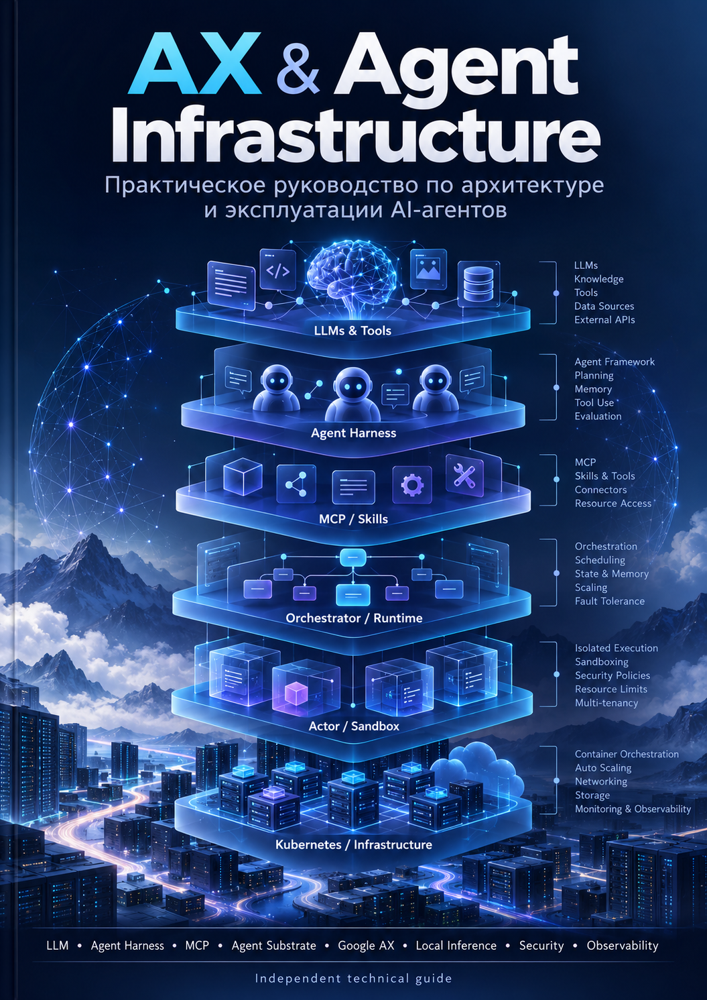

# AX & Agent Infrastructure

**Практическое руководство по архитектуре и эксплуатации AI-агентов.**

Это веб-версия инженерной книги о современной agent infrastructure: от LLM, agent loop и harness до MCP, multi-agent orchestration, sandboxing, Agent Substrate, Google AX, local inference, security и production operations.

Книга рассчитана на системных и сетевых инженеров, SRE/DevOps, архитекторов инфраструктуры, разработчиков agentic-платформ и технических руководителей. Основная перспектива - **как систему развернуть, ограничить, наблюдать, масштабировать и диагностировать**, а не как переписывать внутренний Go-код AX.

## Паспорт издания

| Поле | Значение |
| --- | --- |
| Название | AX & Agent Infrastructure / AX и агентная инфраструктура |
| Назначение | Независимое инженерное руководство по выбору, архитектуре и эксплуатации инфраструктуры AI-агентов |
| Язык и форматы | Русский; исходный HTML, PDF A4 и веб-версия GitBook. Термины API и команды сохранены в оригинале |
| Редакция | Рабочая редакция от 12.10.2026 на основе первого публичного выпуска v1.0.0 от 03.10.2026. Это не новый опубликованный релиз |
| Состав | 44 нумерованные главы (0–43: вводная и 43 основные), 3 приложения (A–C), 42 технические схемы и 14 лабораторных работ в главе 32 |
| Пагинация | Зависит от сборки и вёрстки; число страниц указано в свойствах конкретного PDF. Объём первого выпуска не описывает текущую редакцию |
| Версионная база | Несколько фиксированных профилей, перечисленных в карте главы 0. Версия книги, версия проекта, дата спецификации и commit исходников не взаимозаменяемы |
| Граница проверки | Указанные механизмы сверены с закреплёнными источниками. Лабораторная пара не испытана на работающем стенде; совместимость и production readiness не заявляются |

HTML задаёт текст и названия глав; из него генерируются PDF и Markdown веб-версии. Паспорт и карта версий относятся к одной редакции независимо от формата. Рабочие изменения не считаются опубликованными до отдельного выпуска.

Канонический источник: [репозиторий книги](https://github.com/5UN5H1N3/ax-agent-infrastructure-book). Начните чтение с [главы 0](00-reading-guide.md); точные профили собраны в [карте версий](00-reading-guide.md).

## Как читать

Для последовательного освоения начните с [руководства по чтению](00-reading-guide.md) и двигайтесь по оглавлению. Для эксплуатационной задачи можно сразу перейти к AX, Substrate, security, local inference или troubleshooting.

## Публичная веб-версия

- [Читать книгу в GitBook](https://romandocs.gitbook.io/ax-agent-infrastructure/)

GitBook Git Sync настроен на каталог `docs/` ветки `main`. Публичная версия отражает опубликованную ветку, а не неопубликованные рабочие изменения. Репозиторий остаётся источником материалов.

## Печатная версия

- [PDF](https://github.com/5UN5H1N3/ax-agent-infrastructure-book/blob/main/book/AX_Agent_Infrastructure_Book_RU.pdf)
- [Исходный HTML](https://github.com/5UN5H1N3/ax-agent-infrastructure-book/blob/main/book/AX_Agent_Infrastructure_Book_RU.html)
- [GitHub repository](https://github.com/5UN5H1N3/ax-agent-infrastructure-book)

> Это независимое учебно-техническое издание. Оно не является официальной документацией Google, Google AX, Agent Substrate или других упомянутых проектов.
