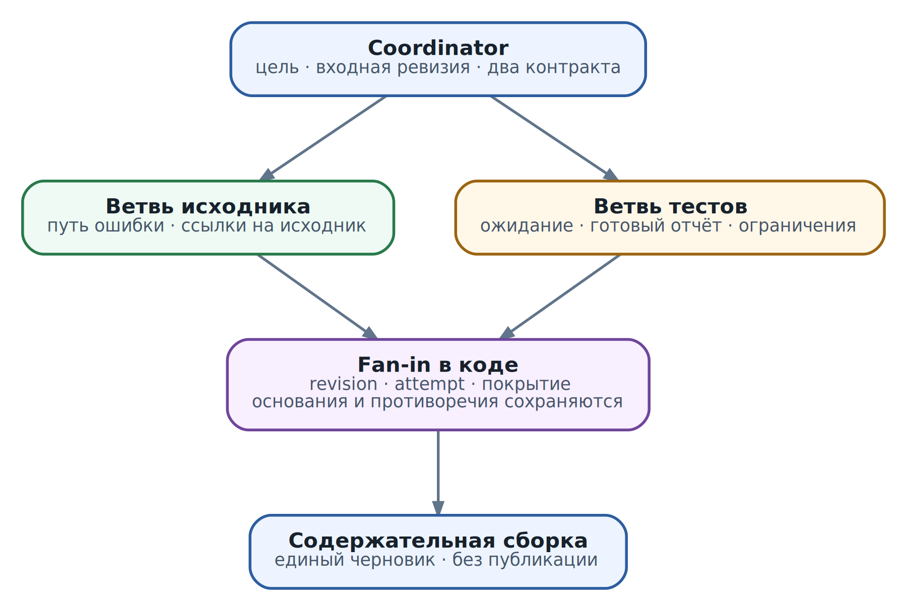

# 7. Multi-agent архитектуры без лишней магии

В главе 6 ревьюер получил два узких инструмента: прочитать файл заданной ревизии и получить готовый отчёт проверки. Он умеет сопоставить код, тест и результат, объяснить ошибку и подготовить комментарий без публикации. Возникает соблазн добавить исследователя, тестировщика и ещё одного ревьюера. Кажется, что команда должна справиться лучше одного участника. Но что именно станет лучше и за счёт чего?

Для нашей функции `total(items)` ответ пока неочевиден. В исходнике есть обращение к `items[0]`, тест ожидает `total([]) == 0`, а отчёт `job-42` сообщает об `IndexError`. Один агент с подходящими инструментами способен разобрать такой случай. Три агента, пересказывающие те же два файла, могут только увеличить время и стоимость. Это не запрет на команду, а важная исходная точка: усложнение должно решать обнаруженную проблему.

Теперь представим, что ревью распространяется на несколько модулей, каждый со своими требованиями и отчётами. Один участник теряет важные детали или слишком долго читает независимые материалы. Здесь разделение уже может помочь. Но вместе с ним появляются новые вопросы: кто раздаёт работу, какую ревизию читают участники, можно ли доверять их выводам и что делать, если один ответ не пришёл?

В этой главе мы построим решение от этих вопросов, а не от списка ролей. Разберём границы агентного цикла, выбор схемы координации, контракт делегирования и сборку результатов. На небольшом локальном опыте увидим, почему два завершённых участника ещё не означают завершённое ревью. К концу главы вы сможете объяснить, где нужен второй агент, где достаточно обычного workflow и какие обязанности всё равно остаются у приложения.

## Что делает систему многоагентной

Агент из главы 4 не просто выдаёт текст. Он получает цель, наблюдает среду через инструменты, выбирает следующий шаг, обновляет рабочее состояние и останавливается по заданным условиям. Если в системе несколько таких циклов со своими задачами и контекстом, а их действия координируются ради общего результата, будем называть её многоагентной, или multi-agent системой.

Терминология продуктов различается. В одном SDK «агентом» может называться даже набор инструкций для одного вызова. Для инженерного решения полезнее смотреть на поведение: кто действительно выбирает действия и кто удерживает состояние между ними. Две строки prompt `researcher` и `reviewer` не создают ни изоляцию, ни самостоятельный жизненный цикл.

Сравним три способа прочитать два файла. Обычная программа вызывает две функции и получает данные. Workflow заранее задаёт шаги «прочитать исходник, прочитать тест, сопоставить ревизии». Агент может сам решить, что после чтения теста ему нужен ещё один документ с требованиями. Несколько агентов добавляют несколько таких мест выбора. Вы получаете гибкость, но должны договориться, как их решения соединяются.

Не каждый параллельный исполнитель обязан быть агентом. Если один worker скачивает отчёт, а другой вычисляет хеш, их проще оставить обычными задачами программы. И наоборот, два самостоятельных цикла могут идти последовательно: параллельность не является обязательным признаком многоагентной системы. Это один из возможных источников её пользы.

### Координатор и инфраструктурный orchestrator

Координатором будем называть прикладного владельца общей цели: он делит задачу, назначает исполнителей и собирает итог. Решения о содержании работы могут предлагаться моделью. Учёт запусков, лимиты, проверку ответов и обязательные переходы лучше закреплять в коде. Поэтому координатор не обязан быть ещё одним полностью автономным агентом.

Инфраструктурный orchestrator решает другие вопросы: где запустить workload, как выделить среду и как управлять её жизненным циклом. Он может знать, что процесс работает, но не понимать, достаточно ли доказательств для ревью. Это то же разделение, которое мы использовали для harness и AX: запуск не равен содержательному успеху.

Далее `child`, или дочерняя задача, означает часть работы, которую координатор делегировал участнику. Это прикладная запись, не обязательно отдельный процесс и не обязательно AX Task. Для одного короткого вызова достаточно локального исполнения; отдельная среда нужна по другим основаниям, к которым мы вернёмся ниже.

## Когда второй агент действительно помогает

Начните с рабочей версии с одним агентом и запишите, что в ней мешает. «Хотим multi-agent» не описывает проблему. «Ревью теряет требования одного из модулей» или «независимые поиски занимают слишком много времени» уже дают проверяемую цель. Без исходной версии, baseline, сравнение легко превращается в впечатление от более длинного ответа.

Разделение обычно обсуждают ради четырёх свойств. Первое - независимый поиск: участники читают разные области и не ждут каждого шага друг друга. Второе - разделение контекста: одному нужен большой корпус требований, другому - трассы тестов, а координатору достаточно проверяемых выводов и ссылок. Третье - разные разрешённые возможности: исследователь только читает, исполнитель работает с кодом в ограниченной среде. Четвёртое - отдельная проверка, которая ищет не подтверждение красивого ответа, а возможную ошибку.

Каждое свойство имеет цену. При разделении контекста можно потерять важную связь между документами. Разные prompts не ограничивают реальные credentials. Проверяющий той же модели, которому показали только уверенный summary автора, способен повторить его ошибку. Отдельное имя роли не создаёт независимость. Её усиливают собственные исходные данные, явные критерии и проверка среды; другая модель также может помочь, но не даёт автоматической гарантии.

Для короткого ревью `total(items)` разумная исходная версия - один агент и детерминированные проверки ревизии. Для нескольких крупных независимых модулей имеет смысл испытать отдельных читателей. Если единственная потребность - ещё раз прочитать тот же вывод, начните с дополнительного шага проверки или теста. Возможно, самостоятельный цикл вообще не понадобится.

Модельная специализация тоже не требует команды. Программа может направлять простую классификацию дешёвой модели, а сложное объяснение - более сильной. Это routing, выбор обработчика. Он становится агентным взаимодействием только там, где участники получают самостоятельную работу и координируют её, а не просто возвращают один ответ.

## Разделяем работу по зависимостям

Перед назначением ролей выпишите, какие результаты нужны для следующего решения. В нашем ревью можно независимо разобрать исходник и прочитать тест с готовым отчётом. Но предложение исправления зависит от обоих: код показывает путь ошибки, тест - ожидаемое поведение. Проверять изменённую ревизию до появления самого изменения нельзя.

Если позже пользователь разрешит исправление, граф будет таким: анализ исходника и анализ тестового контракта сходятся в объяснение; затем один исполнитель готовит изменение; после этого проверяется конкретная новая ревизия. Несогласие аналитиков возвращает нас к уточнению требования, а не разрешает исполнителю наугад выбрать одну версию.

Такой граф для одного прохода удобно представить как DAG, directed acyclic graph, направленный граф без циклов. Он показывает зависимости, а не всю жизнь агента: повторное уточнение или исправление может создавать управляемый цикл между проходами. Наличие цикла не делает систему неправильной; отсутствие условия выхода делает её бесконечной.

### Что означает ускорение на практике

Возьмём условный расчёт, не измерение нашей программы. Подготовка входов занимает 3 секунды, две независимые ветви - 12 и 9 секунд, сборка вывода - 4 секунды. Последовательный проход занимает `3 + 12 + 9 + 4 = 28` секунд. При двух свободных слотах исполнения идеальная параллельная часть занимает 12 секунд; добавим 2 секунды на раздачу и сбор ответов и получим 21 секунду.

Здесь выигрывает только перекрытие ветвей, а не «интеллект команды». Если оба участника стоят в очереди одного перегруженного inference endpoint, их времена могут вырасти и выигрыш исчезнет. Если ветвь на 12 секунд ждёт результат другой, максимум уже не описывает расписание. Полезно смотреть на critical path, критический путь: цепочку зависимостей, которая определяет самое раннее завершение всей задачи.

Закон Амдала выражает похожее ограничение для идеализированной работы. Если доля, которую можно распараллелить, равна `P`, а одинаковых исполнителей `N`, ускорение при фиксированном объёме работы ограничено `1 / ((1 - P) + P / N)`. В агентной системе объём часто меняется: добавляются обсуждение, повторные чтения и новые вызовы модели. Поэтому формула помогает увидеть последовательную часть, но не предсказывает реальную стоимость команды.

Проверьте независимость отдельно по чтению, записи и решению. Два участника могут безопасно читать разные модули, но менять общий файл конфигурации. Их локальные правки независимы по времени, но не по смыслу. Два разных worktrees предотвращают случайную перезапись, однако не устраняют конфликт требований при объединении.

## Как выбрать схему взаимодействия

Топология описывает, кто передаёт работу, куда возвращается результат и кто отвечает пользователю. Названия схем не исключают друг друга: manager может запускать fan-out, а один этап pipeline - содержать цикл проверки. Выбирайте по владению и зависимостям, а не по желанию поместить все известные patterns на одну схему.

### Manager сохраняет ответственность за итог

В схеме manager участники решают ограниченные задачи и возвращают результаты одному владельцу. Пользователь общается с ним, а не собирает ответы самостоятельно. Если специалист представлен как вызываемый инструмент, такую форму часто называют agents-as-tools. За интерфейсом инструмента может скрываться целый цикл поиска; снаружи у него всё равно должны быть ясные вход, результат и пределы.

Для ревью это естественный выбор: специалист по исходнику возвращает объяснение пути ошибки, специалист по тестам - ожидаемое поведение и ограничения отчёта. Manager отвечает за единый черновик. Он не получает право молча отбросить неудобное замечание. Недостаток схемы - центральный узел может неверно разделить цель или исказить результат при пересказе. Структурированные ответы и доступные первичные артефакты уменьшают этот риск, но не отменяют содержательной проверки.

В официальном описании [OpenAI Agents SDK](https://developers.openai.com/api/docs/guides/agents/orchestration) agents-as-tools и handoffs различаются прежде всего владением ответом: в первом случае manager остаётся ответственным за итог, во втором управление переходит специалисту. Это полезное различие независимо от выбранного SDK.

### Fan-out и fan-in разделяют работу и собирают основания

Fan-out означает раздачу независимых ветвей, fan-in - точку их сборки. Manager отвечает на вопрос «кто владеет итогом», а fan-out/fan-in - «как несколько результатов сходятся в следующий шаг». В нашем случае используются обе схемы.

До запуска нужно решить, что считать достаточным набором. Для объяснения пустого ввода обязательны исходник и тестовый контракт. Нельзя заменить второй результат двумя копиями первого. Для широкого исследовательского обзора, напротив, можно допустить неполную выборку, явно назвав отсутствующие области. Это правило сборки будем называть join policy. Оно относится к покрытию задачи, а не к количеству уверенных ответов.

Fan-in не является конкатенацией текстов. Он проверяет привязку к входам, сохраняет источники, выявляет пробелы и передаёт противоречия на разбор. Содержательная сборка может требовать модели, но решение «получены ли все обязательные области» можно проверить обычным кодом.

### Handoff передаёт ведение работы

Handoff полезен, когда специалист должен сам продолжить диалог: например, первичный обработчик обращения передаёт его специалисту по конкретной теме. В отличие от вызова помощника, прежний владелец не обязан собирать каждый ответ и пересказывать его пользователю. Для нашего ревью это обычно лишнее: пользователь ждёт один связный вывод о конкретном коде.

При передаче нужны правила истории, незавершённых действий, возврата и остановки циклов. Не переносите согласие пользователя как универсальное «можно всё»: его область и актуальность проверяются у конкретного действия, как в главе 6. Новый prompt не наследует чужие полномочия сам по себе. Возврат A → B → A без нового факта должен расходовать ограниченный счётчик переходов и приводить к уточнению, а не к бесконечному диалогу.

### Pipeline и evaluator решают разные задачи

Pipeline задаёт стадии: прочитать материалы, подготовить вывод, проверить, передать человеку. Если шаги заранее известны, это часто обычный workflow с несколькими вызовами модели. Нет необходимости добавлять каждому шагу самостоятельное планирование. Отдельный агент нужен, когда стадия должна сама выбирать существенные действия, например искать неизвестные связанные требования.

Generator/evaluator добавляет обратную связь: автор создаёт вариант, проверяющий возвращает конкретные дефекты, controller решает о повторе. Для ревью проверяющий должен видеть исходник, тест и отчёт, а не только авторский вывод. Его критерии: не перепутаны ли ревизии, объяснена ли причина, не выдано ли предложение за проверенное исправление. Фраза «можно улучшить» без дефекта не является основанием для бесконечного повторения. Задайте предел итераций и исход `needs_human`, если спор не разрешён.

Blackboard, общая доска записей, позволяет участникам публиковать находки и брать следующую работу из общего пространства. Peer swarm уменьшает роль централизованного раздатчика. Это может быть полезно при заранее неизвестном поиске, но требует правил присвоения работы, версий, модерации и завершения. Общий чат такими правилами не является. Для нашего ограниченного ревью дополнительные механизмы не дают ясной пользы; начнём с двух ветвей и одного владельца.

## Контракт делегирования связывает цель с результатом

«Посмотри тесты» не говорит участнику, какую ревизию смотреть, надо ли их запускать и когда остановиться. В главе 6 мы уже различили чтение готового отчёта и запуск проверки. Делегирование должно сохранить это различие. Если координатор передал неточную задачу, аккуратно написанный tool не исправит её смысл.

Для ветви тестов зададим учебную запись. Это наш прикладной формат, не manifest AX, не пакет skill и не сообщение A2A:

```
{
  "task_id": "review-demo/tests",
  "parent_id": "review-demo",
  "revision": "demo-fixture-v1",
  "attempt": 1,
  "objective": "Объяснить ожидание для пустого ввода и итог job-42",
  "inputs": ["tests/test_stats.py", "job-42"],
  "non_goals": ["Не запускать код", "Не изменять и не публиковать"],
  "allowed_tools": ["review.read_file", "review.get_check"],
  "budget": {"model_steps": 4, "tool_calls": 4},
  "output_schema": "review-finding-v1",
  "stop_when": "Тест и отчёт сопоставлены либо нужный вход недоступен"
}
```

Метка `demo-fixture-v1` продолжает локальный пример главы 6 и не является Git SHA. В реальной интеграции фиксируйте неизменяемую ревизию репозитория и версии других значимых входов. Идентификатор задачи отвечает на вопрос «какую часть работы назначили», `attempt` - «какую попытку сейчас принимаем». Повтор не должен маскироваться под новую независимую задачу.

Цель должна описывать результат, а не личность участника. Non-goals ограничивают трактовку: читать отчёт не означает заново исполнять чужой код. Условия остановки позволяют вернуть неполный результат, если входа нет. Иначе модель может продолжать поиск, пока не найдёт удобную, но нерелевантную замену.

Передавайте отобранные материалы и ограничения, а не автоматически весь transcript координатора. Полная история может содержать секреты, чужие инструкции и неподходящие предположения. Но чрезмерное сжатие тоже опасно: нельзя удалить требование `total([]) == 0` ради экономии и ждать правильного выбора поведения. Пакет входов должен оставлять участнику всё необходимое для его вопроса и способ запросить недостающее.

### Полномочия не выдаются текстом контракта

Поле `allowed_tools` полезно для конфигурации, но само по себе ничего не запрещает. Harness и реальный executor должны предоставить только указанные операции и проверить разрешённые объекты. Ветви исходника можно дать чтение `src/stats.py`; ветви тестов - чтение `tests/test_stats.py` и отчёта `job-42`. Обеим не нужен инструмент публикации.

Обычно child получает пересечение доступных координатору полномочий, области задачи и решения policy. Делегирование не должно незаметно расширять доступ. Если нужна операция, которой parent не обладает, её выполняет отдельно уполномоченный сервис по своей policy, а не ребёнок, которому передали более широкий token.

Это различие особенно важно при рекурсивном делегировании. Простой способ начать - запретить child создавать новых участников. Если такое создание требуется, лимиты и сужение доступа применяются на каждом уровне. Роль «проверяющий» с admin credential остаётся привилегированным исполнителем, сколько бы раз prompt ни повторял «только проверь».

## Собираем результаты на одном ревью

\
_&#x4D;ulti-agent workflow ревью: одна ревизия, две ветви и проверяемая сборка_

Обе ветви читают одну ревизию. Ветвь исходника объясняет: пустой список не имеет элемента с индексом ноль, поэтому вычисление останавливается до `sum(items[1:])`. Ветвь тестов показывает: тест ожидает ноль, а готовый отчёт сообщает об `IndexError`. Эти результаты дополняют друг друга, но выполняют разные обязанности. Отчёт подтверждает наблюдавшийся сбой; он не доказывает корректность будущего изменения.

После сборки координатор может подготовить черновик: «Ошибка возникает на первом индексировании пустого списка. Тест этой ревизии ожидает ноль, и job-42 подтверждает падение. Предлагаю обработать пустой ввод и проверить изменённую ревизию». Он не должен писать «исправление прошло тесты»: ни изменения, ни новой проверки пока нет. Отсутствие публикации тоже входит в результат задачи, а не является случайной настройкой интерфейса.

### Структурированный ответ сохраняет основания

Ответ ветви исходника в локальном опыте выглядит так:

```
{
  "task_id": "review-demo/code",
  "revision": "demo-fixture-v1",
  "attempt": 1,
  "status": "complete",
  "findings": [{
    "key": "empty_input",
    "value": "raises_IndexError",
    "evidence_refs": ["fixture://files/src/stats.py"]
  }]
}
```

`complete` означает, что участник прислал предусмотренный результат своей ветви, а не что код корректен. `key` обозначает один заранее выбранный вопрос: фактическое поведение для пустого ввода. `value` содержит ответ, `evidence_refs` - ссылки на материалы. Ожидание теста «должен вернуть ноль» - другой вопрос, а не противоречие наблюдению «сейчас падает». В полном ревью отдельно храните наблюдение, требование, вывод и предложение. Здесь формат намеренно сужен до одного фактического утверждения, чтобы ясно увидеть работу сборщика.

Ссылка на источник ещё не доказывает истинность утверждения. Реальный сборщик должен проверить доступность, версию и относимость материалов, а при необходимости повторить наблюдение. Даже действующая ссылка может вести на файл, который не поддерживает написанный вывод. Структура сохраняет возможность проверки; она не заменяет её.

### Локальный опыт проверяет fan-in

В репозитории есть `examples/ch07_coordination_demo.py` и тесты к нему. Программа использует фиксированные данные главы 6, создаёт два заданных ответа и проверяет их сборку. Она не вызывает LLM, не запускает дочерние процессы и не является работающим multi-agent runtime. Такой опыт нужен, чтобы отдельно проверить обязательный код координации, не смешивая его с качеством рассуждений модели.

Сначала `validate_output` сравнивает ответ с доверенной записью задачи. Он отклоняет неверную форму, другого участника, ревизию или попытку, неизвестное значение и ссылку вне разрешённого набора. Успешная проверка формы означает только, что ответ допустим для дальнейшей сборки:

```
def validate_output(contract, output):
    fields = {"task_id", "revision", "attempt", "status", "findings"}
    if not isinstance(output, dict) or set(output) != fields:
        raise ValueError("exact output fields required")
    for key in ("task_id", "revision", "attempt"):
        if type(output[key]) is not type(contract[key]):
            raise ValueError("identity field type mismatch")
        if output[key] != contract[key]:
            raise ValueError("task, revision or attempt mismatch")
    if output["status"] not in ("complete", "partial"):
        raise ValueError("invalid completion status")
    findings = output["findings"]
    if not isinstance(findings, list) or not 1 <= len(findings) <= 8:
        raise ValueError("bounded nonempty findings required")
    for finding in findings:
        if not isinstance(finding, dict) or set(finding) != {
            "key", "value", "evidence_refs"
        }:
            raise ValueError("invalid finding fields")
        if finding["key"] != "empty_input":
            raise ValueError("unknown question")
        if finding["value"] not in ("raises_IndexError", "returns_zero"):
            raise ValueError("unknown observation")
        refs = finding["evidence_refs"]
        if not isinstance(refs, list) or not 1 <= len(refs) <= 8:
            raise ValueError("bounded evidence list required")
        if any(not isinstance(ref, str) or
               ref not in contract["evidence_refs"] for ref in refs):
            raise ValueError("evidence outside contract")
    return findings
```

Контракт здесь создаёт программа, а не принимает из ответа участника. Поэтому нельзя переписать разрешённую ревизию, прислав удобный `contract` вместе с выводом. В распределённой системе также требуется связать сообщение с аутентифицированным отправителем: знание `task_id` не удостоверяет личность.

Второй шаг считает покрытие по обязательным идентификаторам и группирует наблюдения. Он не подсчитывает голоса:

```
def collect(contracts, outputs):
    by_id, claims = {}, {}
    for output in outputs:
        if not isinstance(output, dict):
            raise ValueError("output must be an object")
        task_id = output.get("task_id")
        if not isinstance(task_id, str) or task_id not in contracts:
            raise ValueError("unknown task")
        if task_id in by_id:
            raise ValueError("duplicate output")
        findings = validate_output(contracts[task_id], output)
        by_id[task_id] = output["status"]
        for finding in findings:
            values = claims.setdefault(finding["key"], {})
            refs = values.setdefault(finding["value"], set())
            refs.update(finding["evidence_refs"])
    missing = sorted(set(contracts) - set(by_id))
    partial = sorted(key for key, value in by_id.items()
                     if value == "partial")
    conflicts = sorted(key for key, values in claims.items()
                       if len(values) > 1)
    status = "ready_for_synthesis"
    if missing or partial:
        status = "incomplete"
    elif conflicts:
        status = "unresolved"
    merged = {key: {value: sorted(refs) for value, refs in values.items()}
              for key, values in claims.items()}
    return {"status": status, "missing": missing, "partial": partial,
            "conflicts": conflicts, "claims": merged}
```

`ready_for_synthesis` означает, что обязательные ветви присланы полностью и по нашему одному вопросу нет разных значений. Это не `review_passed`. Программа не определяет, правильно ли выведен `IndexError`, не формирует объяснение и не выбирает исправление. Она лишь не даёт следующему шагу незаметно проигнорировать определённые проблемы координации.

Если одна ветвь неполная и одновременно есть противоречие, итоговый `status` будет `incomplete`, но поле `conflicts` сохранится. Статус - удобная метка для управления, не замена всей записи. В более широкой задаче понадобятся правила семантического объединения, проверка покрытия внутри ветвей и ссылки на неизменяемые артефакты. Общего решения этих вопросов в нескольких десятках строк нет.

Запустите из корня репозитория на Python 3.10 или новее:

```
python3 examples/ch07_coordination_demo.py
python3 -m unittest discover -s examples -p 'test_ch07*.py' -v
```

Первый проход даёт `ready_for_synthesis`. Далее программа показывает `incomplete` при отсутствующей ветви, отказ при чужой ревизии и `unresolved` при разных утверждениях. Все эти сценарии используют заданные ответы. Время работы не измеряет скорость агентов, а число успешных тестов не доказывает качество ревью.

## Разбираем пробелы и противоречия

### Завершение участника и покрытие задачи

Предположим, ветвь тестов не смогла получить отчёт. Она может вернуть `partial`: файл теста прочитан, ожидание известно, результат исполнения не подтверждён. Coordinator не должен подставлять прошлый зелёный job или объявлять полное ревью. Для нашей join policy следующий допустимый шаг - получить нужный отчёт, объяснить ограничение либо спросить пользователя, достаточно ли частичного вывода.

Для исследования по десяти регионам правило может быть другим: показать результаты девяти и назвать отсутствующий регион. Но три успешных ответа не образуют quorum, достаточное число участников, для произвольного вопроса. Кворум реплик с заданными свойствами согласования и большинство текстовых мнений решают разные задачи. Если одна обязательная область отсутствует, количество ответов о соседних областях её не восстанавливает.

Полезно хранить карту покрытия: какая ветвь отвечает за какой вопрос и какие входы обязана рассмотреть. В больших задачах `complete` от самого участника недостаточно; проверяйте его собственные критерии полноты. Наш локальный формат не знает перечня всех функций модуля, поэтому не способен подтвердить полноту большого code review.

### Противоречие нельзя усреднить

Пусть один ответ говорит «для пустого ввода получается `IndexError`», другой - «для пустого ввода возвращается ноль». Оба обозначены как фактическое поведение той же ревизии. Это противоречие. Возможно, участник перепутал исходник с предлагаемым исправлением, либо прочитал другой файл. Нужен различающий шаг: сверить материал по зафиксированной ревизии или выполнить ограниченную воспроизводящую проверку в подходящей среде.

Теперь другой случай: оба участника согласны, что код падает, но спорят, надо ли вернуть ноль или отклонить ввод. Это вопрос требования, а не наблюдения. Наш тест ожидает ноль; если документ с требованиями говорит обратное, тест также может нуждаться в исправлении. Дополнительный запуск того же теста не разрешит противоречие требований. Здесь нужен владелец контракта или уточнение пользователя.

Не заставляйте сборщик всегда выдавать один ответ. `unresolved` бывает правильным результатом. Сохраните разные утверждения, их источники и вопрос, который позволит различить версии. В автоматизации высокого риска честное отсутствие решения полезнее уверенного компромисса без основания.

### Повторённый источник не становится независимым подтверждением

Два аналитика могут прочитать один отчёт `job-42`. Это два прочтения одного наблюдения, не две независимые проверки кода. Сборщик сохраняет источник и может убрать повторяющуюся ссылку, но не должен на основании числа участников повышать достоверность произвольно.

Коррелированная ошибка возникает, когда участники опираются на одинаковую ошибочную предпосылку. Другой prompt или seed не устраняет общий дефект источника. Для ревью полезнее отдельный тест с понятным ожиданием, проверка первичного diff и явный поиск случая, который опровергает вывод. Эти методы также имеют ограничения; независимость - характеристика данных и способа проверки, а не декоративная черта архитектуры.

Исследование [MAST](https://arxiv.org/abs/2503.13657v3) группирует наблюдаемые сбои в проблемы проектирования, рассогласование участников и проверку задачи. Это основание искать дефекты координации, а не приписывать все ошибки слабой модели. Таксономия получена на изученных системах и задачах; она не устанавливает универсальную долю ошибок для вашего приложения.

## Кто владеет изменениями и средой исполнения

Наш текущий режим остаётся read-only. Если позже потребуется исправление, безопаснее начать с одного владельца записи. Аналитики возвращают предложения и основания, исполнитель меняет ограниченный набор файлов, проверяющий читает готовый diff. Публикация остаётся отдельным действием с собственной проверкой согласия и полномочий.

Один общий writable checkout делает даже аккуратных участников зависимыми от времени. Пока tester проверяет файлы, implementer может их изменить; полученный зелёный результат уже относится к неизвестной смеси состояний. Передавайте проверяющему неизменяемый commit или artifact и записывайте, что именно исполнялось. «Проверены последние файлы» не является воспроизводимой привязкой.

Отдельные branches или worktrees полезны для нескольких writers, но не являются полноценной границей безопасности. Они могут оставаться под одним OS user, видеть одни credentials и общий host. Даже без текстового конфликта две правки способны вместе нарушить API. После объединения проверяйте именно объединённую ревизию; тест каждого исходного branch её не удостоверяет.

Sandbox нужен по риску исполняемого кода, а не по названию роли. Запуск package manager или теста чужого PR может исполнить произвольный script. Такому участнику нельзя передавать production secrets или управляющий socket. Следующая глава разберёт process, container, gVisor и microVM; здесь важно увидеть, где логическое разделение должно поддерживаться физическим.

AX может предоставить отдельную Task, Workspace и управление жизненным циклом среды. Но прикладные child IDs, budgets, join policy и итог ревью не появляются от этого автоматически. Не предполагайте также, что любое записанное поле ресурсов уже превратилось в runtime limit: это зависит от зафиксированного профиля реализации. В главе 22 подробно разобраны эти границы. Новую AX Task создают ради нужной границы исполнения или жизненного цикла, а не ради каждого model call.

## Ограничиваем всю работу до запуска ветвей

Лимит каждого участника не является лимитом дерева. Если все пять детей могут создать ещё по пять, количество задач растёт быстрее полезного результата. К этому добавляются повторные попытки после timeout. Поэтому координатор ограничивает одновременно сумму расходов, число созданных задач, глубину делегирования, число активных ветвей и общий срок.

Деньги или tokens и wall-clock deadline учитываются по-разному. Расходы ветвей складываются, а параллельное время перекрывается. Ограничение `max_concurrency=2` означает не «система потратит мало», а «не больше двух ветвей исполняются одновременно». Если модельный сервис допускает только один запрос, полезен отдельный лимит model calls, даже когда живых процессов больше.

### Резерв оставляет место для сборки и проверки

Предположим, осталось 20 000 tokens, а 4 000 нужны для сборки, объяснения и проверки. На все дочерние задачи вместе можно зарезервировать не больше 16 000. Две ветви с резервом по 6 000 оставляют ещё 4 000 для непредвиденного уточнения. Это пример учёта, не рекомендуемый размер контекста или обещание качества.

Для каждого аддитивного ресурса действует правило:

```
сумма активных резервов children
    <= остаток общего бюджета - резерв координатора
```

Резервирование должно быть атомарным относительно конкурирующих запусков. Проверка «денег ещё хватает» перед двумя одновременными spawn без общей записи может пропустить оба, хотя вместе они превышают лимит. Лимиты в prompt не заменяют admission control, проверку допуска в коде перед запуском.

После подтверждённого завершения неиспользованный резерв можно освободить, учтя фактический расход. При потерянной связи расход может оставаться неизвестным. Нельзя автоматически вернуть весь резерв и запустить замену, пока старый участник потенциально продолжает работу. Уточните его состояние или сохраняйте консервативный учёт. Финальный `failed` не означает, что модельные вызовы были бесплатны.

### Очередь должна ограничивать давление на сервисы

Backpressure, обратное давление, означает, что медленный downstream ограничивает поступление новой работы. Ограниченная очередь и семафор model calls часто полезнее бесконечного создания процессов. Если inference endpoint недоступен, новые агенты не создают новых оснований; они создают retry storm.

Задайте повтор с задержкой и пределом, а при общей повторяющейся причине временно прекращайте новые обращения. Такой выключатель называют circuit breaker. Не путайте ошибку одной гипотезы с системной недоступностью инструмента: в первом случае может помочь другая ветвь исследования, во втором она попадёт в ту же неисправную зависимость.

## Повторы отмена и восстановление

Состояние координации храните отдельно от человеческого пересказа: какая работа назначена, какой вход ей выдан, какой резерв занят, какая попытка активна и где находится результат. Progress «почти закончил» помогает оператору, но не должно переводить root в успех. Completion «готово» тоже сначала требует проверки артефакта.

Для восстановления нужен стабильный logical child ID, связанный с общей задачей, версией её разбиения и областью работы. Номер попытки изменяется при повторе; связь с той же логической частью сохраняется. Одного детерминированного имени недостаточно: хранилище и dispatcher должны обеспечивать уникальное создание или поиск существующей записи.

### Поздний ответ не должен переписать новую попытку

Первый участник перестал отвечать. Координатор запустил вторую попытку, а затем получил запоздавший успех первой. Если принимать только по `task_id`, старый ответ может заменить свежий. Наш локальный validator поэтому сравнивает `attempt` с доверенным контрактом. Реальный journal также должен атомарно проверить активную попытку и версию записи при сохранении результата.

Lease, временное право владения работой, помогает обнаружить потерянного исполнителя, но истечение срока не доказывает его остановку. Старый процесс может проснуться после паузы. Fencing token, монотонный номер владения, позволяет принимающей стороне отклонять действия прежнего владельца. Если внешний API такой проверки не поддерживает, право на запись нельзя безопасно восстановить только локальным lease; нужны сверка и иной контракт исполнения.

### Отмена не является откатом

Cancellation сначала выражает намерение: больше не нужно продолжать работу. Состояние `cancel_requested` полезно держать отдельно от подтверждённого `cancelled`. Участник может ещё находиться внутри запроса или успеть записать результат. Остановка процесса не удалит уже опубликованный комментарий и не вернёт деньги за выполненные model calls.

Для чтения повтор часто допустим, если закреплены версия и пределы. Для внешней записи после timeout сначала нужно выяснить исход: operation ledger и сверка целевой системы, как в главах 5 и 37. Повторный child с прежним ID не делает его git push или API write идемпотентным. Ключ дедупликации должен поддерживаться там, где происходит эффект, либо повтор остаётся потенциально опасным.

После restart координатор не запускает дерево с нуля. Он читает journal, принимает проверенные результаты, присоединяется к ещё работающим задачам, разруливает неизвестные исходы и только затем повторяет действительно недостающую работу. Правила объединения и резервов также должны переживать restart. Наш опыт хранит данные лишь в памяти и этой гарантии не даёт.

## Как выбрать средства реализации

Начните не с рейтинга frameworks, а с вопроса, какое поведение вам нужно закрепить. Для двух фиксированных чтений достаточно обычных функций, проверки результатов и, при необходимости, ограниченного параллельного исполнения. SDK нужен, когда вы действительно управляете агентными циклами. Durable workflow engine, движок устойчивого выполнения, нужен по требованиям к долгому ожиданию и восстановлению, а не по числу персонажей.

| Требование                              | Возможная отправная точка           | Что остаётся вашей обязанностью                             |
| --------------------------------------- | ----------------------------------- | ----------------------------------------------------------- |
| Несколько заранее известных шагов       | Обычный код или небольшой workflow  | Версии входов, ошибки, допустимость действий                |
| Вызов специалистов или передача диалога | Agents SDK с tools и handoffs       | Область доступа, общий budget, проверка результата          |
| Явный граф с состоянием и паузами       | LangGraph с настроенным persistence | Семантика состояния, хранилище, безопасные повторы          |
| Долгое выполнение с устойчивой историей | Temporal и внешние Activities       | Идемпотентность эффектов, границы retries, модельные вызовы |
| Независимый удалённый agent service     | Зафиксированная версия A2A          | Доверие, доступ, evidence и прикладная join policy          |

Это архитектурные варианты для испытания, а не обещание взаимозаменяемости. [LangGraph](https://docs.langchain.com/oss/python/langgraph/overview) поддерживает графы со смесью детерминированных и агентных шагов и механизмами сохранения состояния. Нужно выбрать и настроить хранилище; сохранённый checkpoint не превращает внешний write в однократный эффект.

[Temporal](https://docs.temporal.io/workflow-execution) использует историю событий и replay для восстановления workflow. Нестабильные внешние обращения, включая model calls, выносят в [Activities](https://docs.temporal.io/activities), а не заново исполняют при воспроизведении детерминированного workflow. Это иной уровень обязательств и эксплуатации, чем добавить второй prompt. Возможный повтор Activity требует продуманного контракта внешней операции.

MCP из главы 6 подключает инструменты и данные. A2A предназначен для взаимодействия с агентным сервисом, внутренние шаги которого клиенту могут быть не видны. Эти механизмы могут работать вместе, но ни один не решает за приложение, кому верить и достаточно ли полученного результата. В этой книге профиль [A2A 0.3.0](https://a2a-protocol.org/v0.3.0/specification/) рассматривается как конкретная версия, не как заявление о самой новой. Её запрос отмены также не гарантирует успешную остановку. Наши поля `attempt`, `evidence_refs` и `ready_for_synthesis` не являются полями или статусами этой спецификации.

Для короткого локального ревью не нужно устанавливать все эти средства. Сначала реализуйте понятные границы и негативные случаи. Затем переносите проверенный контракт в выбранную библиотеку и отдельно испытывайте её сохранение состояния, повторы, отмену и совместимость. Архитектура должна оставаться объяснимой без названий продуктов.

## Как проверить полезность команды

Сравните версию с одним агентом, фиксированный workflow и выбранную многоагентную схему на одних заданиях. Дайте им одинаковые tools, исходные ревизии и критерии. Бюджеты либо уравняйте, либо явно покажите разницу. Если команда читает больше материалов и расходует больше tokens, её лучший ответ ещё не доказывает преимущество самого разделения.

Для ревью критерии качества можно сделать конкретными: найден путь ошибки, правильно установлено ожидаемое поведение, вывод связан с нужной ревизией, неполный отчёт не выдан за полный, публикация без согласия не произошла. Проверяйте как ложные замечания, так и пропущенные дефекты. Оценка одного красивого transcript особенно плохо показывает редкие сбои координации.

Время измеряйте от запроса пользователя до проверенного результата, включая очереди, повторные попытки и сборку. Стоимость одного подтверждённого результата считайте с расходами на неуспешные проходы, а долю успеха показывайте отдельно. Иначе система может выглядеть дешёвой только потому, что сложные задачи исключили из отчёта.

Помимо итогового качества наблюдайте время ожидания обязательной ветви, дублирование работы, пробелы покрытия, устаревшие ответы, число передач и задержку отмены. Root ID должен связываться с child ID, номером попытки, версией конфигурации, входами, tool calls и артефактом. Не обязательно сохранять все секретные тексты в trace; нужны безопасные идентификаторы и доступные уполномоченному оператору основания.

Полезен ablation, контрольное исключение компонента. Запустите ту же схему без параллельного исполнения, без дополнительного проверяющего или с фиксированной вместо динамической декомпозицией. Если качество не меняется, дополнительный механизм пока не оправдан для этого набора. Не распространяйте вывод на все задачи. [Опыт multi-agent research Anthropic](https://www.anthropic.com/engineering/multi-agent-research-system) показывает пользу разделения для широкого поиска, но также подчёркивает расходы и трудности координации. Он не является измерением скорости нашего ревьюера.

Отдельно проведите fault injection: недоступный обязательный вход, повторное сообщение, поздний ответ старой попытки, restart координатора и потерянный ответ после внешней записи. Эти проверки нужны даже если все участники используют сильную модель. Модель не может исправить сборщик, который по ошибке принимает два ответа одной ветви за полное покрытие.

## Практикум от одного ревью к нескольким модулям

Сначала выполните локальный опыт. Удалите ответ ветви тестов и объясните, почему итог неполный. Измените ревизию и номер попытки: оба должны привести к отказу, но по разным причинам. Затем добавьте другой вывод о фактическом поведении и убедитесь, что исходное основание не потерялось при обнаружении конфликта. Попробуйте заменить ссылку на неизвестную: сборщик не должен принять её только из-за знакомого слова `fixture`.

После этого спроектируйте ревью трёх независимых модулей, не меняя реальный репозиторий. Нарисуйте зависимости, запишите вопрос и non-goals каждой ветви, укажите обязательное покрытие. Решите, кому действительно нужен собственный цикл поиска, а где хватит чтения заранее известных файлов. Оставьте одну точку подготовки итогового объяснения.

Теперь пользователь разрешает предложить исправление, но не публиковать. Назначьте одного владельца записи и объясните, какую неизменяемую ревизию получит tester. Если два исполнителя меняют разные файлы, но общий API, назовите проверку после объединения. Наличие worktree не является ответом на вопрос о совместимости правок.

Наконец, добавьте restart и поздний ответ. Какие записи надо сохранить до запуска child? Как отличить повтор от новой области работы? Когда можно освободить резерв? Если ответ на неизвестный исход внешней записи звучит как «создать ещё одного агента», контракт восстановления ещё не закончен.

Проверьте себя: можете ли вы объяснить отказ от multi-agent для короткого `total(items)` и условие, при котором вернулись бы к разделению? Почему manager и fan-out совместимы, а handoff меняет владельца? Чем тестовое ожидание отличается от наблюдаемого поведения? Что означает `ready_for_synthesis` и чего оно не подтверждает? Ответы на эти вопросы важнее запоминания названий схем.

## Итоги главы

Многоагентная система полезна не количеством ролей, а конкретным разделением работы, контекста, возможностей и проверки. Начинайте с одного рабочего агента и проблемы, которую можно измерить. Стройте зависимости до запуска участников и не делегируйте модели операции, которые проще и надёжнее закрепить в коде.

Делегирование требует понятных входов, границ, результата и остановки. Сборка проверяет версии и обязательное покрытие, сохраняет основания и не заменяет противоречие голосованием. Даже полный допустимый набор ответов ещё требует содержательной оценки. Результат участника, итог всей задачи и состояние инфраструктуры - разные вещи.

Надёжность команды опирается на обычные инженерные механизмы: владельца записи, устойчивые идентификаторы, учёт резервов, проверку попыток и сверку неизвестных эффектов. SDK, MCP, A2A и AX могут помочь с отдельными слоями, но не создают отсутствующие гарантии. В следующей главе свяжем логические границы участников с физической изоляцией исполнения и разберём, почему отдельный prompt не защищает host от чужого кода.

### Источники и дальнейшее чтение

* [OpenAI Agents SDK Orchestration and handoffs](https://developers.openai.com/api/docs/guides/agents/orchestration) - различие владения ответом при вызове специалистов и передаче управления.
* [Anthropic Building effective agents](https://www.anthropic.com/engineering/building-effective-agents) - различие workflows и agents, параллельные ветви и цикл evaluator.
* [Anthropic How we built our multi-agent research system](https://www.anthropic.com/engineering/multi-agent-research-system) - опыт широкого поиска, делегирование, расходы и эксплуатация.
* [Cemri et al. Why Do Multi-Agent LLM Systems Fail v3](https://arxiv.org/abs/2503.13657v3) - наблюдаемые категории сбоев MAST и область исследования.
* [LangGraph overview](https://docs.langchain.com/oss/python/langgraph/overview) - графы, агентные и детерминированные шаги, persistence.
* [Temporal Workflow Execution](https://docs.temporal.io/workflow-execution) и [Activities](https://docs.temporal.io/activities) - история, replay и граница внешних операций.
* [A2A Protocol Specification 0.3.0](https://a2a-protocol.org/v0.3.0/specification/) - взаимодействие с удалёнными агентами и запрос отмены.
* Главы 8, 22, 24, 33 и 37 - физическая изоляция, реализация делегирования на AX, полномочия, полные архитектуры и внешние действия.
