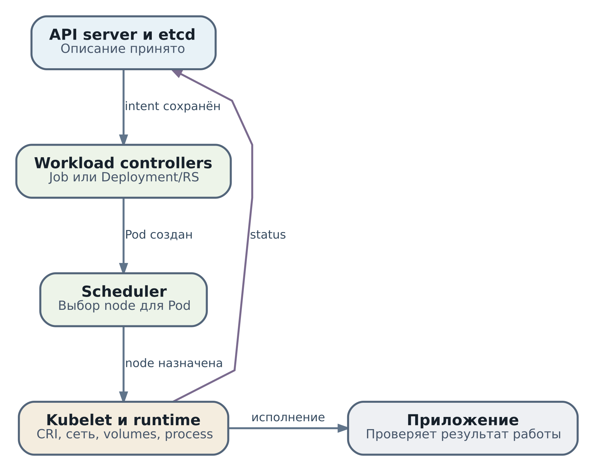

# 9. Kubernetes: необходимый минимум для понимания AX/Substrate

В главе 8 мы выбрали условия исполнения внешних тестов: отдельная среда, подготовленный вход, отсутствие сети и credentials координатора. Теперь представим, что конфигурация принята кластером, а отчёта всё нет. В таблице Pods написано `Pending`. Что делать: добавить CPU, исправить image, переустановить gVisor или проверить код теста? Пока у нас только одно слово, обоснованного ответа нет.

Kubernetes нужен инженеру прежде всего для такого разбора. Он связывает описание работы с её размещением, запуском, сетью и хранилищем. При этом он не понимает, насколько хорош ответ модели и завершено ли ревью. Наша задача - научиться читать цепочку исполнения, выбирать подходящий способ управления процессами и находить участок, на котором намерение перестало превращаться в результат.

Дальше мы будем возвращаться к проверке `total(items)` и `test_empty_list`. Учебный Job из главы 8 остаётся примером отдельного запуска теста; его не нужно путать с AX Task или Actor Substrate. Сначала разберём общие механизмы Kubernetes для Linux-кластера, затем покажем их действительное место в закреплённых версиях AX и Substrate. Практический разбор можно выполнить локально на искусственных наблюдениях, без кластера.

## Что читатель сможет сделать после главы

* Объяснить путь от принятого YAML до процесса и найти ответственный компонент.
* Различить имя ресурса, UID конкретного экземпляра и идентификатор прикладной задачи.
* Выбрать Deployment, StatefulSet, DaemonSet или Job по требуемому жизненному циклу.
* Рассчитать заявку на ресурсы и понять, почему свободный CPU не гарантирует размещение.
* Прочитать probes, Service и volumes как конкретные условия работы, а не набор обязательных полей.
* Отделить готовность Pod от готовности Worker, Actor и результата теста.
* Провести диагностический разбор, сохраняя наблюдения и не меняя кластер наугад.

## Что Kubernetes добавляет к запуску контейнера

На одной машине достаточно запустить контейнер и наблюдать за ним. Когда машин несколько, появляются новые вопросы: кто выберет место, кто создаст замену после сбоя, как клиент найдёт новый адрес, как подключить диск и как не дать одному процессу занять всю площадку. Kubernetes предоставляет общий API и набор согласующих эти действия механизмов.

Слово **кластер** здесь означает совместно управляемые машины и управляющие компоненты. Машина, на которой исполняются Pods, называется **node**, или узлом. Управляющая часть - **control plane** - хранит описания ресурсов и принимает решения об их жизненном цикле. Компоненты узла воплощают решения в процессы. В небольшой установке роли могут размещаться рядом, но их обязанности всё равно различаются.

Kubernetes оправдан, когда нужна общая площадка для множества сервисов, предсказуемое размещение, обновления и единые политики. Для одной собственной утилиты на одной машине сервисный менеджер или обычный контейнер часто проще. Если выбранная платформа требует Kubernetes, как Substrate в рассматриваемой архитектуре, он становится частью её эксплуатационной стоимости: нужны обновления, резервное копирование управляющего состояния, наблюдаемость и компетенции команды. Наличие кластера не отменяет эти работы.

### Намерение вместо разовой команды

Команда shell «запусти процесс» описывает действие. Объект Deployment с `replicas: 2` описывает сохраняемое намерение: поддерживать два экземпляра сервиса. После завершения клиента это намерение остаётся в API. Контроллеры снова и снова сравнивают его с наблюдаемым состоянием и делают следующий шаг. Такой процесс называется **reconciliation**, или согласованием желаемого и наблюдаемого состояния.

Например, Deployment controller управляет ReplicaSets, а ReplicaSet controller создаёт недостающие Pods. Удаление одного управляемого Pod не отменяет намерение владельца: может появиться замена. Это полезно при случайной потере экземпляра, но объясняет, почему «удалил Pod, а он вернулся» не является загадочным поведением. Для изменения намерения нужно работать с владельцем, а не только с его дочерним процессом. [Controllers](https://kubernetes.io/docs/concepts/architecture/controller/)

Контроллер не волшебный ремонтник. Если образ отсутствует в registry, повторное согласование не создаст его. Если ни один узел не удовлетворяет требованиям, новый Pod останется без места. Механизм поддерживает попытки привести систему к заданному состоянию; достижимость этого состояния зависит от ресурсов, конфигурации и внешних сервисов.

## Путь от API до процесса

Удобно разделить путь на принятие описания, размещение и локальное исполнение. Так становится ясно, какие свидетельства искать на каждом участке.

\
_&#x41F;уть обычного Job или Deployment: принятие, размещение, исполнение и отдельная проверка результата. Стрелки показывают этапы, не прямые RPC_

`kube-apiserver` - вход в Kubernetes API. Он проверяет полномочия, формат и допустимость запроса, применяет предусмотренные defaults и admission-механизмы. Принятые объекты хранятся через `etcd`, распределённое хранилище управляющего состояния. API server не запускает приложение. Ответ о создании объекта означает принятие описания, а не готовность процесса.

`kube-controller-manager` запускает встроенные контроллеры, которые наблюдают объекты и управляют зависимыми ресурсами. Внешний operator может добавлять собственные контроллеры. `kube-scheduler` ищет подходящий узел для ещё не назначенного Pod и фиксирует назначение. Он не переносит живой процесс между машинами. [Kubernetes components](https://kubernetes.io/docs/concepts/overview/components/)

На назначенном узле `kubelet` согласует состояние Pod с локальным исполнением. Через **CRI**, Container Runtime Interface, он обращается к container runtime, например containerd. Runtime подготавливает окружение Pod и контейнеры. **CNI**, Container Network Interface, используется сетевой реализацией для подключения окружения к сети; **CSI**, Container Storage Interface, применяется драйверами хранения для поддерживаемых операций с томами. Это точки интеграции, а не одна встроенная реализация сети и дисков.

Представьте, что scheduler уже выбрал узел, но registry недоступен. Назначение состоялось, исполнения ещё нет. Или контейнер работает, но приложение не прошло readiness. Локальный запуск состоялся, полезный сервис ещё не готов. Из цепочки сразу следует порядок вопросов: объект принят? дочерний Pod создан? место назначено? окружение подготовлено? приложение доступно? результат относится к нужной попытке?

## Как читать объект и не спутать экземпляры

YAML - текстовое представление объекта API, а не сценарий, который выполняется сверху вниз. `apiVersion` и `kind` выбирают тип и схему. `metadata` содержит имя, namespace, UID, labels и другие сведения. `spec` задаёт желаемые свойства. `status` содержит наблюдения компонентов, а не обещание автора YAML.

**Namespace** задаёт область имён и удобную область применения многих политик. Можно иметь `platform-api` в двух namespaces, не получая один и тот же ресурс. Некоторые ресурсы, например Node и RuntimeClass, относятся ко всему кластеру. Namespace сам по себе не разделяет ядро, диски узла и все сетевые пути. Здесь продолжает действовать модель угроз главы 8.

### Имя ресурса и UID

Имя нужно для обращения к ресурсу, UID - для различения конкретного экземпляра. Удалённый Pod можно заменить новым с тем же именем, но новым UID. Поэтому журнал вида «ошибка в `worker-0`» недостаточен, если запись пережила замену этого Pod. Нужны namespace, имя, UID и время наблюдения; для прикладной работы дополнительно нужны Task, Actor и attempt ID. [Object Names and IDs](https://kubernetes.io/docs/concepts/overview/working-with-objects/names/)

**Labels** - метки для выбора и группировки. Selector Service или контроллера выбирает ресурсы по ним. **Annotations** подходят для дополнительной метаинформации, не предназначенной для обычного выбора. **Owner references** связывают дочерний ресурс с владельцем и участвуют в сборке мусора. Метка `task=job-42` помогает искать, но не делает Pod частью корректной модели владения и не доказывает подлинность результата.

### Версия намерения и версия записи

У Deployment `metadata.generation` помогает различать версии желаемой конфигурации, а `status.observedGeneration` показывает, какую версию наблюдал контроллер. Если generation уже изменилась, старые conditions нельзя молча приписать новой конфигурации. `metadata.resourceVersion` относится к версии записи API и используется в механизмах чтения, watch и конкурентных обновлений. Значение передают обратно API без изменения; допустимые сравнения зависят от типа API и гарантий его версии. Это не прикладной счётчик завершённых работ. [API concepts](https://kubernetes.io/docs/reference/using-api/api-concepts/)

Не переносите эти поля автоматически в другие API. У AX `ac233282` нет Kubernetes-полей `generation/resourceVersion/observedGeneration`; Actor metadata Substrate использует собственные `uid/version`. Kubernetes-подобный стиль описания не делает оба проекта Kubernetes API. Это различие пригодится в главе 10, где версии и повторы станут частью проектирования операций.

## Pod и выбор способа управления работой

**Pod** - группа совместно размещённых контейнеров и общих ресурсов Kubernetes. Контейнеры обычного Pod используют общую сетевую область и могут общаться через `localhost`; тома подключаются к тем контейнерам, которым они явно смонтированы. Это удобно для тесно связанных процессов, но не означает, что любой контейнер автоматически видит любой filesystem соседнего.

Обычные init containers выполняют подготовку до основных контейнеров. Sidecar обслуживает тесно связанную функцию рядом с приложением: proxy, доставку данных или telemetry. Общая сеть, выданные volumes и credentials требуют анализа доверия. Вынести недоверенный тест во второй контейнер того же Pod - не то же самое, что отделить его от полномочий координатора. Особенности native sidecar lifecycle зависят от версии и конфигурации кластера; здесь не требуется строить на них учебный пример.

Самостоятельный Pod не обеспечивает весь жизненный цикл сервиса. При потере узла или удалении такого объекта за ним может не стоять владелец, который создаст замену. Обычно выбирают workload controller - механизм, который управляет набором Pods по нужной семантике.

| Потребность                                             | Средство    | Почему подходит                                                  | Что остаётся за приложением                                     |
| ------------------------------------------------------- | ----------- | ---------------------------------------------------------------- | --------------------------------------------------------------- |
| Взаимозаменяемые экземпляры API                         | Deployment  | Поддерживает replicas и обновляет Pod template через ReplicaSets | Совместимость версий, внешнее состояние и безопасность повторов |
| Стабильное имя экземпляра и отдельный persistent volume | StatefulSet | Сохраняет ordinal identity и связь экземпляра с claims           | Репликация данных, backup и предотвращение двух владельцев      |
| Компонент на каждом подходящем узле                     | DaemonSet   | Число Pods следует за набором узлов                              | Права узлового компонента и его восстановление                  |
| Конечный запуск теста или batch                         | Job         | Учитывает успешное завершение и управляет попытками              | Проверка результата и идемпотентность внешних действий          |
| Периодическое создание batch-работ                      | CronJob     | Создаёт Jobs по расписанию                                       | Пропуски, повторы и строгая бизнес-периодичность                |

### Deployment и StatefulSet выбирают по identity

Если экземпляр `platform-api` можно заменить любым другим, состояние находится во внешнем store, а запросы обрабатываются независимо, Deployment естественен. Но `replicas: 2` ещё не означает высокую доступность: оба Pod могут оказаться на одном узле, а оба процесса - зависеть от одной недоступной базы. Rolling update не проверяет совместимость database schema и не откатывает изменения данных. [Deployments](https://kubernetes.io/docs/concepts/workloads/controllers/deployment/)

StatefulSet нужен, когда приложению важна устойчивая роль экземпляра: например, `store-0` и его собственный диск. Новый Pod с этим именем всё равно имеет новый UID; стабильная роль не означает непрерывность процесса. StatefulSet не превращает три независимых диска в реплицированную базу. Если база требует quorum, восстановления и безопасных upgrades, это обеспечивает сама база и её operator, либо managed service. [StatefulSets](https://kubernetes.io/docs/concepts/workloads/controllers/statefulset/)

DaemonSet выбирают не потому, что сервис «важный», а потому, что его функция привязана к узлу: сетевой агент, сборщик node logs, runtime integration. Когда нужен просто пул из десяти исполнителей независимо от количества nodes, эта семантика может не подходить. [DaemonSet](https://kubernetes.io/docs/concepts/workloads/controllers/daemonset/)

### Почему тест из главы 8 показан как Job

Тест имеет конечный результат: выполнить подготовленную работу и завершить процесс. Для отдельной Kubernetes-реализации Job подходит лучше Deployment, который поддерживал бы сервис после завершения. В учебном Job `restartPolicy: Never` не перезапускает завершившийся контейнер внутри того же Pod, `backoffLimit: 0` отключает обычные повторные попытки после учтённой ошибки, а deadline ограничивает ожидание работы. TTL задаёт уборку объекта после завершения, не срок исполнения теста.

Даже при одном completion и одной параллельной работе Job не обещает exactly-once запуск. Потеря связи с узлом или другие сбои могут привести к повторному исполнению; удаление записи не доказывает, что старый процесс уже остановлен. Поэтому операция, публикующая результат, должна различать попытки и защищаться от повторов. `Succeeded` означает успешное завершение процессов по правилам Pod, не содержательную правильность отчёта. [Jobs](https://kubernetes.io/docs/concepts/workloads/controllers/job/)

Наш `job-42` - учебное обозначение работы, а `demo-fixture-v1` - ревизия фиксированных материалов, не настоящий Git SHA. Получатель всё ещё должен проверить связь отчёта с `test_empty_list` и нужным входом. Kubernetes может правильно завершить неправильный тест. Это не отказ оркестратора: критерий результата принадлежит приложению.

## Размещение и ресурсы

### Scheduler считает заявки на конкретном узле

**Request** - заявка контейнера на ресурс. Scheduler использует её вместе с ограничениями размещения. **Allocatable** - объём узла, доступный Pods после предусмотренных резервов. Это не текущая свободная память из `top`. Уже размещённые заявки занимают место в модели scheduler даже тогда, когда процессы временно почти не работают.

Пусть учебный узел имеет allocatable `4000m` CPU и `8192Mi` памяти. Другие Pods уже запросили `3400m` и `7168Mi`. Для новой работы с request `500m` и `256Mi` и условным runtime overhead `100m` и `128Mi` эффективная заявка будет `600m` и `384Mi`. Она ровно помещается по CPU и оставляет `640Mi` памяти. Если CPU request увеличить до `700m`, с тем же overhead получится `800m`: на узле осталось только `600m`, размещение не проходит. Низкая фактическая загрузка не изменяет этого расчёта.

Числа здесь придуманы для арифметики, не измерены для gVisor или microVM. Реальный расчёт учитывает init containers, sidecars, расширенные ресурсы, overhead и правила конкретной версии. Ресурсы должны поместиться **на одном допустимом узле**: суммарные свободные `600m` на двух разных nodes не превращаются в один подходящий слот. CPU в `m` означает millicores: `1000m` - один CPU; `Mi` и `Gi` - двоичные единицы памяти.

### Заявка и ограничение решают разные задачи

**Limit** задаёт ограничение исполнения. На Linux CPU limit обычно приводит к throttling, а memory limit может привести к OOM kill; применение идёт через kubelet, runtime и kernel cgroups. Request не является жёстким потолком: при наличии ресурсов контейнер может потреблять больше него. Limit сам по себе не обещает ресурсы на узле. Если задан limit без request, Kubernetes при отсутствии другого admission-default обычно копирует limit в request. [Resource management](https://kubernetes.io/docs/concepts/configuration/manage-resources-containers/)

Для теста CPU limit помогает ограничить влияние на соседей, но способен увеличить длительность проверки. Для сервиса с чувствительной latency жёсткий CPU ceiling требует отдельного измерения throttling. Memory limit выбирают по рабочему набору и пикам, а не по желанию уменьшить цифру в YAML. Причину `OOMKilled` сопоставляют с состоянием контейнера, метриками и давлением памяти на node.

`ephemeral-storage` ограничивает учитываемое временное хранение; это не универсальная синхронная файловая квота. Переполнение может обнаруживаться с задержкой и вести к eviction. `emptyDir` в памяти расходует память, а не просто бесплатное место. PID budget на узле задаётся механизмами kubelet/runtime, не произвольным `limits.pids` в container resources. Эти ограничения продолжают ресурсный профиль главы 8.

ResourceQuota ограничивает потребление и количество определённых ресурсов в namespace, LimitRange может задавать defaults и границы requests/limits. Quota способна остановить создание ресурса ещё до scheduling; она не добавляет capacity и не гарантирует равномерное размещение. Когда Job принят, но дочерний Pod не появился, изучите status и Events владельца: причина может быть в admission или quota, а не в scheduler.

### Требования к узлу и защита пула

`nodeSelector` и required node affinity задают обязательные свойства узла. Preferred affinity задаёт предпочтение, которое допускается не выполнить. Taint `NoSchedule` не позволяет обычным неподходящим Pods занимать узел; toleration разрешает рассмотреть его, но не притягивает к нему работу. Для выделенного пула обычно нужны обе стороны: выбор нужного набора nodes и защита его от чужой работы. [Assigning Pods](https://kubernetes.io/docs/concepts/scheduling-eviction/assign-pod-node/), [Taints and tolerations](https://kubernetes.io/docs/concepts/scheduling-eviction/taint-and-toleration/)

Назначенная вручную `spec.nodeName` обходит обычный выбор scheduler, поэтому её нельзя использовать как штатный способ «починить Pending». Она способна обойти проверку `NoSchedule` и разрушить задуманный процесс размещения. Для защиты от недоверенных manifests нужны ограничения admission и права, а не надежда, что автор выберет подходящие labels.

Anti-affinity и topology spread помогают разнести replicas по узлам или зонам. Жёсткое разнесение при недостатке подходящих nodes оставит Pod Pending; мягкое повышает доступность запуска ценой возможного общего отказа. Priority и preemption помогают получить место за счёт менее приоритетной работы, но не добавляют физических ресурсов и не лечат несовместимый runtime.

### RuntimeClass связывает Pod с настроенным CRI handler

Для обычного Kubernetes Job из главы 8 поле `runtimeClassName: review-gvisor` выбирает заранее настроенный RuntimeClass. Он ссылается на handler CRI, а его scheduling-настройки могут добавлять требования к узлам и tolerations. RuntimeClass не устанавливает `runsc`, не проверяет совместимость toolchain и сам по себе не решает, кто имеет право выбрать этот класс. [RuntimeClass](https://kubernetes.io/docs/concepts/containers/runtime-class/)

Следующий эскиз продолжает имя из главы 8. `runsc` здесь - условное имя handler, которое администратор должен сопоставить с фактической конфигурацией CRI; label и taint тоже должны реально существовать на проверенных nodes. Это не manifest установки Substrate:

```
apiVersion: node.k8s.io/v1
kind: RuntimeClass
metadata:
  name: review-gvisor
handler: runsc
scheduling:
  nodeSelector:
    sandbox.example/profile: review-gvisor
  tolerations:
  - key: sandbox.example/dedicated
    operator: Equal
    value: review
    effect: NoSchedule
```

Если runtime добавляет существенные затраты, RuntimeClass `overhead.podFixed` позволяет учесть их при admission и scheduling. В эскизе overhead не указан: без измерения нельзя выдавать придуманную цифру за характеристику среды. В рабочей конфигурации следует задать измеренные значения и проверить, как они влияют на capacity. [Pod Overhead](https://kubernetes.io/docs/concepts/scheduling-eviction/pod-overhead/)

## Готовность процесса и доступность сервиса

### Phase не является заключением о здоровье

`Pending` охватывает больше, чем ожидание scheduler: Pod уже может иметь node, но ждать image или подготовки окружения. `Running` не означает `Ready`. `CrashLoopBackOff` - reason ожидания между перезапусками контейнера, а не отдельная phase Pod. У одного Pod одновременно могут быть разные состояния нескольких контейнеров, поэтому общей колонки STATUS мало для диагноза. [Pod Lifecycle](https://kubernetes.io/docs/concepts/workloads/pods/pod-lifecycle/)

Conditions отвечают на отдельные вопросы. `PodScheduled=True` указывает на назначение; `Ready=True` участвует в готовности к обычному обслуживанию traffic. Для собственных readiness gates и init containers надо смотреть дополнительные условия и состояния. Это наблюдения во времени, не вечный сертификат работоспособности: после чтения ситуация могла измениться.

### Три probes и три разных решения

Startup probe даёт приложению время на инициализацию; пока она не успешна, обычные liveness/readiness проверки не выполняются. Readiness отвечает, можно ли использовать этот экземпляр для обслуживания запросов. Её failure меняет готовность, но не обязан перезапускать контейнер. Liveness нужен для состояния, из которого процесс не восстановится без restart, например deadlock. Неверная liveness превращает задержку зависимости в волну перезапусков. [Probes](https://kubernetes.io/docs/concepts/workloads/pods/probes/)

Для API разумно спросить: «может ли экземпляр принять новый запрос и корректно его обработать или отклонить?». Для Worker: «может ли он принять новое размещение?». Ни одна такая probe автоматически не подтверждает прогресс всех Actors и их tests. Если PostgreSQL временно недоступен, убийство каждого процесса может лишь увеличить нагрузку. Нужно отдельно решить, влияет ли зависимость на readiness и способен ли процесс дождаться её восстановления.

Конечному тестовому Job не нужен Service лишь ради стандартного набора объектов. Readiness не является условием `Job Complete`, а liveness, которая убивает долгий тест, может испортить измерение и породить ошибочную попытку. Для batch чаще важны exit state, общий deadline, проверка результата и наблюдаемая остановка. Для долгоживущего сервиса probes выбирают по его конкретному контракту.

### Читаем Deployment и Service как один контракт

Рассмотрим вымышленный доверенный `platform-api`, который отдаёт результаты через HTTP. Это не `ax-server` и не Worker Substrate. Namespace `book-demo` нужно создать отдельно, image digest заменить реальным, а приложение должно слушать на Pod IP и реализовать три health endpoints. Значения времени учебные, не рекомендованные для production. Манифест показывает связь полей, не готовое безопасное развёртывание:

```
apiVersion: apps/v1
kind: Deployment
metadata:
  name: platform-api
  namespace: book-demo
spec:
  replicas: 2
  selector:
    matchLabels:
      app: platform-api
  template:
    metadata:
      labels:
        app: platform-api
    spec:
      automountServiceAccountToken: false
      terminationGracePeriodSeconds: 30
      containers:
      - name: api
        image: registry.example/platform-api@sha256:REPLACE_ME
        ports:
        - name: http
          containerPort: 8080
        resources:
          requests: {cpu: "500m", memory: "256Mi"}
          limits: {memory: "512Mi"}
        startupProbe:
          httpGet: {path: /health/startup, port: http}
          periodSeconds: 2
          failureThreshold: 30
        readinessProbe:
          httpGet: {path: /health/ready, port: http}
          periodSeconds: 5
          failureThreshold: 2
        livenessProbe:
          httpGet: {path: /health/live, port: http}
          periodSeconds: 10
          failureThreshold: 3
```

Selector выбирает именно Pods с label `app: platform-api`, Pod template даёт новым экземплярам этот label. `containerPort` документирует порт и позволяет ссылаться на имя `http`; он не заставляет приложение открыть сокет и не публикует порт наружу. Внешнее состояние у этого API должно переживать замену Pod. Отсутствие CPU limit здесь оставлено намеренно: request участвует в размещении, а CPU ceiling выбирают после оценки влияния throttling, не механически.

Обычный Service создаёт устойчивую точку обращения к меняющимся Pods. Вот продолжение того же примера:

```
apiVersion: v1
kind: Service
metadata:
  name: platform-api
  namespace: book-demo
spec:
  selector:
    app: platform-api
  ports:
  - name: http
    port: 80
    targetPort: http
```

Клиент внутри кластера обращается к `platform-api.book-demo.svc` на порт 80, а dataplane направляет запрос к готовому backend на именованный порт `http`, то есть 8080. DNS-имя не описывает маршрут из внешнего интернета. Service типа ClusterIP по умолчанию предназначен для доступа в кластерной сети; публикация наружу требует отдельного решения. Service не выдаёт HTTP authorization и TLS identity. [Service](https://kubernetes.io/docs/concepts/services-networking/service/)

### EndpointSlice и поиск потерянного запроса

EndpointSlice описывает адреса, ports и условия backend endpoints. Обычный Service с selector получает их через контроллер. Наличие DNS-ответа подтверждает discovery, но не наличие подходящего готового backend. Пустой список или `ready: false` направляет нас к selector и readiness; правильный backend при отсутствии связи направляет к dataplane, сетевой политике и listener. Нужно смотреть все slices данного Service, не только первый. [EndpointSlices](https://kubernetes.io/docs/concepts/services-networking/endpoint-slices/)

После установленного TCP connection остаются TLS, authorization и прикладной ответ. Проверка `/health/ready` не заменяет запрос нужного метода API. `publishNotReadyAddresses` и специальные сценарии terminating endpoints могут менять привычное поведение: нельзя считать любой адрес в EndpointSlice безусловно обслуживающим обычный traffic.

При удалении Pod обновление endpoints и локальная остановка идут асинхронно, без единой мгновенной точки. Приложение прекращает принимать новую работу и обрабатывает уже начатую. При наличии `preStop` он расходует тот же grace budget; затем runtime обычно посылает TERM, а по истечении срока - принудительное завершение. Старые соединения и кэши не исчезают только потому, что API уже принял delete. [Pod termination](https://kubernetes.io/docs/concepts/workloads/pods/pod-lifecycle/#termination-of-pods)

## Что хранить и кому выдавать полномочия

### Время жизни данных

Writable слой контейнера не предназначен для восстановления прикладных данных после его замены. `emptyDir` существует в течение жизни конкретного Pod и переживает restart отдельного контейнера, но не замену Pod или потерю узла. Для временного workspace теста это подходящая семантика: артефакт результата надо забрать до cleanup и сохранить отдельно. [Volumes](https://kubernetes.io/docs/concepts/storage/volumes/)

PersistentVolume, или PV, представляет ресурс хранения с отдельным жизненным циклом; PersistentVolumeClaim, PVC, - заявку workload на него. StorageClass задаёт класс и механизм provisioning. CSI-драйвер реализует поддерживаемые операции подключения и работы с томом. Если Pod ждёт PVC, ошибка может находиться в классе, capacity, topology или драйвере; увеличение CPU не поможет.

Два важных уточнения меняют архитектурный выбор. `ReadWriteOnce` обычно ограничивает подключение записью одним узлом, а не гарантирует ровно одного писателя Pod; на этом узле том могут использовать несколько Pods. Для поддерживаемого CSI есть более строгий `ReadWriteOncePod`. И `reclaimPolicy: Delete` при освобождении claim может привести к удалению ресурса хранения, тогда как `Retain` требует другого процесса освобождения. Резервная копия и restore не следуют ни из access mode, ни из слова persistent. [Persistent Volumes](https://kubernetes.io/docs/concepts/storage/persistent-volumes/)

StorageClass с `WaitForFirstConsumer` откладывает выбор/provisioning до появления потребителя, чтобы учесть размещение и topology. Pending claim при этом не всегда означает сломанный диск. Local PV сохраняет данные независимо от конкретного Pod, но привязан к узлу; сетевой storage добавляет собственные задержки и отказы. Имя класса `fast` не является доказательством latency или backup policy. [StorageClass](https://kubernetes.io/docs/concepts/storage/storage-classes/)

В агентной платформе разделяйте scratch попытки, долговечные artifacts, runtime snapshots и управляющую базу. Один общий writable PVC для всех тестов создаёт совместный доступ и гонки. Возврат snapshot из главы 5 или 8 не откатывает опубликованный отчёт и внешнее действие; владение данными и критерий восстановления остаются отдельными контрактами.

### Identity не равна разрешению

ServiceAccount задаёт workload identity. RBAC связывает identity с разрешёнными действиями над API-ресурсами. Выбор ServiceAccount не даёт автоматически администраторских прав, но доступный процессу token может использовать скомпрометированный код. Для нашего offline теста Kubernetes API не нужен, поэтому в главе 8 отключён автоматический mount token. [Service Accounts](https://kubernetes.io/docs/concepts/security/service-accounts/)

`automountServiceAccountToken: false` запрещает автоматическую проекцию, но не удаляет вручную выданные tokens, env secrets и cloud credentials. Контроллеру, которому действительно нужен API, выдают собственную identity и минимальные права. Особенно опасно право создавать Pods с произвольными ServiceAccounts или secret mounts: это может дать доступ к данным, даже когда прямое `get Secret` запрещено. [RBAC good practices](https://kubernetes.io/docs/concepts/security/rbac-good-practices/)

ConfigMap подходит для неконфиденциальной конфигурации. Secret предназначен для секретных значений, однако base64 - кодирование, не шифрование. Нужны отдельно encryption at rest, ограничение `get/list/watch`, безопасная передача и ротация. Процесс, получивший секрет через volume или environment, уже может его прочитать. Нельзя одновременно передать credentials внешнему тесту и считать их скрытыми от этого теста. [Secrets good practices](https://kubernetes.io/docs/concepts/security/secrets-good-practices/)

### Admission и сетевые ограничения

Admission проверяет или изменяет запросы до сохранения объекта. Pod Security Admission может применять Pod Security Standards; `warn` и `audit` не равны `enforce`. Для собственных правил выбора RuntimeClass, допустимых images и запрета конкретных mounts используют соответствующие validating policies или webhooks. RBAC «можно создать Pod» не выражает все ограничения полей Pod. [Pod Security Admission](https://kubernetes.io/docs/concepts/security/pod-security-admission/)

NetworkPolicy выражает разрешённые соединения для выбранных Pods, если сетевой dataplane поддерживает её применение. Политики складываются: дополнительное разрешение не отменяется названием другой policy `default-deny`. Отсутствие DNS не доказывает невозможность соединения по IP. Node-local пути, metadata services и особенности NAT проверяют в реальной сети. Для обычного тестового Pod можно применить эскиз главы 8; для Actor внутри Worker сначала надо выяснить, какую именно сетевую identity видит dataplane. [NetworkPolicy](https://kubernetes.io/docs/concepts/services-networking/network-policies/)

Здесь не нужно повторять всю security architecture. Рабочее правило проще: каждое требование свяжите с механизмом, точкой применения и внешним свидетельством. Namespace, RuntimeClass, policy object и Secret по отдельности не являются доказательством безопасного исполнения.

## Где Kubernetes заканчивается и начинается Substrate

### CRD описывает ресурс но не реализует его поведение

CustomResourceDefinition, или CRD, добавляет тип объектов в Kubernetes API. Например, объект WorkerPool может выражать желаемый пул исполнителей. Чтобы пул действительно появился, нужен controller, который читает этот ресурс и создаёт или изменяет нижележащие объекты. **Operator** - подход, при котором controller несёт знания о жизненном цикле конкретной системы; одно добавление схемы таких знаний не создаёт.

CRD уместен для инфраструктурного намерения, которым должен управлять оператор кластера. Поток model tokens, пользовательские сообщения, traces и каждый шаг agent loop - другая нагрузка. Официальная документация рекомендует не использовать Custom Resources как store обычных application, end-user и monitoring data. Данные и управление имеют разные частоты обновления и требования к retention. [Custom Resources](https://kubernetes.io/docs/concepts/extend-kubernetes/api-extension/custom-resources/)

Выбор здесь не между «Kubernetes современный» и «база старомодная». Спросите, кому принадлежит жизненный цикл и что должен делать watch. Пул capacity естественно связывается с Kubernetes. Историю `job-42`, результат ревью и прикладные переходы хранит соответствующий слой приложения. etcd backup не заменяет backup этих store и object artifacts.

### Закреплённая реализация AX и Substrate

В AX `ac233282` manifest развёртывает `ax-server` как Deployment. Отдельного Kubernetes `ax-controller` из этого не следует; readiness и liveness в manifest используют `/healthz`. Учебные `/health/startup`, `/health/ready`, `/health/live` выше принадлежат вымышленному API, не обещают три разных проверки AX. Сам `ax-server` принимает Task, хранит состояние AX и обращается к Substrate. [AX deployment](https://github.com/google/ax/blob/ac2332829f22360ff97b0ba34d94dd0dd782f17e/deploy/ax-server.yaml)

В Substrate `ccecc788` WorkerPoolReconciler создаёт и согласует **Deployment WorkerPool**. Его Pods содержат `ateom`, который участвует в исполнении Actors. Узловой `atelet` развёртывается как DaemonSet. Следовательно, модель «Worker обязательно отдельный DaemonSet» неверна для этого среза: Deployment управляет пулом Workers, а DaemonSet обеспечивает узловой компонент. [WorkerPool controller](https://github.com/agent-substrate/substrate/blob/ccecc788a327dc11dcd6c21ee153f3d0cbb5cc97/cmd/atecontroller/internal/controllers/workerpool_controller.go), [Worker Pod construction](https://github.com/agent-substrate/substrate/blob/ccecc788a327dc11dcd6c21ee153f3d0cbb5cc97/cmd/atecontroller/internal/controllers/workerpool_apply.go), [atelet manifest](https://github.com/agent-substrate/substrate/blob/ccecc788a327dc11dcd6c21ee153f3d0cbb5cc97/manifests/ate-install/atelet.yaml)

Здесь есть две разные операции размещения. Kubernetes scheduler назначает **Worker Pod на node**. Управляющий контур Substrate размещает **Actor на подходящем Worker** с учётом собственного capacity и lifecycle. Actor не обязан получать новый Kubernetes Pod на каждый запуск. Когда Actor задерживается, свободные requests кластера ещё не доказывают свободную capacity подходящих Workers, и наоборот.

Не смешивайте Kubernetes `RuntimeClass` с Substrate `sandboxClass/SandboxConfig`. В показанном обычном Job sandbox создаётся через выбранный CRI handler. В закреплённом Substrate gVisor и microVM принадлежат его собственной интеграции: SandboxConfig описывает assets, а microVM path использует Kata и Cloud Hypervisor. Подстановка `runtimeClassName` в произвольный пример не воспроизводит эту архитектуру. [gVisor SandboxConfig](https://github.com/agent-substrate/substrate/blob/ccecc788a327dc11dcd6c21ee153f3d0cbb5cc97/manifests/ate-install/sandboxconfig-gvisor.yaml), [microVM SandboxConfig](https://github.com/agent-substrate/substrate/blob/ccecc788a327dc11dcd6c21ee153f3d0cbb5cc97/manifests/microvm/sandboxconfig-microvm.yaml.tmpl)

Worker, создающий изолированное исполнение, является доверенной частью платформы и может иметь специальные полномочия. Нельзя скопировать узловой или Worker securityContext во внешний тест и назвать его безопасным. Нельзя и применить запрет всей сети к Worker Pod без разбора: можно отключить необходимые управляющие соединения, не получив правильную политику для отдельного Actor.

Поэтому `Pod Ready`, `Worker доступен`, `Actor готов` и `Task завершена` - разные утверждения. При incident инженер сначала определяет слой. Harness по-прежнему отвечает за agent loop, допуск инструментов и принятие результата; ни Worker readiness, ни Kubernetes phase не заменяют его критерий завершения.

## Практический разбор наблюдений

### Сначала выясняем что уже состоялось

Вернёмся к тесту из главы 8 в обычном Kubernetes Job. Автор видит `Pending` и предлагает добавить ещё один узел. Мы читаем `spec.nodeName`: узел уже выбран. В состоянии контейнера стоит `waiting.reason: ImagePullBackOff`, а Events сообщают о невозможности получить образ. Следующий обоснованный шаг - проверить reference образа, registry access и pull identity, а не изменять scheduler или Python-функцию.

После исправления контейнер запустился, но это ещё не отчёт. У batch проверяем exit state и Job conditions, затем забираем artifact, сопоставляем revision и применяем критерий теста. У долгоживущего API дополнительно проверяем readiness, Service и нужный метод. Один и тот же `Running` ведёт к разным следующим вопросам в зависимости от договора с приложением.

### Локальная программа выбирает следующий вопрос

В `examples/ch09_pod_observation_demo.py` есть исполняемый пример на Python 3.10+ со стандартной библиотекой. Он не обращается к Kubernetes и не запускает контейнеры. `Observation` - сокращённая модель одного обычного контейнера без init containers и readiness gates: UID, phase, node assignment, условия scheduled/ready, reason ожидания и признак удаления. Это **не JSON-схема Kubernetes**, а учебное представление уже прочитанных полей.

`None` для condition означает «сведения отсутствуют», не `False`. Настоящие API Conditions передают status строками `True/False/Unknown`; адаптер должен разобрать их отдельно. В примере уже используются Python bool или `None`. Validator отвергает неверные типы и несовместимые комбинации сокращённой модели, но не пытается решить все возможные состояния реального Pod.

Основная функция предлагает участок расследования и следующее свидетельство:

```
def next_check(obs, expected_uid):
    validate_observation(obs, expected_uid)
    if obs.uid != expected_uid:
        return "identity", "read_new_attempt"
    if obs.deleting:
        return "termination", "observe_shutdown_and_result"
    if obs.phase == "Unknown":
        return "unknown", "refresh_node_and_pod_observation"
    if obs.phase == "Succeeded":
        return "pod_succeeded", "verify_job_and_result_revision"
    if obs.phase == "Failed":
        return "pod_failed", "read_termination_and_events"
    if obs.node is None:
        if obs.scheduled is False:
            return "placement", "read_scheduling_events"
        return "unknown", "read_assignment_and_conditions"
    if obs.waiting_reason is not None:
        return "container_start_or_restart", "read_waiting_reason_and_events"
    if obs.phase != "Running":
        return "unknown", "read_container_and_init_states"
    if obs.ready is False:
        return "readiness", "read_probe_and_application_evidence"
    if obs.ready is None:
        return "unknown", "read_ready_condition"
    return "pod_ready", "verify_service_or_task_contract"
```

Проверка UID стоит раньше признаков готовности. Иначе ответ нового Pod можно ошибочно отнести к старой попытке. Удаление стоит раньше `Ready`: экземпляр может ещё числиться готовым в наблюдении, но уже завершаться. `Succeeded` возвращает необходимость проверки результата, а не флаг «ревью принято». Функция намеренно не вызывает delete, retry или изменение ресурсов.

Запустите из корня репозитория книги:

```
python3 examples/ch09_pod_observation_demo.py
python3 -m unittest discover -s examples -p 'test_ch09_*.py'
```

Программа последовательно разбирает шесть искусственных наблюдений. Ниже полный вывод, не снятый с работающего кластера:

```
{
  "source": "synthetic_fixture",
  "cluster_contacted": false,
  "task_completed": "not_established",
  "checks": [
    {"stage": "placement", "next_check": "read_scheduling_events"},
    {"stage": "container_start_or_restart", "next_check": "read_waiting_reason_and_events"},
    {"stage": "readiness", "next_check": "read_probe_and_application_evidence"},
    {"stage": "pod_ready", "next_check": "verify_service_or_task_contract"},
    {"stage": "pod_succeeded", "next_check": "verify_job_and_result_revision"},
    {"stage": "identity", "next_check": "read_new_attempt"}
  ]
}
```

Это упражнение учит сохранять неопределённость и выбирать свидетельство. Оно не доказывает containment, истинность probes или актуальность API status. В реальной диагностике появляются несколько контейнеров, задержанные observations, races, внешние зависимости и свои условия controller. Для production нужны Kubernetes client, корректный разбор объектов, timestamps и повторное наблюдение; превращать учебную функцию в автоматический ремонтник не следует.

### Какие данные читать в настоящем кластере

Сначала проверьте текущий context и область доступа. У реального окружения имена заменяют placeholders; команды ниже только читают состояние и logs, но вывод может содержать чувствительные данные. Не копируйте его целиком в публичный отчёт:

```
kubectl config current-context
kubectl get job <job> -n <namespace> -o yaml
kubectl get pods -n <namespace> -l batch.kubernetes.io/job-name=<job> -o wide
kubectl get pod <pod> -n <namespace> -o yaml
kubectl describe pod <pod> -n <namespace>
kubectl logs <pod> -n <namespace> -c <container>
kubectl logs <pod> -n <namespace> -c <container> --previous
kubectl get endpointslice -n <namespace> -l kubernetes.io/service-name=<service> -o yaml
```

`logs --previous` читает предыдущий экземпляр контейнера в **том же Pod**, если он доступен; это не журнал удалённого Pod с прежним UID. Для нашего Job с `restartPolicy: Never` такого предыдущего контейнера может не быть. EndpointSlice нужен при разборе Service, не для доказательства завершения batch.

Events полезны для причин FailedScheduling, mount, image pull и probe failures, но их retention ограничен, а сообщения могут агрегироваться. Если Job не создал Pod, начните с владельца и его Events. Если Pod назначен, переходите к container/init states и runtime. Если сервис доступен, но Actor не принимает работу, продолжайте по наблюдениям Substrate, AX и harness, а не повторяйте бесконечно `kubectl get pod`.

Read-only анализ может быть недостаточен, однако `exec`, ephemeral debug containers, node access и drain - уже отдельные полномочия и риск. Сначала сохраните существенные UID, версии, состояние и временные отметки, сформулируйте гипотезу и выберите минимальное проверяемое изменение. Перезапуск, который убрал симптом, ещё не объяснил его причину.

## Ограничения восстановления и доступности

Graceful termination работает, когда kubelet и процесс могут выполнить протокол. При потере узла ожидаемая остановка не равна подтверждённой остановке. Приложению нужны правила повторного владения и результата, иначе два исполнителя могут публиковать разные ответы одной работы. Kubernetes replacement не переносит память старого процесса в новый и не создаёт прикладной checkpoint сам.

PodDisruptionBudget, PDB, помогает ограничивать допустимые disruption через Eviction API, например при штатном drain. Он не защищает от потери машины, прямого delete Pod и всех вариантов rollout. Deployment update управляется собственной стратегией. Для доступности нужны разнесение replicas, запас capacity, согласованность данных и проверка зависимостей, а не только объект PDB. [Disruptions](https://kubernetes.io/docs/concepts/workloads/pods/disruptions/)

Масштабирование тоже имеет два уровня. Если очередь Actors растёт, недостаточно знать процент CPU nodes: может не хватать подходящих Workers, runtime assets, памяти либо готовых slots. Добавление Worker replicas не ускорит внешний model gateway и не изменит concurrency лимит инструмента. Метрики queue, placement, sandbox start, выполнение и cleanup связывают с одним идентификатором попытки и измеряют отдельно.

Для рассматриваемой пары проектов именно Worker rollout может затронуть множество Actors. Проверяют прекращение приёма новой работы, освобождение capacity, судьбу активных исполнений, сохранение результата и повторное размещение. Общее «Kubernetes восстановит» скрывает тот этап, за который отвечает приложение или Substrate. Его контракт подробно появится в главах о lifecycle и эксплуатации.

## Практика для самостоятельного решения

Первое упражнение: на узле свободно по requests `600m` CPU и `1024Mi` памяти. Работа просит `500m/256Mi`, измеренный для вашей среды overhead составляет `150m/128Mi`. Объясните, почему памяти достаточно, а CPU не хватает, даже если график показывает 10% загрузки. Затем предложите проверку requests, pool capacity и допустимости уменьшения заявки. Не начинайте с отключения runtime.

Второе: `platform-api` имеет два Running Pods, но у обоих `Ready=False`. Service selector совпадает, endpoints не готовы. Что надо прочитать до изменения Service? Сопоставьте probe configuration, поведение health endpoint и application logs. Установленный TCP listener сам по себе не отменяет отказ readiness. Замена liveness на постоянный успех тоже не является доказательством здоровья.

Третье: тестовый Pod завершился с `Succeeded`, но отчёт содержит другую input revision; затем появился Pod с новым UID. Сформулируйте, какие результаты получатель должен отклонить, какие сведения сохранить и что ещё неизвестно о прежнем процессе. Это мост к главе 10: операция могла выполнить внешний шаг, повториться и не дать однозначного ответа.

Четвёртое: Actor Substrate не готов, хотя Worker Pod Running и API Kubernetes отвечает. Назовите две разные операции размещения и найдите, какой слой хранит наблюдение об Actor. Не создавайте для него Job «по аналогии» и не считайте label RuntimeClass доказательством применённой Substrate sandbox configuration.

Хороший итог упражнения - объяснение вида «это свидетельство подтверждает данный этап; следующий вопрос требует таких данных». Оно полезнее набора команд, который случайно привёл все колонки к зелёному цвету.

## Итоги главы

Kubernetes хранит намерение и через несколько независимых механизмов приводит его к исполнению. API acceptance, node assignment, container start, Pod readiness и проверенный прикладной результат обозначают разные этапы. Если они разделены, расследование превращается из перебора перезапусков в поиск конкретного нарушенного условия.

Способ управления выбирают по жизненному циклу и identity, а не по популярности ресурса. Requests описывают заявки на размещение, limits - ограничения исполнения. Probes, Service, volumes, identity и admission надо читать как согласованный договор приложения с площадкой; ни одно поле не гарантирует безопасность или доступность в одиночку.

В закреплённом Substrate Kubernetes размещает Workers, а Substrate размещает Actors и управляет их runtime. AX и harness решают задачи следующих уровней. Учебный Job главы 8 и RuntimeClass этой главы помогают понять обычный Kubernetes путь, но не являются готовой копией реализации AX/Substrate.

**Дальше.** Глава 10 разберёт, как управляющие операции переживают задержки, повтор, неизвестный результат и сбой между шагами. Kubernetes дал нам конкретный пример reconciliation; теперь нужно понять, какие дополнительные контракты делают собственный control plane восстанавливаемым.

### Источники и дальнейшее чтение

* [Kubernetes components](https://kubernetes.io/docs/concepts/overview/components/), [Controllers](https://kubernetes.io/docs/concepts/architecture/controller/) и [API concepts](https://kubernetes.io/docs/reference/using-api/api-concepts/) - обязанности компонентов, reconciliation и чтение API state.
* [Pods](https://kubernetes.io/docs/concepts/workloads/pods/), [Pod Lifecycle](https://kubernetes.io/docs/concepts/workloads/pods/pod-lifecycle/) и [Probes](https://kubernetes.io/docs/concepts/workloads/pods/probes/) - совместное исполнение, состояния и готовность.
* [Deployment](https://kubernetes.io/docs/concepts/workloads/controllers/deployment/), [StatefulSet](https://kubernetes.io/docs/concepts/workloads/controllers/statefulset/), [DaemonSet](https://kubernetes.io/docs/concepts/workloads/controllers/daemonset/) и [Job](https://kubernetes.io/docs/concepts/workloads/controllers/job/) - разные договоры о жизненном цикле.
* [Resource management](https://kubernetes.io/docs/concepts/configuration/manage-resources-containers/), [ResourceQuota](https://kubernetes.io/docs/concepts/policy/resource-quotas/), [RuntimeClass](https://kubernetes.io/docs/concepts/containers/runtime-class/) и [Pod Overhead](https://kubernetes.io/docs/concepts/scheduling-eviction/pod-overhead/) - заявки, ограничения и расходы runtime.
* [Service](https://kubernetes.io/docs/concepts/services-networking/service/), [EndpointSlices](https://kubernetes.io/docs/concepts/services-networking/endpoint-slices/) и [NetworkPolicy](https://kubernetes.io/docs/concepts/services-networking/network-policies/) - discovery, backends и условия применения сети.
* [Volumes](https://kubernetes.io/docs/concepts/storage/volumes/), [Persistent Volumes](https://kubernetes.io/docs/concepts/storage/persistent-volumes/) и [StorageClass](https://kubernetes.io/docs/concepts/storage/storage-classes/) - lifetime, access modes и provisioning.
* [Service Accounts](https://kubernetes.io/docs/concepts/security/service-accounts/), [RBAC](https://kubernetes.io/docs/concepts/security/rbac-good-practices/), [Secrets](https://kubernetes.io/docs/concepts/security/secrets-good-practices/) и [Pod Security Admission](https://kubernetes.io/docs/concepts/security/pod-security-admission/) - identity и контроль полномочий.
* [Custom Resources](https://kubernetes.io/docs/concepts/extend-kubernetes/api-extension/custom-resources/) и [Disruptions](https://kubernetes.io/docs/concepts/workloads/pods/disruptions/) - расширение API и ограничения восстановления.
* [AX ac233282](https://github.com/google/ax/tree/ac2332829f22360ff97b0ba34d94dd0dd782f17e) и [Substrate ccecc788](https://github.com/agent-substrate/substrate/tree/ccecc788a327dc11dcd6c21ee153f3d0cbb5cc97) - закреплённые срезы реализации; точные файлы указаны в тексте.
