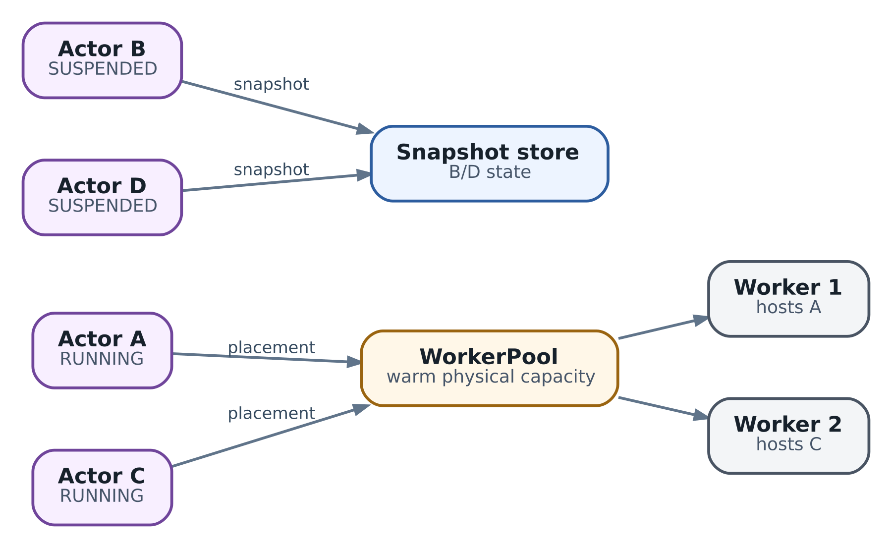

# 11. Actor model для агентных workload: identity, state и lifecycle

В главе 10 мы научились восстанавливать операцию после потерянного ответа. Теперь усложним тот же пример. Сессия ревью `review-42` готовит исправление `total(items)`, запускает `test_empty_list` и ждёт решения инженера. Пока тест работает, инженер меняет план. Потом приходит результат старого запуска. Кто должен решить, относится ли он к текущей работе? Где хранить это решение, если обслуживающий процесс уже перезапущен?

Разместить все обработчики в одном сервисе недостаточно. Каждый из них может отдельно прочитать прежний план, принять поздний результат или подтвердить устаревшее разрешение. Нам нужен понятный **владелец состояния сессии**: одна точка, где проверяются допустимые переходы, а не несколько несогласованных представлений о том, что сейчас происходит.

Actor model помогает организовать такую ответственность. Она связывает адресуемую сущность, её состояние и реакцию на сообщения. Но не обещает автоматически сохранить очередь, восстановить память или выполнить внешний запрос ровно один раз. В этой главе мы отделим модель программирования от конкретного runtime, построим небольшую сессию ревью и разберём, когда этот подход действительно полезен.

**Срез реализации Substrate:** [v0.3.0 · ccecc788](https://github.com/agent-substrate/substrate/tree/ccecc788a327dc11dcd6c21ee153f3d0cbb5cc97). Поля и lifecycle Substrate ниже относятся к этому commit. Учебная сессия, её сообщения и правила обработки - наш прикладной проект, не встроенный протокол Substrate. Experimental authz из главы 24 относится к другому профилю.

## Что читатель сможет сделать после главы

* Объяснить, чем Actor отличается от объекта, сервиса, процесса и sandbox.
* Выбрать сущность, которая владеет состоянием, и назвать её инварианты.
* Разделить обработку сообщения, сохранённый переход и внешний результат.
* Проверить поздний результат и approval по конкретному плану и вызову.
* Спроектировать смену activation без предположения, что очередь и память всегда сохраняются.
* Выбрать между обычным сервисом, Actor framework, workflow runtime и Substrate.
* Оценить цену последовательной обработки, восстановления и изоляции.

## Actor как владелец состояния

В обычном объектном коде один компонент может получить ссылку на чужой изменяемый объект и поправить его поля. Тогда правила изменения состояния постепенно оказываются в разных местах. Actor-подход предлагает другую границу: обращаться к сущности через сообщения, а её внутреннее состояние менять только через её behavior - правила реакции на эти сообщения.

В исходной модели Actor при обработке сообщения может отправлять сообщения известным ему Actors, создавать новые Actors и определять поведение для последующих сообщений. Это описание конкурентного вычисления, а не требование обязательно использовать отдельный сервер или очередь в Redis. [Обзор Actor model](https://arxiv.org/abs/1008.1459) и [описание составных частей Actor в Akka](https://doc.akka.io/libraries/akka-core/current/general/actors.html) полезны именно для разделения модели и её реализаций.

Представьте рабочий стол ответственного за одну сессию ревью. Ему приходят новый план, подтверждение инженера и отчёт теста. Ответственный не просто складывает бумаги: он знает, какой план действует, какое подтверждение нужно и какой отчёт относится к какому запуску. Другие участники передают ему сведения, но не должны незаметно заменять его записи. Аналогия объясняет владение, а не гарантии доставки: потерянное письмо всё равно может не попасть на стол.

Для нашей сессии важны четыре части. **Identity** отвечает, к какой сессии обращаемся. **State** хранит текущий план, фазу работы и известные вызовы. **Behavior** определяет, что делать с поступившей командой. **Mailbox** в конкретном runtime организует ожидание и выдачу сообщений обработчику. Последняя часть удобна, но её свойства нельзя вывести из одного слова Actor.

### Какие инварианты принадлежат сессии

Инвариант - условие, которое должно оставаться верным после каждого допустимого перехода. В нашем проекте approval относится к определённой ревизии плана. Результат теста относится к определённому вызову и его входам. Старый результат не переводит новый план в завершённое состояние. Отчёт о прошедшем тесте ещё не равен принятию исправления человеком.

Если эти проверки разбросаны между HTTP handler, callback тестового сервиса и страницей подтверждения, каждое место вынуждено заново угадывать актуальность данных. Если они находятся у одного владельца состояния, изменение плана сразу задаёт правила для всех последующих сообщений. Это главное удобство Actor-подхода, а не сам факт наличия очереди.

Такое владение должно быть реальным. Если соседний компонент напрямую меняет ту же строку в базе, не соблюдая протокол, формальная надпись Actor не защищает инварианты. Нужны ограничения доступа к записи, согласованный способ обновления или транзакционные проверки. И наоборот, обычный сервис с хорошо выделенным state owner может получить большую часть пользы без нового framework.

### Сообщение отличается от вызова чужого метода

Отправитель сообщает намерение или наблюдение, а получатель решает, допустимо ли оно сейчас. Команда `Approve(r1)` не означает «безусловно запусти тест»: она означает «попробуй применить подтверждение к плану r1». Если уже действует r2, поведение должно явно вернуть устаревшее подтверждение, а не сделать вид, что инженер разрешил всё последующее.

Сообщения лучше делать неизменяемыми или копировать на границе. Передача ссылки на словарь внутри одного процесса, который отправитель позже изменит, снова создаёт общее изменяемое состояние. В учебном mailbox вход копируется. В распределённом runtime сериализация тоже не избавляет от задачи версионирования схемы и проверки значимых полей.

Ответ также требует трактовки. «Принято в очередь» означает одно, «переход записан» - другое, «тест выполнен» - третье. В главе 10 мы уже отделили создание задания от результата. Actor reference не отменяет эту границу, а лишь даёт удобный адрес её владельцу.

## Три значения слова Actor

Термин встречается на разных уровнях, и это частый источник неверных ожиданий.

| Контекст              | Что является Actor                                               | За какой слой отвечает реализация                                                      |
| --------------------- | ---------------------------------------------------------------- | -------------------------------------------------------------------------------------- |
| Actor framework       | Адресуемый владелец состояния и behavior                         | Доставка к обработчику, scheduling, lifecycle; остальные свойства зависят от framework |
| Virtual actor runtime | Логическая сущность, вызываемая без знания текущего расположения | Activation, directory, placement и выбранные механизмы persistence                     |
| Agent Substrate       | Экземпляр sandboxed workload, связанный с ActorTemplate          | Назначение Worker, маршрутизация и операции над окружением                             |

Классическая actor model не равна набору всех возможностей Akka или Erlang/OTP. Framework добавляет конкретный scheduler, references, supervision и средства persistence. Эти возможности надо изучать по отдельности. Равным образом не любой virtual actor сохраняет все свои поля без явной записи в хранилище.

В Substrate внутри Actor может работать обычный многопоточный HTTP server на Python, Go или Rust. Сам факт размещения такого сервера в sandbox не превращает его запросы в последовательные message turns. Приложение может использовать Actor framework внутри этого окружения, но это будет дополнительный слой с собственным контрактом.

## Identity живёт дольше физического экземпляра

В нашем проекте адрес сессии состоит из tenant, имени сессии и UID её конкретного воплощения: `demo-tenant/review-42/uid-42`. Tenant задаёт область принадлежности, имя помогает найти сессию, UID отличает удалённую и заново созданную сущность с тем же именем. Это прикладная схема ключа, не требование всех Actor frameworks.

IP, PID и имя Worker не подходят на роль такой identity. Они отвечают, где и как сейчас работает процесс, и могут измениться без смены смысла сессии. В то же время стабильность domain ID не возникает сама собой: приложение должно хранить отображение и решить, что означает удаление, пересоздание и повтор старого сообщения.

Actor reference в framework имеет его собственные правила срока жизни. Не следует считать любую ссылку вечным адресом domain entity. После окончательной остановки и создания другого Actor прежняя reference может быть недействительна, даже если человек дал новому объекту похожее имя. Внешнюю identity и lifecycle конкретного framework нужно связать явно.

### Actor, activation, Worker и Pod

**Activation** - временный обслуживающий экземпляр логического Actor. Он может загрузить состояние из базы и начать обработку, а после бездействия исчезнуть. Следующий экземпляр может обслужить ту же identity. Для Substrate похожая идея реализуется через запуск или восстановление всего workload на Worker, а не обязательно через создание объекта класса.

| Сущность              | Что она обозначает                           | Что нельзя из неё заключить                          |
| --------------------- | -------------------------------------------- | ---------------------------------------------------- |
| Логическая сессия     | Работу с определённой identity и историей    | Процесс сейчас существует                            |
| Activation приложения | Текущий экземпляр обработчика этой identity  | Все несохранённые поля переживут его исчезновение    |
| Worker Substrate      | Физическую ёмкость для назначенного workload | Это постоянный адрес сессии                          |
| Kubernetes Pod        | Инфраструктурный объект из главы 9           | Это владелец прикладного плана или очередь сообщений |

\
_&#x41;ctor ≠ Worker: logical population can be larger than active capacity_

На схеме Actors A и C сейчас используют Workers, а B и D представлены сохранённым состоянием. Она показывает разделение логического населения и активной ёмкости, не доказывает определённую плотность или latency. Для обычного in-process Actor framework несколько Actors могут разделять процесс. Для Substrate Worker исполняет назначенный sandboxed workload. Эти способы размещения не нужно смешивать.

Deactivation не означает удаление domain state. Сессия может остаться в базе и снова активироваться при обращении. Но сохранение state - отдельное решение: если были только поля объекта в RAM, новый экземпляр их не получит. Удаление сессии тоже не равно освобождению Worker; оно затрагивает историю, отчёты, сроки хранения и незавершённые внешние действия.

### Что добавляют virtual actors

В Orleans логическая сущность называется grain. Клиент обращается по её ключу, а runtime управляет размещением и активацией. Это снимает с вызывающего кода поиск обслуживающего процесса. Persistence при этом не означает автоматическую запись каждого изменения: приложению нужно вызвать запись persistent state в выбранный provider. [Orleans overview](https://learn.microsoft.com/en-us/dotnet/orleans/overview), [grain persistence](https://learn.microsoft.com/en-us/dotnet/orleans/grains/grain-persistence/).

Directory хранит соответствие identity и текущего расположения activation. Однако обещание «активация всегда ровно одна» требует конкретного механизма и версии. Руководство Orleans различает варианты directory, в том числе допускающий временные дубликаты при нестабильности кластера. Поэтому для важного инварианта нужно проверять выбранный directory и защиту записи, а не полагаться на название virtual actor. [Grain directory](https://learn.microsoft.com/en-us/dotnet/orleans/host/grain-directory).

Даже корректная адресация не останавливает старый внешний вызов. Если прежний исполнитель уже отправил запрос до смены владельца, новая activation не может просто стереть его последствия. Протокол идемпотентности, подтверждения и fencing из главы 10 остаётся нужен на соответствующей границе. Location transparency скрывает адрес от клиента, но не скрывает network partitions от инженера.

## Один обработчик не отменяет конкуренцию

Многие Actor runtimes выдают обработчику короткие последовательные участки работы - turns. Это позволяет читать и менять собственное состояние без отдельного lock на каждое поле. Но «один turn» и «один запрос целиком до конца» не всегда одно и то же.

Пусть обработчик подтвердил r1 и ушёл в `await` внешнего теста. Пока ответа нет, другой запрос заменил план на r2. Продолжение первого обработчика вернулось и записало «готово», опираясь на прежнюю проверку. Два фрагмента не выполнялись одновременно, но решение всё равно устарело. Это логическая гонка из-за перемежающихся запросов.

В Orleans по умолчанию новый запрос не начинает обработку до завершения текущего; reentrancy позволяет их interleaving, сохраняя выполнение одного turn за раз. Значит, вопрос нужно задавать точно: какие запросы могут перемежаться и какие предположения переживают `await`? [Request scheduling](https://learn.microsoft.com/en-us/dotnet/orleans/grains/request-scheduling).

### Долгое действие лучше разделить на сообщения

Для сессии ревью нет необходимости держать один message handler открытым все три минуты теста. Первый короткий переход записывает разрешённый вызов и переводит сессию в ожидание. Другой компонент исполняет запрос по контракту главы 10. Затем отдельное сообщение приносит результат с revision и call ID. Владелец снова проверяет актуальное состояние.

Это не обход сохранения: между записью намерения и отправкой действия всё ещё есть разрыв. Нужен журнал незавершённых вызовов, outbox или другой восстановимый механизм. В учебной программе ниже записанное намерение видно в state, но внешней отправки нет. Сохранённый `call_id` ещё не означает, что тестовый сервис получил задание.

Разделение снимает долгую блокировку и позволяет обработать замену плана. Оно также делает неопределённость видимой: можно узнать, что сессия ждёт конкретного вызова, даже без старого процесса. После сообщения результата проверяется текущий план, а не предположение, которое было верным перед отправкой.

### Циклические ожидания

Если Actor A ждёт ответа B, а B ждёт ответа A, строгая обработка запросов до конца может заблокировать оба. Включить reentrancy ради устранения такого цикла - не универсальное исправление: оно меняет допустимые перемежания и может нарушить прежние инварианты.

Для нашего ревью проще не строить синхронную цепочку «сессия ждёт исполнитель, исполнитель спрашивает сессию». Исполнитель получает неизменяемые входы и возвращает отдельный результат. Для действительно связанных сущностей нужно назвать владельца каждого инварианта и границы транзакций. Два Actors сами по себе не образуют общую атомарную операцию.

## Практический пример сессии ревью

Программа `examples/ch11_actor_session_demo.py` работает на Python 3.10+ со стандартной библиотекой. Она состоит из короткого behavior, SQLite-хранилища и небольшой очереди в памяти. Это локальная модель поведения, не реализация Akka, Orleans или Substrate. Мы используем её, чтобы проверить правила переходов и увидеть, что теряется при исчезновении обслуживающего экземпляра.

Ключ сессии включает tenant, имя и incarnation UID. Ревизии r1 и r2 обозначают версии плана ревью, не Git commit и не `metadata.version` Substrate. Вызовы c1 и c2 обозначают отдельные попытки теста; operation ID связывает прикладное намерение с будущим внешним протоколом. Эти значения нельзя заменить одним универсальным generation.

План здесь представлен только его revision. В настоящем сервисе она должна однозначно ссылаться на неизменяемый набор входов: текст плана, ревизию кода, выбранный тест и разрешённые действия. Если под тем же r1 незаметно заменить входы, проверка revision перестанет защищать approval. Как сохранять значимые входы и сравнивать повтор, мы разобрали в главе 10.

### Протокол и состояния

`ProposePlan` создаёт новый текущий план и требует approval. `Approve` проверяет revision, записывает новый call ID и operation ID. `ToolResult` сообщает исход известного вызова и ссылку на отчёт. `AcceptReview` принимает текущий план только после его успешного отчёта. Каждый message ID сохраняет квитанцию об обработке и привязан к неизменяемому содержимому.

| Переход                      | Проверка                                     | Состояние после него           |
| ---------------------------- | -------------------------------------------- | ------------------------------ |
| Новый план r1                | Revision новая, а не возвращённая устаревшая | `waiting_approval`             |
| Approval r1                  | План актуален, call ID и operation ID новые  | `waiting_tool`                 |
| Новый план r2                | Прежние вызовы остаются в истории            | `waiting_approval` для r2      |
| Поздний результат c1 для r1  | Известный вызов, совпадающая revision        | Отчёт сохранён, r2 не завершён |
| Успешный результат c2 для r2 | Это текущий active call                      | `waiting_acceptance`           |
| Принятие r2                  | Есть успешный текущий отчёт                  | `completed` для этого плана    |

Программа сохраняет старые calls при замене плана. Это важно не только для удобства чтения истории. Старая работа могла уже создать внешний объект, который придётся проверить или убрать. Потерять её запись ради красивого текущего статуса означало бы потерять обязанность восстановиться. Но сохранение истории ещё не реализует cleanup: оно лишь не уничтожает нужные сведения.

Смена плана не отменяет прежний вызов. `active_call` обозначает актуальный вызов для текущего плана, а не единственное незавершённое внешнее действие во всей системе. Перед запуском нового действия реальный сервис должен проверить общий лимит и политику cancellation или ожидания старого результата. Эти ограничения не реализованы в demo.

### Где находится сериализация и запись

Mailbox ограничен по числу сообщений и вручную выдаёт их по одному. Обработчик не делает `await` и не вызывает внешний сервис. SQLite-транзакция записывает новое состояние и квитанцию message ID вместе. При исключении до commit откатываются обе записи. После commit повтор того же сообщения с тем же содержимым получает сохранённый ответ, а с другим содержимым - конфликт.

Именно эта транзакция делает повтор локального перехода безопасным. Не сам ID и не слово Actor. Она не охватывает тестовый сервис, object storage или будущую отправку сообщения. `BEGIN IMMEDIATE` здесь задаёт локальную границу SQLite; пример не доказывает единственность activation в распределённом кластере.

Есть ещё одна тонкость. Сохранённый ответ на прежний approval может снова содержать `tool_requested`, хотя сейчас сессия уже ждёт approval r2. Это квитанция о прошлом принятом переходе, а не свежий запрос состояния. Отправитель не должен воспринимать такой ответ как новое разрешение повторить действие без прежнего operation ID. Историю обработки и текущий status читают для разных целей.

### Обработка позднего результата

Основная проверка из программы:

```
def record_result(state, command):
    state = deepcopy(state)
    call_id, revision = command["call_id"], command["revision"]
    call = state["calls"].get(call_id)
    if call is None or revision != call["revision"]:
        return state, {"code": "unknown_call"}
    result = {"outcome": command["outcome"], "report_ref": command["report_ref"]}
    if result["outcome"] not in {"passed", "failed"} or not result["report_ref"]:
        raise Conflict("a result needs an outcome and a report reference")
    if call["result"] is not None:
        if call["result"] != result:
            raise Conflict("one call cannot acquire a different result")
        return state, {"code": "result_already_saved"}
    call["result"] = result
    if revision != state["revision"] or call_id != state["active_call"]:
        return state, {"code": "historical_result_saved"}
    state["phase"] = ("waiting_acceptance" if result["outcome"] == "passed"
                      else "test_failed")
    return state, {"code": "current_result_saved"}
```

Сначала проверяется принадлежность к известному вызову. Затем сохраняется результат, который нельзя незаметно заменить другим. Только после этого определяется, имеет ли он право менять текущую фазу. Для старого вызова ответ `historical_result_saved` означает «сведения сохранены, но они относятся к другой работе», а не «результат удалён».

`deepcopy` сохраняет входное состояние неизменным до успешного сохранения нового. В программе `record_result` вызывается внутри общего `transition`, а `SessionStore.dispatch` задаёт транзакцию и квитанции. Фрагмент не является готовым HTTP endpoint: аутентификацию sender, проверку самого отчёта и разрешение на approval должен обеспечить реальный прикладной контур.

### Запуск и чтение результата

Из корня репозитория книги:

```
python3 examples/ch11_actor_session_demo.py
python3 -m unittest discover -s examples -p 'test_ch11*.py'
```

Demo записывает r1, подтверждает вызов c1, затем заменяет план на r2. Результат c1 кладётся в очередь, но экземпляр mailbox исчезает до обработки. SQLite-соединение закрывается; новый экземпляр открывает ту же базу. Повторная доставка результата сохраняет исторический отчёт. Затем условный результат r2 проходит свой путь до отдельного принятия.

```
{
  "source": "local_sqlite_behavior_model",
  "cluster_contacted": false,
  "logical_actor": "demo-tenant/review-42/uid-42",
  "mailbox_instances": 2,
  "queued_before_restart": 1,
  "queued_after_restart": 0,
  "late_result": "historical_result_saved",
  "phase_after_late": "waiting_approval",
  "replayed_approval_reply": "tool_requested",
  "new_old_revision_approval": "stale_approval",
  "phase_after_report": "waiting_acceptance",
  "final_phase": "completed",
  "saved_results": 2,
  "real_test_executed": false,
  "real_human_approval_verified": false
}
```

`queued_after_restart: 0` специально показывает потерю очереди в памяти. Программа не называет `submit` устойчивым принятием: он возвращает `queued_in_memory`. Сохранённое состояние пережило смену соединения, а необработанное сообщение - нет. В реальном сервисе после такого приёма без durable inbox отправитель всё ещё должен уметь повторить команду.

`final_phase: completed` относится только к нашей модели: результат и acceptance поданы подготовленными сообщениями. Программа не запускает `test_empty_list`, не оценивает `total(items)` и не подтверждает личность инженера. Эти границы видны в последних двух полях. Иначе наглядный пример легко превратился бы в ложное доказательство работы настоящего ревью.

Тесты проверяют конфликты message ID, tenant и incarnation scope, неизменяемость входа, совместный rollback состояния и квитанции, повтор после повторного открытия соединения с базой, поздние результаты, устаревший approval, повтор call ID и operation ID, предел очереди и различие отчёта с принятием. Новая очередь и новое соединение создаются внутри того же процесса; реального kill, сетевого сбоя и checkpoint памяти здесь нет.

## Mailbox не равен устойчивому приёму

У очереди есть как минимум три независимых вопроса: сколько она держит сообщений, в каком порядке выдаёт их и что переживает после отказа. Bounded mailbox может остановить рост RAM, но не сохранить принятое сообщение. Durable inbox может сохранить сообщение, но всё равно потребует обработки повторов. FIFO внутри одной очереди не задаёт общий порядок для всех отправителей и узлов.

В базовом контракте Akka доставка обычных сообщений описана как at-most-once, а порядок - для пары sender-receiver. Эти гарантии не равны успешной обработке; документация отдельно разбирает границу mailbox и необходимость business acknowledgement. Dead letters тоже служат диагностике на best-effort основе, не восстановлению всех потерянных сообщений. [Message delivery reliability](https://doc.akka.io/libraries/akka-core/current/general/message-delivery-reliability.html).

Для нашего сервиса нужно выбрать, что обещает ответ клиенту. Если обещаем «работа принята и будет восстановлена», сначала сохраняем inbox или намерение в устойчивом хранилище, затем отвечаем. Если сохранили переход, но ответ потерялся, повтор получает квитанцию. Необработанные устойчивые записи должен находить scheduler или rescan. Очередь в RAM можно оставить ускорителем, если её потеря не уничтожает единственное доказательство принятой работы.

### Ограничение нагрузки и горячая сессия

Предположим, один короткий turn занимает 20 миллисекунд. Без других ограничений последовательный обработчик способен сделать около 50 таких turns в секунду. Это иллюстративная арифметика, не benchmark: реальные storage latency, разброс времени и scheduling уменьшают полезный запас. Если приходят 80 сообщений в секунду, очередь будет расти независимо от числа свободных Workers для других Actors.

Ограничить mailbox до 100 сообщений полезно, но этого недостаточно. Даже 100 небольших команд могут ссылаться на гигабайты данных или порождать дорогие запросы. Нужны ограничения размера, количества незавершённых внешних действий, tenant budget и срока ожидания. При переполнении клиент должен понимать, была ли команда принята. Нельзя одновременно потерять её и ответить, что она надёжно ожидает исполнения.

Сессия, к которой обращаются слишком часто, называется hot Actor или hot key. Добавление узлов помогает множеству независимых сессий, но не снимает предел одного последовательного владельца. Иногда можно вынести чтение в отдельное представление, хранить большие bytes по reference или разделить независимые части состояния. Если инвариант действительно требует общего порядка всех изменений, его последовательная цена остаётся.

Control messages тоже нуждаются в запасе ёмкости. Если `Cancel` или результат уже запущенного вызова стоят за тысячей новых пользовательских запросов, bounded queue предотвращает OOM, но не даёт своевременного управления. Нужна продуманная admission policy или отдельная полоса для таких сообщений. Учебный mailbox использует простой FIFO и не реализует приоритеты, fairness между сессиями и обработку deadlines.

## Как выбрать границу Actor

Граница определяется не названием таблицы, а набором изменений, которые должны согласовываться вместе. Для одного ревью полезно держать план, approvals и привязку результатов у одной сессии. Они часто проверяются в одном переходе. У двух независимых ревью разные планы и нет причины заставлять их ждать друг друга.

Один Actor на пользователя кажется удобным для персонального помощника, но связывает все разговоры и задачи этого пользователя одной очередью. Один Actor на workspace оправдан, если все изменения реально затрагивают общий checkout; если проекты независимы, он станет искусственным bottleneck. Один Actor на каждую мелкую запись может, наоборот, превратить обычное обновление двух полей в координацию нескольких владельцев.

Практический вопрос звучит так: «Какое условие я могу проверить и сохранить здесь, не спрашивая другого изменяемого владельца?» Если для approval постоянно требуется атомарно менять состояние пяти Actors, граница выбрана неудобно либо нужен другой транзакционный механизм. Общая SQL-транзакция может быть проще и честнее сложного обмена сообщениями.

Для общего лимита tenant нельзя просто дать каждой сессии отдельный счётчик и назвать их независимыми. Кто-то должен владеть общим budget, либо storage должен атомарно резервировать его. Здесь вновь появляются межсущностная конкуренция, partial failures и возврат reservation. Actor-подход локализует часть сложности, но не отменяет инварианты, которые пересекают границы.

У нашего учебного ключа есть incarnation UID. Если `review-42` удалено и создано заново, старые сообщения не должны попадать в новую историю только из-за совпадающего имени. Для реального API нужно также определить tombstone, сроки хранения квитанций и запрет поздних callbacks после удаления. У программы нет операции delete и полноценного retention; все calls и receipts сохраняются до удаления временной базы.

## Состояние приложения и snapshot окружения

После слова state легко начать говорить о совершенно разных данных как об одном объекте. Для сессии полезнее спросить, кто их восстанавливает и какую потерю можно допустить.

| Данные                                            | Разумное место в нашем проекте                               | Что надо проверить при восстановлении                                |
| ------------------------------------------------- | ------------------------------------------------------------ | -------------------------------------------------------------------- |
| План, approval, calls и квитанции                 | Явная durable schema приложения                              | Совместимость схемы, актуальность revision и незавершённые намерения |
| Большие отчёты и artifacts                        | Object storage со ссылками в state                           | Существование bytes, принадлежность, checksum и retention            |
| Прогретый interpreter, heap и локальная execution | Поддерживаемый runtime snapshot либо повторная инициализация | Scope, backend и совместимость кода                                  |
| Задание у тестового сервиса                       | Сам внешний сервис плюс журнал операции                      | Подтверждение по устойчивому ключу, а не содержимое heap             |

SQLite-файл в demo становится durable лишь в пределах выбранного локального хранения и его правил. Если положить такую базу в эфемерный контейнер и удалить его вместе с файлом, открывать новому экземпляру будет нечего. Для production нужно выбрать размещение, backup, restore procedure и concurrency contract. Формат базы не заменяет эксплуатационное решение.

### Что переносит Substrate

В закреплённом API `Actor` имеет metadata, ссылку на ActorTemplate и системный status. Status содержит lifecycle state, worker assignment и ссылки на snapshots. `SUSPENDED` означает отсутствие текущего Worker assignment, но не обязано означать, что Actor уже когда-то выполнил свою работу и сохранил новый snapshot: до первого запуска его история другая. [Actor и ActorStatus в API](https://github.com/agent-substrate/substrate/blob/ccecc788a327dc11dcd6c21ee153f3d0cbb5cc97/pkg/proto/ateapipb/ateapi.proto).

`Full` и `Data` задают разный состав сохранённой точки. Full предназначен для process memory, writable rootfs changes и поддерживаемых данных. Data сохраняет snapshot-capable data, но не индивидуальную память процесса; resume использует cold boot либо общий golden guest state с данными Actor. Ни один scope не захватывает внешний тестовый сервис. Возможности конкретных устройств и backend нужно проверять отдельно, а не выводить из слова Full.

Не менее важно, где лежит checkpoint. Pause использует node-local snapshot; suspend публикует external snapshot в object storage. Полнота локальной точки не делает её устойчивой к потере node. Подробный выбор операций и scope разобран в главе 14, владение bytes - в главе 39. Здесь нам достаточно вывода: новый обслуживающий экземпляр получает только тот state, который выбранный путь реально способен восстановить.

В [resume workflow](https://github.com/agent-substrate/substrate/blob/ccecc788a327dc11dcd6c21ee153f3d0cbb5cc97/cmd/ateapi/internal/controlapi/workflow_resume.go) видны чтение записи, lifecycle lease, назначение Worker, restore и переход в RUNNING. [Suspend workflow](https://github.com/agent-substrate/substrate/blob/ccecc788a327dc11dcd6c21ee153f3d0cbb5cc97/cmd/ateapi/internal/controlapi/workflow_suspend.go) продолжает инфраструктурные шаги по сохранённому состоянию. Это защита конкретных lifecycle operations, не сериализация `Approve` и `ToolResult` внутри нашего приложения.

Architecture.md начинает описание оговоркой об aspirational частях. Поэтому схема «много Actors на меньшем числе Workers» объясняет направление архитектуры, а наличие определённого пути проверяется по API и workflow. Целевые latency и scale не становятся измерениями нашего стенда. [Закреплённая архитектура](https://github.com/agent-substrate/substrate/blob/ccecc788a327dc11dcd6c21ee153f3d0cbb5cc97/docs/architecture.md).

### Согласованная точка перед остановкой

Для нашего приложения безопасная остановка означает сначала закрыть приём новых команд либо перенести его в устойчивый inbox. Затем завершить короткие локальные transitions и сохранить незавершённые намерения. Долгий внешний вызов нельзя объявлять отменённым только потому, что процесс собирается уснуть: его outcome может остаться неизвестным и потребовать сверки из главы 10.

Называть это «дождаться всех действий» тоже опасно: недоступный внешний сервис способен задержать остановку навсегда. Нужен ограниченный drain и явная запись того, что не успели подтвердить. После сохранения приложение должно понимать, какие commands приняты, какие эффекты неизвестны и что следующий экземпляр проверит первым.

Если платформа freeze-ит процесс без прикладного handshake, она не создаёт такой протокол автоматически. Возможность memory checkpoint и устойчивость бизнес-перехода - разные свойства. Не следует придумывать встроенный `on_suspend` или `on_resume` API, если его нет в выбранной конфигурации. Подготовку можно реализовать в приложении и согласовать с вызывающим orchestration layer.

### После resume внешний мир уже другой

В восстановленной памяти могут остаться connection pools, cached DNS, старые tokens и предположения о lease. Remote peer мог закрыть соединение, срок credential истёк, а ownership сменилось. При этом часть process identifiers или timers конкретный backend действительно может восстановить. Правильная формулировка не «всё пропадает», а «локальная непрерывность не доказывает внешнюю актуальность».

Приложение заново загружает authoritative domain state, проверяет незавершённые операции, обновляет необходимые credentials и пересоздаёт негодные соединения. Если восстановленная RAM содержит r1, а внешняя база уже хранит r2, память нельзя молча записать поверх более нового состояния. Это особенно важно, если durable domain state находится вне runtime snapshot.

Готовность к трафику тоже имеет условия. В срезе Substrate `wakeup_probe` проверяет HTTP 200 перед завершением wakeup; без probe `ResumeActor` может вернуть ответ после старта container, ещё до начала listen. Приложение должно использовать probe так, чтобы положительный ответ означал безопасный приём работы. Наличие probe не доказывает качество самой проверки. [Контракт wakeup probe](https://github.com/agent-substrate/substrate/blob/ccecc788a327dc11dcd6c21ee153f3d0cbb5cc97/pkg/proto/ateapipb/ateapi.proto).

## Как выбирать инструменты

Начните с задачи, которую хотите упростить. Если вся сессия описывается несколькими durable полями, а одновременных requests немного, обычный сервис с SQL-транзакцией может быть достаточен. Выделить behavior и протокол сообщений можно и в таком сервисе. Новый Actor framework имеет смысл, когда его scheduling, addressing, supervision или размещение снимают измеримую сложность.

| Потребность                                       | Что рассмотреть                      | Что остаётся спроектировать                                 |
| ------------------------------------------------- | ------------------------------------ | ----------------------------------------------------------- |
| Короткие изменения небольшого state               | Обычный сервис и транзакционная база | Конкуренцию, retries и статус принятия                      |
| Множество взаимодействующих state owners          | Akka или Erlang/OTP                  | Persistence, delivery, protocol и эксплуатацию runtime      |
| Адресуемые .NET entities с on-demand activation   | Orleans                              | Storage provider, scheduling, directory и domain invariants |
| Долгие процессы с timers и ожиданием человека     | Workflow runtime                     | Контракт activities, идемпотентность и изменение workflow   |
| Дорогое stateful sandboxed окружение между bursts | Substrate                            | Прикладное состояние, очередь, approval и безопасный resume |
| Короткие независимые задания без долгой identity  | Очередь и worker pool                | Delivery, admission и подтверждение результата              |

Это не рейтинг взаимозаменяемых продуктов. Orleans предоставляет модель программирования .NET-приложения. Substrate управляет его физическим окружением на другом уровне. Workflow runtime владеет длительным исполнением процесса, а сессия может владеть текущим domain state. Слои могут сочетаться, но каждый добавляет recovery contract, настройки и стоимость диагностики.

Для нашей сессии есть три разумных пути. Небольшой сервис может держать одну таблицу состояния и последовательные транзакции. При большом количестве адресуемых .NET-сессий virtual actors могут упростить их размещение. Если ревью держит тяжёлый checkout, interpreter и sandbox для недоверенного кода, Substrate может помочь экономить idle capacity. В последнем случае таблица state и правила обработки сообщений всё равно остаются приложению.

Не стоит добавлять broker только ради слова mailbox. Очередь нужна для конкретной доставки или разделения компонентов. И не стоит выбирать snapshot вместо явной схемы, если единственное требование - сохранить номер текущего шага. Читателю главы 10 уже знаком принцип: минимальная архитектура должна сохранять нужные инварианты, а не демонстрировать максимальный набор технологий.

## Supervision и восстановление после ошибки

Supervisor отвечает за реакцию на failure дочерних процессов: перезапустить один, группу или остановить ветку. Erlang/OTP также ограничивает интенсивность restart, чтобы постоянная ошибка не породила бесконечный цикл. Это конкретный механизм framework, а не следствие любого объекта с именем Actor. [Supervisor behaviour](https://www.erlang.org/doc/system/sup_princ.html).

Для сессии важно различать восстановление способности исполнять код и восстановление корректного решения. Перезапуск обработчика не возвращает несохранённую очередь. Новый Worker не подтверждает прежний тест. Восстановленный snapshot не отменяет опубликованное внешнее действие. Infrastructure recovery даёт возможность продолжить, а прикладной журнал и protocol определяют, что продолжать безопасно.

После crash нужно перечитать сохранённое состояние, найти неизвестные эффекты и восстановить расписание проверок. «Let it crash» полезно, если failure отделён и state способен восстановиться; без этих условий оно означает лишь потерю сведений. Иногда безопаснее остановить обработку и запросить вмешательство, чем бесконечно повторять конфликтующие результаты или неподдерживаемую state schema.

При обновлении кода также нельзя рассчитывать, что прежний heap подходит новому behavior. Явное domain state можно версионировать и мигрировать, сохраняя старые квитанции и незавершённые calls. Memory snapshot дополнительно связан с runtime, template и backend. Миграция записи и восстановление process image - разные процедуры; обе требуют проверки, а не только смены image tag.

## Изоляция, разрешения и наблюдаемость

Private state Actor - правило программирования, не автоматическая security boundary. Если Actors разделяют address space, ошибка или недоверенный код могут выйти за логическую границу. Для sandboxed execution применяются механизмы главы 8. Сообщение с правильным UID тоже не является авторизацией: реальный gateway должен связать tenant и caller с разрешённой сессией.

В частности, `Approve` и `AcceptReview` должны приходить от проверенного участника и относиться к разрешённому действию. Callback с `outcome: passed` требует проверенного источника и самого evidence: call identity не доказывает правильность теста. Наш demo предполагает доверенные подготовленные сообщения, чтобы изолировать state protocol. В production нельзя сохранять эту предпосылку без authentication и authorization.

Snapshot может содержать credentials, prompts, source code и tool outputs. Поэтому право его восстановить фактически даёт доступ к чувствительному окружению. Нужны tenant-scoped storage access, integrity checks, encryption и retention в соответствии с угрозами. Общий golden snapshot не должен размножать уникальную identity, действующий lease или персональные данные прежнего пользователя.

При расследовании начинайте с logical Actor ID, incarnation UID, revision плана, call ID и operation ID. К ним добавляйте activation и Worker, чтобы увидеть, где выполнялась работа. Если смотреть только по Pod name, relocation разорвёт историю. В то же время все уникальные IDs не стоит делать labels массовых метрик: detailed correlation удобнее хранить в traces и журнале.

Для нагрузки измеряйте не только число Actors, но время ожидания mailbox, длительность turn и возраст незавершённого call. Для инфраструктуры отдельно измеряйте warm request latency, resume latency и ожидание Worker. Холодный Actor может быть исправен и просто требовать activation. Быстро восстановленный процесс может оставаться непригодным из-за базы, credentials или неизвестного внешнего эффекта.

Эти различия дают осмысленный runbook. Если растёт queue age, ищем долгие turns и admission policy. Если задерживается resume, исследуем capacity, загрузку snapshot и probe. Если завис один call при здоровом Actor, сверяем операцию у исполнителя. Перезапуск всех Workers ради любого из трёх симптомов скрывает причину и может добавить повторных действий.

## Практика для самостоятельного решения

Начните с demo и объясните, почему повтор m2 возвращает прежнюю квитанцию, а новый approval r1 после замены плана отклоняется. Ответ должен различать повтор обработанного сообщения, новое намерение и текущее состояние. Если всё свести к «устаревшие сообщения отклоняются», один из случаев останется необъяснённым.

Затем удалите проверку revision или active call в `record_result`. Покажите тест, при котором результат r1 незаконно завершает r2. После восстановления проверки объясните, почему исторический отчёт всё же сохраняется. Это не только выбор между принять и выбросить: нужен отдельный путь сохранения сведений без продвижения текущей работы.

Следующее упражнение - устойчивый inbox. Определите точку, после которой `submit` вправе ответить durable acceptance. Спроектируйте совместное сохранение команды и обработки, повторное чтение после restart и ограничение backlog. Очередь в RAM должна стать ускорителем, а не единственным местом принятого обязательства. Не называйте упражнение решённым только потому, что добавлен JSON-файл без протокола commit и replay.

Наконец, выберите границу для двух ревью одного пользователя с общим лимитом tool calls. Назовите владельца каждой сессии и общего budget, порядок reservation и release, поведение при потерянном ответе. Если границы требуют слишком много согласования, сравните это решение с одной транзакционной базой. Инженерный результат - обоснованный выбор, не обязательное увеличение числа Actors.

## Итоги главы

Actor-подход собирает состояние и правила его изменения у понятного владельца. Он полезен, когда сущности имеют независимые identities и большинство инвариантов можно проверить внутри одной из них. Но выбор владельца не создаёт автоматически durable mailbox, глобальный порядок или защиту внешних действий.

Activation - временное воплощение, а identity и сохранённая история имеют собственный срок жизни. Без явной persistence новая activation не знает несохранённого прошлого. Последовательные turns упрощают короткие transitions, но после interleaving и `await` актуальность предположений приходится проверять заново.

В сессии ревью late result сохраняется для своего call и не завершает другой план. Сохранённая квитанция описывает прежнюю обработку, не свежий status. Успех теста и принятие инженером - разные переходы. Эти правила принадлежат приложению, не mailbox и не runtime snapshot.

Substrate переносит эту идею identity на sandboxed workload: управляет Worker assignment и поддерживаемым execution state. Он не превращает наш HTTP server в Actor framework и не подменяет durable domain protocol. Full, Data, pause, suspend и probe задают конкретные границы восстановления.

**Дальше.** В главе 12 рассмотрим operational architecture Substrate: как `ateapi`, `atecontroller`, `atelet`, `ateom` и `atenet` вместе возвращают workload к работе. Теперь важно держать вопрос: какой компонент восстанавливает окружение и какой остаётся ответственным за смысл следующего шага?

### Источники и дальнейшее чтение

* [Actor model of computation](https://arxiv.org/abs/1008.1459) и [состав Actor в Akka](https://doc.akka.io/libraries/akka-core/current/general/actors.html) - модель вычисления и части framework Actor.
* [Akka message delivery reliability](https://doc.akka.io/libraries/akka-core/current/general/message-delivery-reliability.html) - delivery, ordering и business acknowledgement.
* [Orleans overview](https://learn.microsoft.com/en-us/dotnet/orleans/overview), [request scheduling](https://learn.microsoft.com/en-us/dotnet/orleans/grains/request-scheduling), [grain persistence](https://learn.microsoft.com/en-us/dotnet/orleans/grains/grain-persistence/) и [grain directory](https://learn.microsoft.com/en-us/dotnet/orleans/host/grain-directory) - activation, interleaving, явная запись state и варианты размещения.
* [Erlang/OTP supervisor behaviour](https://www.erlang.org/doc/system/sup_princ.html) - restart strategies и ограничение restart loops.
* [Substrate ccecc788 API](https://github.com/agent-substrate/substrate/blob/ccecc788a327dc11dcd6c21ee153f3d0cbb5cc97/pkg/proto/ateapipb/ateapi.proto), [resume](https://github.com/agent-substrate/substrate/blob/ccecc788a327dc11dcd6c21ee153f3d0cbb5cc97/cmd/ateapi/internal/controlapi/workflow_resume.go), [suspend](https://github.com/agent-substrate/substrate/blob/ccecc788a327dc11dcd6c21ee153f3d0cbb5cc97/cmd/ateapi/internal/controlapi/workflow_suspend.go) и [architecture](https://github.com/agent-substrate/substrate/blob/ccecc788a327dc11dcd6c21ee153f3d0cbb5cc97/docs/architecture.md) - закреплённый контракт окружения, не протокол учебной сессии.
