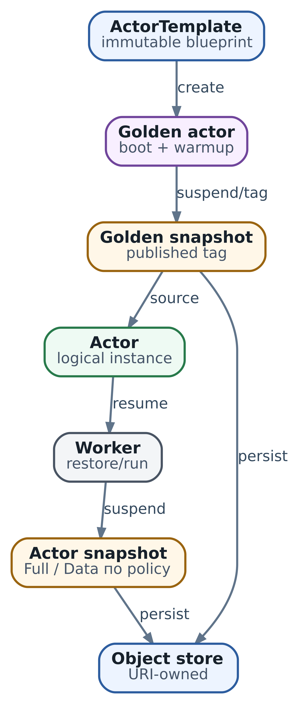

# 13. Ресурсная модель Substrate: от capacity до долговечного Actor

В главе 12 мы вернули среду сессии `review-42`: нашли Actor, выделили Worker и довели запрос до приложения. Теперь подготовим такую сессию к эксплуатации. Где задать её размер? Как потребовать нужный регион, не перепутав его с Kubernetes namespace? Что произойдёт при выпуске новой версии агента? Можно ли удалить исходный snapshot, если клон уже работает?

Ответы распределены между несколькими ресурсами. Это кажется лишней сложностью, пока систему не приходится обновлять или восстанавливать. Один объект с полями «образ, tenant, память, backup» смешал бы решения с разными владельцами и сроками жизни. Ресурсная модель разделяет версию среды, конкретную сессию, временную вычислительную ёмкость и удерживаемую точку восстановления. Инженеру нужно понимать связи между ними, а не помнить весь API наизусть.

**Срез реализации Substrate:** [v0.3.0 · ccecc788](https://github.com/agent-substrate/substrate/tree/ccecc788a327dc11dcd6c21ee153f3d0cbb5cc97). Поля и проверки ниже относятся к этому commit. Atespace и selectors не заменяют authorization; experimental authz главы 24 относится к другому профилю.

## Что читатель сможет сделать после главы

* Разнести конфигурацию между Kubernetes API и ate API и выбрать нужный инструмент для изменения.
* Объяснить, чем имя, UID и version защищают разные стороны одной операции.
* Найти причину отказа placement, не снимая обязательные ограничения.
* Подготовить новую версию ActorTemplate и отличить проверку API от совместимости прикладных данных.
* Определить, кто владеет snapshot и кто пока заимствует его bytes.
* Выбрать обычный запуск, golden baseline или Tag по задаче, а не по обещанию «быстро».

## Ресурсы описывают разные решения

Представим сервис ревью. Пользователь работает с одним репозиторием, ждёт ответа коллеги и возвращается через несколько часов. Платформа поддерживает совместимый sandbox runtime и запас Workers. Команда приложения выпускает версию агента. Сессия пользователя сохраняет свой `/workspace`. Для учебного примера другой команде иногда нужен клон подготовленного workspace.

Здесь уже четыре разных изменения: увеличить ёмкость, обновить программу, продолжить сессию и удержать её состояние. Если увеличить WorkerPool, версия агента не поменяется. Если создать ActorTemplate v2, существующие Actors не станут v2 автоматически. Если создать Tag, новый Worker не появится. С этого различия и начинается управление системой.

| Вопрос инженера                         | Ресурс и API                              | Что он не решает                             |
| --------------------------------------- | ----------------------------------------- | -------------------------------------------- |
| Сколько тёплых Worker Pods поддерживать | WorkerPool в Kubernetes                   | Не задаёт число всех существующих сессий     |
| Какие sandbox binaries использовать     | Cluster-scoped SandboxConfig в Kubernetes | Не определяет код агента                     |
| Какую версию среды запускать            | ActorTemplate в ate API                   | Не является пользовательской сессией         |
| Какую сессию продолжить                 | Actor в ate API                           | Не гарантирует постоянный process или Worker |
| Как организовать адреса ресурсов        | Atespace в ate API                        | Не выдаёт tenant изоляцию сам по себе        |
| Как удержать и передать snapshot        | Tag в ate API                             | Не является историей всех checkpoints        |

### Почему нужны два API

Kubernetes управляет инфраструктурой: `atecontroller` превращает WorkerPool в Deployment, затем Kubernetes размещает Worker Pods на nodes. Ate API управляет Actor records, их состояниями и assignments через свой control-plane store. В этой книге им служит PostgreSQL. `Worker` в ate API связывает обе стороны: он описывает конкретный Worker Pod и состояние его ёмкости, которое использует Substrate.

WorkerPool является namespaced CRD; SandboxConfig - cluster-scoped CRD. ActorTemplate, Actor, Atespace и Tag не являются Kubernetes CRD. Их обслуживает `kubectl ate` или gRPC client, а не обычный Kubernetes resource endpoint. Наличие слова `kubectl` в имени клиента не переносит на ate API все правила Kubernetes.

Для эксплуатации это даёт простой первый вопрос: что именно не получилось? Если нет Worker Pods, начните с Deployment, events и `atecontroller`. Если Pods существуют, но Actor не получает assignment, нужны Worker records, selectors и capacity. Если UpdateActor возвращает `ABORTED`, увеличение Deployment replicas не исправит устаревший UID/version. `kubectl get all` тоже не является полным инвентарём: он не охватывает ни все Kubernetes kinds, ни ate API.

## Адрес ресурса не равен его личности

`review-team/review-42` - удобный адрес Actor. Он состоит из `metadata.atespace` и `metadata.name`. Сервер добавляет `metadata.uid`, `metadata.version` и timestamps. UID отличает конкретную жизнь объекта от его предыдущего существования; version отличает последовательные изменения внутри этой жизни.

Пользователь может удалить сессию и создать другую с тем же именем. Старый запрос всё ещё обращается по знакомому адресу, но должен ли он изменить новый объект? Нет. Именно здесь нужен UID. А если сессию не удаляли, но два оператора прочитали её до изменения, один из них не должен молча затереть решение другого. Здесь нужна version.

```
Один объект: uid=A, version=17
  оператор 1 читает его и обновляет -> uid=A, version=18
  оператор 2 отправляет старую version=17 -> ABORTED

Пересозданный объект с прежним именем: uid=B, version=17
  старый запрос несёт uid=A, version=17 -> ABORTED
```

Вторая version выбрана для примера: совпадение чисел между разными объектами не делает их одной сессией. В логах и прикладных ссылках сохраняйте Actor UID, когда важно отличить эти жизни. UID ресурса не заменяет operation ID внешнего действия из главы 10: один Actor выполняет много разных операций.

### Что хранит ObjectRef

`ObjectRef` содержит отдельные `atespace` и `name`, но не UID. Для ссылок Actor на template и sourceTag Atespace указывают явно, даже если он тот же. При работе с API используйте соответствующее поле сообщения, а не самодельный парсер строки `atespace/name`.

Это типизированная форма адреса, не вечная ссылка на конкретную жизнь объекта. Перед опасной записью нужен свежий объект и guards. Для snapshot происхождение дополнительно фиксируется в status через template UID. Автоматизация не должна считать неизменное имя template достаточным доказательством того, что его прежний объект ещё существует.

### Update является заменой ресурса

UpdateActor требует UID и version, полученные из чтения. Клиент берёт прочитанный Actor целиком, меняет разрешённое поле и отправляет replacement. Сервер сохраняет свой status и metadata, проверяет guards и допустимость изменения. Это не patch произвольной части PodSpec.

Создать новое сообщение только с изменённым selector опасно: остальные клиентские поля могут исчезнуть или нарушить immutable validation. После `ABORTED` перечитайте Actor и заново примените намерение. Не просто подставляйте новую version в старое тело: так можно затереть изменение, из-за которого конфликт и возник.

Version меняется и при серверных mutations, поэтому конфликт не обязательно означает работу второго оператора. Read-modify-write защищает отдельную запись. Он не делает атомарной цепочку «обновить Actor, создать Tag, выдать bucket permission».

### Delete требует собственного решения о guards

У DeleteOptions UID и version опциональны: отсутствующий guard не проверяется. Для удаления именно увиденного объекта UID особенно важен. Version добавляет условие «он не менялся после моего чтения». После частично выполненного DeleteActor lifecycle может уже иметь новую version, и повтор с прежними guards получит конфликт. Перечитайте объект; если задача всё ещё состоит в завершении удаления той же жизни, используйте guard её UID либо свежие UID/version.

Это правило не означает «при ошибке удалять снова». Сначала выясните, осталась ли запись и какая операция продолжается. Удаление ресурса не становится безопасным только потому, что совпала version: его содержимое может быть нужно другому ресурсу.

## Atespace задаёт область адресов

Для нашей команды создаётся Atespace `review-team`. Он global-scoped: его собственное `metadata.atespace` пусто, а имя находится в `metadata.name`. Actor, ActorTemplate и Tag имеют свои адреса внутри Atespace. Actor `review-42` другой команды может существовать одновременно и не является нашей сессией.

Но WorkerPool живёт в Kubernetes namespace, например `ate-workers`. Один такой pool может обслуживать Actors разных Atespaces, если их ограничения подходят. Template выбирает pools по labels, а не по совпадению имён namespace и Atespace. Naming convention `team-a` на обеих сторонах может облегчить работу людям, но система не выводит из неё placement или права.

В закреплённом профиле нет полноценного control-plane RBAC для изоляции таких команд. Доверенный ate API client и пользователь, которому разрешён один бизнес-запрос, - разные субъекты. Платформа отдельно ограничивает доступ к API, snapshot prefixes и сети workload. Label `tenant=review-team` может участвовать в размещении, но он не проверяет, кто имеет право изменить label.

Второй нюанс появляется при опубликованном Tag. Actor другой команды может получить допустимую ссылку на него, но snapshot остаётся под prefix исходного Atespace. Доступ к reference и доступ runtime к bytes должны быть согласованы. Иначе create пройдёт, а restore получит storage error; выдача общего bucket access всем tenants решит симптом ценой новой утечки.

## WorkerPool и SandboxConfig отвечают за разные слои

WorkerPool задаёт заранее подготовленные Worker Pods: число replicas, worker image, sandbox class, Pod resources и node placement. SandboxConfig задаёт сами runtime assets. ActorTemplate выбирает SandboxConfig по имени и class, а совместимые Workers должны иметь тот же class.

Для gVisor SandboxConfig содержит `runsc` asset по архитектуре и digest-pinned pause image. Для microVM нужен другой набор: Cloud Hypervisor, `virtiofsd`, guest kernel и image, а также доступный `/dev/kvm` на nodes. Один label на node не создаёт поддержку KVM. Digest workload image и hash runtime asset фиксируют разные bytes; pin одного не фиксирует другой.

Это удобно для владельцев платформы: они могут поддерживать согласованный runtime для нескольких версий агента. Обратная сторона - cluster-scoped config становится общей зависимостью. Замена assets под знакомым именем не должна быть незаметным экспериментом для работающих сессий. Snapshot manifest хранит runtime provenance, но это не обещание совместимости любого нового binary со старой памятью.

### Где ставить label

В WorkerPool есть две поверхности. `metadata.labels` пула зеркалируются в labels Worker record; их проверяют template и Actor selectors. `spec.template.labels` попадают на Kubernetes workload и помогают Kubernetes policy и observability. Совпадающий ключ не делает эти поверхности взаимозаменяемыми.

Ниже фрагмент формы WorkerPool, а не готовый manifest для применения. В полном объекте нужны worker image, resources, остальные настройки и реальные значения версии установленного dataplane.

```
apiVersion: ate.dev/v1alpha1
kind: WorkerPool
metadata:
  name: review-eu
  namespace: ate-workers
  labels:
    tier: general
    region: eu
spec:
  sandboxClass: gvisor
  template:
    labels:
      app: review-worker
    nodeSelector:
      ate.dev/substrate-version: "<installed-version>"
```

Actor selector `region=eu` увидит pool label. Он не увидит `app=review-worker` из Pod template. А nodeSelector решает другой вопрос: где Kubernetes размещает Worker Pod. Он не является per-Actor selector. Pin dataplane version помогает отделить старую и новую инфраструктуру при rolling upgrade; его значение берут из установленной системы, а не из названия главы.

### От Pod Ready до пригодного Worker

Worker record описывает Kubernetes coordinates, Pod UID, node, class, labels и server-managed status. В `WorkerStatus` этого среза есть `state`, `capacity` и `allocated`. Assignments являются отдельными records; их читают через `ListWorkerActorAssignments`, а не ожидают полного списка в каждом Worker.

`ACTIVE` означает допустимое состояние для новых assignments; `DRAINING` исключает Worker из нового placement. Даже ACTIVE Worker должен сообщить capacity. При регистрации она ещё не заполнена, пока `ateom` не отправит свой отчёт. Так control plane не размещает Actor на основании догадки о размере Pod.

Не выводите из Pod Ready сохранность пользовательского state. Если runtime перестал отвечать, проверьте конкретный Actor, его assignment, ошибки dataplane и последний пригодный snapshot. Диагностика Actor важнее предположения «Pod тот же, значит сессия цела».

## Placement является пересечением ограничений

Template selector задаёт разрешённый набор pools для версии среды. Per-Actor selector может его сузить, например потребовать `region=eu`. Он не перебивает template. Если template требует `tier=general`, а Actor - `tier=isolated`, ни один pool не удовлетворит обоим значениям одного ключа. Больше replicas не исправят логическое противоречие.

Далее действуют sandbox class, состояние Worker и, для local snapshot, требуемая node. Уже среди таких Workers проверяются CPU, memory и actor slots. Удобно разделять вопросы «подходит ли Worker по условиям» и «есть ли место». Увеличение памяти не превращает microVM Worker в gVisor Worker, а свободный Worker в другом регионе не снимает ограничение нашего Actor.

### Capacity это учёт объявленных размеров

`resources.limits` ActorTemplate задают размер sandbox и участвуют в placement. Scheduler вычитает сумму объявленных limits уже назначенных Actors из reported Worker capacity. Это не замер текущего RSS или CPU usage. Actor, который сейчас почти не работает, всё равно занимает свой учтённый envelope. Limits помогают не обещать один и тот же ресурс нескольким сессиям.

Ещё каждый assignment расходует actor slot. Этот предел ограничивает накладные затраты, которые не выражаются только в CPU/RAM: mounts, namespaces, file descriptors. Worker с достаточной памятью, но исчерпанными slots не примет следующую сессию. Число replicas не равно числу одновременно исполняющихся Actors, а тем более числу всех Actors, включая suspended.

В исполняемой проверке `Quantities.Covers` отсутствующее измерение capacity читается как ноль. Если Actor запросил CPU, а Worker его не сообщил, такой Worker не покрывает запрос. Отсутствующий limit у самого Actor означает отсутствие запроса по этому измерению, а не бесконечную физическую ёмкость. Для эксплуатации нужны явные размеры и проверка runtime defaults. [Код сравнения ресурсов](https://github.com/agent-substrate/substrate/blob/ccecc788a327dc11dcd6c21ee153f3d0cbb5cc97/internal/resources/quantities.go) и [тесты scheduler](https://github.com/agent-substrate/substrate/blob/ccecc788a327dc11dcd6c21ee153f3d0cbb5cc97/cmd/ateapi/internal/scheduling/scheduling_test.go) задают это поведение, несмотря на оставшийся в API guide текст про unconstrained dimensions.

Задача планирования напоминает упаковку предметов в несколько коробок: важен размер каждой коробки, а не только сумма. Но scheduler этого среза не оптимизирует упаковку. Он фильтрует подходящих кандидатов и случайно выбирает одного из них; отдельно claim проверяет возможность assignment при записи. Поэтому расчёт идеального заполнения не является гарантией конкретного размещения или защиты от fragmentation.

## Практический разбор отказа placement

Версия агента требует gVisor и `tier=general`. Для Actor `review-42` дополнительно задан `region=eu`, размер - 1000 millicores CPU и 2048 MiB RAM. Millicore - тысячная доля CPU core; эти целые единицы выбраны, чтобы расчёт не зависел от парсинга Kubernetes quantities.

В заданном отчёте четыре ACTIVE Workers. Числа ниже - учебные входные данные, не измерения кластера. Labels в таблице - labels Worker records, полученные от pools.

| Worker | Class и labels       | Свободные CPU и RAM | Свободные slots | Почему не подходит    |
| ------ | -------------------- | ------------------- | --------------- | --------------------- |
| w-a    | gvisor, general, eu  | 3000m, 1024 MiB     | 3               | Не хватает RAM        |
| w-b    | gvisor, general, us  | 4000m, 8192 MiB     | 4               | Не тот регион         |
| w-c    | microvm, general, eu | 4000m, 8192 MiB     | 4               | Не тот sandbox class  |
| w-d    | gvisor, general, eu  | 3000m, 6144 MiB     | 0               | Исчерпаны actor slots |

Суммарно памяти много. Но свободные 1024 MiB на w-a нельзя сложить с RAM Worker другого региона и получить место для одного Actor. Подмена selector пустым значением тоже не является лечением: требование eu было частью задачи. Инженер должен сначала решить, можно ли изменить это требование, а не позволять автоматике снимать его при первом отказе.

### Запуск локального калькулятора

Программа `examples/ch13_resource_fit_demo.py` на Python 3.10+ со стандартной библиотекой объясняет все проваленные проверки заданного отчёта. Она не выбирает Worker и не резервирует ресурсы.

```
python3 examples/ch13_resource_fit_demo.py
python3 -m unittest discover -s examples -p 'test_ch13*.py'
```

Основная часть проверки выглядит так:

```
    for name, capacity, allocated, requested in (
            ("cpu", worker.cpu_m, worker.used_cpu_m, intent.cpu_m),
            ("memory", worker.memory_mib, worker.used_memory_mib,
             intent.memory_mib)):
        # Missing capacity reads as zero, not as an unbounded physical resource.
        free = (capacity if capacity is not None else 0) - allocated
        if requested > 0 and free < requested:
            reasons.append(name)
```

Это фрагмент функции `explain_fit`, не самостоятельная программа. До него отдельно проверяются class, ACTIVE state, оба selectors, node и slots. Ниже сокращённый вывод для исходных Workers; полный вывод содержит также источник данных и результаты guards.

```
[
  {"worker": "w-a", "candidate": false, "failed_checks": ["memory"]},
  {"worker": "w-b", "candidate": false, "failed_checks": ["actor_label:region"]},
  {"worker": "w-c", "candidate": false, "failed_checks": ["sandbox_class"]},
  {"worker": "w-d", "candidate": false, "failed_checks": ["actor_slots"]}
]
```

Затем demo добавляет report w-e: gVisor, general, eu, 2000m CPU, 4096 MiB RAM и четыре свободных slots. Он становится кандидатом. Это подтверждает расчёт на заданных данных, но не успешный resume: в настоящей системе между чтением и claim другой Actor может занять место. Нужны актуальные records, admission при записи и последующие шаги lifecycle.

### Как использовать результат при расследовании

Если все Workers исключены по label, исправлять нужно намерение или маркировку pool после проверки требований. Если подходящие Workers заполнены, нужны дополнительная совместимая capacity, освобождение assignments либо пересмотр размера workload по измерениям. Если исчерпаны slots, увеличение только RAM может ничего не изменить. Если нужен resume локального snapshot на node-a, добавление Worker на node-b не даёт подходящего кандидата для этого пути.

В реальной системе смотрите и распределение нагрузки. Поднимать количество Workers, каждый из которых слишком мал для одного Actor, бесполезно. Уменьшать declared limits только ради зелёного placement тоже опасно: restore peak может превысить новый размер. Сопоставьте размеры, пики восстановления, запас на failure и стоимость тёплого pool.

Калькулятор принимает уже разобранные целые числа и equality labels. У него нет Kubernetes quantity parser, workercache, RPC, SQL lock, random choice, claim, lifecycle или snapshot files. Он не проверяет kubeconfig, bucket permissions и совместимость runtime. Тесты проверяют учебные условия и границы этой модели, а не установку Substrate.

## ActorTemplate фиксирует версию среды

Template `review-agent-v1` описывает containers, sandbox config, Actor limits, volumes, snapshot policy и template selector. Он отличается от Docker image: image фиксирует содержимое контейнера, а template ещё задаёт, куда монтировать данные, какой runtime использовать и какой смысл имеет сохранённое состояние.

Для клиентов ActorTemplate immutable: публичного UpdateActorTemplate RPC нет. Сервер может изменять status подготовки golden snapshot, но это не разрешение клиенту переписывать workload. Новая версия программы, другой размер sandbox или иная схема mounts требуют нового template. Так snapshot можно связать с определённым основанием, а rollout перестаёт быть скрытой заменой среды под той же memory image.

### Форма template не является PodSpec

Контейнеры задают OCI image, command, args, env, mounts и необязательный wakeup probe. Не копируйте Kubernetes PodSpec целиком: `envFrom` и `valueFrom` не появляются в ate API автоматически, а `$(VAR)` в command/env здесь не разворачивается. Явный command отбрасывает image ENTRYPOINT и CMD. Ошибка в этих предположениях проявится ещё до полезной работы агента.

Ниже фрагмент protojson-shaped ActorTemplate в YAML, не полный документ для create. У него нет Kubernetes `kind` и `apiVersion`. Полный template содержит остальные обязательные поля, реальный image digest и выбранный storage prefix; его форма и команда `kubectl ate create actor-template -f` описаны в API guide.

```
metadata:
  atespace: review-team
  name: review-agent-v1
workerSelector:
  matchLabels:
    tier: general
sandboxConfig:
  sandboxClass: SANDBOX_CLASS_GVISOR
  configName: gvisor-default
resources:
  limits:
  - name: cpu
    quantity: "1"
  - name: memory
    quantity: 2Gi
```

WorkerPool использует строку `gvisor`, а sandbox selection в ate API - enum `SANDBOX_CLASS_GVISOR`. Это разные формы сообщений одной runtime family. `configName` должен разрешаться в существующий Kubernetes SandboxConfig совпадающего class. Установленный config тоже нужно проверить: знакомое имя не фиксирует его нынешнее содержимое.

### Что должно быть общим и что индивидуальным

Template задаёт общую среду версии. Имя сессии, tenant-specific данные и текущий план ревью относятся к Actor и прикладному state. Для проекции identity есть `systemInfo.actorMetadata`: имя, Atespace и UID можно передать в файлы. Это не durable journal и не выдача полномочий внешнему сервису.

Workload images следует фиксировать digest. Mutable tag может дать разные bytes при cold boot и подготовке baseline под одним и тем же template intent. Но digest обеспечивает воспроизводимость содержимого, а не отсутствие уязвимостей или способность нового кода читать старый workspace. Платформенная проверка и контракт данных остаются отдельными задачами.

### Размер и mounts являются частью контракта

Actor-level limits задают размер sandbox; per-container limits, где поддержаны, делят этот размер между контейнерами, а не создают новый резерв на каждого. Для microVM нужны также guest и VMM overhead, для gVisor - соответствующее runtime enforcement. Сначала измерьте workload и restore peaks, затем выбирайте понятный запас. p95 steady-state сам по себе не покрывает дорогую фазу запуска.

`DurableDir` входит в Data/Full snapshots. В этом срезе gVisor template ограничен одним DurableDir, microVM может иметь несколько. External volume имеет свой lifecycle и не входит в Actor snapshot как обычный DurableDir. Если память откатили, внешний volume не обязан откатиться вместе с ней. Поэтому сначала определите владельца каждого mount и способ восстановления, потом выбирайте scope.

`snapshotConfig.onPause` задаёт scope локального checkpoint, `onCommit` - snapshot при suspend. Full содержит поддерживаемый guest state и durable data; Data не сохраняет индивидуальную RAM/rootfs. `onCommit` должен быть подмножеством `onPause`. Пара Full/Data позволяет иметь полный local checkpoint и более компактный durable snapshot. `onResume.fromData` определяет, откуда взять guest state: cold boot либо общий golden baseline. Подробный выбор операций и окон потери данных остаётся главе 14.

## Golden baseline подготавливается отдельно

CreateActorTemplate записывает template, а reconciler готовит baseline асинхронно. Он создаёт временный Actor в reserved Atespace `ate-golden`, запускает среду, ждёт предусмотренный warmup, делает Full suspend, копирует snapshot в published Tag и удаляет временный Actor. Ссылка на Tag появляется в `status.goldenSnapshotStatus.goldenTag`; terminal failure записывается в `errorMessage`.

«Template Ready» удобно говорить в runbook, но не стоит искать универсальное поле `status.ready` в этой схеме. Deployment gate должен читать реальный golden status, проверять отсутствие terminal error, наличие goldenTag и пригодность его snapshot. Timeout ожидания gate не является разрешением незаметно перейти к другой политике запуска.

\
_&#x47;olden snapshot и жизненный цикл stateful Actor_

Схема показывает происхождение общей стартовой точки и последующего Actor snapshot. Это не полный граф API ресурсов: WorkerPool и SandboxConfig задают среду по обе стороны этого пути. Golden не является текущим планом ревью пользователя. В него безопаснее включать общие libraries и заранее подготовленные assets, а не tenant secrets, уникальные leases или индивидуальные полномочия.

### Когда create захватывает исходную точку

У CreateActor два случая. Явный `sourceTag` берёт snapshot выбранного Tag. Без него server использует текущий goldenTag template, если он уже есть, и записывает соответствующий externalSnapshot в Actor status. При этом caller-owned поле sourceTag не заполняется автоматически.

Если Actor создан до появления goldenTag, он остаётся без этой исходной ссылки. Поздняя готовность template не перепривязывает его перед первым resume. Поэтому «подожду Ready после create всех Actors» и «подожду Ready до create» - разные последовательности. Когда нужен именно golden baseline, дождитесь его до создания сессий.

Wakeup probe остаётся условием конкретного запуска, как в главе 12. Настроенные probes должны пройти, но их HTTP 200 не доказывает принятие ревью или безопасность внешнего действия. Отсутствующая probe также не является доказанной готовностью контейнера. Прогрев golden Actor без всех probes использует warmup interval; это задержка подготовки, не универсальная проверка приложения.

## Actor хранит сессию и намерение размещения

Actor `review-team/review-42` ссылается на `review-team/review-agent-v1`, имеет собственный UID и опциональный selector `region=eu`. `sourceTag`, если он был задан, immutable. Status ведёт сервер: lifecycle state, Worker assignment, snapshots, external volumes и сведения о crash. Запись `status.state=RUNNING` в клиентском сообщении не запускает процесс; нужны lifecycle RPC.

Изменение per-Actor selector не переносит уже работающий процесс на другой Worker. Это условие следующего назначения, а не команда миграции. В частности, быстрый ResumeActor для уже RUNNING Actor не означает новый placement. Чтобы изменить среду существующей сессии, нужен отдельный план lifecycle и восстановления.

### Выпуск review-agent-v2

Предположим, новый агент умеет читать тот же workspace, но изменились image и command. Создаём новый immutable template и ждём подготовки его baseline. В pilot проверяем, как v2 читает старые данные и незавершённые operation records. Только после этого рассматриваем перевод существующих Actors.

Смена ссылки `actorTemplate` разрешена в `SUSPENDED`. При существующем старом template сервис сравнивает sandbox config и volumes; containers, присутствующие в обеих версиях, должны сохранить mounts. В коде равенство volumes/mounts включает порядок. Это проверка конкретного API, не оценка бизнес-совместимости приложения. Смена gVisor на microVM через обычный repoint не проходит тот же sandbox config.

Старый external snapshot сохраняет `actorTemplateUid` среды, которая его создала. После смены template UID resume не переносит прежнюю индивидуальную RAM/rootfs в новый код, а использует durable data и свежий guest по соответствующему пути. Поэтому entrypoint v2 обязан понимать старый формат данных и сверять незавершённые операции. «Обновили ссылку» не означает «продолжили тот же instruction pointer».

Есть и граница проверки: если старый template уже удалён, сервису не с чем сравнить прежний sandbox config и volumes. Это не способ безопасно обойти compatibility gate. Сохраняйте старое основание, пока оно нужно для проверки и восстановления, а не удаляйте его ради успешного update.

### Storage prefix не мигрирует от смены ссылки

`snapshotConfig.storageLocation` задаёт базовый prefix для записи snapshots. Уже записанный `status.externalSnapshot.snapshotUri` остаётся адресом прежней точки. Исполняемый UpdateActor в этом срезе не вводит отдельного запрета на новый storageLocation; это не делает перенос bucket автоматическим.

Если новая версия пишет под другим prefix, будущая запись и чтение прежней точки могут требовать прав на оба места. Retention старого bucket тоже не должен уничтожать эту зависимость раньше времени. Для обычного rollout проще сохранить storage policy; смену хранения планировать отдельно с проверкой читателей, записей и cleanup. Поле template задаёт намерение, не выполняет копирование старых объектов.

В локальном demo функция `guard_result` отдельно показывает устаревшую version и пересозданный UID. Оба случая дают `ABORTED`; свежие guards дают `GUARDS_MATCH`. Последний результат не обещает успешный UpdateActor: функция не проверяет SUSPENDED, volumes, sandbox config и полный replacement. Это намеренно узкая проверка, чтобы не принять совпадение guards за разрешение любого изменения.

## Tag удерживает bytes и создаёт зависимость

Actor обычно имеет одну текущую external точку. Следующий successful suspend заменяет её; это не история всех промежуточных версий workspace. Когда одну точку нужно удержать дольше, suspended Actor с external snapshot служит источником CreateTag. Workflow копирует snapshot под UID нового Tag, поэтому последующее удаление исходного Actor не должно собрать tag-owned copy.

На этом сходство с обычным именем версии заканчивается. Snapshot внутри завершённого Tag неизменен: Tag не переставляют на другую точку как mutable branch pointer. При этом scope завершённого Tag можно обновлять через read-modify-write с guards. Неизменность bytes не означает неизменность доступности ссылки другим Atespaces.

`TAG_SCOPE_ATESPACE` разрешает создание Actor из Tag в его Atespace, `TAG_SCOPE_PUBLISHED` - также в других. В обоих случаях требуется тот же ActorTemplate UID, под которым был captured snapshot. Published Tag не становится универсальным образом для любых templates, не переносится в target Atespace и не выдаёт storage permissions. Explicit sourceTag cloning для template с external volumes в этом срезе отклоняется: CSI state не входит в обещание такого клона.

### Почему работающий клон ещё заимствует состояние

Support подготовил `/workspace` в отдельном Actor, сделал suspend и Tag `review-fixture-v1`. Из него создан учебный Actor `review-copy`. CreateActor не копирует snapshot bytes: его externalSnapshot указывает на tag-owned URI. После resume process уже работает на Worker, но его последняя external точка всё ещё чужая.

Если сейчас удалить Tag, текущий process может некоторое время продолжить работу. Проблема проявится позже: после потери runtime или revert потребуется source, которого больше нет. Поэтому «клон запустился» не является критерием независимости.

Первый успешный suspend клона записывает собственный Actor snapshot и обновляет status. После подтверждения этого status зависимость конкретного клона от Tag исчезает. Но это ещё не разрешение DeleteTag: тот же Tag могли заимствовать другие Actors. Для golden baseline дополнительно сохраняйте зависимость от template и путей Data-on-golden, а не только текущие Actor URI.

| Точка                            | Кто владеет bytes    | Когда зависимость остаётся                          |
| -------------------------------- | -------------------- | --------------------------------------------------- |
| Текущий snapshot исходного Actor | Actor                | Пока он текущий либо нужен незавершённому workflow  |
| Snapshot завершённого Tag        | Tag                  | Пока его заимствуют clones или удерживает retention |
| Golden Tag                       | Template-managed Tag | Пока baseline нужен новым Actors или Data-on-golden |
| Собственный snapshot клона       | Новый Actor          | До замены его текущей точки или удаления владельца  |

### Проверка перед очисткой

В prefixes используются UID, а не human name: путь Actor содержит `/actors/<actor-uid>/snapshots/<snapshot-id>`, Tag - `/tags/<tag-uid>`. В automation читайте URI из status. Не конструируйте destination по имени сессии и не объявляйте всё под старым именем мусором. Если для аудита нужен parser, он должен проверять документированную структуру, а не искать случайную подстроку `tags`.

Перед очисткой нужно собрать все страницы Actor и Tag listings в требуемых Atespaces, проверить provenance и зависимости и исключить гонку с новым clone. Пустая страница listing при непустом nextPageToken не означает конец обхода. Даже полное чтение без остановки новых creates не является атомарной проверкой отсутствия borrowers.

В этом срезе DeleteTag может идти одновременно с CreateActor: Tag ещё разрешается, пока его bytes уже собираются. Lease удаления не является полной защитой borrower graph. Поэтому разовая выборка «зависимостей сейчас нет» недостаточна для автоматического массового удаления. Нужны управляемое окно очистки и политика, которая не позволяет создавать новые зависимости в это время. Bucket age сам по себе тоже не является такой политикой.

### Почему create и delete повторяются по-разному

CreateTag сначала резервирует запись и имя, затем копирует bytes, затем заполняет `status.snapshot`. Сбой после reservation оставляет pending Tag. Повтор create с тем же именем возвращает `ALREADY_EXISTS`, а не продолжает copy. Перечитайте Tag; нельзя удалять готовую точку только ради повторного RPC. Для действительно pending попытки сначала исключите продолжающуюся copy, затем удалите именно эту жизнь с guards и создайте заново.

DeleteTag делает обратную по зависимости уборку: сначала owned bytes, потом строку. Между шагами запись ещё есть, а данные уже исчезли частично или полностью. Повтор может завершить cleanup, но не восстановить уничтоженную точку. Tags не обеспечивают распределённую транзакцию между БД и bucket. Более подробные окна сбоя и recovery разобраны в [главе 39](../vii.-deep-dives/39-substrate-snapshot-ownership.md).

## Как выбирать объекты и инструменты

Прежде чем создавать новый ресурс, назовите задачу и то, что должно пережить изменение. Для нашего ревью это помогает избежать лишней инфраструктуры. Если приложение хранит все данные в durable store и быстро стартует, обычный service или restartable job может быть проще snapshot runtime. Если важна дорогая подготовка sandbox и долгое ожидание сессий, пригодность Substrate оценивают по измеренной цене boot/restore, совместимости и эксплуатации.

| Потребность                        | Что использовать или проверить                  | Цена выбора                                                                 |
| ---------------------------------- | ----------------------------------------------- | --------------------------------------------------------------------------- |
| Повторяемая общая подготовка среды | ActorTemplate и golden baseline                 | Подготовка, storage, compatible restore и отсутствие индивидуальных secrets |
| Продолжение конкретной сессии      | Actor и собственная external точка              | Durable state, lifecycle и reconciliation внешних операций                  |
| Передача подготовленного workspace | Завершённый Tag подходящего template            | Copy при create, storage access и borrower retention                        |
| Выделенная группа capacity         | WorkerPool и selectors                          | Тёплый запас, fragmentation и пределы масштабирования                       |
| Другая runtime boundary            | Новый SandboxConfig и template выбранного class | Совместимость workload, hardware и отдельный migration plan                 |
| Только новая версия программы      | Новый ActorTemplate                             | Gate baseline, проверка формата данных и rollout Actors                     |

gVisor и microVM выбирают по workload compatibility и конкретной модели угроз, а не по label «standard/strong». Это разные boundaries, не универсальный рейтинг безопасности. Совместимый class является hard gate, но сама пригодность workload ещё требует испытаний. В этом срезе GPU device pass-through для Actors временно не поддержан: GPU reservation у Worker Pod не означает доступ устройства внутри Actor.

### Какой интерфейс для какого изменения

WorkerPool и SandboxConfig принадлежат Kubernetes, поэтому их declarative intent удобно хранить в GitOps и применять Kubernetes tooling. Наблюдаемый capacity report не следует подменять таким manifest. Он описывает нынешний Worker, а не желание команды иметь Worker заданного размера.

ActorTemplate и Atespace создают через ate API. Для ручного изучения ресурсов подходит `kubectl ate`; для automation, которая делает guarded updates и различает RPC errors, нужен соответствующий API client. Не используйте предположение «всё можно kubectl apply» для объектов, которые этим endpoint не обслуживаются. Перед write полезен read и проверка существующего намерения, особенно после ответа с неизвестным исходом.

Модель, которая предлагает ресурсные настройки, тоже не должна иметь право тихо снимать region или sandbox constraint ради успеха. Harness из главы 4 проверяет намерение и допустимость действия. Сервисное полномочие клиента, tenant ownership и storage permission устанавливает платформа; selector не является этим разрешением.

## Собираем версию для review-42

Сначала платформа проверяет установленный dataplane, SandboxConfig, worker image и совместимые nodes. Создаёт или выделяет pool с нужными labels, версиями и ресурсами. Затем владелец создаёт Atespace и согласует storage prefixes и доступ runtime. Эти действия нельзя заменить одним успешным CreateActor.

Команда приложения создаёт `review-agent-v1`: pinned image, runtime selection, явный размер Actor, workspace mount, probes и осмысленную snapshot policy. Automation ждёт golden status и его пригодной точки. После этого создаётся `review-42` с typed template reference и дополнительным region selector. Проверяют не только факт записи Actor, но и пригодных Workers, wake-up и прикладное восстановление workspace.

Если подготовленная учебная точка нужна другой команде, отдельно создают Tag и проверяют его завершение, scope и содержимое. Публиковать workspace с credentials или customer data без проверки нельзя. Второй runtime получает минимально нужный доступ к исходному prefix, а не ко всему bucket. Borrowers учитываются до очистки, включая окно, когда клон уже исполняется, но ещё не сделал собственный suspend.

Этот порядок не является командами готового стенда. В реальном deployment должны быть подтверждены runtime assets, permissions и совместимость приложения. Его смысл - сделать явными gates и владельцев: подготовка инфраструктуры, версия среды, жизнь сессии и удержание bytes завершаются в разные моменты.

## Практика для самостоятельного решения

В demo замените region Actor на `us`. Предскажите, какие причины исчезнут и какой Worker станет кандидатом. Затем сделайте template selector `tier=isolated`, а Actor selector оставьте `tier=general`. Объясните, почему ни увеличение памяти, ни добавление replicas с этими же labels не решат противоречие.

У w-e удалите CPU capacity, сохранив slots и memory. Сравните положительный CPU request и intent без объявленного CPU request. Объясните разницу между результатом учёта и настоящим размером sandbox. Затем добавьте `required_nodes=("node-a",)` и выясните, почему новый Worker на другой node не помогает local resume.

В функции guards подайте одинаковую version, но другой UID. Почему повторное чтение обязательно даже тогда, когда human name не изменился? Какие ещё проверки нужны после `GUARDS_MATCH`, прежде чем UpdateActor станет допустимым?

Наконец разберите cleanup: три clones созданы из Tag; два сделали собственный suspend, третий пока RUNNING без него. Можно ли удалить Tag? А если current URI всех трёх уже собственные, но новые clones ещё могут создаваться? Назовите недостающие условия вместо ответа «раз записи не ссылаются, значит безопасно».

## Итоги главы

WorkerPool описывает тёплую инфраструктурную ёмкость; SandboxConfig - runtime assets; ActorTemplate - неизменную клиентскую версию среды; Actor - конкретную сессию; Atespace - её область адресов; Tag - удерживаемую snapshot copy. Worker records показывают, что есть сейчас, и связывают намерение pool с фактическим placement.

Три различия предотвращают большую часть опасных выводов. Адрес не равен UID, совпадение guards не равно совместимости изменения, работающий клон не равен независимому snapshot. Selectors и reported resources определяют кандидатов, но не заменяют authorization, физический ресурс или успешный lifecycle.

Для изменения выбирайте ресурс по ответственности, для расследования - проверку, которая действительно могла отказать, для очистки - полный граф зависимостей и контролируемое окно. Следующая глава проходит по самим операциям pause, suspend и resume: где появляется durable точка, сколько стоит её восстановление и что нельзя вернуть process checkpoint.

### Источники и дальнейшее чтение

* [Substrate API guide](https://github.com/agent-substrate/substrate/blob/ccecc788a327dc11dcd6c21ee153f3d0cbb5cc97/docs/api-guide.md) - формы WorkerPool, SandboxConfig и ActorTemplate.
* [Ресурсные сообщения ate API](https://github.com/agent-substrate/substrate/blob/ccecc788a327dc11dcd6c21ee153f3d0cbb5cc97/pkg/proto/ateapipb/ateapi.proto) - fields, scope и typed references.
* [API style guide](https://github.com/agent-substrate/substrate/blob/ccecc788a327dc11dcd6c21ee153f3d0cbb5cc97/docs/api-style-guide.md) - replacement, UID/version и pagination.
* [Scheduler](https://github.com/agent-substrate/substrate/blob/ccecc788a327dc11dcd6c21ee153f3d0cbb5cc97/cmd/ateapi/internal/scheduling/scheduling.go) и [сравнение quantities](https://github.com/agent-substrate/substrate/blob/ccecc788a327dc11dcd6c21ee153f3d0cbb5cc97/internal/resources/quantities.go) - исполняемые условия placement.
* [CreateActor и UpdateActor](https://github.com/agent-substrate/substrate/blob/ccecc788a327dc11dcd6c21ee153f3d0cbb5cc97/cmd/ateapi/internal/controlapi/actor.go) - sourceTag, golden default и проверки repoint.
* [Template reconciler](https://github.com/agent-substrate/substrate/blob/ccecc788a327dc11dcd6c21ee153f3d0cbb5cc97/cmd/ateapi/internal/controlapi/template_reconciler.go) - подготовка golden baseline и status.
* [Tag workflow](https://github.com/agent-substrate/substrate/blob/ccecc788a327dc11dcd6c21ee153f3d0cbb5cc97/cmd/ateapi/internal/controlapi/workflow_tag.go) - reservation, copy, pending и delete.
* [Rolling upgrade](https://github.com/agent-substrate/substrate/blob/ccecc788a327dc11dcd6c21ee153f3d0cbb5cc97/docs/upgrade.md) - безопасное разделение serving pools и dataplane versions.
