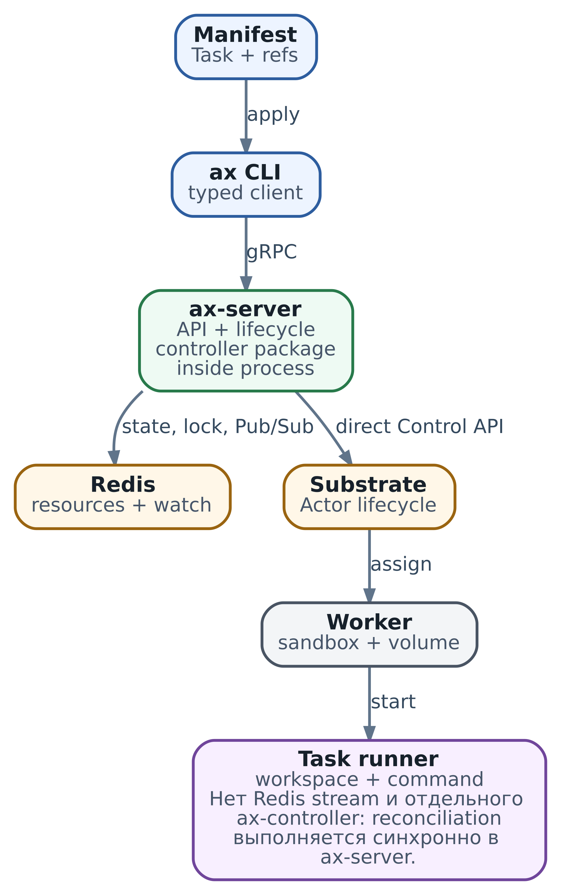

# 16. AX control plane: от декларации к Actor и граница с Substrate

У `review-42` из главы 15 появился пользовательский интерфейс. Инженер больше не хочет вручную создавать ActorTemplate, искать Worker и собирать описание рабочей среды. Он хочет сказать платформе: «Вот задача ревью, вот её checkout и команда; сохрани описание, запусти по запросу и покажи, что происходит». Эту продуктовую роль выполняет AX поверх Substrate.

Но скрыть детали исполнения - не значит устранить их. Пользователь получает timeout при resume, а Actor уже работает. Task показывает Running, но репозиторий ещё не подготовлен. `/healthz` отвечает 200, хотя запись в Redis не проходит. Чтобы разбирать такие случаи, нужно знать, что каждый слой считает своим состоянием и где заканчивается его обещание.

**Статус:** `AX · ac233282` · `DIRECT RECONCILIATION` · `ROADMAP SEPARATED`

Конкретный путь этой главы относится к AX [ac233282](https://github.com/google/ax/tree/ac2332829f22360ff97b0ba34d94dd0dd782f17e). Здесь reconciliation вызывается внутри lifecycle RPC `ax-server`; отдельного фонового `ax-controller` нет. Это описание закреплённой реализации, не гарантия любой версии AX и не доказанная совместимость лабораторной пары AX/Substrate.

## Что читатель сможет сделать после главы

* Разделить продуктовый API, запуск runtime и полезный результат агента.
* Проследить apply, create, resume и delete по реальным границам записи.
* Объяснить, почему phase, readiness и успешный RPC могут расходиться.
* Составить безопасный план после частичного сбоя без создания дубликата.
* Оценить ограничения Redis lock, watch и прямого reconciliation.
* Выбрать, достаточно ли текущего AX или нужен другой слой хранения и выполнения операций.

## Control plane управляет работой но не выполняет её

Control plane - управляющая часть системы: принимает описания, проверяет их, хранит записи и вызывает операции исполнения. Data plane - путь самой работы и её трафика. В AX пользователь обращается к управляющему API, а команда агента выполняется внутри Actor. Один и тот же `ax-server` не должен считаться одновременно agent harness, sandbox и model server.

AX добавляет язык продуктовых ресурсов. `Task` описывает выполняемый экземпляр, `Workspace` - подготовку рабочей среды, `Model` - конфигурацию вызова model provider для соответствующего платформенного клиента. В этом API Task не имеет ссылки на Model. Нельзя создать Model и заключить, что всякая Task автоматически использует его параметры или credentials.

Substrate, напротив, отвечает за Actor, его placement, sandbox, lifecycle и поддерживаемые snapshot/network пути. Он не знает, что для продукта означает «ревью готово к публикации». Runner внутри Actor подготавливает workspace и запускает command; harness управляет agent loop. Успех каждого из этих этапов имеет собственный смысл.

| Слой                       | Его авторитетное описание                                               | Чего оно не доказывает                                          |
| -------------------------- | ----------------------------------------------------------------------- | --------------------------------------------------------------- |
| AX resource store          | Task spec, Workspace/Model records и последний записанный Task status   | Текущее состояние процесса и готовность внешнего результата     |
| AX translation             | Как текущий RPC переводит Task и найденные Workspaces в Substrate calls | Постоянное наблюдение за всеми Task                             |
| Substrate control plane    | Actor identity, state и текущий assignment                              | Смысл Task для пользователя и завершение ревью                  |
| Actor storage и приложение | Сохранённые данные, execution и прикладной журнал                       | Наличие корректного AX record и пользовательского права доступа |

Эти слои полезно сопоставлять, а не назначать один из них «единственной истиной» для всего. Redis может правильно хранить последнее известное AX состояние, пока Actor уже изменился. Snapshot может существовать, когда продуктовая запись Task потеряна. А опубликованное ревью остаётся во внешнем сервисе независимо от suspend или удаления Actor.

\
_&#x41;X Task: фактический путь в срезе ac233282_

Схема показывает wiring прямого пути. Стрелка к Redis и стрелка к Substrate не являются одной атомарной транзакцией. В следующих разделах разберём именно промежутки между ними.

## Кто работает в каждом процессе

CLI `ax` читает manifest и вызывает typed gRPC methods: server получает protobuf resource, не исходный multi-document YAML. `ax-server` проверяет запрос, берёт lock, читает и пишет Redis и вызывает `TaskReconciler` как зависимость в том же процессе. Redis обслуживает resource records, индексы, locks и уведомления watch. Runner работает уже внутри Actor, за границей управляющего API.

Имя Go package `internal/controller` легко принять за отдельный service. Deployment topology подтверждает entrypoint: в `cmd/ax-server/main.go` создаются Redis store, Redis locker, Substrate client и reconciler, затем передаются в API server. Там нет подключения durable queue и запуска отдельного worker, который бесконечно перечисляет Task.

Reconciliation означает «сопоставить требуемое действие и наблюдаемое исполнение, выполнить нужные шаги». Само слово не обещает непрерывный loop. Здесь оно относится к процедуре, вызванной конкретным request. Если процедура закончилась, AX не продолжает автоматически следить за этой Task только потому, что в коде класс называется reconciler.

## Что apply означает для разных ресурсов

В текущем CLI `ax apply` обрабатывает документы последовательно. Для Task это `CreateTask`: существующий Task с тем же `atespace/name` даёт `FailedPrecondition`, даже если новый manifest такой же. Task immutable после создания. Для Workspace и Model используются Update RPC с возможностью create/update.

Это важнее сходства команды с `kubectl apply`. AX не сохраняет YAML одним атомарным batch и не выстраивает dependency graph. Первые документы могут примениться, а следующий завершиться ошибкой. Нужные Workspaces следует создать и проверить до Task, а повторный create не использовать вместо resume.

Atespace задаёт scope имени; пустое значение server заменяет на `default`. В продуктовой конфигурации лучше указывать scope явно. Это не автоматически настроенная tenant authorization: переданный atespace выбирает ресурс, но сам не доказывает право caller на этот ресурс.

### Путь CreateTask

Server валидирует Task, захватывает lock её ключа и проверяет отсутствие записи. Затем сохраняет в Redis spec и начальную phase Suspended. Только после этой записи он читает Workspaces и вызывает reconciler. При configured reconciler процедура создаёт или получает Atespace, ActorTemplate и Actor, затем выполняет ветку suspended и записывает полученный status.

Между шагами есть наблюдаемые окна. Если процесс остановился после SaveTask, запись уже существует, а Actor может ещё отсутствовать. Если runtime изменился и последующая запись status не удалась, Substrate впереди Redis. При возвращённой ошибке reconcile server пытается записать Failed, но ошибка этой дополнительной записи игнорируется; при настоящем падении процесса этот участок вообще не выполняется.

Поэтому ответ create error не означает «ничего не создано». А успешный ответ при наличии обычного reconciler означает прохождение его ветки, не доказательство полезной работы агента. Новая Task по замыслу остаётся suspended до явного resume. Отдельные деградации реализации, разобранные ниже, не позволяют считать даже успешную ветку строгой гарантией состояния Actor.

## Launch configuration и граница существующего Actor

Reconciler использует имя Task как имя Actor. В environment шаблона попадают пользовательские env, `AX_TASK_YAML` и найденные Workspace specs в `AX_WORKSPACES_YAML`. Status исключается из сериализованного launch Task: его изменение не должно создавать новый template digest. Per-task ActorTemplate получает имя с коротким digest image и environment.

Digest - способ различать launch configuration, не криптографическое доказательство полной совместимости state. Кроме того, возвращённый существующий Actor не означает автоматическую замену его template на только что рассчитанный. Изменённый Workspace, новый secret или mutable image tag не обязаны обновить уже работающий процесс. Для воспроизводимости нужны закреплённые inputs и понятная стратегия новой Task либо migration, а не надежда на имя template.

TaskSpec имеет `resources`, но наличия CPU/memory fields недостаточно для вывода об enforcement: inspected translation не переносит эти значения как универсальные runtime limits. Подробная матрица полей находится в главе 17. Для каждого обещания полезен один вопрос: какой код применяет поле и в какой момент?

Есть и неочевидная зависимость workspace. `fetchWorkspaces` пропускает отсутствующие или не прочитанные bindings, не превращая каждый такой случай в ошибку create. Runner может получить меньше объектов, чем ожидал пользователь. «В spec написано имя repository» и «Actor действительно получил нужный checkout» - отдельные результаты.

## Resume использует phase как вход процедуры

У TaskSpec этого среза нет отдельного поля desiredPhase. Handler `ResumeTask` читает Task, меняет `task.Status.Phase` на Running _в памяти request_ и передаёт объект reconciler. Обновлённый status сохраняется в Redis после завершения процедуры. `SuspendTask` аналогично задаёт Suspended в локальном объекте.

В этом пути status.phase одновременно используется как управляющий вход и как последнее сохранённое сообщение пользователю. Это не полноценная модель «durable desired state отдельно, observed state отдельно». Если server остановился после ResumeActor, но до UpdateTaskStatus, persisted Task не обязан отражать уже выполненную просьбу. Фоновый worker не восстановит intent только на основании незаписанного значения из памяти погибшего request.

Такое разделение объясняет timeout из начала главы. Клиент ждёт ответ своего RPC, control plane Substrate выполняет операцию, Redis получает запись позже. Отмена или потеря ответа не откатывает автоматически runtime и тем более внешнюю публикацию ревью. Сначала выясните фактический результат, затем выбирайте следующий lifecycle call.

## Readiness показывает ограниченное наблюдение

После успешного resume AX получает Worker address и, пока WorkspaceReady не True, опрашивает `/readyz?check=workspace`. Default окно - 15 секунд, interval 500 ms, отдельный HTTP request ограничен 2 секундами и общим контекстом. Сначала пробуется direct Worker path; при `ATENET_ROUTER_ADDR` доступен fallback через actor-aware router.

Если проверка не дала успех до окончания окна, handler может вернуть Task с phase Running и Ready=False/WorkspaceReady=False. Это не обязательно ошибка runtime: setup может закончиться позже, либо direct probe не достигает runner. Но после завершения RPC нет постоянного poll, который сам обновит Redis в момент готовности. Watch тоже не запускает reconciliation.

WorkspaceReady здесь сохраняется как признак однажды завершённого setup и может оставаться True через suspend/resume. При следующем resume такой флаг позволяет пропустить новую workspace probe; он не является постоянно обновляемым health signal. CreateTask также не очищает целиком входной status, нормализуя прежде всего phase. Не используйте клиентские или сохранённые conditions как самостоятельное основание выдачи привилегий.

Более глубокий предел разбирает глава 17: runner readiness не подтверждает все Git, bootstrap, MCP и tool postconditions. Нужен свой acceptance: ожидаемый commit checkout, доступный tool, минимальный разрешённый model request и возможность обработать безопасную операцию. Простой Ready=True не заменяет эту проверку.

Не путайте её и с завершением command. Runner может продолжать обслуживать metadata после выхода child process; стандартный wiring `ax-task-runner` не превращает этот exit автоматически в записанный Redis phase Completed. Для «ревью выполнено и результат проверен» требуется прикладное доказательство, а не только существование Task или живой metadata listener.

## Три деградации которые меняют смысл успеха

### Server без reconciler

В entrypoint ошибка инициализации Substrate client приводит к warning и запуску API без reconciler. Например, причиной может быть непригодный CA file. Create/resume тогда могут сохранять record/phase без операций с Substrate. Недоступность API после успешного создания client - другой случай: gRPC client сам по себе не является health probe.

`/healthz` `ax-server` просто отвечает 200 на соответствующий path. Он не выполняет Redis ping и не проверяет наличие reconciler или возможность resume. Этот endpoint показывает жизнь listener, не готовность всего control plane. Проверяйте deployment logs и безопасный синтетический lifecycle на отдельном canary, если продукт обещает runtime provisioning.

### Ошибка suspend становится warning

Suspended branch reconciler вызывает SuspendActor, но его error только логирует. Затем очищает workerIP, ставит phase Suspended/Ready=False и возвращает success. AX Task поэтому может выглядеть suspended, пока Actor всё ещё исполняется.

Это не повод перестать использовать AX; это повод не строить на данном status обещание «нет CPU cost» или «код точно больше не работает». Для подтверждения остановки прочитайте текущий Actor state и завершение нужной операции Substrate. В слоях 14-15 уже есть инструменты, чтобы отличить незавершённый lifecycle от успеха.

### Fallback template и пересоздание после crash

Ошибка custom ActorTemplate также может стать warning с fallback на default template. Следующий Actor способен получить другой image/environment, чем ожидал пользователь. Нужны наблюдение выбранного template и явная политика fail closed для workload, где такой fallback недопустим.

`EnsureActor` не является безусловно безопасным повтором. Для crashed Actor client сначала пытается Revert; если он не удался, code path удаляет Actor и создаёт заново. Имя сохраняется, UID и судьба старого state могут измениться. Поэтому рекомендация «повторить reconciliation» требует сначала проверить Actor, snapshot и допустимость такого recovery. Название Ensure не обещает сохранение индивидуальных данных при любой ошибке.

## Практический пример двух независимых записей

`examples/ch16_dual_write_demo.py` моделирует окно после resume, до записи status. Это две локальные SQLite базы, Python 3.10+ и стандартная библиотека. Имена полей и records упрощены; AX, Redis, Substrate, network и реальные processes не запускаются.

В начале Task record содержит Suspended, соответствующий Actor record - Suspended с UID `actor-u1`. Fixture задаёт approved launch marker. Модель resume меняет локальный объект Task на Running, фиксирует Running в runtime database и выбрасывает SimulatedCrash до записи Task. Затем соединения закрываются и открываются снова.

После reopening Task всё ещё Suspended, Actor уже Running. Попытка create существующей Task отклоняется. Read-only planner сравнивает resource key, ожидаемый UID, request launch и runtime launch; он предлагает проверить существующий Actor перед resume, но ничего не ремонтирует автоматически. Для Actor с новым UID возвращает STOP\_IDENTITY\_CHANGED.

```
python3 examples/ch16_dual_write_demo.py
python3 -m unittest discover -s examples -p 'test_ch16*.py'
```

Решение planner сохраняет неизвестные или несовместимые состояния для разбора:

```
def recovery_plan(task, actor, *, expected_uid, requested_launch):
    if task is None:
        return "STOP_ORPHAN_REVIEW" if actor else "NO_RESOURCES"
    if task["launch"] != requested_launch:
        return "STOP_REQUEST_CHANGED"
    if actor is None:
        return "STOP_RUNTIME_MISSING"
    if not expected_uid:
        return "STOP_MISSING_PROVENANCE"
    if actor["key"] != task["key"] or actor["uid"] != expected_uid:
        return "STOP_IDENTITY_CHANGED"
    if actor["launch"] != task["launch"]:
        return "STOP_LAUNCH_CHANGED"
    if actor["state"] not in {"Running", "Suspended"}:
        return "STOP_LIFECYCLE_REVIEW"
    return "REVIEW_EXISTING_BEFORE_RESUME"
```

### Чтение результата

Полный вывод demo:

```
{
  "source": "two_local_sqlite_records",
  "ax_and_substrate_contacted": false,
  "reopened": {
    "task_phase": "Suspended",
    "actor_state": "Running"
  },
  "retry_create": "REJECTED_IMMUTABLE",
  "plan": "REVIEW_EXISTING_BEFORE_RESUME",
  "planner_mutated_records": false,
  "changed_uid_plan": "STOP_IDENTITY_CHANGED",
  "task_records": 1,
  "actor_records": 1
}
```

Исключение не отменяет уже committed запись другого store. Повторный create не решает расхождение и не является lifecycle repair. Даже разумный plan не меняет record: дальнейшее действие требует проверок и полномочий оператора. Это и есть переносимый урок dual-write, записи одного логического изменения в независимые системы.

`expected_uid` и launch marker - входы учебной модели, не поля AX TaskSpec. В ObjectMeta AX нет UID; TaskStatus.id также не является Actor UID. В реальной системе provenance исполнения нужно записывать отдельно или получать из достоверного inventory/history. Модель сравнивает только заданные markers, не доказывает совместимость image, environment, snapshot и workspace.

Закрытие и reopening SQLite подтверждают конкретный fixture state, не испытание power loss, Redis persistence, распределённой транзакции или реального restart AX. Здесь нет leases, конкуренции handlers и фонового convergence. Для стенда нужны controlled fault points между runtime call и status commit, корректный read-only inventory и проверки всех разрешённых recovery веток.

## Lease уменьшает конфликты но не создаёт транзакцию

Redis lock использует `SET NX` с уникальным token и TTL. Он помогает удерживать одну операцию ключа `lock:task:<atespace>:<name>`; release Lua script удаляет запись только при совпадении token. Pub/Sub будит waiters после освобождения, fallback retry помогает пережить потерю notification.

В этом коде default TTL - 30 секунд; renewal/heartbeat отсутствует. Если первый handler всё ещё выполняет slow Substrate call после истечения lease, второй может получить тот же lock. Проверка token при unlock не отменяет старую работу и не запрещает её поздний status write. Она защищает запись lock нового владельца от чужого release, не все downstream side effects.

Поэтому строгая сериализация ограничена жизнью lease и условиями Redis. Task lock также не блокирует обновление referenced Workspace/Model и не превращает две системы в атомарный commit. Увеличение TTL уменьшает часть вероятности overlap, но увеличивает ожидание после падения и не решает проблему неограниченно долгого RPC.

Когда требуется сильнее, проектируют bounded execution, lease renewal и fencing: downstream должен отвергать действие старого владельца по поколению, а не просто надеяться, что тот остановился. Эти свойства не следует приписывать текущему AX. Подробный lifecycle разбор продолжает глава 19.

## Watch удобен для интерфейса но не для аудита

AX WatchTask сначала подписывается на Redis Pub/Sub, затем читает record и отправляет INITIAL, после чего пересылает MODIFIED. [Redis Pub/Sub](https://redis.io/docs/latest/develop/pubsub/) не хранит уведомления для replay после disconnect. Новый snapshot помогает увидеть record сейчас, но не восстанавливает все пропущенные переходы.

Кроме того, snapshot и подписка не являются versioned event log: API не даёт resume cursor или resourceVersion для восстановления строгой последовательности. Не используйте последний увиденный message как криптографическое доказательство актуальности. Для действия после reconnect перечитайте resource и сопоставьте runtime; для approvals, использования бюджета и расследования храните durable audit с identity и retention.

Наличие Redis transaction pipeline для записи record, индексов и publish не добавляет atomicity внешнему Substrate. Уведомление о Failed/Completed может завершить текущий watch, но сам observer не выполняет command и не определяет бизнес-результат. Интерфейс наблюдения и механизм восстановления - разные функции.

## Как восстановиться после частичного сбоя

Начните с evidence, не с новой Task: timestamp, atespace/name, exact RPC error, AX record, Actor UID/state/template/assignment и нужная durable точка. Не сохраняйте в отчёт literal credentials или полный environment. Отдельно найдите journal внешней операции ревью, если её результат неизвестен.

| Наблюдение                                        | Возможное объяснение                                                 | Следующее безопасное действие                                            |
| ------------------------------------------------- | -------------------------------------------------------------------- | ------------------------------------------------------------------------ |
| Task существует, Actor не найден                  | Запись AX опередила provisioning либо runtime удалён                 | Проверить intent, inputs, storage и допустимость новой activation        |
| Task Suspended, Actor Running                     | Resume впереди status либо suspend warning path                      | Сверить последнюю операцию и решить, нужно продолжить или остановить     |
| Task Running/Ready=True, useful probe не проходит | Устаревшая condition, неполный setup либо другая проблема исполнения | Проверить real runner/workspace/application, не объявлять бизнес-успех   |
| Actor есть, Task нет                              | Потеря/TTL AX record либо отдельное создание runtime                 | Сохранить state и разобрать ownership; не удалять orphan по одному имени |
| Task Terminating, Actor исчез                     | Runtime cleanup завершён, Redis delete ещё не выполнен               | Продолжить разрешённый delete path после проверки references             |

Create уже существующей immutable Task не запустит reconciliation. Для существующей Task lifecycle RPC выбирается по нужному действию и фактическому runtime состоянию; crashed branch с возможным recreate требует отдельного решения. Для отсутствующей Task нельзя автоматически присвоить себе любой совпавший по имени Actor.

DeleteTask сначала сохраняет Terminating, затем удаляет Actor и только потом запись Redis. Substrate DeleteActor считает отсутствие Actor успехом; AX DeleteTask при отсутствии самой Task возвращает NotFound. Cleanup per-task templates является best effort: warning не обязательно удержит Task record. Удалённая Task поэтому не доказывает отсутствие всех templates и не отменяет опубликованное ревью.

Практический recovery считается законченным, когда intent, runtime и пользовательский результат объяснимо согласованы. Одна зелёная phase, исчезнувшая ошибка CLI или повторное создание listener недостаточны.

## Как выбирать архитектуру хранения и выполнения

AX DESIGN объясняет Redis ожидаемым количеством короткоживущих Task. Это мотивировка, не benchmark миллионов Task данного release. Redis позволяет использовать собственные records, sorted-set indexes и live notifications; фактический предел нужно измерять вместе с долгими lifecycle calls и runtime capacity.

Task TTL поддерживается store option, но стандартный entrypoint создаёт store с пустыми options и без заданного Task TTL. Даже включённый TTL удаляет запись, а не запускает автоматический DeleteActor. Persistence, backup и restore Redis также нужно настраивать: store name не обещает подходящий RPO сам по себе.

CRD в Kubernetes дают API conventions, resourceVersion/watch и интеграцию с authn/authz/admission при соответствующей конфигурации. Они не дают бесплатно прикладной controller, бессрочную историю watch или exactly-once внешнего вызова. База с транзакционным operation log тоже не делает внешний runtime участником того же commit автоматически.

| Требование                                                         | Какой вариант рассматривать                 | Обязательное дополнение                                                |
| ------------------------------------------------------------------ | ------------------------------------------- | ---------------------------------------------------------------------- |
| Небольшой проверенный direct lifecycle с допустимыми ограничениями | AX direct path на закреплённой версии       | Защита API, bounded RPC, inventory и явная recovery policy             |
| Много частых product records и свой API contract                   | Собственное хранилище и API, в AX это Redis | Persistence, индексы, авторизация и испытание failure windows          |
| Управление сравнительно редкими cluster configuration objects      | Kubernetes API/CRD                          | Controller и контроль нагрузки, не Task на каждое событие по умолчанию |
| Принятый intent должен пережить падение API process                | Durable operation log/queue и workers       | Повторы, lease/fencing, дедупликация и терминальная verification       |

Асинхронный controller имеет смысл, когда API должен быстро зафиксировать intent и ответить, а исполнение продолжится отдельно с ограниченной concurrency. Но очередь должна быть durable, worker - уметь безопасно повторить шаг, а status - объяснять queue lag и неизвестные исходы. «Вынести reconciler в другой process» без этих contracts ещё не даёт автоматическую convergence.

Для выбора измеряйте create/resume end-to-end latency, lock wait, длительность RPC, readiness polling, Redis write latency и Substrate saturation. Добавление API replicas не создаёт Workers и может увеличить давление на runtime. Сначала найдите bottleneck, затем выбирайте concurrency и архитектуру.

## Security связывает API runtime и внешний результат

Пользовательский server в этом wiring создаёт обычный gRPC server и допускает unencrypted HTTP/2. Защита AX → Substrate может включать TLS authority, CA и bearer token file, но она не является caller authorization пользовательского API. Endpoint для недоверенных клиентов требует отдельной аутентификации, проверки доступа к atespace/Task и защищённого transport. mTLS без соответствующей policy тоже не отвечает на вопрос, какое действие этому caller разрешено.

Reconciler может прочитать Gemini API key из Kubernetes Secret в atespace или fallback server environment и передать его в ActorTemplate env. Secret тогда доступен недоверенному workload и может войти в runtime state/snapshot. Это конкретное поведение среза, не безопасное brokering Model по ссылке из Task.

Для production требование «credential не входит в Actor» выбирайте поддерживаемый broker/egress injection и проверяйте весь путь из главы 15: dataplane, provider, mandatory behavior и допустимые origins. Нельзя заменить env одним effects field и объявить защиту готовой. API lock, шаблон и сеть также не заменяют ограничение полномочий самого review API или tool.

Roadmap AX содержит отдельный setup Actor, least-privilege policies, idleness suspension, branching и расширенную telemetry/governance. Это направления развития, а не включённые возможности ac233282. Для покупки времени инженера важнее проверенный необходимый contract, чем количество знакомых названий в roadmap.

## Практика для самостоятельного решения

В примере замените Actor UID, launch marker, runtime state на Crashed и наличие Task record. Объясните, почему planner останавливается, а не автоматически создаёт или удаляет ресурс. Где в вашей системе хранится достоверная связь Task с incarnation Actor?

Составьте timeline handler, который выполняется 35 секунд при lock TTL 30 секунд. Что предотвращает release с чужим token, а чего он не предотвращает? Где должен проверяться fencing, если поздний старый handler ещё способен писать status или вызывать runtime?

Для `review-42` выпишите четыре проверки: API listener жив, runtime действительно восстановлен, workspace соответствует ожидаемым inputs, ревью опубликовано и сверено. Какие records и probes отвечают на каждый вопрос? Как изменится recovery, если client timeout наступил между двумя записями или watch был отключён?

Наконец, определите продуктовый contract create: синхронно закончить provisioning или durable принять intent для последующего исполнения. Для второго варианта перечислите недостающие operation state, queue/retry, ownership, audit и verification; не приписывайте их текущему server автоматически.

## Итоги главы

AX даёт продуктовый API поверх runtime, но не объединяет Redis, Substrate и внешний результат в одну транзакцию. В ac233282 lifecycle выполняется прямо в API request; phase используется как вход процедуры и сохранённый status, а не как отдельный durable desired-state contract.

Инженеру важно проверять смысл успеха: наличие reconciler, результат suspend, выбранный template, Actor incarnation, реальную readiness и пользовательский outcome. Lease, watch и Ensure уменьшают часть проблем, но каждое имя скрывает собственные ограничения. Безопасное восстановление начинается с сопоставления records, не с безусловного retry или нового имени Task.

Глава 17 продолжит язык Task, Workspace и Model: какие поля кто применяет, как versioning рабочей среды влияет на уже созданные Task и почему schema нужно читать вместе с execution path. Runner и точные lifecycle ветки подробнее разберут главы 18 и 19.

### Источники и дальнейшее чтение

* [AX design](https://github.com/google/ax/blob/ac2332829f22360ff97b0ba34d94dd0dd782f17e/DESIGN.md), [entrypoint](https://github.com/google/ax/blob/ac2332829f22360ff97b0ba34d94dd0dd782f17e/cmd/ax-server/main.go) и [server handlers](https://github.com/google/ax/blob/ac2332829f22360ff97b0ba34d94dd0dd782f17e/internal/server/server.go): direct execution, записи и degraded mode.
* [TaskReconciler](https://github.com/google/ax/blob/ac2332829f22360ff97b0ba34d94dd0dd782f17e/internal/controller/reconciler.go) и [Substrate client](https://github.com/google/ax/blob/ac2332829f22360ff97b0ba34d94dd0dd782f17e/internal/substrate/client.go): suspend warning, readiness latch, templates и recreate после crash.
* [AX protobuf](https://github.com/google/ax/blob/ac2332829f22360ff97b0ba34d94dd0dd782f17e/pkg/apis/v1alpha1/ax.proto) и [CLI apply](https://github.com/google/ax/blob/ac2332829f22360ff97b0ba34d94dd0dd782f17e/cmd/ax/main.go): API kinds, immutable Task и отсутствие desiredPhase/metadata UID.
* [Redis store](https://github.com/google/ax/blob/ac2332829f22360ff97b0ba34d94dd0dd782f17e/internal/store/redis/store.go), [lock implementation](https://github.com/google/ax/blob/ac2332829f22360ff97b0ba34d94dd0dd782f17e/internal/lock/lock.go), [Redis Pub/Sub](https://redis.io/docs/latest/develop/pubsub/) и [Redis lease patterns](https://redis.io/docs/latest/develop/clients/patterns/distributed-locks/): границы сохранения и взаимного исключения.
* [Runner](https://github.com/google/ax/blob/ac2332829f22360ff97b0ba34d94dd0dd782f17e/runner/runner.go), [runner entrypoint](https://github.com/google/ax/blob/ac2332829f22360ff97b0ba34d94dd0dd782f17e/cmd/ax-task-runner/main.go) и [roadmap](https://github.com/google/ax/blob/ac2332829f22360ff97b0ba34d94dd0dd782f17e/docs/roadmap.md): выполнение command и граница будущих возможностей.
