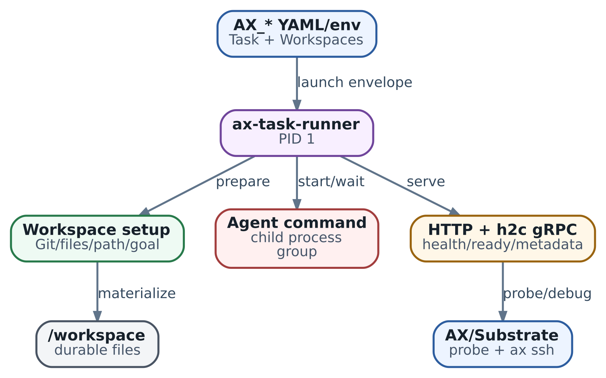

# 18. Runner: PID 1 как платформенный контракт, а не просто entrypoint

**Статус:** `AX · ac233282` · `PROCESS LIFECYCLE` · `READINESS SEMANTICS`

Допустим, мы поручили агенту разобрать сервис выставления счетов. Он должен прочитать код, найти места, где обработка ошибок требует внимания, и сохранить отчёт для инженера. Harness из предыдущих глав умеет вести такое исследование: обращаться к модели, читать файлы, запускать тесты. Чтобы начать, ему нужны каталог проекта, установленный Python, доступные инструменты и команда запуска.

В главе 17 мы описали эту среду через Task и Workspace. Теперь проследим, как описание превращается в работающую программу. Внутри sandbox эту работу выполняет runner. Он подготавливает рабочие каталоги, запускает команду harness и остаётся рядом с ней: обслуживает HTTP-запросы платформы, получает статус завершения процесса, участвует в остановке.

К концу главы вы сможете подключить собственный harness к стандартному runner, объяснить последовательность запуска и выбрать способ сохранения результата. Затем разберём, когда стандартного runner достаточно, а когда требуется изменить управление процессами. Поведение AX рассматривается по исходникам версии `ac233282`; локальный пример позволяет воспроизвести отдельные шаги без развёртывания платформы.

## Зачем между платформой и harness нужен runner

У нашей задачи есть две группы обязанностей. Первая относится к выполнению исследования: какие файлы читать, как сформулировать запрос модели, как проверить выводы, что включить в отчёт. Вторая относится к среде исполнения: куда положить файлы, какой процесс запустить, как сообщить о готовности каталога и как закончить работу при остановке sandbox.

Harness берёт на себя первую группу. Runner — вторую. Это разделение позволяет менять способ исследования, сохраняя знакомый платформе способ запуска. Сегодня команда использует Python и один агентный цикл, завтра — другой framework. Пока обе команды принимают нужную конфигурацию, работают в подготовленном каталоге и сохраняют результат, платформенный запуск может оставаться прежним.

Для нашего сервиса распределение работы выглядит так. Runner подготавливает `/workspace`, выбирает его рабочим каталогом и запускает команду исследования. Harness читает код, собирает наблюдения, создаёт `report.md` и записывает сведения о завершении. Runner получает exit code команды и продолжает обслуживать среду, пока её явно не остановят. Инженер в это время может забрать отчёт и изучить логи.

\
_&#x52;unner contract: граница между AX, sandbox и agent process_

На схеме связь start/wait означает запуск команды и ожидание её завершения. Metadata даёт программе доступ к переданной конфигурации Task и Workspace. Guest services — дополнительный интерфейс работы с процессами и файлами; AX включает его при `debug=true` и успешной инициализации сервиса. Для обычного запуска команды достаточно основного runner.

## Что подготовить для запуска своего harness

Начнём с трёх конкретных вещей: исполняемой команды, рабочего каталога и способа получить результат.

Команду AX runner получает как список аргументов. Например, если в образ заранее установлен наш модуль исследования, значение `spec.command` может быть таким:

```
["python3", "-m", "review_agent", "--input", ".", "--output", "report.md"]
```

Здесь `review_agent` — условный модуль нашего приложения, который команда должна добавить в образ. Runner запускает executable `python3` с указанными аргументами через Go `exec.Command`. Такой запуск удобен тем, что границы аргументов явные: путь с пробелом остаётся одним аргументом. Если нужен shell pipeline, например обработка вывода через несколько утилит, shell задают отдельной командой с `-c` и продумывают экранирование её строки.

Рабочий каталог выбирается по первому Workspace binding. Если он указывает на `/workspace`, аргумент `--input .` относится к этому каталогу. Остальные bindings runner тоже подготавливает, в порядке объявления. Так harness получает предсказуемую точку входа: исходники лежат по известному пути, а дополнительные данные доступны в других объявленных каталогах. Без bindings используется `/workspace`.

Результат тоже стоит определить до запуска. В нашем случае это текст отчёта и небольшая запись о завершении. В записи удобно хранить путь к отчёту, идентификатор задания и выполненный этап. Другой сервис сможет найти артефакт, а инженер — понять, какую именно работу он представляет. Для долгой задачи рядом сохраняют промежуточный checkpoint: например, список уже разобранных файлов.

AX создаёт контейнер с фиксированной командой `/usr/local/bin/ax-task-runner`. Описание Task передаётся runner через `AX_TASK_YAML`, найденные Workspace — через `AX_WORKSPACES_YAML`. Поэтому образ для нашего агента должен содержать и совместимый AX runner по ожидаемому пути, и Python с модулем `review_agent`. Обычный способ — расширить проверенный образ runner и установить в него зависимости приложения. Собственный `ENTRYPOINT` образа не заменяет команду, указанную в AX ActorTemplate.

Это продолжение выбора template из глав 16–17. Перед запуском проверяют фактически выбранный образ, переменные среды и mapping volumes: provisioning может использовать fallback template. Для результата, который должен переживать сохранение Task, выбирают включённый в snapshot volume. В рассматриваемом BuildActorTemplate `/workspace` относится к такому volume; для другого каталога mapping задают и проверяют отдельно.

## Запуск по шагам

Проследим нормальный запуск исследования. Сначала default binary читает YAML-конфигурацию из environment или файлов. Флаги `--task-file` и `--workspace-file` позволяют передать описания из файлов. Ошибка чтения или некорректный YAML завершает этот этап с ошибкой. Binary также поддерживает запуск без описания Task — он полезен для работы с пустой средой, но нашему исследованию нужна Task с командой.

Затем runner открывает HTTP listener. Он нужен уже во время подготовки: платформа может проверить, что runner отвечает, пока checkout ещё создаётся. После открытия listener runner последовательно вызывает подготовку Workspace bindings. Когда все вызовы вернулись без ошибки, он устанавливает признак готовности среды.

Теперь можно создать дочерний процесс. Runner задаёт ему рабочий каталог, передаёт окружение и связывает стандартные потоки ввода и вывода со своими. Поэтому сообщения harness попадают в обычный поток логов запуска. В окружении команды доступен `AX_METADATA_URL`: по нему приложение может прочитать стартовое описание Task и Workspace.

Последовательность в нашем сценарии:

```
Runner читает описание Task
  → открывает HTTP listener
  → подготавливает /workspace
  → отмечает готовность среды
  → запускает review_agent в /workspace
  → получает exit code после завершения исследования
  → обслуживает среду до запроса остановки
```

Во время подготовки `/healthz` отвечает 200, а `/readyz` — 503. После успешного возврата всех вызовов подготовки `/readyz` отвечает 200. Это позволяет отличить запущенный runner от подготовленной им среды. В AX по умолчанию используется порт 80; флаг binary `--port` меняет локальный listener, но платформенный template и его probe должны быть настроены согласованно.

Нужные самому агенту проверки выполняют в начале команды: например, читают обязательный файл конфигурации, сверяют checkout и проверяют наличие тестового инструмента. Это особенно важно в рассматриваемой реализации: возвращённая ошибка подготовки оставляет ready=false, но command всё равно может стартовать; часть ошибок подготовки логируется внутри Workspace setup. Для нашего исследования при недостающих исходниках команда должна закончиться с понятной ошибкой, а не отправить модели пустой каталог. Подробности материализации Workspace остаются в главе 17.

## Как runner связан с процессами

Когда runner запускает harness, операционная система создаёт дочерний процесс. У каждого процесса есть PID — его номер. PPID — номер родителя. Родитель получает возможность дождаться завершения ребёнка и прочитать его exit status. В AX эту работу выполняет `cmd.Wait()`.

Номера в следующем примере условные. Если runner запущен первым процессом в отдельном Linux PID namespace, картина может выглядеть так:

```
PID 1   ax-task-runner
  └─ PID 24  python3 -m review_agent
       └─ PID 31  pytest
```

Здесь runner ждёт процесс 24. Harness запустил тесты и отвечает за процесс 31: должен прочитать их вывод, дождаться завершения и включить результат проверки в отчёт. Такое распределение естественно для задачи: harness знает, зачем нужны тесты и когда их можно прекратить.

После завершения ребёнка родитель собирает его exit status вызовом Wait. До этого в системе сохраняется запись о завершившемся процессе, называемая zombie. Сам процесс уже не вычисляет; запись нужна родителю для получения результата. Поэтому работа с дочерними утилитами включает и запуск, и ожидание.

PID 1 имеет особую роль: это init данного namespace. При его завершении Linux прекращает остальные процессы namespace. К нему также могут переподчиняться осиротевшие потомки, если их не принимает более близкий subreaper. Так называют процесс, настроенный принимать осиротевших потомков и собирать их статусы. Выбор главного процесса влияет на срок жизни всей среды, поэтому в названии главы он назван платформенным контрактом.

Стандартный AX runner ждёт свою прямую command. Для harness, который сам аккуратно управляет тестами и утилитами, это понятная модель. Если приложение оставляет фоновые службы после собственного выхода, нужен supervisor, который учитывает их жизненный цикл и выполняет ожидание. В проверенном runner общего цикла сбора статусов произвольных потомков нет.

## Небольшой запуск, который можно повторить

В учебном примере сохраним описанный порядок и упростим само исследование. Вместо модели программа найдёт строки `TODO:` в файле. Так видно, какие обязанности относятся к запуску, а какие — к содержанию работы. Затем эту команду можно заменить своим harness, оставив те же шаги подготовки и получения результата.

Пример состоит из локального runner с HTTP endpoints и отдельной рабочей команды. Он создаёт временный каталог, кладёт туда файл сервиса, отмечает готовность и запускает дочерний процесс с этим каталогом в качестве cwd. Команда пишет `report.txt` и `result.json`. После её выхода runner продолжает отвечать на HTTP-запросы; в конце пример явно закрывает его и удаляет временную среду.

Запустите из корня репозитория:

```
python3 examples/ch18_runner_observation.py
python3 -m unittest discover -s examples -p 'test_ch18_runner_observation.py'
```

Рабочая часть программы:

```
def build_report(workspace: Path) -> dict:
    lines = (workspace / 'service.txt').read_text(encoding='utf-8').splitlines()
    findings = [f'{number}: {line.strip()}'
                for number, line in enumerate(lines, 1) if 'TODO:' in line]
    (workspace / 'report.txt').write_text('\n'.join(findings) + '\n', encoding='utf-8')
    result = {'stage': 'completed', 'report': 'report.txt', 'items': len(findings)}
    temporary = workspace / 'result.tmp'
    temporary.write_text(json.dumps(result), encoding='utf-8')
    os.replace(temporary, workspace / 'result.json')
    return result
```

Функция сначала читает вход, затем создаёт отчёт, после этого записывает сведения о завершении. Временный файл и `os.replace` позволяют заменить запись результата целиком. Это простая защита от чтения частично записанного JSON; сохранность при отключении питания требует отдельной работы с файловой системой и синхронизацией данных. В промышленной версии запись также связывают с идентификатором конкретного запуска, чтобы отличать её от артефактов прошлого задания.

Вывод примера:

```
{
  "before_setup": {
    "health": 200,
    "ready": 503
  },
  "after_command": {
    "health": 200,
    "ready": 200,
    "exit_code": 0
  },
  "result": {
    "stage": "completed",
    "report": "report.txt",
    "items": 2
  },
  "report_lines": [
    "2: TODO: add retry test",
    "3: TODO: document timeout"
  ],
  "runner_closed": true
}
```

Первая пара значений относится к подготовке. Вторая получена после выхода рабочей команды. Между этими наблюдениями создан результат: два пункта отчёта и запись `completed`. Для реального исследования инженер дополнительно проверит содержимое отчёта — например, есть ли ссылки на код и воспроизводимые объяснения найденных проблем. Exit code помогает обнаружить ошибку выполнения программы, а качество исследования оценивают по её артефакту.

Это локальная Python-модель отдельных механизмов: HTTP, cwd, запуск собственного процесса, ожидание и остановка. Она слушает только loopback и создаёт отдельную session/process group через `start_new_session`; Go runner AX создаёт новую process group через `Setpgid`. Пример не развёртывает AX/Substrate и не проверяет PID namespace или восстановление snapshot.

## Зачем runner живёт после завершения команды

Исследование закончилось, и мы хотим прочитать отчёт, посмотреть файлы или запустить дополнительную диагностику в подготовленной среде. Для этого удобно сохранить sandbox доступным. Доступ к процессам и файлам через guest services требует включённого debug; основной HTTP metadata остаётся доступным и без него. Стандартный AX runner после выхода command сообщает её exit через предусмотренный callback, если он задан, и ждёт отмены своего context. HTTP продолжает обслуживаться.

Получается два отдельных события: закончилась рабочая команда; остановлена среда. Их полезно хранить и наблюдать раздельно. `/healthz` сообщает, что HTTP runner отвечает. `/readyz` отражает признак подготовки Workspace. Запись результата относится к выполненной работе. Стандартный runner сам не переводит AX Task в прикладной статус Completed.

Если вы строите очередь исследований, задайте отдельный протокол получения результата: кто читает запись завершения, как проверяет артефакт и когда останавливает Task. Для интерактивной среды эту остановку может запросить инженер после осмотра файлов. Для автоматического задания её инициирует сервис после получения и сохранения результата. Так срок хранения среды становится осознанным выбором, а не побочным эффектом выхода Python.

## Как остановить работу посередине

Представим, что исследование занимает час, но Task нужно остановить через двадцать минут. Полезный исход — сохранить уже разобранные файлы и продолжить позже. Для этого harness записывает checkpoint по ходу работы: какие файлы обработаны, где лежат наблюдения, какую операцию он выполняет сейчас. Обработчик остановки завершает ближайший безопасный шаг и сохраняет обновлённый checkpoint.

Когда default binary получает SIGTERM или interrupt, он отменяет context runner. Если command ещё работает, runner посылает SIGTERM её process group. Это группа процессов, которым можно адресовать общий сигнал. AX создаёт для command новую группу; обычные дочерние утилиты наследуют её. Поэтому запрос остановки может получить и harness, и запущенный им тестовый процесс.

Harness должен координировать этот выход: прекратить запуск новых действий, дождаться обязательных детей, сохранить состояние и завершиться. Runner ждёт прямую command до десяти секунд. Если она не завершилась, он отправляет группе SIGKILL. SIGTERM даёт приложению возможность отреагировать; SIGKILL принудительно прекращает процесс, и обработчик сохранения при нём не выполняется.

Process group полезна для доставки сигнала, а supervisor — для согласованного завершения работы. Потомок может создать другую группу или session, и тогда групповой сигнал его не охватит. Кроме того, стандартный runner завершает ожидание после выхода прямой command: оставшихся членов группы он отдельно не проверяет. Если command вышла ещё до отмены context, этот путь групповой остановки вообще не вызывается. Поэтому harness удобно держать foreground-процессом, который завершится после своих обязательных детей.

При расчёте времени сохранения оставляйте запас. Десять секунд — grace ожидания command в этой ветке, а не общий deadline остановки runner. После SIGKILL Go-код снова ждёт Wait без второго timeout; callback и остановка HTTP также могут занять время. Внешний runtime имеет собственную политику прекращения среды. Если checkpoint требует долгой записи, лучше сохранять его малыми порциями во время работы.

Для внешних действий, например отправки patch, в checkpoint сохраняют идентификатор операции. При следующем запуске harness проверит её исход во внешней системе. Это позволяет продолжить работу после потери подтверждения, не отправляя одно действие повторно вслепую.

## Продолжение из сохранённого состояния

В BuildActorTemplate рассматриваемой версии AX используется Data для сохранения и `RESUME_SOURCE_GOLDEN` для восстановления. Data сохраняет предусмотренные данные, а GOLDEN предоставляет общий подготовленный guest state. Индивидуальную память конкретного harness Data не сохраняет. Поэтому прогресс исследования удобно выражать через файлы и записи, которые harness умеет перечитать.

Например, в checkpoint указано, что разобраны 18 из 50 файлов. В сохранённом каталоге лежат наблюдения по этим файлам. После восстановления harness проверяет входные данные, читает checkpoint и выбирает следующий файл. Если там отмечена начатая внешняя операция, сначала выясняет её исход. Такой способ продолжения объясним и при восстановлении платформой, и при обычном повторном запуске приложения.

Конкретный template определяет состав сохранения и путь resume. Для другого template или режима Full проверяют его policy и совместимость runtime. Поведение процессов при восстановлении следует из этого пути; универсального обещания «всегда новый PID 1» здесь нет. Состав и ownership snapshots подробно разобраны в [главе 39](../vii.-deep-dives/39-substrate-snapshot-ownership.md).

## Что harness получает через metadata

Metadata помогает приложению прочитать описания, с которыми оно было запущено. Адрес передаётся через `AX_METADATA_URL`; default использует loopback URL на порт runner. По пути `/metadata/v1alpha1/ax/task` приложение получает Task в YAML, а по `/metadata/v1alpha1/ax/workspaces` — переданные Workspace в multi-document YAML. Это удобно, когда harness нужны параметры Task или имена Workspace bindings. В обычном пути runner отдаёт стартовую конфигурацию: живая подписка на изменения AX API в Run не подключена.

При настройке доступа учитывайте содержимое ответа: в Task могут находиться literal env. HTTP metadata handlers не имеют встроенной проверки caller, а listener bind выполняется на `:<port>`, то есть на всех интерфейсах. Сетевые правила должны разрешать только нужные маршруты к этому порту. Debug расширяет набор сервисов, но основные metadata доступны и с выключенным debug.

В собственных конфигурациях удобно зарезервировать платформенные имена переменных, включая `AX_METADATA_URL`: Task env может перекрыть этот адрес. Так пользовательские настройки приложения и настройки runner останутся различимыми. Если нужны debug guest services, отдельно проверяют успешную инициализацию и допустимый доступ: HTTP и незашифрованный HTTP/2 с gRPC обслуживаются одним listener.

## Как выбрать способ подключения

Для нашего одиночного harness начните с расширения образа. Он выполняет работу в foreground, сам ждёт тестовые утилиты, пишет отчёт и умеет сохранять промежуточное состояние. Стандартный lifecycle подходит этой задаче, а зависимости приложения можно обновлять в образе.

| Задача                                                              | Подход                                                                  | Что предстоит поддерживать                                                      |
| ------------------------------------------------------------------- | ----------------------------------------------------------------------- | ------------------------------------------------------------------------------- |
| Добавить Python, CLI и собственный harness                          | Расширить совместимый образ AX runner                                   | Пакеты, их версии, image digest и код приложения                                |
| Добавить небольшую интеграцию при выходе command                    | Встроить Go runner package                                              | Собственный binary, чтение конфигурации и обработку callback                    |
| Управлять несколькими службами с общей остановкой и сбором статусов | Спроектировать собственный runner или согласованную supervision-обвязку | Родительство процессов, readiness, signals, ожидание и платформенные интерфейсы |

Embedding уместен, например, для короткой отправки записи о завершении в вашу систему наблюдения. Callback выполняется синхронно, поэтому его работа должна иметь собственное ограничение времени и обработку ошибок. В default binary такой callback не задан. Для прикладного отчёта по-прежнему удобен протокол результатов в harness.

Собственный runner выбирают, когда меняется сам порядок исполнения: несколько обязательных служб, другая политика restart, общий сбор статусов потомков. В этом случае сначала описывают процессную модель и последовательность stop, затем согласуют executable, port и endpoints с AX template. Цена решения — постоянная поддержка этой интеграции, включая сценарии отказа. Отсутствующая библиотека в Python обычно решается гораздо проще, на уровне образа.

## Если запуск пошёл иначе

Удобнее искать сбой по последнему завершённому шагу. Если HTTP не появился, проверьте чтение YAML, наличие executable и ошибку открытия listener. Если health отвечает, но ready остаётся 503, изучите подготовку Workspace и файлы в рабочем каталоге. Если command вышла с ошибкой, нужны её логи и фактические аргументы запуска. Если exit code равен нулю, а отчёта нет, проверьте путь записи и протокол завершения приложения.

В локальных тестах рядом с успешным примером оставлены три полезных ситуации: выход с ненулевым кодом, мягкая остановка с checkpoint и команда, игнорирующая SIGTERM. Можно воспроизвести их и сравнить с нормальным запуском. Для native AX потребуются отдельные интеграционные проверки выбранного template; в этой главе они не выполнялись.

Для самостоятельной работы добавьте в учебный отчёт идентификатор задания и проверку, что запись результата относится к текущему запуску. Затем опишите checkpoint для настоящего исследователя кода: что он сохранит после каждого файла и как выберет следующий. Наконец, перечислите дочерние утилиты вашего harness и укажите, кто ждёт их выхода при остановке.

## Итоги главы

Теперь путь от Task к отчёту можно проследить целиком. Платформа запускает runner; runner читает конфигурацию и подготавливает Workspace; harness выполняет исследование и сохраняет результат. После выхода harness среда остаётся доступной для осмотра до отдельного запроса остановки.

Для подключения своего агента сначала определяют команду, рабочие пути и формат результата. Затем выбирают образ и проверяют подготовку. Для длинной работы добавляют checkpoint и управляемый выход. Изменять runner стоит тогда, когда задача требует другого управления процессами. В следующей главе рассмотрим те же события со стороны AX: Create, resume, suspend и delete.

### Источники и дальнейшее чтение

* [Default runner](https://github.com/google/ax/blob/ac2332829f22360ff97b0ba34d94dd0dd782f17e/runner/runner.go): Run, Wait, callbacks и stopCommand.
* [Entrypoint](https://github.com/google/ax/blob/ac2332829f22360ff97b0ba34d94dd0dd782f17e/cmd/ax-task-runner/main.go): specs и signal context.
* [Metadata server](https://github.com/google/ax/blob/ac2332829f22360ff97b0ba34d94dd0dd782f17e/internal/metadata/server.go): listener, handlers и Shutdown.
* [Workspace setup](https://github.com/google/ax/blob/ac2332829f22360ff97b0ba34d94dd0dd782f17e/internal/workspace/setup.go): подготовка файлов и checkout.
* [Task reconciler](https://github.com/google/ax/blob/ac2332829f22360ff97b0ba34d94dd0dd782f17e/internal/controller/reconciler.go): readiness polling и conditions.
* [BuildActorTemplate](https://github.com/google/ax/blob/ac2332829f22360ff97b0ba34d94dd0dd782f17e/internal/substrate/client.go): launch и Data/GOLDEN policy.
* [Runner documentation](https://github.com/google/ax/blob/ac2332829f22360ff97b0ba34d94dd0dd782f17e/docs/runner.md) и [sandbox documentation](https://github.com/google/ax/blob/ac2332829f22360ff97b0ba34d94dd0dd782f17e/docs/sandbox.md).
* [Linux PID namespaces](https://man7.org/linux/man-pages/man7/pid_namespaces.7.html), [kill](https://man7.org/linux/man-pages/man2/kill.2.html) и [wait](https://man7.org/linux/man-pages/man2/waitpid.2.html): init, групповые сигналы и ожидание процессов.
