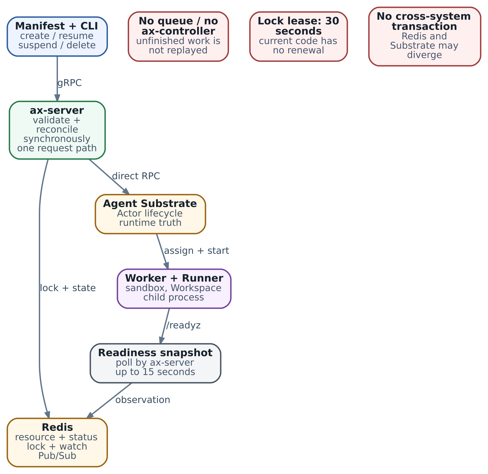

# 19. Task lifecycle в AX: synchronous reconciliation, состояния и recovery

В главе 18 наш агент исследовал сервис выставления счетов и сохранял отчёт. Мы разобрали запуск внутри sandbox: runner готовит каталог и создаёт процесс harness. Теперь посмотрим на ту же работу со стороны платформы. Как зарегистрировать задание, выбрать момент запуска, приостановить исследование до завтра и освободить ресурсы после получения результата?

Этими действиями управляет lifecycle Task — последовательность операций над одним заданием. Возьмём Task `review-billing-142` в Atespace `default`. Сначала подготовим его через `CreateTask`, затем запустим через `ResumeTask`. Посередине работы вызовем `SuspendTask`, позже продолжим исследование, а после сохранения отчёта удалим среду через `DeleteTask`.

Для каждого шага проследим, кто выполняет действие и где сохраняется его результат. Это поможет и при обычном запуске, и при потере ответа: инженер сможет выяснить, что уже произошло, и выбрать следующий запрос. Поведение AX в главе относится к срезу `ac233282`.

## Кто управляет одним заданием

Клиент обращается к `ax-server` через gRPC. Для ручной работы это обычно CLI `ax`; сервис автоматизации может использовать тот же API из программы. Сервер хранит описание Task и его status в Redis. По имени Task он находит связанный Actor в Agent Substrate — среду, в которой выполняется работа.

Substrate размещает Actor на Worker и выполняет runtime-операции. Внутри запущенной среды runner подготавливает Workspace и запускает harness. Сам harness читает код сервиса, проводит исследование и сохраняет отчёт. Поэтому в одном задании есть несколько полезных наблюдений: запись Task, состояние Actor, готовность каталога и результат исследования. Каждое отвечает на свой вопрос.

Например, запись Task позволяет восстановить параметры задания после перезапуска `ax-server`. Состояние Actor помогает понять, выделен ли Worker. Готовность runner показывает результат подготовки Workspace. Чтобы получить выводы исследования, нужен сохранённый harness отчёт. При нормальной работе эти сведения складываются в понятную историю одного задания.

\
_&#x41;X Task в срезе ac233282: synchronous lifecycle под per-resource lock_

На схеме показан путь lifecycle-запроса. Reconciliation здесь означает приведение среды исполнения к запрошенному состоянию: обеспечить нужные ресурсы, вызвать операцию Substrate и сохранить полученный status. В этом срезе код выполняется синхронно внутри обработчика RPC: клиент ждёт, пока сервер пройдёт эти шаги.

Redis в такой схеме хранит ресурсы, блокировки и уведомления для наблюдателей. Сами операции запускает `ax-server`. Если вы встречали ранние материалы про Redis Streams и отдельный `ax-controller`, это другая архитектура: в рассматриваемом срезе очередь reconciliation удалена. Имя пакета `internal/controller` осталось, но его reconciler вызывается из сервера.

## Создание Task и подготовка Actor

Начнём с `CreateTask`. В его запросе находится описание исследования: имя, image, command, переменные среды и Workspace bindings. Подробно эти ресурсы разобраны в главе 17. Здесь нас интересует, в каком порядке сервер использует описание.

Сначала сервер проверяет Task, подставляет Atespace `default`, если он не указан, и получает блокировку для этого имени. Затем проверяет, что Task ещё нет. Имя вместе с Atespace служит адресом ресурса, поэтому для нового задания выбирают новое имя. В этом API Task immutable: изменить существующее описание повторным create нельзя. Даже тот же manifest для существующего имени вернёт `FailedPrecondition`.

После проверок сервер записывает Task в Redis с `phase=Suspended`. С этого момента задание можно найти через `GetTask`. Затем reconciler обеспечивает Atespace и Actor в Substrate. Actor получает то же имя, что и Task; имя и область `default/review-billing-142` позволяют сопоставлять записи двух систем.

Чтобы запустить правильную программу, reconciler формирует конфигурацию для runner: `AX_TASK_YAML` без status, найденные Workspace specs и окружение. Для image и окружения рассчитывается digest, входящий в имя per-task ActorTemplate. Так изменение launch-конфигурации отделяется от обычного обновления status. Выбор template и возможный fallback уже разобраны в главах 16–17; при расследовании запуска смотрят фактически использованный template.

Последний шаг create — запрос suspend для подготовленного Actor. Затем AX сохраняет `Ready=False` с reason `TaskSuspended`. Нормальный итог: Task зарегистрирован, Actor подготовлен, исследование ещё не запущено. Это удобно, когда задания создают заранее, а вычисления разрешают позже — например, после проверки входных данных или в начале выделенного окна работы.

Порядок записи Task и создания Actor важен для восстановления. Если provisioning завершится ошибкой, имя Task уже может быть занято. Поэтому после потерянного ответа create сначала выполняют `GetTask`. Найденная запись даёт отправную точку: проверить её описание, состояние Actor и причину ошибки. Так повторный запрос продолжит работу с тем же заданием, а не начнёт второе исследование под новым именем случайно.

## Запуск исследования через ResumeTask

Когда входные данные готовы, вызываем `ResumeTask` для существующего имени. Обработчик получает блокировку Task, читает его из Redis и устанавливает `Running` в рабочей копии записи. Reconciler обеспечивает необходимые ресурсы и обращается к `ResumeActor` в Substrate.

После успешного resume AX получает сведения о Worker assignment и сохраняет адрес в `workerIp`. Дальше начинается уже знакомая цепочка: sandbox, runner, подготовка каталога, command harness. Удобно различать запуск среды и готовность каталога, потому что checkout и установка инструментов могут занимать заметное время.

Для этого в status есть phase и conditions. Phase описывает крупный этап lifecycle. Condition — более узкий признак с полями status, reason и message. Например, `WorkspaceReady=False` с reason `Initializing` означает, что AX ещё не получил подтверждения подготовки Workspace. Приложение может показать инженеру осмысленное сообщение вместо одного неопределённого «запускается».

При первой подготовке AX обращается к `/readyz?check=workspace` runner. Сначала используется Worker IP, затем при настроенном `ATENET_ROUTER_ADDR` возможна проверка через router. AX делает начальную попытку и далее повторяет проверки с интервалом 500 миллисекунд, в пределах заданного окна. По умолчанию окно равно 15 секундам.

Если runner ответил 200, AX устанавливает `WorkspaceReady=True` и `Ready=True`. Если окно истекло без подтверждения, успешный resume Actor остаётся отражён как `Running`, а conditions сообщают о подготовке. Ошибка самого `ResumeActor` ведёт к `Failed` и reason `ActorResumeFailed`. Эти исходы помогают выбрать, где продолжить наблюдение: в runtime или в подготовке рабочей среды.

Сохранение status происходит после reconciliation. Изменение phase в памяти обработчика ещё не означает, что новый status уже доступен другому клиенту через Redis. При нормальном успешном ответе сервер прошёл и этот шаг. При обрыве запроса нужно перечитать запись и сопоставить её с Actor.

## Ожидание готовности и время жизни запроса

Предположим, наш checkout готовится двадцать секунд. Сервер успел запустить Actor, но первая проверка Workspace закончилась раньше. Runner продолжает подготовку. Позже его probe уже может отвечать 200, тогда как сохранённый AX status всё ещё показывает `Initializing`.

Причина — способ выполнения reconciliation. В данном срезе очередной lifecycle RPC запускает работу reconciler, а отдельного постоянного наблюдателя за readiness нет. Поэтому вызывающая система должна решить, как ждать длинную подготовку. Она может проверять runner перед выдачей работы, а затем при необходимости повторить контролируемый lifecycle-запрос для обновления AX status. Для большого потока заданий имеет смысл отдельный observer с ограничением частоты и времени ожидания.

Здесь особенно полезно сопоставить три разных таймера:

| Механизм                             | Значение в рассматриваемом коде | Что ограничивает                                                                                    |
| ------------------------------------ | ------------------------------- | --------------------------------------------------------------------------------------------------- |
| Deadline команды CLI `ax resume`     | 15 секунд                       | Весь RPC, включая ожидание lock, обращения к Substrate и запись status                              |
| Окно проверки Workspace в reconciler | По умолчанию 15 секунд          | Подготовку, наблюдаемую после успешного resume Actor; родительский context может закончиться раньше |
| Lease Redis lock                     | По умолчанию 30 секунд          | Срок владения блокировкой конкретного ресурса                                                       |

Deadline — время, до которого клиент готов ждать ответ. Оно не описывает прогресс исследования. Если до readiness уже ушло несколько секунд, оставшееся время RPC будет меньше полного пятнадцатисекундного окна. Поэтому стандартный CLI может получить тайм-аут, хотя Actor уже запущен. Автоматизация на gRPC задаёт свой deadline с учётом всех этапов и всё равно обрабатывает неоднозначный исход через чтение состояния.

Увеличение deadline полезно для медленной штатной операции, но его согласуют с lease блокировки. Один длинный запрос и множество коротких повторов имеют разные последствия. К устройству lease вернёмся ниже.

## Приостановка и продолжение исследования

Допустим, агент разобрал восемнадцать файлов, а работу нужно отложить до завтра. Harness сохраняет checkpoint: какие файлы уже обработаны, где лежат наблюдения, какая внешняя операция ожидает подтверждения. Затем вызываем `SuspendTask`.

AX читает Task под той же блокировкой и передаёт reconciler запрошенную phase `Suspended`. Тот вызывает `SuspendActor`, очищает `workerIp` и устанавливает `Ready=False/TaskSuspended`. Task остаётся адресуемым по прежнему имени. При успешном runtime suspend вычисление приостанавливается, а сохранение и дальнейшее восстановление определяются policy ActorTemplate.

В BuildActorTemplate этого среза используются Data и `RESUME_SOURCE_GOLDEN`: данные объединяются при восстановлении с общим подготовленным guest state. Data не сохраняет индивидуальную RAM нашего harness. Поэтому продолжение исследования строят на checkpoint в сохранённых данных. Какой процесс продолжится или будет запущен в конкретном пути resume, зависит от template и runtime; обязательный новый PID 1 здесь обещать нельзя. Подробности пути сохранения — в главах 18 и 39.

В текущем reconciler ошибка `SuspendActor` записывается как warning, после чего AX всё равно может сохранить `Suspended`. Если приостановка нужна для прекращения расхода ресурсов, после ответа проверяют Actor и его Worker assignment в Substrate. Так прикладное решение «вычисление остановлено» опирается на runtime-подтверждение.

При следующем `ResumeTask` полезно знать ещё одну особенность: `WorkspaceReady=True` сохраняется через suspend/resume. AX использует этот прежний результат и пропускает повторные probes подготовки. Это ускоряет возврат уже подготовленной среды. Свежую проверку доступности модели, необходимых инструментов и пригодности восстановленных файлов выполняет harness перед продолжением работы.

## Учебный пример полного цикла

Воспроизведём выбранные решения lifecycle в маленькой локальной модели. Она хранит Task и Actor в памяти, а ответы probe получает списком. Это позволяет увидеть порядок переходов без развёртывания AX, Redis и Substrate. Время, сетевые вызовы, блокировки и snapshots здесь не моделируются.

Запустите из корня репозитория:

```
python3 examples/ch19_task_lifecycle.py
python3 -m unittest discover -s examples -p 'test_ch19_task_lifecycle.py'
```

В модели Task — неизменяемая запись с phase и двумя булевыми признаками. Реальный AX хранит готовность в conditions; короткие поля модели нужны для наглядного вывода. После успешного resume Actor решение о readiness принимает функция:

```
def finish_resume(task: Task, probe_replies: list[bool]) -> tuple[Task, int]:
    workspace_ready = task.workspace_ready
    probes = 0
    if not workspace_ready:
        for reply in probe_replies:
            probes += 1
            if reply:
                workspace_ready = True
                break
    updated = replace(task, phase='Running',
                      workspace_ready=workspace_ready, ready=workspace_ready)
    return updated, probes
```

`replace` из `dataclasses` создаёт обновлённую копию записи. На первом запуске функция перебирает наблюдения до первого успешного. При уже сохранённом `workspace_ready=True` она сразу использует его. В Go reconciler вместо списка ответов работает ограниченный временем HTTP polling; решение о сохранённом успешном setup устроено так же.

Программа выполняет create, первый resume, suspend, второй resume и delete. Результат:

```
{
  "create": {
    "phase": "Suspended",
    "ready": false
  },
  "first_resume": {
    "phase": "Running",
    "ready": true,
    "workspace_ready": true,
    "probes": 2
  },
  "suspend": {
    "phase": "Suspended",
    "ready": false,
    "workspace_ready": true
  },
  "second_resume": {
    "phase": "Running",
    "ready": true,
    "workspace_ready": true,
    "probes": 0
  },
  "delete": {
    "task_exists": false,
    "actor_exists": false,
    "templates": 0
  }
}
```

При первом resume модель получает ответы `False`, затем `True`: две проверки. Suspend сохраняет память о подготовке, но снимает общую готовность к работе. Второй resume обходится без нового опроса — поэтому `probes` равно нулю. Для приложения это повод иметь собственную свежую проверку зависимостей, а для оператора — читать conditions вместе с историей Task.

В тестах можно изменить ответы на одни `False`, прервать delete после удаления Actor или задать ошибку suspend. Эти сценарии дополняют нормальный цикл. Проверка локальной модели проверяет именно её правила; совместимость лабораторной пары и native lifecycle проверяются отдельно.

## Удаление среды после получения результата

Когда отчёт принят и сохранён в нужном месте, Task можно удалить. Перед этим определяют, какие данные понадобятся после удаления: сам отчёт, ссылки на изменения кода, журналы исследования и идентификаторы внешних операций. Если их единственная копия лежит внутри удаляемой среды, сначала выбирают способ выгрузки или сохранения.

`DeleteTask` получает блокировку и сохраняет `phase=Terminating` в Redis. Это запись о начатой очистке. Затем reconciler удаляет Actor через Substrate. AX client ожидает, пока чтение Actor вернёт `NotFound`; если Actor уже отсутствует, этот шаг считается выполненным.

После удаления Actor reconciler пытается очистить per-task ActorTemplates. Затем сервер удаляет запись Task и её индексы из Redis. Ошибка удаления Actor прерывает последовательность, а ошибка очистки templates обрабатывается как warning. Поэтому для контроля оставшихся templates нужен отдельный inventory: запись Task может исчезнуть и при незавершённой очистке этих артефактов.

Представим остановку `ax-server` сразу после удаления Actor. Запись `Terminating` остаётся, и следующий delete может продолжить очистку: отсутствие Actor уже является ожидаемым состоянием. Так предварительная запись сохраняет инженеру адрес незавершённой операции. Сбой не требует ручного удаления Redis key, которое убрало бы этот ориентир.

Внешние результаты исследования имеют собственный lifecycle. Например, опубликованный Git commit остаётся после удаления Task. При выборе delete решают судьбу среды исполнения, а судьбу внешних изменений определяют отдельно.

## Как блокировка упорядочивает запросы

Теперь представим два действия одновременно: инженер нажал suspend, а автоматизация отправила resume. Оба запроса адресованы `default/review-billing-142`. Сервер получает для них одну и ту же блокировку `lock:task:default:review-billing-142`. Пока первый обработчик владеет действующей блокировкой, второй ждёт. Запросы к другим Task используют другие ключи и могут выполняться параллельно.

В Redis владение задаётся записью, созданной через `SET NX` с ограниченным сроком жизни. Такой срок называют lease. При освобождении Lua script сравнивает случайный token владельца и удаляет lock только при совпадении. Pub/Sub сообщает ожидающим об освобождении; периодический повтор страхует потерянное уведомление и истечение срока записи.

В текущем коде lease по умолчанию равен 30 секундам, продления нет. Если первая операция длится дольше, другая может получить lock, пока первый обработчик ещё работает. Поэтому budget всей операции сопоставляют со сроком lease, а не только с timeout readiness.

Для длительных операций архитектуру можно расширить продлением lease и защитой записи от устаревшего владельца. Последнюю часто строят через fencing token: получатель принимает только актуальный, упорядоченный номер владения. Это требует проверки на стороне получателя; случайный token текущего Redis lock служит другой задаче — корректному освобождению. Альтернатива для длинных многошаговых операций — сохраняемая state machine с явными повторами, рассмотренная в главе 10. Это выбор развития платформы, а не уже встроенная возможность AX.

Блокировка Task относится к одному ресурсу. Workspace может обновляться под своим ключом, пока Task читает связанные specs. Согласованность версий входных данных обеспечивают отдельным соглашением, например фиксированными Git revision и проверкой launch-конфигурации. Обновление Model также остаётся отдельной операцией: TaskSpec не связывает harness с Model автоматически.

## Чтение состояния после потерянного ответа

Вернёмся к ситуации с тайм-аутом resume. У клиента закончился deadline, но запрос мог уже изменить Actor. Полезный первый шаг — чтение: `ax get task review-billing-142` или подробное `ax describe task review-billing-142`. Затем сверяют Actor в той же области Substrate и доступность runner. Это даёт основание выбирать повтор операции.

Для нашего исследования возможен простой исход: Actor работает, runner готов, а AX сохранил более ранний status. Тогда продолжают работу с существующей средой и отдельно обновляют наблюдение control plane. Если Task существует, а Actor отсутствует, сначала выясняют причину и пригодность сохранённых данных. Для Actor в `Crashed` helper `EnsureActor` пробует revert к последнему snapshot; если это не удалось, его путь восстановления включает удаление и повторное создание Actor. Такой повтор стоит оценивать как recovery среды, а не только как перечитывание status.

После create тот же принцип помогает избежать лишнего задания: найденный Task уже занимает имя, поэтому новый create для него завершится `FailedPrecondition`. После незавершённого delete запись `Terminating` подсказывает продолжить очистку. Пока инженер заканчивает удаление, автоматизацию resume этого задания разумно остановить, чтобы не отправлять противоположные действия.

Для чтения изменений CLI предоставляет `ax watch task review-billing-142`. Сервер сначала подключает источник уведомлений и читает Task для события `INITIAL`, затем передаёт новые сохранения как `MODIFIED`. Redis Pub/Sub доставляет уведомления активным подписчикам; после переподключения потребитель снова получает текущую запись через `INITIAL`. Если нужен полный журнал переходов, его сохраняют отдельно.

Watch удобен для экрана состояния и диагностики подготовки. Результат исследования получают через протокол harness из главы 18. Сервер завершает stream при получении обновления с phase `Failed` или `Completed`, но обычный выход command сам по себе не устанавливает `Completed` в AX. Поэтому ожидающая отчёт автоматизация должна читать прикладной результат, а не просто ждать завершения watch.

## Как выбрать способ управления заданиями

Для ручной работы обычно достаточно CLI: `ax apply` вызывает создание Task, resume начинает вычисление, get и describe помогают понять состояние, suspend сохраняет сущность задания, delete завершает жизнь среды. После неоднозначного ответа сначала используют команды чтения.

Для очереди исследований удобен gRPC-клиент. Он позволяет явно задать deadline, сохранить адрес Task и различить ошибки операций. Прикладной сервис хранит соответствие между пользовательским заданием, Task и артефактом результата. Политику ожидания Workspace и дальнейшего назначения работы тоже задаёт этот сервис.

Если много операций остаётся незавершёнными после рестартов или требует длительных повторов, команде нужен дополнительный механизм восстановления: периодическая сверка либо сохраняемый workflow. Его выбирают по длительности операций, стоимости повторов и требованиям к журналу. Сначала определяют, кто владеет следующей попыткой и по каким наблюдениям принимает решение. После этого выбирают scheduler, очередь или workflow engine — уже под конкретную задачу.

## Итоги главы

Мы проследили одно исследование от регистрации до удаления среды. Create сохраняет Task и подготавливает suspended Actor; resume запускает среду и наблюдает подготовку Workspace; suspend оставляет адресуемое задание для дальнейшего продолжения; delete проводит очистку с промежуточной записью `Terminating`.

Synchronous reconciliation позволяет пройти этот путь в одном обработчике RPC и сразу получить обратную связь. Для надёжной автоматизации к нему добавляют понятные deadlines, согласованный budget lock и чтение состояния после неоднозначных ответов. Прикладной прогресс и отчёт остаются частью harness. В следующей главе перейдём к inference-сервису и разберём, как выбрать runtime и модель для такой нагрузки.

### Источники и дальнейшее чтение

* [Task API](https://github.com/google/ax/blob/ac2332829f22360ff97b0ba34d94dd0dd782f17e/internal/server/server.go): порядок записи и reconciliation, CreateTask, ResumeTask, SuspendTask, DeleteTask и WatchTask.
* [Task reconciler](https://github.com/google/ax/blob/ac2332829f22360ff97b0ba34d94dd0dd782f17e/internal/controller/reconciler.go): подготовка Actor, readiness и очистка templates.
* [Redis store](https://github.com/google/ax/blob/ac2332829f22360ff97b0ba34d94dd0dd782f17e/internal/store/redis/store.go): сохранение Task, status и уведомления.
* [Per-resource locks](https://github.com/google/ax/blob/ac2332829f22360ff97b0ba34d94dd0dd782f17e/internal/lock/lock.go): lease, token и освобождение блокировки.
* [AX Substrate client](https://github.com/google/ax/blob/ac2332829f22360ff97b0ba34d94dd0dd782f17e/internal/substrate/client.go): EnsureActor, resume, suspend, delete и BuildActorTemplate.
* [CLI](https://github.com/google/ax/blob/ac2332829f22360ff97b0ba34d94dd0dd782f17e/cmd/ax/main.go): команды и их deadlines.
* [Architecture](https://github.com/google/ax/blob/ac2332829f22360ff97b0ba34d94dd0dd782f17e/DESIGN.md) и [изменение архитектуры ac233282](https://github.com/google/ax/commit/ac2332829f22360ff97b0ba34d94dd0dd782f17e): синхронный lifecycle.
