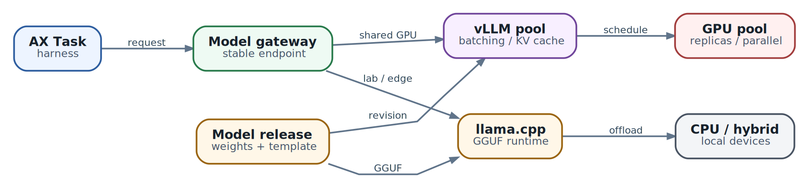

# 20. Local inference как сервис: как выбрать runtime, модель и границу ответственности

Наш агент исследует сервис выставления счетов. В главе 19 мы создали для него Task, разобрали запуск и научились выяснять состояние после тайм-аута. Теперь harness нужно выбрать следующий шаг исследования: какой файл прочитать, какой тест предложить, как объяснить найденный расчёт. За этим решением он обращается к модели.

Представим, что исходный код должен оставаться в инфраструктуре команды. Начнём с одного инженера и локального endpoint, а затем рассмотрим общий сервис для нескольких агентов. Пройдём путь от устройства генерации до проверяемого tool call. По дороге станет понятно, зачем нужны vLLM и llama.cpp, какая память требуется модели и что меняется при переносе на GPU.

## Что происходит внутри inference

**Inference** здесь означает вычисление ответа уже обученной языковой модели. Её веса - числовые параметры, полученные при обучении. Во время обычного запроса сервер использует эти параметры; обучение на каждом новом сообщении не происходит.

Сначала **tokenizer** превращает текст в последовательность номеров - tokens. Token может соответствовать части слова, знаку или служебной границе сообщения. Поэтому длина в символах не позволяет точно определить расход context. В нашем запросе место занимают инструкции, описание tools, история исследования и фрагменты кода.

Затем модель обрабатывает входную последовательность. Эту фазу называют **prefill**. После неё начинается **decode**: модель выбирает следующий token, добавляет его к продолжению и повторяет вычисление. Отсюда два разных ощущения скорости. Большой файл может долго обрабатываться до начала ответа, а сам ответ после этого появляться быстро. Или начало приходит скоро, но продолжение выводится медленно. В главе 21 измерим эти интервалы отдельно.

**Runtime**, или engine, организует вычисления: загружает веса, выбирает вычислительные kernels для устройства, управляет памятью и очередью запросов. HTTP server принимает сообщения harness и возвращает результат в понятном клиенту формате. В конкретном продукте эти роли могут быть объединены одним процессом. Названия vLLM и llama.cpp прежде всего относятся к программному обеспечению, которое выполняет модель; качество её знаний задаётся выбранными весами и способом их использования.

## Как агент получает доступ к модели

Harness знает адрес сервиса, логическое имя модели и способ авторизации. Например, команда может договориться об имени `review-code`: за ним будет модель для исследования кода. При переносе с рабочего компьютера на выделенный host адрес или маршрут меняется в конфигурации, а последовательность действий агента остаётся прежней.

\
_&#x4C;ocal inference в AX: стабильный model endpoint скрывает runtime, модель и hardware_

В этой схеме AX управляет Task и Actor, runner подготавливает Workspace, а harness выполняет прикладную работу. Inference server отдельно отвечает за модель и генерацию. Ресурс AX `Model` в рассматриваемом срезе `ac233282` не настраивает произвольный пользовательский harness автоматически: URL и имя модели нужно связать с приложением явно, как мы разобрали в главе 17.

Для команды общий model server может жить дольше любого Task. Когда инженер удаляет среду исследования, веса остаются загруженными для остальных пользователей. При обновлении inference replica сохраняются файлы и прогресс агента. Такая независимость позволяет по отдельности менять модель и рабочую среду.

Словом «локальный» здесь будем называть самостоятельно управляемое развёртывание: на workstation, своём сервере или в подконтрольном кластере. Это выбор ответственности за данные и эксплуатацию. Фактическое размещение тоже фиксируют: арендованный GPU-host может подходить одной политике данных и не подходить другой. В стоимость решения входят загрузка и хранение artifacts, обслуживание оборудования и свободная мощность для пиков, а не только время генерации.

Запуск model server внутри каждого Task удобен для отдельного эксперимента с уникальной моделью. Для общего сервиса мы вынесем его за пределы Tasks: так несколько исследователей используют одну загруженную копию. Dedicated replica остаётся вариантом для tenant, которому требуется отдельное размещение или несовместимая конфигурация.

## Какая модель нужна нашему исследованию

Агенту предстоит читать код через tool, учитывать его результат и объяснять расчёт. Начнём с text-only instruct-модели: она должна уметь работать с диалогом и выбранным форматом tool use. Слово instruct обозначает дополнительное обучение следованию инструкциям. Для выбора возьмём небольшую подборку задач из знакомого команде кода и проверим объяснения по ожидаемому поведению программы.

В первой итерации ограничим сценарий одним вызовом tool за шаг, обычным ответом без streaming и отсутствием внешних изменений. Это осознанное упрощение клиента. Когда потребуются несколько tools или потоковая выдача, расширим и контракт, и проверку. Возможности вроде vision и embeddings пока не участвуют в выборе: они не нужны этому исследованию.

Зададим для учебного профиля общий предел context в 8192 tokens и резерв ответа в 512 tokens. Это означает, что сериализованные инструкции, schemas, история и входные данные должны укладываться в оставшийся бюджет. В него входит и оформление chat template. Реальные длины проверяют tokenizer выбранного deployment; в маленьком probe ниже ответ ограничен 256 tokens, чтобы быстро проверить формат обмена.

Если история перестала помещаться, harness выбирает нужные фрагменты кода, сохраняет промежуточные выводы и собирает следующий запрос из них. Так связь с исходным заданием остаётся управляемой. Простое увеличение context потребует дополнительной памяти и вычислений. Сам предел 8192 подходит лишь модели и runtime, которые поддерживают такой режим.

Для приёмки разделим два вопроса. Сначала проверим интерфейс: модель выдала распознаваемый tool call, а результат tool удалось вернуть в диалог. Затем оценим содержание: нужный ли файл выбран, верно ли объяснён код, хватает ли ответа для следующего шага исследования. Корректная сериализация делает ответ пригодным для обработки, а смысловая проверка определяет пользу агента.

## Зачем нужны chat template и parser

На HTTP-уровне harness передаёт список `messages` с ролями `system`, `user`, `assistant` и `tool`. Модель получает последовательность tokens. **Chat template** описывает, как превратить сообщения и описание tools в эту последовательность: где поставить границы ролей, как оформить вызов функции и куда поместить результат. Разные instruct-модели обучались на разных форматах. Поэтому template выбирают вместе с tokenizer и весами. Механизм показан в [руководстве Hugging Face](https://huggingface.co/docs/transformers/en/chat_templating).

Обратный путь тоже требует преобразования. Модель может сгенерировать текст в своём формате tool use. **Tool-call parser** runtime выделяет из него имя функции и arguments, чтобы сервер вернул структурированный `tool_calls`. Затем harness проверяет допустимость действия. Именно harness исполнит чтение файла; inference server только предложит вызов.

Предположим, модель вернула фразу «прочитаю billing.py», хотя клиент ожидал `tool_calls`. Сначала проверим сохранённый ответ и `finish_reason`, выбранные template и parser, затем - поведение самой модели. Это разные участки цепочки. Смена только `base_url` сохраняет форму HTTP-запроса, но пригодность диалога зависит от всей связки. Например, настройка automatic tool choice в [vLLM v0.31.0](https://docs.vllm.ai/en/v0.31.0/features/tool_calling/) включает выбор parser; [llama.cpp](https://github.com/ggml-org/llama.cpp/blob/6e66cb5d4e9a2b4f02820a9f3053422b92ec4d51/docs/function-calling.md) использует Jinja template и обработчики формата.

Structured output решает соседнюю задачу: ограничивает форму генерируемого результата, например JSON по schema. Это удобно для машинной обработки аргументов или отчёта. Прикладная проверка всё равно определяет разрешённые пути, доступ пользователя и смысл значений. В примере разрешим единственное имя `billing.py`, чтобы эта граница была видна в коде.

## Как выбирать между llama.cpp и vLLM

Для первого запуска у инженера есть обычный компьютер и один пользователь. Здесь разумный кандидат - **llama.cpp** с подходящей GGUF-моделью. GGUF - формат artifact, хранящий tensors и metadata модели; среди вариантов есть разные способы quantization. `llama-server` позволяет поднять HTTP endpoint и выбирать поддерживаемый CPU/GPU backend. Мы можем сначала проверить поведение агента, а затем измерить скорость на имеющемся устройстве.

Частичный **offload** переносит часть слоёв или вычислений на GPU, оставляя остальное на CPU. Это помогает разместить модель при ограниченной VRAM. Операции на CPU и обмены между памятью устройств входят во время ответа, поэтому такой режим оценивают на нужной длине запросов. CPU также может быть достаточен для редких фоновых исследований, если полное время задачи укладывается в требования команды.

Когда несколько агентов обращаются к выделенному GPU-сервису, важным становится scheduler. **Continuous batching** позволяет включать новые sequences в работу по мере завершения других. Вместо ожидания окончания самого длинного ответа из фиксированной группы устройство получает следующую доступную работу. Этот механизм есть у обоих рассматриваемых проектов; [llama-server](https://github.com/ggml-org/llama.cpp/blob/6e66cb5d4e9a2b4f02820a9f3053422b92ec4d51/tools/server/README.md) также поддерживает параллельное обслуживание.

**vLLM** стоит рассмотреть для общего serving-пула, особенно когда нужны его средства управления cache и распределения модели. Его PagedAttention организует KV cache блоками, а поддерживаемые режимы parallelism позволяют распределить вычисления между устройствами. Выбор зависит от конкретных architecture, формата весов, kernels и связности GPU. Проверку распределённого размещения начинайте с [руководства parallelism](https://docs.vllm.ai/en/v0.31.0/serving/parallelism_scaling/); подробный расчёт приведён в главе 41.

Зачем cache нужен такой allocator? Два исследования могут иметь истории разной длины, причём обе растут во время ответа. Если заранее выделять каждой большой непрерывный участок под максимальную длину, часть памяти будет простаивать. PagedAttention хранит состояние в блоках и сопоставляет их позиции в sequence с физическим размещением. Так runtime может выделять память по мере необходимости и уменьшать потери. Само содержимое истории всё равно занимает память; механизм распределения описан в [работе о PagedAttention](https://arxiv.org/abs/2309.06180).

Для масштабирования также различаем две конструкции. Несколько полных копий модели, или replicas, обслуживают независимые запросы. Tensor parallelism распределяет части вычислений одной модели между GPU и требует обменов внутри её работы. Первое помогает наращивать общий поток при достаточной памяти для копий, второе позволяет разместить и выполнять поддерживаемую модель совместно на нескольких устройствах. Цена обменов становится частью времени ответа.

| Исходная задача                                       | Первый кандидат                                        | Что определит следующий шаг                                    |
| ----------------------------------------------------- | ------------------------------------------------------ | -------------------------------------------------------------- |
| Один инженер, CPU или ограниченная GPU                | llama.cpp и совместимый GGUF                           | Правильность tool roundtrip, память и время полного шага       |
| Общий GPU-host с одновременными запросами             | Сравнить vLLM и llama.cpp на том же сценарии           | Очередь, latency и число полезных завершённых исследований     |
| Модель требует нескольких GPU                         | Runtime с поддержкой нужной architecture и parallelism | Размещение весов, обмены между GPU и цена отказа replica       |
| Редкие обращения без жёсткого требования self-hosting | Сопоставить собственный сервис с внешним API           | Допустимость передачи данных, полная стоимость и сопровождение |

Так мы получаем проверяемую гипотезу выбора. Для нашей первой итерации берём llama.cpp ради простого локального endpoint. После роста нагрузки измеряем общий сервис и проверяем, даст ли другой runtime выигрыш. Наличие GPU само по себе не обязывает менять engine.

## Сколько памяти потребуется

Веса остаются в памяти во время обслуживания запросов. Их грубый размер равен `число параметров × битность / 8`. У условной dense-модели с ровно 8 миллиардами параметров BF16-значения занимают 16 миллиардов bytes, около 14.90 GiB. Сырые 4-bit значения дают около 3.73 GiB. Реальный quantized artifact дополнительно хранит scales, metadata и tensors другой precision.

Во время decode attention использует предыдущие позиции последовательности. Runtime сохраняет их key и value tensors в **KV cache**, чтобы повторно не вычислять их на каждом шаге. По мере роста диалога этому состоянию нужно больше памяти. Одновременно активные исследования добавляют собственные продолжения. Совместное использование одинакового prefix зависит от runtime и конфигурации.

Поэтому бюджет выглядит так:

```
память устройства = размещённые веса + KV cache
                   + рабочие buffers runtime + запас
```

Для нашего выбора полезны два отдельных опыта. Сначала загрузим модель и короткий запрос: это проверяет базовое размещение. Затем дадим длинную историю и несколько одновременных запросов: появятся расходы, которых не было в первом опыте. Проверяем и VRAM, и host RAM, включая пик загрузки. Уменьшение предела context или числа активных sequences - один из способов сократить расход памяти, описанных в [руководстве vLLM](https://docs.vllm.ai/en/v0.31.0/configuration/conserving_memory/).

Здесь достаточно понимать источник роста. Формулу KV для конкретной architecture, различие GB и GiB и расчёт нескольких GPU подробно используем в главе 41. Параметры модели дают отправную оценку весов, а пригодность deployment определяется также формой нагрузки.

## Как оценивать quantization

Quantization представляет числа с меньшей точностью. Уменьшенные веса занимают меньше памяти, а подходящие kernels могут сократить время вычисления или чтения данных. В зависимости от метода преобразуются веса, activations или cache; эти решения фиксируют отдельно. Например, уменьшение весов не меняет автоматически dtype KV cache.

Для нашего агента сравнение начинается с одной исходной модели и набора задач. Сохраняем вопросы и tool schemas, запускаем варианты artifact и смотрим, как меняются выбор файла, arguments и объяснение результата. Если маленькая ошибка в расчёте проходит синтаксическую проверку, исследование всё равно закончится неверным выводом. Это причина оценивать весь шаг агента, а не только валидность JSON.

После качества измеряем latency и память. Поддержка quantization зависит от hardware и backend: меньший artifact может требовать дополнительных преобразований при вычислении. Проверяйте точную комбинацию по [матрице vLLM](https://docs.vllm.ai/en/v0.31.0/features/quantization/) или документации выбранного backend llama.cpp. Из этих измерений получается конкретное решение: какой вариант экономит память при приемлемом для задачи качестве и времени ответа.

## Практика с двумя запросами

Начнём с программы `examples/ch20_inference_contract.py`. Без параметров она работает с подготовленными ответами в памяти, не загружает модель и не обращается к сети. Так можно проследить контракт и изменить ошибочный ответ независимо от оборудования.

```
python3 examples/ch20_inference_contract.py
python3 -m unittest discover -s examples -p 'test_ch20_inference_contract.py'
```

В первом запросе программа передаёт schema `read_snippet` с одним обязательным строковым полем `path`, разрешённым значением `billing.py` и запретом дополнительных полей. `tool_choice=auto` оставляет модели выбор вызова, а учебное задание явно просит прочитать файл. Параметр `parallel_tool_calls=False` запрашивает одиночный вызов, и проверка ожидает ровно один tool call. Если модель вместо него ответила текстом, это означает, что данный опыт не выполнил требуемый шаг; такой текст может быть допустимым HTTP-ответом при `auto`.

Вот центральный участок обмена из программы. До него клиент уже задал `model`, `messages`, `tools`, `stream=False` и ограничение ответа:

```
assistant = choice(complete(deepcopy(request)), 'tool_calls')
call_id, path = validate_call(assistant)
messages.extend([assistant, {'role': 'tool', 'tool_call_id': call_id,
                            'content': SNIPPETS[path]}])
request['tool_choice'] = 'none'
final = choice(complete(deepcopy(request)), 'stop')
```

Функция `choice` проверяет завершённый ответ и возвращает сообщение assistant. Затем `validate_call` проверяет имя tool, идентификатор, JSON-строку arguments, единственное разрешённое поле и значение пути. Только после этого выполняется чтение из `SNIPPETS` - словаря с искусственным кодом. Реальные файлы эта программа не читает.

Во второй запрос попадает история из четырёх сообщений: исходные system и user, ответ assistant с вызовом и сообщение `tool` с результатом. `tool_call_id` связывает результат с конкретным вызовом. Сохранение сообщения assistant нужно модели, чтобы продолжить тот же диалог. `tool_choice=none` задаёт финальный ответ без нового обращения к инструменту.

Ожидаемый вывод локального примера:

```
{
  "tool": "read_snippet",
  "path": "billing.py",
  "tool_result_linked": true,
  "final_text": "total multiplies amount by 1.2."
}
```

Для этого искусственного фрагмента ответ содержательно проверяется чтением функции: она умножает `amount` на `1.2`. Программа автоматически проверяет структуру обмена, а смысл произвольного ответа реальной модели оценивает инженер. В tests можно заменить arguments на путь `../secret`, добавить лишнее поле или задать `finish_reason=length`: обработка остановится до следующего запроса. Последний вариант показывает, зачем проверять завершение генерации перед использованием arguments.

## Как подключить тот же probe к llama-server

Для опыта потребуется заранее подготовленный GGUF instruct-модели с подходящим tool-use template и поддержкой выбранного context. Сохраните revision исходной модели, checksum файла, способ quantization и версию сборки llama.cpp. Путь ниже - локальное имя такого artifact, а `review-code` - его alias в HTTP API.

```
llama-server -m ./models/review-model.gguf \
  --alias review-code --host 127.0.0.1 --port 8080 \
  --ctx-size 8192 --parallel 1 --jinja
```

Мы выбрали один slot, чтобы сначала разбирать один диалог. Конкретный CPU/GPU backend определяется сборкой и настройками размещения; загрузочный log показывает обнаруженные устройства и фактический offload. Template по умолчанию берётся из metadata модели. Если для неё нужен отдельный template, укажите соответствующий файл через `--chat-template-file` и сохраните его checksum вместе с artifact. Флаги и поведение описаны в [llama-server README](https://github.com/ggml-org/llama.cpp/blob/6e66cb5d4e9a2b4f02820a9f3053422b92ec4d51/tools/server/README.md).

Когда сервер закончил загрузку, второй терминал может запустить:

```
python3 examples/ch20_inference_contract.py \
  --base-url http://127.0.0.1:8080/v1 --model review-code
```

Только `--base-url` включает HTTP-режим. Он отправляет два запроса с искусственными сообщениями, не передаёт код репозитория и не выполняет внешних tools. Клиент ограничивает размер ответа и время каждой HTTP-операции, не следует redirects и не повторяет запросы автоматически. Это небольшой probe для non-streaming text/tool roundtrip; авторизация, streaming, отмена и другие возможности общего сервиса требуют своих проверок. Его socket timeout также не заменяет общий deadline исследования из главы 19.

Loopback в этих командах относится к компьютеру с сервером. В отдельном AX Actor адрес `127.0.0.1` указывает на сам Actor. Для удалённого harness настройте доступный ему частный endpoint, например через gateway. По той же причине смена bind на общий интерфейс требует одновременно решить доступ и защиту соединения.

Если опыт остановился, используйте место ошибки. HTTP error отправляет нас к адресу, маршруту и настройке сервера. Отсутствующий `tool_calls` - к ответу модели, template и parser. Некорректные arguments - к schema и поведению модели. Ошибка второго запроса - к поддержке истории с assistant/tool. Правильный текстовый итог после двух запросов позволяет перейти к проверке задач и нагрузки.

## Как превратить endpoint в общий сервис

Когда нашими исследованиями пользуется команда, перед runtime полезен **gateway** - отдельный входной сервис. Он проверяет, кто обращается к модели, выбирает backend и ограничивает нагрузку. Это часть проектируемого deployment, а не автоматически возникающий компонент AX. Долгоживущие credentials upstream хранят на стороне сервиса; Tasks получают ограниченную прикладную identity через выбранный механизм доставки secrets.

Входные ограничения следуют из сценария. Наш pool принимает text-only запросы, ограничивает длину входа и ответа, число одновременно обслуживаемых запросов и размер очереди. При заполнении очереди клиент получает явный отказ, например `429` или `503` по контракту gateway, и решает, ждать ли следующей попытки. Так нехватка мощности становится управляемым событием, а не бесконечным ожиданием.

Harness различает повтор model call и повтор действия tool. После потерянного ответа модель может выбрать другой вызов. Поэтому допуск к записи в репозиторий или внешней операции остаётся за прикладной логикой из глав 4–6. Прочитанный файл можно запросить снова; уже отправленное письмо или изменение внешней системы требует проверки результата и защиты от дублирования.

Для новых запросов replica должна закончить загрузку модели и пройти прикладной canary. Один короткий диалог с tool полезно проверять при выпуске и периодически, а не выполнять тяжёлую генерацию на каждом health poll. Liveness отвечает за жизнь процесса, readiness - за допуск трафика; перегрузку наблюдают отдельно. Startup должен давать время на загрузку весов, чтобы оркестратор не перезапускал исправную инициализацию.

Настройте раздельный доступ к inference, metrics и административным операциям. Проверьте, какие routes действительно закрывает авторизация выбранной версии server. Для prompts и tool results задайте явную политику logging: в исследовании они могут содержать исходный код или чувствительные данные. Наличие сервера в частной сети упрощает сетевую границу, но доступ и хранение данных всё равно требуют правил.

## Как обновлять модель и сохранять воспроизводимость

Рабочий выпуск фиксирует исходную model revision, формат и checksum весов, tokenizer, template, parser, runtime и параметры запуска. Для контейнера сохраняют image digest; для локальной сборки - commit и параметры сборки. Отдельно проверяют лицензию выбранных artifacts. По этим данным команда сможет воспроизвести вариант, на котором принимала качество.

Логическое имя `review-code` позволяет переключать backend, но само по себе не объясняет, какая версия ответила. Поэтому gateway или журнал deployment связывает запрос с фактическим выпуском. При rollout новая replica загружает artifacts, проходит те же диалоги и получает небольшую долю трафика. Старые streams завершаются на прежней replica; для возврата сохраняются и предыдущие artifacts, и её конфигурация.

При сравнении llama.cpp и vLLM также запишите, что изменилось: сам engine, формат весов, template или sampling. Если одновременно заменить несколько частей, результат покажет качество всего нового deployment. Чтобы найти причину различия, затем меняют по одному фактору там, где это технически возможно.

Для нашего агента следующий этап теперь конкретен: взять endpoint, прошедший двухшаговый обмен, прогнать подборку исследований и измерить профиль нескольких одновременных диалогов. В главе 21 разложим ожидание на очередь, prefill и decode и проверим, сколько полезной работы выдерживает сервис. Детальный memory sizing и parallelism остаются в главе 41.

### Источники и дальнейшее чтение

* [Chat templates](https://huggingface.co/docs/transformers/en/chat_templating): преобразование сообщений в tokens.
* [llama-server README](https://github.com/ggml-org/llama.cpp/blob/6e66cb5d4e9a2b4f02820a9f3053422b92ec4d51/tools/server/README.md) и [function calling](https://github.com/ggml-org/llama.cpp/blob/6e66cb5d4e9a2b4f02820a9f3053422b92ec4d51/docs/function-calling.md): запуск, flags и обработка tools.
* [vLLM v0.31.0 server](https://docs.vllm.ai/en/v0.31.0/serving/online_serving/openai_compatible_server/) и [tool calling](https://docs.vllm.ai/en/v0.31.0/features/tool_calling/): API и настройка parser/template.
* [vLLM memory](https://docs.vllm.ai/en/v0.31.0/configuration/conserving_memory/), [quantization](https://docs.vllm.ai/en/v0.31.0/features/quantization/) и [parallelism](https://docs.vllm.ai/en/v0.31.0/serving/parallelism_scaling/): ограничения выбранного deployment.
* [PagedAttention](https://arxiv.org/abs/2309.06180): блочное размещение KV cache.
* [AX protobuf schema](https://github.com/google/ax/blob/ac2332829f22360ff97b0ba34d94dd0dd782f17e/pkg/apis/v1alpha1/ax.proto): TaskSpec и ModelSpec; настройка harness разобрана в главе 17.
