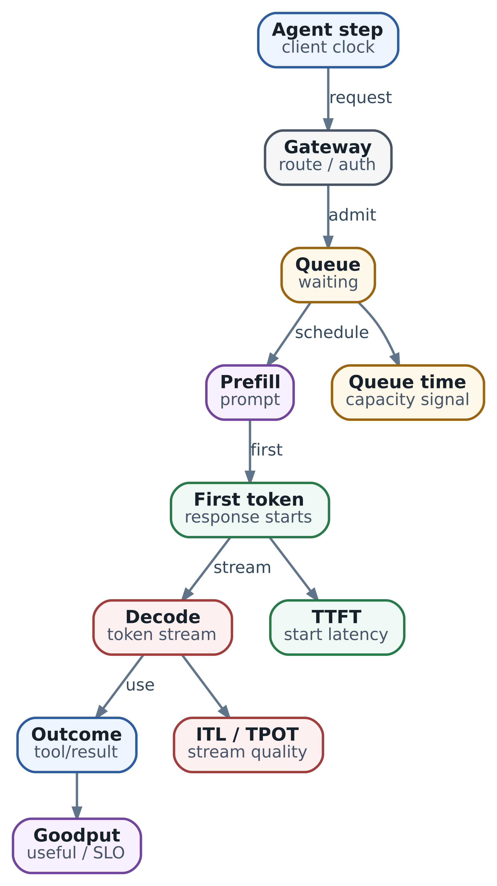

# 21. Производительность inference: как измерять latency, throughput и capacity для 10-15+ агентов

Агент из главы 20 научился обращаться к локальной модели: запросить чтение кода, получить результат инструмента и продолжить объяснение. Теперь сервисом пользуется команда. Несколько исследований идут одновременно, а после общего запуска пятнадцать агентов почти разом обращаются к модели. Одни быстро получают ответ, другие заметно ждут. Как решить, нужна ли ещё одна GPU, другой runtime или более аккуратное управление запросами?

Начнём с пути одного ответа, затем воспроизведём маленькую очередь и составим опыт для настоящего endpoint. Цель измерений - определить, какую работу сервис успевает выполнить с нужным качеством и временем. Для нашего исследования полезным результатом будет законченный, проверенный tool call. Полное завершение агентом исследования кода измерим отдельно.

## Какой результат должен успеть сервис

Допустим, после чтения файла инженер готов ждать следующий шаг агента две секунды. Примем это за учебную цель: model call должен вернуть полный допустимый вызов инструмента за 2000 ms. Это выбранный для примера предел, который команда в реальной работе согласует с пользователями и общим deadline исследования.

Такое измеримое обещание называют **SLO**, service level objective. Для общего сервиса его формулируют вместе с долей запросов: например, какая часть всех попыток должна дать допустимый результат вовремя. Также заранее определяют судьбу отказа и отмены. Если из ста обращений десять отклонены, быстрые ответы остальных девяноста описывают только часть опыта пользователей.

У разных сценариев разные часы. Для чтения объяснения человеком важны начало и плавность stream. Harness, собирающий arguments, ждёт законченный объект и проверку. Для исследования из нескольких шагов важны ещё время tools, повторы и принятие итогового отчёта. Поэтому в опыте будем считать отдельно скорость model calls и время прикладного исследования. Проверка контракта из главы 20 даёт отправную точку для допустимости ответа; правильность содержательного решения требует набора задач с ожидаемыми результатами.

## Путь запроса и границы измерения

Harness собирает сообщения, schema инструмента и фрагменты кода. После отправки запрос проходит сеть и gateway, затем может ждать допуска к вычислению. Runtime подготавливает вход, выполняет prefill и начинает decode. Клиент получает данные, собирает полный ответ и передаёт его валидатору.

\
_&#x41F;уть inference-запроса: где возникают queue time, TTFT, ITL и полезный результат_

**Latency** - длительность выбранного участка этого пути. Начало и конец измерения записывают вместе с числом. Клиенту доступно время от отправки до получения ответа, серверу - внутренние этапы обработки. Например, очередь gateway может входить в клиентскую задержку, но отсутствовать в метрике engine. При сопоставлении этих чисел сначала проверяем границы.

Для длительностей внутри одного процесса используйте монотонные часы: они не перескакивают при коррекции календарного времени. События разных машин связывают trace, а их длительности читают в соответствующих spans. Вычитание несогласованных клиентской и серверной временных отметок способно создать фиктивную очередь. В нашем учебном расчёте все отметки принадлежат одним условным часам.

## Когда начинается и заканчивается ответ

**TTFT**, time to first token, показывает время до первого выходного token. Для модели это граница начала генерации; клиент наблюдает доставку данных по сети. Streaming transport передаёт chunks: один может содержать только роль assistant, несколько tokens или служебные поля. Поэтому запишите, что именно измеряет клиентская реализация: первый содержательный fragment, первое поле tool arguments или действительно доступную отметку token. Пустой chunk с ролью ещё не означает начало полезного ответа.

Probe главы 20 использовал `stream=False`: такой клиент получает полный ответ и измеряет E2E. Для клиентского TTFT нужен отдельный потоковый клиент и проверка streaming выбранного endpoint. Внутренний TTFT при этом можно наблюдать по серверной telemetry. Эти способы наблюдения дополняют друг друга.

**ITL**, inter-token latency, - интервалы между последовательными выходными tokens. Например, при отметках `200, 400, 700, 1000 ms` получаем `200, 300, 300 ms`. По этим интервалам видно изменение плавности генерации. Клиентские интервалы между chunks тоже полезны: они показывают доставку и buffering, но имеют другую единицу наблюдения. Без информации о границах tokens их сохраняют как inter-chunk latency.

**TPOT**, time per output token, усредняет участок после первого token для одного запроса. Если известны отметки первого и последнего tokens, используем:

```
TPOT = (время последнего token - время первого token)
       / (число выходных tokens - 1)
```

Для четырёх tokens выше это `800 / 3`, около `266.67 ms`. Для одного token знаменатель равен нулю: такого наблюдения TPOT нет. Три интервала при этом могут быть очень неравномерными. Среднее TPOT сглаживает паузы, которые остаются видны в распределении ITL. Реализация измерителя может включать иные границы, поэтому определение рядом с результатом сохраняют.

**E2E latency** model call - время до полного ответа. Оно может включать доставку последних metadata и завершение stream после последнего token. Для инструмента добавим ещё прикладную проверку arguments. Так два endpoint с одинаковой TTFT могут по-разному подходить harness: один быстро начинает длинный ответ, другой раньше возвращает законченный вызов.

## Сколько полезной работы завершено

**Throughput** - количество работы за единицу времени. Output throughput считает выходные tokens/s, prompt throughput - входные tokens/s, request throughput - завершённые запросы/s. Укажите область: одна sequence, replica или весь сервис. Суммарные 100 tokens/s у нескольких диалогов не задают скорость одного из них.

Для нашего опыта введём **goodput**: число допустимых model calls, завершившихся в пределах 2000 ms, делённое на длительность наблюдения. Это прикладное определение полезного потока. Runtime benchmark может ограничивать goodput только latency-условиями; у нашей проверки есть ещё допустимость ответа. При переходе к целому агенту единицей станут успешно завершённые исследования, а не calls.

Быстрый невалидный ответ останется в статистике попыток и потраченных tokens. В goodput он не попадёт. Если harness повторил запрос, оба обращения потребили мощность, но прикладная работа всё ещё одна. Такое разделение помогает оценивать quantization и маршрутизацию на меньшую модель: экономия одного вызова полезна, когда сохраняется результат всего шага.

## Учебный опыт с очередью

Программа `examples/ch21_inference_measurements.py` воспроизводит однопоточный FIFO-сервис: запросы обслуживаются в порядке поступления, одновременно работает один slot. Каждый запрос занимает ровно 1000 ms и выдаёт четыре tokens на отметках `200, 400, 700, 1000 ms` от начала обслуживания. Третий ответ заранее помечен невалидным; время проверки здесь принято равным нулю. В реальном harness окончание валидации записывают отдельным событием. Это искусственные данные для разбора арифметики, без модели, сети, KV cache и batching.

Сначала один клиент отправляет следующий запрос после завершения предыдущего: времена отправки `0, 1000, 2000, 3000 ms`. Очереди нет, все ответы укладываются в двухсекундный предел. Из четырёх допустимы три. За окно `0-4000 ms` получаем `3 / 4 = 0.75` полезного ответа в секунду.

Теперь отправим те же четыре запроса независимо от ответов с интервалом 250 ms: `0, 250, 500, 750 ms`. Вычисление каждого осталось прежним, но перед ним появилось ожидание:

| Запрос | Отправка, ms | Начало обслуживания, ms | Полный ответ от отправки, ms |
| ------ | ------------ | ----------------------- | ---------------------------- |
| r1     | 0            | 0                       | 1000                         |
| r2     | 250          | 1000                    | 1750                         |
| r3     | 500          | 2000                    | 2500                         |
| r4     | 750          | 3000                    | 3250                         |

Вовремя завершились r1 и r2. Четвёртый ответ допустим, но опоздал; третий одновременно невалиден и просрочен. За то же четырёхсекундное окно goodput равен `2 / 4 = 0.5`. Оба опыта выдали 16 tokens за четыре секунды, то есть 4 tokens/s. Различается полезный результат при заданном deadline.

Окно включает завершение всей группы после прекращения отправки - **drain**. Эти четыре arrivals иллюстрируют заданный темп, но не являются установившимся потоком в 4 requests/s. Для длительного сервиса отдельно задают время подачи нагрузки, окно измерения и период завершения оставшихся запросов. Если тест остановлен с незавершёнными попытками, их учитывают явно; они не должны исчезать из оценки успеха.

## Как воспроизвести расчёт

Запуск из корня репозитория:

```
python3 examples/ch21_inference_measurements.py
python3 -m unittest discover -s examples -p 'test_ch21_inference_measurements.py'
```

Центральная функция переводит одну запись в длительности. Здесь `started_ms` - известная в модели отметка начала обслуживания, а `token_ms` - именно отметки отдельных tokens:

```
def request_metrics(trace: Trace):
    tokens = trace.token_ms
    return {
        'queue_ms': trace.started_ms - trace.sent_ms,
        'ttft_ms': tokens[0] - trace.sent_ms if tokens else None,
        'e2e_ms': trace.ended_ms - trace.sent_ms,
        'tpot_ms': ((tokens[-1] - tokens[0]) / (len(tokens) - 1)
                    if len(tokens) > 1 else None),
        'itl_ms': tuple(b - a for a, b in zip(tokens, tokens[1:])),
    }
```

Проверки запрещают перепутанный порядок отметок, повтор request ID и окно, обрезающее нашу полностью наблюдаемую группу. В сводке сохраняются transport failures и число невалидных завершений. Percentiles задержки считаются по транспортно завершённым ответам, включая невалидные; доля успеха и goodput используют отдельные условия. Такой условный percentile читают вместе с количеством отказов.

Ожидаемый вывод:

```
{
  "closed": {
    "queue_p95_ms": 0,
    "ttft_p95_ms": 200,
    "e2e_p95_ms": 1000,
    "on_time_valid": 3,
    "output_tokens_per_s": 4.0,
    "goodput_rps": 0.75
  },
  "open": {
    "queue_p95_ms": 2250,
    "ttft_p95_ms": 2450,
    "e2e_p95_ms": 3250,
    "on_time_valid": 2,
    "output_tokens_per_s": 4.0,
    "goodput_rps": 0.5
  }
}
```

Измените интервал arrivals или deadline и объясните новый результат до запуска. Затем поменяйте признак допустимости третьего ответа: число сгенерированных tokens останется прежним, а goodput изменится только там, где этот ответ ещё успевал. Так видна связь качества, ожидания и полезного потока. Числа не прогнозируют скорость llama.cpp или vLLM: у настоящего runtime работа запросов перекрывается и её стоимость зависит от batch и длин sequences.

## Что показывает percentile

Отсортируем E2E второго опыта: `1000, 1750, 2500, 3250 ms`. Наш алгоритм **nearest rank** берёт элемент с номером `ceil(p × n / 100)`. Для p95 и четырёх наблюдений это максимум, 3250 ms. Среднее равно 2125 ms. Оба числа верны, но отвечают на разные вопросы: одно описывает среднюю затрату времени, другое - выбранный край распределения.

Маленькая группа нужна для ручной проверки. В ней недостаточно данных, чтобы оценить редкие задержки production. Для реального результата сохраняйте число наблюдений, класс запросов, окно, долю ошибок и повторяемость опыта. P99 на ста запросах определяется почти самым медленным ответом; повторный прогон легко изменит его. Устойчивую эксплуатационную оценку получают более длинными повторяемыми наблюдениями соответствующей нагрузки.

Для нескольких replicas сначала объединяют наблюдения либо совместимые histogram buckets, затем вычисляют percentile. Среднее из p95 отдельных replicas не является p95 всего сервиса. Prometheus вычисляет histogram quantile по buckets с приближением; он может отличаться от nearest rank по сырым записям. Устройство агрегации разобрано в [документации histograms](https://prometheus.io/docs/practices/histograms/).

## Как перевести пятнадцать агентов в нагрузку

Пока агент читает файл или ждёт tool, его model call может быть уже завершён. Для первого приближения возьмём пятнадцать агентов, каждый из которых в среднем делает один вызов каждые десять секунд. Получаем `15 / 10 = 1.5 requests/s`. Если один начинает делать несколько параллельных вызовов, они входят в поток отдельно.

Для установившегося режима закон Little связывает среднее число запросов внутри выбранной границы с темпом поступления и средним временем пребывания: `L = λ × W`. При 1.5 requests/s и двух секундах внутри endpoint получаем три запроса в среднем. Здесь учтены и ожидание, и обслуживание. Это не число GPU sequences, вычисляемых одновременно, и не размер KV cache. Условия усреднения и граница системы важны; [вывод закона](https://www.columbia.edu/~ks20/stochastic-I/stochastic-I-LL.pdf) объясняет связь через время пребывания.

После общего события те же пятнадцать агентов могут послать запросы разом. Поэтому профиль включает и обычный поток, и fan-out. Запишите совместные длины входа и ответа после нужного tokenizer/template, интервалы поступления, tools, повторы и отмены. Совместные traces сохраняют ситуацию, в которой длинный prompt сопровождается длинным ответом. Отдельные средние длины эту связь теряют.

## Как выбрать генератор нагрузки

В первом учебном профиле следующий запрос зависел от окончания предыдущего. Это **closed-loop**: число работающих клиентов задано, а темп меняется вместе со скоростью сервиса. Такой опыт подходит для вопроса «как ведут себя пять пользователей, каждый ждёт ответ перед продолжением». Он также удобен для постепенного увеличения числа клиентов.

Во втором профиле arrivals заданы независимо от ответов - **open-loop**. Он подходит для внешних событий, продолжающих приходить при замедлении сервиса. Подмена такого потока closed-loop тестом скрывает часть перегрузки: медленные ответы сами тормозят генератор. Этот эффект называют coordinated omission; различие моделей объяснено в [руководстве k6](https://grafana.com/docs/k6/latest/using-k6/scenarios/concepts/open-vs-closed/).

При настоящем open-loop сохраняйте плановое и фактическое время отправки. Если генератор ограничил in-flight requests или сам упёрся в CPU, часть очереди образовалась до endpoint. Измерение от фактической отправки пропустит её. В vLLM сочетание `--max-concurrency` с `--request-rate` способно снизить фактический темп; это прямо оговорено в [benchmark CLI](https://docs.vllm.ai/en/v0.31.0/cli/bench/serve/).

`vllm bench serve` удобен для token latency и нагрузочных проходов по model endpoint. k6 позволяет описать HTTP-сценарий, включая gateway и правила arrivals; проверку streaming нужно реализовать в выбранном клиенте или подходящем расширении, а для token boundaries нужна дополнительная информация. Для поведения агента сохраняем harness из главы 20 с проверкой tool roundtrip и прикладными traces. Эти инструменты отвечают на разные вопросы, поэтому результаты связываем одним сценарием и версиями deployment.

## Как начать опыт на настоящем endpoint

Сначала сохраните состав выпуска из главы 20: weights, tokenizer/template, parser, runtime, hardware и настройки. Подготовьте обезличенную подборку запросов исследования. Отдельно оставьте длинную историю и общий burst: это узнаваемые для команды ситуации. Проверьте функциональность до нагрузки, чтобы ошибки контракта не смешивались с нехваткой мощности.

Сделайте baseline с одним запросом. Затем задайте несколько уровней обычного темпа и burst из пятнадцати обращений. Перед steady-state замером прогрейте сервис, а cold start измерьте отдельным сценарием. Сохраняйте фактические длины ответов и причины завершения: ограничение output задаёт бюджет, но модель может закончить раньше. Повторите каждый режим, чтобы сравнивать устойчивое поведение.

Для освоения генератора можно использовать следующий транспортный опыт. Нужны установленный клиент vLLM выбранной версии, запущенный endpoint `review-code` из главы 20 и локальный tokenizer этой модели по указанному пути. Base URL здесь не содержит `/v1`: endpoint дописывается отдельно.

```
vllm bench serve --backend openai-chat \
  --base-url http://127.0.0.1:8080 --endpoint /v1/chat/completions \
  --model review-code --tokenizer ./models/review-tokenizer \
  --dataset-name random --random-input-len 512 --random-output-len 64 \
  --num-prompts 100 --request-rate 2 --burstiness 1 \
  --percentile-metrics ttft,tpot,itl,e2el --metric-percentiles 50,95,99
```

Здесь заданы случайные prompts и средний темп два запроса в секунду с Poisson arrivals. Это обучение запуску измерителя, а не оценка качества чтения кода. Следующий опыт заменяет случайный набор реальными классами запросов и проверками результата. Параметры описаны для [vLLM v0.31.0](https://docs.vllm.ai/en/v0.31.0/cli/bench/serve/). Его default `request-rate=inf` задаёт отправку всех запросов сразу; для обычного потока темп нужно указать явно.

## Как связать задержку с причиной

Во втором учебном опыте ITL каждого запроса осталось прежним, а TTFT выросло за счёт ожидания. На настоящем сервисе сначала проверим очередь: сколько запросов ждёт и как долго. Если растёт внутреннее время prefill без большой очереди, посмотрим на длины prompts и совместную работу длинных и коротких запросов. Chunked prefill позволяет делить входную обработку на части, но влияние на начало ответа и decode проверяют на нашем профиле.

Если паузы появились уже после первого token, сопоставим engine ITL с клиентскими интервалами chunks. Плавная генерация внутри и рывки снаружи направляют расследование к gateway, buffering и чтению клиентом. Если растёт и engine ITL, проверяем активные sequences, cache pressure, preemptions и взаимодействие prefill/decode. Высокая занятость GPU показывает работу устройства, но конкретный ограничивающий ресурс выясняется из этих наблюдений и profiling.

Для vLLM отправной набор включает `vllm:num_requests_waiting`, `vllm:request_queue_time_seconds`, `vllm:time_to_first_token_seconds` и `vllm:inter_token_latency_seconds`; назначения и типы проверьте по [metrics v0.31.0](https://docs.vllm.ai/en/v0.31.0/usage/metrics/). Средства runtime дополняют клиентские E2E и результат валидатора. Название метрики, её единица и место измерения входят в описание опыта.

В traces свяжите адрес AX Task вида `atespace/name`, agent step, attempt и inference request ID. Это прикладная корреляция, которую добавляет harness или gateway. AX Ready из главы 19 остаётся инфраструктурным наблюдением, а время model call измеряется отдельно. В metric labels оставляйте ограниченные категории - например, model route и outcome. Уникальные request IDs храните в traces/logs: каждый новый label set создаёт time series, как объясняет [руководство Prometheus](https://prometheus.io/docs/practices/naming/).

## Как принять решение после измерений

Пусть при обычном потоке цель выполняется, а после fan-out очередь растёт и ответы запаздывают. Сначала определим, какую часть работы действительно надо начать одновременно. Coordinator может ограничить число параллельных исследований и дать остальным явное ожидание в прикладной очереди с deadline от исходного задания. Это меняет политику допуска, поэтому время до отправки model call также остаётся видимым пользователю.

Если задания независимы, требуется больший устойчивый поток и одна модель помещается на устройстве, проверим дополнительную replica. В новом опыте смотрим, распределилась ли нагрузка и сохранился ли запас при отказе одной копии. Tensor parallelism решает другую задачу размещения и совместного вычисления модели; подробный выбор и memory sizing останутся в главе 41.

Когда основную работу создаёт повторяющийся context, проверяем сокращение лишних фрагментов и prefix reuse. Когда длинные фоновые ответы мешают коротким tool calls, проверяем отдельные классы очереди или pools. Изменение quantization и маршрута на меньшую модель снова проходит проверку содержания: измениться могут число шагов и повторы. Выбирайте одно проверяемое изменение за опыт, сохраняя остальные условия настолько одинаковыми, насколько возможно.

При перегрузке задайте предел очереди и понятный отказ по контракту gateway. Время, уже проведённое в очереди, вычитается из оставшегося deadline. Повторы ограничивают budget и разносят во времени, чтобы одновременный retry не воспроизвёл burst. Смена model endpoint при fallback допустима для нужных данных и capabilities; повтор model call отделяют от уже совершённого действия tool.

Итоговый artifact опыта хранит профиль, версии, исходные записи, окно измерения, counts, ошибки, latency и goodput. Заключение формулируют как область проверенной работы: при каком потоке, длинах, качестве и отказах соблюдается цель, а где начинается ограничение допуска. Учебная очередь научила нас читать эти условия; реальную capacity определяет повторяемый опыт на выбранном deployment.

В главе 22 применим результат к делегированию: сколько ветвей coordinator может запустить, как ждать их результаты и что делать с общей нагрузкой model service. Так измерение одного вызова станет основанием для управления всей работой агентов.

### Источники и дальнейшее чтение

* [vLLM v0.31.0 metrics](https://docs.vllm.ai/en/v0.31.0/usage/metrics/): внутренние очереди и длительности.
* [vLLM v0.31.0 benchmark CLI](https://docs.vllm.ai/en/v0.31.0/cli/bench/serve/): arrivals, concurrency и параметры отчёта.
* [k6 open and closed models](https://grafana.com/docs/k6/latest/using-k6/scenarios/concepts/open-vs-closed/): выбор модели поступления запросов.
* [Prometheus histograms](https://prometheus.io/docs/practices/histograms/) и [labels](https://prometheus.io/docs/practices/naming/): percentile и агрегация наблюдений.
* [Little's law](https://www.columbia.edu/~ks20/stochastic-I/stochastic-I-LL.pdf): связь среднего числа запросов и времени пребывания.
* [vLLM optimization](https://docs.vllm.ai/en/v0.31.0/configuration/optimization/): настройка scheduler и chunked prefill.
