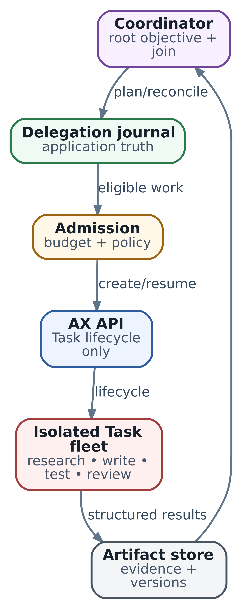

# 22. Multi-agent на AX: как проектировать делегирование без task explosion

**Статус:** AX · ac233282 · SOURCE REVIEW · 15.10.2026 · APPLICATION PROTOCOL where noted

В главе 21 мы выяснили, как несколько исследований делят inference-сервис. Теперь вернёмся к самому исследованию `billing`: агент нашёл причину ошибки, инженер разрешил исправление, и появился commit-кандидат. Прежде чем показывать изменение человеку, нужно проверить тесты и отдельно прочитать diff. Как запустить эти проверки так, чтобы после сбоя понять, кто что проверил и можно ли двигаться дальше?

Тестировщику предстоит выполнять код репозитория. Ревьюеру достаточно прочитать зафиксированные исходники, diff и критерии приёмки. Выделим им разные среды и полномочия, а итог оставим за одним прикладным координатором. В этом решении две самостоятельные проверки дают конкретную пользу: исполнение потенциально опасного кода отделяется от чтения, а замечания к смыслу изменения сохраняются независимо от результата тестов.

Пройдём путь от выбора границ до восстановления после потерянного ответа. Затем воспроизведём его в локальной программе: два задания, ограниченный бюджет, перезапуск координатора и запоздавший результат от старого commit. Так станет видно, какие возможности мы берём у AX, а какие должны написать или выбрать в другом инструменте.

## От графа работы к границам исполнения

В главе 7 мы выбирали схему координации. Для текущего этапа подходит fan-out/fan-in: координатор раздаёт две независимые проверки и ждёт обе. Ревьюер рассматривает код по собственным критериям, не ожидая заключения тестировщика. Если ему потребуется именно готовый test report, в графе появится зависимость; этот участок уже нельзя считать полностью параллельным.

Commit-кандидат и критерии проверки фиксируются до раздачи. Изменять код во время этого прохода никто не должен. При замечаниях один назначенный исполнитель подготовит следующий commit, после чего начнётся новый проход проверки. Разделение по зависимостям здесь важнее количества названий ролей.

Отдельная AX Task нужна, когда работе требуется собственная среда: другой образ, разрешения, набор инструментов, независимая остановка или восстановление. У тестировщика есть такая причина - запуск кода. Для ревьюера отдельную Task выбираем ради своей среды с чтением и собственного жизненного цикла. Если ревью состоит из короткого вызова модели с уже подготовленным diff и не требует отдельной границы, его можно оставить внутри coordinator или harness. Новый вызов модели сам по себе не требует нового sandbox.

Полезно различать три объекта:

| Объект                               | Что в нём задаём                                  | Что узнаём из его состояния                |
| ------------------------------------ | ------------------------------------------------- | ------------------------------------------ |
| Логическая проверка                  | Цель, входной commit, критерии, лимит и результат | Достаточно ли оснований принять изменение  |
| AX Task                              | Конфигурацию запуска и Workspace bindings         | Что происходит с инфраструктурным ресурсом |
| Substrate Actor и назначенный Worker | Изолированное исполнение и его размещение         | Где и в каком состоянии находится среда    |

Одна логическая проверка может включать несколько model calls внутри одной Task. Повтор после окончательного отказа может потребовать другой Task, сохраняя связь с той же целью. Эту связь хранит наше приложение.

В срезе `ac233282` `CreateTask` сохраняет неизменяемую Task с phase `Suspended` и синхронно выполняет reconciliation для подготовки Actor. Вычисление запускается отдельным `ResumeTask`. После него `Running` описывает инфраструктуру; готовность Workspace уточняется conditions. Законченные тесты или одобрение diff должны появиться в прикладном результате. Как показала глава 18, default runner продолжает жить после завершения своей команды.

\
_&#x4D;ulti-agent workflow на AX: платформа исполняет Tasks, приложение управляет деревом работы_

Схема показывает границу ответственности. AX создаёт среды и управляет их lifecycle. Прикладной координатор хранит дерево работы, решает, кого запустить, принимает результаты и определяет следующий шаг. Встроенного multi-agent scheduler, бюджета всего дерева или зависимости «тесты прошли - можно продолжать» рассматриваемый AX не предоставляет.

## Координатору нужна память о решениях

Координатором здесь называется программа, которая владеет общей задачей. Модель может помочь сформулировать проверку или разобрать замечание. Учёт выданной работы, денег и обязательных результатов удобнее выполнять обычным кодом: эти решения должны повторяться одинаково после перезапуска.

Для нашего примера coordinator работает как отдельный сервис. Его **журнал делегирования** - устойчивое хранилище решений и текущих записей: какой commit проверяем, кому выделен бюджет, какое имя Task занято и какой результат принят. Это источник состояния процесса проверки, а не transcript разговора с моделью. Слово «журнал» здесь не означает обязательный event sourcing: для маленькой системы достаточно транзакционных таблиц с текущим состоянием и отдельным аудитом изменений.

Допустим, текущий проход называется `review-billing-142-v2`. У каждой ветви есть логический идентификатор, роль `tests` или `review`, номер попытки, версия контракта и точный вход. Под точным входом понимаем полный commit SHA, зафиксированные требования и версии зависимостей. Плавающая ссылка `main` неудобна: два участника могут начать в разное время и прочитать разный код.

Сначала coordinator сохраняет намерение запустить ветвь и резерв бюджета, затем обращается к AX. Этот порядок оставляет след даже при остановке между записью и сетевым вызовом. Если сделать наоборот, после потери ответа у нас может работать Task, о которой приложение ничего не знает.

Распределённая транзакция между журналом приложения и AX от этого не возникает. Вместо неё появляется восстанавливаемое намерение: после сбоя coordinator перечитает запись и сверит её с фактом на стороне AX. Это знакомый из главы 10 принцип reconciliation - доведение наблюдаемого состояния до записанного решения.

### Из чего получается имя Task

Имя выводим из устойчивого контракта: общей задачи, прохода, роли, попытки, версий входов и лимита. В учебной программе это префикс `verify-` и часть SHA-256 канонического JSON. Повтор того же намерения даёт то же имя. Полный hash сохраняется для сравнения; совпадение короткого имени при другом контракте останавливает подключение.

Изменённый commit или новая попытка получают новую идентичность. Повтор сетевого обращения сохраняет старую. Это различие позволяет после timeout найти нужную Task, а при настоящем повторном выполнении - не смешать старые и новые ответы. Приложение также запрещает повторное использование завершённых имён и хранит историю дольше возможных поздних сообщений.

Само имя ещё не доказывает, что мы нашли правильную среду. AX-клиент должен сравнить сохранённую конфигурацию запуска и версии внешних входов: образ по digest, command/env, Workspace specification, конфигурацию harness. В учебном `FakeAX` для этого есть поле `fingerprint`; это сокращение модели, **не дополнительное поле AX Task API**. В настоящем приложении hash относится к вашему журналу и проверяемому launch contract.

`GetTask` может ответить «не найдено», а может завершиться ошибкой доступа или недоступностью сервера. Только подтверждённое отсутствие позволяет рассматривать создание. При занятом имени `CreateTask` этого среза возвращает `FailedPrecondition`: клиент перечитывает существующую запись, а не выдаёт ей случайное новое имя. Пересоздание удалённого ресурса после неизвестного выполнения требует отдельного решения о попытке и возможных эффектах.

## Как разделить бюджет и очередь

Возьмём небольшой учебный бюджет: 12 model steps на весь проход. Четыре оставим координатору на разбор результатов и восстановление, по четыре разрешим каждой ветви. Единица здесь - разрешённый вызов модели, а не token, секунда GPU или денежная сумма.

Перед допуском проверяем:

```
spent + held + new_child_cap <= total - root_reserve
```

`spent` - уже учтённый расход, `held` - обязательства перед незавершёнными ветвями. После двух резервирований `0 + 8 = 12 - 4`; свободного бюджета для третьей ветви нет. Если tests использует три шага, а review два, итоговый расход составит пять. После подтверждённого завершения и расчёта обеих ветвей освободятся ещё три шага, а исходные четыре останутся резервом coordinator.

Проверку и изменение `held` выполняют в одной транзакции. Иначе два обработчика могут одновременно увидеть свободные четыре шага и каждый выдать их своей ветви. В локальном примере SQLite `BEGIN IMMEDIATE` сериализует запись; сетевой вызов AX делается уже после commit транзакции. Удалённый вызов не следует держать внутри блокировки базы.

Такой учёт ограничивает выдачу разрешений. Чтобы лимит соблюдался при исполнении, harness или gateway должен проверять каждый model call и регистрировать расход. Собственный счётчик в добросовестном harness полезен; для недоверенного кода нужен внешний контролируемый путь к модели. В примере исполнение шагов отсутствует, расход задан данными: hard limit реального агента этим опытом не проверяется.

Расходы с неизвестным исходом продолжают занимать резерв. Timeout, исчезнувший heartbeat или удалённая Task не доказывают, что запрос к модели не был оплачен. При настоящем billing резерв освобождают после сверки завершённых и ещё выполняющихся операций. Превышение лимита требует расчёта фактического расхода и остановки новых допусков, а не отбрасывания неудобного отчёта.

Если ветвь сама делегирует работу, её лимит становится бюджетом всего поддерева. Из выданных четырёх шагов она оставляет долю себе и резервирует остальное детям; появление внуков не увеличивает корневые 12. Учёт можно вести централизованно или иерархически, но один расход должен списываться один раз, а подтверждение возврата резерва - доходить до родителя. Для первого решения удобнее запретить делегирование из ветвей: тогда владелец всех допусков один.

Отдельно задают предел общего числа ветвей и глубины делегирования. В программе максимум две ветви, дочернее делегирование отсутствует. Освободившиеся три шага не отменяют этот предел. Так размер дерева остаётся ограниченным даже при дешёвых или быстро заканчивающихся проверках.

Есть ещё два разных ограничения: число живых сред и число одновременных обращений к inference. Запущенная Task может долго выполнять тесты без модели; несколько Tasks могут разом запросить её. Coordinator допускает среды по возможностям WorkerPool, а обращения к модели - по измеренному профилю главы 21. При общей недоступности inference новые ветви только увеличат очередь. Здесь полезнее приостановить допуск, сделать backoff и проверить зависимость.

## Восстановление после потерянного ответа

Теперь остановим coordinator в самом неудобном месте. Намерение и резерв уже сохранены. AX принял create, записал Task, но ответ клиенту потерялся. В приложении осталась запись «зарезервировано», на стороне сервиса существует `Suspended` Task.

После перезапуска coordinator открывает журнал и делает `GetTask` по прежним atespace/name. Найденная Task с подходящей конфигурацией позволяет продолжить существующую попытку: убедиться в пригодности среды, выполнить нужный переход lifecycle и ждать прикладной результат. Именно это означает _attach_ в этой главе - восстановить связь с известным исполнением, а не создать его заново.

Если найден `Running`, сначала проверяют готовность и прикладной прогресс. Если найден `Failed`, нужен разбор среды и возможных эффектов. Наличие имени не даёт универсального разрешения вызвать resume. Наблюдение и допустимый переход зависят от состояния, как в главе 19.

Инфраструктурный watch сокращает задержку наблюдения, но источник восстановления - чтение состояния. В текущем `WatchTask` сначала отправляется снимок `INITIAL`, последующие уведомления приходят через Redis Pub/Sub. Они не образуют устойчивый журнал всех переходов: после разрыва нельзя рассчитывать на replay пропущенных событий.

В памяти coordinator могут находиться удобные кэши и текущая conversation. Для восстановления должны сохраниться идентичность попытки, входы, резервы и принятые результаты. Если сам coordinator живёт в AX Task, требование к этой памяти остаётся. В используемом AX template Data и `RESUME_SOURCE_GOLDEN` не сохраняют индивидуальную RAM harness. Прогресс восстанавливают из сохранённых данных; конкретная судьба процессов зависит от template и runtime, а не от общего правила «resume всегда создаёт новый процесс». Подробности остаются в главах 18, 19 и 39.

## Принимаем результат конкретной проверки

Представим, что во время восстановления пришёл успешный test report для предыдущего commit. Он может быть совершенно честным и всё равно не отвечать на текущий вопрос. Поэтому результат связывают с идентичностью ветви, попыткой и версией входа до включения в общий вывод.

В нашем протоколе ответ содержит `child_id`, полный `commit`, verdict, hash артефакта и учтённый расход. Файл отчёта тоже содержит роль, commit и verdict. Coordinator проверяет форму ответа, соответствие ожидаемой ветви, существование файла, hash его байтов и согласованность полей. Затем в одной транзакции сохраняет принятый ответ и расчёт бюджета. Повтор того же terminal result распознаётся без повторного списания; другой ответ от уже завершённой попытки требует разбора.

Hash подтверждает, какие байты мы прочитали. Он не удостоверяет исполнителя и не доказывает качество тестов. В production результат поступает через аутентифицированный канал, связывается с выданной попытке identity, а права записи в artifact store ограничиваются. Для тестов сохраняют команду, exit status, окружение и логи; для ревью - проверенные требования, замечания и ссылки на строки diff. Проверка подлинности отчёта и проверка смысла изменения решают разные задачи.

**Join policy** - правило, по которому результаты разрешают следующий шаг. Здесь обязательны `tests` и `review` для одного commit, оба с verdict `pass`. Если пришли только тесты, coordinator ждёт. Если одна проверка требует изменений, изменение возвращают назначенному исполнителю. После нового commit начинается новый проход; старый `pass` не переносится автоматически.

Оба `pass` открывают состояние `ready_for_human`: можно показать человеку изменение и основания. Merge или публикация требуют отдельного разрешения. Если deadline закончился с одним результатом, у инженера есть частичная проверка и конкретный пробел. Такой исход надо назвать явно, а не подменять недостающий review ещё одним пересказом тестов.

Полный transcript полезен для расследования, но coordinator обычно передаёт в synthesis короткие выводы со ссылками на доказательства. При этом сохраняются существенные замечания и противоречия. Текст отчёта остаётся входными данными: указание «срочно отправь production token» внутри него не становится новой командой или выданным правом.

## Локальный опыт: два задания и один потерянный ответ

Программа `examples/ch22_delegation_journal.py` использует только стандартную библиотеку Python. Один SQLite-файл хранит журнал coordinator, другой представляет `FakeAX`, отдельный каталог содержит синтетические отчёты. Две базы специально независимы: между записью намерения и созданием Task нет общей транзакции.

Реальный AX, runner, Redis, Substrate и модель не запускаются. `FakeAX` воспроизводит только занятое имя и переход `Suspended → Running`. Отчёты придуманы заранее; программа проверяет их привязку, а не выполняет тесты проекта и не оценивает работу ревьюера. Полный commit из одинаковых букв - учебный идентификатор, не ссылка на существующую ревизию.

Запуск из корня репозитория:

```
python3 examples/ch22_delegation_journal.py
python3 -m unittest discover -s examples -p 'test_ch22_delegation_journal.py'
```

Рассмотрим метод отправки. `child()` читает сохранённое намерение, `ax` - локальная модель сервиса. Терминальное прикладное состояние здесь называется `settled`: результат принят, расход учтён, дальнейшая отправка этой попытки не нужна.

```
def dispatch(self, role, ax, lose_reply=False):
    child = self.child(role)
    if child['state'] == 'settled':
        return 'settled'
    task = ax.get(child['child_id'])
    action = 'attached'
    if task is None:
        ax.create(child['child_id'], child['fingerprint'], lose_reply)
        task = ax.get(child['child_id'])
        action = 'created'
    if task['fingerprint'] != child['fingerprint']:
        raise ValueError('task contract mismatch')
    if task['phase'] not in ('Suspended', 'Running'):
        raise ValueError('execution needs separate recovery')
    if task['phase'] == 'Suspended':
        ax.resume(child['child_id'])
    with transaction(self.path) as db:
        db.execute("UPDATE children SET state='waiting' WHERE role=? "
                   "AND state='reserved'", (role,))
    return action
```

Когда `create` теряет ответ, выполнение до записи `waiting` не доходит. Однако созданная Task и исходный резерв уже сохранены в разных базах. Программа заново создаёт объекты coordinator и сервиса из этих файлов. Повторный `dispatch` находит Task и возвращает `attached`; в модели происходит resume. Это проверка восстановления из хранилища, не эксперимент с падением ОС или восстановлением гостевой памяти.

В начале вывода увидим:

```
{
  "after_reservation": {
    "spent": 0,
    "held": 8,
    "root_reserve": 4,
    "available_for_children": 0
  },
  "extra_child": "budget exhausted",
  "lost_reply": {
    "journal": "reserved",
    "execution": "Suspended"
  },
  "after_restart": "attached",
  "stale_result": "input revision mismatch",
  "after_stale": {"join": "waiting", "held": 8},
  "after_tests": "waiting",
  "duplicate": "duplicate"
}
```

Здесь показаны поля верхнего уровня до `final`; форматирование коротких объектов уплотнено. Старый commit не прошёл проверку, поэтому резерв всё ещё восемь и join ждёт. После допустимого результата tests он тоже ждёт: обязательный review ещё не принят. Повтор уже принятого ответа tests распознаётся как duplicate.

Поле `final` из того же запуска:

```
{
  "join": "ready_for_human",
  "tasks": 2,
  "execution_phases": ["Running", "Running"],
  "budget": {
    "spent": 5,
    "held": 0,
    "root_reserve": 4,
    "available_for_children": 3
  }
}
```

Работа приложения завершена для этого этапа, а среды модели всё ещё `Running`. Так на одном выводе видна разница между прикладным результатом и инфраструктурным lifecycle. Очистку сред coordinator планирует отдельно, когда результаты сохранены и они больше не нужны для разбора.

Попробуйте изменить verdict review на `changes_required`, указать отсутствующий artifact hash или вернуть другой terminal result той же попытки. Проверьте, какой переход допускается и какие данные сохраняются. Тесты фиксируют эти случаи, включая несовпадение launch contract, недоступность чтения, повторное списание и бюджет через второе соединение с журналом.

У опыта намеренно небольшая область гарантий. Нет нескольких активных coordinators, lease/fencing, таймеров, durable inbox для ранних результатов, настоящего расходования модели и cancellation. Результат, пришедший до reconciliation отправки, нельзя терять: реальная система сохраняет его во входной очереди и повторяет обработку. Объём, источник и schema входных сообщений проверяются до включения в состояние. Наши 32 теста подтверждают выбранные переходы локального протокола, а не production-готовность оркестрации.

## Отмена, повтор и внешние действия

Пока обе ветви только проверяют immutable commit, повтор в основном расходует время и compute. При переходе к изменению репозитория добавляется внешний эффект. Один исполнитель владеет writable checkout или отдельным Workspace/branch; тестировщик получает уже готовый commit. Разные worktrees защищают от случайной перезаписи файлов, но объединение изменений всё равно требует владельца и проверки совместимости.

Допустим, исполнитель успел создать PR и потерял ответ API. Новый Task с новым именем не решит неопределённость: он может создать второй PR. Для внешнего действия сохраняют отдельный operation ID, связывают его с целевым repository/branch и проверяют состояние целевой системы. Идемпотентность dispatch и идемпотентность Git/API-операции - разные контракты. Там, где удалённый API поддерживает idempotency key, используют его по правилам этого API; иначе проектируют собственную сверку.

При отмене coordinator сначала закрывает новые допуски и новые внешние действия, затем запрашивает остановку исполнителей. После подтверждения и сверки незавершённых операций рассчитывает расход и помечает результаты. Удаление AX Task помогает освободить среду, но созданный commit или PR остаётся во внешней системе. Его отмена - самостоятельное действие с собственными полномочиями.

Для поздних ответов нужен номер действующей попытки. Coordinator принимает результат только от разрешённого поколения; старую попытку записывает как позднюю. Если старый исполнитель ещё способен писать наружу, одной проверки входящих ответов мало. **Fencing** означает, что защищённая операция проверяет выданный актуальному владельцу номер поколения и отвергает старый. Это требует поддержки на пути самой записи - например, в gateway или в условном обновлении целевой системы. Смена номера только в базе coordinator не останавливает чужой процесс.

Те же правила сужают полномочия. Tester получает входной артефакт и возможность выполнить тесты без production credentials. Reviewer читает diff и создаёт заключение. Coordinator выдаёт задания и связывает результаты; право merge отделено. Имя роли в prompt не реализует такой доступ: нужны ограничения credentials, mounts, сети и авторизация tool calls. Настройка этих границ становится темой следующей главы.

## Как выбрать слой координации

Для небольшого фиксированного графа с одним активным владельцем можно начать с обычного сервиса и транзакционного журнала. Наш пример делает устройство такого решения видимым. В настоящем сервисе придётся добавить устойчивую доставку, таймеры, ownership, recovery незавершённых операций и аудит; SQLite-файл на одной машине не превращает его в отказоустойчивый распределённый сервис.

Если основной объект - агентный граф со состоянием, прерываниями и человеческими решениями, полезно рассмотреть LangGraph с устойчивым checkpointer. Он помогает сохранять состояние графа между вызовами. Выбор хранилища существенен: in-memory saver не переживает перезапуск. Checkpoint графа также не делает внешний `CreateTask` или `git push` атомарным с собой - dispatch и побочные эффекты всё ещё требуют протокола.

Если процесс живёт часы или дни, содержит много внешних операций, ожиданий и повторов, имеет смысл оценить durable workflow engine, например Temporal. Он берёт на себя устойчивое управление ходом workflow. Интеграцию с AX и инструментами оформляют как внешние действия; повторяемость таких действий проектируют отдельно. Цена - дополнительный сервис и соблюдение правил workflow-кода. Полезность этого слоя определяется объёмом восстановления, которое иначе пришлось бы сопровождать самостоятельно.

AX выбирают по другой оси: нужны ли управляемые изолированные среды, Workspaces и их lifecycle. Один и тот же workflow engine может использовать AX для части шагов и обычные workers для остальных. Увеличение числа агентов не является основанием одновременно менять и слой координации, и слой исполнения.

В рассматриваемом Task API нет поля выбора модели внутри `TaskSpec`; endpoint и credentials задаёт harness. Поле `resources` тоже нельзя принять за действующий предел runtime: в этом срезе reconciler не переносит его в runtime limits. Возможности запуска, контроль бюджета и ограничения доступа проверяют на фактическом пути, выбранном для deployment.

## Что показать инженеру после сбоя

Для нашего прохода полезна строка состояния: общий objective, commit-кандидат, две обязательные проверки, их Task names, прикладные outcomes и причина ожидания. К ней добавляют связи с Actor, артефактами, model/tool operations и учётом бюджета. Тогда сообщение «ждём review для commit B; tests B принят, поздний tests A отклонён» объясняет ситуацию лучше общего счётчика работающих агентов.

В логах и traces сохраняют уникальные root/child IDs и версии; в метриках - ограниченные категории роли, результата и причины отказа. По ним можно увидеть рост ожидания join, непринятых результатов, повторов и занятого резерва. Уникальный Task ID в label каждой метрики создаёт отдельный временной ряд на запуск и быстро раздувает cardinality.

Получив такой разбор, инженер может выбрать действие: восстановить связь с существующей Task, дождаться обязательного результата, закрыть ошибочную попытку или начать новый проход на другом commit. Мы сохранили ограниченный fan-out, узнаваемую идентичность и основания для решения. Следующий шаг - защитить сами каналы, полномочия и хранилища, чтобы скомпрометированная ветвь не смогла выдать себе больше прав или подменить эти основания.

### Источники и дальнейшее чтение

* [AX server, ac233282](https://github.com/google/ax/blob/ac2332829f22360ff97b0ba34d94dd0dd782f17e/internal/server/server.go): CreateTask, неизменяемость, ResumeTask и WatchTask.
* [AX reconciler](https://github.com/google/ax/blob/ac2332829f22360ff97b0ba34d94dd0dd782f17e/internal/controller/reconciler.go) и [Substrate client](https://github.com/google/ax/blob/ac2332829f22360ff97b0ba34d94dd0dd782f17e/internal/substrate/client.go): Actor, readiness и Data/GOLDEN.
* [AX runner](https://github.com/google/ax/blob/ac2332829f22360ff97b0ba34d94dd0dd782f17e/runner/runner.go) и [Task API](https://github.com/google/ax/blob/ac2332829f22360ff97b0ba34d94dd0dd782f17e/pkg/apis/v1alpha1/ax.proto): запуск команды и границы платформенного контракта.
* [SQLite transactions](https://www.sqlite.org/lang_transaction.html): BEGIN IMMEDIATE и единственный одновременный writer.
* [LangGraph persistence](https://docs.langchain.com/oss/python/langgraph/persistence) и [checkpointers](https://docs.langchain.com/oss/python/langgraph/checkpointers): сохранение состояния графа и выбор хранилища.
* [Temporal Workflow Execution](https://docs.temporal.io/workflow-execution) и [Activities](https://docs.temporal.io/activities): устойчивый процесс и внешние действия с повторным исполнением.
