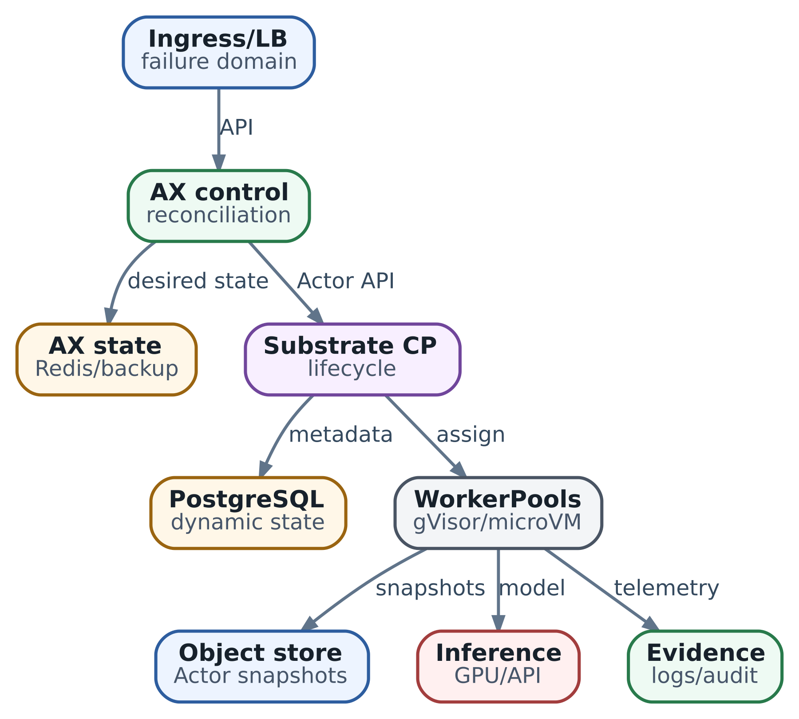

# 27. Production engineering: как доказать HA, persistence, upgrades и DR

**Профиль главы на 16.10.2026:** AX `ac233282` и Substrate `df788825`, полные SHA — в паспорте главы 26. Это закреплённые ревизии, не текущий `main`. Development-манифесты, условия upstream runbook и проектируемая эксплуатационная схема ниже разделены. Стенд и восстановление реальных данных при подготовке редакции не запускались.

В лаборатории из главы 26 мы научились связывать результат с конфигурацией среды. Теперь вернёмся к публикации `billing`. Publisher отправил согласованного кандидата во внешнюю систему. Ветка обновилась, ответ потерялся, затем кластер стал недоступен. У дежурного есть резервная копия, в которой последняя попытка ещё не завершена. Если просто поднять процессы и продолжить выполнение, агент может повторить запись, уже состоявшуюся за пределами кластера.

При этом резервная копия сама может оказаться непригодной: база ссылается на отсутствующий snapshot, старый runtime не понимает новый формат, ключ расшифрования остался в недоступном account. Даже исправная копия не отвечает на вопрос, прекратил ли старый publisher писать после сетевого разделения. Восстановить файлы, восстановить сервис и безопасно продолжить работу — связанные, но разные действия.

Разберём этот инцидент последовательно: какое обещание дать пользователю, какое состояние сохранить, как выбрать средства защиты и что проверить перед возобновлением работы. После этого станет понятнее и плановое обновление: оно меняет те же данные и границы совместимости, только у инженера есть время подготовиться.

\
_&#x50;roduction-like topology: availability зависит от всей цепочки stateful и stateless planes_

## 1. Сначала определить восстанавливаемый результат

Production engineering — подготовка системы к эксплуатации с измеримыми обязательствами и понятными действиями при отказе. Для нашего сервиса обязательство может звучать так: «После потери кластера восстановить согласованные задачи и возможность продолжать публикации в установленный срок, не выдавая неизвестный исход предыдущей записи за разрешение повторить её». Это уже позволяет выбирать архитектуру и проверку.

**DR, disaster recovery,** — аварийное восстановление после события, для которого обычного продолжения работы или локального failover недостаточно. Такой сценарий может означать потерю кластера, повреждение общей базы или компрометацию доступов. Его границы называют явно: доступность при потере одного Pod и восстановление после удаления всех копий в account требуют разных средств.

В слове «надёжность» удобно различать четыре свойства:

| Свойство                            | Что означает для `billing`                                           | Какое свидетельство нужно                                                      |
| ----------------------------------- | -------------------------------------------------------------------- | ------------------------------------------------------------------------------ |
| Доступность, availability           | Пользователь может выполнить оговорённую операцию в пределах SLO     | Проверка полезного пути под нагрузкой и при выбранном отказе                   |
| Сохранность, durability             | Подтверждённые данные сохраняются в пределах принятого контракта     | Семантика подтверждения записи, хранения и отказа                              |
| Восстановимость, recoverability     | Команда может вернуть согласованное состояние и сервис               | Восстановление из сохранённых копий с измерением результата                    |
| Безопасность продолжения исполнения | Восстановленный процесс корректно разбирает прежние внешние действия | Связь operation ID, согласования, состояния target и результата reconciliation |

Например, чтение статуса может оставаться доступным, пока новые публикации остановлены. Если считать оба пути одним «API uptime», пользовательская проблема исчезнет из отчёта. Глава 25 уже дала способ связать SLI с результатом; здесь нужно определить, какие именно операции обещаны во время аварии и после неё.

**RPO, recovery point objective,** задаёт допустимую глубину отката данных во времени. **RTO, recovery time objective,** задаёт допустимое время до восстановления оговорённого обслуживания. Это цели, с которыми сравнивают результат опыта. Начало отсчёта RTO фиксируют заранее; в нашем сценарии считаем от начала недоступности, включая обнаружение, получение доступа и проверку восстановления. Отсчёт только от команды restore скрыл бы значительную часть простоя. [Планирование DR и целей восстановления](https://docs.aws.amazon.com/wellarchitected/latest/reliability-pillar/plan-for-disaster-recovery-dr.html).

Если отказ случился в момент `t=130`, а последняя пригодная точка покрывает состояние до `t=120`, окно потенциальной потери составляет десять секунд. Это ещё не число утраченных операций: в эти секунды могло не быть записей, часть данных могла сохраниться другим путём. Чтобы установить фактическую потерю, нужны sequence, receipts или другой журнал подтверждённых изменений. Цель RPO 15 секунд сама по себе ни одного изменения не сохраняет.

Для AX state, Actor checkpoints и внешних действий могут действовать разные требования. Одному workload допустимо повторить локальную компиляцию; другому нельзя потерять подтверждённое согласование. Внешняя публикация не откатывается вместе с Redis. Поэтому recovery contract описывает состояние каждого участника, условия подтверждения и способ сопоставить их после отказа. Требования продукта определяют этот контракт до выбора числа replicas.

## 2. Какое состояние понадобится после потери кластера

Представим, что рабочий кластер полностью недоступен. Что инженер сможет получить из другого места и чему сможет доверять? Ответ нужно записать вместе с владельцами данных.

| Состояние                                  | Почему потребуется                                   | Что нельзя восстановить догадкой                               |
| ------------------------------------------ | ---------------------------------------------------- | -------------------------------------------------------------- |
| AX Task, Workspace, Model, статусы и связи | Понять, какую работу продолжать и с каким Actor      | Живой статус из одного YAML в Git                              |
| Substrate metadata                         | Найти Actor и соответствующий завершённый checkpoint | Связь Actor → snapshot по похожим именам файлов                |
| Snapshot blobs и их зависимости            | Восстановить выбранное состояние исполнения          | Недостающие bytes, runtime или ключ расшифрования              |
| Images, конфигурации и схемы               | Запустить совместимые readers и writers              | Старый image по изменившемуся tag `latest`                     |
| Журнал внешних операций и данные target    | Определить, что уже произошло вне кластера           | Неизвестный результат по отсутствию записи в старой копии      |
| Доступы, trust и процедура восстановления  | Получить копии и безопасно запустить новый контур    | Полномочия недоступного или скомпрометированного control plane |

Часть Kubernetes-объектов можно пересоздать декларативно. Worker Pods и caches обычно относятся к расходуемой инфраструктуре; данные workload — к другому классу. GitOps помогает вернуть желаемые конфигурации, но не воспроизводит автоматически runtime status, историю согласований и содержимое PVC. Прежде чем исключить что-либо из backup, проверьте, из какого сохранённого источника оно будет восстановлено.

### Почему копии разных хранилищ нужно связать

Допустим, metadata уже ссылается на `snapshot-S2`, а в сохранённом object store есть только `S1`. Обе backup-задачи могли завершиться успешно: каждая скопировала своё хранилище в своё время. Вместе эти копии не образуют пригодную точку восстановления.

Нужен **recovery manifest** — перечень согласованных версий: backup базы и его позиция восстановления, идентичности Task/Actor, ссылки на завершённые blobs, их версии и digests, необходимые images, форматы и версии ключей. Это предлагаемая эксплуатационная схема, не готовый стандартный формат AX/Substrate. Согласованность обеспечивают протоколом публикации checkpoints, временной остановкой writers — процессов, изменяющих состояние, — либо проверенной процедурой согласования копий. Близость timestamps не заменяет такой протокол.

Metadata и blobs должны оставаться доступными на весь срок восстановления. Удаление рабочего snapshot сборщиком мусора или lifecycle policy не должно неожиданно лишить смысла retained backup базы. Политики хранения согласуют по зависимостям: какие версии ещё нужны хотя бы одной действующей точке восстановления? Аналогичный вопрос относится к image registry и encryption keys.

В нашем опыте последний полноценный комплект относится к `t=120`. Комплект `t=125` выглядит свежее, но не завершён. Выберем 120. Если же там не хватает bytes или ключа, придётся искать более старую согласованную точку и заново сравнивать получившуюся потерю с RPO. Допустимость такого отклонения требует решения ответственного за восстановление; автоматический выбор «самого свежего файла» этого решения не даёт.

## 3. Выбор средств хранения и backup

Выбирать инструмент удобнее по обязанности, которую он должен выполнять. Реплика помогает продолжать обслуживание после части отказов. Backup позволяет вернуться к сохранённой истории, в том числе после логической ошибки. Ошибочное удаление может распространиться на replicas задолго до обнаружения. Поэтому проверяют и путь failover, и отдельный путь restore.

При допустимом долгом простое можно восстанавливать окружение из копий: постоянно работающих ресурсов меньше, но подготовка и replay занимают время. Малый RTO может потребовать заранее готового контура, доступных ключей и тёплой capacity. За сокращение действий во время аварии платят ресурсами и обслуживанием резервного пути. Эту цену сравнивают с ущербом от простоя; резервный контур всё равно нуждается в проверке данных и права писать.

### PostgreSQL и восстановление по журналу

Если metadata должна восстанавливаться ближе к моменту отказа, чем интервал между полными копиями, полезен PITR — point-in-time recovery. В PostgreSQL он использует базовую физическую копию и непрерывную нужную последовательность WAL. WAL, write-ahead log, — журнал изменений данных: при восстановлении его записи воспроизводятся поверх базовой копии до выбранной точки. Потерянный участок журнала ограничивает доступный горизонт восстановления; наличие свежего `pg_dump` не заменяет этот механизм. Конфигурационные файлы и внешние object blobs также требуют своего плана. [PostgreSQL continuous archiving и PITR](https://www.postgresql.org/docs/current/continuous-archiving.html).

В управляемом PostgreSQL команда может использовать сервисный PITR, если подтверждены retention, доступ после потери account/region, ограничения восстановления и нужные права. Для самостоятельного размещения пример подходящего средства — **pgBackRest**: он организует копии, WAL archive, retention и restore. Выбор оправдан, когда команда готова обслуживать repository и проверять цепочки восстановления. Один успешный backup job не показывает, что восстановлены все зависимости приложения. [Руководство pgBackRest](https://pgbackrest.org/user-guide.html).

Не заменяйте выбранный AX store PostgreSQL только потому, что он уже используется Substrate. Сначала нужна поддерживаемая реализация store или отдельная доработка и проверка API/locking semantics. Общий инструмент backup может обслуживать несколько баз, но это не делает их одним состоянием приложения.

### Redis и граница подтверждённой записи

RDB сохраняет снимки Redis, AOF записывает изменения с выбранной политикой синхронизации. При периодическом сохранении остаётся интервал изменений после последней копии; более частая синхронизация увеличивает требования к I/O. Например, режим AOF `everysec` не означает, что каждая подтверждённая операция уже прошла отдельный `fsync`. Следует проверять и сохранение на диск, и расположение самого диска, и поведение failover. Наличие AOF на storage, потерянном вместе с машиной, не является отдельной аварийной копией. [Persistence Redis](https://redis.io/docs/latest/operate/oss_and_stack/management/persistence/).

В AX `ac233282` файл `deploy/redis.yaml` задаёт одну replica Redis в Deployment и не подключает устойчивый том или специальную конфигурацию persistence. Это описание **манифеста**, а не утверждение, будто Redis не умеет сохранять данные или обязательно отключает свои defaults. Без выбранного устойчивого хранения и проверенного restore этот quickstart не предоставляет требуемого контракта сохранности AX state. [Закреплённый Redis manifest AX](https://github.com/google/ax/blob/ac2332829f22360ff97b0ba34d94dd0dd782f17e/deploy/redis.yaml).

### Object store и защита истории

Для snapshots важны сохранённая версия объекта, целостность bytes, возможность чтения и необходимые ключи. Versioning помогает пережить замену версии; политика retention или object lock может ограничить удаление. Их конкретные гарантии и права администратора нужно проверить у выбранного backend. Другая папка в том же account с теми же полномочиями удаления не создаёт независимого credentials domain.

Checksum обнаруживает расхождение с ожидаемыми bytes. Он не удостоверяет источник manifest и не подтверждает, что runtime сможет восстановить процесс. Если злоумышленник меняет и blob, и ожидаемый hash, простая проверка равенства пройдёт. Поэтому доверие к каталогу backup, управление ключами и фактическая проверка restore — самостоятельные части схемы.

### Kubernetes и конфигурация окружения

Для self-managed control plane нужен план восстановления etcd — хранилища состояния Kubernetes API. Его копия не содержит автоматически данные внешних сервисов. Для managed Kubernetes нужно понимать границы ответственности сервиса. **Velero** может помогать с копированием Kubernetes resources и поддерживаемыми способами защиты volumes. Это полезно, когда нужно вернуть динамические объекты вместе с окружением. Но из этого не следует согласованность внешнего PostgreSQL, object store и operation journal: их связывает recovery contract приложения. [Backup reference Velero](https://velero.io/docs/main/backup-reference/), [восстановление etcd](https://kubernetes.io/docs/tasks/administer-cluster/configure-upgrade-etcd/).

Для маленькой системы часто лучше несколько хорошо проверенных механизмов с понятными владельцами, чем единая панель, за которой никто не может объяснить recovery point. Итог выбора инструмента — доступный и проверяемый restore-путь, включая действия при недоступности обычных credentials и observability backend.

## 4. Доступность и право нового контура писать

HA, high availability, проектируется для конкретных отказов и операций. Если нужно пережить потерю физического host, replicas распределяют по таким hosts, а зависимости не оставляют единственными на той же машине. Именно эту границу мы разобрали в главе 26. Схема в начале главы показывает зависимости; она не является проверенной конфигурацией, которую достаточно скопировать.

Запас мощности тоже относится к сценарию отказа. В условном пуле из трёх узлов по десять slots после потери одного останется двадцать slots. Восемнадцать активных работ арифметически помещаются, двадцать одна — уже нет. Но slots здесь лишь первая оценка: нужны ещё подходящее размещение по RAM/CPU, snapshot I/O, доступ к images и способность обслужить одновременный resume. Проценты резерва без workload и отказного сценария мало помогают. Измерения capacity продолжатся в главе 28.

**PodDisruptionBudget** ограничивает допустимые добровольные evictions через соответствующий механизм Kubernetes. Он помогает при согласованном drain, но не предотвращает аварийную потерю node. Прямое удаление Pod обходит PDB; rollout Deployment регулируется правилами самого workload, а не обещанием PDB остановить любое обновление. К этому добавляют topology, резерв и протокол приложения. [Kubernetes disruptions](https://kubernetes.io/docs/concepts/workloads/pods/disruptions/).

Readiness должна соответствовать способности обслуживать обещанный путь. Проверка только открытого порта слишком слаба, а зависимость readiness всех replicas от любого необязательного backend может одновременно убрать их из обслуживания. Liveness отвечает на другой вопрос: нужен ли restart процесса; временный отказ внешнего сервиса сам по себе не делает restart полезным. Инженер выбирает критические зависимости, ограничивает ожидание и отдельно проверяет пользовательский outcome. В AX manifest `ax-server` обе probes обращаются к `/healthz`; из одного названия нельзя вывести глубину проверки. [Probes Kubernetes](https://kubernetes.io/docs/tasks/configure-pod-container/configure-liveness-readiness-startup-probes/), [manifest AX](https://github.com/google/ax/blob/ac2332829f22360ff97b0ba34d94dd0dd782f17e/deploy/ax-server.yaml).

### Зачем останавливать старого writer

При сетевом разделении старый publisher может продолжать работать, хотя новый контур уже выбран главным. Leader election помогает выбрать участника; **fencing** делает устаревшего участника неспособным выполнять защищаемую запись. Например, шлюз записи принимает epoch 8 и отклоняет epoch 7. Такая защита действует, только если проверяется там, где выполняется изменение, а не просто записана в diagnostic log. Другой вариант — надёжно отозвать старые полномочия или изолировать старый контур.

Истечение lock или исчезновение heartbeat не подтверждает остановку прежнего процесса: он мог надолго приостановиться, а потом продолжить. Конкретный store, lock и target должны давать нужный контракт. В частности, документация Redis отдельно обсуждает fencing и ограничения времени жизни locks. Эта глава не приписывает готовый end-to-end fencing AX. [Distributed locks Redis](https://redis.io/docs/latest/develop/clients/patterns/distributed-locks/).

Теперь вернёмся к внешней публикации. Журнал намерений сохранил `publish-742` и hash кандидата до отправки; в нашем сценарии этот журнал доступен вне восстанавливаемого checkpoint. Target сохранил receipt об обновлении ветки. После восстановления мы сопоставляем operation ID, кандидата и фактическое состояние target. Уже выполненную публикацию не нужно исполнять снова. Если журнал утрачен, receipt непроверяем или target не даёт установить исход, работа остаётся в состоянии неопределённости из главы 24. Удобный таймаут не превращает её в новую безопасную попытку.

## 5. Практикум на искусственной истории восстановления

В репозитории добавлен `examples/ch27_recovery_plan.py` с тестами. Он использует стандартную библиотеку Python и небольшие строки bytes. Это **учебная модель решения**, не парсер backup AX/Substrate и не реализация DR. Флаги завершения, доступности ключа, fencing и наблюдения target поступают как доверенные искусственные входы. Реальные инфраструктурные действия программа не выполняет.

Упрощённый каталог содержит по одному кандидату на каждый момент `cut`; одинаковые имена и одинаковые cuts отклоняются как неоднозначность этой модели. `select_point` рассматривает записи от новых к старым. Для выбранной фиксированной Task он сверяет Actor, ссылку metadata на blob, наличие bytes, их SHA-256, доступность ключа и объявленную пару snapshot format / reader. Совпадение hash вычисляется действительно; расшифрование и запуск runtime не выполняются. `demo-v1` — имя учебного контракта, не версия AX или Substrate.

В основном сценарии используем сжатую шкалу секунд, чтобы расчёт был виден целиком:

1. В `t=120` сохранён завершённый комплект `p120`.
2. Комплект `p125` ещё не завершён. Внешняя публикация имеет устойчивый operation ID и receipt; момент `126` в имени receipt — только иллюстративная метка.
3. В `t=130` начинается недоступность. Старый writer в успешной ветке изолирован, состояние target сопоставлено с сохранённой операцией.
4. В `t=170` задан результат проверки оговорённого сервиса после восстановления. Цели опыта: RPO не более 15 секунд, RTO не более 45 секунд. Это учебные числа, не измерения платформы.

Окно потенциальной потери равно `130 - 120 = 10` секунд, длительность до подтверждённого обслуживания — `170 - 130 = 40` секунд. В программе их считает функция:

```
def recovery_budget(incident_at, cut, verified_at, rpo_limit, rto_limit):
    values = [incident_at, cut, rpo_limit, rto_limit]
    if any(type(v) is not int or v < 0 for v in values) or cut > incident_at:
        raise ValueError("invalid_budget_input")
    if verified_at is not None and (
            type(verified_at) is not int or verified_at < incident_at):
        raise ValueError("invalid_verification_time")
    exposure = incident_at - cut
    elapsed = None if verified_at is None else verified_at - incident_at
    return {"exposure_s": exposure, "recovery_elapsed_s": elapsed,
            "rpo_met": exposure <= rpo_limit,
            "rto_met": None if elapsed is None else elapsed <= rto_limit}
```

Если подтверждения обслуживания ещё нет, `recovery_elapsed_s` и `rto_met` равны `None`. Это «ещё не установлено», а не нулевой RTO и не уже доказанное нарушение срока. Для продолжающегося реального инцидента отдельно считают elapsed до текущего момента. Учебная функция оценивает только заданную завершённую проверку или её отсутствие.

Запуск из корня репозитория:

```
python3 examples/ch27_recovery_plan.py
python3 -m unittest discover -s examples -p 'test_ch27_recovery_plan.py'
```

Ожидаемые результаты десяти сценариев. Прочерк означает `None`, то есть измерение отсутствует:

| Сценарий          | Точка  | Окно отката, с | Восстановление, с | Результат модели    |
| ----------------- | ------ | -------------- | ----------------- | ------------------- |
| `good`            | `p120` | 10             | 40                | `model_pass`        |
| `old_fallback`    | `p110` | 20             | 40                | `hold_rpo`          |
| `corrupt_blob`    | —      | —              | —                 | `hold_no_point`     |
| `mapping_lost`    | —      | —              | —                 | `hold_no_point`     |
| `unknown_format`  | —      | —              | —                 | `hold_no_point`     |
| `missing_key`     | —      | —              | —                 | `hold_no_point`     |
| `old_writer_live` | `p120` | 10             | —                 | `hold_fencing`      |
| `unknown_effect`  | `p120` | 10             | —                 | `hold_unknown`      |
| `retry_needed`    | `p120` | 10             | —                 | `hold_retry_needed` |
| `too_slow`        | `p120` | 10             | 50                | `hold_rto`          |

В `good` новый комплект отклонён как incomplete, старый пригоден, target сообщает о состоявшейся операции. В `old_fallback` bytes более нового комплекта отсутствуют; выбранный `p110` выходит за установленный RPO. Это повод обсуждать потерю с ответственным владельцем, а не молча снижать обещание пользователю. `rejected` в выводе сохраняет причину исключения кандидата.

В `retry_needed` target определённо сообщает, что операция не выполнена, и учебный контракт idempotency ещё действует. Модель советует `retry_same_operation`, но возвращает `hold_retry_needed`: совет не равен выполненной и проверенной записи. Неопределённый поиск, истёкший срок idempotency или неизвестный payload не дают такого совета. Прежние operation ID и кандидат остаются связанными; новый ключ создал бы другую попытку дедупликации.

Обычный вызов `assess` по умолчанию не получает положительных свидетельств fencing и проверки сервиса. Их явно задаёт helper `worked_case`, создающий fixtures. Во всех сценариях `production_ready=false` и `live_restore_executed=false`, включая `model_pass`. Такой результат говорит только о согласованности переданных учебных данных. Он не доказывает доверие к receipt, действительное прекращение старых writes, корректность всех Tasks, совместимость runtime, HA или выполнение RPO/RTO на настоящем стенде.

Попробуйте поменять только hash blob, только ожидаемый Actor или только reader. Затем оставьте идеальную копию, но уберите receipt. Это разные места отказа: в первых случаях не выбирается точка, в последнем — не разрешается безопасное продолжение. Поэтому один общий флаг `backup_ok` не заменит протокол проверки.

## 6. Обновление системы с живым состоянием

При обновлении нужно проверить не только запуск нового binary. Новый reader должен понимать сохранённые данные; новый writer может создать данные, которые старый reader уже не прочитает. Совместимость AX CLI/server, Substrate control plane/dataplane, database schema, runner и snapshot runtime имеет разные границы. Заявление «новая версия работает» должно указывать исходную версию, направление чтения и допустимое окно смешанных версий.

Перед rollout выберите стратегию возвращения для каждого изменения. При **rollback** старый код продолжит понимать текущее состояние. При **roll-forward** проблему устраняют следующей совместимой версией, не возвращая старый writer. При **restore** возвращают сохранённое состояние с принятым окном потери и затем согласуют внешние действия. Смена image не отменяет migration и не откатывает target. Совместимое расширение схемы перед переключением writers часто позволяет сохранить обратный путь; удаление старого поля разумно откладывать до его завершения.

### Что требует runbook выбранного Substrate

В `df788825` документирован versioned rolling path. Его preconditions существенны: version-suffixed atelet DaemonSet, labels `ate.dev/substrate-version`, закреплённые serving WorkerPools, поддержка `DrainWorker` и контролируемые источники изменения nodes. Если начальный installation profile не соответствует условиям, этот путь нельзя переносить на него как универсальную инструкцию. [Закреплённый upgrade runbook](https://github.com/agent-substrate/substrate/blob/df788825e6fc13dd7aa5fd283c8f14bd4c818247/docs/upgrade.md).

Порядок в документе начинается с новых CRDs и controller, затем подготавливается новая версия dataplane. Serving WorkerPool клонируют с сохранением необходимых полей и новой version pin/image, а не редактируют и не уменьшают под живыми Actors. Так старая и новая capacity существуют раздельно, а переход выполняется по узлам. Для выбранной пары релизов отдельно проверяют, что действительно допустимо в mixed-version window; обещание runbook нельзя распространять на произвольные будущие форматы.

На узле сначала прекращают новые назначения через `DrainWorker`. Это ещё не переносит существующих Actors. Нужно учесть и работающих Actors, и paused Actors с локальным snapshot на этом узле; последних не видно в списке занятых Workers. Их доводят до завершённого suspend с внешним snapshot. Только затем меняют version label и освобождают старую worker capacity в предусмотренном порядке. Перестановка этих действий может снова разместить старые workers там, где уже меняется atelet.

Runbook предупреждает и о worker eviction: завершить процесс по `SIGTERM` недостаточно для сохранения Actor. Suspend должен дойти до control plane и завершиться в предусмотренное окно. В описанном аварийном исходе Actor становится `CRASHED`, а `RevertActor` возвращает его к последнему внешнему snapshot с потерей более поздних изменений. Это иной результат, чем обещанный аккуратным rollout перенос состояния. После dataplane обновляется остальной control plane; single-node профиль на соответствующем этапе останавливается полностью.

Старые WorkerPools, образы и versioned объекты сохраняют до завершения проверки и выдержки. Их удаление — отдельное решение о закрытии быстрого обратного пути. Следуйте полному runbook конкретного перехода, включая его исключения и provider-specific условия, а не только этому объяснению причин. Здесь мы не выполняем ни drain, ни изменение labels, ни rollout.

Для AX требуется собственный план обновления store, API и runner. `deploy/ax-server.yaml` задаёт одну replica; увеличение числа серверов требует проверки concurrent writes, resource locking, lifecycle reconciliation и восстановления после незавершённой операции. Пара AX/Substrate из главы 26 по-прежнему не объявлена испытанной совместимой сборкой. Статическое чтение manifests и runbook такую проверку не заменяет.

## 7. Как провести настоящий recovery drill

Следующий шаг после офлайн-модели — отдельный восстановительный контур с синтетическим workload и тестовым target. Это будущий согласованный опыт, не часть выполненных проверок этой редакции. Он не должен иметь права писать в production target или автоматически продолжать задачи из скопированной базы.

Сначала задайте сценарий: например, основной кластер недоступен, но backup repository, ключи и журнал внешних операций сохранены. Отдельный опыт должен проверять их потерю или компрометацию. Назначьте руководителя восстановления, полномочия на остановку/возобновление writes, цели RPO/RTO и условия прекращения упражнения. Runbook и доступ к нему должны пережить именно выбранный отказ.

Затем создайте проверяемую историю: известный Task, marker в сохраняемом состоянии, согласованный кандидат, operation ID и известный исход внешнего действия. Сохраните комплект зависимостей и восстановите его в новом изолированном окружении по инструкции. Это лучше проверяет полноту runbook, чем рестарт прежнего процесса с его неучтёнными caches и открытыми доступами.

До возобновления пройдите цепочку: права старого writer прекращены; каталог и ключи доступны; metadata и blobs согласованы; нужные readers запускаются; Task сопоставлен с Actor; восстановлен marker; внешняя операция reconciled; проверен полезный путь. Если ключи могли быть скомпрометированы, обычное возвращение старого secret из backup не закрывает инцидент — требуется отдельная процедура доверия, ротации и отзыва.

Измеряйте обнаружение, доступ к копиям, получение ключей, restore/replay, проверку данных и staged admission отдельно. Общий RTO включает договорённый путь до обслуживания. Фактическую потерю сверяют с журналом подтверждённых изменений. Запишите ручные действия и расхождения; после исправления runbook повторите опыт. Глава 25 подсказывает, как сохранить связь результата с Task и попыткой, не принимая diagnostic log за единственное доказательство.

Восстановление одной удачной Task — полезный smoke test. Для эксплуатационного обещания нужны репрезентативные размеры state, варианты runtime, длительные операции, неполные snapshots и соответствующая нагрузка после аварии. Отдельно проверяют возврат в основной контур: failback тоже может запустить двух writers или создать очередь повторных действий. Один успешный drill ограничен своим сценарием и не является сертификатом на все отказы.

## Итог

Для `billing` восстановление закончено, когда команда может объяснить не только происхождение данных, но и право продолжать работу: выбран согласованный комплект, понятен допустимый откат, остановлен старый writer, установлен исход прежних внешних действий и проверен оговорённый сервис. У каждого вывода есть своё свидетельство.

Replication, backup, fencing и совместимые updates решают разные части этой задачи. Инструмент выбирают по тому, какую часть он действительно покрывает и кто сможет восстановить её при отказе. Локальный пример помогает проверить логику решения; обещание RPO/RTO появляется после опыта на выбранной конфигурации и workload.

Следующая глава посвящена performance и scaling. Теперь для этих измерений есть важное условие: полезная capacity должна сохраняться в принятом сценарии отказа и восстановления, а ускорение не должно менять смысл подтверждённой работы.

### Источники и дальнейшее чтение

* Конкретный профиль: [Substrate upgrade `df788825`](https://github.com/agent-substrate/substrate/blob/df788825e6fc13dd7aa5fd283c8f14bd4c818247/docs/upgrade.md), [AX Redis](https://github.com/google/ax/blob/ac2332829f22360ff97b0ba34d94dd0dd782f17e/deploy/redis.yaml), [AX server](https://github.com/google/ax/blob/ac2332829f22360ff97b0ba34d94dd0dd782f17e/deploy/ax-server.yaml).
* Цели и Kubernetes: [DR planning](https://docs.aws.amazon.com/wellarchitected/latest/reliability-pillar/plan-for-disaster-recovery-dr.html), [disruptions/PDB](https://kubernetes.io/docs/concepts/workloads/pods/disruptions/), [probes](https://kubernetes.io/docs/tasks/configure-pod-container/configure-liveness-readiness-startup-probes/), [etcd](https://kubernetes.io/docs/tasks/administer-cluster/configure-upgrade-etcd/).
* Средства и ограничения: [PostgreSQL PITR](https://www.postgresql.org/docs/current/continuous-archiving.html), [pgBackRest](https://pgbackrest.org/user-guide.html), [Redis persistence](https://redis.io/docs/latest/operate/oss_and_stack/management/persistence/), [distributed locks](https://redis.io/docs/latest/develop/clients/patterns/distributed-locks/), [Velero](https://velero.io/docs/main/backup-reference/). Версии инструментов, форматы и проверенные переходы закрепляют в эксплуатационном паспорте.
