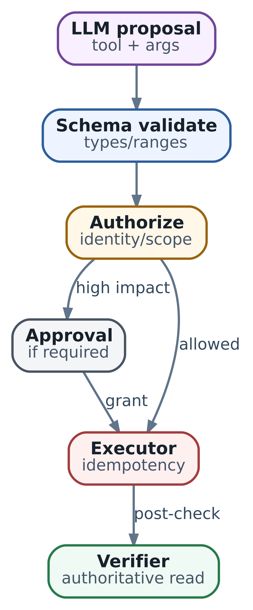
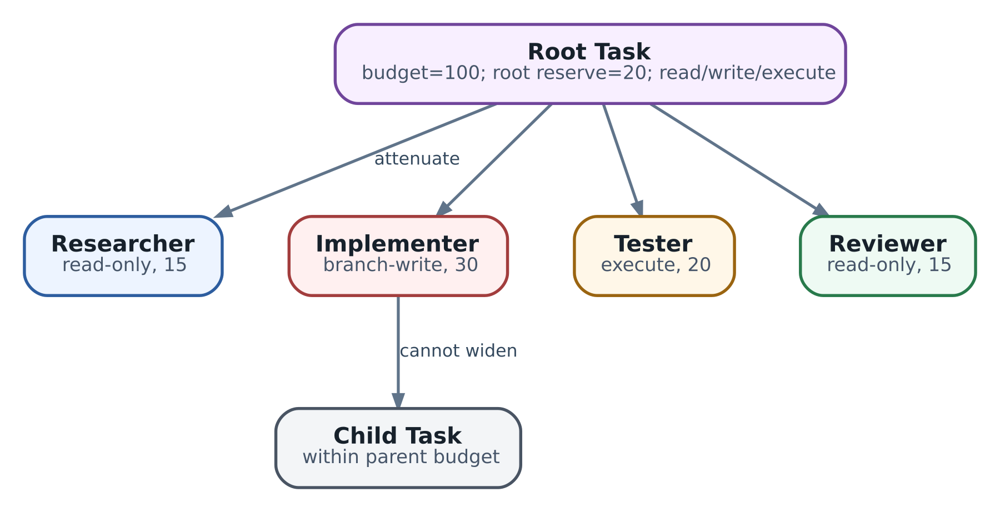

# 37. Безопасное выполнение tools: idempotency, approvals и attenuation полномочий

На `lab-edge-1` уже видны `config-18` и local preference 150 для пути A. Это наблюдение мы получили в главе 36. В журнале приложения осталась операция `op-17`: ответ на запрос `lab33-net-001` потерялся, поэтому её исход обозначен как `OUTCOME_UNKNOWN`. Дежурному нужно понять, можно ли продолжать работу. Повторить запись? Проверить трафик? Сначала найти квитанцию исполнителя?

Чтобы ответить, восстановим ход изменения. При `config-17` у пути A было значение 100. Оператор согласовал повышение до 150 для одного префикса в VRF `LAB`. Теперь нам нужны два отдельных результата: установить судьбу той записи и выяснить, улучшилась ли связность. Текущая конфигурация помогает со вторым вопросом, но сама не связывает изменение с нашей попыткой.

**Executor - программный компонент, который исполняет разрешённое действие и ведёт учёт его исхода.** Внутри агентной системы он превращает предложение модели в конкретный запрос к целевой системе. Разберём, какие сведения ему нужны до отправки, почему приходится хранить неопределённость и как восстановить работу после потерянного ответа. Затем запустим локальный пример с двумя отдельными базами данных. Это продолжение сетевого случая глав 33-36; название параметра, target и прежний request сохраняются.

\
_&#x53;afe tool execution: model proposal is only the first stage_

## Где начинается ответственность исполнителя

Harness из главы 4 управляет работой агента: получает предложение модели, собирает контекст и выбирает следующий шаг. Executor отвечает за узкую операцию, например изменение local preference. Adapter переводит её в API или команды конкретного controller. В небольшой программе эти части могут быть функциями одного сервиса. Разделение важно потому, что у них разные основания для решения.

Модель получила telemetry и предложила предпочесть путь A. Executor должен знать точный router, VRF, префикс, путь, новое значение и исходную revision. Inventory связывает имя `lab-edge-1` с устойчивым ID устройства. Доверенный контекст соединения устанавливает вызывающую сторону. Policy определяет допустимое действие, а запись approval содержит подтверждённый вариант изменения. Так появляются данные, с которыми можно выполнять проверяемую запись.

Форма и смысл аргументов проверяются последовательно. Schema проверяет тип local preference и диапазон, semantic validator - корректность CIDR и существование пути, policy - доступ к этому объекту. Например, `192.0.2.1/24` нужно явно отклонить или привести к сети по установленным правилам. Если оператор согласовал один вариант, adapter уже не должен незаметно расширять его до всех префиксов. Все defaults и нормализация, влияющие на эффект, выполняются до подтверждения.

Нагрузка и утечка данных тоже относятся к рискам tool. Чтение полного config может раскрывать credentials; diagnostic probe может запускать дорогую работу. Для каждого интерфейса выясните, что реально делает target, какой объём затрагивает запрос и насколько обратим эффект. Особенно важно понять побочные действия: повторная установка того же значения иногда снова вызывает reload. По одному имени `set_route` этого не узнать.

## Как связать намерение и подтверждение

У нашего изменения несколько идентификаторов. Они нужны разным участникам и живут разное время.

| Поле                  | Значение в примере                     | Для чего сохраняется                                    |
| --------------------- | -------------------------------------- | ------------------------------------------------------- |
| Run приложения        | lab-network-017                        | Объединяет исследование и его операции                  |
| Операция приложения   | op-17                                  | Обозначает одно принятое намерение                      |
| Ключ внешнего запроса | lab33-net-001                          | Позволяет backend распознать повтор этого намерения     |
| Target                | router-lab-01 / LAB / 192.0.2.0/24 / A | Указывает точную область изменения                      |
| Ожидаемая revision    | config-17                              | Задаёт состояние, на основании которого принято решение |

`router-lab-01` - учебный inventory UID устройства с отображаемым именем `lab-edge-1`. `op-17` обозначает внутри run тот же запрос, который в предыдущих главах назывался `lab33-net-001`. JSON-RPC ID из главы 36 относится к отдельному обмену сообщениями; при повторном обмене он может быть другим. ID операции и внешний ключ при этом сохраняются. Эти поля принадлежат нашему приложению, а не схеме AX или стандартному набору arguments любого MCP tool.

Approval связывает подтверждающего человека, действующий субъект, задачу, получателя разрешения, конкретное действие и срок. У действия сохраняются contract, нормализованный target, новое значение и ожидаемая revision. Для сравнения удобно вычислять digest этого небольшого объекта. При изменении значения 150 на 170 или `config-17` на `config-18` получится другой digest, и исполнитель обнаружит, что подтверждённый вариант изменился.

Правила сериализации становятся частью контракта issuer и executor. В нашем коде фиксированы ASCII-поля, имена ключей и представление целых чисел; JSON сериализуется с сортировкой ключей. Для произвольных документов придётся отдельно решить вопросы чисел, Unicode и normalization. Сам hash помогает сравнить содержимое. Право принять решение появляется из доверенного хранилища approval или проверенной подписи и policy выдачи - это задача границы identity, разобранной в главе 24.

Перед новой попыткой записи исполнитель проверяет действующие права, срок и отзыв approval. Важно выбрать момент, в который разрешение считается использованным. Если проверка выполнена при захвате операции, запрос уже может уйти после последующего отзыва. Требование «не применять после отзыва» потребует контроля на стороне применения или механизма fencing. Короткий TTL лишь ограничивает часть этого окна. Разрешённый lookup прежнего результата можно оставить доступным после истечения права на новую запись.

## Что защищает условная запись

Допустим, пока оператор читал diff для `config-17`, другой инженер сохранил `config-18`. Проверка revision перед отправкой заметит часть таких случаев. Между отдельными read и write всё равно может пройти ещё одно изменение. **Conditional write - запись, при которой целевая система проверяет условие и применяет изменение как один согласованный переход.** Для сравнения ожидаемого значения с текущим часто используют термин compare-and-swap, CAS.

В нашем случае backend принимает «установить A=150, если revision всё ещё config-17». При совпадении он сохраняет изменение и выдаёт `config-18`; при несовпадении возвращает conflict. Executor передаёт конфликт harness для нового чтения и пересмотра решения. Простая замена expected revision на свежую превратила бы старое approval в разрешение на другое исходное состояние.

Знакомый пример такой защиты есть в [Kubernetes API](https://kubernetes.io/docs/reference/using-api/api-concepts/#updates-to-existing-resources): при PUT клиент передаёт `resourceVersion`, а устаревшее значение приводит к `409 Conflict`. Здесь это иллюстрация механизма другого API. Наше поле `expected_revision` требует соответствующей реализации сетевого controller; AX этого контракта за него не создаёт.

Если целевая система позволяет только безусловные команды, оцените возможность единственного controller, через который действительно проходят все writers. Его локальная блокировка полезна лишь в этой области владения. Прямой CLI другого администратора уже находится снаружи. Для сменяемого владельца lease задаёт срок владения, а fencing token - возрастающий номер, который target проверяет перед записью. Worker, проснувшийся после долгой паузы, предъявит старый номер и получит отказ. Если target номера не проверяет, истечение lease само по себе не останавливает старого writer.

Условия должны соответствовать риску. Revision всего config консервативно остановит нашу запись даже при изменении постороннего интерфейса. Версия отдельного объекта уменьшает число лишних конфликтов, если backend сохраняет нужные зависимости. Начать можно с более широкой проверки, а затем сужать её по понятной модели владения. Для опасного изменения через неконтролируемый CLI разумным первым вариантом остаётся подготовка diff с ручным исполнением.

## Как backend узнаёт повтор операции

CAS защищает решение от устаревшего состояния. **Idempotency contract определяет, как backend обрабатывает повтор одного намерения без дополнительного предусмотренного эффекта.** В нашем примере один ключ `lab33-net-001` сопровождает все transport attempts операции `op-17`. После resume он извлекается из сохранённой записи.

Для создания двух одинаковых VM понадобятся два разных намерения и два ключа. Для восстановления ответа о первой VM сохраняется прежний ключ. Поэтому hash аргументов сам по себе неудобен как identity операции. [Amazon Builders’ Library](https://aws.amazon.com/builders-library/making-retries-safe-with-idempotent-APIs/) описывает caller-provided request identifier и проверку несовпадающих параметров у повторного запроса. В проектируемом API заранее определите scope ключа: tenant, caller, endpoint или другая явно названная область.

Принимающая сторона должна согласованно учитывать ключ и внешний эффект. Представим два отдельных действия proxy: записать ключ в свою БД и отправить команду router. Если proxy упал между ними, наличие ключа ещё не доказывает эффект. Если сначала отправил команду и упал до записи ключа, повтор может применить её второй раз. Положение записи в коде меняет окно сбоя, но не объединяет две системы в транзакцию.

Backend, который сам владеет изменяемыми данными, может сохранить изменение и receipt в одной транзакции. Receipt, или квитанция, связывает ключ, digest запроса и установленный результат. Повтор возвращает сохранённую квитанцию. Именно такую ограниченную модель реализует наш локальный Target. Реальному adapter, отправляющему команды наружу, понадобится гарантия конечного controller или собственный протокол восстановления.

Срок хранения ключей важен не меньше наличия API. Например, [Stripe API v1](https://docs.stripe.com/api/idempotent_requests) сохраняет первый результат после начала исполнения, включая `500`, сравнивает параметры повторов и допускает удаление ключей после как минимум 24 часов. После удаления прежний ключ может начать новую операцию. Это конкретный контракт v1, а не правило для любого платёжного или сетевого API. Проверяйте свою версию, конкурентные запросы, retention и поведение ошибок; окно восстановления приложения должно учитывать эти ограничения.

У повторного запроса к нашему Target есть важный порядок: сначала поиск прежнего ключа, затем проверка CAS для нового исполнения. Если первая попытка уже создала `config-18`, replay должен вернуть receipt этой попытки с исходным `expected_revision=config-17`. Сравнение со свежим config до поиска ключа дало бы ложный конфликт. Сохранённый receipt описывает прошлый результат; последующее состояние устройства проверяется отдельно.

## Почему нужен отдельный журнал операции

Ledger - устойчивый журнал намерений, попыток и результатов приложения. Перед внешним вызовом executor записывает точное действие и захватывает право начать попытку. Такой захват будем называть claim. Транзакция в ledger не позволяет двум сотрудничающим workers одновременно взять одну подготовленную запись. После commit исполнитель обращается к target.

Теперь существуют две независимые точки commit: в журнале приложения и у backend. Именно между ними появляется неопределённость. Рассмотрим три остановки одной программы:

| Момент остановки                                             | Запись приложения после восстановления | Что могло произойти у target                     |
| ------------------------------------------------------------ | -------------------------------------- | ------------------------------------------------ |
| Claim сохранён, отправка ещё не началась                     | DISPATCHING                            | Эффекта ещё нет                                  |
| Запрос ушёл, полный ответ не получен                         | DISPATCHING или OUTCOME\_UNKNOWN       | Запрос мог быть в очереди, применён или отклонён |
| Backend применил изменение, receipt ещё не сохранён клиентом | DISPATCHING или OUTCOME\_UNKNOWN       | Эффект есть, клиентского подтверждения ещё нет   |

Одинаковое содержимое ledger допускает разные внешние исходы. Поэтому после остановки `DISPATCHING` сначала требует сверки. `OUTCOME_UNKNOWN` - рабочее состояние, в котором система собирает недостающее evidence и ограничивает конфликтующие действия. Возраст таких записей должен быть виден дежурному.

Для учебного executor достаточно пяти состояний:

| Состояние        | Основание                                            | Следующий шаг                                   |
| ---------------- | ---------------------------------------------------- | ----------------------------------------------- |
| PREPARED         | Намерение сохранено; право отправки ещё не захвачено | Проверить допуск и выполнить claim              |
| DISPATCHING      | Попытка учтена; отправка возможна                    | Получить результат или начать recovery          |
| OUTCOME\_UNKNOWN | Надёжного ответа об эффекте пока нет                 | Lookup прежнего запроса                         |
| APPLIED          | Принят связанный с намерением receipt                | Проверить текущую конфигурацию и цель           |
| CONFLICT         | Учебный backend отклонил попытку до её эффекта       | Перечитать состояние и пересмотреть предложение |

В прикладной реализации также потребуются результаты verification, явные отказы до исполнения, история решений и завершение операции. Их лучше хранить так, чтобы факт применения оставался доступен и при провале проверки цели. Переименование `APPLIED` в безликий `FAILED` теряет сведения, необходимые восстановлению.

Transactional outbox полезен, когда намерение и задание на доставку нужно сохранить в одной БД. Доставщик затем повторяет отправку, пока не получит подтверждение по своему контракту. Внешний effect всё ещё требует дедупликации у получателя. Аналогично snapshot Actor сохраняет часть runtime, но после восстановления прежней памяти router может уже иметь новую конфигурацию. Сначала перечитывайте независимый ledger и backend; локальный checkpoint помогает найти их, а не заменяет их состояние.

## Практический пример с потерянным ответом

В `examples/ch37_operation_ledger.py` находятся Ledger, Target и Executor. Код использует Python standard library и два временных файла SQLite: `ledger.db` для приложения и `target.db` для условного сетевого controller. Они открываются разными соединениями. Между файлами нет общей транзакции. У Target конфигурация и receipt, напротив, находятся в одной базе и фиксируются вместе.

Сначала создаются `config-17` и A=100. `Ledger.prepare()` сохраняет `op-17`, её параметры, ключ и бюджет двух отправок. `claim()` проверяет fixture approval, увеличивает attempts и переводит запись в `DISPATCHING`. Для этого используется `BEGIN IMMEDIATE`: [SQLite начинает write transaction сразу](https://www.sqlite.org/lang_transaction.html), а конкурентный writer должен дождаться освобождения или получить `SQLITE_BUSY`.

Target в своей транзакции ищет ключ, проверяет revision, меняет local preference на 150 и сохраняет receipt `config-18`. Режим `drop_reply` затем поднимает исключение уже после commit. Executor сохраняет `OUTCOME_UNKNOWN`. В файле target изменение есть, в ledger квитанции ещё нет - это и есть интересующий нас промежуток.

Запустите из корня репозитория:

```
python3 examples/ch37_operation_ledger.py
python3 -m unittest discover -s examples -p 'test_ch37_operation_ledger.py'
```

Существенные поля вывода:

```
{
  "key": "lab33-net-001",
  "after_lost_reply": "OUTCOME_UNKNOWN",
  "after_recovery": "APPLIED",
  "dispatch_attempts": 1,
  "effects_before_lookup": 1,
  "effects_after_lookup": 1,
  "current_config": {"revision": "config-18", "local_pref": 150},
  "goal_verification": "NOT_EVALUATED",
  "network_calls": 0
}
```

Для recovery программа создаёт новые Python-объекты и открывает прежние файлы. Сначала выполняет разрешённый lookup по сохранённому ключу. Квитанция проходит проверку key, digest и ожидаемых полей результата, после чего ledger становится `APPLIED`. Число attempts остаётся 1, число зафиксированных effects - 1. Новой отправки записи не было. Время fixture уже равно 101, а write approval истекало в 100; разрешение lookup задано отдельно и остаётся действующим.

Теперь посмотрите тест `test_stop_before_send_also_leaves_dispatching`. Он останавливает исполнителя после claim, но до вызова Target. Ledger выглядит так же, как при остановке после внешнего commit, хотя effects равно нулю. Recovery без receipt оставляет `OUTCOME_UNKNOWN`. Код не делает из отсутствия записи разрешение автоматически повторить write. У реального сервиса первоначальный запрос мог ещё находиться в очереди или быть невидим в читаемой replica.

Явный `dispatch(retry=True)` в упражнении повторно проверяет допуск, берёт тот же key и расходует ещё одну попытку. Это допустимо только в рамках контракта данного Target: его история ключей сохраняется всё время жизни файла. Тест повторной отправки после потерянного ответа получает прежний receipt и один effect. При отзыве approval retry блокируется, а при исчерпании бюджета следующая попытка не начинается.

Ещё два теста объясняют цену реализации backend. Два соединения одновременно отправляют тот же ключ; транзакция Target оставляет одну запись эффекта. Искусственная ошибка INSERT receipt откатывает изменение config в той же транзакции. Для реального router такой rollback нельзя получить, просто поместив отправку CLI-команды между `BEGIN` и `COMMIT` локальной SQLite.

Упражнение моделирует узкий синхронный backend. Identity, approval и policy - доверенные fixtures; их выпуск, криптография и credentials здесь отсутствуют. Fault injection задаёт исключение в выбранной точке, а не убивает настоящий worker и не испытывает отключение питания. Проверены локальные SQLite-переходы, повторное открытие файлов и конкуренция соединений. HTTP, MCP, реальное оборудование, HA хранилища и статистика трафика требуют отдельных испытаний. Код сохраняет `APPLIED`, не объявляя цель достигнутой.

## Как выбрать следующий шаг при неизвестном исходе

Начните с lookup по внешнему operation ID или ключу, затем сопоставьте receipt с точным намерением. Если API вернул только «job принят», сохраните handle и дождитесь его конечного статуса. Для асинхронной работы приём задания и применение конфигурации - разные факты. Не превращайте промежуточную квитанцию в `APPLIED`.

При отсутствии receipt выясните, что означает отрицательный ответ. Чтение replica может отставать. Принятый запрос может ожидать исполнения. Удалённая запись дедупликации могла исчезнуть по retention. Надёжный ответ «не применялось и уже не может примениться» требует контракта backend об очереди, истории и завершении прежней попытки. Часто получить такой ответ труднее, чем повторить тот же запрос по действующему idempotency contract.

Для повтора с возможным новым эффектом нужны прежние key и параметры, сохранённая дедупликация, актуальный допуск и остаток attempts/deadline. Изменение параметров создаёт новое предложение, которое проходит свою проверку и approval. Если backend не даёт ни безопасного повтора, ни надёжного lookup, операция остаётся на ручной разбор. Одновременно система ограничивает новые конфликтующие записи.

Область конфликта тоже проектируется. В упражнении reservation относится к устройству, VRF, префиксу и пути, а уникальность этой комбинации проверяет ledger. Он консервативно удерживает её и после `APPLIED`: завершение verification и освобождение здесь не реализованы. В реальном controller операция, заменяющая всю policy, конфликтует с изменением одного входящего в неё правила. Простой lock по точной строке target такую зависимость пропустит. Иногда начать с блокировки всего устройства проще, чем преждевременно разрешить небезопасный параллелизм.

## Как выбрать инструменты исполнения и хранения

Выбор начните с гарантий конечного API. Самый удобный workflow engine всё равно должен узнать, что произошло у router. Если есть условная запись, operation status и поддерживаемые ключи, adapter может перенести их в узкий typed tool. Если доступен только произвольный shell, сначала придётся определить и ограничить допустимые команды, парсинг результата и владельцев конфигурации.

| Условия задачи                                  | С чего можно начать                                         | Что проверить до расширения                                                     |
| ----------------------------------------------- | ----------------------------------------------------------- | ------------------------------------------------------------------------------- |
| Один локальный исполнитель и небольшой журнал   | Типизированный adapter и SQLite                             | Сохранность файла, backup, поведение после restart и конкуренция writers        |
| Несколько workers на разных hosts               | Общая транзакционная БД, например PostgreSQL, и явный claim | Уникальность намерения, конфликты, восстановление владения и доступность ledger |
| Долгие ожидания, согласования и много этапов    | Durable workflow, например Temporal, плюс backend adapter   | Поведение retries каждой activity, сохранение key и смысл каждого timeout       |
| Backend без надёжного контроля внешнего эффекта | Подготовка diff и исполнение оператором                     | Как документировать действие, проверять его исход и ограничить риск             |

SQLite здесь выбрана за локальную транзакцию и отсутствие отдельного сервера. [Документация SQLite](https://www.sqlite.org/whentouse.html) рекомендует client/server БД при доступе с нескольких компьютеров и большом числе конкурентных writers. Перенос файла на общий сетевой диск не равнозначен переходу к такому серверу. Срок хранения, backup и потеря storage остаются самостоятельными требованиями даже у локального executor.

Workflow engine полезен, когда инженеру приходится вручную поддерживать timers, ожидание approval, историю шагов и восстановление orchestration. В [Temporal](https://docs.temporal.io/activities) activity выполняет прикладное действие и может автоматически повторяться по Retry Policy; документация рекомендует idempotent activities. Поэтому key логической операции сохраняется вне номера попытки activity, а adapter обрабатывает неизвестный внешний исход. Подключение Temporal переносит часть механики ожидания и доставки, сохраняя за вашим кодом контракт эффекта.

Policy engine выбирают по сложности правил; глава 24 сравнила встроенный gateway, Cedar, OPA и модели отношений. В небольшом executor несколько явных проверок могут быть проще отдельного сервиса. При любом выборе enforcement находится на пути каждой записи, а сведения о principal, target и approval имеют доверенное происхождение. Недоступный ledger или отсутствующее обязательное решение policy останавливают новую запись. Для уже отправленной операции сохраняется путь разрешённой сверки.

## Как сужать полномочия дочерней задачи

**Attenuation - выдача более узких полномочий при передаче работы.** Researcher достаточно читать telemetry устройства. Implementer может подготовить diff. Executor получает допуск к точному изменению, а verifier - к read-back и ограниченному probe. Такое разделение уменьшает последствия ошибки в каждой роли и делает понятным, где находится downstream credential.

\
_&#x41;uthority attenuation: child may narrow scope, never silently widen it_

Схема показывает распределение прав и бюджета на примере работы с репозиторием. У root явно присутствуют read, write и execute в пределах своей задачи; child получает только допустимую часть. Для сетевого случая вместо ветки указывают своё устройство и действие. Право дочерней задачи писать должно входить в разрешённое делегирование parent: роль с одним read не может породить writer. Сравнивать нужно допустимые сочетания action, resource и conditions, сохраняя audience, срок и ограничения цепочки из главы 24.

Enforcement можно устроить двумя способами. Если target умеет выпускать узкий credential, broker получает его для конкретного scope и срока. Если target предоставляет только широкий service account, credential остаётся у доверенного gateway, который проверяет каждый запрос. Во втором случае gateway сам является высокопривилегированным компонентом. Агенту нельзя оставить другой token или сетевой путь, позволяющий обойти эту проверку.

На схеме показан остаток общего budget: 100 условных единиц стоимости исполнения. Из него 20 зарезервированы для coordinator: join, проверка результатов и восстановление. Дочерним ветвям выделены 15 + 30 + 20 + 15 = 80 единиц. Лимит Child Task входит в 30 единиц Implementer, а не добавляется к ним. Это учебная единица стоимости, не универсальное число tool calls и не разрешение на действие.

Два child, одновременно увидевшие остаток 10, не должны оба получить право потратить 10. Общий счётчик или reservation обновляется атомарно в доверенном контуре. Уже учтённые расходы и непогашенные резервы вместе не превышают общий лимит; при передаче резерва в расход ту же сумму повторно не списывают. Учитывайте как отдельные расходы попытки, чтения и внешнюю стоимость: отсутствие дополнительного бизнес-эффекта при idempotent retry не делает запрос бесплатным. В коде главы реализован только бюджет отправок одной операции; он переживает повторное открытие ledger.

## Как проверить результат и подготовить восстановление

После receipt `config-18` executor может утверждать: backend сообщил о применении `op-17`. Следующий read проверяет, что нужный путь действительно имеет A=150 сейчас. Затем probe проверяет пользовательскую цель - связность на определённом потоке. Эти уровни полезно сохранить раздельно: поздний read может уже увидеть чужую `config-19`, а успешная запись local preference не гарантирует выбора пути или устранения потерь.

До применения задайте наблюдения, по которым примете результат. Для учебного случая можно установить правило: на том же направлении и VRF наблюдаемая доля потерь ниже 1% в двух последовательных минутных окнах, в каждом не менее 100 probes, а контрольный путь не ухудшился относительно сохранённого baseline. Это условие упражнения о сборе evidence. Нулевые потери в маленькой выборке сами по себе не доказывают реальную вероятность потери ниже 1% с выбранной статистической уверенностью. Production-приёмка требует своего метода измерений и окна по SLO.

Verifier сохраняет target, revision, интервал, число отправленных и полученных probes, метод и источник. Независимый путь чтения помогает обнаружить ошибку executor или устаревший cache. При этом оцените общие зависимости: два сервиса, читающие одну и ту же неверную replica, не дают двух независимых подтверждений. В demo трафик вообще не измеряется, что отражено в `goal_verification=NOT_EVALUATED`.

Если изменение применено, а связность не улучшилась, начинается recovery с уже новым состоянием. Заранее подготовьте, какие значения вернуть, при какой revision это допустимо и как сохранить доступ к устройству. Возврат A=100 станет отдельной операцией с собственным key, допуском и проверкой. При появлении чужой `config-19` нужно пересмотреть обратный diff; восстановление целого старого config затронет чужую работу.

[Compensating Transaction pattern](https://learn.microsoft.com/en-us/azure/architecture/patterns/compensating-transaction) описывает такое предметное восстановление: компенсация учитывает параллельные изменения, может сама завершиться неудачно и не обязана возвращать систему побайтно к прежнему состоянию. Иногда нужен forward fix. Для необратимых действий - отправки письма, внешнего поручения или раскрытия данных - возможности компенсации ещё уже, поэтому ограничения задаются до исполнения.

## Как ограничить повторяющийся ущерб

У retry policy должен быть понятный владелец. Три попытки harness, внутри которых adapter делает по три вызова SDK, а SDK - ещё по три, дают до 27 обращений к target. Согласуйте общий deadline, число attempts и обработку rate limits. Backoff с jitter распределяет повторные обращения во времени; этот механизм подробно разобран в [Amazon Builders’ Library](https://aws.amazon.com/builders-library/timeouts-retries-and-backoff-with-jitter/). Сначала устанавливают допустимость повтора по смыслу операции, затем выбирают его задержку.

Circuit breaker прекращает новые обращения к деградирующей зависимости и допускает ограниченную проверку восстановления. Ограничение concurrency удерживает число одновременных вызовов. Deny switch позволяет оператору остановить новые writes, включая дочерние. Эти механизмы полезны для сдерживания ущерба, а исход уже принятого target запроса выясняется через сохранённую операцию. Cancellation тоже имеет свой contract: «перестали ждать» и «backend гарантированно прекратил работу» требуют разных доказательств.

В audit свяжите инициатора, actor, run, operation, approver, нормализованное действие, policy decision, attempts, ключ, receipt и verification evidence. Секреты и полные конфиги храните отдельно с подходящим доступом; в обычном журнале достаточно защищённых references. Для дежурного полезны возраст неизвестных исходов, последние lookup, причина запрета retry и ответственный за следующий шаг. Это позволяет продолжить работу после смены человека или процесса.

## Как встроить этот контур в AX

В срезе AX `ac233282` Task задаёт исполняемую работу, Workspace подготавливает файлы и репозитории, runner запускает command, а Substrate предоставляет runtime Actor. Наш harness может работать внутри этой среды. Прикладной ledger связывает run `lab-network-017`, AX Task `lab/network-017` и операцию `op-17`; ни phase Task, ни readiness runner не заменяют receipt сетевого controller.

При восстановлении Actor controller сначала получает актуальный ledger, проверяет допуск к продолжению и сверяет незавершённые внешние операции. Пока неизвестный write блокирует конфликтующий объект, агент может выполнять независимые разрешённые reads. Для такого ожидания полезно собственное состояние интерфейса с reason и возрастом, чтобы оператор видел осмысленную паузу. Детали источников истины AX разберём в главе 38.

Перед первым автономным write пройдите весь путь на отдельном adapter и synthetic target: потерянный ответ после эффекта, остановка после claim, конкурентные попытки, stale revision, изменённые параметры под старым key, expiry/revocation, потеря ledger и истечение retention backend. Затем отдельно испытайте verification и конфликт во время компенсации. Локальные тесты главы дают воспроизводимую основу для первых случаев; реальная интеграция должна подтвердить контракт выбранной целевой системы.

Практический результат этой работы - исполнитель, у которого для каждого изменения есть понятный ответ: что было разрешено, что отправлено, что подтвердил backend и что ещё предстоит проверить. С такой основой можно постепенно расширять набор writes, сохраняя контролируемые границы восстановления.

### Источники и дальнейшее чтение

* [Amazon Builders’ Library](https://aws.amazon.com/builders-library/making-retries-safe-with-idempotent-APIs/): request identifiers, одинаковые параметры и поздние повторы.
* [Stripe idempotent requests](https://docs.stripe.com/api/idempotent_requests): пример конкретного контракта API v1 и его retention.
* [Kubernetes API updates](https://kubernetes.io/docs/reference/using-api/api-concepts/#updates-to-existing-resources): условные записи и resourceVersion.
* [SQLite transactions](https://www.sqlite.org/lang_transaction.html) и [выбор области применения](https://www.sqlite.org/whentouse.html): транзакция локального примера и границы shared storage.
* [Temporal Activities](https://docs.temporal.io/activities): выполнение, retries и требования к idempotency прикладного действия.
* [Compensating Transaction pattern](https://learn.microsoft.com/en-us/azure/architecture/patterns/compensating-transaction): восстановление с учётом параллельной работы.
* [Timeouts, retries, backoff and jitter](https://aws.amazon.com/builders-library/timeouts-retries-and-backoff-with-jitter/): согласование повторов.
