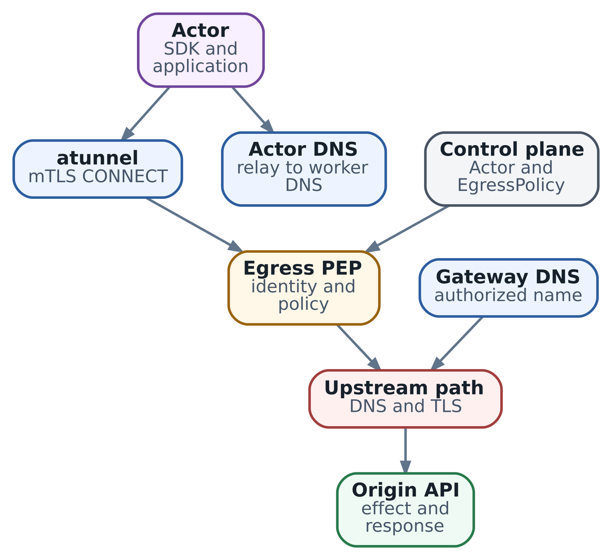

# 40. Gateway и egress: DNS, TLS и проверка реальной доступности

После восстановления из главы 39 `lab/network-017` снова может читать workspace и checkpoint. Внешняя операция `op-17` уже применена; теперь приложению нужно продолжить проверку цели. Но обращение к model endpoint заканчивается ошибкой. Actor работает, значит, искать причину предстоит на следующем участке: от клиента внутри sandbox до нужного приложения на другом конце соединения.

Этот участок состоит из нескольких решений. Кто превратил имя в адрес? Какой посредник принял TCP connection? Какой сертификат проверил клиент? Кто разрешил запрос и кто вернул HTTP status? Ответы позволяют выбрать следующий диагностический запрос и не менять исправную часть системы. Например, исправление CA внутри Actor не поможет gateway, который сам не доверяет origin.

В главе 15 мы разобрали общую архитектуру сети. Здесь научимся проверять конкретный путь, выбирать слой ограничения доступа и собирать доказательства для allow и deny. В качестве реализации используем **Substrate v0.3.0, commit `ccecc788`**, в описанном Envoy/sdsmint режиме. Для практики подготовлен локальный HTTPS-эксперимент с настоящей проверкой сертификатов; он поможет увидеть границы, прежде чем переносить методику на Actor.

## Какую работу выполняет egress gateway

Egress - исходящие обращения приложения: к модели, MCP server, Git, telemetry или другому сервису. Gateway - управляемый посредник на этом пути. Через него можно ограничить назначения, проверить identity workload, добавить credential и записать решение в аудит. Какие из этих действий доступны, определяет реализация шлюза.

Выбирайте инструмент по тому решению, которое нужно принять. Если требуется запретить сетевой маршрут, достаточно подходящего сетевого enforcement. Если нужно запретить один tool при разрешённых остальных tools того же server, потребуется понимание прикладного протокола. Шлюз, который видит только hostname и port, не сможет различить два tool call внутри одного разрешённого HTTPS API.

| Инструмент                      | Какой вопрос он решает                                           | Где понадобится другой слой                                              |
| ------------------------------- | ---------------------------------------------------------------- | ------------------------------------------------------------------------ |
| Firewall или CNI NetworkPolicy  | Какие сетевые направления доступны workload                      | HTTP method, arguments инструмента и полномочия пользователя             |
| TCP proxy или TLS passthrough   | Куда передать поддерживаемое соединение, сохранив внутренний TLS | Проверка зашифрованного HTTP body и изменение headers                    |
| HTTP gateway с TLS interception | Разрешить HTTP request и изменить его перед отправкой            | Смысл операции, корректность результата и защита всех разрешённых данных |
| MCP-aware broker                | Разрешить конкретную прикладную операцию с нужной identity       | Безопасность самого tool и целевой системы                               |

Эти инструменты часто работают вместе. Сетевая policy ограничивает собственный доступ gateway, а прикладной processor сужает действия, которые gateway совершает по поручению Actor. В стандартной Kubernetes NetworkPolicy разрешения нескольких policies [складываются](https://kubernetes.io/docs/concepts/services-networking/network-policies/): одна широкая allow может открыть путь при существующей default-deny. Результат зависит и от поддержки policy вашим сетевым plugin.

Ingress решает другую задачу: доставить входящий запрос к logical Actor и при необходимости возобновить его. Egress ограничивает исходящий выбор работающего приложения. Kubernetes Gateway API - ещё один самостоятельный контракт; слово Gateway в этой главе не означает автоматическое использование Kubernetes `Gateway` или `HTTPRoute`.

## Проследим один запрос из Actor

В рассматриваемом Substrate TCP-трафик Actor, кроме DNS-пути на port 53, перехватывается и передаётся `atunnel`. Тот открывает mTLS HTTP CONNECT к policy enforcement point, или PEP - компоненту, исполняющему решение о доступе. CONNECT передаёт исходный `IP:port`, который набрал Actor. Это адрес назначения соединения, а не удостоверенное имя приложения.

На внешнем CONNECT gateway проверяет сертификат Actor и получает из SPIFFE URI его atespace/name. Затем `validateActor` читает Actor по этому reference и проверяет `RUNNING`. **В этом handler нет отдельной сверки Actor UID.** Такой запрос к control plane нельзя описывать как доказательство совпадения lifetime после удаления и повторного создания Actor. Для сопоставления incident evidence по-прежнему нужны Actor UID и привязка run из глав 38-39; аутентификация gateway и владение прикладным run решают разные задачи.

Далее gateway рассматривает внутренний трафик. Для HTTPS он проверяет SNI соединения и authority расшифрованного HTTP request по `EgressPolicy`. При разрешении HTTP-путь выбирает upstream по проверенному hostname. Поэтому одна и та же операция включает transport, authentication, policy и обращение к origin - приложению, которому предназначался запрос.

\
_&#x47;ateway validation: Actor path and gateway upstream are separate checks_

Схема показывает точки проверки. Вызов из admin Pod может обойти перехват, сертификат Actor или его policy. Он полезен для проверки доступности сервера из admin Pod, но не заменяет вызов из нужного sandbox. В инциденте сначала зафиксируйте, откуда получен каждый результат: из Actor, gateway или origin.

## Имя URL, адрес dial, SNI, authority и SAN

Возьмём URL `https://models.example.test/v1/probe`. Его hostname задаёт ожидаемое приложение. Resolver выбирает IP для connection. В первом TLS-сообщении ClientHello клиент передаёт SNI (Server Name Indication) - имя, по которому сервер или посредник выбирает сертификат и обработку TLS. Само по себе SNI ещё ничего не удостоверяет: имя сообщил клиент. Внутри HTTP/1.1 находится Host, а в HTTP/2 - `:authority`. Наконец, SAN (Subject Alternative Name) сертификата перечисляет имена, для которых сертификат выпущен.

Обычно эти имена согласованы, но в диагностике их легко разъединить. Например, URL с IP и вручную добавленный Host не заставляют TLS-клиент проверять сертификат для hostname из Host. А разрешённый SNI ещё не разрешает любой Host внутри установленного соединения. Поэтому проверяют отдельно адрес dial, ожидаемое TLS-имя и HTTP authority.

В v0.3.0 port для HTTP policy берётся из исходного dial, переданного CONNECT. Port внутри Host не заменяет его. На MITM leg gateway проверяет и SNI connection, и authority каждого request. Это важно для повторного использования connection: новое HTTP-сообщение может назвать другое приложение, хотя TLS-соединение прежнее.

В `EgressPolicy` этой версии `http` применяется к cleartext HTTP, `https` - к расшифрованному HTTPS. Exact hostname имеет приоритет перед wildcard, named port - перед всеми ports. `*.example.com` покрывает один непустой label: `api.example.com`, но не apex `example.com` и не `a.api.example.com`. Hostnames записывают без scheme, path и port.

Ниже body ресурса, не самостоятельный Kubernetes manifest. Parent Actor передаётся отдельно в API request:

```
metadata:
  atespace: lab
  name: default
rules:
- https:
    hostnames: ["models.example.test"]
    ports:
      numbers: [443]
```

Имя `.test` обозначает ваш управляемый лабораторный endpoint. Этот body ограничивает назначение, но не создаёт DNS, CA projection или поддержку нужного протокола. В частности, `tls_passthrough` присутствует в API v0.3.0, однако `SNIRules` исключает такие rules из classifier описанного Envoy-пути. Нельзя выбирать его для end-to-end TLS только потому, что schema приняла правило. Приложение с origin certificate pinning потребует поддерживаемого пути без подмены leaf либо изменения своего trust contract.

WebSocket, gRPC, STARTTLS и другие transports проверяйте по рабочему dataplane. Разрешение TCP port 443 не создаёт HTTP/3 поверх QUIC: для него нужен поддерживаемый UDP-путь. Требования протокола нужно установить до переноса клиента, а не компенсировать неподдерживаемый transport правилом на все назначения.

## Почему DNS проверяют с двух сторон

Actor сначала должен разрешить имя по правилам своего клиента. На intercepted HTTP-пути gateway затем сам резолвит разрешённый hostname для upstream. Между этими действиями могут отличаться resolver, cache, search domains и момент запроса. Ответ Actor не обязан совпасть с ответом gateway.

В Substrate v0.3.0 DNS Actor проходит через relay к configured resolvers Worker, вне внешнего egress gateway. `EgressPolicy` не фильтрует эти запросы и не отключает relay. Default-deny для TCP-направлений поэтому не закрывает DNS-канал. Контроль DNS-доменов и защита от утечки через DNS потребуют отдельного resolver и сетевого enforcement.

Для первого разбора полезны `getent ahosts` и `dig`, но они отвечают на разные вопросы. `getent` использует системные источники разрешения, включая hosts и NSS; `dig` обращается к DNS. SDK может иметь собственный resolver или cache. Сопоставьте результат с поведением именно того клиента, который выдаёт ошибку, и отдельно проверьте DNS gateway. При dual-stack учитывайте A/AAAA и фактическую поддержку выбранного address family.

`curl --resolve` позволяет закрепить адрес dial, сохранив hostname URL, SNI и проверку сертификата. Однако gateway на intercepted пути может снова выбрать upstream по своему DNS. Такой эксперимент изолирует resolver клиента, но не обязательно фиксирует конечный backend. Доказывать выбор backend нужно gateway/origin evidence, а не только значением client `remote_ip`.

Hostname allowlist также не описывает все допустимые IP за именем. При DNS rebinding разрешённый домен может начать указывать на private или link-local адрес. Ограничивайте назначения, доступные самому gateway, и проверяйте разрешённые внутренние endpoints по вашей модели угроз. Широкий доступ proxy способен превратить его в confused deputy - доверенного посредника, использующего собственные права по поручению недоверенного клиента. Проверки проводите только на своих canaries; реальные metadata credentials и чужие внутренние сервисы для этого не нужны.

## Где именно проверяется TLS

TLS создаёт защищённый канал с конкретным peer. Клиент проверяет, что сертификат действителен, выпущен для ожидаемого имени и связан цепочкой подписей с доверенным CA - центром сертификации. Trust store хранит такие доверенные сертификаты. Если добавить туда CA посредника, клиент сможет принять выпущенный посредником сертификат для нужного имени. Это осознанная передача доверия: gateway получает возможность читать запрос и становится новой границей защиты данных.

В transparent-пути приложение обычно не знает о внешнем CONNECT. `atunnel` проверяет PEP и предъявляет сертификат Actor по mTLS. Внутри tunnel приложение проверяет TLS peer. В sdsmint режиме этим peer оказывается gateway с выданным им leaf, а gateway устанавливает ещё одно TLS-соединение к origin. Получаются три проверки с разными участниками.

Если приложению неизвестен gateway CA, отказ произойдёт до его HTTP request. Если приложение доверяет gateway, но gateway не доверяет origin CA, первая TLS-граница уже пройдена, а вторая ещё нет. Добавление origin CA только внутрь Actor второй случай не исправит. В incident record называйте leg: «client -> gateway» или «gateway -> origin», а не просто «ошибка SSL».

Проекция `egress-mitm.ate.dev` через `systemInfo` volume делает CA material доступным в filesystem Actor. Она не содержит private key и не заставляет все библиотеки автоматически пользоваться этим файлом. Для `curl` в диагностике можно явно задать `--cacert`; Python, Node.js, Java и Git требуют настройки своего фактического TLS stack. Проверяйте документацию выбранного SDK и его способ создания клиента, особенно если он задаёт собственный `ca` или игнорирует environment.

После Full restore процесс способен сохранить старый trust store в памяти. В v0.3.0 projection перечитывается на Run/Restore, но загруженный приложением pool не обязан обновиться. Rotation требует overlap и понятного момента reload/reconnect. Snapshot возвращает среду, но не продлевает срок сертификата, credentials или прежней TLS session.

## Практика на настоящем локальном HTTPS

[examples/ch40\_https\_boundary.py](https://github.com/5UN5H1N3/ax-agent-infrastructure-book/blob/main/examples/ch40_https_boundary.py) поднимает три HTTPS-сервера в одном процессе Python: учебный gateway, разрешённый origin и canary для запрещённого назначения. Все sockets привязаны к `127.0.0.1`, ports выбирает система. Через OpenSSL создаются временные test CAs и сертификаты. Клиент и gateway действительно выполняют TLS handshake с проверкой цепочки и hostname.

Для запуска нужны Python 3.13 и OpenSSL CLI 3.x; сторонние Python packages не нужны:

```
python3 examples/ch40_https_boundary.py
python3 -m unittest discover -s examples -p 'test_ch40_https_boundary.py'
```

У gateway свой test CA, у двух upstream canaries - другой. Клиент доверяет первому, gateway для upstream - второму. Dial закреплён на loopback с отдельным `server_hostname`: имена `.test` не резолвятся через публичный DNS. Это позволяет менять trust или имя, не зависеть от интернета и не отключать verification.

Сначала запускается `/health`: origin возвращает 200. Затем тот же путь проверяется через `/v1/probe`, которому нужен тестовый credential. Ответ - 401 от origin, и это видно в его журнале. Сеть до приложения работает; конкретная прикладная операция ещё не разрешена. После явной настройки тестового credential probe возвращает marker `probe_ok`, не раскрывая token.

Для отрицательной проверки canary сначала проверяется напрямую: она жива и отдаёт 200. Затем запрос с её hostname проходит через gateway и получает policy deny. Журнал gateway содержит `policy_deny`, а origin/canary не получили HTTP request с этим request ID. Отдельный control test временно разрешает этот hostname в учебной конфигурации и доказывает, что маршрут до canary действительно пригоден.

| Сценарий demo        | Что видит клиент                    | Где находится подтверждение причины                           |
| -------------------- | ----------------------------------- | ------------------------------------------------------------- |
| `health`             | 200, `listener_ok`                  | Origin получил health request                                 |
| `missing_credential` | 401 от origin                       | Gateway allow, затем HTTP request у origin                    |
| `allowed`            | 200, `probe_ok`                     | Обе TLS-границы пройдены, origin подтвердил probe             |
| `denied`             | 403 от gateway                      | Policy deny, HTTP request не дошёл ни до одного origin        |
| `wrong_client_ca`    | Ошибка TLS, HTTP status отсутствует | Gateway HTTP handler не получил request                       |
| `wrong_upstream_ca`  | 502 от gateway                      | Client TLS пройден; gateway зафиксировал upstream TLS failure |

Для последнего случая существенная часть вывода выглядит так:

```
{
  "status": 502,
  "emitter": "gateway",
  "marker": "upstream_tls_failed",
  "client_tls": "VERIFIED",
  "origin_received": false,
  "automatic_policy_changes": 0
}
```

Здесь 502 - соглашение учебного gateway, а не универсальный код для Substrate или любого proxy. Причина установлена по обеим сторонам: клиент проверил gateway, затем gateway отклонил origin certificate, не отправив HTTP request. Расширение hostname allowlist не изменит доверие второй TLS-границы.

В эксперименте каждый запрос получает уникальный ID, по которому сопоставляются события всех трёх серверов. Поле `emitter` берётся из контролируемой лаборатории и проверяется её журналами. Произвольный `X-Lab-Emitter`, полученный из внешнего response, не является доказательством происхождения. То же относится к отсутствию request: здесь журнал полный и проверка синхронная; в реальном distributed logging пропуски, sampling и задержка доставки требуют отдельного учёта.

### Что проверяет и чего не проверяет эксперимент

Он исполняет реальные loopback TCP/TLS/HTTP запросы, включая отказ сертификата и policy deny к доступному серверу. Тесты проверяют SNI и authority по отдельности, разграничение trust anchors и отсутствие token в публичном evidence. В примере нет кода, который автоматически расширяет policy после ошибки.

Это учебный reverse proxy с фиксированными routes и простыми exact-name rules. Он не реализует Substrate, Envoy, mTLS CONNECT, transparent interception, DNS relay, CredentialProvider, wildcard matching, streaming или MCP. Передача фиксированного тестового credential не проверяет настоящий brokering. Внешние сервисы и реальные model API не вызываются; временные ключи удаляются вместе с лабораторией. Успех этого теста не доказывает работоспособность стенда AX/Substrate.

## Как перенести диагностику внутрь Actor

Теперь вернёмся к реальному incident. Зафиксируйте Task atespace/name, прикладной run и incarnation, Actor name и UID, SDK/image versions, время и gateway mode. В AX `ac233282` нет Task metadata UID; его нельзя подменять Actor UID. Запишите hostname и path без secrets, версию policy и ожидаемый read-only результат.

Ниже диагностические команды для нужного Actor и вашего лабораторного origin. Предполагаются GNU `timeout`, OpenSSL 3, curl и смонтированный CA bundle. Утилиты лучше заранее включить в debug image. Endpoint должен принадлежать вам; команды не предназначены для сканирования чужой сети.

```
getent ahosts models.example.test

timeout 5s nc -vz models.example.test 443

timeout 10s openssl s_client \
  -connect models.example.test:443 \
  -servername models.example.test \
  -verify_hostname models.example.test \
  -verify_return_error \
  -CAfile /run/ate/trust-bundle.pem </dev/null

curl --noproxy '*' --cacert /run/ate/trust-bundle.pem \
  --connect-timeout 5 --max-time 15 --fail-with-body \
  -sS -o /dev/null \
  -w 'http=%{http_code} peer=%{remote_ip}\n' \
  https://models.example.test/health
```

У каждого шага свой предел. `nc` мог подключиться к локальному tunnel до проверки внутреннего назначения. OpenSSL проверяет TLS, но не авторизацию нужного API; `-verify_return_error` заставляет завершиться при ошибке verification. curl добавляет HTTP outcome, однако успешная проверка требует ожидаемого status и результата, а не просто exit code 0. `--fail-with-body` ловит HTTP 4xx/5xx, но 3xx не превращает redirect в доказательство работоспособности API.

`--noproxy '*'` исключает environment proxy для этого curl, сохраняя transparent interception. Если SDK использует explicit proxy, проверьте отдельно его реальную конфигурацию. У HTTPS proxy собственная TLS-проверка, отличная от проверки конечного сервера. Redirect в примере не следует автоматически: каждое новое назначение должно пройти свою policy и правила передачи credentials.

Для изоляции resolver клиента можно добавить `--resolve models.example.test:443:192.0.2.20`, подставив реальный IP своего стенда. `192.0.2.20` - documentation address. Проверка имени остаётся включённой; на intercepted пути upstream gateway всё равно может выбрать другой адрес по собственному DNS. `curl -k` для этого опыта не нужен: с ним исчезло бы как раз проверяемое свойство identity TLS peer.

Не помещайте полный environment, Authorization headers и verbose body в общий incident ticket. Сохраняйте очищенные адреса, request IDs, verdict, certificate issuer/SAN, timing и безопасный marker. Если для расследования действительно нужны чувствительные traces, у них должен быть отдельный защищённый режим доступа и срок хранения.

## Почему credential injection требует собственной проверки

Gateway может добавить credential на пути к upstream, не оставляя его в env или snapshot Actor. Это уменьшает число мест хранения секрета. При этом агент всё ещё использует его полномочия через разрешённые обращения. Нужны ограниченные права origin, узкие destinations и, где необходимо, контроль method/tool и arguments.

В v0.3.0 `applyEffects` выполняет injection только на TLS MITM leg при подключённом provider. На cleartext leg или без provider injection пропускается, а request идёт без добавленного credential. Поэтому запись `replaceHeaders` в policy не является fail-closed проверкой всей установки. При тестировании нужно увидеть, кто реально запросил secret и с чем origin получил обращение.

Если FetchSecret действительно вызван, missing secret или запрещённый scope приводят к 403, временная недоступность provider - к 503. Есть и второе ограничение: `OVERWRITE_IF_EXISTS_OR_ADD` добавляет header даже без placeholder в исходном request. Отсутствие Authorization поэтому не является способом отказаться от injection для отдельного вызова. Нужен отдельный route/policy boundary или реализация с проверенным opt-in контрактом.

Проверяйте brokering на собственном canary origin с тестовым credential. Origin должен подтвердить нужную identity безопасным marker, не возвращая token. Public echo service может раскрыть injected secret обратно Actor; затем он попадёт в logs, workspace или snapshot. Изоляция секрета в gateway сохраняет смысл только вместе с ограничением доступных операций и содержания ответов.

## Как проверить нужный API и его протокол

После health выполните минимальную разрешённую операцию тем же SDK, которым работает агент: нужный path, method, content type, authentication и application result. Для inference это короткий ограниченный запрос к нужной модели; для MCP - read-only операция в выбранном protocol profile. Роли и profiles разбирались в главах 6 и 36. Не навязывайте initialization всем MCP clients: modern профиль книги `2026-07-28` использует per-request metadata, legacy `2025-11-25` - initialization и session/version semantics. Локальный stdio server создаёт свои outbound connections отдельным процессом.

Streaming проверяется дополнительно: первый полезный chunk, завершение сообщения, idle interval и cancellation. Proxy может буферизовать ответ или закрывать соединение по idle timeout, хотя короткий GET проходит. HTTP/2, gRPC, WebSocket и длинная generation требуют проверки реального режима. Повышать deadline имеет смысл после измерения нужного участка ожидания, а не как универсальное лечение всех timeout.

Если требуется запрет отдельного MCP tool или user-scoped approval, выбирайте gateway, понимающий соответствующую операцию. Сравните transport revisions, authentication конечного пользователя, выдаваемые upstream permissions, streaming, audit и отзыв доступа. Hostname allowlist разрешённого model API не предотвращает отправку туда чувствительных данных; это остаётся задачей harness и прикладной policy. Общий gateway также становится зависимостью всех клиентов, поэтому его собственные сети, RBAC и credentials требуют защиты.

После timeout изменяющего вызова возвращайтесь к operation contract глав 37-39. Отсутствующий ответ не отменяет уже применённую `op-17`. Повтор соединения для безопасного probe и повтор внешней mutation - разные решения; второе требует сверки ledger или effect и разрешённого retry.

## Как учитывать caches и отзыв доступа

Policy, DNS, TLS sessions, provider credentials и SDK connections обновляются независимо. В Envoy handler этого среза policy cache имеет default TTL 10 секунд, который можно изменить или отключить. Сохранение новой policy не означает мгновенный verdict на всех replicas. Проверяйте новые requests после обновления и фиксируйте, какой policy revision видел обработчик.

HTTP-решение принимается при обработке request headers. Уже разрешённый stream может продолжиться после revoke; cache TTL не задаёт срок его принудительного закрытия. Срочный отзыв требует отдельного плана: завершение sessions, сетевое ограничение или отзыв upstream credential. Измеряйте момент отказа новых обращений и судьбу in-flight операции отдельно. Для passthrough в другой поддерживаемой реализации граница решения может вообще проходить по connection.

После resume проверьте allow, deny и SDK operation заново. Сравните непрерывно работающий Actor, fresh boot и восстановленную среду: loaded trust store и cached sessions могут различаться. Не все зависимости принадлежат Actor: OCI image pull выполняет инфраструктура, а host NTP не требует разрешать произвольный UDP агенту. Git clone, package installation и runtime API из sandbox, напротив, входят в его egress inventory. Подготовка immutable image часто позволяет сузить production destinations.

## Как завершить расследование

Для `lab/network-017` полезен итог не «интернет работает», а конкретная цепочка: DNS выбран нужным resolver, Actor прошёл предусмотренную authentication, gateway разрешил нужное назначение, проверены нужные TLS legs, origin подтвердил безопасную операцию. Рядом сохраните отрицательную проверку живого canary и основания считать, что запрещённый request не дошёл до него.

Диагностику начинайте с первого неподтверждённого участка. При client certificate error проверьте ожидаемое имя и trust store; при gateway deny - identity и rule match; при origin 401 - authentication API. HTTP status без emitter и correlated evidence неоднозначен. Тайм-аут сам по себе не доказывает ни policy deny, ни отсутствие эффекта.

Для latency сопоставьте клиентские накопленные `time_namelookup`, `time_connect`, `time_appconnect`, `time_starttransfer` и `time_total` с gateway и origin timing. Их нельзя сложить как независимые интервалы. Наблюдайте connection/stream limits, pending DNS, ext\_proc и provider latency, очередь origin и усиливающие нагрузку retries. К концу этой главы нужен проверенный путь до inference endpoint; в главе 41 выясним, какую полезную нагрузку он способен обслужить и как выбирать ресурсы под неё.

### Источники и дальнейшее чтение

* [Substrate v0.3.0 egress handler](https://github.com/agent-substrate/substrate/blob/ccecc788a327dc11dcd6c21ee153f3d0cbb5cc97/cmd/atenet/internal/router/egress/egress.go), [request authorization](https://github.com/agent-substrate/substrate/blob/ccecc788a327dc11dcd6c21ee153f3d0cbb5cc97/cmd/atenet/internal/router/egress/request.go) и [policy evaluator](https://github.com/agent-substrate/substrate/blob/ccecc788a327dc11dcd6c21ee153f3d0cbb5cc97/internal/egresspolicy/egresspolicy.go).
* [Credential injection](https://github.com/agent-substrate/substrate/blob/ccecc788a327dc11dcd6c21ee153f3d0cbb5cc97/cmd/atenet/internal/router/egress/credentials.go), [policy cache](https://github.com/agent-substrate/substrate/blob/ccecc788a327dc11dcd6c21ee153f3d0cbb5cc97/cmd/atenet/internal/router/egress/policycache.go) и [CA projection/DNS relay](https://github.com/agent-substrate/substrate/blob/ccecc788a327dc11dcd6c21ee153f3d0cbb5cc97/docs/egress-trust-bundle.md).
* [Envoy/sdsmint deployment](https://github.com/agent-substrate/substrate/blob/ccecc788a327dc11dcd6c21ee153f3d0cbb5cc97/manifests/ate-install/atenet-egress-with-sdsmint.yaml), [atunnel egress](https://github.com/agent-substrate/substrate/blob/ccecc788a327dc11dcd6c21ee153f3d0cbb5cc97/internal/atunnel/egress.go).
* [curl certificate verification](https://curl.se/docs/sslcerts.html), [name resolution overrides](https://everything.curl.dev/usingcurl/connections/name.html), [OpenSSL s\_client](https://docs.openssl.org/3.0/man1/openssl-s_client/) и [Python ssl](https://docs.python.org/3.13/library/ssl.html).
* [Kubernetes NetworkPolicy](https://kubernetes.io/docs/concepts/services-networking/network-policies/); protocol profiles и источники MCP - в главах 6 и 36.
