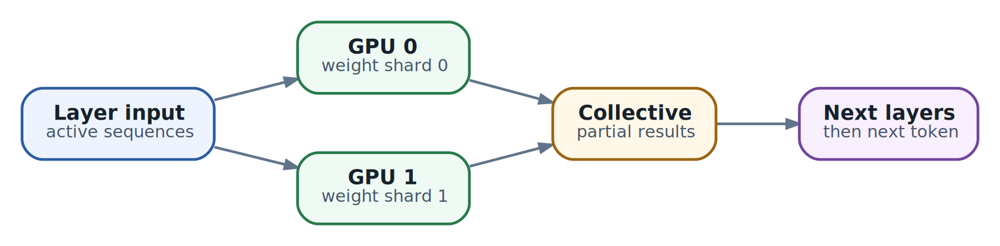

# 41. Local inference sizing: память GPU, parallelism и эксплуатационные SLO

В главе 40 мы проверяли, способен ли агент безопасно дойти до model endpoint. Теперь представим, что сеть исправна, модель загружена, а первый запрос успешно выполнен. Через час одновременно просыпаются несколько Tasks, один приносит большой transcript, и ответы начинают запаздывать. GPU при этом может быть занята на 100%, а пользователь всё равно видит не полезную работу, а ожидание. Что именно оказалось недостаточным: память, вычисления, связь между устройствами или правила допуска в очередь?

**Sizing** - это выбор ресурсов и ограничений сервиса под определённую нагрузку. Он отвечает не только на вопрос «помещается ли модель», но и на вопрос «какие запросы мы обещаем обслужить вовремя, включая отказ части инфраструктуры». Глава 20 объяснила выбор runtime, глава 21 - методику измерения. Здесь свяжем эти решения: рассчитаем память, выберем способ размещения модели и превратим benchmark в эксплуатационный контракт.

Расчёты ниже относятся прежде всего к autoregressive decoder с обычным attention. Числовой пример - учебный, а не результат испытания конкретной GPU. Для реальной модели нужны её config, точный artifact, выбранный backend и измерения из главы 21.

## Начните с профиля запросов

Название модели и количество агентов - слабые исходные данные. Один агент большую часть времени ждёт tools, другой делает длинную генерацию, третий запускает fan-out из нескольких model calls. Пятнадцать Tasks могут давать две активные sequences большую часть дня и пятнадцать одновременно после общего resume. Среднюю нагрузку и такой burst нельзя считать одним режимом.

Для каждого класса запросов запишите длины input и output после применения реального tokenizer и chat template, arrival rate, пиковый burst, число одновременно генерируемых ответов и deadline. System prompt, schemas tools, история и результаты tools входят в input. Если запрос создаёт несколько вариантов ответа, один HTTP request может породить несколько sequences.

Отдельно укажите правила длинного хвоста. Например, interactive pool принимает общий context до 8192 tokens и output до 512; длинные разборы идут в отдельный pool. Это допустимая политика, если harness знает о ней и явно обрабатывает превышение лимита. Молчаливое обрезание начала истории способно удалить system instructions или важный tool result и не является безопасным способом сэкономить память.

Полезно хранить не только отдельные percentiles длин, но и совместные traces. Большие prompts и длинные ответы могут приходить вместе. Кроме того, длинная генерация дольше занимает slot, поэтому распределение _активных_ sequences обычно отличается от распределения входящих запросов. Расчёт «p95 context × средняя concurrency» скрывает именно тот режим, в котором заканчивается KV cache.

## Память GPU состоит из разных бюджетов

**VRAM** - память accelerator; она хранит не только файл модели. Для каждого устройства рассматривайте следующий баланс:

```
доступная VRAM >= resident weights + KV cache
                  + activations и workspace buffers
                  + runtime и CUDA graphs + запас
```

**Resident weights** - tensors, действительно размещённые на этом устройстве после загрузки. Activations - промежуточные результаты вычислений; workspace - временные buffers kernels. CUDA graphs сохраняют подготовленные последовательности GPU-операций, чтобы уменьшить overhead запуска, но тоже требуют памяти. Последняя часть бюджета покрывает колебания allocations, фрагментацию и допустимую неопределённость, а не даёт право игнорировать измерения.

Не вычитайте одну allocation дважды. Если startup profiling runtime уже сообщил память вне KV cache, выясните, включены ли туда graph capture и workspace. Во время приёмки смотрите startup peak, steady state и стрессовый prefill: успешная загрузка весов не доказывает, что первое большое вычисление поместится. Возможности уменьшать context, batch и CUDA graphs описаны в [руководстве vLLM по памяти](https://docs.vllm.ai/en/v0.31.0/configuration/conserving_memory/).

Высокая занятость памяти в `nvidia-smi` сама по себе не означает утечку. Serving runtime может заранее выделить большой KV pool и использовать внутри него лишь часть blocks. Сопоставляйте физическую allocation с cache occupancy, preemption и количеством активных sequences. Также различайте CUDA OOM и Kubernetes OOMKill из-за host RAM: это разные бюджеты и разные причины отказа.

У GPU-сервиса остаются CPU, RAM и storage. Нужны tokenizer workers, сетевой frontend, загрузка и распаковка artifacts, pinned buffers, место под checkpoints и временные файлы. При startup host RAM может достигать пика раньше, чем GPU полностью загрузится. CPU offload не превращает host memory в бесплатную VRAM: переносы по interconnect добавляются к критическому пути.

## Посчитайте веса и не смешивайте GB с GiB

Для однородного представления начальная оценка проста: `weights bytes = число параметров × bits / 8`. У условной dense-модели с ровно 8 миллиардами параметров BF16-веса занимают 16 миллиардов bytes, то есть около **14.90 GiB**. Сырые 4-bit значения занимают 4 миллиарда bytes, около **3.73 GiB**. Это нижняя оценка данных, а не размер готового deployment.

`1 GB = 10^9 bytes`, тогда как `1 GiB = 2^30 bytes`. Поэтому 24 GB и 24 GiB - не одно и то же. Для расчёта приводите данные runtime, device и model artifact к bytes, а округляйте только итог. Не угадывайте доступную память по маркетинговому названию карты.

Quantized artifact хранит scales, иногда zero points и tensors другой precision. Kernels могут использовать дополнительные packed representations. Если распределение dtype неоднородно, суммируйте размеры групп tensors, затем сверяйте оценку с памятью после загрузки. Размер скачанного файла, объём tensors на device и peak загрузки могут различаться.

У **Mixture of Experts, MoE**, часть вычислений выполняют отдельные подсети - experts. Router выбирает, какие из них обработают конкретный token. Поэтому «мало активных параметров на token» описывает вычисления, а не автоматически resident weights. Если experts должны быть доступны в памяти, учитываются все размещённые experts, общие слои и runtime buffers. Expert parallelism распределяет experts и добавляет обмен routed activations. Для такой модели нельзя подставить число активных параметров в dense-формулу и считать вопрос решённым.

## Что KV cache хранит и как его рассчитать

При генерации очередного token attention обращается к предыдущим позициям. Чтобы не вычислять их key и value заново на каждом шаге, runtime сохраняет эти tensors в **KV cache**. Это ускоряет decode, но связывает память с длиной контекста и числом активных sequences. Кэш растёт и на prompt, и на уже сгенерированных tokens.

Для full attention с одинаковыми слоями и одинаковым размером K и V оценка на одну token position выглядит так:

```
KV bytes/token = 2 × L × Hkv × D × B

L   - число attention layers
Hkv - число key/value heads, не число query heads
D   - размерность каждой K/V head
B   - bytes на элемент cache
2   - хранятся и key, и value
```

При BF16 или FP16 `B = 2`. Если `L = 32`, `Hkv = 8`, `D = 128`, получаем `131072 bytes/token = 128 KiB/token`. Одна sequence с 8192 сохранёнными positions требует 1 GiB сырых K/V. Это арифметический результат заданной архитектуры; overhead blocks и прочие allocations сюда ещё не входят.

Почему важен именно `Hkv`? В multi-head attention query heads имеют соответствующие K/V heads. В **GQA** несколько query heads используют общую группу K/V; в **MQA** такая группа одна. Например, замена восьми KV heads на 32 увеличит наш cache в четыре раза при прочих равных. Число query heads не позволяет определить этот расход без config модели. Различие объясняется в [работе о grouped-query attention](https://arxiv.org/abs/2305.13245).

Для неодинаковых слоёв суммируйте их расходы отдельно. Формулу нельзя переносить буквально на MLA с compressed latent state, hybrid attention/state-space модели, encoder-decoder или multimodal stacks. Sliding window может ограничивать сохраняемые positions в части слоёв, но не обязательно во всех. Верный расчёт начинается с architecture и реализации cache в backend, а не с общего числа parameters.

## От одной sequence к общей вместимости

В первом приближении расход активного cache равен `KV bytes/token × сумма сохранённых positions`. В нашем учебном примере получается:

| Нагрузка                      | Сумма positions | Сырые K/V |
| ----------------------------- | --------------- | --------- |
| Одна sequence длиной 4096     | 4096            | 0.5 GiB   |
| Шесть sequences по 8192       | 49152           | 6 GiB     |
| Одна sequence длиной 32768    | 32768           | 4 GiB     |
| Пятнадцать sequences по 32768 | 491520          | 60 GiB    |

Пусть устройство действительно имеет 24 GiB, а мы _условно_ разрешили executor использовать 21 GiB. После 14.90 GiB BF16-весов и 3 GiB на всё остальное остаётся около **3.10 GiB** для KV. Три sequences по 8192 positions дают арифметический предел почти без внутреннего запаса; одна sequence на 32768 уже не помещается. Число «3» не обещает concurrency или SLO: ограничения compute и реальная allocation могут сработать раньше.

Если уменьшить только веса, свободного cache может стать больше. Но расход _одной position_ останется 128 KiB, пока cache хранится в BF16. Weight quantization и KV quantization - отдельные решения. FP8 K/V уменьшает сырые данные относительно 16-bit, однако требует совместимых kernels, scales и проверки качества на длинном context и tool calls. Условия описаны в [документации quantized KV cache](https://docs.vllm.ai/en/v0.31.0/features/quantization/quantized_kvcache/). Экономия памяти не равна гарантированному ускорению.

В реальном allocator positions округляются до blocks. PagedAttention размещает cache блоками и снижает потери от крупных непрерывных резервов, но не устраняет его физическую стоимость. Совместно используемые prefix blocks нужно считать один раз, приватные продолжения - отдельно. Учебная сумма выше предполагает отсутствие sharing и округления; это не показание allocator. Принцип описан в [работе о PagedAttention](https://arxiv.org/abs/2309.06180).

Prefix caching особенно полезен при длинном одинаковом system prompt: повторный prefill может переиспользовать готовое состояние. Но любой изменившийся prefix уменьшает reuse, а cache eviction и новая replica создают cold path. Эта оптимизация не отменяет генерацию каждого нового token. Не стройте обязательный SLO только на warm cache; механизм и его границы разобраны в [руководстве prefix caching](https://docs.vllm.ai/en/v0.31.0/features/automatic_prefix_caching/).

## Почему свободная память ещё не означает скорость

**Prefill** обрабатывает входной prompt, **decode** последовательно генерирует продолжение. В обычном decode следующий token зависит от предыдущего: наращивание числа GPU не снимает эту зависимость. При длинном prefill важна вычислительная работа над большим prompt; при небольшом decode batch часто существенны чтение весов и cache, overhead kernels и коммуникация. Конкретный bottleneck определяет профиль, а не название фазы.

В качестве проверки здравого смысла можно оценить traffic весов. Если бы каждый decode iteration перечитывал 14.90 GiB через memory subsystem с эффективной bandwidth 600 GiB/s, одно лишь это чтение заняло бы около 25 ms. Это условная оценка одного компонента, не прогноз token latency: реальные kernels, cache locality, attention и обмены меняют картину. В batch тот же iteration обслуживает несколько sequences, поэтому aggregate tokens/s может расти без такого же ускорения одного ответа.

Именно поэтому continuous batching полезен сервису, но не даёт права бесконечно увеличивать batch. Длинный prefill может мешать коротким decode шагам. Chunked prefill позволяет scheduler дробить такую работу; приёмка должна показать влияние на TTFT и плавность stream. Связь batching и latency разобрана в [руководстве vLLM по настройке производительности](https://docs.vllm.ai/en/v0.31.0/configuration/optimization/).

## Tensor parallelism и цена коммуникации

**Tensor parallelism, TP**, делит поддерживаемые tensors и вычисления внутри слоёв между устройствами одной model replica. GPUs совместно обслуживают запросы, а не получают независимые очереди. Частичные результаты приходится согласовывать через **collectives** - групповые операции обмена. Например, all-reduce агрегирует результаты участников и возвращает итог каждому. В типичной реализации эти обмены повторяются внутри слоёв во время генерации, а не происходят один раз после всего ответа.

\
_&#x54;ensor parallelism: sharded layer and communication repeat during decode_

Схема показывает один фрагмент вычисления, а не полный attention block: конкретный backend может иметь несколько обменов, fusion и другую раскладку. Для выбора TP существенны bandwidth и latency interconnect. NVLink/NVSwitch, PCIe внутри одного host и сеть между hosts дают разные условия. Первая польза TP может состоять просто в том, что модель стала помещаться; удвоение скорости из этого не следует.

Не делите всю память на TP size автоматически. Часть tensors и buffers остаётся replicated, splits должны поддерживаться архитектурой, а KV heads могут оказаться неделимыми или replicated в выбранном backend. **Rank** - участник распределённой группы, обычно отдельный процесс со своим устройством. Проверяйте память _каждого rank_ и startup cache report. Самый тесный rank ограничивает всю группу, даже если сумма свободной VRAM выглядит достаточной.

Начните с single-GPU baseline, если он возможен. Затем сравните TP=2 с тем же workload, total context и quality gate. Если TTFT улучшился, но ITL ухудшился, общий показатель tokens/s не заменяет решение по interactive SLO. Для cross-node TP отдельно измеряйте коммуникацию в реальной topology; успешный запуск collectives не является доказательством нужной производительности.

## Pipeline parallelism и независимые replicas

**Pipeline parallelism, PP**, распределяет группы слоёв по stages: запрос проходит через них последовательно. Между stages передаются activations, а не полная копия модели. Когда достаточно работы для перекрытия, stages могут обслуживать разные части потока; при малом потоке часть устройств ждёт. Эти периоды простоя называют **pipeline bubbles**. Несбалансированные stages и последовательный decode усиливают проблему.

PP стоит рассмотреть, если модель не помещается на одной GPU, а частые TP collectives слишком дороги для доступного interconnect. Поддержка разбиения и баланс stages зависят от модели и runtime. Сочетание TP внутри быстрой группы устройств и PP между группами также возможно. Проверять нужно худший stage, а не среднюю память по кластеру.

**Независимые replicas** обслуживают разные запросы, каждая со своими weights, queue и cache. Для dense-модели это естественный способ масштабировать число обслуженных запросов, если один экземпляр уже помещается и выполняет single-request SLO. Но дополнительные replicas не делают автоматически быстрее один длинный ответ. В MoE встроенный data parallel режим может быть связан с шардированием experts; независимые deployments и флаг DP нельзя считать синонимами без проверки backend.

| Проблема                          | Первый кандидат для сравнения                                              | Что проверять                                          |
| --------------------------------- | -------------------------------------------------------------------------- | ------------------------------------------------------ |
| Модель помещается, очередь растёт | Независимые replicas                                                       | Goodput, балансировка, cold prefix cache               |
| Один экземпляр не помещается      | TP или PP                                                                  | Память по ranks, communication, single-request latency |
| Не хватает KV для длинных calls   | Отдельный long-context pool, cache dtype или допустимое сокращение context | Качество и реальный worst-case context                 |
| Нужна работа при отказе host      | Replicas в разных failure domains                                          | Capacity после отказа и время прогрева                 |

Это порядок экспериментов, не универсальная рекомендация купить больше устройств. Распределённые варианты и ограничения изложены в [руководстве vLLM по parallelism](https://docs.vllm.ai/en/v0.31.0/serving/parallelism_scaling/). Если новая topology увеличила сложность, но не улучшила измеряемый контракт, её дополнительная стоимость пока не обоснована.

## Свяжите настройки vLLM с проверяемой гипотезой

Для следующих примеров фиксируем **vLLM v0.31.0**; это не обещание одинаковых defaults в будущих версиях. В deployment сохраняйте container digest, CUDA/driver, model revision и полный набор arguments. После обновления повторяется приёмка, а не только проверка, что процесс запустился.

| Настройка                                            | Какой предел задаёт                                                  |
| ---------------------------------------------------- | -------------------------------------------------------------------- |
| `--max-model-len`                                    | Общий context запроса, включая output                                |
| `--gpu-memory-utilization`                           | Доля device memory для данного executor; не эксклюзивная reservation |
| `--kv-cache-memory-bytes`                            | Явный KV budget на GPU; при задании заменяет расчёт по utilization   |
| `--max-num-seqs`                                     | Sequences за iteration и capacity model runner                       |
| `--max-num-batched-tokens`                           | Работа scheduler за iteration в tokens                               |
| `--tensor-parallel-size`, `--pipeline-parallel-size` | Разбиение model replica, не число независимых HTTP backends          |

Значения и совместимость сверяются с [engine arguments этой версии](https://docs.vllm.ai/en/v0.31.0/configuration/engine_args/). Ограничение sequences не означает, что остальные запросы отсутствуют: они могут ждать в очереди. Доступный в v0.31.0 `--max-num-queued-reqs`, несмотря на имя, ограничивает _waiting плюс running_ в API server; это грубый admission valve, а не гарантия queue delay. Связь пределов описана в [SchedulerConfig](https://github.com/vllm-project/vllm/blob/v0.31.0/vllm/config/scheduler.py). Tenant quotas и deadline-aware admission по-прежнему требуют явного владельца.

Минимальная стартовая гипотеза для уже проверенного text-only artifact в read-only каталоге `/srv/models/agent-release` может выглядеть так. Каталог заранее содержит pinned weights, config, tokenizer и корректный chat template; команда не скачивает случайную revision по имени. Выбранная модель и backend должны поддерживать chunked prefill: здесь он включён явно, поскольку token budget iteration меньше общего context limit. Без такого режима эту пару limits использовать нельзя.

```
# В окружении vLLM v0.31.0; только локальный lab listener.
vllm serve /srv/models/agent-release \
  --host 127.0.0.1 --port 8000 \
  --served-model-name ax-agent-lab \
  --max-model-len 8192 \
  --gpu-memory-utilization 0.90 \
  --max-num-seqs 2 \
  --max-num-batched-tokens 2048 \
  --enable-chunked-prefill \
  --max-num-queued-reqs 4 \
  --tensor-parallel-size 1 \
  --pipeline-parallel-size 1
```

Это начало sweep, не production tuning и не доказательство, что любая модель поместится. `0.90` не связано с условным бюджетом 21 GiB из предыдущего расчёта: здесь startup profiling должен дать фактический cache budget. Output cap из workload задаётся в каждом model request: `--max-model-len` не заменяет этот предел. Для remote доступа нужен защищённый gateway; binding на loopback сам по себе не организует доступ из Actors. Изменяйте один фактор за эксперимент и записывайте влияние на память, TTFT, ITL, E2E и качество.

## Проверьте SLO и отказ одного узла

Полезная capacity - максимальная нагрузка, при которой запросы нужного класса завершаются правильно и вовремя. Она может оказаться ниже memory capacity и ниже throughput saturation. Если очередь уже съела deadline, admission должен отказать явно, а не принять ещё сотню запросов ради красивой utilization.

Допустим, для коротких tool-selection calls команда выбрала учебные цели: client-observed TTFT p95 до 1 s, E2E p95 до 4 s и не менее 99.5% валидных по schema результатов. Это разные проверки; для доли _одновременно_ правильных и своевременных ответов нужна отдельная goodput-метрика. Rejected, failed и отменённые запросы не должны исчезать из отчёта только потому, что у них нет полного latency sample. Затем проверяется representative trace, credible burst и cold cache, как в главе 21.

Для capacity после отказа используйте измерение одной replica _при заданном SLO_. Если условно один экземпляр выдержал 2 requests/s нужного workload, а целевой поток составляет 3 requests/s, две replicas дают 4 requests/s номинально, но только 2 после потери одной. Три дают арифметически 4 после потери одной. Это нижняя оценка: неидеальная маршрутизация, burst и запас могут потребовать большего. Числа здесь иллюстрируют расчёт, а не benchmark.

Replica, распределённая через TP=2, всё ещё одна replica. Потеря любого обязательного rank выводит из строя всю группу; два устройства внутри одного host не защищают от потери этого host. Размещайте резерв по соответствующим failure domains и проверяйте именно их отказ. Если две независимые replicas находятся на одной машине, node failure уберёт обе.

Автоматическое масштабирование не обязано спасти текущий burst: новую replica нужно разместить, загрузить weights, прогреть kernels/cache и проверить. Queue age и goodput полезнее одного сигнала GPU utilization. Планируется также rollout: временное сосуществование старой и новой model revisions требует capacity сверх текущего steady state. Если полного SLO при отказе нет, заранее определите degraded mode, его допустимую нагрузку и приоритет запросов.

## Что sizing меняет в harness и AX

AX Task должен обращаться к стабильному логическому endpoint, а не выбирать GPU host. Runtime отвечает за cache и batching, inference deployment - за capacity, gateway - за admission и маршрутизацию, harness - за смысл model call, deadline и допустимое продолжение работы. Контракт должен указывать, какие limits применяются на каждом уровне и кто возвращает явный отказ.

Harness знает, можно ли заменить старую историю компактным state summary, уменьшить output cap или перенести background step. GPU scheduler этого не знает. В частности, tool schemas и результаты нельзя обрезать случайно: изменение input проходит context policy из главы 35 и capability tests из главы 20. Fallback на меньшую модель или CPU допускается только для совместимого profile; более медленный endpoint может сохранить доступность и всё же нарушить deadline всего agent step.

Не устраивайте лавину retries при перегрузке. Logical call имеет общий deadline и retry budget, а повторные physical attempts наблюдаются отдельно. Если потерялся stream, частичный tool proposal нельзя принимать за готовую операцию. Если внешнее действие уже началось, его неизвестный outcome разрешается через operation ledger и reconciliation из главы 37, а не повторной генерацией команды.

В traces связывайте Task/Actor, logical model call, backend replica и physical attempt. В metrics оставляйте ограниченные dimensions: pool, model revision, class и result. Отчёт должен позволять отличить ожидание inference от ожидания tools, а нехватку KV - от communication bottleneck. Suspend Actor не является backup KV cache общего model server: возможность продолжить agent run опирается на durable logical state, а не на существование старой GPU allocation.

## Практикум расчёта и приёмки

Результат практикума - короткий capacity plan с исходными допущениями, таблицей измерений и решением. Если accelerator пока нет, выполните расчёт и подготовку workload; измеренную capacity оставьте незаполненной, не заменяйте её рекламным benchmark другой системы.

1. **Опишите workload.** Выберите interactive и long-context классы, реальные token lengths, output caps, arrivals, burst и критерии качества. Отдельно задайте поведение при переполнении и отказе host.
2. **Разберите artifact.** Зафиксируйте architecture, revision, tensors/dtype, attention layers, KV heads и head dimension. Отметьте, где простая формула cache неприменима.
3. **Постройте memory sheet.** Рассчитайте weights и K/V в bytes, приведите к GiB. Составьте representative и stress сценарии, добавьте отдельные runtime allocations и явно обозначенный запас.
4. **Снимите baseline.** Запишите startup peak, выделенный cache pool и память по ranks. Проверьте длинный prefill, максимальный допустимый output и освобождение ресурсов после cancellation.
5. **Сравните размещения.** Если модель помещается, сравните одну replica и независимые replicas. Если нет - поддерживаемые TP/PP варианты. Для каждого сохраните topology и communication profile.
6. **Выполните sweep.** Используйте protocol главы 21, проверяя одновременно latency, overload, cache preemption и качество. Зафиксируйте последнюю нагрузку, на которой весь контракт выполняется, а не только максимальные tokens/s.
7. **Проверьте деградацию.** В разрешённом стенде исключите одну replica, затем соответствующий failure domain; повторите cold path и burst. Сопоставьте результат с capacity после отказа и rollout budget.
8. **Оформите решение.** Запишите допустимые классы и limits, конфигурацию, normal/degraded SLO, владельцев admission и recovery. Укажите, какие изменения model/runtime требуют новой приёмки.

Итоговое решение должно объяснять причину выбора: «replicas уменьшают очередь», «TP позволяет разместить weights», «отдельный pool защищает короткие calls от длинного context». Формулировка «используем четыре GPU, потому что так быстрее» не содержит проверяемого контракта. Следующая глава добавит другую часть production readiness: secrets, безопасность и восстановление после потери состояния. Запас мощности помогает пережить отказ, но не восстанавливает identity и не отменяет уже совершённые действия.

### Источники и дальнейшее чтение

[GQA](https://arxiv.org/abs/2305.13245) и [PagedAttention](https://arxiv.org/abs/2309.06180): attention heads и организация cache. vLLM v0.31.0: [arguments](https://docs.vllm.ai/en/v0.31.0/configuration/engine_args/), [memory](https://docs.vllm.ai/en/v0.31.0/configuration/conserving_memory/), [tuning](https://docs.vllm.ai/en/v0.31.0/configuration/optimization/), [parallelism](https://docs.vllm.ai/en/v0.31.0/serving/parallelism_scaling/), [KV quantization](https://docs.vllm.ai/en/v0.31.0/features/quantization/quantized_kvcache/), [prefix cache](https://docs.vllm.ai/en/v0.31.0/features/automatic_prefix_caching/) и [SchedulerConfig](https://github.com/vllm-project/vllm/blob/v0.31.0/vllm/config/scheduler.py). В книге: главы 20-21, 35 и 37.
