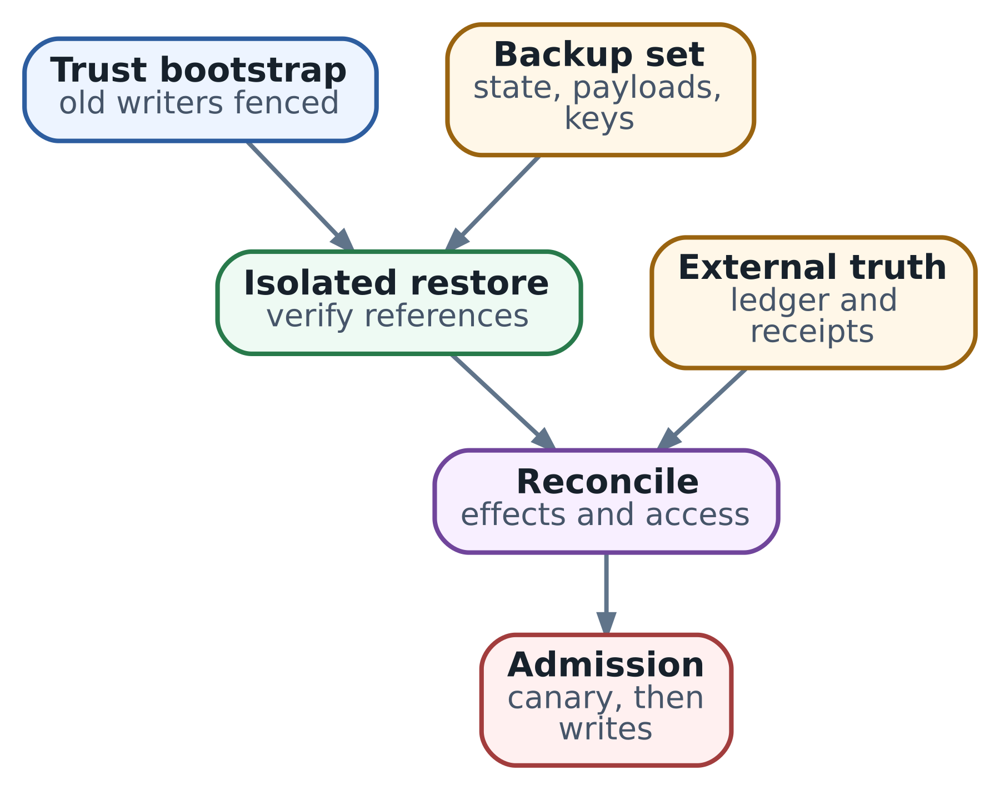

# 42. Production security, secrets и disaster recovery

Продолжим историю `lab/network-017`. В главе 37 тестовый tool успел изменить конфигурацию, но исполнитель остановился до сохранения receipt. Глава 39 объяснила, как выбрать пригодный snapshot. Теперь предположим, что потерян весь кластер. Команда вернула stores и workspace, а harness прочитал старое состояние `DISPATCHING`: запрос отправлялся, результат ещё неизвестен. За время аварии оператор отозвал прежний credential. Что должно произойти после запуска?

Дежурному нужны два независимых ответа. Первый: что уже сделано во внешней системе? Второй: что этому Task разрешено делать сейчас? Старый checkpoint отвечает лишь о прошлом знании приложения. Для результата операции нужен ledger или целевой сервис, для действующих прав - актуальная доверенная система доступа. На этом различии построим восстановление.

**Disaster recovery, DR**, возвращает полезную работу после потери инфраструктуры или данных. Для нашей платформы полезный результат включает сохранённый ход Task, правильную identity исполнителя и контролируемые внешние действия. Глава 27 задала цели восстановления, глава 41 разобрала запас мощности. Здесь спроектируем выдачу доступа, комплект резервных копий и последовательность допуска восстановленного приложения. Начнём с механизмов, затем проверим решения на локальном примере.

## Сначала определите характер потери

Потеря Worker при сохранных управляющих данных обычно требует нового размещения и восстановления Actor. Ошибочное удаление metadata требует пригодной прошлой копии и проверки ссылок на payloads. Утечка административного credential требует ещё и устранить доступ нарушителя. В последнем случае перенос старой системы на новые nodes способен перенести ту же проблему.

Эти случаи объясняют назначение разных механизмов. **High availability, HA**, сохраняет доступность при предусмотренных отказах, например потере одной replica. **Replication** переносит изменения на другую копию; ошибочное удаление может оказаться таким же изменением. **Backup** сохраняет прошлое состояние независимо от текущей рабочей копии. **Cyber recovery** добавляет восстановление доверенной среды после компрометации: нужно определить, каким artifacts, identities и точкам истории ещё можно доверять.

Выбирайте процедуру по утраченной гарантии. Если данные целы и доступ не скомпрометирован, полный откат только увеличит потерю работы. Если доверие к текущим artifacts потеряно, один быстрый restart не разрешит вопрос об их происхождении. На время расследования сервис может работать в ограниченном режиме: диагностические чтения доступны, автоматические изменения остановлены.

Заранее назначьте, кто ограничивает новые действия, кто выбирает recovery point и кто разрешает возврат пользовательской нагрузки. Ночью эти решения сложнее, чем команды восстановления. Инженер, который умеет запустить database, не обязательно уполномочен принять потерю последних изменений tenant.

Проверки относятся к закреплённым версиям книги. В [AX `ac233282`](https://github.com/google/ax/blob/ac2332829f22360ff97b0ba34d94dd0dd782f17e/internal/server/server.go) конструктор gRPC server сам не устанавливает transport credentials и authn/authz interceptors. Для production нужен отдельно обеспеченный контроль доступа. В [Substrate v0.3.0, `ccecc788`](https://github.com/agent-substrate/substrate/blob/ccecc788a327dc11dcd6c21ee153f3d0cbb5cc97/docs/authentication.md) документация ещё не заявляет RBAC: actor identity provider выделен особо, остальные authenticated providers получают широкий контроль. Экспериментальная authorization более нового среза рассмотрена отдельно в главе 24. При восстановлении используйте контракт фактически установленных digests, а не собирательный набор возможностей разных versions.

## Как credential превращается в доступ

**Credential** - материал, которым вызывающий доказывает identity или предъявляет делегированный доступ: token, пароль, private key для клиентской аутентификации. **Secret** - более широкое понятие чувствительных данных. Например, конфиденциальный фрагмент документа является secret, но не удостоверением для API.

Сервис сначала проверяет предъявленный credential, затем решает, разрешено ли действие. Это authentication и authorization из главы 24. Смена token может восстановить аутентификацию, но не вернуть отозванное право изменять конфигурацию. Approval человека тоже относится к определённому действию и условиям, а не ко всем будущим действиям восстановленного процесса.

Рассмотрим доступ нашего network writer. Удостоверение workload подтверждает, какой broker пришёл к сервису. Tenant и операция определяют область действия. **Audience** указывает, какому получателю предназначено удостоверение; model endpoint и network writer - разные получатели. **TTL**, time to live, ограничивает срок. **Revocation** позволяет прекратить доступ раньше, если механизм потребителя это поддерживает. Для self-contained token с локальной проверкой подписи прекращение выдачи новых tokens само по себе не отзывает уже выданные.

Составьте паспорт credential без его значения. Для network writer в нём будут issuer, workload-получатель, разрешённые tenant и операции, audience, срок, способ доставки, проверка отзыва и ответственный за смену. Отдельно запишите, куда материал копируется: файл, environment, client cache, snapshot. Именно этот последний пункт часто объясняет, почему «ключ уже поменяли», а старый Actor всё ещё обращается к API.

Control-plane administration, доступ к моделям, tools, registry и backups требуют разных полномочий. Runner, которому нужен один tool, не должен получать доступ к удалению recovery points. Такое разделение ограничивает **blast radius** - ущерб от одной утечки. Оно также позволяет отключить скомпрометированный runner, сохранив отдельный путь чтения backup.

## Где хранить secret и кто должен его видеть

Сначала проследите вызов. Actor предлагает изменение; доверенный broker проверяет tenant, ресурс и параметры; broker обращается к tool. Если downstream credential нужен только последнему участнику, его можно оставить там. Это уменьшает число копий внутри пользовательской среды. Broker при этом становится доверенной границей: ему нужны проверка запросов и защита от обхода, разобранные в главах 23 и 37.

| Потребность                                                       | Механизм                                                      | Что проверить до выбора                                                         |
| ----------------------------------------------------------------- | ------------------------------------------------------------- | ------------------------------------------------------------------------------- |
| Приложение в Kubernetes принимает существующий API key            | Kubernetes Secret с ограниченным mount                        | Защиту storage и API, перечитывание значения, все consumers                     |
| Несколько сервисов используют централизованно управляемые secrets | External secret store и выбранный способ доставки             | Копируется ли значение в Kubernetes, кто читает копии, как работает отказ store |
| Backend умеет выдавать отдельный временный доступ                 | Dynamic credentials, например подходящий secrets engine Vault | Реальный lease, renew, revoke и прекращение доступа у backend                   |
| Целевой сервис доверяет identity workload                         | Workload identity и обмен на нужный доступ                    | Issuer, audience, scope, обновление и доступность issuer                        |
| Task нужна узкая операция без downstream key                      | Tool broker с собственным credential                          | Проверку каждого действия и отсутствие прямого обходного пути                   |

Это сочетаемые решения. Broker может получать temporary credential по workload identity и хранить его только до expiry. External store может, напротив, просто отдавать один долгоживущий key всем consumers. По названию продукта нельзя определить срок и область реального доступа.

**Kubernetes Secret** - API-объект для чувствительных данных; base64 не шифрует их. Обычный Secret volume обновляется с задержкой, `subPath` не получает автоматических обновлений. Приложению всё равно нужно перечитать файл и обновить client. Значение, однажды переданное через environment, не заменяется внутри уже запущенного процесса. Эти условия задаёт [контракт Secrets](https://kubernetes.io/docs/concepts/configuration/secret/).

Для **dynamic credentials** Vault выдаёт lease и поддерживает его renew/revoke. Обычный KV backend хранит произвольное значение без такой lease-семантики. Поместить постоянный пароль в KV не значит сделать его временным. При интеграции проверьте, что делает конкретный secrets engine с уже открытой session после revoke. [Vault leases](https://developer.hashicorp.com/vault/docs/concepts/lease)

**Workload identity** связывает доступ с исполняющей средой вместо общего пароля. В Kubernetes projected ServiceAccount token имеет срок и обновляется kubelet; приложение должно использовать актуальное значение, а не сохранённую копию. Workload без задачи обращаться к API можно запускать с `automountServiceAccountToken: false`. Для другого получателя token нужна соответствующая audience и настроенное доверие. [Service Accounts](https://kubernetes.io/docs/concepts/security/service-accounts/)

Если backend поддерживает только статический key, разумным выбором может быть ограниченный broker с проверяемой rotation. Если умеет короткоживущие удостоверения, оцените этот путь вместе с отказом issuer. Чем короче срок, тем важнее надёжное обновление: недоступность выдачи проявится как остановка новых операций. Заранее определите, какие безопасные чтения допустимы отдельно, а какие действия должны ждать восстановления доступа.

## Rotation охватывает путь до конечного сервиса

**Rotation** заменяет используемый материал, **revocation** прекращает действие старого. Между ними находится доставка нового значения всем consumers. Для плановой смены network writer команда может сначала выпустить `cred-v2`, переключить broker, подтвердить использование новой версии и затем отозвать `cred-v1`. Короткий overlap нужен лишь там, где его допускает provider и политика. При компрометации приоритетом становится быстрое ограничение вреда, даже ценой временной недоступности.

Проверка заканчивается у получателя запроса. Новое значение в store доказывает только изменение store. Consumer мог удержать старый client, connection pool или bearer token в RAM. Поэтому испытайте fresh request, существующую session и resume ранее suspended Actor. Измерьте время между revoke и последним реально разрешённым обращением. Разные API могут прекращать новые обращения и уже начатые операции по-разному.

В нашем случае snapshot возвращает `cred-v1`, хотя действующая система доступа уже отозвала его. Harness должен заново получить доступ по разрешённой процедуре и сверить текущие права. Если snapshot вернул также старую policy, её нельзя использовать как актуальное разрешение. Проверки на доверенном пути выполнения должны опираться на действующий источник policy и revocation state вне откатываемого checkpoint.

Full restore возвращает процесс к сохранённой точке исполнения. Проверка credential только при startup поэтому может не выполниться. Поддерживаемый resume path должен заново установить нужные соединения и доступ, а доверенный broker - проверять текущие права на каждом действии независимо от состояния Actor. Если приложение не умеет такой возврат, рассмотрите совместимый Data restore с cold boot и явным чтением checkpoint, как в главе 39.

Ошибка `401` может требовать нового удостоверения; `403` - разбора прав. Автоматический refresh допустим только по контракту клиента и не должен превращаться в бесконечный повтор tool write. Перед повтором отдельно устанавливается исход прежней операции. В главе 40 показано, почему policy caches, credential injection и уже открытые streams требуют самостоятельных проверок.

Full snapshot способен удержать секрет в памяти, Data snapshot - в файлах. Шифрование payload защищает его хранение, но не удаляет сохранённый credential. Ограничивайте readers, доступ debug и retention снимков как чувствительных artifacts. При этом decrypt key старой резервной копии и API credential старого runner имеют разные сроки жизни: первый может быть нужен для чтения retained backup, второй не должен возвращаться в работу.

## Как проверить границу tenant после восстановления

Tenant isolation складывается из проверок API, identity, sandbox, сети и storage. Namespace удобен для разделения Kubernetes resources, но не является всей этой границей. Например, запрет прямого чтения Secret бесполезен, если тому же участнику разрешено создать Pod, который смонтирует этот Secret.

В Kubernetes проверьте `get`, `list` и `watch` Secrets, а также косвенные пути через создание workloads и выбор ServiceAccount. Право `list` тоже способно раскрывать значения. Документация [Secrets good practices](https://kubernetes.io/docs/concepts/security/secrets-good-practices/) прямо выделяет эти пути. Проверка `kubectl auth can-i` оценивает authorization, а не sandbox или egress; при impersonation нужно учитывать группы identity и право оператора на impersonation. Ошибка такой проверки не равна подтверждённому запрету для runner.

На отдельном стенде подготовьте synthetic tenants `lab-a` и `lab-b` с безопасными canary objects. От имени workload `lab-a` проверьте разрешённое чтение своего объекта, отказ чтения чужого и отказ чужой mutation. Контролируйте обе стороны: ответ отказа и отсутствие изменения у целевой системы. Иначе timeout после выполненного write легко принять за сработавший запрет.

Тот же тест нужен для backup reader и restore operator. Доступ к зашифрованной копии вместе с decrypt правом иногда раскрывает больше, чем доступ обычного Task. Восстанавливайте controls до запуска пользовательских workloads. Если controllers начинают reconciliation сразу после подключения stores, барьеры должны уже действовать к этому моменту.

## Что входит в пригодную резервную копию

Пройдем путь восстановления `lab/network-017`. AX record указывает на Actor; Actor - на completed snapshot; Data-on-golden требует ещё template и golden Tag. Приложение читает checkpoint, а затем ищет `op-17` в ledger и целевой системе. Каждый переход - зависимость, которую нужно вернуть. Имя файла с backup database не описывает весь комплект.

| Компонент               | Что он возвращает                        | Условие пригодности                                           |
| ----------------------- | ---------------------------------------- | ------------------------------------------------------------- |
| Deployment и artifacts  | Исполняемый код, schemas, config         | Доступны exact images и совместимая процедура запуска         |
| AX и Substrate metadata | Связи Task, Actor, template, Tag         | Mappings разрешаются в правильные lifetimes и completed точки |
| Snapshot payloads       | Файлы и поддерживаемое runtime state     | Полный граф dependencies читается и проходит integrity checks |
| Trust foundation        | Доверенные issuer, policy и decrypt path | Известен текущий источник прав, доступны нужные key versions  |
| Ledger и receipts       | История внешних операций                 | Сохранён binding к run, operation, key и parameters           |

Backup должен удерживать нужные payloads независимо от обычного cleanup. Подробности ownership и borrowed snapshots разобраны в главе 39. Если metadata ссылается на Tag, а его bytes уже удалены, успешное восстановление database оставит неразрешимую ссылку. Выбор соседнего каталога с похожей датой эту связь не исправляет.

При coordinated backup фиксируйте поддерживаемую согласованную точку приложения и stores. Если общей транзакции нет, определите порядок завершения, валидатор references и последнюю допустимую точку для каждого Task. Timestamps могут различаться: важно, чтобы выбранные ссылки вели к завершённым совместимым данным. Отдельно сохраняйте актуальную историю отзыва прав, которую нельзя молча откатить вместе с пользовательским состоянием. Если после потери площадки её достоверность неизвестна, доступ остаётся закрытым до нового установления доверия.

Git возвращает только то, что действительно было закоммичено: manifests и config не заменяют live state, volumes и receipts. Registry digest также обозначает artifact, а не гарантирует, что он останется доступен после потери registry. Проверьте сам путь получения выбранного image из recovery environment.

## Как выбрать средства резервирования

Для PostgreSQL **PITR**, point-in-time recovery, соединяет base backup с непрерывным архивом **WAL**, журнала изменений. Это позволяет выбрать точку replay, а не ограничиваться временем последнего полного backup. Пробел в нужной цепочке WAL мешает восстановлению до цели. Вручную изменяемые `postgresql.conf`, `pg_hba.conf` и `pg_ident.conf` требуют отдельного сохранения. PITR одной database не возвращает snapshot objects другой системы. Условия приведены для [PostgreSQL 17](https://www.postgresql.org/docs/17/continuous-archiving.html).

У Redis **RDB** сохраняет снимок, **AOF** - журнал операций. Выбор зависит от допустимой потери и стоимости записи. `appendfsync everysec` допускает потерю последних записей при аварии; это не SLO всей платформы. В multipart AOF сохраняют согласованный комплект files и manifest. Проверяйте процедуру своей версии по [Redis persistence](https://redis.io/docs/latest/operate/oss_and_stack/management/persistence/). В [development manifest AX `ac233282`](https://github.com/google/ax/blob/ac2332829f22360ff97b0ba34d94dd0dd782f17e/deploy/redis.yaml) durable volume и production persistence не настроены. Отдельный Redis Pod ещё не даёт подходящую резервную копию.

Для object storage выбирайте versioning, retention и, где требуется, immutability по угрозе удаления и сроку обнаружения повреждений. Эти свойства работают вместе с правами: production admin с возможностью удалить все versions и резервные копии остаётся общей точкой отказа. Разделите backup writer, delete authority и recovery reader; вынесите копии за failure domain, потерю которого требуется пережить. Цена - дополнительный storage, администрирование и испытания доступа.

**Checksum** сравнивает bytes с известным значением. Он не удостоверяет источник, если файл и соседний hash заменили вместе. Доверенный каталог или проверяемая подпись защищают происхождение комплекта, а проверки приложения - его пригодность. Даже подлинный backup может содержать ошибочное удаление, сделанное до сохранения.

Шифрование создаёт ещё одну зависимость. В KMS envelope encryption ключ данных, DEK, защищён ключом KEK из KMS; для чтения encrypted backup нужен рабочий decrypt path. Это устройство механизма, описанного в [Kubernetes KMS](https://kubernetes.io/docs/tasks/administer-cluster/kms-provider/). Сохраните нужные key versions и отдельно испытайте права recovery identity. Удаление последнего пригодного decrypt key может сделать retained копию невосстановимой.

## Как измерить потерю и время возврата

**RPO** задаёт допустимый интервал потери изменений, **RTO** - допустимое время до восстановления выбранного сервиса. Обе цели относятся к пользовательской возможности: читать историю, создавать Tasks, продолжать старые Tasks или выполнять рискованные writes. У них могут быть разные сроки допуска.

Пусть инцидент произошёл в `12:07 UTC`. Metadata можно вернуть до `12:02`, но последняя пригодная точка конкретного Task относится к `11:56`. Для его локального состояния окно отката составляет **11 минут**, а не пять. Это интервал потенциальной потери изменений Task, не доказательство того, что он работал каждую из этих минут. Внешнее изменение `op-17` в `12:04` сохраняется у tool и должно быть учтено независимо.

Если containment занял 8 минут, bootstrap 12, возврат stores и payloads 18, сверка прав и операций 10, canary admission 7, последовательный путь составляет **55 минут**. При параллельном выполнении считают critical path с учётом зависимостей. Если read-only диагностика стала доступна раньше, это отдельный достигнутый этап; открытый порт не завершает RTO для полезной работы Task.

Долгое обнаружение повреждения влияет на retention. Копии за последние три дня не помогут выбрать состояние до ошибки, которая незаметно живёт неделю. Сопоставьте частоту backup, срок обнаружения, глубину хранения и время восстановления. Затем измерьте эти величины в упражнении с выбранным объёмом данных и другим оператором.

## Подготовьте независимый bootstrap

**Bootstrap восстановления** - получение первых доверенных инструментов и доступов, с которых можно вернуть остальные компоненты. Типичный цикл выглядит так: secret store требует KMS key, доступ к KMS требует identity provider, а сам provider находится в потерянном cluster. Такой цикл нужно разорвать заранее подготовленным recovery path.

В комплект входят проверенные operator tools, доступ к backup storage, нужным key versions, registry, DNS и средствам связи команды. **Break-glass access** - аварийный путь с узким purpose, ограниченным временем и аудитом из главы 24. Он не должен зависеть только от того сервиса, который этим доступом предстоит восстановить. После инцидента временные полномочия закрывают и проверяют их использование.

**Recovery manifest** связывает выбранные artifacts и процедуры. Ниже сокращённый учебный внутренний документ, не AX resource и не Substrate API. Идентификаторы условные; рабочий manifest содержит exact object versions, hashes, mappings и ссылки на результаты validators. Secret values в него не включают.

```
format: recovery-plan/v1
environment: ax-dr-lab
release_inventory: pinned-images-and-configs-01
incident_time_utc: "2026-10-17T12:07:00Z"
metadata_target_utc: "2026-10-17T12:02:00Z"
task_checkpoint_utc: "2026-10-17T11:56:00Z"
snapshot_inventory: completed-snapshots-1202
dependency_report: snapshot-reference-check-01
decrypt_key_reference: backup-key-version-7
current_authority_source: recovery-identity-and-policy
operation_to_reconcile: op-17
mutation_access: disabled
acceptance_report: pending
```

Проверьте bootstrap с чистой operator environment. На ноутбуке автора могут случайно оставаться рабочие credentials, trust roots и registry cache. Второй оператор должен получить нужный доступ по утверждённой процедуре, не копируя забытые secrets из живого стенда. Такая проверка обнаруживает зависимость, которую невозможно увидеть простым чтением YAML.

## Порядок допуска восстановленного приложения

**Fencing** исключает старого исполнителя из возможности продолжать запись. Потеря связи с cluster не доказывает, что он остановился. DNS переключает маршрут новых клиентов, но не обязательно закрывает старые outbound connections. Выберите подтверждаемый механизм: отключение старого writer, отзыв действительно проверяемого доступа либо fencing token, который конечная система умеет отвергать после смены поколения. Локальное число поколения без проверки у получателя ничего не блокирует.

\
_&#x52;ecovery gates: trusted bootstrap, isolated restore, reconciliation, controlled writes_

Затем восстанавливайте данные в изолированной среде. Пользовательские mutation credentials ещё не выданы, автоматический resume ограничен, egress закрыт за исключением подготовленных recovery destinations. Блокировка только входящего traffic оставила бы Actor возможность самому отправить write. Барьер нужен и на время запуска controllers, которые могут немедленно продолжить reconciliation. Это процедура вашей установки, не универсальный флаг AX.

Порядок внутри restore определяется зависимостями. Верните доверенные artifacts и доступ к keys, затем совместимые stores и payloads. Проверьте schemas, references, integrity и mapping Task/Actor/Tag. При пересоздании Kubernetes resources UIDs и owner references могут измениться: используйте поддерживаемую import/migration процедуру версии, а не совпадение имён. Свежие credentials выдаются после проверки доверенной identity, а текущие grants устанавливаются отдельно от восстановленных старых records.

Перед разрешением пользовательских writes выполните read-only canary, проверку чужого tenant и reconciliation незавершённых операций. Затем допустите узкий canary write в synthetic target и проверьте outcome у получателя. Расширяйте нагрузку по явным критериям и с возможностью снова закрыть admission. Если новый write уже произошёл, последующий откат snapshot не отменит его; это новая запись для reconciliation.

Этап допуска, или **gate**, связывает условие с наблюдаемым подтверждением. Для fencing таким подтверждением будет отказ старому writer, для decrypt - чтение выбранной копии recovery identity, для tenant - отказ чужому доступу без эффекта. Один общий `healthy=true` не показывает, какое из условий действительно проверено.

## Сверьте историю отдельно от разрешения продолжать

Восстановленный checkpoint нашего Task говорит `DISPATCHING`. Для `op-17` сохраняются прежние run, operation ID, idempotency key и digest аргументов. Новый key сделал бы запрос похожим на новое действие и разрушил бы связь с прежней попыткой. Ledger должен переживать откат Actor либо восстанавливаться с последующей сверкой у authoritative target.

Дальше возможны три исхода. Receipt с правильным binding подтверждает прежнее выполнение: harness сохраняет его и переходит к проверке результата, не отправляя write снова. Достоверное подтверждение отсутствия эффекта позволяет рассмотреть retry той же logical operation по действующим правам и контракту provider. Неизвестный outcome оставляет рискованный повтор закрытым. Пустой lookup или недоступный API сами по себе относятся к третьему случаю.

| Установленный факт                                    | Следующий шаг                                   | Чего этот факт не разрешает                                        |
| ----------------------------------------------------- | ----------------------------------------------- | ------------------------------------------------------------------ |
| `op-17` выполнена, receipt связан с нужными arguments | Учесть outcome и проверить инженерную цель      | Выполнить действие повторно или начать следующее без проверки прав |
| Эффекта достоверно не было                            | Оценить retry с прежней identity                | Обойти истёкший approval или изменившуюся policy                   |
| Результат неизвестен                                  | Сохранить неопределённость и передать на разбор | Повторить write ради получения более ясного ответа                 |

Отдельный recovery reader может иметь право читать receipt при отозванном праве Task на новые writes. Это позволяет вернуть историю без восстановления прежних полномочий. Само чтение тоже авторизуется: receipt способен содержать чувствительные сведения другого tenant.

Idempotency действует в пределах provider contract: namespace ключа, неизменность parameters и срок хранения результата должны покрывать recovery window. Запись ключа недельной давности не даёт защиты, если provider хранит deduplication сутки. При отсутствии подходящего API потребуется предметная сверка и решение уполномоченного человека. Механизм безопасного write остаётся в главе 37; DR должен сохранить его условия, включая существующие уже после аварии эффекты.

## Практика на локальной модели восстановления

Запустите `examples/ch42_recovery_admission.py` на стандартной библиотеке Python. Программа использует SQLite target из главы 37: подготовка fixture применяет одно изменение и имитирует остановку до сохранения receipt. Проверка восстановления вызывает только lookup. Реальный router, AX, Substrate, issuer и backup systems не задействуются.

```
python3 examples/ch42_recovery_admission.py
python3 -m unittest discover -s examples -p 'test_ch42_recovery_admission.py'
```

Checkpoint остаётся старым во всех сценариях. Меняются данные отдельного текущего источника доступа и результат поиска receipt. В учебной модели credential представлен проверенными metadata, а не token bytes. Проверка подписи, collection evidence и реальные fencing механизмы остаются за пределами этой программы.

| Сценарий                                              | Gate                      | Почему                                       |
| ----------------------------------------------------- | ------------------------- | -------------------------------------------- |
| Вернулась `cred-v1`, уже отозванная текущей authority | `HOLD_CREDENTIAL_REVOKED` | Сохранённое удостоверение больше не пригодно |
| Выдана `cred-v2`, но право продолжения отозвано       | `HOLD_CURRENT_PERMISSION` | Новая аутентификация не меняет policy        |
| Доступ свежий, receipt не найден                      | `HOLD_OUTCOME_UNKNOWN`    | Основания повторять операцию нет             |
| Receipt найден, текущие проверки пройдены             | `READY_FOR_CANARY`        | Можно переходить к отдельной canary-проверке |
| Старый writer не исключён                             | `HOLD_FENCING`            | Два исполнителя могут продолжить одну работу |

В первых двух сценариях `historical_effect` имеет значение `APPLIED`: recovery reader смог установить прошлый факт, хотя продолжение заблокировано. Во всех сценариях `write_admission` остаётся `CLOSED`. Даже `READY_FOR_CANARY` - результат учебной оценки условий, не техническое разрешение production write. В ходе assessment число effects не меняется: было одно, осталось одно.

Измените audience на `model-api`, передайте credential другого tenant, сдвиньте время ровно на expiry или измените digest checkpoint. Посмотрите, какое условие нарушено и почему свежий token не исправляет неверную identity операции. Затем уберите подтверждение tenant boundary. Тесты удерживают эти развилки и отдельно проверяют, что assessment не вызывает `apply`.

Модель намеренно однопоточная и доверяет входным observations. Она не реализует распределённую блокировку и не устраняет промежуток между проверкой и последующим действием. В рабочем сервисе enforcement должен снова проверять условия на пути исполнения. Boolean `old_writers_fenced` здесь обозначает уже полученное подтверждение; выставить его вручную в настоящем DR было бы подменой проверки.

## Как перенести упражнение на отдельный стенд

Используйте synthetic tenant, тестовый tool и копии данных, которыми разрешено рисковать. Сначала подготовьте Task с durable marker, незавершённой операцией и completed checkpoint. Сохраните inventory, release digests и текущую policy. Получите backup комплект и проверьте decrypt и зависимости до выбора recovery point.

Затем отзовите canary credential или право продолжения и восстановите комплект в изолированной среде с чистого operator environment. Подтвердите прекращение доступа старого writer, отсутствие нежелательного auto-resume и сохранность tenant boundary. На отдельных копиях испытайте отсутствующий payload и недоступный key: ожидается остановка до допуска workloads, а не попытка выбрать похожие данные.

Создайте случай, где test tool выполнил действие после выбранного checkpoint, а receipt в нём отсутствует. При restore результат должен найтись без повторного эффекта. Для unknown outcome проверьте остановку. Свежий scoped credential и новое разрешение выдавайте только по действующей процедуре, после чего выполните read-only canary и одну разрешённую test mutation. Зафиксируйте начало инцидента, выбранные точки и время полезного результата.

Сравните измеренные интервалы с RPO/RTO, закройте временный доступ и сохраните evidence без secret values. Повтор другим оператором проверит воспроизводимость runbook. Дальше глава 43 связывает такие наблюдения с диагностикой и приёмкой релиза. Результат этой главы для инженера - понятный ответ на три вопроса: какие данные можно вернуть, какой доступ действителен сейчас и почему восстановленный Task безопасно допустить к следующему этапу.

### Источники и дальнейшее чтение

Kubernetes: [Secrets](https://kubernetes.io/docs/concepts/configuration/secret/), [Secrets good practices](https://kubernetes.io/docs/concepts/security/secrets-good-practices/), [Service Accounts](https://kubernetes.io/docs/concepts/security/service-accounts/), [KMS encryption](https://kubernetes.io/docs/tasks/administer-cluster/kms-provider/). [Vault leases](https://developer.hashicorp.com/vault/docs/concepts/lease), [PostgreSQL 17 PITR](https://www.postgresql.org/docs/17/continuous-archiving.html), [Redis persistence](https://redis.io/docs/latest/operate/oss_and_stack/management/persistence/). Границы release: AX `ac233282`, Substrate v0.3.0 `ccecc788`; более новый authorization срез разобран в главе 24. В книге: главы 23-24, 27, 37, 39-41 и 43.
